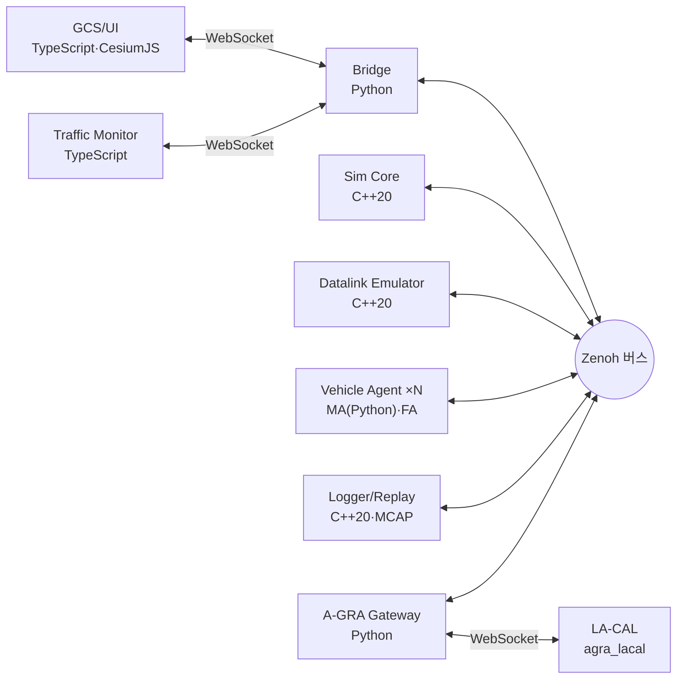

# SwarmFlSim

군집/편대 알고리즘을 설계하고 검증하는 연구용 군집 무인항공기 시뮬레이터.

## 1. 목표
- 군집·편대 형성 알고리즘의 설계·검증 환경 제공
- 하위 유도/제어(FA)부터 상위 행동결정(MA)까지 계층별 교체·설계
- 데이터링크 불완전성(지연·손실·재밍)과 이종 기체 특성(센서·재머, 시뮬레이션 이벤트를 내는 임무장비) 반영
- A-GRA 구조 준용 → 이후 A-GRA 호환 MA 시험 환경으로 확장 (DEC-013)

## 2. 주요 기능
- **동역학**
  - 2/3/5/6-DoF 선택. 2·3-DoF는 알고리즘 시험용, 5·6-DoF는 실기체 모사용
    - 미구현: 5·6-DoF (로드맵 P3). 현재는 2·3-DoF만 쓸 수 있다
  - 고정 프레임(50–100 Hz) + 프레임 안의 가변 스텝 RK45 (RK4 선택 가능)
- **실행 모드**
  - 실시간 / 가속 lockstep(결정론적, 시드 고정) / free-run (DEC-005)
- **데이터링크**
  - 모든 기체 간·지상-기체 간 메시지가 Datalink Emulator를 거침
  - 지연·지터·손실·대역폭, 재밍 영역, 개별 기체 두절
- **UI**
  - CesiumJS 2D/3D 지도, RTS식 선택·명령, 시나리오 편집
    - 미구현: UI의 시나리오 편집. 시나리오는 JSON으로 쓰고 `swarm-scenario`로 검증한다
  - Traffic Monitor: 엔티티별 메시지 트래픽 (실시간·재생)
- **기록·재생**: 전 채널 MCAP 기록과 버스 재송출
- **규모**: 20대 필수, 수백 대까지 확장, 이종 컴퓨터 분산 실행
  - 확인 안 됨: 여러 PC 분산 실행과 수백 대 규모 (로드맵 P4). 단일 PC에서 시연했다
- **센서·재머·시뮬레이션 이벤트**: 카메라 탐지, 재밍 구역, 유도 객체의 발사·도달 판정 (WP8, Core 내장)
- **A-GRA Gateway**: GCS가 받은 상태를 UCI 메시지로 LA-CAL에 내보내고, 외부 C2 명령 일부를 받는다 (WP9, DEC-068)

## 3. 아키텍처



- **통신**: Zenoh만 사용, DDS 미사용 (DEC-002). 프로세스는 `open_bus`로 버스를 연다 (DEC-026)
- **브라우저**: WebSocket 브리지로만 버스에 접속 (DEC-027)
- **채널 분리**
  - `swarm/**`: 기체 간·지상-기체 간 메시지 (tx → Datalink → rx)
  - `sim/**`: 시뮬레이션 통제·시간 동기
  - `truth/**`: 실제 상태. UI·Monitor·Logger·Datalink가 구독하고 기체 에이전트는 접근 불가
- **A-GRA 경계**: MA는 L1 포트(C2/VI/MS/MP/MD/P2P)로만 통신 (DEC-013)

## 4. 디렉터리

| 디렉터리 | WP | 내용 |
|---|---|---|
| `proto/`, `api/`, `bus/`, `scripts/`, `docs/` | WP0 | Protobuf 스키마, 키 체계, 플러그인 API, 공용 버스, 문서 |
| `core/` | WP1 | 프레임 스케줄러, 엔티티 저장소, lockstep |
| `dynamics/` | WP2 | DoF 모델, 적분기, 지면 판정 |
| `agent/`, `algorithms/` | WP3 | Agent 런타임, 기본 FA·편대 알고리즘 |
| `datalink/` | WP4 | 링크·재밍 모델, 전달 사유 태깅 |
| `ui/`, `bridge/` | WP5 | 지도·통제 UI, WebSocket 브리지 |
| `ui/monitor/` | WP6 | Traffic Monitor |
| `scenario/`, `logger/` | WP7 | 시나리오 JSON Schema, MCAP 기록·재생 |
| `payload/` | WP8 | 센서·재머·유도 객체 판정 라이브러리(Core가 프레임마다 호출), 기본 프로파일 |
| `gateway/` | WP9 | A-GRA Gateway(UCI 변환, LA-CAL 연동). 독립 uv 프로젝트 |
| `third_party/agra_lacal` | WP9 | LA-CAL 서브모듈(수정하지 않음, DEC-069) |
| `qa/` | QA | 시험 하니스, 고장 주입, 결정성 진단 |
| `examples/plugins/` | — | 플러그인 예제 패키지. MA 3종, FA 1종 (DEC-070) |

## 5. 기술 스택

| 영역 | 언어·도구 |
|---|---|
| Core·Datalink·Logger·Payload | C++20, CMake, vcpkg / MSYS2 / 배포판 패키지 |
| Agent 플러그인·Bridge·시나리오·Gateway | Python 3.12, uv |
| UI·Monitor | TypeScript, Vite, CesiumJS |
| 메시지 | Protobuf |

## 6. 빌드와 시험
- 상세 설치 절차: [docs/10_contracts.md §7](docs/10_contracts.md)
- CMake 프리셋: `msvc-*`(vcpkg), `mingw-*`(MSYS2 UCRT64), `linux-*` (DEC-022)

```bash
cmake --preset <preset>
```

```bash
cmake --build --preset <preset>
```

```bash
ctest --preset <preset>
```

```bash
uv sync
```

```bash
uv run python scripts/gen_proto.py
```

```bash
uv run pytest
```

- 통합 데모 실행: [docs/20_p0_demo.md](docs/20_p0_demo.md)

## 7. 로드맵

| 단계 | 내용 | 상태 (2026-11-09) |
|---|---|---|
| P0 | 2-DoF + 2D UI 골격 | 완료 |
| P1 | 3-DoF + 편대 + Traffic Monitor | 기능 구현 |
| P2 | 데이터링크·재밍 | 부분 (링크 상실 행동 미구현) |
| P3 | 5/6-DoF + RK45 | 부분 (RK45·RK4만, 5·6-DoF 미구현) |
| P4 | 분산 실행 | 미착수 |
| P5 | 임무장비·표적 (센서·재머·시뮬레이션 이벤트) | 기능 구현 |
| P6 | A-GRA Gateway | 완료 (DEC-074, 미결 항목은 개괄 §8) |
| P7 | A-GRA L1 전면 준수 | 미착수 |
| P8 | PX4/ArduPilot SITL 연동 | 미착수 |

- 상태의 근거와 완료 기준: [docs/40_overview.md §8](docs/40_overview.md#8-진행-상태)

## 8. 문서

| 문서 | 내용 |
|---|---|
| [00_proposal.md](docs/00_proposal.md) | 제안 계획서: 아키텍처, 모델, WBS, 로드맵 |
| [01_id_convention.md](docs/01_id_convention.md) | ID 규칙 (REQ / PRP / OPN / DEC / IMP / TC) |
| [02_registry.md](docs/02_registry.md) | 요구·제안·미결정·결정사항 등록부 |
| [03_traceability.md](docs/03_traceability.md) | 추적 매트릭스 |
| [10_contracts.md](docs/10_contracts.md) | WP0 계약: 스키마, 버스 키, 플러그인 API, 빌드 |
| [11_wp_briefs.md](docs/11_wp_briefs.md) | WP 세션 지시문 |
| [20_p0_demo.md](docs/20_p0_demo.md) | 통합 데모 구성·실행 |
| [21_qa_report.md](docs/21_qa_report.md) | QA 시험 결과 |
| [30_doc_plan.md](docs/30_doc_plan.md) | 매뉴얼 작성 계획 |
| [31_doc_changelog.md](docs/31_doc_changelog.md) | 문서 변경 기록: 병합별 매뉴얼 영향과 반영 상태 |
| [40_overview.md](docs/40_overview.md) | 프로젝트 개괄: 목적, 현재 기능, 구성, 처음 실행, 진행 상태 |
| [41_dev/](docs/41_dev/README.md) | 개발자 매뉴얼: 환경, 빌드, 플러그인 작성, WP별 기여 안내 |
| [42_user/](docs/42_user/README.md) | 사용자 매뉴얼: 시나리오, 실행, UI 조작, 기록·재생 |
| [en/](docs/en/README.md) | 영문판 (목차만 있다. 본문은 국문에서 옮기는 중) |

## 9. 개발 규칙
- 모든 구현은 REQ 또는 DEC에 연결하고 `IMP-*`·`TC-*` ID를 부여한다
- 커밋 메시지에 관련 ID를 적는다. 예: `IMP-CORE-003: RK45 적분기 추가 (REQ-DYN-004, DEC-005)`
- 계약(`proto/`, `api/`, `bus/`, `docs/10_contracts.md`) 변경은 WP0을 거친다
- 참고 표준 자료는 `../open_arsenal/`에 둔다. A-GRA 배포 제한(Distribution D) 내용은 저장소에 옮기지 않는다
