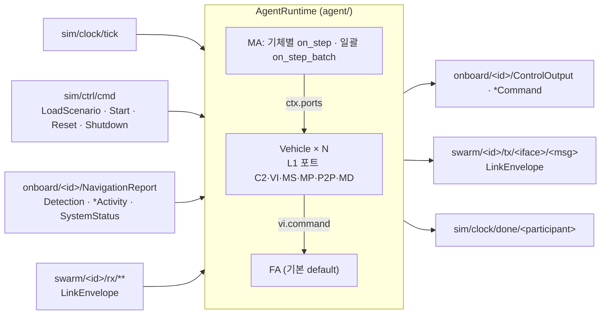

# WP3 Vehicle Agent 런타임 추적표 (모듈 AGT)

- 패키지 `swarm-agent`, 실행 파일 `swarm-agent`. 한 프로세스가 여러 기체를 호스팅한다.
- 기본 MA 플러그인은 `algorithms/`(IMP-AGT-011~018·020, TC-AGT-014~025·028)에 있다.

## 구성



- 틱 N 처리: 수신 버퍼 넘김·ctx 갱신 → MA(기체 ID 순, 일괄 MA는 플러그인 이름 순) → FA(틱 N 이전에 항법 보고를 받은 기체만) → ControlOutput 발행 → lockstep이면 FrameDone(N).
- threaded(Zenoh) 모드는 틱(N)을 받았을 때 항법 보고(N)가 덜 왔으면 최대 50 ms 기다린다. Zenoh는 키마다 다른 스레드에서 콜백을 부르므로 Core가 보고를 먼저 보내도 틱이 먼저 도착할 수 있다. 기다리는 기체는 아직 보고가 없거나 직전 프레임까지 보고한 기체다(파괴된 기체는 한 번만 기다린다).
- 수신 버퍼는 이중 버퍼다. 프레임 사이에 도착한 메시지는 다음 프레임 시작 때 inbox로 넘어가고, 읽지 않은 것은 그다음 프레임에 버린다.
- 런타임은 `sim/ctrl/cmd`를 읽지만 어떤 포트로도 넘기지 않는다. `truth/**`, `link/**`는 구독하지 않는다 (DEC-013, DEC-014, PRP-SIM-003).
- 맡는 기체: `--entities`가 있으면 그 기체, 없으면 `AutonomySpec`(ma_plugin 또는 fa_plugin)이 있는 기체. MA가 비면 `hold`, FA가 비면 `default`.
- 난수: `ctx.rng = default_rng([seed, crc32(entity_id)])`. seed는 시나리오 `run.seed`, 첫 프레임 전에 `Start.seed`(≠0)가 오면 그것.
- C2 송신 dst는 `controlling_gcs`(없으면 버리고 경고). P2P `to=None`은 dst를 비운다(브로드캐스트). 내부 메시지 `header`의 빈 항목(source, frame, sim_time_us, seq)은 런타임이 채운다.
- 시나리오는 `LoadScenario.scenario`로 받는다. `--scenario <file>`(.pb, proto JSON, 시나리오 JSON)은 `swarm_core --scenario`로 시작해 LoadScenario가 버스에 나오지 않을 때 쓴다.

## IMP

| ID | 내용 | 위치 | 근거 | 시험 결과 |
|---|---|---|---|---|
| IMP-AGT-001 | 평면 근사 좌표 변환(북·동 오프셋, 역변환, 각 정규화), 스칼라·NumPy 공용 | `src/swarm_agent/geo.py` | DEC-006 | Pass (TC-AGT-001~003) |
| IMP-AGT-002 | 메시지 이름 ⇄ 클래스(디스크립터 풀, swarm.v1만), 인코딩, header 빈 항목 채우기 | `src/swarm_agent/messages.py` | PRP-NET-003 | Pass (TC-AGT-009) |
| IMP-AGT-003 | L1 포트 구현 C2·VI·MS·MP·P2P·MD, 프레임 이중 버퍼, MP 자기 작업·편대 필터와 링크 갱신, MS 잔량 갱신, MS 명령 → onboard | `src/swarm_agent/ports.py` | DEC-013, PRP-BHV-001 | Pass (TC-AGT-008, TC-AGT-009) |
| IMP-AGT-004 | Vehicle: 포트·AgentContext·FA·항법 상태 보관, 송신 header·seq | `src/swarm_agent/vehicle.py` | DEC-013 | Pass (TC-AGT-006, TC-AGT-009) |
| IMP-AGT-005 | 플러그인 로딩: entry point `swarm.ma`/`swarm.fa` 등록명, 기본값(hold/default), 시험용 덮어쓰기 | `src/swarm_agent/plugins.py` | PRP-BHV-001, REQ-BHV-004 | Pass (TC-AGT-006) |
| IMP-AGT-006 | AgentRuntime: LoadScenario·Start·Reset·Shutdown, 호스팅 선택, 기체별·일괄 MA 호출(NavBatch), FA step, onboard·rx 수신, LinkEnvelope 송신(C2 → controlling_gcs), lockstep FrameDone, threaded 모드 항법 보고 대기(틱 보류, 50 ms 기한), 시드 고정 rng, 플러그인 예외 격리, 처리 시간 통계, threaded(Zenoh)·동기(InMemory) 모드 | `src/swarm_agent/runtime.py` | DEC-005, DEC-006, DEC-013, DEC-014, PRP-BHV-002, PRP-SIM-002 | Pass (TC-AGT-006~011, TC-AGT-013) |
| IMP-AGT-007 | 기본 FA `default`: HSA·Waypoint·Orbit 유도(직행, 벡터장), 침로 비례 선회율(최대 뱅크 제한)·고도 비례 상승률, KinematicCmd에 heading_rate와 협조선회 bank를 함께 채움(2/3-DoF 공용), 상태 ACCEPTED·REJECTED·EXECUTING·COMPLETED·CANCELLED, 완료 후 마지막 점 선회, 같은 command_id 갱신 | `src/swarm_agent/fa.py` | PRP-GNC-001, REQ-GNC-001, REQ-DYN-001 | Pass (TC-AGT-001~005) |
| IMP-AGT-008 | 실행 파일 `swarm-agent`: `--participant`, `--entities`, `--scenario`, `--frames`, `--list-plugins`, 공통 버스 옵션(`--bus`, `--zenoh-config`, `--zenoh-mode`, `--connect`, `--listen`, `--no-multicast`), 종료 시 처리 시간 출력 | `src/swarm_agent/cli.py` | DEC-026 | Pass (TC-AGT-012, 수동 시험) |
| IMP-AGT-009 | 시험 도구: 가짜 Core(2-DoF 운동학, truth·NavigationReport·tick 발행), 가짜 Datalink(tx → rx 즉시, 손실 함수), 시나리오 생성기, Harness, 일치 판정 캐시 InMemoryBus | `src/swarm_agent/testing.py` | DEC-015 | Pass (시험 전체) |
| IMP-AGT-010 | FA·런타임 성능 측정 스크립트 | `bench/bench_fa.py` | REQ-PRF-001, REQ-PRF-002 | 아래 측정값 |
| IMP-AGT-019 | 기본 FA 레이스트랙(`CurveCommand.racetrack`, DEC-034): 반경 R 두 원 + 접선 직선 두 개의 폐경로. 매개변수 `racetrack_guidance` = `dubins`(기본: 원 구간 벡터장 + 직선 구간 횡오차 진입각 `ψ − χ∞·(2/π)·atan(k·e)`) 또는 `vector_field`(MATLAB `reference/racetrack_vectorfield.m`: 원 구간 수렴+접선 합성장, 직선 구간 `χ∞ = atan2(10R, L)`, `atan(k·√|e|)`). 구간은 축 방향 투영으로 나눈다. 반경 ≤ 0·길이 < 0 REJECTED | `src/swarm_agent/racetrack.py`, `src/swarm_agent/fa.py` | REQ-GNC-001, REQ-BHV-002, DEC-034 | Pass (TC-AGT-026, TC-AGT-027) |
| IMP-AGT-021 | 기체별 매개변수 런타임(DEC-035): `ParamSet`이 기본값 → 시나리오 → 실행 중 `SetParams` 순으로 값을 정한다(`resolve_params`). `sim/ctrl/cmd`의 `set_params`는 자기 기체의 FA·MA 소유자만 받아 다음 프레임 시작에 적용하고 `on_params`로 알린다. 적용·거부(unknown/type/range/not_runtime)를 `EntityParams`로 `sim/param/<기체>/<fa|ma>`에 게시(적재 직후·변경 직후·벽시계 1 s마다). 기본 FA는 `PARAMS` 14개(기체 한계 5개 `runtime=False`, 제어 2개, 유도 7개)를 선언. `PARAMS`가 없는 플러그인은 시나리오 값을 그대로 받고 실행 중 변경은 모두 unknown | `src/swarm_agent/params.py`, `runtime.py`, `vehicle.py`, `fa.py` | REQ-CFG-003, DEC-035 | Pass (TC-AGT-029~035) |
| IMP-AGT-023 | 시나리오 구독 적재(DEC-037): `sim/ctrl/scenario`를 구독해 `LoadScenario`를 받지 못해도 적재. 이미 적재한 시나리오와 `name`이 같으면 무시, 다르면 다시 적재. 적재 직후 lockstep이면 `sim/clock/done/<participant>`에 `FrameDone{frame=0}` 준비 신호 | `src/swarm_agent/runtime.py` | DEC-037, DEC-025 | Pass (TC-AGT-036, TC-AGT-037) |
| IMP-AGT-024 | 입력 검증(DEC-038, QA-002·QA-005): 매개변수 NaN·inf는 `range`로 거부(`ParamSet.load/change`, 선언 유무와 무관), `Struct` 변환은 비유한 값에서도 예외를 내지 않음, `AgentRuntime.handle`이 예외를 격리해 로그로 남기고 계속 처리(strict면 다시 던짐). 임무 값 검증(`invalid_reason`): 빈 task_id, 임무 메시지의 모든 실수 필드(중첩·반복 포함)를 `non_finite_field`로 한 곳에서 유한성 검사(QA-014), 지도 밖·비유한 좌표, 고도 0..30000 m, 속도·반경·시간·레이스트랙 범위, 경로 점 200개·다각형 꼭짓점 100개 상한을 `TaskStatus` REJECTED(사유)로 거부. 빈 `assignees`는 받은 기체마다 REJECTED. 같은 `task_id`는 이전 임무를 대체(취소 보고 없음) | `src/swarm_agent/params.py`, `src/swarm_agent/runtime.py`, `../algorithms/src/swarm_algorithms/common.py` | DEC-038, DEC-035, DEC-033 | Pass (TC-AGT-038~043) |
| IMP-AGT-026 | lockstep 수신 결정성(DEC-040): `run.participants` 중 `datalink`로 시작하는 참여자의 `FrameDone{f}`를 받을 때까지 틱 f+1을 보류 틱으로 두고(콜백은 막지 않음, 첫 틱 전 frame 0은 준비 신호로 무시), rx는 `rx_time_us <= 틱 시각`인 것만 (rx_time, source, seq) 순으로 틱 시작에 소비한다. realtime·free-run은 즉시 소비 | `src/swarm_agent/runtime.py` | DEC-040, DEC-005, DEC-039 | Pass (TC-AGT-044~046) |
| IMP-AGT-027 | lockstep rx 소비 상한을 이전 틱 시각으로 변경(QA-016, DEC-005·039·040): 틱 f는 Datalink가 그 틱의 rx를 내는 중일 수 있으므로 FrameDone{f-1}이 보장하는 시각(틱 f-1)까지만 소비. 계약 문구(`rx_time_us <= t`)와 달라 OPN-037 → DEC-045로 확정 | `src/swarm_agent/runtime.py` | DEC-005, DEC-040, DEC-045 | Done |
| IMP-AGT-028 | 송신 개수 장벽(DEC-044): lockstep FrameDone{f}에 기체별 `swarm/<e>/tx/**` 누적 발행 수를 `sent_count`로 싣고, 틱 f+1은 Datalink FrameDone{f}에 더해 자기 기체의 `swarm/<e>/rx/**` 누적 수신 수가 그 `sent_count[e]` 이상일 때 처리. 자기 기체가 아닌 e·빈 값은 기다리지 않고 realtime·free-run은 영향 없음. IMP-AGT-027 소비 조건은 유지 | `src/swarm_agent/runtime.py` | DEC-044, DEC-040, QA-016 | TC-AGT-047~050 Pass |
| IMP-AGT-029 | 임무장비 상태 자동 보고(DEC-051): 자기 기체의 `onboard/<id>/{Sensor,Jammer,Strike}Activity`를 (메시지, payload_id)별로 보관하고, 헤더를 뺀 값이 바뀌면 다음 틱 시작에, 모의 시간 1 s 경계마다 전체를 `swarm/<id>/tx/ms/<Msg>`로 GCS(`controlling_gcs`, 없으면 시나리오의 첫 GCS)에 보냄. 송신은 틱 처리 안에서 하므로 `sent_count`에 포함(DEC-044). MA 플러그인과 무관 | `src/swarm_agent/runtime.py` | DEC-051, DEC-044, QA-020 | TC-AGT-051~054 Pass |
| IMP-AGT-030 | 임무장비 상태 변화 보고 최대 빈도(DEC-056): 키별 마지막 송신 모의 시각을 두고 간격이 `round(1e6/activity_max_hz)` µs 미만이면 미뤘다가 다음 허용 틱에 그때 최신 값으로 보냄. 기본 10 Hz, CLI `--activity-max-hz`, 0 이하면 제한 없음. 1 s 경계 전체 보고는 제한과 별개(보낸 시각은 갱신). 판단은 모의 시간이라 결정적 | `src/swarm_agent/runtime.py`, `src/swarm_agent/cli.py` | REQ-PAY-002, DEC-056, DEC-051 | TC-AGT-051, 055~058 Pass |
| IMP-AGT-031 | 무장별 보고 키(DEC-063): `StrikeActivity` 키를 (메시지, payload_id, weapon_entity)로 분리(비면 "" 그대로), Sensor·Jammer는 (메시지, payload_id). 10 Hz 상한은 새 키별. 종료 상태(IMPACT·MISSED·REJECTED)를 한 번 보낸 키는 상태 저장소에서 지워 1 Hz 전체 보고에서 빠지고, 그 송신 시각도 상한 간격이 지나면 버림. QA-026(같은 프레임 두 무장 변화 중 하나 누락) 해소 | `src/swarm_agent/runtime.py`, `src/swarm_agent/cli.py` | REQ-PAY-002, DEC-063, QA-026 | TC-AGT-059~062 Pass |
| IMP-AGT-032 | 기체 VI 상태 GCS 자동 보고(DEC-071): 틱 시작(begin_frame 뒤, MA 전)에 `swarm/<id>/tx/vi/<Msg>`로 GCS(DEC-051과 같은 대상·LinkEnvelope·tx 키별 seq)에 보냄. 값의 출처: `FlightCapability`는 `Vehicle.capability`(FA `on_init` 반환)로 첫 틱 1회, `NavigationReport`는 `onboard/<id>/NavigationReport`의 최신 값을 `round(1e6/vi_report_hz)` µs 경계마다(기본 1 Hz, CLI `--vi-report-hz`, 0 이하면 끔), `SystemStatus`는 `onboard/<id>/SystemStatus`를 받을 때, `FlightCommandStatus`는 `VIPort.push_status`(FA `on_command`·`pending_status` 모두 거침)에서 가로채지 않고 복사해 command_id별 변화 보고. 변화 보고는 `--activity-max-hz` 키별 상한(DEC-056)과 최신 값 보내기, 종료 명령 상태(REJECTED·COMPLETED·FAILED·CANCELLED)를 보낸 키는 지움. 주기 전체 보고는 없음. 키별 추적은 `reporting.ChangeReporter`로 묶고 임무장비 보고(IMP-AGT-029~031)도 같은 클래스로 옮김. MA 플러그인과 무관 | `src/swarm_agent/reporting.py`, `runtime.py`, `vehicle.py`, `ports.py`, `cli.py` | DEC-071, OPN-064, DEC-056, DEC-044 | TC-AGT-049, 063~069 Pass |
| IMP-AGT-033 | 비행 명령 갱신의 상태 역행 방지(D-28): 같은 `command_id`·종류로 갱신하면 `on_command`가 수행 중에는 EXECUTING, 수행 전에는 ACCEPTED를 돌려줌. 새 ID·종류 변경·REJECTED 처리는 그대로. 파이썬 FA 구현은 `DefaultFlightAutonomy`뿐이라 다른 곳은 고칠 것이 없음 | `src/swarm_agent/fa.py` | D-28, DEC-071 | TC-AGT-070~074 Pass |

## TC

`uv run pytest agent/tests`

| ID | 내용 | 위치 | 근거 | 결과 |
|---|---|---|---|---|
| TC-AGT-001 | HSA 침로·속도·고도 수렴, 명령 전 첫 상태 유지, 일부 항목만 준 HSA | `tests/test_agent_fa.py` | IMP-AGT-007 | Pass |
| TC-AGT-002 | Waypoint 3점 순차 통과(수락 반경 또는 최소 선회 반경 안), EXECUTING → COMPLETED, 마지막 점 2·R_min 선회, 고도 | `tests/test_agent_fa.py` | IMP-AGT-007 | Pass |
| TC-AGT-003 | Orbit 반경 400 m ±5% 수렴, CW·CCW 방향 | `tests/test_agent_fa.py` | IMP-AGT-007 | Pass |
| TC-AGT-004 | 모드 없음·빈 경유점·반경 0 REJECTED, 다른 명령으로 바꾸면 이전 것 CANCELLED, 같은 command_id 갱신은 상태 없음 | `tests/test_agent_fa.py` | IMP-AGT-007 | Pass |
| TC-AGT-005 | 속도 제한, 최대 뱅크 제한, bank = atan(V·ψ̇/g), 3-DoF(bank) 해석으로도 같은 침로 수렴 | `tests/test_agent_fa.py` | IMP-AGT-007, REQ-DYN-001 | Pass |
| TC-AGT-006 | AutonomySpec 있는 기체만 호스팅, `--entities` 지정, entry point로 hold/default 로딩, 일괄 MA 한 인스턴스, 모든 기체 ControlOutput(같은 프레임), NavBatch 행 = 기체 | `tests/test_agent_runtime.py` | IMP-AGT-004~006 | Pass |
| TC-AGT-007 | lockstep 틱마다 `sim/clock/done/agent-0`에 FrameDone(같은 frame), ControlOutput이 FrameDone보다 먼저, 기체 없어도 FrameDone, REALTIME에서는 보내지 않음, threaded 모드에서 틱이 항법 보고보다 먼저 와도 모든 기체 출력(보고가 오면 바로, 끝내 안 오면 기한 뒤 처리) | `tests/test_agent_runtime.py` | IMP-AGT-006, DEC-005 | Pass |
| TC-AGT-008 | 런타임 구독이 `truth/**`·`link/**`와 겹치지 않고 처리한 키에도 없음, sim/ctrl·truth 메시지가 포트로 들어오지 않음, 포트에 버스 참조 없음 | `tests/test_agent_runtime.py` | IMP-AGT-003, IMP-AGT-006, DEC-013, PRP-SIM-003 | Pass |
| TC-AGT-009 | LinkEnvelope 송신(키, dst, iface, msg_type, header, seq, 인코딩), 수신 해제(C2·P2P inbox), 모르는 msg_type·자기 송신 버림, GCS 수신, Detection·Activity·잔량, MS 명령 키, MP 필터·RoutePlan 링크 갱신, MD 기록 | `tests/test_agent_runtime.py` | IMP-AGT-002~004, IMP-AGT-006 | Pass |
| TC-AGT-010 | 결정론: 같은 시드 두 번 실행의 ControlOutput 바이트열 일치(flocking + ctx.rng 흔들기), 다른 시드는 다름, Start.seed 적용 | `tests/test_agent_runtime.py` | IMP-AGT-006, DEC-005 | Pass |
| TC-AGT-011 | 플러그인 예외 격리(FA는 계속 출력), Reset 후 재구성, Shutdown | `tests/test_agent_runtime.py` | IMP-AGT-006 | Pass |
| TC-AGT-012 | 명령행·버스 옵션 해석, 시나리오 파일 .pb·proto JSON·시나리오 JSON(예제 20대 flocking_basic 호스팅), `--list-plugins` | `tests/test_agent_runtime.py` | IMP-AGT-008 | Pass |
| TC-AGT-013 | Zenoh(open_bus, 멀티캐스트 끔) threaded 런타임: LoadScenario → 5틱 → ControlOutput 10개, FrameDone 0~4. 25회 반복 통과 | `tests/test_agent_runtime.py` | IMP-AGT-006, DEC-026 | Pass |
| TC-AGT-026 | 레이스트랙 기하: 경로 오차(원 위·직선 위 0, 중심 R), 경로 위 점에서 침로가 접선(CW·CCW, dubins·vector_field), 안쪽 점은 바깥쪽·바깥쪽 점은 안쪽으로 | `tests/test_agent_racetrack.py` | IMP-AGT-019 | Pass |
| TC-AGT-027 | 레이스트랙 수렴: 서로 다른 초기점·침로·축·방향 4가지 × dubins·vector_field. 400 s 뒤 100 s 동안 경로 오차 < 40 m, 침로와 경로 접선 차 < 30°, 고도 수렴 | `tests/test_agent_racetrack.py` | IMP-AGT-019 | Pass |
| TC-AGT-029 | 기본값·게시: 시나리오 매개변수 없이 FA·MA 기본값 적용, `EntityParams` 소유자·플러그인·계층·runtime·최소/최대/기본값, 기체마다 fa·ma 키로 게시 | `tests/test_agent_params.py` | IMP-AGT-021 | Pass |
| TC-AGT-030 | 시나리오 재정의와 거부: 값 덮어쓰기, 미선언 이름 unknown, 범위 밖 range, 타입 불일치 type은 기본값 유지 | `tests/test_agent_params.py` | IMP-AGT-021 | Pass |
| TC-AGT-031 | 실행 중 변경(FA): k_heading·racetrack_guidance 즉시 반영, 다른 기체 불변, 변경 직후 재게시 | `tests/test_agent_params.py` | IMP-AGT-021 | Pass |
| TC-AGT-032 | 거부 사유 4종(not_runtime·range·type·unknown) + 같은 명령의 유효 항목은 적용, 다음 변경에서 거부 목록 갱신, 다른 기체·Dynamics 소유자 명령 무시 | `tests/test_agent_params.py` | IMP-AGT-021 | Pass |
| TC-AGT-033 | MA 실행 중 변경과 `on_params` 전달, 벽시계 1 s 주기 게시, `PARAMS` 미선언 플러그인(시나리오 값 통과, 변경 unknown) | `tests/test_agent_params.py` | IMP-AGT-021 | Pass |
| TC-AGT-034 | 4개 MA(flocking·formation·hold·waypoint) `PARAMS` 선언과 `on_params` 반응(flocking 기체별 값, formation 이득·시한, hold 재명령) | `tests/test_agent_params.py` | IMP-AGT-022 | Pass |
| TC-AGT-035 | 열거형 매개변수(DEC-036): `racetrack_guidance`의 `ParamSpec.choices` 게시, 시나리오·실행 중 잘못된 값은 `choice`로 거부(기본값 유지, 예외 없음), 유효한 값은 적용 | `tests/test_agent_params.py` | IMP-AGT-021 | Pass |
| TC-AGT-036 | `sim/ctrl/scenario`만으로 적재, 같은 name 재발행은 무시(기체 객체 유지), 다른 name은 다시 적재 | `tests/test_agent_scenario_feed.py` | IMP-AGT-023 | Pass |
| TC-AGT-037 | lockstep 적재 직후 `FrameDone{frame=0}` 1회, 같은 name은 재전송 없음, 다시 적재하면 재전송, free-run은 보내지 않음. (TC-AGT-013은 첫 done이 준비 신호임을 반영) | `tests/test_agent_scenario_feed.py` | IMP-AGT-023 | Pass |
| TC-AGT-038 | MA·FA 매개변수의 NaN·inf(실행 중 SetParams, 시나리오 값)가 `range`로 거부되고 프로세스·기존 값 유지, 이어지는 정상 변경 적용 | `tests/test_agent_params.py` | IMP-AGT-024 | Pass |
| TC-AGT-039 | 해석할 수 없는 페이로드(`sim/ctrl/cmd`, `sim/ctrl/scenario`, `sim/clock/tick`)에도 런타임이 살아 있고 이후 SetParams 처리 | `tests/test_agent_params.py` | IMP-AGT-024 | Pass |
| TC-AGT-040 | 잘못된 임무 값(alt inf·음수·100 km, lat 200, lon NaN, 지도 밖·0/0, 속도·반경·시간 NaN, 반경 1e9, 레이스트랙 축 NaN·999, 경로 500점, 경로 NaN, 다각형 2점 등)과 빈 task_id가 REJECTED(사유). 경계값 수용, 다른 기체 대상 명령 무시, flocking 공유, 레이스트랙 leg 0은 ACCEPTED→EXECUTING | `../algorithms/tests/test_alg_validation.py` | IMP-AGT-024 | Pass |
| TC-AGT-041 | 빈 `assignees`: 받은 기체 전원이 REJECTED("empty assignees"), 비행 계속 | `../algorithms/tests/test_alg_validation.py` | IMP-AGT-024 | Pass |
| TC-AGT-042 | 같은 task_id 재전송은 이전 임무를 대체(취소 보고 없음, ACCEPTED 2회, 새 목적지로 비행) | `../algorithms/tests/test_alg_validation.py` | IMP-AGT-024 | Pass |
| TC-AGT-043 | 경로 NaN·hold 반경 NaN이 waypoint·formation·flocking 모두에서 REJECTED(사유), 사유에 필드 경로 표시(`route.waypoints[0].position.lat_deg not finite`), flocking의 Route는 `unsupported task route` 사유 그대로 전달(DEC-039 (3)) | `../algorithms/tests/test_alg_validation.py` | IMP-AGT-024 | Pass |
| TC-AGT-044 | lockstep에서 틱 t의 rx는 틱 t+1에서 소비(이전 틱 시각까지만) | `tests/test_agent_lockstep_rx.py` | IMP-AGT-026, IMP-AGT-027 | Pass |
| TC-AGT-045 | Datalink 참여자가 있으면 FrameDone{f} 전에는 틱 f+1을 처리하지 않고, 도착하면 보류 틱 처리 + FrameDone{f}가 보장하는 틱 시각까지의 rx 소비, 중복 FrameDone은 다음 틱을 풀지 않음 | `tests/test_agent_lockstep_rx.py` | IMP-AGT-026, IMP-AGT-027 | Pass |
| TC-AGT-046 | realtime은 FrameDone 대기·rx_time 필터 없음 | `tests/test_agent_lockstep_rx.py` | IMP-AGT-026 | Pass |
| TC-AGT-047 | sent_count보다 rx가 적으면 보류하고 채워지면 보류 틱 처리 | `tests/test_agent_lockstep_rx.py` | IMP-AGT-028 | Pass |
| TC-AGT-048 | 다른 기체의 sent_count·빈 sent_count는 기다리지 않음 | `tests/test_agent_lockstep_rx.py` | IMP-AGT-028 | Pass |
| TC-AGT-049 | Agent FrameDone에 기체별 tx 누적 수가 실림(첫 틱 FlightCapability 자동 보고 포함, DEC-071) | `tests/test_agent_lockstep_rx.py` | IMP-AGT-028, IMP-AGT-032 | Pass |
| TC-AGT-050 | realtime은 sent_count 무시 | `tests/test_agent_lockstep_rx.py` | IMP-AGT-028 | Pass |
| TC-AGT-051 | 임무장비 상태가 바뀌면 다음 틱에 GCS로 보고, 헤더만 다른 같은 값은 다시 보내지 않음 | `tests/test_agent_activity_report.py` | IMP-AGT-029 | Pass |
| TC-AGT-052 | 모의 시간 1 s 경계마다 주기 보고 | `tests/test_agent_activity_report.py` | IMP-AGT-029 | Pass |
| TC-AGT-053 | 보고 송신이 FrameDone.sent_count에 반영 | `tests/test_agent_activity_report.py` | IMP-AGT-029 | Pass |
| TC-AGT-054 | GCS 링크 두절이면 Datalink(FakeDatalink)에서 손실되어 GCS에 닿지 않음 | `tests/test_agent_activity_report.py` | IMP-AGT-029 | Pass |
| TC-AGT-055 | 기본 10 Hz에서 매 틱 바뀌어도 같은 키의 변화 보고 간격 ≥ 0.1 s | `tests/test_agent_activity_report.py` | IMP-AGT-030 | Pass |
| TC-AGT-056 | 미룬 변화는 다음 허용 틱에 최신 값으로 한 번만 보냄(중간 값 생략) | `tests/test_agent_activity_report.py` | IMP-AGT-030 | Pass |
| TC-AGT-057 | 설정 반영: 0이면 매 틱 보고, 2 Hz면 간격 ≥ 0.5 s, CLI 기본 10·지정값 파싱 | `tests/test_agent_activity_report.py` | IMP-AGT-030 | Pass |
| TC-AGT-058 | 변화 보고 제한이 낮아도 1 s 경계 전체 보고는 유지 | `tests/test_agent_activity_report.py` | IMP-AGT-030 | Pass |
| TC-AGT-059 | 같은 프레임의 두 무장 변화(w01 IMPACT, w04 LAUNCHED)가 0 Hz·10 Hz 모두 GCS에 닿음 | `tests/test_agent_activity_report.py` | IMP-AGT-031 | Pass |
| TC-AGT-060 | 종료 키(IMPACT·MISSED·빈 weapon_entity REJECTED)는 한 번 보낸 뒤 전체 보고에서 빠지고 저장소·송신 시각이 비워짐 | `tests/test_agent_activity_report.py` | IMP-AGT-031 | Pass |
| TC-AGT-061 | 1 s 전체 보고는 비행 중인 무장 키만 다시 보냄 | `tests/test_agent_activity_report.py` | IMP-AGT-031 | Pass |
| TC-AGT-062 | 상한은 무장 키별: 새 무장 키는 바로, 같은 키의 다음 변화는 0.1 s 뒤 | `tests/test_agent_activity_report.py` | IMP-AGT-031 | Pass |
| TC-AGT-063 | 기본 1 Hz: 5 s 동안 기체마다 NavigationReport 5개(0~4 s 경계), tx 키별 seq 0~4 | `tests/test_agent_vi_report.py` | IMP-AGT-032 | Pass |
| TC-AGT-064 | `vi_report_hz` 0이면 NavigationReport 끔(FlightCapability는 나감), 5 Hz면 2 s에 10개, CLI 기본 1·`--vi-report-hz 0` 파싱 | `tests/test_agent_vi_report.py` | IMP-AGT-032 | Pass |
| TC-AGT-065 | SystemStatus는 바뀔 때만, 같은 값 재전송 없음, 10 Hz 상한으로 미룬 변화는 최신 값으로 0.1 s 뒤, 주기 재전송 없음 | `tests/test_agent_vi_report.py` | IMP-AGT-032 | Pass |
| TC-AGT-066 | FlightCommandStatus: MA 포트 명령과 FA pending_status(CANCELLED·EXECUTING) 모두 보고, command_id별 상한, 종료 키 정리, MA의 command_status는 그대로 받음 | `tests/test_agent_vi_report.py` | IMP-AGT-032 | Pass |
| TC-AGT-067 | FlightCapability는 기체마다 첫 틱(0 s)에 1회, 값은 FA on_init 반환과 같음 | `tests/test_agent_vi_report.py` | IMP-AGT-032 | Pass |
| TC-AGT-068 | MA 플러그인 hold·waypoint·flocking(일괄)·formation·legacy 모두 같은 VI 보고 | `tests/test_agent_vi_report.py` | IMP-AGT-032 | Pass |
| TC-AGT-069 | lockstep에서 같은 입력 두 번 실행 시 GCS가 받은 VI 보고(메시지·시각·seq·내용)가 같음 | `tests/test_agent_vi_report.py` | IMP-AGT-032 | Pass |
| TC-AGT-070 | 수행 중 같은 ID 갱신은 EXECUTING 유지, EXECUTING을 다시 내지 않음 | `tests/test_agent_fa_status.py` | IMP-AGT-033 | Pass |
| TC-AGT-071 | 수행 전 갱신은 ACCEPTED 유지, 첫 FA 단계에 EXECUTING | `tests/test_agent_fa_status.py` | IMP-AGT-033 | Pass |
| TC-AGT-072 | 새 ID는 이전 명령 CANCELLED 후 ACCEPTED, 같은 ID라도 종류가 바뀌면 ACCEPTED, REJECTED는 그대로 | `tests/test_agent_fa_status.py` | IMP-AGT-033 | Pass |
| TC-AGT-073 | flocking(매 프레임 같은 ID) 5 s: GCS가 받은 FlightCommandStatus가 command_id별로 역행·반복 없음 | `tests/test_agent_fa_status.py` | IMP-AGT-033, IMP-AGT-032 | Pass |
| TC-AGT-074 | lockstep에서 같은 입력 두 번 실행 시 GCS가 받은 FlightCommandStatus가 같음 | `tests/test_agent_fa_status.py` | IMP-AGT-033 | Pass |

시험 결과(2026-11-09): agent 80, algorithms 52 passed

## FA 성능 측정 (IMP-AGT-010)

`uv run python agent/bench/bench_fa.py --seconds 10`, Windows 11, CPython 3.12. NullBus(발행 버림)라 전송 비용은 빠진다. flocking 행은 P2P 전달이 없어 이웃 계산이 빈 상태다.

| 항목 | 20대 | 100대 | 300대 |
|---|---|---|---|
| FA step 1회 | 7.1 µs | | |
| 런타임 프레임 처리, MA hold (ms/프레임) | 0.156 | 0.767 | 2.247 |
| 그중 FA (step + ControlOutput 직렬화·발행) | 0.121 | 0.610 | 1.790 |
| 50 Hz 최대 배속(런타임만) | 128× | 26× | 8.9× |
| 런타임 프레임 처리, MA flocking (ms/프레임) | 0.456 | 1.785 | |

- Zenoh 실측(아래 수동 시험, 20대 flocking + P2P): 프레임 처리 p50 1.53 ms, p99 3.81 ms. MA 0.84 ms, FA 0.81 ms/프레임.
- 판단: FA는 기체당 약 6 µs(발행 포함)라 Python으로 둔다. REQ-PRF-002의 "3-DoF 100대 ≥10배"는 프레임 예산이 2 ms인데, 런타임 하나가 hold 0.77 ms, flocking 1.8 ms를 쓴다. 필요하면 `--entities`로 기체를 여러 호스트에 나눠 맞춘다. C++ 이식은 6-DoF 제어(액추에이터 출력)를 넣을 때 다시 측정해 정한다.

## 수동 시험: swarm_core와 Zenoh 연동 (2026-11-01)

- swarm_core: `wp0-contracts` 빌드(`build/msvc-debug/core/swarm_core.exe`, Zenoh 포함). 시나리오 `scenario/examples/korea_east_strike_20.json`을 `swarm-scenario export`로 .pb로 만들어 양쪽에 준다.
- 데이터링크: WP4 swarm_datalink가 아직 없어 `FakeDatalink`를 Zenoh 위에서 돌렸다(링크 모델 없음, 즉시 전달).
- 시작 순서: agent(listen) → 가짜 datalink(connect) → core(listen, connect agent) → 관측자(connect core, truth/state 구독). 멀티캐스트는 끈다.

```bash
uv run swarm-agent --scenario korea.pb --participant agent-0 --no-multicast --listen tcp/127.0.0.1:17461 --frames 6000
```

```bash
swarm_core --scenario korea.pb --autostart --mode lockstep --rate 0 --participant agent-0 --frames 6000 --no-multicast --listen tcp/127.0.0.1:17462 --connect tcp/127.0.0.1:17461
```

| 항목 | 결과 |
|---|---|
| 호스팅 | 20대(flocking_basic 일괄 MA 1개) |
| lockstep | 6000 프레임(120 s) 완료, Core overruns 0, 장벽 정지 없음 |
| 진행 속도 | 120 s 시뮬레이션에 벽시계 41.9 s(평균 2.9×). SimStatus rate_actual 2.7~6.1 |
| 군집 (alpha·bravo 각 10대) | 정렬도 0.991 → 0.997, 최대 간격 2181 → 1269 m, 최소 간격 525 → 88 m(분리 기준 80 m), 중심이 북동쪽 목표 방향으로 약 21 m/s 이동 |
| 생존 | 20대 모두 alive |

## 계약 변경 요청

1. MD 포트 메시지·키가 없다. `MDPort.record`는 지금 런타임 메모리에만 남는다. 제안: `swarm.v1.MetricRecord { Header header; string name; oneof value { double number; string text; } }`(SIM)를 `onboard/<id>/MetricRecord`로 발행해 Logger가 MCAP에 기록.
2. 고도 "미지정"을 표현할 수 없다. `Geodetic.alt_m`은 optional이 아니어서 MoveTo·Waypoint·Orbit에서 0이 "해수면"인지 "현재 고도 유지"인지 구분되지 않는다. 지금 FA는 `alt_m <= 0`을 "현재 고도 유지"로 해석한다. 제안: `MoveToTask`·`Waypoint`·`OrbitCurve`에 `optional double altitude_m`을 두거나, 이 해석을 §2 좌표 규칙에 적는다.
3. 늦게 붙은 참여자: `swarm_core --scenario`로 시작하면 LoadScenario가 버스에 나오지 않아 Agent도 같은 파일(`--scenario`)을 받아야 한다. 또 Core는 틱 N을 한 번만 발행하므로, 참여자가 그 뒤에 구독하면 장벽에서 멈춘다(지금은 Agent를 먼저 띄워 피한다). 제안: Core가 적재한 Scenario를 `sim/ctrl/scenario`(또는 LoadScenario 재발행)로 알리고, 장벽 대기 중에는 같은 틱을 주기적으로 다시 발행한다.
4. 문서 정정: `api/python/src/swarm_api/plugin.py`의 `FlightAutonomy` 설명은 "기본안은 C++(WP3)"인데, 2차 지시와 위 측정에 따라 기본 FA는 Python이다. `BatchMissionAutonomy` 설명의 "DEC-008: 기체는 데이터링크로 받은 정보만 본다"는 등록부상 PRP-SIM-003이다(DEC-008은 중앙·분산 의사결정).
