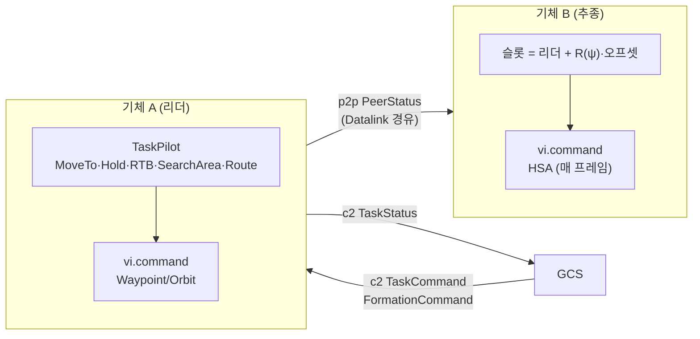

# WP3 기본 MA 플러그인 추적표 (모듈 AGT)

- 패키지 `swarm-algorithms`. entry point 그룹 `swarm.ma`에 `hold`, `waypoint`, `formation`, `flocking`, `flocking_basic`(예제 시나리오 이름, `flocking`과 같음), 시험·데모 전용 `approval_demo`(DEC-103, 기본 MA 아님)를 등록한다.
- 런타임과 시험 도구는 `agent/`(swarm-agent)에 있다. IMP·TC 번호는 `agent/TRACE.md`와 이어 쓴다.
- 모든 플러그인은 `ctx.ports`로만 송수신한다 (DEC-013). 다른 기체 상태는 P2P로 받은 `PeerStatus`만 쓴다 (PRP-SIM-003).

## IMP

| ID | 내용 | 위치 | 근거 | 시험 결과 |
|---|---|---|---|---|
| IMP-AGT-011 | 공용 부품: `TaskTracker`(MissionPlan 작업 순차, C2 TaskCommand 즉시 선점·취소·미지원 REJECTED, TaskStatus를 통제 GCS로), `TaskPilot`(MoveTo·RTB → Waypoint, Hold → 현재 위치 Orbit, FA COMPLETED → 작업 COMPLETED), `PeerStatus` 생성, 기체별 위상을 둔 주기 송신 | `src/swarm_algorithms/common.py` | REQ-BHV-001, REQ-BHV-002, DEC-013, DEC-014 | Pass (TC-AGT-015, TC-AGT-017) |
| IMP-AGT-012 | MA `hold`: 첫 항법 상태의 침로·속도·고도 유지(HSA). `orbit_radius_m` > 0이면 그 자리 선회 | `src/swarm_algorithms/hold.py` | REQ-BHV-004 | Pass (TC-AGT-014) |
| IMP-AGT-013 | MA `waypoint`: MissionPlan·C2의 MoveTo/Hold/RTB 수행과 상태 보고(ACCEPTED → EXECUTING → COMPLETED, 선점 CANCELLED), RoutePlan 경유점 비행 | `src/swarm_algorithms/waypoint.py` | REQ-BHV-002, REQ-BHV-004, PRP-GNC-001 | Pass (TC-AGT-015) |
| IMP-AGT-014 | MA `formation`: leader-follower. FormationCommand(C2) 또는 MissionPlan.formations, 모양 LINE·COLUMN·WEDGE·ECHELON·CIRCLE·CUSTOM, PeerStatus P2P 교환(리더 위치 외삽), 추종 속도장 v = v_L + k_p·(슬롯 − 자기)(보정 상한), 리더는 작업 수행, 슬롯 오차 MD 기록 | `src/swarm_algorithms/formation.py` | PRP-BHV-003, REQ-BHV-003 | Pass (TC-AGT-016~018) |
| IMP-AGT-015 | MA `flocking`: Reynolds 분리·정렬·응집 + 목표점(MoveTo·SearchArea 중심·RTB) 이동, `BatchMissionAutonomy`. 기체마다 자기 P2P inbox로 만든 이웃 표를 (N, M) 배열로 채워 NumPy로 한 번에 계산, 그룹 필터, `ctx.rng` 침로 흔들기 | `src/swarm_algorithms/flocking.py` | PRP-BHV-002, PRP-BHV-003, REQ-BHV-003, DEC-006 | Pass (TC-AGT-019, TC-AGT-010) |
| IMP-AGT-016 | 공용 `TaskPilot`을 구간(Leg) 상태 기계로 전환, Hold 매개변수(center 없으면 시작 위치·고도, radius 없으면 `hold_radius_m`, `duration_s` 0·없음 = 다음 명령까지 / 있으면 원 위 체류 후 COMPLETED, 방향 기본 CW). 같은 task_id는 CANCELLED 없이 교체, 빈 Route·반경 ≤ 0 Hold·모양 없는 SearchArea는 REJECTED. waypoint MA·편대 리더가 사용 | `src/swarm_algorithms/common.py` | REQ-BHV-002, REQ-UI-003, DEC-033 | Pass (TC-AGT-020, TC-AGT-024, TC-AGT-025) |
| IMP-AGT-017 | RouteTask: 항로점마다 goto(그 점의 alt_m·speed_mps·acceptance) + 행위 선회(Loiter: duration_s, Recon: 반경 원 1바퀴 이상 또는 duration_s), loop 반복, `TaskStatus.progress` = 마친 항로점 / 전체. SearchArea 원(다각형은 외접 원)은 정찰 원 1바퀴. 선회 반경은 최소 선회 반경 × 1.3 이상으로 보정. StrikeTask.aim_point는 REJECTED 유지 | `src/swarm_algorithms/common.py`, `waypoint.py`, `formation.py` | REQ-BHV-002, REQ-UI-004, DEC-033 | Pass (TC-AGT-021~025) |
| IMP-AGT-018 | flocking Hold: 중심·반경·방향의 접선 벡터장 선회, duration_s 체류 후 COMPLETED. Route는 REJECTED | `src/swarm_algorithms/flocking.py` | REQ-BHV-002, DEC-033 | Pass (TC-AGT-025) |
| IMP-AGT-020 | 레이스트랙 선회 대기(DEC-034): `HoldTask.racetrack`·`LoiterAction.racetrack`이 있으면 `TaskPilot`이 `CurveCommand.racetrack`을 FA에 보낸다(중심·반경·방향은 작업에서, duration 처리는 원형과 같고 체류 판정은 경로 오차). `leg_length_m < 0`은 REJECTED. flocking Hold는 vector_field 침로로 레이스트랙을 따른다 | `src/swarm_algorithms/common.py`, `flocking.py` | REQ-BHV-002, DEC-034 | Pass (TC-AGT-028) |
| IMP-AGT-022 | MA 플러그인 `PARAMS` 선언·`on_params`(DEC-035): hold(orbit_radius_m, 변경 시 재명령), waypoint(acceptance_m·hold_radius_m·speed_mps), formation(peer_hz·leader_speed_mps·k_p·corr_max_mps·leader_timeout_s·acceptance_m·hold_radius_m·group), flocking(기존 `_DEFAULTS` 11개 + group, 기체별 값). 계층은 행위·결정, `group`은 `runtime=False`. flocking `_DEFAULTS`는 `PARAMS`에서 만든다 | `src/swarm_algorithms/hold.py`, `waypoint.py`, `formation.py`, `flocking.py` | REQ-CFG-003, DEC-035 | Pass (TC-AGT-034, agent/tests/test_agent_params.py) |
| IMP-AGT-034 | 실행 중 받은 `MissionPlan` 반영(DEC-076, CR-GW-008): `PlanWatcher`가 MP 포트의 계획 중 처음 보는 `plan_id`만 내주고, `TaskTracker.update`와 `formation.on_step`이 틱마다 확인한다. 같은 `plan_id`는 내용이 달라도 무시. **새 `plan_id`는 교체**: C2 `TaskCommand`가 받는 즉시 현재 작업을 밀어내는 규칙(현재 작업 CANCELLED `preempted`, 같은 `task_id`면 취소 보고 없이 내용 교체)과 맞췄고, 계획은 순서가 있는 작업 묶음이므로 대기열도 새 계획으로 바꾼다(시작 전 작업도 CANCELLED). 이 기체 몫의 유효한 작업이 없는 계획은 C2의 다른 기체 명령·REJECTED처럼 현재 작업을 밀어내지 않는다. 지원하지 않거나 값이 잘못된 작업은 C2처럼 REJECTED(초기 계획도 IMP-AGT-050부터 REJECTED). 다른 기체 작업은 `MPPortImpl._own`이 거른다. 편대는 계획에 이 기체의 편대가 있을 때만 바꾼다. 틱 안에서 확인하므로 lockstep 결정성 유지. 포트는 최신 계획만 들고 있어 한 틱에 두 계획이 닿으면 마지막 것만 수행한다 | `src/swarm_algorithms/common.py`, `formation.py` | DEC-076, CR-GW-008, DEC-033, DEC-038 | TC-AGT-075~081 Pass |
| IMP-AGT-035 | RoutePlan과 작업의 관계(D-29, O-26): `waypoint`는 `RoutePlan`을 틱의 `pilot.step()` 뒤에 본다. **같은 ID의 계획 작업이 있으면 비행하지 않는다**: Gateway는 참조된 RoutePlan의 `route_id`를 `task_id`로 쓰므로(`gateway/.../converters/mp.py` `_route_to_task`) 그 작업이 수행하고, 도착 순서·같은 틱과 무관하게 COMPLETED로 끝난다. RoutePlan이 먼저 오면 뒤따른 계획이 같은 ID로 넘겨받는다. **계획에 없는 단독 RoutePlan**은 기존처럼 바로 비행하되 비행 명령을 직접 내지 않고 상태 보고 없는 작업(`TaskTracker.run_quiet`)으로 돈다. 근거: C2 `TaskCommand`가 받는 즉시 현재 작업을 밀어내는 규칙과 맞춰, 수행 중 작업은 CANCELLED(`preempted`)로 끝낸다(O-26: EXECUTING으로 남지 않음). 대기 작업은 C2처럼 그대로 두고 항로가 끝나면 잇는다. RoutePlan 자체의 TaskStatus는 지금처럼 없다. 값이 잘못된 RoutePlan은 현재 작업을 건드리지 않고 MD `route_plan_invalid`만 남긴다. 비행 명령 ID는 `<id>-route-<route_id>`에서 `<id>-task-<n>`으로 바뀐다 | `src/swarm_algorithms/waypoint.py`, `common.py` | D-29, O-26, DEC-076, DEC-033 | TC-AGT-082~087 Pass |
| IMP-AGT-038 | GCS 링크 상실 행동(DEC-078): `LinkMonitor`는 C2 포트의 `GcsHeartbeat`로만 판단한다(첫 수신 뒤 감시, 마지막 수신 후 `lost_link_timeout_s` 초과면 상실, 모의 시간). `LostLinkGuard`는 상실 순간 현재 작업의 `lost_link_policy`, 없으면 MA 변수로 정책을 정하고 선회 시작·재개를 알린다. 선회 중에는 작업 진행과 대기 작업 시작을 멈추고, 수락된 새 작업 명령은 링크 상태와 무관하게 선회를 끝낸다(취소는 아님). 재개는 중단한 구간과 체류 시간을 잇는다. `LOST_LINK_PARAMS`를 waypoint, formation, flocking, hold에 적용한다. formation 추종기는 MA 변수만 쓴다. 사용자 MA는 `LinkMonitor`만 쓰거나 `TaskPilot.enter_lost_link_hold`를 덮어쓸 수 있다. MD: `link_state`(lost, recovered), `lost_link_policy`, `lost_link_action`(hold, keep_hold, resume, command, continue). 선회 명령 ID는 `<기체>-lost-link-<n>` | `src/swarm_algorithms/common.py`, `waypoint.py`, `formation.py`, `flocking.py`, `hold.py` | DEC-078, DEC-013, DEC-039, DEC-045, REQ-LNK-003 | TC-AGT-095~113 Pass |
| IMP-AGT-039 | 작업 없이 복구할 때 상실 전 비행 상태 복원(D-32, DEC-078): RESUME·새 명령으로 선회를 끝낼 때 현재 작업과 대기 작업이 없으면 `TaskPilot`이 비행을 다시 명령한다. 상실 때 작업이 없었으면 마지막 구간 명령(끝난 작업이면 그 도착점 둘레 선회로 돌아감, FA 거부 명령 제외), 명령이 없었거나 선회 중 작업이 취소됐으면 상실 순간의 침로·속도·고도(HSA) | `src/swarm_algorithms/common.py` | D-32, DEC-078 | TC-AGT-114~117 Pass |
| IMP-AGT-046 | 실행 전 GCS 승인(DEC-088, DEC-075): `TaskTracker`는 MA 변수 `approval_tasks`(쉼표 구분 작업 종류, 기본 빈 값)에 든 작업, 또는 `EngagementCriteria.require_approval`이 참인 교전 작업(`strike`, 기본 MA는 지원하지 않아 그대로 REJECTED)을 받으면 시작하지 않고 `ApprovalRequest`(request_id `<기체>-approval-<n>`, task_id, strike면 target_id, description `<종류> <task_id>`, correlation_id = task_id)를 C2 포트로 통제 GCS에 보낸다. 같은 request_id의 `ApprovalResponse`가 approved면 C2 명령처럼 시작(지금 작업 CANCELLED preempted, ACCEPTED), 거부면 REJECTED("approval denied"), `approval_timeout_s`(기본 0 = 무한)를 넘기면 REJECTED("approval timeout"). 응답 전에는 TaskStatus를 보내지 않고 지금 작업을 밀어내지 않는다. 대기 중 취소는 CANCELLED, 새 작업·새 계획·단독 항로는 대기 작업을 CANCELLED(preempted)로 끝낸다. 계획 작업도 꺼낼 때 승인을 받는다(대기 중 다음 작업을 꺼내지 않음). 모르는·끝난 요청의 응답은 무시. MD `approval_requested`, `approval`. waypoint, formation(리더), flocking에 적용 | `src/swarm_algorithms/common.py`, `waypoint.py`, `formation.py`, `flocking.py` | DEC-088, DEC-075, DEC-013, D-26 | TC-AGT-132~133 Pass |
| IMP-AGT-047 | P2P A-GRA 2종(DEC-088): formation은 편대 리더가 정해지거나 바뀌면(편대 또는 리더가 달라짐) 새 리더가 `LeaderUpdate`(group_id, leader, term = 그 기체가 본 리더 변경 횟수)를 다음 틱에 P2P 브로드캐스트한다(피어와 같은 편 GCS가 받음). `TrackSharer`는 `track_share_hz`(기본 0 = 끔, 끄면 detections()를 건드리지 않음) > 0이면 매 틱 `ms.detections()`를 표적별 최신으로 모아 기체별 위상 주기(`every`)로 표적마다 `TrackShare`(UCI `MA_Entity`, track_id `<기체>/<표적>`, 위치·속도·종류·관측 시각) 한 건을 브로드캐스트한다(표적 ID 순). hold, waypoint, formation, flocking에 적용 | `src/swarm_algorithms/common.py`, `formation.py`, `waypoint.py`, `flocking.py`, `hold.py` | DEC-088, DEC-013, PRP-SIM-003, D-26 | TC-AGT-134~135 Pass |
| IMP-AGT-050 | 시작 계획의 미지원·잘못된 작업 보고(QA 28차 O-45): `TaskTracker`는 초기화 때 MP 포트에 있던 계획에서 지원하지 않는 작업(`unsupported task <종류>`)과 값이 잘못된 작업(`invalid_reason`)을 대기열에서 빼고, 첫 `update()`에서 실행 중 계획·C2와 같은 규칙으로 TaskStatus REJECTED를 한 번 보낸다(계획 순서, 첫 작업 ACCEPTED보다 먼저). 이전에는 보고 없이 걸렀다. 승인 요청은 지원하는 작업에만 하므로 require_approval이어도 미지원 strike는 요청 없이 REJECTED다. 틱 안에서 보내므로 lockstep 결정성 유지. waypoint, flocking에 적용 | `src/swarm_algorithms/common.py` | O-45, DEC-076, DEC-038, DEC-088 | TC-AGT-138, TC-AGT-015 Pass |
| IMP-AGT-051 | 끝 상태에 이른 FlightCommand ID를 다시 쓰지 않음(QA 29차 D-37, 기준 44 §C5): `CommandIds`가 같은 목적의 명령 흐름에 ID를 낸다(흐름이 이어지면 같은 ID로 FA가 목표만 갱신, `end()` 뒤에는 새 ID, 첫 ID는 base, 다음은 base-2, base-3). formation 추종기는 리더 정보가 없거나 `leader_timeout_s`보다 오래되면 명령을 내지 않는다(이전에는 mode 없는 명령을 내 REJECTED(no mode) 뒤 같은 ID로 EXECUTING). 추종 흐름은 링크 상실 선회·편대 변경에서 끝나 재개하면 `<기체>-fmn-<편대>-2`처럼 새 ID, 리더 명령(`-fmn-lead`)도 다시 낼 때마다 새 ID. hold는 보낼 때마다 새 ID(링크 복구 재개·`orbit_radius_m` 변경 → `-hold-2`, `-hold-3`). TaskPilot·flocking·링크 상실 선회는 이미 매번 새 ID이거나 다른 명령이 끼지 않아 그대로. FA는 바꾸지 않았다(아래 보고 참조) | `src/swarm_algorithms/common.py`, `formation.py`, `hold.py` | D-37, DEC-056, DEC-071, DEC-078 | TC-AGT-139~141, TC-AGT-108 Pass |
| IMP-AGT-055 | 기본 MA 복구 유지 시간(DEC-101(2), QA O-36): `LinkMonitor`가 상실 중 Heartbeat를 다시 받으면 복구 대기에 들어가고, MA 변수 `lost_link_recover_hold_s`(기본 5 s, 0~86400, 모의 시간) 동안 다시 상실로 판정되지 않아야 "recovered"를 낸다. 대기 중 시간 제한을 넘기면 대기를 버리고 상실을 이어 간다("lost"를 다시 내지 않음). 확정 전에는 `lost`가 참이라 `LostLinkGuard`의 상실 행동(선회)이 이어진다. md `link_state`에 `recovering`(유지 시간 > 0일 때)·`recover_aborted`를 남긴다. 0이면 이전처럼 받은 틱에 복구. 간격 조건은 IMP-AGT-059(DEC-105). `LOST_LINK_PARAMS`에 넣어 waypoint·formation·flocking·hold가 모두 선언한다 | `src/swarm_algorithms/common.py` | DEC-101, DEC-078 | TC-AGT-029, TC-AGT-095~117, TC-AGT-145 Pass |
| IMP-AGT-056 | 승인 흐름 시험·데모 전용 MA `approval_demo`(DEC-103, 계약 0.22.0, QA O-2). 기본 MA가 아니다(기본은 `hold`). `strike` 작업만 수행하고 다른 작업은 REJECTED(unsupported). 승인이 필요하면(교전 기준 `require_approval` 또는 `approval_tasks`) `TaskTracker`의 승인 처리로 `ApprovalRequest`를 보내고 승인 `ApprovalResponse` 뒤에만 MS 포트로 `StrikeCommand`(작업 `weapon_type`과 같은 종류 중 잔량 있는 첫 스테이션, 없으면 잔량 있는 첫 스테이션)를 낸다. 거부 → REJECTED("approval denied"), `approval_timeout_s` 초과 → REJECTED("approval timeout"), 둘 다 발사 명령 없음. 발사 명령 뒤 EXECUTING, 그 스테이션의 StrikeActivity IMPACT(유도 객체 도달) → COMPLETED, MISSED → FAILED("missed"), REJECTED → FAILED("strike rejected: …"), 잔량 없음 → FAILED("no store"). 비행 명령·링크 상실 행동은 없다 | `src/swarm_algorithms/approval_demo.py`, `pyproject.toml` | DEC-103, DEC-088, DEC-075, DEC-067 | TC-AGT-146 Pass |
| IMP-AGT-057 | flocking EXECUTING 보고(QA O-28): 다른 기본 MA(`TaskPilot`)와 같은 시점에 보낸다. 기체마다 지난 틱 비행 명령(`<id>-flock`)을 낼 때의 작업을 기억하고, 다음 틱 FA가 그 명령을 EXECUTING으로 보고하면 작업마다 한 번 TaskStatus EXECUTING(ACCEPTED 다음 틱). 링크 상실 선회 중 낸 명령은 세지 않아, 선회 중 받은 작업은 선회가 끝난 뒤 EXECUTING. 같은 작업의 재개는 다시 보내지 않는다 | `src/swarm_algorithms/flocking.py` | O-28, IMP-AGT-015, DEC-071 | TC-AGT-147 Pass |
| IMP-AGT-059 | 복구 확정의 Heartbeat 간격 조건(DEC-105, 계약 0.23.0, QA O-51): `LinkMonitor` 복구 대기 중 마지막 Heartbeat 뒤 MA 변수 `lost_link_recover_gap_s`(기본 2 s, 0.01~86400, 모의 시간)를 넘기면 대기를 버리고(md `recover_aborted`) 상실 행동을 유지한다. 확정 판정보다 먼저 보므로 잠깐 들린 Heartbeat 1건으로는 확정되지 않는다(기본 5 s/5 s에서 유지 시간이 상실 판정보다 한 틱 먼저 차던 문제). 다음 Heartbeat에서 대기를 새로 시작한다. "lost"는 다시 내지 않는다. `LOST_LINK_PARAMS`에 넣어 기본 MA 네 개가 모두 선언한다. 런타임 재보고(DEC-101(1), IMP-AGT-054)는 바꾸지 않았다 | `src/swarm_algorithms/common.py` | DEC-105, DEC-101, DEC-078 | TC-AGT-120, TC-AGT-145, TC-AGT-149 Pass |
| IMP-AGT-060 | 기본 MA MS 임무 수행(DEC-106, OPN-079): 공용 `PayloadTasker`(`common.py`)를 `TaskPilot(payload_tasks=True)`로 켜 waypoint와 formation 리더가 Track·Jam·Strike를 수행한다(flocking·hold는 그대로 REJECTED, approval_demo 유지). 표적 위치는 자기 MS `Detection`과 P2P `TrackShare`만 쓴다(DEC-013, 자기 Detection만 side를 준다). **센서**: Track·SearchArea·Strike 동안 첫 camera(정렬 순)에 `SensorCommand` enable + 지향(표적 `track_entity`, 영역 중심 `geo_point`), 바뀔 때만 보내고 끝·취소·선점·링크 상실 선회에 끈다. **Track**: 표적을 `track_standoff_m`(1500) 반경으로 선회, 위치가 없으면 그 자리 `hold_radius_m` 선회로 탐색, 첫 위치에 EXECUTING, 표적이 max(100, 0.1·standoff) m 넘게 움직이면 중심 갱신, `track_acquire_timeout_s`(60) 안에 못 찾으면 FAILED("target not found"), 마지막 위치 뒤 `track_lost_s`(30) → FAILED("target lost"). 취소·선점 외에는 끝나지 않는다. **Jam**: 영역 중심을 영역 반경(없으면 `hold_radius_m`)으로 선회, 원 위에 들면 `JammerCommand` enable(radius_m 0 = 프로파일 반경) 뒤 EXECUTING, duration_s > 0이면 원 위 체류 시간 뒤 끄고 COMPLETED, 0이면 취소까지. jammer가 없으면 FAILED("no jammer"). **Strike**: 승인은 `TaskTracker`(DEC-088, 접근 전). aim_point, 없으면 표적 위치로 접근(100 m 넘게 움직이면 재계획), `strike_range_m`(3000) 안에서 교전 기준 확인(`engagement_reason`: hostile_sides, weapons_free(있을 때) 안, no_strike 밖) 위반 → REJECTED(이유). 표적 side를 모르면(TrackShare만) 범위 안에서 `track_acquire_timeout_s`까지 기다린 뒤 REJECTED("target side unknown"), 좌표만 준 Strike는 side를 보지 않는다. 발사·스테이션 선택·결과는 approval_demo와 공용 `StrikeLauncher`(IMP-AGT-056 동작 그대로): 발사 시 EXECUTING, IMPACT → COMPLETED, MISSED → FAILED("missed"), REJECTED → FAILED("strike rejected: …"), 잔량 없음 → FAILED("no store"). 발사 뒤 그 자리 선회로 결과를 기다린다. **링크 상실 선회**(정책이 continue가 아닐 때): 발사하지 않고 재밍·센서를 끄고 Track·Strike 시계(획득·상실·범위 대기)를 멈춘다. 재개하면 센서는 바로, 재밍은 원 위에 다시 들면 켠다. 결과(StrikeActivity)는 선회 중에도 받는다. 추종기로 바뀐 리더는 켜 둔 탑재체를 끈다. `invalid_reason` 추가: track은 target_id 필수, strike는 aim_point 좌표 검사 또는 target_id 필수, jam은 영역·duration_s 검사. 새 MA 변수는 `PAYLOAD_TASK_PARAMS`로 waypoint·formation이 선언한다. md `sensor`·`jammer`·`strike_command`. 틱 안에서만 판단해 lockstep 결정성 유지. `TrackSharer.step(detections)`는 같은 Detection 목록을 함께 쓴다 | `src/swarm_algorithms/common.py`, `waypoint.py`, `formation.py`, `approval_demo.py` | DEC-106, OPN-079, DEC-088, DEC-103, DEC-013, DEC-078 | TC-AGT-150~157, TC-AGT-146, TC-AGT-029 Pass |

## TC

시험은 `swarm_agent.testing.Harness`(InMemoryBus + 가짜 Core 2-DoF 운동학 + 가짜 Datalink 즉시 전달)로 한다. 편대·군집 지표는 가짜 Core의 상태(truth)로 잰다.

`uv run pytest algorithms/tests`

| ID | 내용 | 위치 | 근거 | 결과 |
|---|---|---|---|---|
| TC-AGT-014 | hold: 60 s 동안 침로 ±0.5°, 속도 ±0.2 m/s, 고도 ±0.5 m 유지. 선회 모드 반경 400 m ±6% | `tests/test_alg_basic.py` | IMP-AGT-012 | Pass |
| TC-AGT-015 | waypoint: 계획 작업 2개 순차 수행과 상태 순서, 미지원 작업 REJECTED(O-45), C2 MoveTo 선점(계획 작업 CANCELLED), 값이 잘못된 C2 Strike REJECTED(DEC-106 뒤 waypoint는 Strike를 수행한다), RTB 귀환(300 m 안), 다른 기체 작업 무시 | `tests/test_alg_basic.py` | IMP-AGT-011, IMP-AGT-013 | Pass |
| TC-AGT-016 | 편대 슬롯 기하: 6개 모양 오프셋, CUSTOM members 순서, 리더 미지정 시 사전순 첫 기체 | `tests/test_alg_swarm.py` | IMP-AGT-014 | Pass |
| TC-AGT-017 | 편대 수렴: 5대 WEDGE(MissionPlan) 초기 슬롯 오차 > 200 m → 120 s 뒤 < 5 m, 고도 일치, 리더만 TaskStatus 보고, MD 슬롯 오차 기록. C2 FormationCommand COLUMN·CIRCLE 150 s 뒤 < 10 m | `tests/test_alg_swarm.py` | IMP-AGT-014, PRP-BHV-003 | Pass |
| TC-AGT-018 | P2P를 모두 잃으면 추종기가 편대를 이루지 못한다(슬롯 오차 > 100 m). 편대는 데이터링크로 받은 정보만 쓴다 | `tests/test_alg_swarm.py` | IMP-AGT-014, PRP-SIM-003 | Pass |
| TC-AGT-019 | flocking 20대(침로 0~380° 분산): 150 s 뒤 정렬도 < 0.5 → > 0.95, 최소 간격 > 40 m, 최대 간격 감소, 목표 쪽 이동, 이웃 수 지표. P2P 손실 시 이웃 0. SearchArea 중심 도달 COMPLETED, 그룹 필터 | `tests/test_alg_swarm.py` | IMP-AGT-015 | Pass |
| TC-AGT-020 | Hold 매개변수: center(2 km 북)·반경 500 m ±8%·CCW·고도 1700 m·duration 90 s 뒤 COMPLETED. 매개변수 없음 → 시작 위치 둘레 `hold_radius_m` CW, 다음 명령까지 지속. 반경 ≤ 0 REJECTED | `tests/test_alg_mission.py` | IMP-AGT-016 | Pass |
| TC-AGT-021 | Route 순서·구간별 고도/속도(18·25 m/s, 1400·1600 m) 추종, 항로점 접근 120 m 안, 상태 ACCEPTED → EXECUTING(진행 0, 1/3, 2/3) → COMPLETED | `tests/test_alg_mission.py` | IMP-AGT-017 | Pass |
| TC-AGT-022 | Loiter 체류 시간: 원 위에 든 뒤 80 s 이상 140 s 미만, 반경 400 m ±10%, 이후 다음 항로점 | `tests/test_alg_mission.py` | IMP-AGT-017 | Pass |
| TC-AGT-023 | Recon 반경 600 m 원 1바퀴 이상(누적 각 ≥ 0.95 × 2π) 뒤 COMPLETED. SearchArea 원 700 m ±10% 선회 후 COMPLETED | `tests/test_alg_mission.py` | IMP-AGT-017 | Pass |
| TC-AGT-024 | 같은 task_id Route 교체(CANCELLED 없이 ACCEPTED 재송신, 새 항로점 도달), loop 2바퀴 이상(진행 0 → 0.5 → 1.0 → 0.5), 빈 Route REJECTED | `tests/test_alg_mission.py` | IMP-AGT-016, IMP-AGT-017 | Pass |
| TC-AGT-025 | 편대 리더 Route 수행·추종기 이탈 800 m 미만, flocking Route REJECTED, flocking Hold 3대 반경 600 m ±25%·duration 후 COMPLETED | `tests/test_alg_mission.py` | IMP-AGT-016~018 | Pass |
| TC-AGT-028 | 레이스트랙: Hold(중심·반경 300 m·축 90°·duration) 명령이 FA 레이스트랙으로 전달되고 duration 뒤 COMPLETED, Route Loiter 레이스트랙 수행 후 다음 항로점·COMPLETED, `leg_length_m < 0` REJECTED, flocking Hold 레이스트랙 duration 후 COMPLETED. 수렴 정확도는 TC-AGT-027 | `tests/test_alg_mission.py` | IMP-AGT-020 | Pass |
| TC-AGT-075 | 실행 중 받은 계획의 move_to 수행(ACCEPTED·EXECUTING·COMPLETED, 목적지 도착) | `tests/test_alg_plan_update.py` | IMP-AGT-034 | Pass |
| TC-AGT-076 | 실행 중 받은 계획의 route 수행과 계획 안 작업 순서 | `tests/test_alg_plan_update.py` | IMP-AGT-034 | Pass |
| TC-AGT-077 | 같은 plan_id 재수신(수행 중·내용이 달라도·완료 뒤) 시 중복 수행 없음 | `tests/test_alg_plan_update.py` | IMP-AGT-034 | Pass |
| TC-AGT-078 | 새 plan_id: 현재 작업 CANCELLED(preempted), 대기 작업 CANCELLED, 새 작업 수행. 같은 task_id는 취소 없이 내용 교체 | `tests/test_alg_plan_update.py` | IMP-AGT-034 | Pass |
| TC-AGT-079 | 다른 기체에 배정된 작업은 제외. 이 기체 몫이 없는 계획은 현재 작업을 밀어내지 않음 | `tests/test_alg_plan_update.py` | IMP-AGT-034 | Pass |
| TC-AGT-080 | 지원하지 않는 작업 REJECTED, 유효 작업이 없는 계획은 밀어내지 않음. flocking 수신, formation 실행 중 편대 적용·같은 plan_id 재적용 없음 | `tests/test_alg_plan_update.py` | IMP-AGT-034 | Pass |
| TC-AGT-081 | 같은 입력이면 GCS 수신 메시지와 기체 위치가 같음(waypoint, flocking) | `tests/test_alg_plan_update.py` | IMP-AGT-034 | Pass |
| TC-AGT-082 | RoutePlan이 먼저 오고 참조 MissionPlan이 뒤따르면 작업이 COMPLETED(1점 move_to, 2점 route) | `tests/test_alg_route_plan.py` | IMP-AGT-035 | Pass |
| TC-AGT-083 | MissionPlan이 먼저 오고 RoutePlan이 뒤따라도 작업이 COMPLETED(1점, 2점) | `tests/test_alg_route_plan.py` | IMP-AGT-035 | Pass |
| TC-AGT-084 | 같은 틱(발행 순서 양쪽)에 받아도 작업이 COMPLETED(1점, 2점) | `tests/test_alg_route_plan.py` | IMP-AGT-035 | Pass |
| TC-AGT-085 | 수행 중 작업이 있을 때 단독 RoutePlan: 작업 CANCELLED(preempted), 항로 비행, 항로 TaskStatus 없음, 끝나면 대기 작업 이어감 | `tests/test_alg_route_plan.py` | IMP-AGT-035 | Pass |
| TC-AGT-086 | 유휴 상태의 단독 RoutePlan 비행, 계획이 끝난 뒤 늦게 온 같은 ID의 RoutePlan은 다시 비행하지 않음 | `tests/test_alg_route_plan.py` | IMP-AGT-035 | Pass |
| TC-AGT-087 | 같은 입력이면 GCS 수신 메시지·FlightCommandStatus·기체 위치가 같음 | `tests/test_alg_route_plan.py` | IMP-AGT-035 | Pass |
| TC-AGT-095 | Heartbeat가 없으면 감시하지 않음(MA 4종) | `tests/test_alg_lost_link.py` | IMP-AGT-038 | Pass |
| TC-AGT-096 | 타임아웃 경계: 정확히 5 s는 유지, 다음 틱에 상실 | `tests/test_alg_lost_link.py` | IMP-AGT-038 | Pass |
| TC-AGT-097 | 경계 틱에 받은 Heartbeat는 상실을 막음, `lost_link_timeout_s` 변경 반영 | `tests/test_alg_lost_link.py` | IMP-AGT-038 | Pass |
| TC-AGT-098 | HOLD_UNTIL_COMMAND: 그 자리 선회, 복구 뒤 유지, 새 명령으로 종료 | `tests/test_alg_lost_link.py` | IMP-AGT-038 | Pass |
| TC-AGT-099 | RESUME_ON_RECOVERY: 중단한 항로 구간부터 재개해 완료 | `tests/test_alg_lost_link.py` | IMP-AGT-038 | Pass |
| TC-AGT-100 | 재개 시 체류 시간을 이어 나머지만 채움 | `tests/test_alg_lost_link.py` | IMP-AGT-038 | Pass |
| TC-AGT-101 | CONTINUE: 상실·복구가 있어도 Heartbeat 없는 실행과 위치·작업 상태가 같음 | `tests/test_alg_lost_link.py` | IMP-AGT-038 | Pass |
| TC-AGT-102 | 작업 정책이 MA 변수보다 우선, UNSPECIFIED는 변수, 잘못된 값 거부, 내장 MA 변수 선언 | `tests/test_alg_lost_link.py` | IMP-AGT-038 | Pass |
| TC-AGT-103 | 재복구: 상실·복구 반복, 선회 중 재상실은 명령을 다시 내지 않음 | `tests/test_alg_lost_link.py` | IMP-AGT-038 | Pass |
| TC-AGT-104 | 진행 중 작업이 없을 때 HOLD 계열은 선회, CONTINUE는 그대로 | `tests/test_alg_lost_link.py` | IMP-AGT-038 | Pass |
| TC-AGT-105 | 상실 중 TaskCommand·MissionPlan은 선회를 끝내고 다른 기체 명령은 끝내지 않음 | `tests/test_alg_lost_link.py` | IMP-AGT-038 | Pass |
| TC-AGT-106 | 상실 틱에 받은 새 명령이 우선 | `tests/test_alg_lost_link.py` | IMP-AGT-038 | Pass |
| TC-AGT-107 | Heartbeat는 미지원 작업이 아님, 선회 중 취소는 선회를 끝내지 않고 대기 작업도 시작하지 않음 | `tests/test_alg_lost_link.py` | IMP-AGT-038 | Pass |
| TC-AGT-108 | hold, flocking의 선회·재개, hold MA의 새 명령 종료 | `tests/test_alg_lost_link.py` | IMP-AGT-038 | Pass |
| TC-AGT-109 | formation 리더·추종기의 3개 정책과 새 편대 명령 종료 | `tests/test_alg_lost_link.py` | IMP-AGT-038 | Pass |
| TC-AGT-110 | 같은 입력이면 GCS 수신·MD·위치가 같고 Heartbeat와 명령의 도착 순서와 무관 | `tests/test_alg_lost_link.py` | IMP-AGT-038 | Pass |
| TC-AGT-111 | 사용자 MA가 `LinkMonitor`만 쓰거나 선회 행동을 대체 | `tests/test_alg_lost_link.py` | IMP-AGT-038 | Pass |
| TC-AGT-112 | 상실 틱에 시작된 대기 작업도 선회가 먼저, 복구 후 시작 | `tests/test_alg_lost_link.py` | IMP-AGT-038 | Pass |
| TC-AGT-113 | flocking 선회 중 취소는 선회 목표를 유지 | `tests/test_alg_lost_link.py` | IMP-AGT-038 | Pass |
| TC-AGT-114 | D-32: 명령을 받은 적 없는 기체는 복구 후 상실 전 침로·고도로 돌아감 | `tests/test_alg_lost_link.py` | IMP-AGT-039 | Pass |
| TC-AGT-115 | 끝난 작업의 도착점 둘레 선회로 돌아가고 작업을 다시 보고하지 않음 | `tests/test_alg_lost_link.py` | IMP-AGT-039 | Pass |
| TC-AGT-116 | 선회 중 취소된 작업의 목표로 가지 않고 상실 순간 침로로 돌아감 | `tests/test_alg_lost_link.py` | IMP-AGT-039 | Pass |
| TC-AGT-117 | 작업 없는 복구의 반복, HOLD_UNTIL_COMMAND는 복구해도 선회 유지 | `tests/test_alg_lost_link.py` | IMP-AGT-039 | Pass |
| TC-AGT-139 | `CommandIds`: 흐름 안 같은 ID, end 뒤 새 ID, base가 바뀌었다 돌아와도 이전 ID 재사용 없음, new는 매번 새 ID | `tests/test_alg_command_ids.py` | IMP-AGT-051 | Pass |
| TC-AGT-140 | formation 3기 편대: 추종기 REJECTED 없음, 편대 뒤 추종 ID 하나(ACCEPTED로 시작, EXECUTING), 리더 B로 바꿨다 A로 되돌려도 내부 FlightCommandStatus와 GCS 변화 보고 모두 끝 상태 뒤 전이 0, 새 ID(`-fmn-beta-2`) | `tests/test_alg_command_ids.py` | IMP-AGT-051 | Pass |
| TC-AGT-141 | 링크 상실 뒤 재개: formation 추종기 `-fmn-g` → `-lost-link-1` → `-fmn-g-2`, hold `-hold` → `-lost-link-1` → `-hold-2` → (orbit_radius_m 변경) `-hold-3`, 끝 상태 뒤 전이 0 | `tests/test_alg_command_ids.py` | IMP-AGT-051 | Pass |
| TC-AGT-145 | 복구 유지 시간(DEC-101(2)): 재수신 뒤 유지 시간 전에는 상실 행동 유지(`lost` 참, resume 없음)·지나면 recovered → resume, 기본 5 s, 대기 중 재상실은 대기 취소(lost 재발생 없음). 재밍 경계 모사(3 s 들림·3 s 끊김 10회): 유지 시간 0이면 선회·재개 10회, 5 s면 0회(선회 유지, 상실 1회) | `tests/test_alg_link_recovery.py` | IMP-AGT-055 | Pass |
| TC-AGT-146 | approval_demo: entry point 등록·기본 MA 아님, 승인 → 종류가 같은 스테이션으로 발사 명령 1건(correlation_id = task_id)·ACCEPTED·EXECUTING, 다른 스테이션 활동 무시, 도달(IMPACT) → COMPLETED. 거부 → 발사 명령 없이 REJECTED(approval denied). 시간 초과 → 발사 명령 없이 REJECTED(approval timeout), 늦은 승인 무시. 승인 불필요 시 바로 발사, MISSED·REJECTED → FAILED, 잔량 없음 FAILED(no store), 미지원 작업 REJECTED. 두 번 실행의 GCS 수신·발사 명령이 같음 | `tests/test_alg_approval_demo.py` | IMP-AGT-056 | Pass |
| TC-AGT-147 | flocking MoveTo·Hold(duration) ACCEPTED → EXECUTING → COMPLETED, EXECUTING이 waypoint와 같이 ACCEPTED 다음 틱, 선점된 작업 EXECUTING 뒤 CANCELLED·새 작업 다시 EXECUTING, 상실 선회·재개 뒤 MA의 EXECUTING 재송신 없음(복구 재보고 DEC-101 한 건만) | `tests/test_alg_flocking_status.py` | IMP-AGT-057 | Pass |
| TC-AGT-149 | 복구 간격 조건(DEC-105): 변수 기본 2 s, Heartbeat 1건 뒤 끊김은 확정 안 함(2.02 s에 recover_aborted, 선회 유지. 간격 조건을 끄면 recovered 뒤 곧 재상실로 O-51 재현), 1 Hz 5 s면 재수신 뒤 정확히 5 s에 확정·간격 정확히 2 s도 확정, 간격 3 s(상실 판정 전)면 대기 버림·lost 재발생 없음 뒤 다시 이어지면 확정, 2.5 s 간격은 기본값 미확정·변수 3 s면 확정, O-36 모사(3 s 들림·3 s 끊김 10회, 기본값) 재개 0회·상실 1회, 결정성 | `tests/test_alg_recover_gap.py` | IMP-AGT-059 | Pass |
| TC-AGT-150 | 새 MA 변수 4개(기본값·층·범위)를 waypoint·formation이 선언, flocking·hold는 선언하지 않음. `in_area`(원·다각형), 잘못된 Track·Strike·Jam REJECTED | `tests/test_alg_payload_tasks.py` | IMP-AGT-060 | Pass |
| TC-AGT-151 | Track: 자기 Detection으로 ACCEPTED → EXECUTING, 표적 둘레 1300~1700 m로 선회, 움직이는 표적 따라 중심 갱신, camera `track_entity` 지향, 취소 → CANCELLED·센서 끔. 표적 미발견 60 s → FAILED("target not found"), 30 s 끊김 → FAILED("target lost"), 다른 표적 Detection 무시. camera 없이 P2P TrackShare만으로 추적(SensorCommand 없음) | `tests/test_alg_payload_tasks.py` | IMP-AGT-060 | Pass |
| TC-AGT-152 | Jam: 원 위에 든 뒤에만 JammerCommand enable(radius_m 0) 뒤 EXECUTING, duration 60 s 체류 뒤 끔·COMPLETED. duration 0은 취소까지 유지·취소에 끔, C2 선점에 끔(CANCELLED preempted), jammer 없음 → FAILED("no jammer") | `tests/test_alg_payload_tasks.py` | IMP-AGT-060 | Pass |
| TC-AGT-153 | Strike: 표적으로 접근, `strike_range_m` 안에서 스테이션 1곳에 StrikeCommand(correlation_id = task_id) 1건·EXECUTING, IMPACT → COMPLETED·센서 끔. aim_point는 그 좌표 3000 m 안에서 발사. 교전 기준 위반(적대 아님·weapons_free 밖·no_strike 안) → 발사 없이 REJECTED(이유), side 모름 → 기다린 뒤 REJECTED("target side unknown"). 승인 거부 → REJECTED(approval denied)·발사 없음, 승인 → 발사. 잔량 없음 → FAILED("no store"), MISSED·REJECTED → FAILED. 표적 미발견 → FAILED("target not found") | `tests/test_alg_payload_tasks.py` | IMP-AGT-060 | Pass |
| TC-AGT-154 | SearchArea 동안 camera `geo_point`(영역 중심) 지향·끝에 끔, Track → C2 Jam 선점 시 센서 끄고 재밍 켬 | `tests/test_alg_payload_tasks.py` | IMP-AGT-060 | Pass |
| TC-AGT-155 | 링크 상실 선회: 범위 안이어도 발사 없음·센서 끔, 재개 뒤 센서 다시 켜고 발사. Jam은 정책이 continue가 아니면 끄고 재개 뒤 원 위에서 다시 켬, continue면 유지. 재개 뒤 GCS의 두 번째 EXECUTING은 런타임 재보고(DEC-101(1), 같은 프레임 헤더)뿐 | `tests/test_alg_payload_tasks.py` | IMP-AGT-060 | Pass |
| TC-AGT-156 | formation 3기: 리더가 Track(EXECUTING, 표적 선회), SensorCommand는 리더 것 1건, 추종기는 리더 400 m 안·슬롯 오차 중앙값 < 150 m로 따른다 | `tests/test_alg_payload_tasks.py` | IMP-AGT-060 | Pass |
| TC-AGT-157 | 결정성: Track·Jam·Strike 시나리오 두 번 실행의 GCS 수신·onboard 명령·md 기록·최종 위치가 같다 | `tests/test_alg_payload_tasks.py` | IMP-AGT-060 | Pass |

시험 결과(2026-11-24, DEC-106 반영 후): algorithms/tests 142 passed(TC-AGT-150~157 17건 포함), 전체(agent·algorithms·api/python·examples/plugins) 302 passed, scenario/tests 100 passed. DEC-106으로 waypoint가 Strike를 수행해 기존 시험을 고쳤다: TC-AGT-015·TC-AGT-080은 값이 잘못된 Strike로 REJECTED를 보고, TC-AGT-133(Strike 거부 부분)·TC-AGT-138·결정성 실행은 flocking으로, TC-AGT-029는 새 변수 4개를 기대한다. 실스택 예제 `scenario/examples/ms_tasks_demo_7.json`.

시험 결과(2026-11-23, 계약 0.23.0 DEC-105 반영 후): algorithms/tests 125 passed(TC-AGT-149 6건 포함), 전체(agent·algorithms·api/python·examples/plugins) 284 passed. 이전(2026-11-22): algorithms/tests 119 passed. 링크 복구 재보고(TC-AGT-144, 런타임 IMP-AGT-054)는 `agent/TRACE.md`에 있다. DEC-088 시험(TC-AGT-132~137)과 O-45 시험(TC-AGT-138)은 `agent/tests/test_agent_agra.py`에 있다
