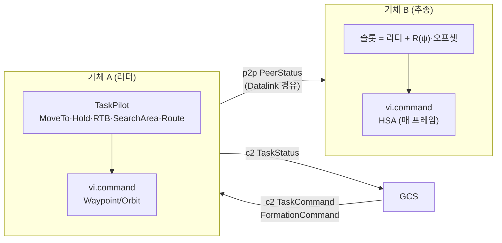

# WP3 기본 MA 플러그인 추적표 (모듈 AGT)

- 패키지 `swarm-algorithms`. entry point 그룹 `swarm.ma`에 `hold`, `waypoint`, `formation`, `flocking`, `flocking_basic`(예제 시나리오 이름, `flocking`과 같음)을 등록한다.
- 런타임과 시험 도구는 `agent/`(swarm-agent)에 있다. IMP·TC 번호는 `agent/TRACE.md`와 이어 쓴다.
- 모든 플러그인은 `ctx.ports`로만 송수신한다 (DEC-013). 다른 기체 상태는 P2P로 받은 `PeerStatus`만 쓴다 (PRP-SIM-003).

## IMP

| ID | 내용 | 위치 | 근거 | 시험 결과 |
|---|---|---|---|---|
| IMP-AGT-011 | 공용 부품: `TaskTracker`(MissionPlan 작업 순차, C2 TaskCommand 즉시 선점·취소·미지원 REJECTED, TaskStatus를 통제 GCS로), `TaskPilot`(MoveTo·RTB → Waypoint, Hold → 현재 위치 Orbit, FA COMPLETED → 작업 COMPLETED), `PeerStatus` 생성, 기체별 위상을 둔 주기 송신 | `src/swarm_algorithms/common.py` | REQ-BHV-001, REQ-BHV-002, DEC-013, DEC-014 | Pass (TC-AGT-015, TC-AGT-017) |
| IMP-AGT-012 | MA `hold`: 첫 항법 상태의 침로·속도·고도 유지(HSA). `orbit_radius_m` > 0이면 그 자리 선회 | `src/swarm_algorithms/hold.py` | REQ-BHV-004 | Pass (TC-AGT-014) |
| IMP-AGT-013 | MA `waypoint`: MissionPlan·C2의 MoveTo/Hold/RTB 수행과 상태 보고(ACCEPTED → EXECUTING → COMPLETED, 선점 CANCELLED), RoutePlan 경유점 비행 | `src/swarm_algorithms/waypoint.py` | REQ-BHV-002, REQ-BHV-004, PRP-GNC-001 | Pass (TC-AGT-015) |
| IMP-AGT-014 | MA `formation`: leader-follower. FormationCommand(C2) 또는 MissionPlan.formations, 모양 LINE·COLUMN·WEDGE·ECHELON·CIRCLE·CUSTOM, PeerStatus P2P 교환(리더 위치 외삽), 추종 속도장 v = v_L + k_p·(슬롯 − 자기)(보정 상한), 리더는 작업 수행, 슬롯 오차 MD 기록 | `src/swarm_algorithms/formation.py` | PRP-BHV-003, REQ-BHV-003 | Pass (TC-AGT-016~018) |
| IMP-AGT-015 | MA `flocking`: Reynolds 분리·정렬·응집 + 목표점(MoveTo·SearchArea 중심·RTB) 이동, `BatchMissionAutonomy`. 기체마다 자기 P2P inbox로 만든 이웃 표를 (N, M) 배열로 채워 NumPy로 한 번에 계산, 그룹 필터, `ctx.rng` 침로 흔들기 | `src/swarm_algorithms/flocking.py` | PRP-BHV-002, PRP-BHV-003, REQ-BHV-003, DEC-006 | Pass (TC-AGT-019, TC-AGT-010) |
| IMP-AGT-016 | 공용 `TaskPilot`을 구간(Leg) 상태 기계로 전환, Hold 매개변수(center 없으면 시작 위치·고도, radius 없으면 `hold_radius_m`, `duration_s` 0·없음 = 다음 명령까지 / 있으면 원 위 체류 후 COMPLETED, 방향 기본 CW). 같은 task_id는 CANCELLED 없이 교체, 빈 Route·반경 ≤ 0 Hold·모양 없는 SearchArea는 REJECTED. waypoint MA·편대 리더가 사용 | `src/swarm_algorithms/common.py` | REQ-BHV-002, REQ-UI-003, DEC-033 | Pass (TC-AGT-020, TC-AGT-024, TC-AGT-025) |
| IMP-AGT-017 | RouteTask: 항로점마다 goto(그 점의 alt_m·speed_mps·acceptance) + 행위 선회(Loiter: duration_s, Recon: 반경 원 1바퀴 이상 또는 duration_s), loop 반복, `TaskStatus.progress` = 마친 항로점 / 전체. SearchArea 원(다각형은 외접 원)은 정찰 원 1바퀴. 선회 반경은 최소 선회 반경 × 1.3 이상으로 보정. StrikeTask.aim_point는 REJECTED 유지 | `src/swarm_algorithms/common.py`, `waypoint.py`, `formation.py` | REQ-BHV-002, REQ-UI-004, DEC-033 | Pass (TC-AGT-021~025) |
| IMP-AGT-018 | flocking Hold: 중심·반경·방향의 접선 벡터장 선회, duration_s 체류 후 COMPLETED. Route는 REJECTED | `src/swarm_algorithms/flocking.py` | REQ-BHV-002, DEC-033 | Pass (TC-AGT-025) |
| IMP-AGT-020 | 레이스트랙 선회 대기(DEC-034): `HoldTask.racetrack`·`LoiterAction.racetrack`이 있으면 `TaskPilot`이 `CurveCommand.racetrack`을 FA에 보낸다(중심·반경·방향은 작업에서, duration 처리는 원형과 같고 체류 판정은 경로 오차). `leg_length_m < 0`은 REJECTED. flocking Hold는 vector_field 침로로 레이스트랙을 따른다 | `src/swarm_algorithms/common.py`, `flocking.py` | REQ-BHV-002, DEC-034 | Pass (TC-AGT-028) |

## TC

시험은 `swarm_agent.testing.Harness`(InMemoryBus + 가짜 Core 2-DoF 운동학 + 가짜 Datalink 즉시 전달)로 한다. 편대·군집 지표는 가짜 Core의 상태(truth)로 잰다.

`uv run pytest algorithms/tests`

| ID | 내용 | 위치 | 근거 | 결과 |
|---|---|---|---|---|
| TC-AGT-014 | hold: 60 s 동안 침로 ±0.5°, 속도 ±0.2 m/s, 고도 ±0.5 m 유지. 선회 모드 반경 400 m ±6% | `tests/test_alg_basic.py` | IMP-AGT-012 | Pass |
| TC-AGT-015 | waypoint: 계획 작업 2개 순차 수행과 상태 순서, 미지원 작업 건너뜀, C2 MoveTo 선점(계획 작업 CANCELLED), C2 Strike REJECTED, RTB 귀환(300 m 안), 다른 기체 작업 무시 | `tests/test_alg_basic.py` | IMP-AGT-011, IMP-AGT-013 | Pass |
| TC-AGT-016 | 편대 슬롯 기하: 6개 모양 오프셋, CUSTOM members 순서, 리더 미지정 시 사전순 첫 기체 | `tests/test_alg_swarm.py` | IMP-AGT-014 | Pass |
| TC-AGT-017 | 편대 수렴: 5대 WEDGE(MissionPlan) 초기 슬롯 오차 > 200 m → 120 s 뒤 < 5 m, 고도 일치, 리더만 TaskStatus 보고, MD 슬롯 오차 기록. C2 FormationCommand COLUMN·CIRCLE 150 s 뒤 < 10 m | `tests/test_alg_swarm.py` | IMP-AGT-014, PRP-BHV-003 | Pass |
| TC-AGT-018 | P2P를 모두 잃으면 추종기가 편대를 이루지 못한다(슬롯 오차 > 100 m). 편대는 데이터링크로 받은 정보만 쓴다 | `tests/test_alg_swarm.py` | IMP-AGT-014, PRP-SIM-003 | Pass |
| TC-AGT-019 | flocking 20대(침로 0~380° 분산): 150 s 뒤 정렬도 < 0.5 → > 0.95, 최소 간격 > 40 m, 최대 간격 감소, 목표 쪽 이동, 이웃 수 지표. P2P 손실 시 이웃 0. SearchArea 중심 도달 COMPLETED, 그룹 필터 | `tests/test_alg_swarm.py` | IMP-AGT-015 | Pass |
| TC-AGT-020 | Hold 매개변수: center(2 km 북)·반경 500 m ±8%·CCW·고도 1700 m·duration 90 s 뒤 COMPLETED. 매개변수 없음 → 시작 위치 둘레 `hold_radius_m` CW, 다음 명령까지 지속. 반경 ≤ 0 REJECTED | `tests/test_alg_mission.py` | IMP-AGT-016 | Pass |
| TC-AGT-021 | Route 순서·구간별 고도/속도(18·25 m/s, 1400·1600 m) 추종, 항로점 접근 120 m 안, 상태 ACCEPTED → EXECUTING(진행 0, 1/3, 2/3) → COMPLETED | `tests/test_alg_mission.py` | IMP-AGT-017 | Pass |
| TC-AGT-022 | Loiter 체류 시간: 원 위에 든 뒤 80 s 이상 140 s 미만, 반경 400 m ±10%, 이후 다음 항로점 | `tests/test_alg_mission.py` | IMP-AGT-017 | Pass |
| TC-AGT-023 | Recon 반경 600 m 원 1바퀴 이상(누적 각 ≥ 0.95 × 2π) 뒤 COMPLETED. SearchArea 원 700 m ±10% 선회 후 COMPLETED | `tests/test_alg_mission.py` | IMP-AGT-017 | Pass |
| TC-AGT-024 | 같은 task_id Route 교체(CANCELLED 없이 ACCEPTED 재송신, 새 항로점 도달), loop 2바퀴 이상(진행 0 → 0.5 → 1.0 → 0.5), 빈 Route REJECTED | `tests/test_alg_mission.py` | IMP-AGT-016, IMP-AGT-017 | Pass |
| TC-AGT-025 | 편대 리더 Route 수행·추종기 이탈 800 m 미만, flocking Route REJECTED, flocking Hold 3대 반경 600 m ±25%·duration 후 COMPLETED | `tests/test_alg_mission.py` | IMP-AGT-016~018 | Pass |
| TC-AGT-028 | 레이스트랙: Hold(중심·반경 300 m·축 90°·duration) 명령이 FA 레이스트랙으로 전달되고 duration 뒤 COMPLETED, Route Loiter 레이스트랙 수행 후 다음 항로점·COMPLETED, `leg_length_m < 0` REJECTED, flocking Hold 레이스트랙 duration 후 COMPLETED. 수렴 정확도는 TC-AGT-027 | `tests/test_alg_mission.py` | IMP-AGT-020 | Pass |

시험 결과(2026-11-02): algorithms/tests 26 passed (기존 12 + DEC-033 11 + DEC-034 3)
