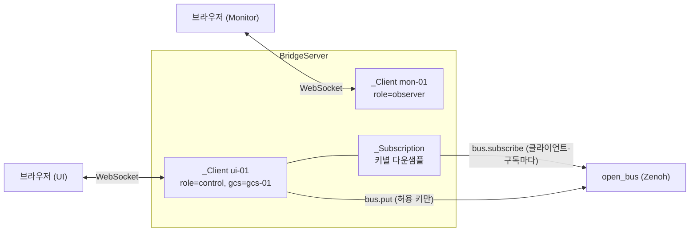

# WebSocket 브리지 (`bridge/`, swarm-bridge)

브라우저(GCS/UI, Traffic Monitor)를 버스에 붙이는 Python 프로세스다 (DEC-027). 프로토콜은 `docs/10_contracts.md` §3.5 "브리지 프로토콜 v1"을 그대로 따른다. 모듈 코드 `UI`(WP5).

## 실행

```bash
uv sync
```

```bash
uv run swarm-bridge --port 8765
```

- 접속 주소: `ws://<host>:8765/bus`. 다른 경로는 HTTP 404.
- 기본 대기 주소는 `127.0.0.1`이다. 다른 PC의 브라우저를 받으려면 `--host 0.0.0.0`.
- 버스 옵션은 다른 실행 파일과 같다 (DEC-026): `--bus`, `--zenoh-config`, `--zenoh-mode`, `--connect`, `--listen`, `--no-multicast`.
- `--queue-limit N`: 클라이언트별 송신 대기 프레임 수(기본 4096). 넘치면 오래된 것부터 버리고 접속 종료 때 버린 수를 기록한다.
- 브리지는 lockstep 참여자가 아니다(`FrameDone`을 보내지 않는다).

## 구조



- 구독: 클라이언트의 `sub`마다 버스 구독을 따로 선언한다. 버스 콜백(Zenoh 스레드)은 `call_soon_threadsafe`로 이벤트 루프에 넘긴다.
- 다운샘플(`max_hz > 0`): 키마다 마지막 송신 뒤 `1/max_hz`가 지났으면 바로 보내고, 아니면 최신 메시지만 남겨 주기 끝에 보낸다. 같은 키의 순서는 바뀌지 않는다.
- 발행: `role=control`이고 키가 `sim/ctrl/cmd` 또는 `swarm/<gcs>/tx/**`(와일드카드 없음)일 때만 버스에 싣는다. 그 밖은 `forbidden`.
- 오류: hello 전의 메시지·잘못된 hello·hello 시간 초과(10 s)는 `error` 뒤 연결을 닫는다(1008). hello 뒤의 잘못된 요청은 `error`만 보내고 연결을 유지한다.

## 시험

```bash
uv run pytest bridge/tests
```

추적은 [TRACE.md](TRACE.md).
