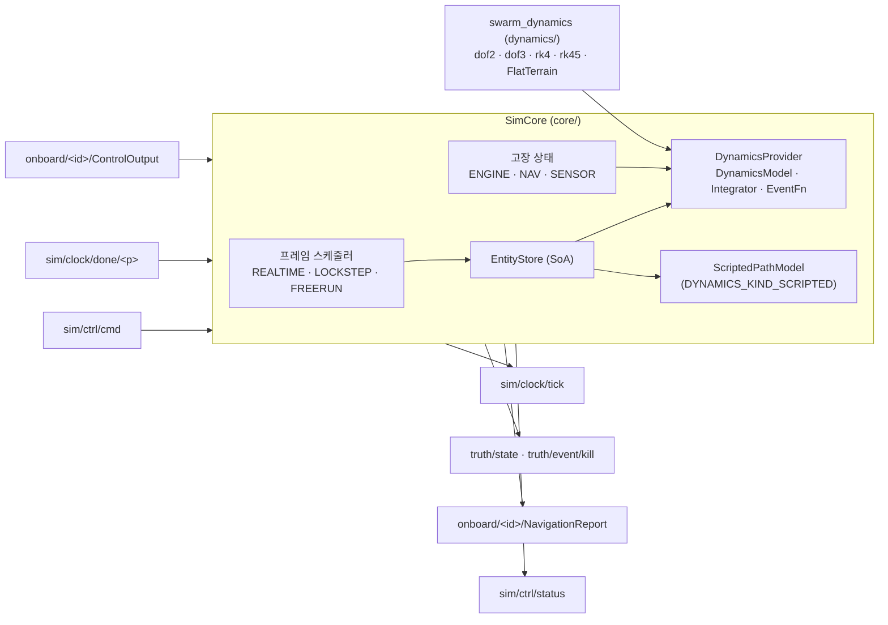

# WP1 Sim Core 추적표 (모듈 CORE)

## 구성

- 프레임 N: truth·NavigationReport·tick(N) 발행 → 참여자 응답(ControlOutput, lockstep이면 FrameDone(N)) → 진행 조건 충족 시 [t_N, t_N+dt] 적분 → N+1.
- 진행 조건: LOCKSTEP은 모든 참여자의 FrameDone(N). REALTIME은 dt마다(배속 1 고정). LOCKSTEP·FREERUN은 배속 > 0이면 dt/배속마다, 0이면 대기 없음.
- 한 프레임 이상 늦으면 따라잡지 않고 기준 시각을 다시 잡으며 `frame_overruns`를 올린다.
- PAUSED에서 StepFrames(n)은 배속 기한 없이 n 프레임 진행한다. LOCKSTEP 장벽은 그대로 적용한다.
- ControlOutput은 엔티티별 최신값을 다음 적분에 반영하고(영차 유지), `map_control`이 false면 버리고 이전 입력을 유지한다.
- 동역학: swarm_core는 `wp2_provider`(WP2 팩토리)를 쓴다. DynamicsKind → `dyn::make_model`, airframe → 모델 파라미터 표, 적분기 `--integrator rk4|rk45`(기본 rk45). 목 공급자(`mock::provider`)는 시험용이다.
- 지면 충돌: 프레임 시작에 지면 위(g > 0)인 엔티티에만 `make_ground_event`를 건다. 적분기가 교차를 찾으면 그 시점 상태로 멈추고 kill(cause=ground)을 발행한다. 이벤트 Header는 교차 시각과 프레임 N+1(처음 죽은 채 발행되는 프레임)이다.
- 고장: ENGINE은 명령을 그대로 둔 채 적분 입력의 속도 명령만 모델 최소값으로 바꾼다. 해제(`clear`, `duration_s` 경과)되면 마지막 명령으로 돌아간다. NAV는 NavigationReport를 멈춘다. Reset이 모든 고장을 푼다.

## IMP

| ID | 내용 | 위치 | 근거 | 시험 결과 |
|---|---|---|---|---|
| IMP-CORE-001 | swarm::Bus의 Zenoh 백엔드 ZenohBus (zenoh-cpp 1.10.2, zenoh-c). peer/client 모드, connect/listen, json5 설정 | `include/swarm/core/zenoh_bus.hpp`, `src/zenoh_bus.cpp` | PRP-NET-001, DEC-002, REQ-NET-001 | TC-CORE-001 통과 Superseded by IMP-API-007 (`bus/`로 이관, DEC-026) |
| IMP-CORE-002 | 프레임 스케줄러: 50–100 Hz 고정 프레임, REALTIME/LOCKSTEP/FREERUN, lockstep 장벽, 시드 고정 rng, sim/clock/tick 발행, sim/ctrl/cmd 처리, sim/ctrl/status 발행 | `include/swarm/core/sim_core.hpp`, `src/sim_core.cpp` | DEC-005, REQ-SIM-002, REQ-DYN-003, PRP-SIM-002, DEC-014 | TC-CORE-002~006, 009, 010 통과 |
| IMP-CORE-003 | 엔티티 저장소(SoA, 상태·입력 연속 버퍼), truth/state(TruthFrame) 발행. STATIC과 모델 없는 SCRIPTED는 초기 위치 고정 | `include/swarm/core/entity_store.hpp`, `src/entity_store.cpp`, `src/sim_core.cpp` | DEC-006, REQ-PRF-001, PRP-SIM-003 | TC-CORE-002, 007 통과 |
| IMP-CORE-004 | onboard/&lt;id&gt;/ControlOutput 구독 → `map_control` → 동역학 입력, onboard/&lt;id&gt;/NavigationReport 발행(UAV·FPV·자율 플러그인 지정 엔티티). 잡음 훅 `CoreConfig::nav_noise` | `src/sim_core.cpp` | DEC-013, PRP-SIM-003, REQ-DYN-001 | TC-CORE-005, 007, 008 통과 |
| IMP-CORE-005 | 시험용 등속 2-DoF 목 모델(구면 지구)과 RK4 목 적분기. DynamicsProvider로 주입 | `include/swarm/core/mock_dynamics.hpp`, `src/mock_dynamics.cpp`, `include/swarm/core/dynamics_provider.hpp` | DEC-006, IMP-API-006 | TC-CORE-007, 008 통과 |
| IMP-CORE-006 | 실행 파일 swarm_core, 최소 시나리오 JSON 파서(EntitySpec proto JSON), 내장 시나리오(고정익 20 + GCS 1), 격추 고장(InjectFault KILL → truth/event/kill) | `src/main.cpp`, `include/swarm/core/scenario.hpp`, `src/scenario.cpp` | REQ-CFG-001, DEC-005, DEC-014 | TC-CORE-009, 011 통과 |
| IMP-CORE-007 | proto 시나리오: `LoadScenario.scenario`(`swarm.v1.Scenario`) 적재, `RunSpec.participants`를 lockstep 장벽에 반영, 파일 입력(`.pb` 또는 proto JSON, 최소 JSON 호환). 버스는 `open_bus`로 연다 | `include/swarm/core/scenario.hpp`, `src/scenario.cpp`, `src/sim_core.cpp`, `src/main.cpp` | DEC-024, DEC-025, DEC-026 | TC-CORE-012 통과 |
| IMP-CORE-008 | WP2 동역학 공급자 `wp2_provider`: DynamicsKind → `dyn::make_model`(dof2, dof3), airframe 파라미터 표(skywalker_x8, aerosonde 공개 일반값), 적분기 rk4/rk45(기본 rk45), 명령 전 입력 유지(현재 속도·상승률, 선회 0). 목 모델은 시험용으로 남김 | `include/swarm/core/wp2_dynamics.hpp`, `src/wp2_dynamics.cpp`, `include/swarm/core/dynamics_provider.hpp`, `CMakeLists.txt` | DEC-005, DEC-006, DEC-023, REQ-DYN-001, REQ-DYN-004, IMP-DYN-006 | TC-CORE-013, 017 통과 |
| IMP-CORE-009 | 지면 충돌: 평지 지형(`terrain_flat_m`), `make_ground_event`를 적분기 EventFn으로 전달, 교차 시 엔티티 사망과 `truth/event/kill`(cause=ground). DEM 지형은 `Wp2DynamicsOptions::terrain` 연결 자리(`--terrain-dem`은 미구현 오류) | `src/wp2_dynamics.cpp`, `src/sim_core.cpp` | DEC-004, DEC-005, DEC-016, REQ-SIM-003, IMP-DYN-005 | TC-CORE-014 통과 |
| IMP-CORE-010 | DYNAMICS_KIND_SCRIPTED: 초기 위치 → `script_path`를 초기 속도 크기로 따라가는 경로 모델(상태 = 경로 거리), 끝점 정지, 제어 입력 없음. 경로가 없으면 초기 위치 고정 | `include/swarm/core/scripted.hpp`, `src/scripted.cpp`, `src/entity_store.cpp` | DEC-017 | TC-CORE-015 통과 |
| IMP-CORE-011 | InjectFault: ENGINE(속도 명령 최소, 기간·해제), NAV(NavigationReport 중단), SENSOR(상태만 기록, 탐지 모델 없음), LINK_CUT·GCS_LINK_CUT은 Datalink(WP4) 담당이므로 무시. `SimCore::fault_active` 조회, Reset 시 해제 | `include/swarm/core/sim_core.hpp`, `src/sim_core.cpp` | DEC-014, REQ-LNK-002, REQ-LNK-003 | TC-CORE-016 통과 |
| IMP-CORE-012 | swarm_core가 WP2 동역학으로 동작. 명령행 `--integrator rk4\|rk45`, `--terrain-flat <m>`, `--terrain-dem`(자리) | `src/main.cpp` | DEC-005, DEC-016 | TC-CORE-018 확인 |
| IMP-CORE-013 | 동역학 매개변수 (DEC-035): 값 순서 기본값 → airframe 표 → `EntitySpec.dynamics_params` → 실행 중 `SetParams{owner=DYNAMICS}`. 거부 사유 unknown\|type\|range\|not_runtime을 이름순으로 `EntityParams.rejected`에 기록(가장 최근 적재·변경 것). SetParams는 poll 시작(프레임 경계)에 적용하고 `sim/param/<id>/dynamics`를 발행(적재 직후·변경 직후·Reset 직후·LOADED 상태 1초마다). Reset은 시나리오 적용 후 값으로 되돌린다. 매개변수가 없는 엔티티(STATIC, SCRIPTED)는 발행하지 않는다. 모르는 airframe은 기본값을 쓰고 `dynamics_params`는 적용 | `include/swarm/core/entity_store.hpp`, `src/entity_store.cpp`, `src/sim_core.cpp` | DEC-035, REQ-CFG-003, DEC-014, IMP-API-012, IMP-DYN-008 | TC-CORE-019~023 통과 |
| IMP-CORE-015 | 시나리오 재발행과 lockstep 준비 신호 (DEC-037, DEC-025): 적재 직후·Reset 직후·LOADED 상태 1초(벽시계)마다 `sim/ctrl/scenario`에 `Scenario` 전체를 발행(proto로 받은 것은 원본 그대로, 아니면 필드에서 구성). lockstep은 `RunSpec.participants`(+`--participant`) 전원의 `FrameDone{frame=0}` 준비 신호를 받은 뒤에 첫 틱을 낸다. 준비 신호는 Start 전에도 받고, 첫 틱 이후의 frame=0 신호는 준비가 아니라 프레임 0 완료로 센다. 비lockstep은 기다리지 않는다 | `include/swarm/core/scenario.hpp`, `src/scenario.cpp`, `src/sim_core.cpp` | DEC-037, DEC-025, DEC-014, IMP-API-014 | TC-CORE-024, TC-CORE-025 |
| IMP-CORE-016 | 시나리오 재발행 보강 (DEC-037): lockstep 준비 대기 중(RUNNING, 첫 틱 전)에도 1초(벽시계)마다 `sim/ctrl/scenario`를 재발행하고 첫 틱 이후는 멈춘다. CLI `--mode`·`--rate`·`--hz`·`--seed` 재정의(`apply_run_override`)는 적재 필드와 재발행 `Scenario.run`에 함께 반영하고, `--autostart`의 Start도 같은 값을 쓴다 | `include/swarm/core/scenario.hpp`, `src/scenario.cpp`, `src/sim_core.cpp`, `src/main.cpp` | DEC-037, IMP-CORE-015 | TC-CORE-026, TC-CORE-027 |
| IMP-CORE-017 | 입력 검증 (DEC-038): `validate_scenario`(비유한 값·위경도 범위·빈 엔티티·frame_hz 50..100·배속·없는 링크 프로파일), 없는 airframe 거부(`known_airframe`), dof5/dof6 적재 거부. 거부 시 `load`는 false를 돌려주고 기존 시나리오·상태를 유지한다. Start·SetRate 배속은 유한·0..1000만 받는다(0은 제한 없음, Start의 hz 0은 시나리오 값). 시작 시나리오가 거부돼도 `swarm_core`는 종료하지 않고 LoadScenario를 기다린다 | `include/swarm/core/scenario.hpp`, `src/scenario.cpp`, `src/sim_core.cpp`, `src/wp2_dynamics.cpp`, `src/main.cpp` | DEC-038, QA-001, QA-003, D-3 | TC-CORE-028, TC-CORE-029, TC-CORE-030 |
| IMP-CORE-018 | 대기 참여자 로그 (QA-004): lockstep 준비·프레임 완료를 기다리는 동안 5초마다 대기 중인 참여자를 로그에 남긴다. 상태 메시지 필드는 계약 변경이 필요해 로그만 한다 | `src/sim_core.cpp` | DEC-038, QA-004 | TC-CORE-031 |
| IMP-CORE-019 | msvc 프리셋의 vcpkg 의존성을 C++20으로 빌드: 오버레이 트리플렛 `triplets/x64-windows-cxx20.cmake` (QA-007, protobuf ABI 불일치로 msvc-release 링크 실패). 계약 §7.1에 안내 | `../triplets/x64-windows-cxx20.cmake`, `../CMakePresets.json` | DEC-022, QA-007 | 처음부터 빌드한 msvc-debug·msvc-release ctest 35/35 (2026-11-02) |
| IMP-CORE-020 | lockstep 응답 없는 참여자 표시 (DEC-041): 준비·프레임 완료 대기가 벽시계 5 s를 넘으면 해당 참여자를 `SimStatus.waiting_participants`에 싣고 기다리는 동안 status를 1초마다 발행한다. 응답·Reset·정지하면 비운다. 재합류는 지원하지 않는다 | `src/sim_core.cpp`, `include/swarm/core/sim_core.hpp` | DEC-041, DEC-038 | TC-CORE-032 |
| IMP-CORE-021 | 대기 로그 오탐 수정 (D-14): `log_waiting`은 같은 대기가 5 s 넘게 이어질 때만 남기고 이후 5 s마다 반복한다. 정상 진행 중 프레임마다 생기는 짧은 장벽 대기는 기록하지 않는다 (IMP-CORE-018 갱신) | `src/sim_core.cpp` | DEC-038, DEC-041 | TC-CORE-031, TC-CORE-033 |
| IMP-CORE-022 | WP8 Payload 통합 (DEC-046, DEC-047): 적재 때 `PayloadSystem` 생성(프로파일·재정의 오류는 적재 거부), Reset 때 `reset()`. 프레임마다 프레임 시작 상태와 SENSOR 고장·`onboard/<id>/{Sensor,Jammer,Strike}Command`(엔티티 ID 순 정렬)로 `step()`을 한 번 부르고, onboard 출력(Detection·*Activity·StoreLoadout)을 키별 seq로, 이벤트를 `truth/event/<kind>`로 발행한다. 무장 엔티티는 TruthFrame에 덧붙이고(Core는 적분하지 않는다), `killed`는 적분 뒤 alive=false로 한다 | `src/sim_core.cpp`, `include/swarm/core/sim_core.hpp`, `CMakeLists.txt` | DEC-046, DEC-047, DEC-044, REQ-PAY-002~004 | TC-CORE-034, TC-CORE-035 |
| IMP-CORE-023 | `--terrain-dem <json>`: `dyn::RawDemLoader`로 DEM을 적재해 `Wp2DynamicsOptions::terrain`에 넣는다(격자 밖 0 m). 지면 충돌과 Payload 가시선이 같은 지형을 쓴다. 시작 메시지에 `terrain=dem RxC lat .. lon ..`을 찍고 적재 실패는 종료 코드 1 (IMP-CORE-012의 자리 표시 대체) | `src/main.cpp`, `CMakeLists.txt` | DEC-053, DEC-004, DEC-016, IMP-DYN-009, QA-022 | TC-CORE-036, TC-CORE-037, TC-CORE-040 |
| IMP-CORE-024 | JamZone 재발행 (DEC-052): 활성 재밍 구역을 소유자별로 기억하고, 변화 시 발행에 더해 모의 시간 1 s마다(프레임 기준, `sim_time ≥ 다음 경계`) `truth/event/jam_zone`에 다시 발행한다. 같은 프레임에 변화로 이미 낸 소유자는 건너뛰고, 소유자 ID 순, 헤더 시각·프레임·seq는 재발행 시점 값. 꺼진 구역은 지우고 다시 내지 않는다. Reset·적재 때 비운다 | `src/sim_core.cpp`, `include/swarm/core/sim_core.hpp` | DEC-052, DEC-044, QA-021, IMP-CORE-022 | TC-CORE-038 |
| IMP-CORE-025 | 적재 검증 추가: 엔티티 ID 형식(`keys::check_entity_id`)과 25자 초과(DEC-050), 엔티티당 `type=jammer` 탑재물 2개 이상(DEC-049)을 `validate_scenario`에서 거부한다. 거부 시 Core는 이전 시나리오로 계속 동작한다(IMP-CORE-017) | `src/scenario.cpp`, `include/swarm/core/scenario.hpp` | DEC-049, DEC-050, DEC-038 | TC-CORE-039 |
| IMP-CORE-026 | DEM 지형(평지 제외)에서 공중 엔티티(UAV·공중 표적·미사일·FPV)의 시작 고도가 그 위치 지형보다 낮으면 적재 때 엔티티마다 `warning: <id> starts below DEM terrain: alt A m < terrain H m ...`를 남기고(적재는 계속), 실행하면 시작 프레임 적분 전에 kill(cause=ground, sim_time 0, frame 1)한다. reset 때 다시 계산한다. 지상 엔티티는 제외(기존 지면 위 판정 유지) | `src/sim_core.cpp`, `include/swarm/core/sim_core.hpp` | DEC-060, IMP-CORE-009, IMP-CORE-023, QA-024 | TC-CORE-041 |
| IMP-CORE-027 | `--terrain-flat`과 `--terrain-dem`을 함께 주면 거부하지 않고 DEM을 쓰며 `warning: both --terrain-flat and --terrain-dem given; using DEM, flat value X m ignored (DEC-061)`을 남긴다. 인자 순서와 무관하다 | `src/main.cpp`, `CMakeLists.txt` | DEC-061, IMP-CORE-023, QA-025 | TC-CORE-042 |
| IMP-CORE-028 | 기체(onboard 런타임이 있는 엔티티: UAV·FPV·플러그인 지정)마다 `onboard/<id>/SystemStatus` 발행. 프레임 발행 때 엔티티 ID 순으로, health·subsystems가 바뀌었거나 모의 시간 1 s 경계(프레임 0 포함)를 지났으면 낸다. 헤더는 모의 시각·프레임·source=<id>·키별 seq. 죽은 기체는 FAILED로 바뀔 때 한 번만 내고 주기 발행을 멈춘다. **subsystem 대응**(늘 이 순서로 4개): `engine`=ENGINE, `nav`=NAV, `sensor`=SENSOR(그 기체의 모든 센서, DEC-047), `link`=LINK_CUT이면 FAILED·GCS_LINK_CUT만이면 DEGRADED. 고장이면 FAILED, 아니면 NOMINAL, 죽으면 모두 FAILED. **전체 health**: 죽었거나 engine 고장이면 FAILED, 다른 고장이 있으면 DEGRADED, 없으면 NOMINAL. **energy_frac**: 2/3-DoF·스크립트 모델에 에너지(연료·배터리) 상태가 없어 1.0. 링크 차단 고장은 효과는 Datalink가 내고 Core는 이 보고용으로 기간·해제만 기록한다. 모의 시간·프레임으로만 정해 lockstep 결정적이다 | `src/sim_core.cpp`, `include/swarm/core/sim_core.hpp` | DEC-073, DEC-047, DEC-071, IMP-CORE-011 | TC-CORE-043, TC-CORE-016 |
| IMP-CORE-014 | Windows에서 별도 프로세스 그룹으로 띄운 swarm_core가 Ctrl+Break(SIGBREAK)를 받으면 SIGINT와 같이 Shutdown 후 종료 (P0 데모 실행기) | `src/main.cpp` | DEC-005, DEC-026 | TC-INT-001 확인 |

## TC

| ID | 내용 | 위치 | 근거 | 시험 결과 |
|---|---|---|---|---|
| TC-CORE-001 | 두 Zenoh 세션(로컬 TCP) 간 와일드카드 구독·페이로드·인코딩 보존, 구독 해제. SimCore가 Zenoh로 50 프레임 tick·truth 발행, 명령을 상대 세션에서 수신 | `tests/test_zenoh_bus.cpp` (`swarm_core_zenoh_tests`) | IMP-CORE-001, 002 | 통과 (msvc-debug) |
| TC-CORE-002 | FREERUN 최대 속도: poll마다 1 프레임, tick 0..N, truth 엔티티 21, NavigationReport는 UAV만 | `tests/test_core.cpp` | IMP-CORE-002, 003 | 통과 |
| TC-CORE-003 | REALTIME 50 Hz 기한(19 ms 미진행, 20 ms 진행), overrun 계수와 기준점 재설정, REALTIME 배속 변경 무시 | `tests/test_core.cpp` | IMP-CORE-002 | 통과 |
| TC-CORE-004 | LOCKSTEP 장벽: 참여자 전원 FrameDone(N) 전에는 진행하지 않음, 미등록 참여자·지난 프레임 완료 무시 | `tests/test_core.cpp` | IMP-CORE-002 | 통과 |
| TC-CORE-005 | LOCKSTEP 결정론: 같은 시드·같은 입력(제어 + 잡음 훅)으로 두 번 실행한 truth·NavigationReport 바이트열 동일 | `tests/test_core.cpp` | IMP-CORE-002, 004 | 통과 |
| TC-CORE-006 | 일시정지·StepFrames·재개·배속(2×, 10×, 0=최대) | `tests/test_core.cpp` | IMP-CORE-002 | 통과 |
| TC-CORE-007 | truth/state·NavigationReport 내용: 북향 25 m/s 10 s 등속 해석해와 위도 오차 < 1e-9°, 고정 엔티티 위치 유지, 잡음 없을 때 항법 = 참값 | `tests/test_core.cpp` | IMP-CORE-003, 004, 005 | 통과 |
| TC-CORE-008 | ControlOutput 선회율 적용(10 s 90° 선회), 형식 불일치(ActuatorCmd) 계수와 이전 입력 유지 | `tests/test_core.cpp` | IMP-CORE-004 | 통과 |
| TC-CORE-009 | 시나리오 JSON 파싱(모르는 필드 무시), 형식 오류·ID 오류 거부, sim/ctrl/cmd 경로 Load, frame_hz 범위 거부, 상태 보고, KILL 고장 이벤트, Reset 후 초기 상태 복원, Shutdown | `tests/test_core.cpp` | IMP-CORE-002, 006 | 통과 |
| TC-CORE-010 | run() 실시간 루프: 50 Hz 25 프레임이 0.45–0.75 s | `tests/test_core.cpp` | IMP-CORE-002 | 통과 |
| TC-CORE-011 | 별도 프로세스 확인: `swarm_core --listen tcp/127.0.0.1:17500 --autostart --frames 150`을 다른 Zenoh 세션이 구독 | 수동 | IMP-CORE-001, 006 | 2026-11-01: tick 150, truth 150, NavigationReport 3000, status 4, 인코딩 `application/protobuf;swarm.v1.TruthFrame` |
| TC-CORE-012 | proto 시나리오 변환(기본값 유지, participants), sim/ctrl/cmd 경로로 `LoadScenario.scenario` 적재 | `tests/test_core.cpp` | IMP-CORE-007 | 통과 (msvc-debug, 2026-11-01) |
| TC-CORE-013 | WP2 dof2·dof3(rk45) 20대 lockstep 결정론: 기체별 선회·상승 명령 + 항법 잡음으로 250 프레임 두 번 실행한 truth·NavigationReport 바이트열 동일, 모델 이름 확인, 명령 속도 추종 | `tests/test_core.cpp` | IMP-CORE-008 | 통과 (msvc-debug, 2026-11-01) |
| TC-CORE-014 | 지면 충돌(rk45, rk4 각각): 100.5 m에서 10 m/s 하강, 평지 50 m → kill(cause=ground) 1회, 시각 5.05 s(오차 < 10 µs), 프레임 253, 고도 50 m에서 정지, 이후 NavigationReport 없음. 지면 높이에서 시작한 지상 표적은 제외 | `tests/test_core.cpp` | IMP-CORE-009 | 통과 (msvc-debug, 2026-11-01) |
| TC-CORE-015 | 스크립트 경로: 10 m/s로 북 1 km → 동 1 km. 50 s·모퉁이+50 s 위치(오차 < 1 m)와 속도 방향, 끝점 정지(속도 0), 경로 없는 엔티티 고정, 지면 이벤트 미적용 | `tests/test_core.cpp` | IMP-CORE-010 | 통과 (msvc-debug, 2026-11-01) |
| TC-CORE-016 | 고장: ENGINE 3 s(25 → 12.65 m/s, 기간 후 25 m/s 복귀), NAV 중단·해제, SENSOR 기록, LINK_CUT·GCS_LINK_CUT은 효과 없이 기록만(SystemStatus용, 2026-11-08 IMP-CORE-028로 변경), 모델 없는 엔티티·목 공급자 ENGINE 미처리, Reset 해제 | `tests/test_core.cpp` | IMP-CORE-011, IMP-CORE-028 | 통과 (msvc-debug, 2026-11-08) |
| TC-CORE-017 | WP2 공급자: 모르는 적분기 거부, airframe 표, 10 s 등속 해석해(250 m)와 rk4/rk45 차 < 1 mm, 동풍 5 m/s 반영(대지 속도, DEC-023) | `tests/test_core.cpp` | IMP-CORE-008 | 통과 (msvc-debug, 2026-11-01) |
| TC-CORE-018 | 별도 프로세스 확인: `swarm_core --integrator rk45 --terrain-flat 0 --connect tcp/127.0.0.1:17501 --no-multicast --autostart --frames 150`을 listen 중인 Python Zenoh 세션(swarm_api.open_bus)이 구독 | 수동 | IMP-CORE-012 | 2026-11-01: tick 151, truth 152, NavigationReport 3020, status 6, 인코딩 `application/protobuf;swarm.v1.TruthFrame`, uav-001 3 s 뒤 북동 25 m/s 등속 위치 일치 |
| TC-CORE-019 | 적재: skywalker_x8 airframe(min 12) 위에 `dynamics_params`(max 30) 덮어쓰기, 범위·타입·미선언·타 모델 이름 거부 사유와 이름순, 모르는 airframe(기본값) + 재정의, ParamSpec 내용(계층·단위·범위·runtime·기본값), GCS 미발행, 인코딩·키 | `tests/test_core.cpp` | IMP-CORE-013 | 통과 (msvc-debug, 2026-11-02) |
| TC-CORE-020 | 실행 중 SetParams: 적용, 거부 사유, 발행 시각 = 적용 프레임 시작, FA 소유자·모르는 엔티티·매개변수 없는 엔티티 무시, 거부 목록 교체, Reset 복원(첫 적재 거부 포함) | `tests/test_core.cpp` | IMP-CORE-013 | 통과 (msvc-debug, 2026-11-02) |
| TC-CORE-021 | `runtime`=false 항목: 적재 시 적용, 실행 중 not_runtime 거부(같은 명령의 runtime 항목은 적용), 범위 거부 시 값 유지 (시험용 목 모델) | `tests/test_core.cpp` | IMP-CORE-013 | 통과 (msvc-debug, 2026-11-02) |
| TC-CORE-022 | lockstep 재현성: 같은 시드·같은 프레임(50)의 SetParams는 truth 바이트열 동일, 프레임 51·없음과는 다름, 선회율 한계 변경이 3 s 선회각에 반영 | `tests/test_core.cpp` | IMP-CORE-013, IMP-CORE-002 | 통과 (msvc-debug, 2026-11-02) |
| TC-CORE-023 | LOADED 상태에서 1초(벽시계)마다 재발행, 실행 중에는 재발행 없음 | `tests/test_core.cpp` | IMP-CORE-013 | 통과 (msvc-debug, 2026-11-02) |
| TC-CORE-024 | `sim/ctrl/scenario` 발행: 적재 직후 1회, LOADED 1초 주기, 실행 중 중단, Reset 직후, 인코딩, proto 원본 보존, 원본 없는 시나리오는 필드에서 구성 | `tests/test_core.cpp` | IMP-CORE-015 | 통과 (msvc-debug, 2026-11-02) |
| TC-CORE-025 | lockstep 준비 신호: 전원 준비 전 틱 없음, 미등록 참여자 무시, 준비 신호는 프레임 0 완료가 아님, 시작 후 frame=0은 준비로 쓰이지 않음, Start 전 준비 인정, FREERUN은 대기 없음 | `tests/test_core.cpp` | IMP-CORE-015 | 통과 (msvc-debug, 2026-11-02) |
| TC-CORE-026 | 지각 참여자: 준비 대기 중 1초마다 재발행, 대기 중 늦게 구독한 쪽이 시나리오를 받음, 첫 틱 이후 재발행 없음 | `tests/test_core.cpp` | IMP-CORE-016 | 통과 (msvc-debug, 2026-11-02) |
| TC-CORE-027 | CLI 재정의 반영: `--mode lockstep`·`--rate`·`--hz`·`--seed`가 적재 필드와 발행 `Scenario.run`에 반영, 원본 없는 시나리오도 동일, 잘못된 모드는 오류 | `tests/test_core.cpp` | IMP-CORE-016 | 통과 (msvc-debug, 2026-11-02) |
| TC-CORE-028 | 적재 검증: 비유한 값·범위 밖 위경도·빈 엔티티·중복 ID·없는 airframe/링크 프로파일·frame_hz·배속·Struct inf를 거부하고 기존 상태 유지, 올바른 입력은 수락 | `tests/test_core.cpp` | IMP-CORE-017 | 통과 (msvc-debug, 2026-11-02) |
| TC-CORE-029 | dof5·dof6 적재는 예외 없이 거부, Core 생존, LoadScenario 명령도 동일 | `tests/test_core.cpp` | IMP-CORE-017 | 통과 (msvc-debug, 2026-11-02) |
| TC-CORE-030 | Start·SetRate 배속 검증: NaN·inf·음수·과대 거부, 0 허용, Start hz 0은 시나리오 값 | `tests/test_core.cpp` | IMP-CORE-017 | 통과 (msvc-debug, 2026-11-02) |
| TC-CORE-031 | 대기 참여자 로그: 준비·프레임 완료 대기 시 5초마다 대기 중 참여자 이름 출력 | `tests/test_core.cpp` | IMP-CORE-018 | 통과 (msvc-debug, 2026-11-02) |
| TC-CORE-032 | 응답 없는 참여자 표시: 5 s 전에는 비어 있고 5 s 넘으면 이름이 status에 나타나며 대기 중 status가 계속 발행된다. 응답하면 비고, Reset하면 비며, 다시 시작해 멈추면 또 나타난다 | `tests/test_core.cpp` | IMP-CORE-020 | 통과 (msvc-debug, 2026-11-03) |
| TC-CORE-033 | 정상 lockstep 진행 12 s(매 프레임 짧은 대기) 동안 대기 로그와 `waiting_participants`가 나타나지 않는다 | `tests/test_core.cpp` | IMP-CORE-021 | 통과 (msvc-debug, 2026-11-05; 수정 전 코드에서는 실패 확인) |
| TC-CORE-034 | 시나리오 통합: 카메라 탐지 발행 → StrikeCommand → Launch·Spawn → 무장 엔티티가 TruthFrame에 나타나고 종료 시 alive=false → Impact·Kill → 표적 alive=false, 이벤트 seq 연속 | `tests/test_core.cpp` | IMP-CORE-022 | 통과 (msvc-debug, 2026-11-05) |
| TC-CORE-035 | 재머 부지 → `truth/event/jam_zone`(owner=jam-01), 같은 시드 두 번 실행의 truth 바이트와 이벤트 순서가 같다 | `tests/test_core.cpp` | IMP-CORE-022 | 통과 (msvc-debug, 2026-11-05) |
| TC-CORE-036 | DEM 지면 충돌: 합성 능선 DEM에서 고도 800 m 북진 기체가 800 m 등고선(위도 37.00667, 오차 < 5e-5°)에서 kill(cause=ground), 고도 = 지형 고도(< 0.5 m), 시각 28.5–30.5 s. 평지 0 m에서는 생존. 두 번 실행의 truth 바이트 동일 | `tests/test_core.cpp` | IMP-CORE-023 | 통과 (msvc-debug, 2026-11-06) |
| TC-CORE-037 | DEM 가시선: 능선 남쪽 고도 500 m 카메라가 능선 북쪽 지상 표적을 DEM에서는 탐지하지 않고 평지에서는 탐지한다 | `tests/test_core.cpp` | IMP-CORE-023 | 통과 (msvc-debug, 2026-11-06) |
| TC-CORE-038 | JamZone 재발행: 재머 부지는 프레임 0(변화)·50·100(1 s 주기) 뒤 끄면 꺼짐 1회 이후 없음. 프레임 30 무렵 켠 탑재 재머는 변화 1회 + 50·100·150·200·250. 두 번 실행의 이벤트 바이트 동일 | `tests/test_core.cpp` | IMP-CORE-024 | 통과 (msvc-debug, 2026-11-06) |
| TC-CORE-039 | 적재 검증: ID 25자 수락, 26자·형식 오류 거부, 재머 2개(UAV·재머 부지) 거부, 재머 1개 수락, 거부 뒤 이전 시나리오·LOADED 유지 | `tests/test_core.cpp` | IMP-CORE-025 | 통과 (msvc-debug, 2026-11-06) |
| TC-CORE-040 | 실행 파일: `swarm_core --terrain-dem ridge.json`이 `terrain=dem 101x101`을 출력하고 20 프레임 진행, 없는 경로는 0이 아닌 종료 코드 (ctest `core.TC-CORE-040.*`) | `CMakeLists.txt` | IMP-CORE-023 | 통과 (msvc-debug, 2026-11-06) |
| TC-CORE-041 | 능선 DEM 정점(1200 m) 위치의 UAV 500 m·공중 표적 300 m: 적재 경고 2건(ID·고도·지형 높이), 적재만으로는 kill 없음, 시작 후 kill(cause=ground) 2건(sim_time 0, frame 1), 프레임 1부터 죽은 채 제자리. 지형 위 UAV·지형 아래 지상 표적은 살아 있음. reset 뒤 재시작도 같음 | `tests/test_core.cpp` | IMP-CORE-026 | 통과 (msvc-debug, 2026-11-06) |
| TC-CORE-042 | 실행 파일: `--terrain-flat 30 --terrain-dem ridge.json`과 반대 순서 둘 다 DEC-061 경고와 `terrain=dem 101x101`을 출력하고 20 프레임 진행 (ctest `core.TC-CORE-042.flat_first`, `.dem_first`) | `CMakeLists.txt` | IMP-CORE-027 | 통과 (msvc-debug, 2026-11-06) |
| TC-CORE-043 | SystemStatus: 프레임 0·50·100에 uav-000, uav-001 순(시나리오 순서와 무관), GCS 제외, 적재만으로는 없음, NOMINAL·energy 1.0·subsystem 4개, seq. NAV 0.5 s 주입 다음 프레임에 그 기체만 DEGRADED(nav FAILED), 25프레임 뒤 만료로 NOMINAL. 다중 고장(ENGINE+SENSOR+GCS_LINK_CUT 한 프레임 → 1건 FAILED, LINK_CUT 추가 → link FAILED, ENGINE 해제 → DEGRADED). 1 s 경계 주기 발행에 고장 상태 유지. KILL → FAILED 1건(같은 프레임 안 ID 순), 이후 주기 발행 없음. 같은 입력 2회 키·바이트 동일 | `tests/test_core.cpp` | IMP-CORE-028 | 통과 (msvc-debug, Zenoh 포함, 2026-11-08) |

## 제약과 후속

- 최소 JSON 시나리오 형식은 폐기 예정이다(`scenario.hpp` 주석).
- DEM 격자 밖(위도 33–43°N, 경도 124–131°E 밖)은 0 m다. 한반도 90 m DEM은 int16 약 200 MB를 메모리에 올린다 (DEC-053).
- 5/6-DoF(DYNAMICS_KIND_DOF5/6)는 WP2 팩토리가 nullptr를 주므로 불러오기에서 거부된다.
- 스크립트 이동은 대지 기준이며 바람을 더하지 않는다.
- 준비 신호는 `load()`에서만 비운다. Reset 뒤에는 참여자가 다시 보내지 않아도 이전 준비 상태를 유지한다. 시작 후 새 참여자는 받지 않는다(DEC-037).
- SetParams의 적용 시각은 Core가 명령을 poll로 받은 프레임 경계다. 명령에 프레임 번호가 없으므로 버스 도착 시점에 따라 어느 프레임인지가 정해진다. 재현이 필요한 시험은 `LoadScenario`나 `dynamics_params`로 시작 값을 정한다.
- 2/3-DoF의 모든 매개변수가 `runtime`=true다(질량·관성 항목은 질점 모델에 없다). 5/6-DoF가 들어오면 해당 항목을 false로 둔다.
- SENSOR 고장은 상태만 둔다. Core가 탐지(Detection)를 만들게 되면 그 상태로 막는다.
- lockstep 참여자는 시나리오 `participants`와 `--participant`로 정적으로 정한다.
