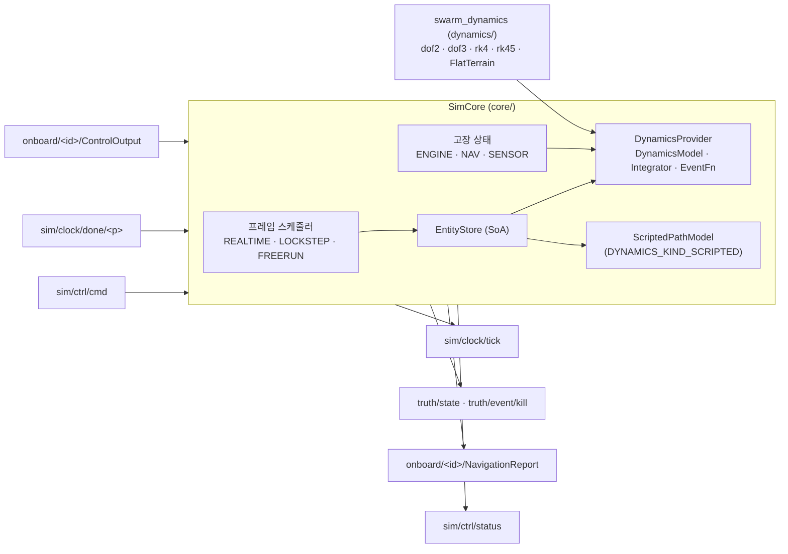

# WP1 Sim Core 추적표 (모듈 CORE)

## 구성

- 프레임 N: truth·NavigationReport·tick(N) 발행 → 참여자 응답(ControlOutput, lockstep이면 FrameDone(N)) → 진행 조건 충족 시 [t_N, t_N+dt] 적분 → N+1.
- 진행 조건: LOCKSTEP은 모든 참여자의 FrameDone(N). REALTIME은 dt마다(배속 1 고정). LOCKSTEP·FREERUN은 배속 > 0이면 dt/배속마다, 0이면 대기 없음.
- 한 프레임 이상 늦으면 따라잡지 않고 기준 시각을 다시 잡으며 `frame_overruns`를 올린다.
- PAUSED에서 StepFrames(n)은 배속 기한 없이 n 프레임 진행한다. LOCKSTEP 장벽은 그대로 적용한다.
- ControlOutput은 엔티티별 최신값을 다음 적분에 반영하고(영차 유지), `map_control`이 false면 버리고 이전 입력을 유지한다.
- 동역학: swarm_core는 `wp2_provider`(WP2 팩토리)를 쓴다. DynamicsKind → `dyn::make_model`, airframe → 모델 파라미터 표, 적분기 `--integrator rk4|rk45`(기본 rk45). 목 공급자(`mock::provider`)는 시험용이다.
- 지면 충돌: 프레임 시작에 지면 위(g > 0)인 엔티티에만 `make_ground_event`를 건다. 적분기가 교차를 찾으면 그 시점 상태로 멈추고 kill(cause=ground)을 발행한다. 이벤트 Header는 교차 시각과 프레임 N+1(처음 죽은 채 발행되는 프레임)이다.
- 고장: ENGINE은 명령을 그대로 둔 채 적분 입력의 속도 명령만 모델 최소값으로 바꾼다. 해제(`clear`, `duration_s` 경과)되면 마지막 명령으로 돌아간다. NAV는 NavigationReport를 멈춘다. Reset이 모든 고장을 푼다.

## IMP

| ID | 내용 | 위치 | 근거 | 시험 결과 |
|---|---|---|---|---|
| IMP-CORE-001 | swarm::Bus의 Zenoh 백엔드 ZenohBus (zenoh-cpp 1.10.2, zenoh-c). peer/client 모드, connect/listen, json5 설정 | `include/swarm/core/zenoh_bus.hpp`, `src/zenoh_bus.cpp` | PRP-NET-001, DEC-002, REQ-NET-001 | TC-CORE-001 통과 Superseded by IMP-API-007 (`bus/`로 이관, DEC-026) |
| IMP-CORE-002 | 프레임 스케줄러: 50–100 Hz 고정 프레임, REALTIME/LOCKSTEP/FREERUN, lockstep 장벽, 시드 고정 rng, sim/clock/tick 발행, sim/ctrl/cmd 처리, sim/ctrl/status 발행 | `include/swarm/core/sim_core.hpp`, `src/sim_core.cpp` | DEC-005, REQ-SIM-002, REQ-DYN-003, PRP-SIM-002, DEC-014 | TC-CORE-002~006, 009, 010 통과 |
| IMP-CORE-003 | 엔티티 저장소(SoA, 상태·입력 연속 버퍼), truth/state(TruthFrame) 발행. STATIC과 모델 없는 SCRIPTED는 초기 위치 고정 | `include/swarm/core/entity_store.hpp`, `src/entity_store.cpp`, `src/sim_core.cpp` | DEC-006, REQ-PRF-001, PRP-SIM-003 | TC-CORE-002, 007 통과 |
| IMP-CORE-004 | onboard/&lt;id&gt;/ControlOutput 구독 → `map_control` → 동역학 입력, onboard/&lt;id&gt;/NavigationReport 발행(UAV·FPV·자율 플러그인 지정 엔티티). 잡음 훅 `CoreConfig::nav_noise` | `src/sim_core.cpp` | DEC-013, PRP-SIM-003, REQ-DYN-001 | TC-CORE-005, 007, 008 통과 |
| IMP-CORE-005 | 시험용 등속 2-DoF 목 모델(구면 지구)과 RK4 목 적분기. DynamicsProvider로 주입 | `include/swarm/core/mock_dynamics.hpp`, `src/mock_dynamics.cpp`, `include/swarm/core/dynamics_provider.hpp` | DEC-006, IMP-API-006 | TC-CORE-007, 008 통과 |
| IMP-CORE-006 | 실행 파일 swarm_core, 최소 시나리오 JSON 파서(EntitySpec proto JSON), 내장 시나리오(고정익 20 + GCS 1), 격추 고장(InjectFault KILL → truth/event/kill) | `src/main.cpp`, `include/swarm/core/scenario.hpp`, `src/scenario.cpp` | REQ-CFG-001, DEC-005, DEC-014 | TC-CORE-009, 011 통과 |
| IMP-CORE-007 | proto 시나리오: `LoadScenario.scenario`(`swarm.v1.Scenario`) 적재, `RunSpec.participants`를 lockstep 장벽에 반영, 파일 입력(`.pb` 또는 proto JSON, 최소 JSON 호환). 버스는 `open_bus`로 연다 | `include/swarm/core/scenario.hpp`, `src/scenario.cpp`, `src/sim_core.cpp`, `src/main.cpp` | DEC-024, DEC-025, DEC-026 | TC-CORE-012 통과 |
| IMP-CORE-008 | WP2 동역학 공급자 `wp2_provider`: DynamicsKind → `dyn::make_model`(dof2, dof3), airframe 파라미터 표(skywalker_x8, aerosonde 공개 일반값), 적분기 rk4/rk45(기본 rk45), 명령 전 입력 유지(현재 속도·상승률, 선회 0). 목 모델은 시험용으로 남김 | `include/swarm/core/wp2_dynamics.hpp`, `src/wp2_dynamics.cpp`, `include/swarm/core/dynamics_provider.hpp`, `CMakeLists.txt` | DEC-005, DEC-006, DEC-023, REQ-DYN-001, REQ-DYN-004, IMP-DYN-006 | TC-CORE-013, 017 통과 |
| IMP-CORE-009 | 지면 충돌: 평지 지형(`terrain_flat_m`), `make_ground_event`를 적분기 EventFn으로 전달, 교차 시 엔티티 사망과 `truth/event/kill`(cause=ground). DEM 지형은 `Wp2DynamicsOptions::terrain` 연결 자리(`--terrain-dem`은 미구현 오류) | `src/wp2_dynamics.cpp`, `src/sim_core.cpp` | DEC-004, DEC-005, DEC-016, REQ-SIM-003, IMP-DYN-005 | TC-CORE-014 통과 |
| IMP-CORE-010 | DYNAMICS_KIND_SCRIPTED: 초기 위치 → `script_path`를 초기 속도 크기로 따라가는 경로 모델(상태 = 경로 거리), 끝점 정지, 제어 입력 없음. 경로가 없으면 초기 위치 고정 | `include/swarm/core/scripted.hpp`, `src/scripted.cpp`, `src/entity_store.cpp` | DEC-017 | TC-CORE-015 통과 |
| IMP-CORE-011 | InjectFault: ENGINE(속도 명령 최소, 기간·해제), NAV(NavigationReport 중단), SENSOR(상태만 기록, 탐지 모델 없음), LINK_CUT·GCS_LINK_CUT은 Datalink(WP4) 담당이므로 무시. `SimCore::fault_active` 조회, Reset 시 해제 | `include/swarm/core/sim_core.hpp`, `src/sim_core.cpp` | DEC-014, REQ-LNK-002, REQ-LNK-003 | TC-CORE-016 통과 |
| IMP-CORE-012 | swarm_core가 WP2 동역학으로 동작. 명령행 `--integrator rk4\|rk45`, `--terrain-flat <m>`, `--terrain-dem`(자리) | `src/main.cpp` | DEC-005, DEC-016 | TC-CORE-018 확인 |

## TC

| ID | 내용 | 위치 | 근거 | 시험 결과 |
|---|---|---|---|---|
| TC-CORE-001 | 두 Zenoh 세션(로컬 TCP) 간 와일드카드 구독·페이로드·인코딩 보존, 구독 해제. SimCore가 Zenoh로 50 프레임 tick·truth 발행, 명령을 상대 세션에서 수신 | `tests/test_zenoh_bus.cpp` (`swarm_core_zenoh_tests`) | IMP-CORE-001, 002 | 통과 (msvc-debug) |
| TC-CORE-002 | FREERUN 최대 속도: poll마다 1 프레임, tick 0..N, truth 엔티티 21, NavigationReport는 UAV만 | `tests/test_core.cpp` | IMP-CORE-002, 003 | 통과 |
| TC-CORE-003 | REALTIME 50 Hz 기한(19 ms 미진행, 20 ms 진행), overrun 계수와 기준점 재설정, REALTIME 배속 변경 무시 | `tests/test_core.cpp` | IMP-CORE-002 | 통과 |
| TC-CORE-004 | LOCKSTEP 장벽: 참여자 전원 FrameDone(N) 전에는 진행하지 않음, 미등록 참여자·지난 프레임 완료 무시 | `tests/test_core.cpp` | IMP-CORE-002 | 통과 |
| TC-CORE-005 | LOCKSTEP 결정론: 같은 시드·같은 입력(제어 + 잡음 훅)으로 두 번 실행한 truth·NavigationReport 바이트열 동일 | `tests/test_core.cpp` | IMP-CORE-002, 004 | 통과 |
| TC-CORE-006 | 일시정지·StepFrames·재개·배속(2×, 10×, 0=최대) | `tests/test_core.cpp` | IMP-CORE-002 | 통과 |
| TC-CORE-007 | truth/state·NavigationReport 내용: 북향 25 m/s 10 s 등속 해석해와 위도 오차 < 1e-9°, 고정 엔티티 위치 유지, 잡음 없을 때 항법 = 참값 | `tests/test_core.cpp` | IMP-CORE-003, 004, 005 | 통과 |
| TC-CORE-008 | ControlOutput 선회율 적용(10 s 90° 선회), 형식 불일치(ActuatorCmd) 계수와 이전 입력 유지 | `tests/test_core.cpp` | IMP-CORE-004 | 통과 |
| TC-CORE-009 | 시나리오 JSON 파싱(모르는 필드 무시), 형식 오류·ID 오류 거부, sim/ctrl/cmd 경로 Load, frame_hz 범위 거부, 상태 보고, KILL 고장 이벤트, Reset 후 초기 상태 복원, Shutdown | `tests/test_core.cpp` | IMP-CORE-002, 006 | 통과 |
| TC-CORE-010 | run() 실시간 루프: 50 Hz 25 프레임이 0.45–0.75 s | `tests/test_core.cpp` | IMP-CORE-002 | 통과 |
| TC-CORE-011 | 별도 프로세스 확인: `swarm_core --listen tcp/127.0.0.1:17500 --autostart --frames 150`을 다른 Zenoh 세션이 구독 | 수동 | IMP-CORE-001, 006 | 2026-11-01: tick 150, truth 150, NavigationReport 3000, status 4, 인코딩 `application/protobuf;swarm.v1.TruthFrame` |
| TC-CORE-012 | proto 시나리오 변환(기본값 유지, participants), sim/ctrl/cmd 경로로 `LoadScenario.scenario` 적재 | `tests/test_core.cpp` | IMP-CORE-007 | 통과 (msvc-debug, 2026-11-01) |
| TC-CORE-013 | WP2 dof2·dof3(rk45) 20대 lockstep 결정론: 기체별 선회·상승 명령 + 항법 잡음으로 250 프레임 두 번 실행한 truth·NavigationReport 바이트열 동일, 모델 이름 확인, 명령 속도 추종 | `tests/test_core.cpp` | IMP-CORE-008 | 통과 (msvc-debug, 2026-11-01) |
| TC-CORE-014 | 지면 충돌(rk45, rk4 각각): 100.5 m에서 10 m/s 하강, 평지 50 m → kill(cause=ground) 1회, 시각 5.05 s(오차 < 10 µs), 프레임 253, 고도 50 m에서 정지, 이후 NavigationReport 없음. 지면 높이에서 시작한 지상 표적은 제외 | `tests/test_core.cpp` | IMP-CORE-009 | 통과 (msvc-debug, 2026-11-01) |
| TC-CORE-015 | 스크립트 경로: 10 m/s로 북 1 km → 동 1 km. 50 s·모퉁이+50 s 위치(오차 < 1 m)와 속도 방향, 끝점 정지(속도 0), 경로 없는 엔티티 고정, 지면 이벤트 미적용 | `tests/test_core.cpp` | IMP-CORE-010 | 통과 (msvc-debug, 2026-11-01) |
| TC-CORE-016 | 고장: ENGINE 3 s(25 → 12.65 m/s, 기간 후 25 m/s 복귀), NAV 중단·해제, SENSOR 기록, LINK_CUT·GCS_LINK_CUT 무시, 모델 없는 엔티티·목 공급자 ENGINE 미처리, Reset 해제 | `tests/test_core.cpp` | IMP-CORE-011 | 통과 (msvc-debug, 2026-11-01) |
| TC-CORE-017 | WP2 공급자: 모르는 적분기 거부, airframe 표, 10 s 등속 해석해(250 m)와 rk4/rk45 차 < 1 mm, 동풍 5 m/s 반영(대지 속도, DEC-023) | `tests/test_core.cpp` | IMP-CORE-008 | 통과 (msvc-debug, 2026-11-01) |
| TC-CORE-018 | 별도 프로세스 확인: `swarm_core --integrator rk45 --terrain-flat 0 --connect tcp/127.0.0.1:17501 --no-multicast --autostart --frames 150`을 listen 중인 Python Zenoh 세션(swarm_api.open_bus)이 구독 | 수동 | IMP-CORE-012 | 2026-11-01: tick 151, truth 152, NavigationReport 3020, status 6, 인코딩 `application/protobuf;swarm.v1.TruthFrame`, uav-001 3 s 뒤 북동 25 m/s 등속 위치 일치 |

## 제약과 후속

- 최소 JSON 시나리오 형식은 폐기 예정이다(`scenario.hpp` 주석).
- 지형은 평지만 쓴다. DEM 로더(`dyn::DemLoader`)가 구현되면 `Wp2DynamicsOptions::terrain`에 넣고 `--terrain-dem`을 연결한다 (DEC-016).
- 5/6-DoF(DYNAMICS_KIND_DOF5/6)는 WP2 팩토리가 nullptr를 주므로 불러오기에서 거부된다.
- 스크립트 이동은 대지 기준이며 바람을 더하지 않는다.
- SENSOR 고장은 상태만 둔다. Core가 탐지(Detection)를 만들게 되면 그 상태로 막는다.
- lockstep 참여자는 시나리오 `participants`와 `--participant`로 정적으로 정한다.
