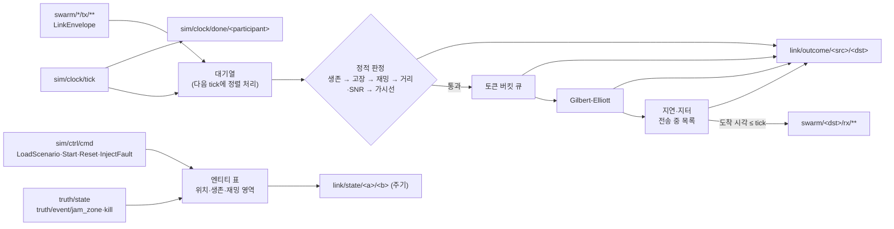

# WP4 데이터링크 추적표 (LNK)

- 범위: `datalink/`. Datalink Emulator (PRP-LNK-001, PRP-LNK-002, REQ-LNK-001~004, DEC-009).
- 라이브러리 `swarm_datalink_lib`, 실행 파일 `swarm_datalink`, 시험 `swarm_datalink_tests`(CTest 이름 `lnk.TC-LNK-NNN`).
- 버스는 `swarm_bus`의 `open_bus`(DEC-026), 지형은 `swarm_dynamics`의 `FlatTerrain`/`GridTerrain`(`dyn::Terrain`).

## 구조

## 모델 결정

- 시간: 송신은 받은 시점의 마지막 tick 시각을 송신 시각으로 붙이고, 다음 tick에서 (송신 시각, src, 키, seq) 순으로 처리한다. 도착 시각이 tick 시각 이하인 메시지를 그 tick에 전달한다. 지연 0인 링크도 최소 한 프레임 뒤에 전달된다. `rx_time_us`는 모델 도착 시각(프레임으로 양자화하지 않음)이다 (DEC-005).
- 결정론: 난수·GE 상태·토큰 버킷을 방향 링크(src→dst)마다 둔다. 링크 시드 = splitmix(seed, FNV(src), FNV(dst)). 균등·정규 변환은 직접 구현해 표준 라이브러리와 무관하다. 시드는 `--seed` → `LoadScenario.scenario.run.seed` → `Start.seed`(0이 아니면) 순으로 덮어쓴다.
- 프로파일: 송신 측(전력·이득·주파수·지연·대역폭·GE)은 송신 엔티티, 수신 측(이득·잡음·최소 SNR)은 수신 엔티티의 프로파일을 쓴다. `link_profile`이 비면 종류별 기본(GCS→`gcs_default`, UAV→`uav_default`, FPV→`fpv_default`, 그 밖→`default`), 모르는 이름은 `default`로 대체하고 한 번 기록한다.
- 재밍: 송신·수신 어느 한쪽이라도 활성 재밍 영역(원, 고도 무관) 안이면 `JAMMED` (DEC-009). 영역은 `JamZoneEvent.owner`마다 하나다.
- 가시선: 두 점을 잇는 직선이 지형 + 유효 지구 반경(4/3·R) 곡률 처짐보다 위에 있어야 한다. 실행 파일 기본 지형은 평지 0 m(`--terrain-flat`), DEM 로더는 WP2 인터페이스만 있어 연결 자리만 둔다 (DEC-016).
- 브로드캐스트(`dst` 비움): 송신자를 뺀, 같은 편(또는 편 미지정)의 무전기 엔티티(UAV·GCS·FPV 또는 `link_profile` 지정)에 각각 링크 모델을 적용한다.
- 고장: `LINK_CUT`은 대상의 모든 링크, `GCS_LINK_CUT`은 대상↔GCS 링크(대상이 GCS면 그 GCS의 모든 링크). `duration_s` 뒤 자동 해제, `clear`로 해제. 그 밖의 고장은 Core 담당이라 무시한다.
- `NODE_DEAD`: 송신·수신자가 죽었거나(truth `alive`, `truth/event/kill`) 엔티티 표에 없을 때. 전송 중 수신자가 죽거나 링크 고장이 들어오면 전달 시점에 버린다.
- `LinkState`: `--state-period`(기본 1 s)마다 같은 편 무전기 엔티티의 모든 쌍. `DOWN` = 위치 모름·사망·고장·재밍·거리 밖·가시선 없음, `DEGRADED` = SNR < 최소 SNR + 6 dB 또는 구간 손실률 ≥ 0.1, 그 밖 `UP`. `snr_db`는 두 방향 중 낮은 값, `loss_rate`는 직전 발행 이후 두 방향 합산.

## 구현 항목 (IMP)

| ID | 내용 | 위치 | 근거 |
|---|---|---|---|
| IMP-LNK-001 | 링크 프로파일 표(default, uav_default, gcs_default, fpv_default, ideal), 종류별 기본 프로파일, `DatalinkConfig::profiles` 추가·덮어쓰기 | `include/swarm/lnk/profile.hpp`, `src/profile.cpp` | PRP-LNK-001, REQ-LNK-001, REQ-LNK-004 |
| IMP-LNK-002 | WGS84 ECEF 직선거리, 자유공간 경로손실, SNR, 최소 SNR·최대 거리 판정 | `include/swarm/lnk/channel.hpp`, `src/channel.cpp` | PRP-LNK-001, REQ-LNK-001 |
| IMP-LNK-003 | 지형 가시선(`dyn::Terrain`, 4/3 유효 지구 반경 곡률) | `src/channel.cpp` | PRP-LNK-001, DEC-004, DEC-016 |
| IMP-LNK-004 | Gilbert-Elliott 2-상태 버스트 손실(메시지마다 천이) | `src/channel.cpp` | PRP-LNK-001, REQ-LNK-001 |
| IMP-LNK-005 | 고정 지연 + 정규 지터(0 이상 절단), 결정론 난수(mt19937_64 + 자체 균등·Box-Muller) | `src/channel.cpp` | PRP-LNK-001, REQ-LNK-001, DEC-005 |
| IMP-LNK-006 | 토큰 버킷 대역폭 큐(FIFO, 대기 메시지 수 상한 초과 시 QUEUE_OVERFLOW) | `src/channel.cpp` | PRP-LNK-001, REQ-LNK-001 |
| IMP-LNK-007 | 재밍 영역(`truth/event/jam_zone`, 원 기둥) 안 100% 손실 | `src/channel.cpp`, `src/emulator.cpp` | DEC-009, REQ-LNK-002 |
| IMP-LNK-008 | tx→rx 중계: 키 변환 `swarm/<src>/tx/<i>/<m>` → `swarm/<dst>/rx/<i>/<m>`, 브로드캐스트, tick 기준 지연 큐, 방향 링크별 난수로 도착 순서와 무관한 결정론, `rx_time_us` 채움, 메시지·수신자마다 `link/outcome/<src>/<dst>`, `FrameDone`, LoadScenario·Start·Reset·Shutdown 처리 | `include/swarm/lnk/emulator.hpp`, `src/emulator.cpp` | PRP-LNK-002, PRP-NET-003, REQ-LNK-004, REQ-UI-005, DEC-005, DEC-013 |
| IMP-LNK-009 | `link/state/<a>/<b>` 주기 발행(UP/DEGRADED/DOWN, SNR, 구간 손실률, 가시선, 재밍) | `src/emulator.cpp` | PRP-LNK-002, REQ-UI-005 |
| IMP-LNK-010 | 고장 주입 `LINK_CUT`·`GCS_LINK_CUT`(지속 시간, 해제) | `src/emulator.cpp` | REQ-LNK-002, REQ-LNK-003, DEC-014 |
| IMP-LNK-011 | 실행 파일 `swarm_datalink`: 공통 버스 옵션, `--participant`, `--seed`, `--scenario`(.pb/proto JSON), `--terrain-flat`, `--no-los`, `--state-period` | `src/main.cpp`, `CMakeLists.txt` | PRP-LNK-002, DEC-026 |

## 시험 (TC)

| ID | 내용 | 위치 | 근거 | 결과 |
|---|---|---|---|---|
| TC-LNK-001 | FSPL(1 km 2.4 GHz = 100.05 dB, 배 거리 +6.02 dB), SNR, SNR 경계 ±1%, max_range 제한, 버스: 10 km 전달·30 km OUT_OF_RANGE | `tests/test_datalink.cpp` | IMP-LNK-001, IMP-LNK-002, IMP-LNK-008 | 통과 (msvc-debug, 2026-11-01) |
| TC-LNK-002 | 격자 지형 2000 m 능선 차단·능선 위 통과, 평지 곡률(30 km, 10 m 차단 / 1000 m 통과), 버스 NO_LOS | `tests/test_datalink.cpp` | IMP-LNK-003 | 통과 (msvc-debug, 2026-11-01) |
| TC-LNK-003 | 재밍 영역 안 수신·송신 100건 모두 JAMMED, 영역 밖 링크 정상, 비활성화 후 복구 | `tests/test_datalink.cpp` | IMP-LNK-007 | 통과 (msvc-debug, 2026-11-01) |
| TC-LNK-004 | GE(p_gb 0.05, p_bg 0.25, 손실 0/1) 40만 건: 정상상태 손실 1/6 ± 0.005, 평균 버스트 길이 4 ± 0.1. 버스 5000건 손실률 1/6 ± 0.04 | `tests/test_datalink.cpp` | IMP-LNK-004, IMP-LNK-008 | 통과 (msvc-debug, 2026-11-01) |
| TC-LNK-005 | 지연 30 ms·지터 5 ms 10만 건 평균·표준편차 ±0.1 ms, 0 이상 절단. 버스: 지연 50 ms, 20 ms 프레임에서 도착 70 ms → 80 ms tick 전달, outcome tx/rx 시각 | `tests/test_datalink.cpp` | IMP-LNK-005, IMP-LNK-008 | 통과 (msvc-debug, 2026-11-01) |
| TC-LNK-006 | 토큰 버킷 송출 시각(0/100/200/300 ms), 대기 3 초과 거부, FIFO, 무제한. 버스: 10건 중 8건 QUEUE_OVERFLOW, 2건 전달 | `tests/test_datalink.cpp` | IMP-LNK-006, IMP-LNK-008 | 통과 (msvc-debug, 2026-11-01) |
| TC-LNK-007 | LINK_CUT(대상 전 링크 차단·해제), GCS_LINK_CUT(대상↔GCS만, 0.1 s 뒤 자동 해제, 대상이 GCS면 GCS 전 링크), ENGINE 무시 | `tests/test_datalink.cpp` | IMP-LNK-010 | 통과 (msvc-debug, 2026-11-01) |
| TC-LNK-008 | 6대 × 150 프레임 브로드캐스트(GE·지터·대역폭·거리 혼합): 같은 시드에서 송신 도착 순서를 뒤집어도 outcome 순서·값 동일, 다른 시드는 다름 | `tests/test_datalink.cpp` | IMP-LNK-008, DEC-005 | 통과 (msvc-debug, 2026-11-01) |
| TC-LNK-009 | LoadScenario(sim/ctrl/cmd) 시드, rx 키·출처·페이로드 보존, outcome 필드, 브로드캐스트 수신자(같은 편 무전기만), 미지·사망 수신자 NODE_DEAD, 자기 자신 제외, tick마다 FrameDone | `tests/test_datalink.cpp` | IMP-LNK-008 | 통과 (msvc-debug, 2026-11-01) |
| TC-LNK-010 | LinkState: 3 km UP, 15 km DEGRADED(SNR 여유), 40 km DOWN, SNR 값, 주기, 재밍·고장 쌍 DOWN·손실률 1, 키 a<b | `tests/test_datalink.cpp` | IMP-LNK-009 | 통과 (msvc-debug, 2026-11-01) |
| TC-LNK-011 | 내장 프로파일 표, 종류별 기본, GCS 링크 100 km, 방향별 링크 시드, 모르는 프로파일 대체·기록, Start.seed 덮어쓰기, Reset 시 전송 중 목록 비움 | `tests/test_datalink.cpp` | IMP-LNK-001, IMP-LNK-008 | 통과 (msvc-debug, 2026-11-01) |

## 제약과 다음 단계

- 시나리오별 링크 프로파일 재정의(JSON)는 계약에 자리가 없어 코드 내 표와 `DatalinkConfig::profiles`만 지원한다.
- 재밍 영역은 `Circle`만 있어 고도대·주파수대·다각형은 반영하지 않는다 (proposal §4는 원/다각형 × 고도대).
- 피어 중계(멀티홉)는 하지 않는다. 링크가 직접 닿는 수신자에게만 전달한다.
- DEM 로더가 생기면 `main.cpp`의 `FlatTerrain`을 `GridTerrain`으로 바꾼다.
