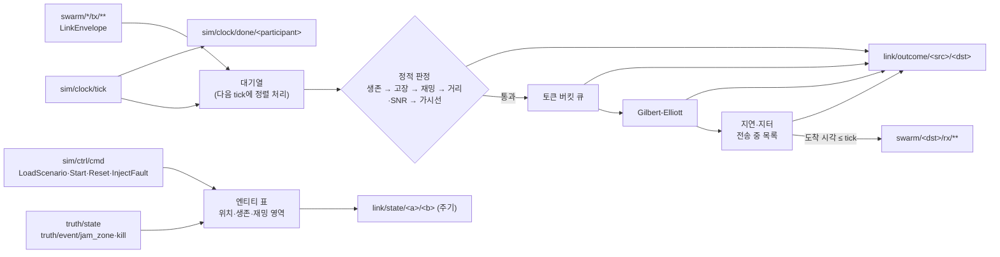

# WP4 데이터링크 추적표 (LNK)

- 범위: `datalink/`. Datalink Emulator (PRP-LNK-001, PRP-LNK-002, REQ-LNK-001~004, DEC-009, DEC-028~030, DEC-032, DEC-037). 계약 0.8.0.
- 라이브러리 `swarm_datalink_lib`, 실행 파일 `swarm_datalink`, 시험 `swarm_datalink_tests`(CTest 이름 `lnk.TC-LNK-NNN`).
- 버스는 `swarm_bus`의 `open_bus`(DEC-026), 지형은 `swarm_dynamics`의 `FlatTerrain`/`GridTerrain`(`dyn::Terrain`).

## 구조

## 모델 결정

- 시간: 송신은 받은 시점의 마지막 tick 시각을 송신 시각으로 붙이고, 다음 tick에서 (송신 시각, src, 키, seq) 순으로 처리한다. 도착 시각이 tick 시각 이하인 메시지를 그 tick에 전달한다. 지연 0인 링크도 최소 한 프레임 뒤에 전달된다. `rx_time_us`는 모델 도착 시각(프레임으로 양자화하지 않음)이다 (DEC-005).
- 결정론: 난수·GE 상태·토큰 버킷을 방향 링크(src→dst)마다 둔다. 링크 시드 = splitmix(seed, FNV(src), FNV(dst)). 균등·정규 변환은 직접 구현해 표준 라이브러리와 무관하다. 시드는 `--seed` → `LoadScenario.scenario.run.seed` → `Start.seed`(0이 아니면) 순으로 덮어쓴다.
- 프로파일: 송신 측(전력·이득·주파수·지연·대역폭·GE)은 송신 엔티티, 수신 측(이득·잡음·최소 SNR)은 수신 엔티티의 프로파일을 쓴다. `link_profile`이 비면 종류별 기본(GCS→`gcs_default`, UAV→`uav_default`, FPV→`fpv_default`, 그 밖→`default`), 모르는 이름은 `default`로 대체하고 한 번 기록한다.
- 시나리오 프로파일 (DEC-029): `Scenario.link_profiles`를 순서대로 적용한다. `base`가 있으면 그 이름(내장·설정·앞선 시나리오 항목), 비면 같은 이름의 내장·설정 프로파일, 둘 다 없으면 `default`를 복사하고 값이 있는 optional 필드만 덮어쓴다. `ge`가 있으면 네 값을 모두 바꾼다. 모르는 `base`는 `default`로 대체하고 기록한다. 시나리오를 다시 불러오면 이전 재정의는 버린다.
- 재밍: 수신 엔티티가 활성 재밍 영역 안이면 `JAMMED`, 송신 위치는 보지 않는다 (DEC-009, DEC-028). `link/state`의 `jammed`는 양쪽 중 하나라도 영역 안이면 참이다. 영역은 `JamZoneEvent.owner`마다 하나다.
- 재밍 영역 (DEC-030): `area`(원 또는 다각형 × 고도대)로 판정하고, `area`가 없을 때만 폐기 예정 `zone`(고도 무관 원)을 쓴다. 다각형은 위경도 평면 반직선 교차 판정, 고도대는 `min_alt_m ≤ alt ≤ max_alt_m`(경계 포함, `max_alt_m` 0이면 상한 없음).
- 가시선: 두 점을 잇는 직선이 지형 + 유효 지구 반경(4/3·R) 곡률 처짐보다 위에 있어야 한다. 실행 파일 기본 지형은 평지 0 m(`--terrain-flat`), DEM 로더는 WP2 인터페이스만 있어 연결 자리만 둔다 (DEC-016).
- 브로드캐스트(`dst` 비움): 송신자를 뺀, 같은 편(또는 편 미지정)의 무전기 엔티티(UAV·GCS·FPV 또는 `link_profile` 지정)에 각각 링크 모델을 적용한다. 닿지 않는 수신자마다 사유를 담은 `LinkOutcome`을 낸다 (DEC-032).
- 시나리오 배포 (DEC-037): `sim/ctrl/scenario`를 구독해 `LoadScenario` 없이도 적재한다. 마지막 적재와 `name`이 같으면 무시(내용이 달라도, 1 s 재발행에 상태가 초기화되지 않도록), 다르면 다시 적재한다. lockstep(`run.mode`)이면 적재 직후 `FrameDone{frame=0}`을 보낸다. `LoadScenario`는 항상 적재하고, 이후 같은 `name`의 재발행은 무시한다. `TaskStatus` 등이 지연·지터로 뒤바뀌는 것은 현실 모사로 유지한다.
- 고장: `LINK_CUT`은 대상의 모든 링크, `GCS_LINK_CUT`은 대상↔GCS 링크(대상이 GCS면 그 GCS의 모든 링크). `duration_s` 뒤 자동 해제, `clear`로 해제. 그 밖의 고장은 Core 담당이라 무시한다.
- `NODE_DEAD`: 송신·수신자가 죽었거나(truth `alive`, `truth/event/kill`) 엔티티 표에 없을 때. 전송 중 수신자가 죽거나 링크 고장이 들어오면 전달 시점에 버린다.
- `LinkState`: `--state-period`(기본 1 s)마다 같은 편 무전기 엔티티의 모든 쌍. `DOWN` = 위치 모름·사망·고장·재밍·거리 밖·가시선 없음, `DEGRADED` = SNR < 최소 SNR + 6 dB 또는 구간 손실률 ≥ 0.1, 그 밖 `UP`. `snr_db`는 두 방향 중 낮은 값, `loss_rate`는 직전 발행 이후 두 방향 합산.

## 구현 항목 (IMP)

| ID | 내용 | 위치 | 근거 |
|---|---|---|---|
| IMP-LNK-001 | 링크 프로파일 표(default, uav_default, gcs_default, fpv_default, ideal), 종류별 기본 프로파일, `DatalinkConfig::profiles` 추가·덮어쓰기 | `include/swarm/lnk/profile.hpp`, `src/profile.cpp` | PRP-LNK-001, REQ-LNK-001, REQ-LNK-004 |
| IMP-LNK-002 | WGS84 ECEF 직선거리, 자유공간 경로손실, SNR, 최소 SNR·최대 거리 판정 | `include/swarm/lnk/channel.hpp`, `src/channel.cpp` | PRP-LNK-001, REQ-LNK-001 |
| IMP-LNK-003 | 지형 가시선(`dyn::Terrain`, 4/3 유효 지구 반경 곡률) | `src/channel.cpp` | PRP-LNK-001, DEC-004, DEC-016 |
| IMP-LNK-004 | Gilbert-Elliott 2-상태 버스트 손실(메시지마다 천이) | `src/channel.cpp` | PRP-LNK-001, REQ-LNK-001 |
| IMP-LNK-005 | 고정 지연 + 정규 지터(0 이상 절단), 결정론 난수(mt19937_64 + 자체 균등·Box-Muller) | `src/channel.cpp` | PRP-LNK-001, REQ-LNK-001, DEC-005 |
| IMP-LNK-006 | 토큰 버킷 대역폭 큐(FIFO, 대기 메시지 수 상한 초과 시 QUEUE_OVERFLOW) | `src/channel.cpp` | PRP-LNK-001, REQ-LNK-001 |
| IMP-LNK-007 | 재밍 영역(`truth/event/jam_zone`, 원 기둥) 안 100% 손실 | `src/channel.cpp`, `src/emulator.cpp` | DEC-009, REQ-LNK-002 |
| IMP-LNK-008 | tx→rx 중계: 키 변환 `swarm/<src>/tx/<i>/<m>` → `swarm/<dst>/rx/<i>/<m>`, 브로드캐스트, tick 기준 지연 큐, 방향 링크별 난수로 도착 순서와 무관한 결정론, `rx_time_us` 채움, 메시지·수신자마다 `link/outcome/<src>/<dst>`, `FrameDone`, LoadScenario·Start·Reset·Shutdown 처리 | `include/swarm/lnk/emulator.hpp`, `src/emulator.cpp` | PRP-LNK-002, PRP-NET-003, REQ-LNK-004, REQ-UI-005, DEC-005, DEC-013 |
| IMP-LNK-009 | `link/state/<a>/<b>` 주기 발행(UP/DEGRADED/DOWN, SNR, 구간 손실률, 가시선, 재밍) | `src/emulator.cpp` | PRP-LNK-002, REQ-UI-005 |
| IMP-LNK-010 | 고장 주입 `LINK_CUT`·`GCS_LINK_CUT`(지속 시간, 해제) | `src/emulator.cpp` | REQ-LNK-002, REQ-LNK-003, DEC-014 |
| IMP-LNK-011 | 실행 파일 `swarm_datalink`: 공통 버스 옵션, `--participant`, `--seed`, `--scenario`(.pb/proto JSON), `--terrain-flat`, `--no-los`, `--state-period` | `src/main.cpp`, `CMakeLists.txt` | PRP-LNK-002, DEC-026 |
| IMP-LNK-012 | 재밍 판정을 수신단 기준으로 변경(`static_check_locked`), `link/state`는 양쪽 기준 유지 | `src/emulator.cpp` | DEC-028, REQ-LNK-002 |
| IMP-LNK-013 | `JamZoneEvent.area` 판정: 원·다각형(`in_polygon`) × 고도대(`in_jam_area`), `area` 없을 때 `zone` 대체 | `include/swarm/lnk/channel.hpp`, `src/channel.cpp`, `src/emulator.cpp` | DEC-030, DEC-009 |
| IMP-LNK-014 | 시나리오 `link_profiles` 적용: base 선택, optional 필드 덮어쓰기(`apply_override`), `ge` 전체 대체, 재적재 시 초기화 | `include/swarm/lnk/profile.hpp`, `src/profile.cpp`, `src/emulator.cpp` | DEC-029, REQ-LNK-004 |
| IMP-LNK-015 | `sim/ctrl/scenario` 구독(`on_scenario`): `LoadScenario` 없이 링크 프로파일·엔티티·시드 적재. `name`이 마지막 적재와 같으면 무시, 다르면 재적재 | `include/swarm/lnk/emulator.hpp`, `src/emulator.cpp` | DEC-037, DEC-025 |
| IMP-LNK-016 | lockstep 준비 신호 `send_ready`: 적재(`LoadScenario`·`sim/ctrl/scenario`·`load()`) 직후 `run.mode`가 LOCKSTEP이고 `participant_id`가 비어 있지 않으면 `sim/clock/done/<participant>`에 `FrameDone{frame=0}` | `src/emulator.cpp` | DEC-037, DEC-005 |
| IMP-LNK-017 | 입력 폭주 보호: 입력 큐 `max_pending`, 틱당 처리 (메시지, 수신자) 쌍 `max_routes_per_tick`(남은 것은 다음 틱), 전송 중 `max_in_flight`. 초과분은 payload를 버리고 `DROPPED(QUEUE_OVERFLOW)` LinkOutcome(틱당 `max_overflow_outcomes`건, 나머지는 건수만 로그)으로 기록. 어떤 부하에서도 `FrameDone`을 막지 않는다 | `include/swarm/lnk/emulator.hpp`, `src/emulator.cpp` | DEC-039, DEC-005, QA-012 |
| IMP-LNK-018 | 송신 시각을 도착 시각 대신 `header.sim_time_us`로 찍고 `tx_time < 틱 시각`인 메시지만 그 틱에서 처리(정렬 키 tx_time, src, key, seq). 메시지가 틱보다 먼저/나중에 도착해도 같은 프레임에서 처리 | `src/emulator.cpp` | DEC-039, DEC-005, QA-013 |
| IMP-LNK-019 | lockstep 참여자 대기: `sim/clock/done/*` 구독(`on_done`), 시나리오 `run.participants`(자신 제외)가 프레임 f-1의 FrameDone을 모두 보낸 뒤에 틱 f를 처리(`run_tick`). 콜백은 막지 않고 보류 틱을 보관, 시각이 되돌아가면 초기화 | `include/swarm/lnk/emulator.hpp`, `src/emulator.cpp` | DEC-039, DEC-005, QA-013 |
| IMP-LNK-015 | Windows에서 별도 프로세스 그룹으로 띄운 swarm_datalink가 Ctrl+Break(SIGBREAK)를 받으면 SIGINT와 같이 정상 종료 (P0 데모 실행기) | `src/main.cpp` | DEC-026 |

## 시험 (TC)

| ID | 내용 | 위치 | 근거 | 결과 |
|---|---|---|---|---|
| TC-LNK-001 | FSPL(1 km 2.4 GHz = 100.05 dB, 배 거리 +6.02 dB), SNR, SNR 경계 ±1%, max_range 제한, 버스: 10 km 전달·30 km OUT_OF_RANGE | `tests/test_datalink.cpp` | IMP-LNK-001, IMP-LNK-002, IMP-LNK-008 | 통과 (msvc-debug, 2026-11-01) |
| TC-LNK-002 | 격자 지형 2000 m 능선 차단·능선 위 통과, 평지 곡률(30 km, 10 m 차단 / 1000 m 통과), 버스 NO_LOS | `tests/test_datalink.cpp` | IMP-LNK-003 | 통과 (msvc-debug, 2026-11-01) |
| TC-LNK-003 | 재밍 영역 안 수신자로 보낸 100건 모두 JAMMED, 영역 밖 링크 정상, 비활성화 후 복구 | `tests/test_datalink.cpp` | IMP-LNK-007, IMP-LNK-012 | 통과 (msvc-debug, 2026-11-02) |
| TC-LNK-004 | GE(p_gb 0.05, p_bg 0.25, 손실 0/1) 40만 건: 정상상태 손실 1/6 ± 0.005, 평균 버스트 길이 4 ± 0.1. 버스 5000건 손실률 1/6 ± 0.04 | `tests/test_datalink.cpp` | IMP-LNK-004, IMP-LNK-008 | 통과 (msvc-debug, 2026-11-01) |
| TC-LNK-005 | 지연 30 ms·지터 5 ms 10만 건 평균·표준편차 ±0.1 ms, 0 이상 절단. 버스: 지연 50 ms, 20 ms 프레임에서 도착 70 ms → 80 ms tick 전달, outcome tx/rx 시각 | `tests/test_datalink.cpp` | IMP-LNK-005, IMP-LNK-008 | 통과 (msvc-debug, 2026-11-01) |
| TC-LNK-006 | 토큰 버킷 송출 시각(0/100/200/300 ms), 대기 3 초과 거부, FIFO, 무제한. 버스: 10건 중 8건 QUEUE_OVERFLOW, 2건 전달 | `tests/test_datalink.cpp` | IMP-LNK-006, IMP-LNK-008 | 통과 (msvc-debug, 2026-11-01) |
| TC-LNK-007 | LINK_CUT(대상 전 링크 차단·해제), GCS_LINK_CUT(대상↔GCS만, 0.1 s 뒤 자동 해제, 대상이 GCS면 GCS 전 링크), ENGINE 무시 | `tests/test_datalink.cpp` | IMP-LNK-010 | 통과 (msvc-debug, 2026-11-01) |
| TC-LNK-008 | 6대 × 150 프레임 브로드캐스트(GE·지터·대역폭·거리 혼합): 같은 시드에서 송신 도착 순서를 뒤집어도 outcome 순서·값 동일, 다른 시드는 다름 | `tests/test_datalink.cpp` | IMP-LNK-008, DEC-005 | 통과 (msvc-debug, 2026-11-01) |
| TC-LNK-009 | LoadScenario(sim/ctrl/cmd) 시드, rx 키·출처·페이로드 보존, outcome 필드, 브로드캐스트 수신자(같은 편 무전기만), 미지·사망 수신자 NODE_DEAD, 자기 자신 제외, tick마다 FrameDone | `tests/test_datalink.cpp` | IMP-LNK-008 | 통과 (msvc-debug, 2026-11-01) |
| TC-LNK-010 | LinkState: 3 km UP, 15 km DEGRADED(SNR 여유), 40 km DOWN, SNR 값, 주기, 재밍·고장 쌍 DOWN·손실률 1, 키 a<b | `tests/test_datalink.cpp` | IMP-LNK-009 | 통과 (msvc-debug, 2026-11-01) |
| TC-LNK-011 | 내장 프로파일 표, 종류별 기본, GCS 링크 100 km, 방향별 링크 시드, 모르는 프로파일 대체·기록, Start.seed 덮어쓰기, Reset 시 전송 중 목록 비움 | `tests/test_datalink.cpp` | IMP-LNK-001, IMP-LNK-008 | 통과 (msvc-debug, 2026-11-01) |
| TC-LNK-012 | 송신자만 영역 안: 20건 전달, 수신자 영역 안: 20건 JAMMED, `pair_state.jammed`는 양방향 참 | `tests/test_datalink.cpp` | IMP-LNK-012 | 통과 (msvc-debug, 2026-11-02) |
| TC-LNK-013 | 오목 다각형 내부·홈·외부, 고도대 경계(최소·최대 포함, 0.1 m 밖 제외, 상한 0 무제한), 원 `zone` 고도 무관. 버스: 다각형×고도대 안 JAMMED, 대역 위·아래 전달, `area`가 `zone`보다 우선, `area` 없으면 `zone` | `tests/test_datalink.cpp` | IMP-LNK-013 | 통과 (msvc-debug, 2026-11-02) |
| TC-LNK-014 | `apply_override`(설정 필드·명시 0 덮어쓰기, 미설정 유지, `ge` 네 값 대체). 버스(LoadScenario): base 지정 max_range 5 km(송·수신 모두), base 비움 같은 이름 재정의 지연 40 ms, 앞 항목 base 연쇄(지연 100 ms + max_range 상속), 모르는 base 기록, 재적재 시 재정의 제거 | `tests/test_datalink.cpp` | IMP-LNK-014 | 통과 (msvc-debug, 2026-11-02) |
| TC-LNK-015 | 브로드캐스트 1건: 같은 편 수신자마다 outcome 하나(전달·OUT_OF_RANGE·NODE_DEAD·JAMMED), 다른 편 없음, rx는 닿은 수신자만 | `tests/test_datalink.cpp` | IMP-LNK-008, DEC-032 | 통과 (msvc-debug, 2026-11-02) |
| TC-LNK-016 | `sim/ctrl/scenario`만으로 적재(시드·엔티티), lockstep 준비 신호 1건(`datalink-0`, frame 0), 같은 name 재발행(내용이 달라도) 무시, 다른 name 재적재·재신호, `LoadScenario` 후 같은 name 무시, 실시간은 신호 없음, 빈 participant는 신호 없음, 시나리오 프로파일 지연 100 ms 반영 | `tests/test_datalink.cpp` | IMP-LNK-015, IMP-LNK-016 | 통과 (msvc-debug, 2026-11-02) |
| TC-LNK-017 | 한 프레임에 5만 건 홍수(`max_pending` 1000, 틱당 400 쌍, 전송 중 3000, 지연 5 s 프로파일): 입력 큐·전송 중 목록 상한 유지, 매 틱 FrameDone, QUEUE_OVERFLOW 기록(outcome 5000건 미만), 홍수 뒤 큐가 비고 새 메시지 전달, 틱당 100 쌍 상한이면 350건을 다음 틱으로 미룸 | `tests/test_datalink.cpp` | IMP-LNK-017 | 통과 (msvc-debug, 2026-11-02) |
| TC-LNK-018 | 불완전 링크(GE·지터·대역폭) 3기 200 프레임: 같은 시드에서 송신이 틱 전/후에 도착해도, 반복해도 outcome 동일, 다른 시드는 다름, 손실·전달이 모두 있음 | `tests/test_datalink.cpp` | IMP-LNK-018, DEC-039 | 통과 (msvc-debug, 2026-11-02) |
| TC-LNK-019 | 참여자 FrameDone 대기: 첫 틱은 즉시, 이후 틱은 `agent-0`의 이전 프레임 FrameDone 전까지 보류(FrameDone 미발행, 늦게 온 tx 보류), 도착 후 처리·FrameDone, FrameDone이 틱보다 먼저 와도 즉시 처리 | `tests/test_datalink.cpp` | IMP-LNK-019, DEC-039 | 통과 (msvc-debug, 2026-11-02) |
| TC-LNK-020 | 틱마다 rx·link/outcome·link/state를 모두 발행한 뒤 FrameDone이 마지막, 틱당 FrameDone 1건 (같은 스레드에서 순서대로 발행) | `tests/test_datalink.cpp` | IMP-LNK-017, DEC-040 | 통과 (msvc-debug, 2026-11-03) |
| TC-LNK-021 | on_tick·on_done을 다른 스레드에서 동시에 호출(300프레임)해도 틱마다 FrameDone은 rx 뒤에 정확히 1건 (`run_mu_` 직렬화) | `tests/test_datalink.cpp` | IMP-LNK-019, DEC-040 | 통과 (msvc-debug, 2026-11-03) |

## 제약과 다음 단계

- 재밍 주파수대는 계약에 없어 반영하지 않는다. 다각형은 위경도 평면 판정이라 날짜변경선·극 부근 영역은 지원하지 않는다.
- 피어 중계(멀티홉)는 하지 않는다. 링크가 직접 닿는 수신자에게만 전달한다.
- DEM 로더가 생기면 `main.cpp`의 `FlatTerrain`을 `GridTerrain`으로 바꾼다.
- 폭주 폐기 outcome은 틱당 `max_overflow_outcomes`건까지이고 나머지는 건수만 로그에 남는다. 브로드캐스트 폭주 폐기는 dst=src 한 건으로 기록한다.
- 계약·타 WP 발견(QA-013): Datalink는 같은 입력(tx 내용·프레임)에 같은 결과를 낸다(TC-LNK-018, 019). 그러나 Datalink가 틱 f를 처리하며 낸 rx가 에이전트에 틱 f+1 전/후 어느 쪽에 도착하느냐는 Core의 다음 틱 발행과 경합한다. `--only 024`는 이 상태에서 같은 시드 2회 결과가 여전히 다르다(시드 7 최대 1.63 m, 20261104 최대 3.46 m, 프레임 수·누락도 다름). Datalink→에이전트 rx를 프레임 번호로 확정하려면 에이전트가 틱 f 처리 시 `rx_time_us <= 틱 시각`인 rx만 소비하거나 Core가 Datalink의 FrameDone 뒤에 rx 소비를 보장하는 규칙이 필요하다(WP3·WP1, 계약 변경 요청).
