# 군집 무인항공기 시뮬레이터 제안 계획서

| 항목 | 내용 |
|---|---|
| 문서 버전 | 0.1 (Draft) |
| 작성일 | 2026-11-01 |
| 관련 문서 | [ID 규칙](01_id_convention.md) · [등록부](02_registry.md) · [추적 매트릭스](03_traceability.md) |

---

## 1. 개요

### 1.1 목표
- 군집/편대 형성 알고리즘을 설계하고 검증하는 연구용 시뮬레이터를 만든다.
- 단일 비행체의 하위 유도/제어부터 상위 행동결정까지 계층별로 교체·설계할 수 있게 한다.
- 데이터링크의 불완전성(지연, 손실, 재밍)과 이종 기체 특성(센서, 재밍, 무장)을 반영한다.
- A-GRA 구조를 준용해, 나중에 실제 A-GRA 호환 MA를 시험하는 환경으로 확장할 수 있게 한다.

### 1.2 범위 밖
- 고충실도 3D 기체 가시화(게임 엔진 수준 렌더링)
- AMS-GRA 하드웨어 MPU(개구면, 프로세서 섀시 등) 모의
- 실제 무기체계의 제원 데이터. 무장은 공개 일반값으로 모의한다(DEC-019)
- 확률 기반 센서 탐지 모델. 탐지는 FOV·거리·가시선으로만 판정한다(DEC-018)
- 초기 단계의 고해상도 지형. 한반도 전역 저해상도로 시작한다(DEC-016)

---

## 2. 요구사항 요약
- 상세 내용은 [등록부 §1](02_registry.md#1-요구사항-req)에 있다.

| 영역 | 핵심 요구 | ID |
|---|---|---|
| UI | 2D/3D 지도 전시, RTS식 선택과 액션, 개별·군집 통제, 엔티티별 트래픽 모니터, 다중 UI 동시 접속 | REQ-UI-001~006 |
| 동역학 | 2/3/5/6-DoF 선택, 50–100 Hz, 적분기 선택, 무장 동역학 | REQ-DYN-001~005 |
| 유도/제어·행동 | 계층별 설계·교체, 기본안 또는 사용자안 선택 | REQ-GNC-001, REQ-BHV-001~004 |
| 분산·규모 | 이종 컴퓨터 분산, 20대 필수·수백 대 확장, 가속 | REQ-NET-001, REQ-PRF-001~002 |
| 데이터링크 | 지연·손실·대역폭, GCS 재밍, 개별 기체 두절, 기체 간 링크 | REQ-LNK-001~004 |
| 설정·임무장비 | GUI/JSON 초기 설정, 이종 특성, 센서, 재밍, 타격, 무장 탑재 | REQ-CFG-001~002, REQ-PAY-001~005 |
| 기타 | 표적/적 엔티티, 실행 모드, 오프라인 지형, 기록·재생, A-GRA | REQ-SIM-001~003, REQ-LOG-001, REQ-STD-001 |

---

## 3. 소프트웨어 아키텍처

### 3.1 시스템 컨텍스트

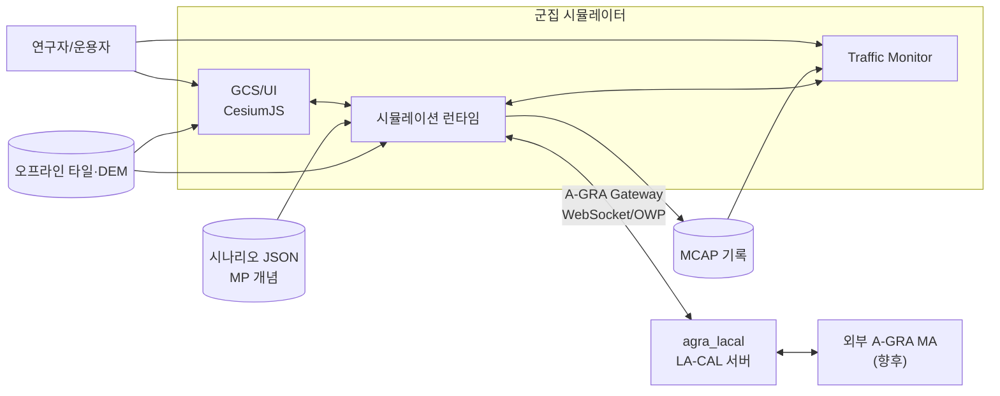

### 3.2 컴포넌트 구성 (PRP-SIM-001)

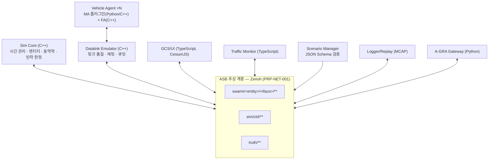

| 컴포넌트 | 책임 | 언어 |
|---|---|---|
| Sim Core | 프레임 스케줄링, 실행 모드, 엔티티 상태(SoA), 동역학 적분, DEM 탄착·충돌 판정, 공간 해싱 | C++20 |
| Vehicle Agent | 기체별 MA/FA 계층 실행, 플러그인 호스팅, L1 포트 제공 | C++ 런타임 + Python 플러그인 |
| Datalink Emulator | 모든 기체 간·지상-기체 간 메시지 중계, 링크 모델 적용, 전달·손실 사유 태깅 | C++20 |
| GCS/UI | 지도 전시, RTS 선택과 명령, 시나리오 편집, 시뮬레이션 통제 | TypeScript |
| Traffic Monitor | 엔티티별 메시지 트래픽 분석(실시간, 재생) | TypeScript |
| Scenario Manager | 시나리오 로드·저장·검증, GUI와 JSON 동기화 | Python |
| Logger/Replay | 전 채널 MCAP 기록, 재생 시 버스로 재송출 | C++ |
| A-GRA Gateway | 내부 메시지 ⇄ UCI 변환, agra_lacal 연동 | Python |

- **Ground truth 분리 (PRP-SIM-003):** `truth/**` 채널은 UI, 모니터, 로거만 구독한다. 기체 에이전트는 센서와 데이터링크를 거친 정보만 받는다.

### 3.3 단일 비행체 계층과 A-GRA 대응 (PRP-BHV-001, DEC-013)

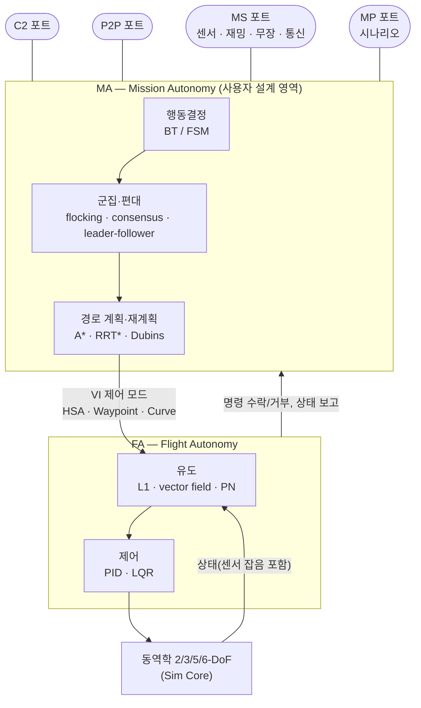

| 시뮬레이터 계층 | A-GRA 요소 |
|---|---|
| 행동결정, 군집·편대, 경로 계획 | MA |
| 유도, 제어 | FA. MA→FA 명령은 VI 제어 모드(HSA, Waypoint Following, Curve Following) |
| GCS 통제 UI | C2 |
| 기체 간 통신, 리더 선출, COP | P2P |
| 센서, 재밍, 무장, 통신 장비 | MS |
| 시나리오, 교전 기준 | MP |
| 기록, 재생 | MD |

- **플러그인 규칙:** MA 플러그인은 L1 포트로만 외부와 통신하며, 시뮬레이터 내부 상태에 직접 접근하지 않는다. 이 규칙이 L1 전면 준수로 확장하는 전제다.
- **호출 방식 (PRP-BHV-002):**
  - 기체별 호출: `on_frame(agent_ctx)`
  - 군집 일괄 호출: `on_frame_batch(swarm_view)`. NumPy 배열로 받아 벡터화한다.
- **의사결정 구조 (DEC-008):**
  - 분산형: 각 에이전트의 MA가 결정한다.
  - 중앙집중형: GCS 또는 리더 노드의 MA가 결정한 뒤 데이터링크로 하달한다.

### 3.4 명령 흐름 (UI → 데이터링크 → 기체)

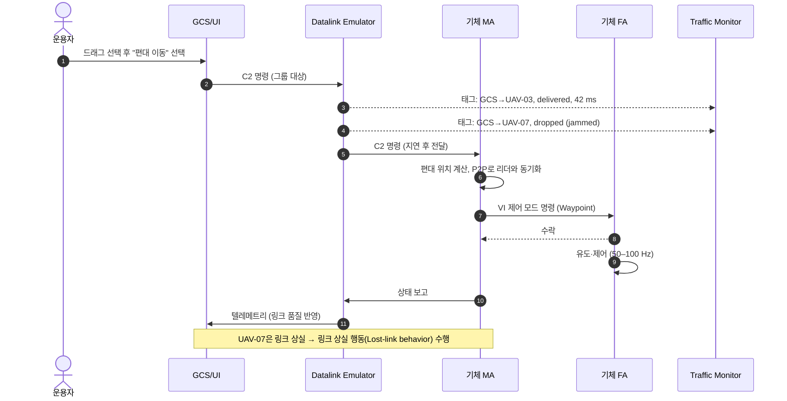

### 3.5 분산 배포 (REQ-NET-001)

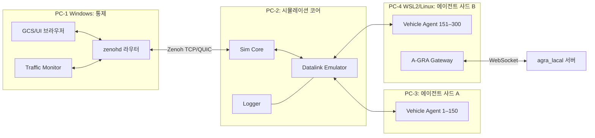

- **이종 컴퓨터 간 동시 시뮬레이션:** 핵심은 시간 동기화다.
  - Sim Core가 프레임 시작 신호를 발행한다.
  - 각 샤드는 프레임 연산을 마치고 완료를 보고한다(프레임 단위 lockstep).
  - free-run 모드에서는 각 프로세스가 벽시계로 진행한다.

### 3.6 링크 상태 머신

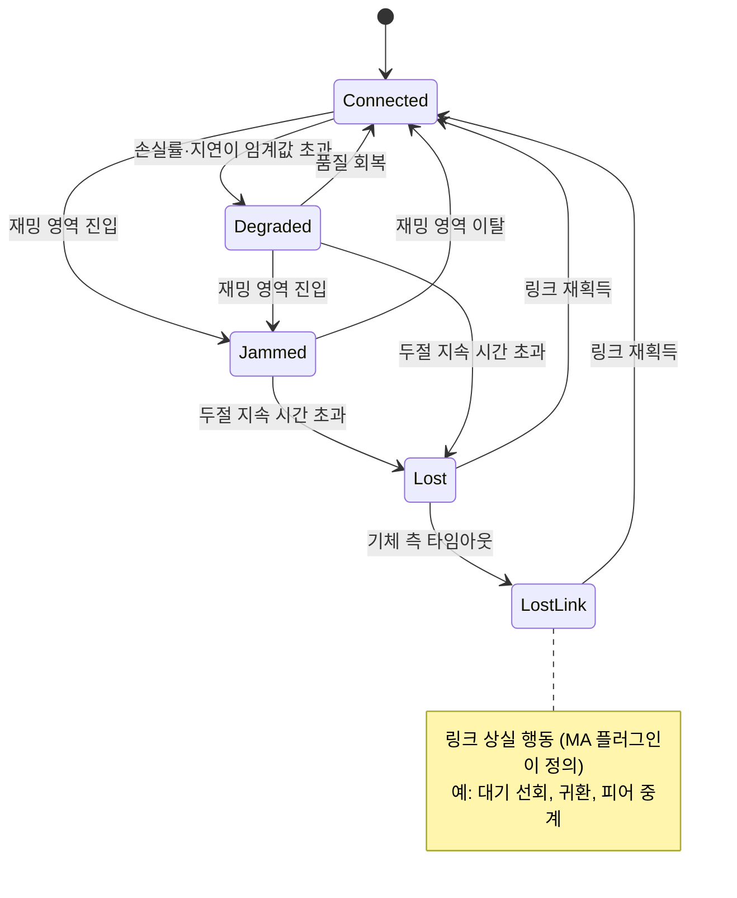

---

## 4. 데이터링크 모델 (PRP-LNK-001, DEC-009)

| 요소 | 모델 | 파라미터 예 |
|---|---|---|
| 경로손실 | 자유공간 + 거리 한계(LOS 판정에 DEM 사용) | 최대 거리, 송신 전력 |
| 손실 | Gilbert-Elliott 2-상태 버스트 손실 | p(G→B), p(B→G), 상태별 손실률 |
| 지연·지터 | 고정 지연 + 정규/파레토 지터 | 평균, 표준편차 |
| 대역폭 | 링크별 토큰 버킷 큐. 넘치면 드롭 | bps, 큐 길이 |
| 재밍 | 재머 영역(원/다각형 × 고도대) 안의 수신단은 100% 손실 | 중심, 반경, 주파수대, 활성 시간 |
| 토폴로지 | GCS↔UAV 스타, UAV↔UAV 메시, 피어 중계 | 링크별 활성화 |

- 메시지마다 `{src, dst, iface, msg, size, t_send, t_recv, outcome, reason}`을 기록한다.
- 이 기록이 Traffic Monitor(REQ-UI-005)와 MCAP의 공통 원천이다(PRP-LNK-002).

### 4.1 센서 탐지 모델 (DEC-018)
- 대상이 다음 세 조건을 모두 만족하면 탐지한다. 확률 요소는 없다.
  1. 센서 FOV(수평·수직 화각, 짐벌 지향각) 안에 있다.
  2. 센서의 최대 탐지 거리 안에 있다.
  3. DEM 기준 가시선(LOS)이 확보된다.
- 카메라 성능 차이는 FOV와 최대 탐지 거리로 표현한다(REQ-PAY-002).

---

## 5. 동역학 모델

### 5.1 비행체 모델 (PRP-DYN-001)

| 모델 | 상태 | 입력 | 용도 |
|---|---|---|---|
| 2-DoF | x, y, (vx, vy 또는 ψ, V) | 가속도 또는 선회율·속도 | 편대 알고리즘 빠른 시험 |
| 3-DoF | x, y, z, V, ψ, γ | 선회율, 상승률, 추력 | 3D 알고리즘 시험 |
| 5-DoF | 3D 위치 + V, ψ, γ, φ(롤), θ(피치) | 롤·피치 명령(1차 지연), 추력 | 실기체 거동 근사 |
| 6-DoF | 위치, 속도, 자세(쿼터니언), 각속도 | 조종면, 스로틀 | 실기체 모사 (Aerosonde 공력 계수) |

### 5.2 적분 구조 (PRP-DYN-002, DEC-005)

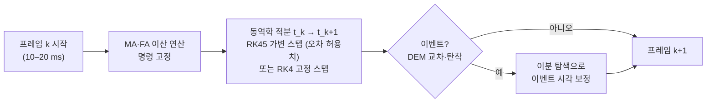

- 제어·통신·행동결정은 프레임 경계에서만 실행한다. 실제 디지털 제어기의 이산 특성을 유지한다.
- 미사일처럼 빠른 엔티티는 가변 스텝이 프레임 안에서 자동으로 세분된다.

### 5.3 무장 모델 (REQ-DYN-005, REQ-PAY-005, DEC-012)

| 무장 | 동역학 | 유도 | 종료 조건 |
|---|---|---|---|
| 단거리 공대공 미사일 | 3-DoF 질점, 추력·연소 시간, 항력 | 비례항법(PN), 탐색기 FOV·락온, 최대 기동 G | 근접 거리 ≤ 살상반경 → 파괴, 연료·시간 소진 → 자폭 |
| 공대지 미사일 | 3-DoF 질점 | PN 또는 좌표 유도 | DEM 교차 시 탄착, 살상반경 판정 |

- 성능 파라미터(속도, 사거리, 최대 G, 살상반경 등)는 공개 일반값의 기본 프로파일을 두고 시나리오 JSON에서 재정의한다(DEC-019).
- 표적/적 엔티티는 스크립트 경로·고정 위치가 기본이며, 아군과 같은 MA 플러그인을 연결할 수 있다(DEC-017).
| FPV 자폭 드론 | 소형 멀티콥터 3-DoF | 종말 유도(추적), 발사 후 독립 에이전트 | 표적 근접 또는 지면 충돌 |

- 탄착점은 동역학으로 계산한다. 탄착점에서 살상반경 안에 있는 대상은 즉시 파괴한다.
- 무장 엔티티도 데이터링크 대상이 될 수 있다. 예를 들어 FPV 영상·제어 링크를 재밍할 수 있다.

---

## 6. 모듈별 언어 (DEC-001)

| 모듈 | 언어/도구 | 근거 |
|---|---|---|
| Sim Core, Datalink, Logger | C++20, CMake, Eigen, zenoh-cpp, mcap | 수백 대 × 100 Hz 성능, 항공 자산(JSBSim 등)과 연동 |
| 알고리즘 플러그인 | Python 3.12, NumPy, uv, pybind11/nanobind | 연구 생산성, 벡터화 일괄 처리 |
| GCS/UI, Traffic Monitor | TypeScript, React, CesiumJS | 오프라인 3D 지구본·지형, Apache-2.0 |
| A-GRA Gateway | Python (agra_lacal 클라이언트 재사용) | 기존 LA-CAL 구현 활용 |
| 메시지 스키마 | Protobuf | 언어 중립, 경량 |

**검토한 대안: Rust**

| 장점 | 기각 사유 |
|---|---|
| 메모리 안전성, 데이터 경쟁 방지 | 항공 동역학·비행 SW 자산(JSBSim, PX4, ArduPilot)이 C++이라 FFI가 필요 |
| PyO3 기반 Python 바인딩 | 국방 인증 도구체인(MISRA, DO-178C)이 C++ 쪽이 더 성숙 |
| Zenoh가 Rust로 작성됨 | 학습 곡선과 국내 인력 풀 |

---

## 7. 권장 비행체 (DEC-007)

| 기체 | 유형 | 선정 이유 | 사용 DoF |
|---|---|---|---|
| Aerosonde | 고정익 소형 UAV | Beard & McLain, *Small Unmanned Aircraft*에 6-DoF 공력 계수가 공개되어 있어 교과서 수준으로 검증 가능 | 5/6-DoF 기준 모델 |
| Skywalker X8 | 고정익 비행익 | 연구용으로 널리 쓰이고, 공력 계수 식별 논문이 있음 | 6-DoF 대안 |
| Crazyflie 2.1, Holybro X500 | 멀티콥터 (참고) | 군집 연구 표준(Crazyswarm2), PX4 기준 기체 | FPV 드론 모델 참고 |

---

## 8. 연구·산업 동향

| 분야 | 동향 | 시뮬레이터 반영 |
|---|---|---|
| 학습 기반 군집 제어 | MARL(MAPPO 등)과 GNN·어텐션 기반 분산 정책. 분산 실행·중앙 학습 구조가 주류이며, sim-to-real 전이가 주요 과제 [1][2] | 군집 일괄 API, 가속 모드, Gym 래퍼(향후) |
| LLM 기반 임무 지휘 | LLM을 임무 계획, 군집 지휘, 네트워크 관리에 쓰는 연구가 늘고 있음. 2026년 종합 서베이 발표 [3][4] | 상위 행동결정 플러그인으로 LLM 에이전트를 연결할 수 있게 함 |
| CCA와 개방형 자율 구조 | 미 공군이 A-GRA로 서로 다른 기체·벤더의 MA를 통합 시험(2026.02, YFQ-42/YFQ-44) [5][6] | A-GRA 구조 준용, Gateway |
| EW 환경의 자율화 | 우크라이나 전장에서 재밍 때문에 조종 링크에 의존하지 않는 자율 비행·종말 유도와 메시 네트워크가 확산 [7][8] | 재밍 모델, 링크 상실 행동, 피어 중계 |
| 국내 | 유무인복합체계 기술 로드맵, AI 기반 MUM-T, 교리·상호운용성 과제가 연구되고 있음. 공군이 소모성 자폭드론 운용 개념을 발표 [9][10] | FPV/자폭 무장 모델, 이종 기체 |
| 고전 군집·편대 이론 | Reynolds·Olfati-Saber flocking, consensus, 분산 MPC, 이벤트 트리거 통신이 기본 비교 대상(baseline)으로 계속 쓰임 | 기본 제공 알고리즘(PRP-BHV-003) |

**출처**
1. [IntechOpen, MARL 기반 UAV 군집 리뷰](https://www.intechopen.com/online-first/1249361)
2. [Batra et al., Decentralized Control of Quadrotor Swarms with End-to-end Deep RL (arXiv 2109.07735)](https://tldr.takara.ai/p/2109.07735)
3. [Emami et al., LLM-Assisted UAV Operations and Communications (arXiv 2602.19534)](https://arxiv.org/abs/2602.19534)
4. [UAVs Meet LLMs (arXiv 2501.02341)](https://arxiv.org/pdf/2501.02341)
5. [Air Force validates open architecture, expands CCA ecosystem (2026.02)](https://www.march.afrc.af.mil/News/Article-Display/Article/4405471/air-force-validates-open-architecture-expands-collaborative-combat-aircraft-eco)
6. [Edwards AFB, CCA open architecture](https://www.edwards.af.mil/News/Display/Article/4408977/edwards-mission-benefits-from-air-force-move-to-cca-open-architecture/)
7. [IEEE Spectrum, The Coming Drone-War Inflection in Ukraine](https://spectrum.ieee.org/autonomous-drone-warfare)
8. [Defense One, Replicator drones in Ukraine](https://www.defenseone.com/technology/2024/11/newest-replicator-drones-proven-battlefields-ukraine/400997/)
9. [한국산학기술학회지, 유무인 복합 전투체계 기술 로드맵](https://kais99.org/jkais/journal/Vol24No04/vol24no04p61.pdf)
10. [earticle, AI 기반 MUM-T 발전 방향](https://www.earticle.net/Article/A472758)

- 전장 효과에 관한 일부 주장은 업계·논평 출처라 독립적으로 검증되지 않았다.

---

## 9. A-GRA / AMS-GRA 정합 (REQ-STD-001, DEC-013, DEC-014)

### 9.1 A-GRA
- **적용 대상:** A-GRA는 MA(Mission Autonomy)와 6개 L1 인터페이스(C2, VI, MS, MP, MD, P2P)를 정의한다. 시뮬레이터의 기체 계층(§3.3)을 이 경계에 맞춘다.
- **내부 메시지:** A-GRA 상호작용 단위의 경량 Protobuf 스키마를 쓴다(PRP-STD-001). UCI XML은 100 Hz × 수백 대 처리에 무겁다.
- **매핑 표:** 내부 메시지 ↔ UCI 메시지를 [등록부 §5](02_registry.md#5-a-gra-메시지-매핑-골격)에서 관리한다.
- **Gateway (PRP-STD-002):** 상호작용별 변환기를 플러그인으로 추가한다. agra_lacal에 LA-CAL 클라이언트로 접속하고, 외부로는 STD 메시지만 내보낸다.
- **L1 전면 준수로 가는 경로:** 남은 상호작용의 변환기를 추가하고 A-GRA 컴플라이언스 하네스로 검증한다.

### 9.2 확장 메시지 원칙 (DEC-014)
- **운용 C2 확장**(예: 편대 형태 지정): UCI 패턴(Command / CommandStatus / Status)을 따르는 자체 네임스페이스 메시지로 정의하고 `EXT`로 표시한다.
- **시뮬레이션 통제**(일시정지, 배속, 고장 주입, 리셋): `sim/ctrl/**` 전용 채널을 쓴다. MA 플러그인은 구독할 수 없다.

### 9.3 AMS-GRA에서 차용하는 개념
| AMS-GRA 개념 | 시뮬레이터 적용 |
|---|---|
| ASB(Abstract Service Bus) | 통신 추상 계층 (PRP-NET-001) |
| OMS 서비스 분해 | 임무장비를 서비스 단위로 모델링 (PRP-PAY-001) |
| Time Distribution | Sim Core 시간 관리와 프레임 동기화 |
| Armament | 무장 서비스와 탑재 구성 명명 |

### 9.4 자료 취급
- 매핑에는 공개 배포(Distribution A) XSD의 메시지명과 공개 Start Here Guide 내용만 쓴다.
- 배포 제한 표기가 있는 인터페이스 볼륨의 상세 내용은 이 문서에 옮기지 않는다.

---

## 10. 가속 성능 추정 (REQ-PRF-002)

| 구성 | 예상 배율 | 주 병목 |
|---|---|---|
| 2/3-DoF 100대 + Python 일괄 API | 수십 배 이상 | 링크 계산 |
| 6-DoF 20–50대 + Python 군집 알고리즘 | 5–10배 이상 | Python 호출 |
| 6-DoF 300대 + 기체별 Python 호출 | 5배 미만 가능 | Python 호출, UI 전송 |
| 6-DoF 300대 + 일괄 API 또는 C++ 플러그인 | 실시간 이상 | 링크 계산, 분산 동기화 |

- **추정 근거:** C++ 6-DoF RK4 1스텝은 약 1–3 µs다. 300대 × 100 Hz를 단일 코어로 처리하는 비용은 실시간의 10% 미만이다.
- **대책:**
  - 공간 해싱으로 이웃·링크 탐색을 O(N)으로 줄인다.
  - 링크 품질은 10–20 Hz로 갱신한다.
  - UI 텔레메트리는 벽시계 기준 10 Hz로 다운샘플한다.
  - 분산 동기화는 프레임 단위로 한다.
- **확정 방법:** P0/P1에서 벤치마크 시나리오(TC-PRF-*)로 측정해 REQ-PRF-002를 확정한다.

---

## 11. Traffic Monitor (REQ-UI-005, PRP-UI-002)

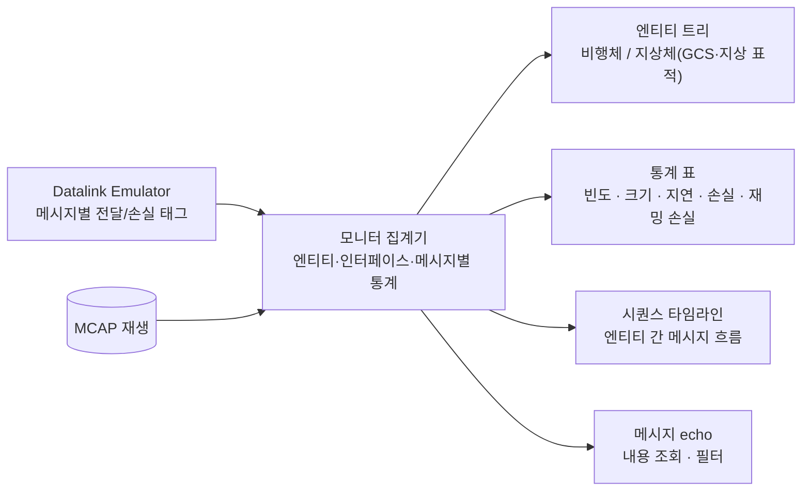

- **기능:**
  - 엔티티를 선택하면 해당 엔티티의 송수신 메시지만 볼 수 있다.
  - 인터페이스(C2/VI/P2P/MS)별로 필터링한다.
  - 손실 사유(거리, 버스트, 대역폭, 재밍)를 구분해 표시한다.
- **실시간 모드와 재생 모드:** 같은 화면을 쓴다. 재생 모드에서는 MCAP 시간축으로 이동할 수 있다.
- **재사용:** agra_lacal 모니터(시퀀스 타임라인, 빈도·지터·RTT)의 표현 방식을 참고한다.

---

## 12. 작업 분할(WBS)과 멀티 에이전트 개발 (DEC-015)

### 12.1 WBS

```mermaid
flowchart TB
    ROOT["군집 시뮬레이터"]

    ROOT --> W0["WP0 계약·기반"]
    ROOT --> W1["WP1 Sim Core"]
    ROOT --> W2["WP2 동역학"]
    ROOT --> W3["WP3 Agent 런타임·알고리즘"]
    ROOT --> W4["WP4 데이터링크"]
    ROOT --> W5["WP5 GCS/UI"]
    ROOT --> W6["WP6 Traffic Monitor"]
    ROOT --> W7["WP7 시나리오·기록"]
    ROOT --> W8["WP8 임무장비·무장"]
    ROOT --> W9["WP9 A-GRA Gateway"]
    ROOT --> W10["WP10 통합·검증"]

    W0 --> W0a["저장소·빌드 구조"]
    W0 --> W0b["Protobuf 스키마"]
    W0 --> W0c["Zenoh 키 체계"]
    W0 --> W0d["플러그인 API"]

    W1 --> W1a["프레임 스케줄러·실행 모드"]
    W1 --> W1b["엔티티 저장소 SoA"]
    W1 --> W1c["공간 해싱"]
    W1 --> W1d["분산 lockstep"]

    W2 --> W2a["2/3-DoF"]
    W2 --> W2b["5/6-DoF Aerosonde"]
    W2 --> W2c["RK4·RK45 적분기"]
    W2 --> W2d["DEM 이벤트 판정"]

    W3 --> W3a["에이전트 런타임·L1 포트"]
    W3 --> W3b["Python 바인딩"]
    W3 --> W3c["FA 유도·제어 기본안"]
    W3 --> W3d["MA 군집·편대 기본안"]

    W4 --> W4a["링크 모델"]
    W4 --> W4b["재밍 영역"]
    W4 --> W4c["메시지 태깅"]

    W5 --> W5a["Cesium 지도·오프라인 지형"]
    W5 --> W5b["RTS 선택·액션"]
    W5 --> W5c["시나리오 편집기"]
    W5 --> W5d["이펙트"]

    W6 --> W6a["집계기"]
    W6 --> W6b["엔티티별 화면"]
    W6 --> W6c["MCAP 재생 연동"]

    W7 --> W7a["JSON Schema·검증"]
    W7 --> W7b["MCAP 로거·재생"]

    W8 --> W8a["센서 PO"]
    W8 --> W8b["재머 EA"]
    W8 --> W8c["미사일·FPV"]
    W8 --> W8d["표적·적 엔티티"]

    W9 --> W9a["변환기 프레임워크"]
    W9 --> W9b["VI·C2·P2P 변환기"]

    W10 --> W10a["벤치마크"]
    W10 --> W10b["E2E 시나리오 시험"]
    W10 --> W10c["추적 매트릭스 갱신"]
```

### 12.2 의존 관계와 병렬 개발

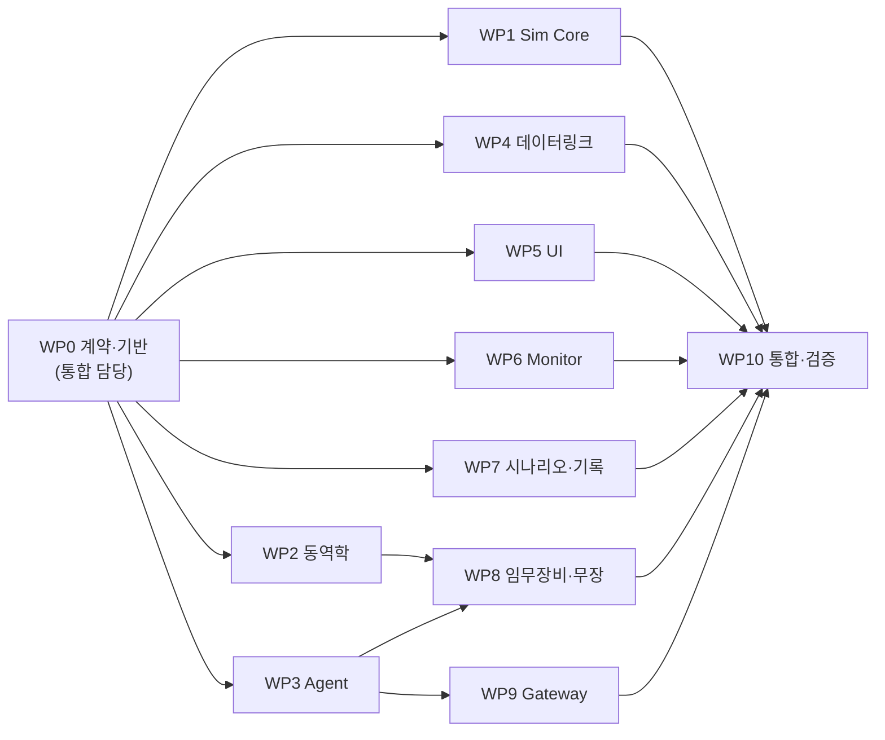

- **WP0은 먼저 단독으로 진행한다.** 이후 WP1–WP7은 각자의 세션(에이전트)에서 병렬로 개발한다.
- **세션 간 계약:** WP0 산출물(Protobuf 스키마, Zenoh 키, 플러그인 API 헤더/스텁)만으로 맺는다. 다른 패키지의 내부 구현에 의존하지 않는다.
- **충돌 방지:** 각 세션은 자기 디렉터리만 수정하고 별도 브랜치(worktree)에서 작업한다. 계약을 바꿀 때는 WP0 담당 세션을 거친다.
- **시험 격리:** 각 패키지는 인메모리 버스 백엔드와 목(mock)으로 단독 시험한다.

- 저장소는 모노레포이며, 아래 디렉터리 배정을 따른다(DEC-021).

| WP | 담당 에이전트(세션) | 주 디렉터리 | 산출물 |
|---|---|---|---|
| WP0 | 통합 담당 | `proto/`, `api/`, `scripts/`, `docs/`, 루트 빌드 | 스키마, 키 체계, API, CI ([10_contracts.md](10_contracts.md)) |
| WP1 | Core | `core/` | 스케줄러, 엔티티 저장소, lockstep |
| WP2 | Dynamics | `dynamics/` | DoF 모델, 적분기, DEM 판정 |
| WP3 | Agent | `agent/`, `algorithms/` | 런타임, 바인딩, 기본 알고리즘 |
| WP4 | Datalink | `datalink/` | 링크·재밍 모델, 태깅 |
| WP5 | UI | `ui/` | 지도, RTS 통제, 편집기, 이펙트 |
| WP6 | Monitor | `ui/monitor/` | 트래픽 모니터 |
| WP7 | Scenario/Log | `scenario/`, `logger/` | JSON Schema, MCAP |
| WP8 | Payload | `payload/` | 센서, 재머, 무장, 표적 |
| WP9 | Gateway | `gateway/` | A-GRA 변환기 |
| WP10 | 통합 담당 | `tests/`, `bench/` | E2E 시험, 벤치마크, 매트릭스 |

---

## 13. 로드맵

```mermaid
gantt
    title 단계별 로드맵 (기간은 상대 단위)
    dateFormat X
    axisFormat %s
    section 기반
    WP0 계약·기반                 :p0a, 0, 1
    section 1단계 알고리즘 환경
    P0 2-DoF + 2D UI 골격         :p0, 1, 2
    P1 3-DoF + 편대 + 모니터      :p1, 2, 3
    section 2단계 현실성
    P2 데이터링크·재밍            :p2, 3, 4
    P3 5/6-DoF + RK45             :p3, 3, 5
    P4 분산 실행                  :p4, 4, 5
    section 3단계 임무
    P5 임무장비·무장·표적         :p5, 5, 6
    section 4단계 표준·연동
    P6 A-GRA Gateway              :p6, 6, 7
    P7 A-GRA L1 전면 준수         :p7, 7, 9
    P8 SITL 연동                  :p8, 8, 9
```

| 단계 | 완료 기준 |
|---|---|
| P0 | 2-DoF 20대가 2D 지도에 표시되고, 드래그 선택으로 이동 명령 가능 |
| P1 | 3-DoF 편대 기본 알고리즘 동작, Traffic Monitor 기본 화면, 가속 벤치마크 1차 |
| P2 | GCS 재밍, 개별 기체 두절, 링크 상실 행동 시연 |
| P3 | Aerosonde 6-DoF가 VI 제어 모드를 추종, RK45/RK4 오차 비교 |
| P4 | 4대 PC에 분산해 300대 실행 |
| P5 | 공대공·공대지·FPV 교전 시나리오, 살상반경 판정 |
| P6 | VI·C2·P2P 주요 상호작용을 agra_lacal과 교환 |
| P7 | L1 컴플라이언스 하네스 통과 |
| P8 | PX4/ArduPilot SITL 기체 1대 이상 연동 |

---

## 14. 추가 결정사항 요약

| ID | 결정 |
|---|---|
| DEC-016 | 지도·DEM은 한반도 전역 저해상도. 고해상도와 지역 변경은 추후 |
| DEC-017 | 표적/적은 스크립트 기본 + MA 플러그인 연결 가능 |
| DEC-018 | 센서 탐지는 FOV·최대 거리·DEM 가시선 판정만 사용. 확률 모델 없음 |
| DEC-019 | 무장 성능은 공개 일반값 기본 프로파일 + 시나리오 JSON 재정의 |
| DEC-020 | 다중 UI 동시 접속은 지금 반영, 역할 권한은 P6 이후 |
| DEC-021 | 모노레포, WP별 디렉터리, 병렬 세션은 worktree |

- 현재 열린 미결정사항은 없다.
