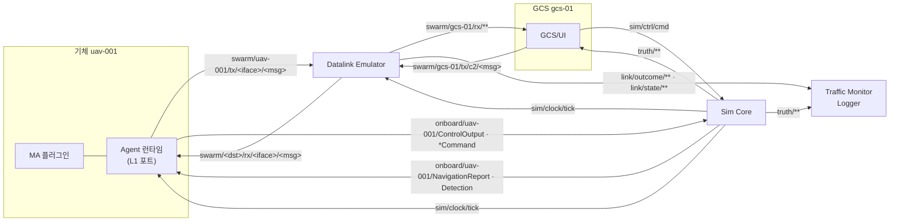
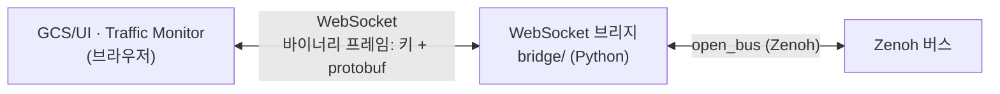
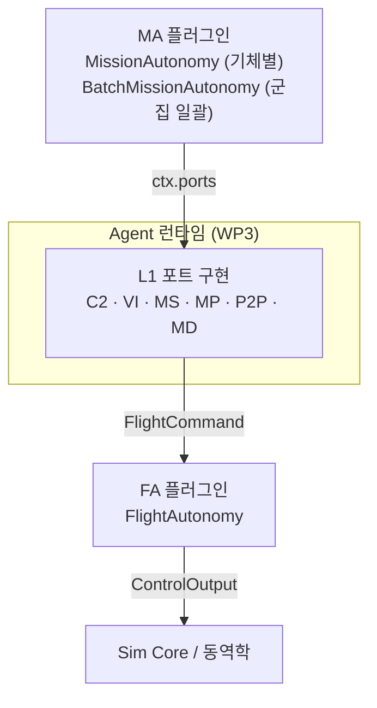

# WP0 계약

- WP 세션들은 이 문서와 `proto/`, `api/`, `bus/`만으로 서로 연결한다 (DEC-015).
- 이 계약을 바꿀 때는 WP0을 거친다. 바꾸면 `CONTRACT_VERSION`(`api/python/src/swarm_api/__init__.py`)을 올린다.
- 계약 버전: 0.2.0
  - 0.2.0: `to_kinematic`에 `Environment` 추가(DEC-023), `Scenario`·`RunSpec` 메시지(DEC-024, DEC-025), 공용 버스 `bus/`와 `open_bus`(DEC-026), 브라우저 연동은 WebSocket 브리지(DEC-027)

## 1. 산출물

| 구분 | 위치 | IMP |
|---|---|---|
| 저장소·빌드 구조 | `CMakeLists.txt`, `CMakePresets.json`, `vcpkg.json`, `pyproject.toml`(uv workspace) | IMP-API-001 |
| Protobuf 스키마 | `proto/swarm/v1/*.proto` | IMP-API-002 |
| Zenoh 키 체계 | `api/python/src/swarm_api/keys.py`, `api/cpp/include/swarm/api/keys.hpp` | IMP-API-003 |
| ASB 버스 계약 + 인메모리 백엔드 | `api/python/src/swarm_api/bus.py`, `api/cpp/include/swarm/api/bus.hpp` | IMP-API-004 |
| 플러그인 API (MA/FA, L1 포트) | `api/python/src/swarm_api/{ports,plugin}.py`, `api/cpp/include/swarm/api/plugin.hpp` | IMP-API-005 |
| Core ⇄ 동역학 인터페이스 | `api/cpp/include/swarm/api/dynamics.hpp` | IMP-API-006 |
| 공용 버스 라이브러리 (InMemory, Zenoh, `open_bus`) | `bus/` (C++ `swarm_bus`), `api/python/src/swarm_api/bus.py` | IMP-API-007 |

## 2. 좌표와 단위

- 위치: WGS84 위도·경도(deg), 고도는 MSL(m)
- 속도: NED(m/s)
- 자세: NED → 기체 FRD 회전 쿼터니언 (w, x, y, z)
- 각속도: 기체 FRD(rad/s)
- 시간: 시뮬레이션 시각 `sim_time_us`(uint64, µs), 프레임 번호 `frame`
- 각도 필드는 이름에 단위를 붙인다(`_deg`, `_rad`). 단위가 없는 각도 필드는 rad이다.

## 3. Zenoh 키 체계 (PRP-NET-003)

### 3.1 메시지 흐름



### 3.2 키 목록

| 키 | 메시지 | 발행 | 구독 |
|---|---|---|---|
| `sim/clock/tick` | `ClockTick` | Core | 모든 참여자의 런타임 |
| `sim/clock/done/<participant>` | `FrameDone` | 참여자 | Core (lockstep 장벽) |
| `sim/ctrl/cmd` | `SimCommand` | UI | Core |
| `sim/ctrl/status` | `SimStatus` | Core | UI, Monitor |
| `swarm/<src>/tx/<iface>/<msg>` | `LinkEnvelope` | 송신 엔티티 런타임, UI(GCS) | Datalink만 |
| `swarm/<dst>/rx/<iface>/<msg>` | `LinkEnvelope` | Datalink | 수신 엔티티 런타임, UI(GCS) |
| `onboard/<id>/<msg>` | `NavigationReport`, `Detection`, `*Activity`, `ControlOutput`, `*Command` | Core ⇄ 해당 기체 런타임 | 해당 기체 런타임, Core |
| `link/outcome/<src>/<dst>` | `LinkOutcome` | Datalink | Monitor, Logger |
| `link/state/<a>/<b>` | `LinkState` (a < b 사전순) | Datalink | UI, Monitor |
| `truth/state` | `TruthFrame` | Core | UI, Monitor, Logger |
| `truth/event/<kind>` | `TruthEvent` (`launch`, `impact`, `kill`, `jam_zone`, `spawn`) | Core | UI, Monitor, Logger |

### 3.3 규칙

- `<iface>`: `c2`, `vi`, `ms`, `mp`, `md`, `p2p`. `<msg>`: proto 메시지의 짧은 이름(예: `FlightCommand`).
- 엔티티 ID: `^[a-z][a-z0-9]*(-[a-z0-9]+)+$`, 32자 이하.
  - 관례: `uav-001`, `gcs-01`, `tgt-001`, `site-01`, 발사체는 `wpn-<발사기체>-<순번>`
  - 참여자(프로세스) ID도 같은 형식이다. 예: `core-0`, `datalink-0`, `agent-host-1`
- 인코딩: Zenoh encoding을 `application/protobuf;<전체 메시지 이름>`으로 둔다.
- 기체 간·지상-기체 간 메시지는 반드시 `tx` → Datalink → `rx`로 흐른다. 런타임은 다른 엔티티의 `rx`에 직접 발행하지 않는다.
- `onboard/**`는 같은 기체 안의 신호다. 데이터링크를 거치지 않는다. FA→MA 간 VI도 같은 기체 안이면 런타임 내부 호출로 처리하고 버스에 싣지 않아도 된다.
- MA 플러그인은 버스에 직접 접근하지 않는다. 런타임은 `sim/ctrl/`, `truth/`, `link/` 접두어를 플러그인에 노출하지 않는다 (`MA_FORBIDDEN_PREFIXES`).
- MCAP 채널은 키와 1:1로 대응한다 (PRP-LOG-001).

### 3.4 버스 열기 (DEC-026)

- 프로세스는 버스 구현을 직접 만들지 않고 `open_bus(BusConfig)`로 연다.
  - C++: `swarm/bus/open_bus.hpp` (타깃 `swarm_bus`). Zenoh가 빌드에 없으면 memory만 된다.
  - Python: `swarm_api.open_bus(BusConfig(...))`. Zenoh는 `swarm-api[zenoh]`(eclipse-zenoh 1.10)
- `BusConfig`: `backend`(zenoh | memory, 비우면 Zenoh가 있으면 zenoh), `zenoh_config_file`, `zenoh_mode`, `connect`, `listen`, `multicast_scouting`
- 실행 파일의 명령행 옵션은 같은 이름을 쓴다: `--bus`, `--zenoh-config`, `--zenoh-mode`, `--connect`, `--listen`, `--no-multicast` (`parse_bus_arg`, `kBusUsage`)

### 3.5 브라우저 연동 (DEC-027)



- 브라우저는 Zenoh에 직접 붙지 않는다. 모든 송수신은 브리지를 거친다.
- 브리지가 하는 일:
  - 구독: 클라이언트가 키 표현식과 최대 전송 주기를 지정한다. 브리지가 클라이언트별로 다운샘플한다 (DEC-006).
  - 발행: 허용한 키만 받는다. 기본 허용은 `sim/ctrl/cmd`와 그 UI가 맡은 GCS의 `swarm/<gcs>/tx/**`
  - 역할별 권한(DEC-020, P6 이후)은 브리지에 붙인다.
- 프레임 형식과 구현은 WP5가 `bridge/`에서 정하고 이 절에 추가한다.

## 4. Protobuf 스키마

- 패키지: `swarm.v1`. 호환을 깨는 변경은 `swarm.v2`로 한다.
- 각 메시지에 커스텀 옵션으로 A-GRA 매핑을 단다 (`options.proto`).
  - `uci_name`: 공개 XSD의 UCI 메시지명
  - `mapping`: `STD`(외부로 내보냄) / `EXT`(확장, 외부 비공개) / `SIM`(내부 전용)
  - `l1`: L1 인터페이스
- Gateway(WP9)는 디스크립터에서 이 옵션을 읽어 매핑 표를 만든다. 등록부 §5 매핑 표와 어긋나면 proto가 기준이다.

| 파일 | 내용 | 매핑 |
|---|---|---|
| `common.proto` | Header, 좌표, 영역, CommandState | - |
| `entity.proto` | EntityKind, Side, DynamicsKind, EntityState, EntitySpec | - |
| `vi.proto` | FlightCommand(HSA/Waypoint/Curve), FlightCommandStatus, FlightCapability, NavigationReport, SystemStatus | STD |
| `c2.proto` | TaskCommand, TaskStatus, ApprovalRequest (STD) / FormationCommand, GroupAssignment, ApprovalResponse (EXT) | STD/EXT |
| `p2p.proto` | PeerStatus, LeaderUpdate, TrackShare (STD) / PeerAlgorithmMessage (EXT) | STD/EXT |
| `ms.proto` | Sensor/Jammer/Strike Command·Activity, StoreLoadout (STD) / Detection (EXT) | STD/EXT |
| `mp.proto` | MissionPlan, RoutePlan, EngagementCriteria | STD |
| `fa.proto` | ControlOutput (Kinematic/Attitude/Actuator) | SIM |
| `link.proto` | LinkEnvelope, LinkOutcome, LinkState | SIM |
| `sim.proto` | SimCommand, SimStatus, ClockTick, FrameDone, Scenario(MapSpec, RunSpec) | SIM |
| `truth.proto` | TruthFrame, TruthEvent | SIM |

- 시나리오: `LoadScenario.scenario`(`Scenario`)로 보낸다. `scenario_json`은 폐기 예정이다 (DEC-024). `Scenario`의 필드 구성은 `scenario/` JSON Schema와 같고, 변환은 `swarm_scenario.to_proto` / `from_proto`가 한다. `swarm_core --scenario`에 줄 파일은 `swarm-scenario export`로 만든다.

- 코드 생성
  - C++: CMake `protobuf_generate` (`proto/CMakeLists.txt`, 타깃 `swarm_proto`)
  - Python: `scripts/gen_proto.py` → `api/python/src/swarm/v1/`
  - TypeScript: protobuf-es(`@bufbuild/protobuf`). WP5가 `ui/`에 설정한다.

## 5. 플러그인 API



- MA
  - 기체별: `on_init(ctx)`, `on_step(ctx)`, `on_shutdown(ctx)`
  - 군집 일괄: `on_step_batch(ctxs, nav)`. `nav`는 NumPy 배열 묶음이다. 기체마다 `ctxs[i].ports`로만 송수신한다 (DEC-008).
  - 난수는 `ctx.rng`만 쓴다 (lockstep 결정론).
- FA: `on_init` → `FlightCapability`, `on_command(FlightCommand)` → 수락/거부, `step(nav, dt)` → `ControlOutput`
- 등록
  - Python: entry point 그룹 `swarm.ma`, `swarm.fa`
  - C++: 공유 라이브러리가 `swarm_plugin_abi`, `swarm_create_ma`, `swarm_create_fa`를 내보낸다. ABI 버전은 `kPluginAbiVersion`이다.
- 시나리오는 `AutonomySpec.ma_plugin`, `fa_plugin`에 등록명을 적는다.

## 6. Core ⇄ 동역학 (`dynamics.hpp`)

- `DynamicsModel`: `derivatives(t, x, u, env, dxdt)`, `map_control(ControlOutput, u)`, `to_kinematic(x, env, out)` / `from_kinematic(in, x)`
  - 상태의 속도는 대기 속도다. `to_kinematic`은 바람(`env.wind_ned_mps`)을 더한 대지 속도를 내고, 중력은 `env.gravity_mps2`를 쓴다 (DEC-023).
  - `from_kinematic`은 입력 속도를 대기 속도로 해석한다(초기 상태 설정용).
- `Integrator::step(model, t0, dt, x, u, env, event)`: 프레임 한 칸을 적분한다. RK45는 프레임 안에서 가변 스텝을 쓴다.
- `EventFn`: 영점 교차 함수(예: 고도 − DEM 고도). 적분기는 교차 시점을 이분법으로 찾아 그 시점에서 멈춘다 (DEC-005).
- `Terrain::elevation_m(lat, lon)`: DEM 조회. 구현은 WP2가 맡는다.

## 7. 빌드 환경과 시험 (DEC-022)

### 7.1 지원 툴체인

| 프리셋 | 환경 | C++ 의존성 | 셸 |
|---|---|---|---|
| `msvc-debug`, `msvc-release` | Windows, MSVC | vcpkg 매니페스트(`vcpkg.json`), `VCPKG_ROOT` 필요 | `vcvars64.bat`를 부른 cmd (x64 Native Tools) |
| `mingw-debug`, `mingw-release` | Windows, MSYS2 UCRT64 GCC | pacman 패키지 | MSYS2 UCRT64 |
| `linux-debug`, `linux-release` | Linux/WSL2, GCC | 배포판 패키지 | bash |
| `linux-vcpkg-debug` | Linux/WSL2, GCC | vcpkg | bash |

- 모든 프리셋은 Ninja 생성기를 쓴다.
- CMake는 의존성을 `find_package`로만 찾는다. 새 의존성을 추가하는 WP는 `vcpkg.json`과 아래 패키지 목록을 함께 갱신한다.
- `vcpkg.json`의 `builtin-baseline`은 vcpkg 저장소 커밋으로 라이브러리 버전을 고정한다. 모든 개발자·세션이 같은 버전을 쓰도록 WP0만 바꾼다.
- `vcvars64.bat`는 `VCPKG_ROOT`를 Visual Studio에 포함된 vcpkg로 덮어쓴다. baseline이 있으므로 어느 vcpkg를 써도 같은 버전을 받는다.

### 7.2 환경별 설치

MSVC + vcpkg:

```bash
winget install Microsoft.VisualStudio.2022.BuildTools --override "--wait --passive --add Microsoft.VisualStudio.Workload.VCTools --includeRecommended"
```

```bash
git clone https://github.com/microsoft/vcpkg C:\dev\vcpkg
```

```bash
C:\dev\vcpkg\bootstrap-vcpkg.bat
```

```bash
setx VCPKG_ROOT C:\dev\vcpkg
```

MSYS2 UCRT64 (MSYS2 설치 후 UCRT64 셸에서):

```bash
pacman -S --needed mingw-w64-ucrt-x86_64-toolchain mingw-w64-ucrt-x86_64-cmake mingw-w64-ucrt-x86_64-ninja mingw-w64-ucrt-x86_64-protobuf mingw-w64-ucrt-x86_64-eigen3
```

Ubuntu / WSL2:

```bash
sudo apt install build-essential cmake ninja-build libprotobuf-dev protobuf-compiler libeigen3-dev
```

MCAP (WP7 `logger/`):

- MSVC + vcpkg: `vcpkg.json`의 `mcap` 포트로 자동 설치된다.
- MSYS2·Ubuntu: 패키지가 없다. mcap 저장소의 C++ 헤더를 받아 `-DMCAP_INCLUDE_DIR=<mcap>/cpp/mcap/include`로 넘긴다. 지정하지 않으면 경고를 내고 `logger/`를 건너뛴다.

```bash
git clone --depth 1 https://github.com/foxglove/mcap <mcap>
```

Zenoh (zenoh-c + zenoh-cpp 1.10.2):

- vcpkg와 MSYS2·Ubuntu 배포판에 패키지가 없으므로 eclipse-zenoh 공식 릴리스의 standalone zip을 한 접두 경로에 풀고 `CMAKE_PREFIX_PATH`로 넘긴다.
- zenoh-cpp는 헤더 전용이다(`zenohcpp-1.10.2-standalone.zip`). zenoh-c는 환경별 zip을 받는다.
- Zenoh가 없으면 `bus/`는 memory 백엔드만 들어간 채로 빌드되고, Zenoh 시험은 빠진다.

| 환경 | zenoh-c zip | 접두 경로 예 |
|---|---|---|
| MSVC | `zenoh-c-1.10.2-x86_64-pc-windows-msvc-standalone.zip` | `C:\dev\zenoh` |
| MSYS2 UCRT64 | `zenoh-c-1.10.2-x86_64-pc-windows-gnu-standalone.zip` | `/ucrt64/opt/zenoh` |
| Ubuntu / WSL2 | `zenoh-c-1.10.2-x86_64-unknown-linux-gnu-standalone.zip` | `/opt/zenoh` |

MSVC (PowerShell):

```bash
curl.exe -LO https://github.com/eclipse-zenoh/zenoh-c/releases/download/1.10.2/zenoh-c-1.10.2-x86_64-pc-windows-msvc-standalone.zip
```

```bash
curl.exe -LO https://github.com/eclipse-zenoh/zenoh-cpp/releases/download/1.10.2/zenohcpp-1.10.2-standalone.zip
```

```bash
mkdir C:\dev\zenoh; tar -xf zenoh-c-1.10.2-x86_64-pc-windows-msvc-standalone.zip -C C:\dev\zenoh; tar -xf zenohcpp-1.10.2-standalone.zip -C C:\dev\zenoh
```

```bash
setx CMAKE_PREFIX_PATH C:\dev\zenoh
```

MSYS2 UCRT64 / Ubuntu (`<zip>`, `<prefix>`는 위 표):

```bash
curl -LO https://github.com/eclipse-zenoh/zenoh-c/releases/download/1.10.2/<zip>
```

```bash
curl -LO https://github.com/eclipse-zenoh/zenoh-cpp/releases/download/1.10.2/zenohcpp-1.10.2-standalone.zip
```

```bash
mkdir -p <prefix> && unzip -o <zip> -d <prefix> && unzip -o zenohcpp-1.10.2-standalone.zip -d <prefix>
```

```bash
export CMAKE_PREFIX_PATH=<prefix>
```

- Linux에서 빌드 트리 밖으로 옮긴 실행 파일은 `LD_LIBRARY_PATH=<prefix>/lib`로 실행한다. Windows는 빌드 후 `zenohc.dll`을 실행 파일 옆에 복사한다(`swarm_copy_runtime_dlls`, `bus/CMakeLists.txt`).

공통 (Python):

```bash
winget install astral-sh.uv
```

### 7.3 빌드와 시험

`<preset>` 자리에 7.1의 프리셋 이름을 넣는다.

```bash
cmake --preset <preset>
```

```bash
cmake --build --preset <preset>
```

```bash
ctest --preset <preset>
```

```bash
uv sync
```

- `uv sync`는 dev 그룹으로 워크스페이스 패키지 전체와 `eclipse-zenoh`를 설치한다. `uv run pytest`는 `api/python/tests`와 `scenario/tests`를 모두 돈다.

```bash
uv run python scripts/gen_proto.py
```

```bash
uv run pytest
```

### 7.4 툴체인별 제약

- Python 확장 모듈(WP3의 pybind11/nanobind 바인딩)은 그 모듈을 불러올 Python과 같은 툴체인으로 빌드해야 한다.
  - MSVC: python.org 또는 uv가 받은 CPython
  - MSYS2: MSYS2의 `mingw-w64-ucrt-x86_64-python`. uv가 받은 CPython과는 섞지 않는다
- 바인딩이 없는 Python 코드(MA 플러그인, Gateway, 시나리오, 시험)는 툴체인과 관계없이 uv 환경에서 실행한다.
- Zenoh는 C++(zenoh-c/zenoh-cpp)와 Python(eclipse-zenoh)이 같은 1.10 버전을 쓴다. 받는 방법은 7.2에 있다.
