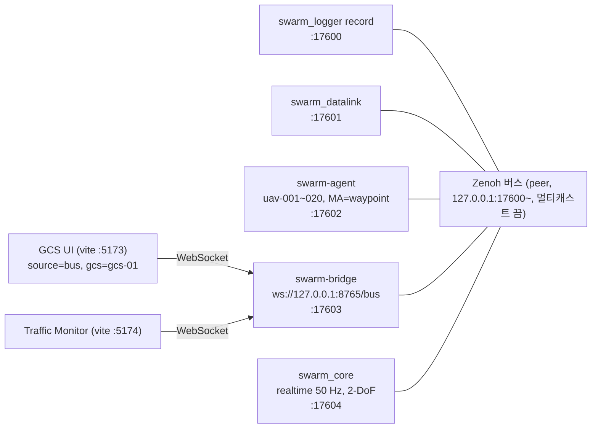
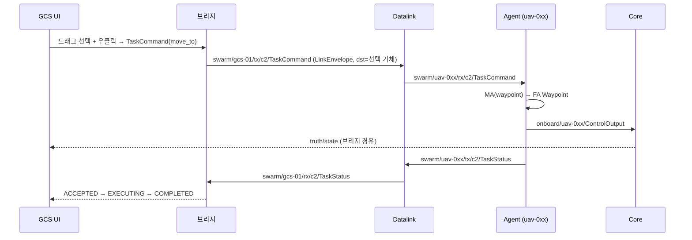

# P0 데모 통합

로드맵 P0 완료 조건: "2-DoF 20대가 2D 지도에 표시되고, 드래그 선택으로 이동 명령 가능" ([00_proposal.md](00_proposal.md) §13).
실행기는 `scripts/run_p0_demo.py`(IMP-INT-001, probe는 IMP-INT-003), 시나리오는 `scenario/examples/p0_demo_20.json`(IMP-INT-002)이다.

## 1. 구성

모든 프로세스가 `open_bus`로 같은 Zenoh 버스에 붙는다 (DEC-026). 브라우저는 WebSocket 브리지로만 버스에 붙는다 (DEC-027).



- 프로세스 k는 `tcp/127.0.0.1:<base+k>`에서 대기하고 앞서 뜬 프로세스 전부에 연결한다. 같은 PC의 다른 버스와 섞이지 않게 멀티캐스트 스카우팅을 끈다.
- 시작 순서: Logger → Datalink → Agent → 브리지 → (2초 대기) → Core(`--autostart --mode realtime`) → UI → Monitor.
- Core는 `--scenario`로 시작하면 `LoadScenario`를 발행하지 않는다. 그래서 Datalink·Agent에도 같은 시나리오(.pb)를 `--scenario`로 준다. 실행기가 JSON을 `scenario.pb`로 내보내 세 프로세스에 넘긴다.
- 실시간 모드를 쓴다. lockstep은 늦게 붙은 참여자가 틱을 놓친다(`agent/TRACE.md` 남은 일).

### 명령 경로 (C2)



## 2. 준비

빌드·설치는 [10_contracts.md](10_contracts.md) §7을 따른다. 필요한 산출물:

- `build/msvc-debug/{core/swarm_core, datalink/swarm_datalink, logger/swarm_logger}.exe` (`cmake --build --preset msvc-debug`)
- `uv sync` (swarm-agent, swarm-bridge, swarm-scenario)
- `ui/`, `ui/monitor/`에서 `npm install`

## 3. 실행

```bash
uv run python scripts/run_p0_demo.py live --monitor
```

- 출력된 주소로 연다: `http://localhost:5173/?source=bus&gcs=gcs-01&bridge=ws://127.0.0.1:8765/bus`
- 툴바에서 `2D` → `전체`를 누른다. 기체 20대와 GCS 1개가 보인다.
- 왼쪽 드래그로 기체를 고르고 지도를 우클릭하면 그 지점으로 이동 명령(MoveTo)이 나간다. 오른쪽 패널에 기체별 상태(수행 → 완료 100%)가 표시된다.
- 로그·기록: `out/p0_demo/live-<시각>/` (프로세스별 `.log`, `scenario.pb`, `p0_demo.mcap`)
- 종료: Ctrl+C 또는 실행 디렉터리에 `STOP` 파일을 만든다. 실행기는 역순으로 Ctrl+Break를 보낸다. Logger·Core·Datalink는 SIGBREAK를 받아 정상 종료하고(IMP-LOG-009, IMP-CORE-013, IMP-LNK-015) Logger가 MCAP을 닫는다.

| 옵션 | 뜻 |
|---|---|
| `--scenario <json>` | 다른 시나리오 (기본 `scenario/examples/p0_demo_20.json`) |
| `--no-record` | MCAP 기록 끔 |
| `--no-autostart` | Core를 LOADED로 두고 UI의 시작 버튼을 기다림 |
| `--no-ui`, `--monitor` | vite dev 서버 끔 / Traffic Monitor도 띄움 |
| `--base-port`, `--bridge-port`, `--ui-port`, `--monitor-port` | 포트 (기본 17600, 8765, 5173, 5174) |
| `--build-dir` | C++ 실행 파일 위치 (기본 `build/msvc-debug`) |
| `--duration <s>` | n초 뒤 종료 |

### 명령 경로 자동 확인 (probe)

```bash
uv run python scripts/run_p0_demo.py probe --targets uav-001,uav-002,uav-003
```

- live가 떠 있는 버스에 GCS(gcs-01)로 붙어 UI와 같은 형식의 TaskCommand(move_to, 북동 1.5 km)를 보낸다.
- 대상 기체가 300 m 안에 들어오고 그 task_id의 TaskStatus가 GCS에 돌아오면 `PASS`.

## 4. 재생

```bash
uv run python scripts/run_p0_demo.py replay out/p0_demo/live-<시각>/p0_demo.mcap --rate 3 --monitor
```

- 브리지 → UI·Monitor → `swarm_logger replay` 순으로 띄운다. Core·Datalink·Agent는 띄우지 않는다.
- 재생기는 `sim/ctrl/status`의 `SimStatus.replay`를 true로 바꿔 발행한다 (DEC-031). Monitor는 이 값으로 `재생 (MCAP)` 배지를 표시한다.
- UI: `http://localhost:5173/?source=bus&gcs=&bridge=ws://127.0.0.1:8765/bus` (GCS를 비워 명령을 막는다)
- Monitor: `http://localhost:5174/?source=bridge&url=ws://127.0.0.1:8765/bus`
- 재생이 끝나면 종료한다. `--linger <s>`로 브리지·UI를 더 둘 수 있다.

## 5. 확인 결과 (2026-11-02, Windows, msvc-debug)

| TC | 확인 내용 | 결과 |
|---|---|---|
| TC-INT-001 | live: UI 2D 지도에 기체 20대 + GCS 표시, 연결·실행 상태, 엔티티 21 | 통과 |
| TC-INT-002 | probe: uav-001~003에 MoveTo → 45~81 s에 300 m 안 도달, TaskStatus ACCEPTED → EXECUTING → COMPLETED (기존 `p0-hold` CANCELLED) | 통과 |
| TC-INT-003 | UI 드래그로 uav-016~020 선택 → 우클릭 MoveTo(약 3.7 km) → 5대 모두 `수행` → 3~3.5분 뒤 `완료 100%`. MCAP에 `swarm/gcs-01/tx/c2/TaskCommand` 2건, `swarm/uav-016/rx/c2/TaskCommand`, `swarm/gcs-01/rx/c2/TaskStatus` 72건 기록 | 통과 |
| TC-INT-004 | MCAP 기록(530 s, 1,223,259건, 311채널)을 3배속 재생 → `sim/ctrl/status` 24건 모두 `replay=true`, Monitor `재생 (MCAP)` 배지와 TaskStatus 트래픽, UI 지도에 기록된 기동 재현 | 통과 |

| 화면 | 파일 |
|---|---|
| live 2D, 20대 |  |
| 드래그 선택 5대 |  |
| MoveTo 전송, 5대 수행 |  |
| 이동 중 |  |
| 도달, 5대 완료 100% |  |
| 재생: UI |  |
| 재생: Monitor 트래픽 |  |
| 재생: Monitor 배지 |  |

## 6. 남은 문제

- UI(WP5)는 `SimStatus.replay`를 표시하지 않는다. 재생 중에도 `실행`으로 보이고 일시정지·배속 버튼이 활성이다(받는 Core가 없다).
- Monitor(WP6) 상단 `링크 지연`이 3배속 재생 중 39.5 s로 표시된다. 벽시계와 sim 시각을 비교하는 값으로 보이며, 재생 배속을 반영하지 않는다.
- Core가 `--scenario`로 시작하면 `LoadScenario`를 발행하지 않아 각 프로세스에 시나리오를 따로 줘야 한다. lockstep에서는 늦게 붙은 참여자가 틱을 놓친다. 계약(`sim/ctrl/**` 늦은 참여자 동기화) 변경이 필요하다.
