# P0 데모 통합

로드맵 P0 완료 조건: "2-DoF 20대가 2D 지도에 표시되고, 드래그 선택으로 이동 명령 가능" ([00_proposal.md](00_proposal.md) §13).
실행기는 `scripts/run_p0_demo.py`(IMP-INT-001, probe는 IMP-INT-003~004), 시나리오는 `scenario/examples/p0_demo_20.json`(IMP-INT-002)이다.

## 1. 구성

모든 프로세스가 `open_bus`로 같은 Zenoh 버스에 붙는다 (DEC-026). 브라우저는 WebSocket 브리지로만 버스에 붙는다 (DEC-027).

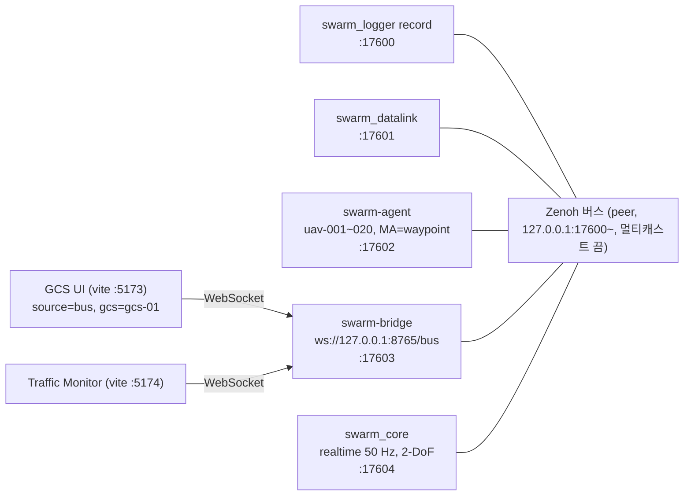

- 프로세스 k는 `tcp/127.0.0.1:<base+k>`에서 대기하고 앞서 뜬 프로세스 전부에 연결한다. 같은 PC의 다른 버스와 섞이지 않게 멀티캐스트 스카우팅을 끈다.
- 시작 순서: Logger → Datalink → Agent → 브리지 → (2초 대기) → Core(`--autostart --mode realtime`) → UI → Monitor.
- Core는 `--scenario`로 시작하면 `LoadScenario`를 발행하지 않는다. 그래서 Datalink·Agent에도 같은 시나리오(.pb)를 `--scenario`로 준다. 실행기가 JSON을 `scenario.pb`로 내보내 세 프로세스에 넘긴다.
- 실시간 모드를 쓴다. lockstep은 늦게 붙은 참여자가 틱을 놓친다(`agent/TRACE.md` 남은 일).

### 명령 경로 (C2)

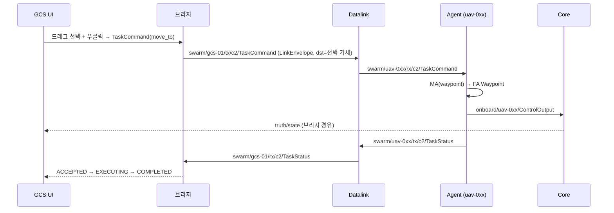

## 2. 준비

빌드·설치는 [10_contracts.md](10_contracts.md) §7을 따른다. 필요한 산출물:

- `build/msvc-debug/{core/swarm_core, datalink/swarm_datalink, logger/swarm_logger}.exe` (`cmake --build --preset msvc-debug`)
- `uv sync` (swarm-agent, swarm-bridge, swarm-scenario)
- `ui/`, `ui/monitor/`에서 `npm install`

## 3. 실행

```bash
uv run python scripts/run_p0_demo.py live --monitor
```

- 출력된 주소로 연다: `http://localhost:5173/?source=bus&gcs=gcs-01&bridge=ws://127.0.0.1:8765/bus`
- 툴바에서 `2D` → `전체`를 누른다. 기체 20대와 GCS 1개가 보인다.
- 왼쪽 드래그로 기체를 고르고 지도를 우클릭하면 그 지점으로 이동 명령(MoveTo)이 나간다. 오른쪽 패널에 기체별 상태(수행 → 완료 100%)가 표시된다.
- 로그·기록: `out/p0_demo/live-<시각>/` (프로세스별 `.log`, `scenario.pb`, `p0_demo.mcap`)
- 종료: Ctrl+C 또는 실행 디렉터리에 `STOP` 파일을 만든다. 실행기는 역순으로 Ctrl+Break를 보낸다. Logger·Core·Datalink는 SIGBREAK를 받아 정상 종료하고(IMP-LOG-009, IMP-CORE-014, IMP-LNK-015) Logger가 MCAP을 닫는다.

| 옵션 | 뜻 |
|---|---|
| `--scenario <json>` | 다른 시나리오 (기본 `scenario/examples/p0_demo_20.json`) |
| `--no-record` | MCAP 기록 끔 |
| `--no-autostart` | Core를 LOADED로 두고 UI의 시작 버튼을 기다림 |
| `--no-ui`, `--monitor` | vite dev 서버 끔 / Traffic Monitor도 띄움 |
| `--base-port`, `--bridge-port`, `--ui-port`, `--monitor-port` | 포트 (기본 17600, 8765, 5173, 5174) |
| `--build-dir` | C++ 실행 파일 위치 (기본 `build/msvc-debug`) |
| `--duration <s>` | n초 뒤 종료 |
| `--lockstep`, `--rate <x>` | lockstep 실행. 시나리오는 Core에만 주고 Datalink·Agent는 `sim/ctrl/scenario`로 받는다. 실행기가 내보내는 시나리오에 `run.mode=lockstep`·`participants`를 넣는다 |
| `--late-agent-s <s>` | Core 뒤 n초에 Agent를 띄운다 (지각 참여자 시험) |

### 명령 경로 자동 확인 (probe)

```bash
uv run python scripts/run_p0_demo.py probe --targets uav-001,uav-002,uav-003
```

- live가 떠 있는 버스에 GCS(gcs-01)로 붙어 UI와 같은 형식의 TaskCommand(move_to, 북동 1.5 km)를 보낸다.
- 대상 기체가 300 m 안에 들어오고 그 task_id의 TaskStatus가 GCS에 돌아오면 `PASS`.

임무 명령과 매개변수는 `--kind`로 고른다 (IMP-INT-004).

| `--kind` | 보내는 것 | 판정 |
|---|---|---|
| `move` (기본) | MoveTo | 300 m 안 도달 + TaskStatus |
| `hold` | 중심 북쪽 1 km, 반경 300 m 선회 | 늦은 표본의 80%가 반경 0.6~1.5배 안 |
| `racetrack` | 같은 중심, 직선 1200 m, 축 90° | 축·횡 방향 최대 편차가 기대 범위 안 |
| `route` | 항로점 3개(북 1 km → 북동 → 동 1 km, 수락 150 m) | 3개 모두 200 m 안 통과 |
| `params` | `SimCommand.set_params` (fa·ma·dynamics 순) | 변경 반영, unknown·range·not_runtime 거부, 기존 값 유지, 원복 |

```bash
uv run python scripts/run_p0_demo.py probe --kind racetrack --targets uav-001,uav-002 --settle-s 50
uv run python scripts/run_p0_demo.py probe --kind params --targets uav-010
```

## 4. 재생

```bash
uv run python scripts/run_p0_demo.py replay out/p0_demo/live-<시각>/p0_demo.mcap --rate 3 --monitor
```

- 브리지 → UI·Monitor → `swarm_logger replay` 순으로 띄운다. Core·Datalink·Agent는 띄우지 않는다.
- 재생기는 `sim/ctrl/status`의 `SimStatus.replay`를 true로 바꿔 발행한다 (DEC-031). Monitor는 이 값으로 `재생 (MCAP)` 배지를 표시한다.
- UI: `http://localhost:5173/?source=bus&gcs=&bridge=ws://127.0.0.1:8765/bus` (GCS를 비워 명령을 막는다)
- Monitor: `http://localhost:5174/?source=bridge&url=ws://127.0.0.1:8765/bus`
- 재생이 끝나면 종료한다. `--linger <s>`로 브리지·UI를 더 둘 수 있다.

## 5. 확인 결과 (2026-11-02, Windows, msvc-debug)

| TC | 확인 내용 | 결과 |
|---|---|---|
| TC-INT-001 | live: UI 2D 지도에 기체 20대 + GCS 표시, 연결·실행 상태, 엔티티 21 | 통과 |
| TC-INT-002 | probe: uav-001~003에 MoveTo → 45~81 s에 300 m 안 도달, TaskStatus ACCEPTED → EXECUTING → COMPLETED (기존 `p0-hold` CANCELLED) | 통과 |
| TC-INT-003 | UI 드래그로 uav-016~020 선택 → 우클릭 MoveTo(약 3.7 km) → 5대 모두 `수행` → 3~3.5분 뒤 `완료 100%`. MCAP에 `swarm/gcs-01/tx/c2/TaskCommand` 2건, `swarm/uav-016/rx/c2/TaskCommand`, `swarm/gcs-01/rx/c2/TaskStatus` 72건 기록 | 통과 |
| TC-INT-004 | MCAP 기록(530 s, 1,223,259건, 311채널)을 3배속 재생 → `sim/ctrl/status` 24건 모두 `replay=true`, Monitor `재생 (MCAP)` 배지와 TaskStatus 트래픽, UI 지도에 기록된 기동 재현 | 통과 |
| TC-INT-005 | 계약 0.6.0 병합 후 probe hold·racetrack·route: 임무 명령이 UI와 같은 TaskCommand로 C2 → Datalink → Agent → Core를 거쳐 실제 선회·레이스트랙·항로 비행, TaskStatus 수신 | 통과 |
| TC-INT-006 | probe params: fa·ma·dynamics 모두 runtime 항목 변경이 `sim/param/<entity>/<owner>`에 반영, 잘못된 변경은 unknown·range·not_runtime으로 거부되고 기존 값 유지 | 통과 |
| TC-INT-007 | UI: 12대 선택 → 레이스트랙 선회 임무 전송 → 임무 카드에 12대 `수행`, 기체가 레이스트랙으로 비행. 매개변수 패널: 적용·기본값 복원, 범위 밖 값은 `10000 이하여야 한다`로 막힘, runtime 불가 항목은 `실행 중에는 바꿀 수 없다`로 표시 | 통과 (아래 결함 있음) |
| TC-INT-008 | 계약 0.8.0 병합 후 lockstep(`--lockstep --rate 2`): Core만 `--scenario`, Datalink·Agent는 인자 없이 `sim/ctrl/scenario`로 수신, 준비 신호 후 첫 틱, probe move 통과. 시나리오 `run.mode`가 realtime이고 CLI `--mode lockstep`만 주면 참여자가 준비 신호를 보내지 않아 틱이 나가지 않는다 | 통과 (조건 있음) |
| TC-INT-009 | lockstep + Core 뒤 6 s에 Agent 시작: Core는 RUNNING으로 넘어가 기다리지만 `sim/ctrl/scenario`를 더 내보내지 않아 지각 Agent가 시나리오를 받지 못하고 틱이 나가지 않는다(`sim/ctrl/**`·`sim/clock/**` 무발행 확인) | 불합격 |
| TC-INT-010 | probe params: `racetrack_guidance=foo` → `{'racetrack_guidance': 'choice'}` 거부, 기존 값 유지. 나머지 fa·ma·dynamics 변경·거부 통과 | 통과 |
| TC-INT-011 | UI: 12대 선택 후 지도 우클릭 → `전송 (12대)`가 임무 패널 최상단에 있고 최상위 요소(가림 없음), 레이스트랙 유형도 같다. 재생: `재생` 배지, 재개·스텝·×배속·대기·귀환·편대 지정 비활성. Monitor 3배속 재생: 링크 지연 평균 16.8~25.5 ms, p95 ≤31.2 ms, 손실 0% | 통과 |
| TC-INT-002/005 재확인 | realtime 0.8.0: probe move·hold·racetrack·params 통과, route 통과(1회 항로점 2/3 도달(불합격) 후 재시도 3/3 통과) | 통과 |

| 화면 | 파일 |
|---|---|
| live 2D, 20대 | 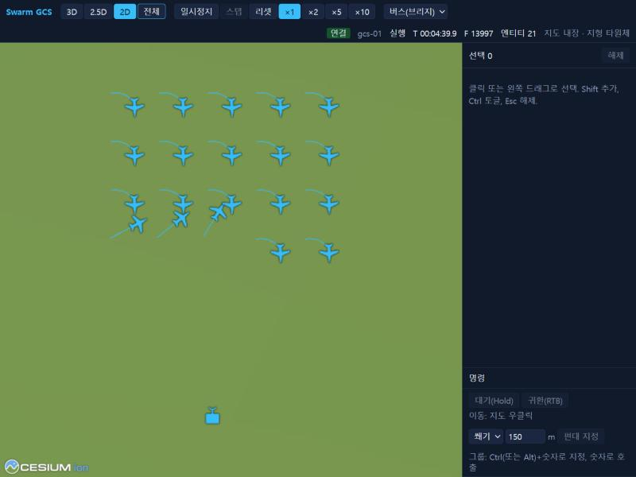 |
| 드래그 선택 5대 | 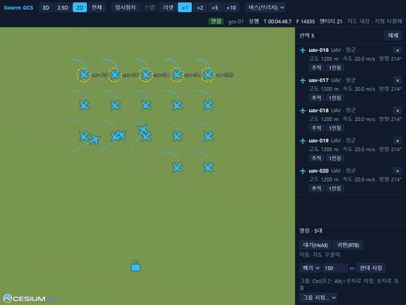 |
| MoveTo 전송, 5대 수행 | 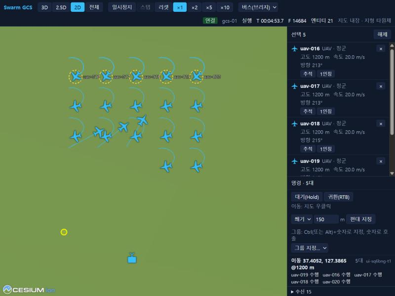 |
| 이동 중 | 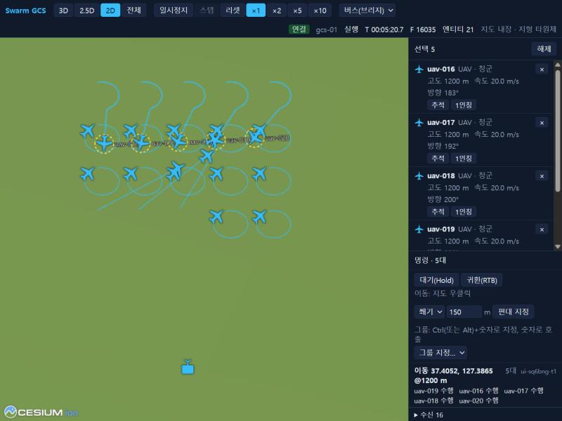 |
| 도달, 5대 완료 100% | 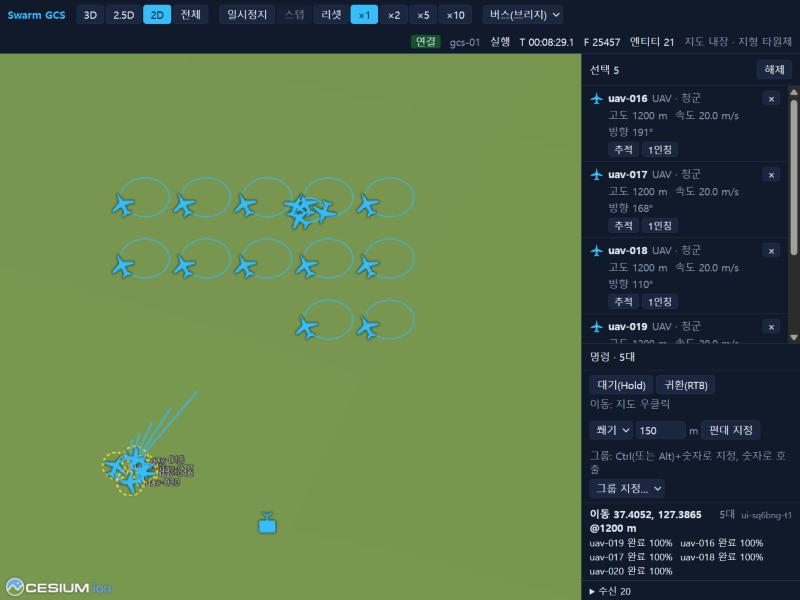 |
| 재생: UI | 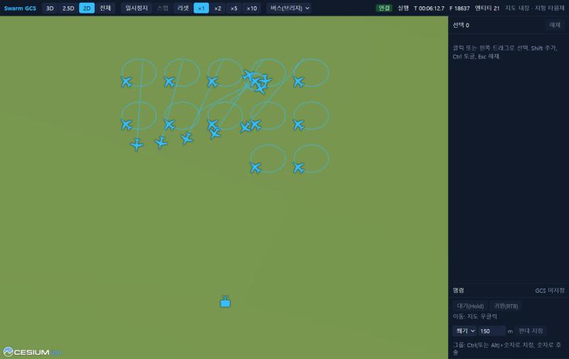 |
| 재생: Monitor 트래픽 | 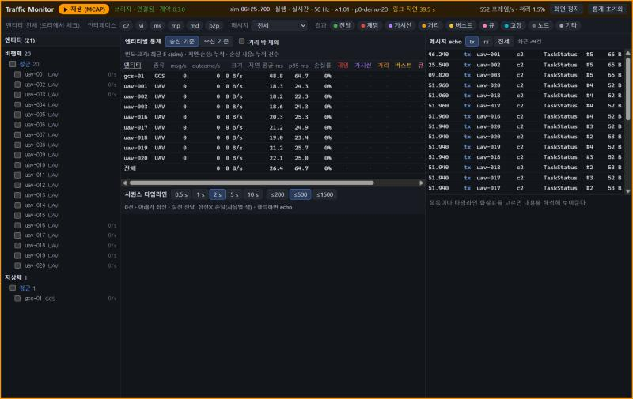 |
| 재생: Monitor 배지 | 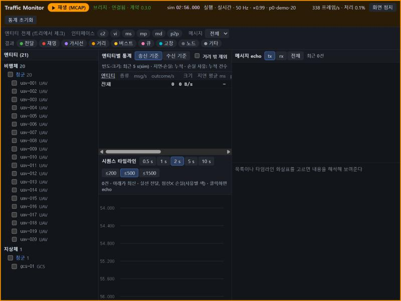 |
| 매개변수 패널(12대 공통) | 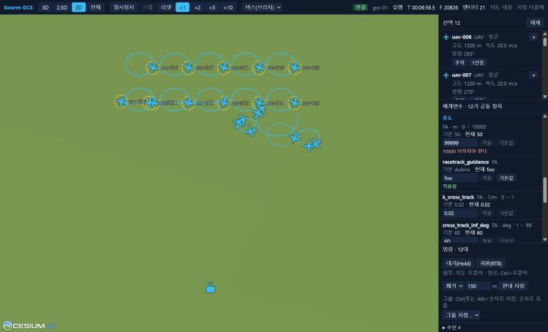 |
| 레이스트랙 임무 비행 | 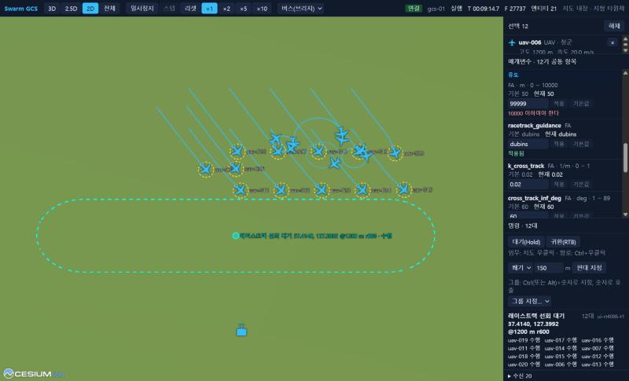 |
| 12대 선택, 이동 임무 `전송` | 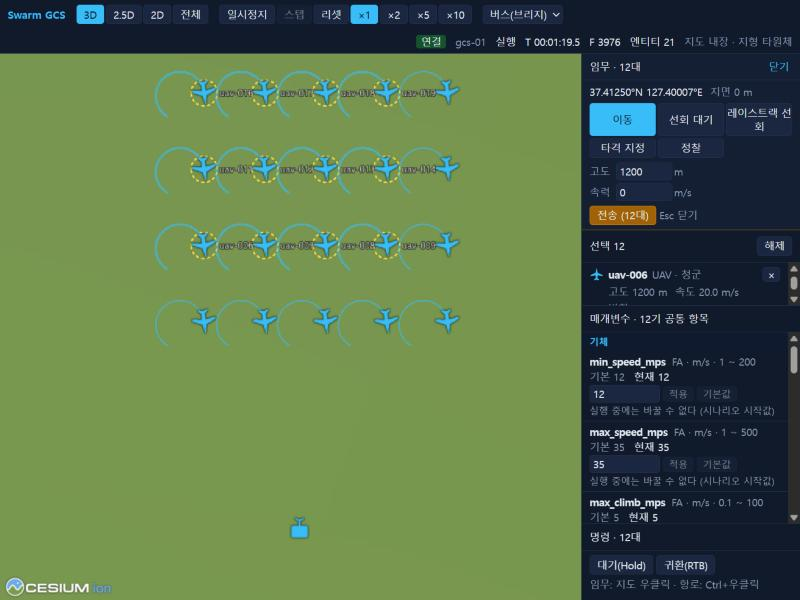 |
| 12대 선택, 레이스트랙 `전송` | 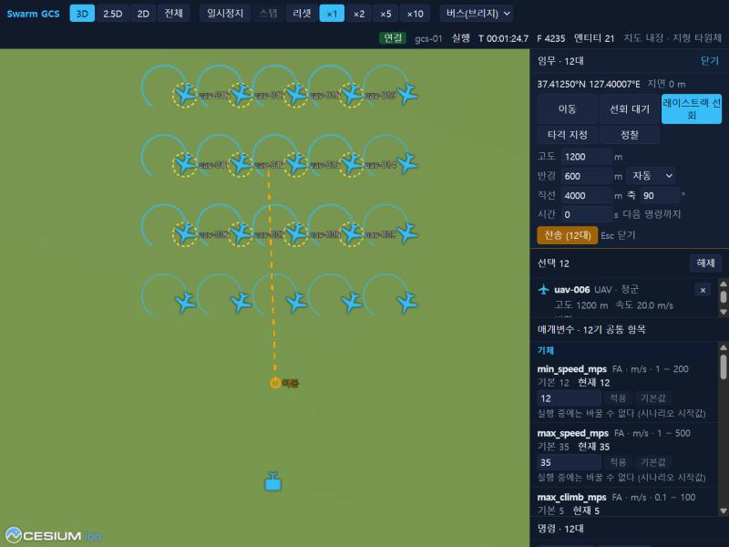 |
| 재생: 배지·버튼 비활성 | 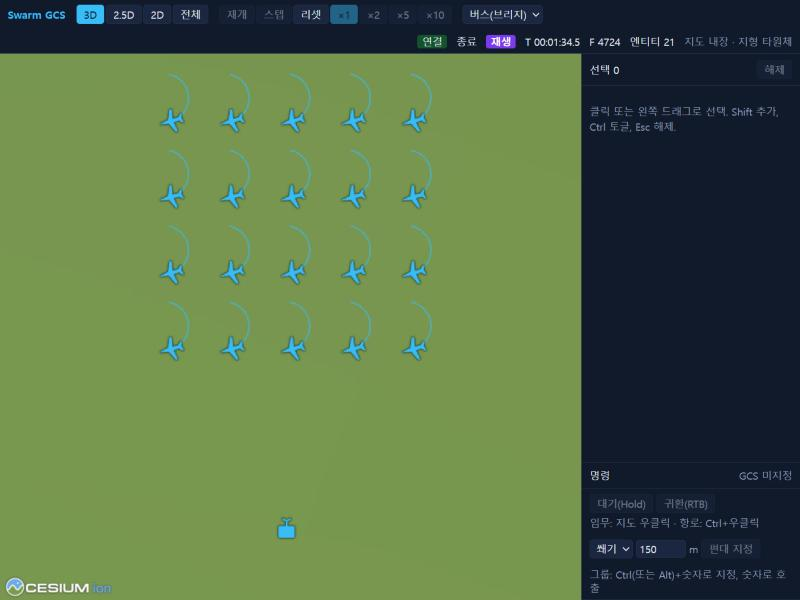 |
| 재생 3배속: Monitor 지연 | 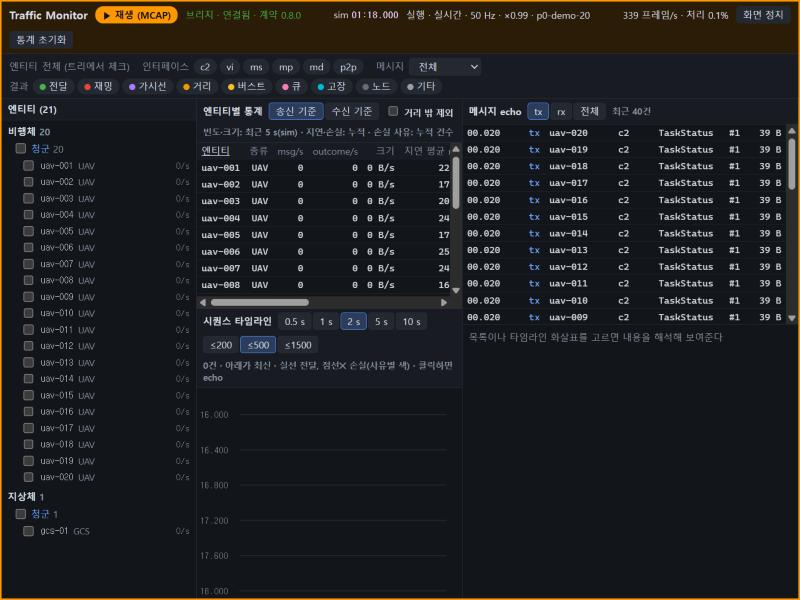 |

## 6. 남은 문제 (계약 0.8.0 재점검, 2026-11-02)

| 항목 | 결과 | 근거·담당 |
|---|---|---|
| lockstep: Core만 `--scenario`, 나머지는 `sim/ctrl/scenario`로 수신 | 통과 (조건 있음) | 시나리오 `run.mode=lockstep`일 때 정상 시작. 데모 시나리오는 realtime이라 Core `--mode lockstep`만 주면 참여자가 준비 신호(`FrameDone{0}`)를 보내지 않아 틱이 영영 나가지 않는다. 담당: WP1 Core·WP3 Agent·WP4 Datalink(CLI 재정의를 `Scenario`에 반영하거나, 참여자가 Core의 실행 모드를 받도록) |
| lockstep 지각 참여자 | **불합격** | Core는 LOADED에서만 `Scenario`를 다시 내보내 RUNNING(준비 대기) 중 늦게 켠 Agent는 시나리오를 받지 못한다. 담당: WP1 Core(첫 틱 전까지 재발행) |
| lockstep에서 hold·racetrack·route·params probe | 미확인 | 디버그 빌드에서 `rate=2`가 따라가지 못하고(overruns) probe의 벽시계 판정 창과 맞지 않아 realtime으로 확인 |
| probe move·hold·racetrack·route·params (realtime) | 통과 | route는 1회 항로점 2/3 도달(불합격) 후 재시도 3/3 통과. 판정 창 문제로 추정 |
| `racetrack_guidance="foo"` | 통과 | `choice`로 거부, 기존 값 유지 (WP3 Agent) |
| UI `전송` 버튼 가림 (12대) | 통과 | 최상위 요소, 패널 맨 위로 이동 (WP5) |
| UI 재생 표시·버튼 비활성 | 통과 | `재생` 배지, 제어 버튼 비활성. `리셋`만 활성 (WP5, 의도 확인 필요) |
| Monitor 링크 지연 (3배속 재생) | 통과 | 평균 약 21 ms, p95 ≤31 ms (WP6) |
| UI에서 거부 사유 확인 | 이월 | UI가 범위를 먼저 막아 거부 응답을 UI로 만들 수 없다. probe로 확인 (WP5) |
| TaskStatus 순서 뒤바뀜 | 이월 | 일부 TaskStatus가 EXECUTING이 ACCEPTED보다 먼저 도착 (WP4 지연·지터로 추정, 판정 영향 없음). 이번 probe에서도 관찰 |
