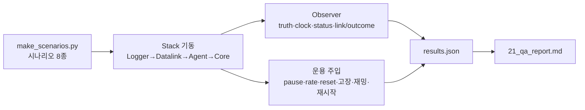
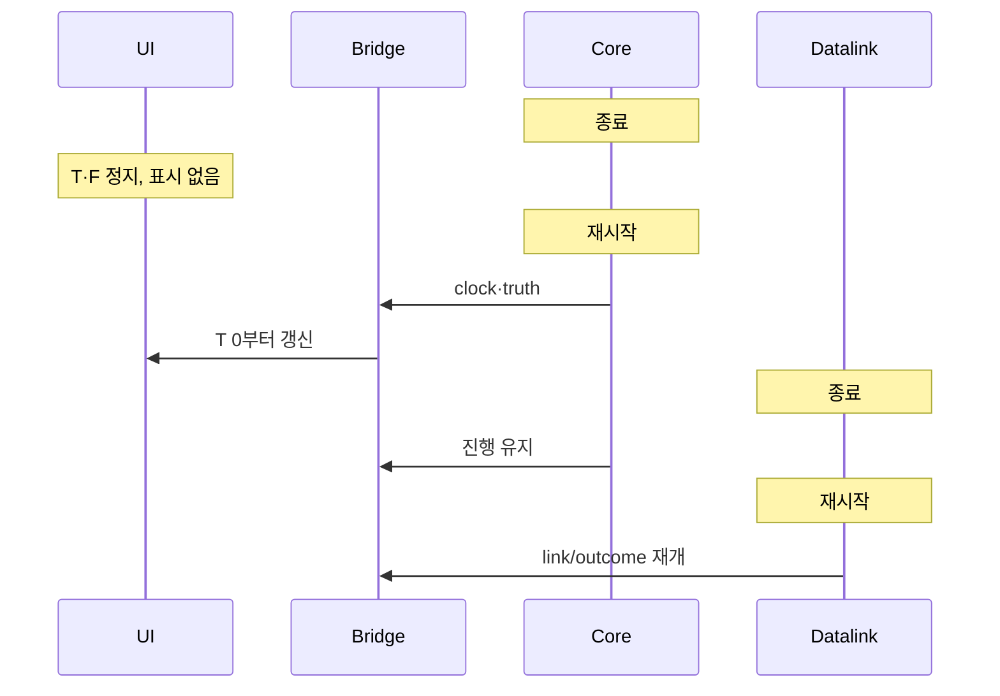

# QA/QC 보고서 (계약 0.8.0, 2026-11-02)

시험 대상은 wp0-contracts 4e3c4c3(WP1 dcc58d8 병합 후)이다. 이 문서는 결함 보고만 한다. 수정은 담당 WP가 한다. §1~8은 1차, §9는 DEC-038 수정 병합 후의 2차 재시험이다. 2차에서 QA-001·002·003·009·010은 수정을 확인했고 QA-005는 대부분 수정, QA-004는 미지원 결정(DEC-038)으로 종결했다. 새 결함은 QA-012~015이다.

## 1. 범위와 방법

| 항목 | 내용 |
|---|---|
| 빌드 | `msvc-debug`만 사용. `msvc-release`는 링크가 실패해 시험하지 못했다 (QA-007) |
| 환경 | Windows 11, MSVC + vcpkg, uv + CPython 3.12, Zenoh 1.10.2 (멀티캐스트 끔, TCP peer) |
| 시험 도구 | `qa/harness.py`(전체 스택 기동·종료·재시작, 버스 관찰자, 자원 표본), `qa/run_qa.py`(TC-QA-001~023), `qa/make_scenarios.py`(시나리오 생성·검증) |
| 재현 | `uv run python qa/make_scenarios.py` → `uv run python qa/run_qa.py [--only 001,010]`. 결과는 `qa/out/results.json` |
| 감시 항목 | 프로세스 종료, 시간·틱 역행, NaN/inf, 프레임 간극·중복, 엔티티 수 불일치, 메시지 순서·유실, CPU·RSS 추세, 결정성, 정지(hang) |

### 1.1 시나리오 (`qa/scenarios/`)

| 파일 | 성격 |
|---|---|
| `qa_s1_formation6` | 6기 3-DoF 편대(리더·추종, formation MA) |
| `qa_s2_swarm20` | 20기 군집. hold·route·racetrack·search_area 혼합 |
| `qa_s3_link` | 불완전 링크 프로파일(지연·손실·좁은 대역·단거리)과 35 km 밖 기체 |
| `qa_s4_engage` | 적·표적·센서·무장 선언 13개 엔티티 |
| `qa_s5_mixed` | 2-DoF/3-DoF, skywalker_x8/aerosonde 혼합, MA 혼합. dof5/dof6는 별도 적재 시험 |
| `qa_s6_load50`, `qa_s6_load100`, `qa_s6_load100_flock` | 50·100기 부하, 100기 flocking(P2P) |

## 2. 시험 결과 (TC-QA-001~023)

| TC | 내용 | 결과 | 비고 |
|---|---|---|---|
| TC-QA-001 | s1 6기 편대 120 s | 통과 | 중심 거리 85~350 m, 프레임 간극 0 |
| TC-QA-002 | s2 20기 임무 혼합 240 s | 통과 | hold 반경 유지, racetrack 범위 유지 |
| TC-QA-003 | s3 불완전 링크 | 통과 | 사유 OUT_OF_RANGE·BURST_LOSS·QUEUE_OVERFLOW 모두 관측. 지연 p99 4.1 s |
| TC-QA-004 | s4 적·표적·센서·무장 | 통과 | 견고성만 확인. 탐지·무장 동작은 Core 미구현(§5) |
| TC-QA-005 | s5 2/3-DoF 혼합, dof5/6 적재 | 통과 | dof5/6는 Core가 종료 코드 1로 종료(§4 D-3) |
| TC-QA-006 | 50기 lockstep 2배속 | 통과 | 실측 1.57배(debug), 간극 0, 엔티티 51 |
| TC-QA-007 | 100기 lockstep 1배속 | 통과 | 실측 0.93배, 엔티티 101 |
| TC-QA-008 | 100기 flocking P2P | 통과 | 실측 0.22배, overrun 1500/1500. Logger RSS 26→313 MB (QA-006) |
| TC-QA-009 | 100기 realtime | 통과 | sim/벽시계 1.00, overrun 3 |
| TC-QA-010 | pause·resume·step·set_rate·reset·반복 | 통과 | 비정상 rate 수용은 QA-003 |
| TC-QA-011 | 모드 전환 lockstep/realtime/freerun | 통과 | Reset 후 Start 순서 필요 |
| TC-QA-012 | 잘못된 SimCommand·시나리오 | 불합격 | QA-001, QA-003 |
| TC-QA-013 | 임무 명령 연속·충돌 | 불합격 | 마지막 명령의 EXECUTING 미관측. 순서 뒤바뀜은 기대 동작이라 결함 아님(§6) |
| TC-QA-014 | 잘못된 임무 값 | 통과 | 기체 종료·이상 이동 없음. 수용 범위는 QA-005 |
| TC-QA-015 | 명령 홍수(10 s에 29.9만 건) | 통과 | 프로세스 생존, 프레임 진행 저하 관찰(QA-011) |
| TC-QA-016 | 실행 중 매개변수 변경·거부 | 불합격 | QA-002 |
| TC-QA-017 | 고장 주입 | 통과 | SENSOR는 기록만(§5) |
| TC-QA-018 | 재밍 구역 on/off | 통과 | 재밍 중 JAMMED 3070건, 해제 후 복귀. `jam_zone`은 시험이 직접 발행 |
| TC-QA-019 | Agent·Datalink·Core 재시작(realtime) | 통과 | Core 재기동 후 frame 1915→326 재개 |
| TC-QA-020 | lockstep 지각 참여·재합류 | 불합격 | 지각 합류 통과(frame None→111). 진행 중 Agent 재합류는 QA-004 |
| TC-QA-021 | Logger 기록 → info → 재생(0.5·1·4·20배) | 통과 | 97,416건·337 채널. 고배속 프레임 감소는 QA-008 |
| TC-QA-022 | 결정성(같은 시나리오 lockstep 2회) | 통과 | 공통 2579 프레임, 최대 차이 0.000000 m |
| TC-QA-023 | 20기 realtime 10분 추세 | 통과 | Core RSS 26→27 MB, Datalink 23→26 MB. Logger +5 MB(QA-006) |

UI·Monitor 점검은 §3에 따로 적는다. 앱 내장 브라우저로 라이브 스택(s2, 20기)을 직접 확인했다.

## 3. UI·Monitor 대조

| 확인 | 결과 |
|---|---|
| UI 엔티티 수 | 21 (UAV 20 + GCS 1). 실제 상태와 일치 |
| UI 시각·프레임 | T 00:01:38.0 / F 4902 → 프레임 ≈ 50/s. 실제와 일치 |
| 일시정지 | 버튼이 `재개`로 바뀌고 상태 `정지`. 2 s 뒤에도 T·F 불변 |
| 재개 | 상태 `실행`, 시간 진행 재개 |
| 배속 ×5 | 5 s 동안 sim 5.2 s만 진행. 반응 없음 (QA-009) |
| Monitor | 연결됨, 계약 0.8.0, `실행 · 실시간 · 50 Hz · ×1.00 · qa-s2-swarm20`, 엔티티 트리 21개 일치 |
| Monitor 통계 | 이 시나리오는 링크 트래픽이 거의 없어 표가 0이다. 트래픽이 많은 상황의 표시 정확성은 확인하지 못했다(§7) |

## 4. 결함

심각도는 치명/높음/보통/낮음이다. 담당 WP는 추정이다.

### 4.1 WP별·심각도별 요약

| WP | 높음 | 보통 | 낮음 |
|---|---|---|---|
| WP1 Core | QA-001 | QA-003, QA-007 | |
| WP3 Agent | QA-002 | QA-004, QA-005 | |
| WP4 Datalink | | | QA-011 |
| WP5 Bridge/UI | | | QA-009, QA-010 |
| WP7 Logger | | QA-006 | QA-008 |
| 치명 | 없음 | | |

### QA-001 — NaN 초기 위치 시나리오가 적재되어 truth에 NaN이 퍼진다
- 담당 WP1 Core / 높음 / TC-QA-012
- 재현: 정지·`LOADED` 상태에서 `uav-003.initial.position.lat_deg = NaN`인 시나리오를 Reset 뒤 `sim/ctrl/scenario`로 발행하고 Start.
- 기대: 적재 거부(`load rejected`), 상태·기존 엔티티 유지.
- 실제: 적재 수용. 첫 프레임부터 `uav-003`의 `truth/state`가 NaN.
- 로그: `[nan_inf] uav-003 frame 0: (nan, 127.39151909999998, 1200.0, 20.0, 0.0, 0.0)` (harness 관찰자)
- 비고: 엔티티 0개 시나리오도 수용(`entity_count=0`). 중복 ID·없는 airframe·`frame_hz=5`·없는 링크 프로파일은 수용 여부를 엔티티 수만으로 구분하지 못했다. 같은 검증 경로의 점검을 권한다.

### QA-002 — MA 매개변수 `k_p=inf` 한 건에 Agent 프로세스가 종료된다
- 담당 WP3 Agent / 높음 / TC-QA-016
- 재현: formation MA 기체(uav-002)에 `SetParams`로 `k_p = inf`(JSON `Infinity`) 전송.
- 기대: `range` 사유로 거부(음수·1e12·문자열·bool·null은 모두 거부되었다).
- 실제: Agent가 종료 코드 1로 죽는다. 20기 전체가 제어를 잃는다.
- 로그: `agent(code 1)`. 같은 시험에서 `k_p=-5`, `1e12`는 `ma param 'k_p' rejected (range)`로 정상 거부.
- 비고: 이 경우를 마지막에 두었으므로 `NaN`은 확인하지 못했다. dynamics 쪽은 NaN·inf·음수·0이 모두 `range`로 거부되었다. MA 경로의 비유한 값 검사가 빠져 있다.

### QA-003 — 비유한·비정상 rate가 Core에서 수용된다
- 담당 WP1 Core / 보통 / TC-QA-010, 012
- 재현: Reset 뒤 `Start(lockstep, rate=NaN)` 또는 `rate=-3.0`. 실행 중 `SetRate(0, -1, NaN, inf, 1e9)`.
- 기대: 거부하거나 유한한 범위로 제한(`Start(realtime, rate=5)`는 1.0으로 제한되었다).
- 실제: 모두 수용. `status.rate_target`에 NaN·inf·음수가 그대로 나타난다. 프로세스는 살아 있다.
- 로그: `[swarm_core] start mode=RUN_MODE_LOCKSTEP hz=50 rate=nan seed=1`
- 비고: 이후 진행 속도는 확인하지 않았다. `hz=0`은 50으로 대체되어 수용된다. `hz=10`·`5000`은 거부된다.

### QA-004 — lockstep 중 이탈한 Agent가 재합류해도 진행이 재개되지 않는다
- 담당 WP1 Core(또는 WP3) / 보통 / TC-QA-020
- 재현: lockstep 실행 중 Agent 프로세스 종료 → 12 s 대기 → Agent 재기동.
- 기대: 장벽 대기 후 재합류 시 재개(DEC-037은 첫 틱 전 지각 참여를 정의한다. 실행 중 재합류는 명시가 없다).
- 실제: 이탈 중 정지(149→149)는 정상이다. 재합류 뒤에도 frame 149에서 멈춘다. Reset + Start로만 복구된다(frame 104).
- 비고: 첫 틱 전 지각 참여는 정상이다(frame None→111). 실행 중 재합류를 지원할지는 §6 항목이다. 지원 대상이 아니면 문서에 명시해야 한다.

### QA-005 — 잘못된 임무 값이 일관되지 않게 처리된다
- 담당 WP3 Agent / 보통 / TC-QA-014
- 재현: 임무 명령에 다음 값을 넣는다.
  - 수용(ACCEPTED→EXECUTING): `alt=inf`, `alt=-값`, `alt=100 km`, 지도 밖 좌표, 위경도 0, `racetrack axis=NaN·999`, `hold radius=1e9`, 경로 점 500개
  - 무응답(REJECTED 없음): `lat=200`, `lon=NaN`, 빈 task_id, 없는 엔티티, 경로 NaN, `radius=NaN`
  - 거부(사유 있음): 빈 경로, `radius<=0`, `leg_length<0`, 빈 task, `strike`
- 기대: 비유한·범위 밖 값은 일관되게 `REJECTED(사유)`.
- 실제: 위와 같음. 기체 종료나 이상 이동은 없었다(최대 이동 1442 m). `raceLeg0`은 ACCEPTED만 오고 EXECUTING이 없다.
- 로그: `qa-bad-altInf:ACCEPTED, EXECUTING, CANCELLED(preempted)`

### QA-006 — Logger 메모리가 부하에 따라 계속 늘어난다
- 담당 WP7 Logger / 보통 / TC-QA-006~009, 023
- 관찰(RSS): 20기 realtime 10분 27.8→39.5 MB(후반 +5.0 MB). 50기 26.9→60.9 MB. 100기 25.9→91.6 MB. 100기 flocking 30 s에 25.6→313.2 MB(후반 +128.8 MB).
- 기대: 쓰기 큐 상한 안에서 안정.
- 실제: 부하와 시간에 비례해 증가. 원인(큐 적체 대 단순 버퍼)은 판별하지 못했다. debug 빌드 기준이다.

### QA-007 — `msvc-release`가 링크되지 않는다
- 담당 WP1 Core 또는 빌드(WP0) / 보통
- 재현: `cmake --preset msvc-release` → 빌드.
- 실제: 링크 단계에서 실패. 세션 초반에 확인했으나 오류 전문은 보존하지 못했다(`qa_bld.log`에 남지 않음). 담당자가 재현해야 한다.
- 영향: 성능 시험이 모두 debug 빌드 값이다. 100기 flocking의 0.22배는 release에서 달라질 수 있다.

### QA-008 — 고배속 재생에서 truth 프레임이 줄어든다
- 담당 WP7 Logger / 낮음 / TC-QA-021
- 같은 기록(truth 프레임 약 2011)을 재생: 0.5배·1배 1970, 4배 1942, 20배 1849 프레임이 관찰자에 도착.
- 기대: 배속과 관계없이 도착 프레임 동일(재생 쪽 유실이 없으면). 수신 측 한계일 수도 있다.

### QA-009 — UI 배속 버튼이 realtime에서 무반응이다
- 담당 WP5 UI / 낮음 / UI 점검
- 재현: 실시간 모드 실행 중 UI에서 `×5` 클릭.
- 기대: 적용되거나 비활성/안내 표시.
- 실제: 5 s 동안 sim 5.2 s 진행(×1 그대로). 버튼은 눌리고 오류 표시는 없다. realtime에서 rate가 고정이라면(DEC-005) 비활성이 맞다.

### QA-010 — `swarm-bridge --help`가 cp949 콘솔에서 비정상 종료한다
- 담당 WP5 Bridge / 낮음
- 재현: 한국어 Windows 콘솔에서 `swarm-bridge --help`.
- 실제: 도움말 문자열 인코딩 오류로 종료. 환경변수 `PYTHONIOENCODING=utf-8`이면 정상.

### QA-011 — 명령 홍수 동안 프레임 진행이 크게 떨어진다
- 담당 WP4 Datalink / 낮음 / TC-QA-015
- 재현: 20기에 10 s 동안 299,349건의 임무 명령 전송.
- 실제: 프로세스는 모두 생존. 홍수 중 10 s 동안 프레임이 181→313(≈13 Hz)만 진행, overrun 25→71. 링크 결과 DROPPED 512,342(큐 넘침). 마지막 명령의 응답은 없다. 보호·속도 제한이 없다는 관찰이며, 요구가 없으면 결함이 아니다.

## 5. 범위 밖으로 확인된 Core 한계

시험 설계에서 확인된 한계다. 결함으로 분류하지 않고 §6에서 결정을 요청한다.

- Detection 메시지를 만들지 않는다. 센서 FOV·거리·가시선 판정(DEC-018)이 동작하지 않는다.
- 무장·발사·명중 논리가 없다(DEC-019). `truth/event/kill` 외 교전 이벤트가 없다.
- `truth/event/jam_zone` 발행자가 없다. 시험이 직접 발행해 Datalink 반응(JAMMED)을 확인했다.
- `SENSOR` 고장은 기록만 하고 효과가 없다.
- dof5/dof6은 미지원이다.

## 6. 결정 확인 필요

| # | 항목 | 확인할 점 |
|---|---|---|
| D-1 | 교전·탐지·재밍 구역 생성 미구현 | 1차 범위인지, 어느 WP가 언제 구현하는지 (DEC-017~019) |
| D-2 | SENSOR 고장 효과 없음 | 효과 정의가 필요한지 |
| D-3 | dof5/dof6 시나리오 적재 시 Core 종료(코드 1) | 거부 후 `LOADED` 유지가 맞는지 |
| D-4 | lockstep 중 참여자 재합류 | 지원 범위(QA-004) |
| D-5 | realtime에서 SetRate 무시 | UI에서 비활성으로 보일지 (QA-009) |
| D-6 | `assignee` 비움 → 전체 기체 수행(19기 응답) | 의도된 방송인지 |
| D-7 | 중복 `task_id` 재전송 시 ACCEPTED가 두 번 | 멱등 처리인지 재할당인지 |
| D-8 | KILL 후 `alive=False`가 고장 해제와 무관하게 유지 | 영구 사망이 맞는지 |
| D-9 | Datalink 지연·지터로 TaskStatus 순서가 뒤바뀜 | 기대 동작이며 결함이 아님 |

## 7. 확인하지 못한 항목

| 항목 | 이유 |
|---|---|
| release 빌드 성능 | `msvc-release` 링크 실패 (QA-007). 모든 속도 수치는 debug 값이다 |
| Agent CPU·메모리 | 표본이 `uv` 래퍼 프로세스를 가리켜 0.0%로 나온다. Agent 자체의 추세는 모른다 |
| 탐지·교전·재밍 구역 동작 | Core 미구현(§5) |
| MA `NaN` SetParams | `inf`에서 Agent가 죽어 뒤 케이스를 실행하지 못했다 |
| Monitor 통계의 정확성 | 이 시나리오는 트래픽이 거의 없다. 트래픽 표·시퀀스 타임라인을 s3·flock 부하로 대조하지 못했다 |
| UI 명령 전송·고장 표시 | 일시정지·재개·배속만 확인했다. 선택·MoveTo 등은 TC-INT-003 범위 |
| 수백 대 이상 | OPN-034와 같은 한계. 100기까지만 시험 |
| 시험 환경 | Linux·MinGW 프리셋은 시험하지 않았다 |

## 8. 이미 알려진 항목

lockstep 시나리오 재발행과 CLI `--mode/--rate` 재정의는 dcc58d8에서 고쳐졌다. 이 시험은 수정을 재확인했다(TC-QA-011, 020의 지각 합류). 새 결함으로 보고하지 않는다.

## 9. 재시험 (2차, 2026-11-02)

시험 대상은 wp0-contracts에 WP1(cddd678)·WP3(a20cd4a)·WP5(73baee1) 수정이 병합된 상태이다(DEC-038). Core를 포함해 `msvc-debug`로 다시 빌드했다. release 빌드(QA-007)는 제외했다.

### 9.1 회귀 시험

| TC | 1차 | 2차 | 판정 근거 |
|---|---|---|---|
| TC-QA-010 | 통과 | 통과 | 비정상 rate가 거부된다(QA-003 수정 확인) |
| TC-QA-012 | 불합격 | 통과 | NaN 초기 위치·dof5/6·빈 시나리오는 적재 거부 후 Core 생존(QA-001, D-3 수정 확인) |
| TC-QA-013 | 불합격 | 통과 | 기준을 바꿨다. 순서 뒤바뀜(D-9, DEC-038 (8))을 허용하고 "기체당 실행 중 임무 1개 이하"와 간격을 둔 마지막 명령의 도달·ACCEPTED로 판정 |
| TC-QA-014 | 통과(비일관) | 불합격 | 경로 NaN(`routeNaN`)·`hold radius=NaN`(`holdRNaN`)이 응답 없이 무시된다(QA-014). 나머지 값은 REJECTED(사유)로 일관(QA-005 대부분 수정). 빈 `assignees` 거부, 중복 `task_id` 교체 확인(D-6, D-7) |
| TC-QA-015 | 통과 | 불합격 | 홍수 후 lockstep이 영구 정지한다(QA-012). 2회 모두 재현 |
| TC-QA-016 | 불합격 | 통과 | MA `k_p`에 `inf`·`NaN`·음수·1e12 모두 `range`로 거부, Agent 생존(QA-002 수정 확인) |
| TC-QA-020 | 불합격 | 통과 | 기준 변경(DEC-038 (4)). Agent 이탈 중 정지, Core 로그 `waiting for frame done: agent-0`, Reset+Start로 복구 |
| QA-009 | | 수정 확인 | realtime에서 UI 배속 버튼이 비활성이다 |
| QA-010 | | 수정 확인 | cp949 콘솔에서 `swarm-bridge --help` 정상 |

### 9.2 새 시험

| TC | 내용 | 결과 | 비고 |
|---|---|---|---|
| TC-QA-024 | 결정성 추가. 시드 7·20261104, s3 불완전 링크, 각 2회 | 불합격 | 같은 시드인데 링크 DROPPED 수가 다르고 궤적이 다르다(QA-013). 손실 없는 시나리오는 1차 TC-QA-022에서 결정적 |
| TC-QA-025 | Agent 프로세스 자체 CPU·RSS(50기 realtime 90 s, python 자식 합산) | 통과 | Agent CPU 평균 63%·최대 119%, RSS 4.5→72.7 MB(후반 -0.1 MB), Core 평균 50%, Logger +8.8 MB(QA-006), Datalink +2.7 MB |
| TC-QA-026 | Monitor 통계 대 독립 집계(s3 라이브) | 통과 | 송신자별 건수·손실률·지연 평균이 독립 집계(`qa/link_count.py`)와 일치. 아래 참고 |
| TC-QA-027 | 임무 중 Core·Datalink 재시작과 UI 복구(realtime, s3) | 통과 | 아래 참고. UI의 끊김 표시 없음(QA-015) |
| UI 명령 | 선택·MoveTo·Hold·Racetrack·Route 전송(브라우저) | 통과 | 5종 모두 TaskStatus 수신. flocking 기체는 Route를 거부(D-10). 고장 표시는 시험하지 못함 |

TC-QA-026 참고:
- s3 40 s 창에서 송신자별 건수·손실률은 일치했다. 예: uav-011은 건수 650, 손실 0.76(QUEUE_OVERFLOW 444, OUT_OF_RANGE 50), 지연 평균 3.6 s.
- Monitor의 지연 p95가 독립 집계보다 크게 나온다. 히스토그램 구간 양자화로 보이며 정확한 원인은 확인하지 못했다.
- 시퀀스 타임라인은 s3에서 메시지 흐름이 표시된다. flocking 100기 부하에서는 대조하지 못했다.

TC-QA-027 결과:

| 단계 | 조작 | 관찰 |
|---|---|---|
| 1 | Core 종료 | UI의 T·F가 멈춘다. 연결 표시는 그대로 "연결"이고 정지·끊김 안내가 없다(QA-015) |
| 2 | Core 재시작 | UI가 새로고침 없이 새 실행(T 0부터)을 따라간다. 엔티티 14 유지 |
| 3 | Datalink 종료 | realtime에서는 Core가 계속 진행한다. UI T·F 정상 진행 |
| 4 | Datalink 재시작 | 링크 결과가 다시 발행된다(10 s에 PeerStatus 2586건, 송신자 4곳, 손실 사유 정상) |

### 9.3 새 결함

#### QA-012 — 명령 홍수 후 lockstep이 영구 정지한다
- 담당 WP4 Datalink(원인 추정) / 높음 / TC-QA-015
- 재현: lockstep 2배속, 20기에 10 s 동안 약 41만 건의 임무 명령을 보낸다.
- 기대: 홍수 뒤 프레임 진행 재개(1차 시험에서는 회복했다).
- 실제: 프레임 271→277에서 멈춘 채 150 s 안에 회복하지 못한다. Core 로그는 `waiting for frame done: datalink-0 (frame 278)`이다. Datalink RSS는 약 2.3 GB까지 늘었다. 2회 모두 재현.
- 비고: 링크 결과 DROPPED 234,465, DELIVERED 1,812. 큐 적체로 `frame_done`을 못 내는 것으로 보인다. 확인하지 못했다.

#### QA-013 — 불완전 링크에서 같은 시드의 결과가 달라진다
- 담당 WP4 Datalink 또는 WP1 Core / 보통 / TC-QA-024
- 재현: `qa_s3_link`를 같은 시드로 lockstep에서 2회 실행해 비교.
- 기대: DEC-005의 결정성(손실 없는 시나리오는 최대 차이 0).
- 실제: 시드 7은 최대 1.97 m, 시드 20261104는 최대 30.8 m 차이. 링크 DROPPED 수와 총 프레임 수도 다르다.
- 비고: 링크 손실·지터 난수가 시드 외 요인(실행 순서·벽시계)에 의존하는 것으로 보인다. 확인하지 못했다. 결정성을 보장해야 하는 범위에 불완전 링크를 포함할지는 §9.5 항목이다.

#### QA-014 — 경로·hold 반경의 NaN이 응답 없이 무시된다
- 담당 WP3 Agent / 낮음 / TC-QA-014
- 재현: 경로 점에 NaN을 넣은 Route, `hold radius=NaN`.
- 기대: 다른 비정상 값처럼 `REJECTED(사유)`.
- 실제: TaskStatus가 오지 않는다. 기체 이동 변화 없음.
- 비고: QA-005의 나머지 항목(`alt=inf`, 범위 밖 좌표, `radius<=0` 등)은 REJECTED로 바뀌었다.

#### QA-015 — Core가 죽어도 UI가 끊김을 표시하지 않는다
- 담당 WP5 UI / 낮음 / TC-QA-027
- 재현: 실행 중 Core 프로세스 종료.
- 기대: 시계 정지·연결 끊김 표시.
- 실제: T·F가 멈추고 연결 표시는 "연결" 그대로. 사용자가 정지를 알아보기 어렵다.

### 9.4 갱신된 결정 확인 항목

| # | 상태 | 비고 |
|---|---|---|
| D-3 | 해결 | dof5/6은 거부 후 Core 생존(DEC-038 (2)) |
| D-4 | 해결 | 재합류 미지원, Reset+Start(DEC-038 (4)). 시험 기준을 바꿨다 |
| D-5 | 해결 | UI 배속 비활성(QA-009) |
| D-6 | 해결 | 빈 `assignees` 거부 |
| D-7 | 해결 | 중복 `task_id`는 교체 |
| D-8 | 확인 | KILL 후 `alive=false` 유지(DEC-038 (7)) |
| D-9 | 확인 | 순서 뒤바뀜은 기대 동작(DEC-038 (8)) |
| D-10 | 신규 | flocking MA는 Route를 `unsupported task route`로 거부한다. UI는 선택한 기체가 flocking이어도 Route 전송을 막지 않고 안내하지 않는다. 의도한 제한인지 확인 필요 |
| D-11 | 신규 | QA-013. 불완전 링크 시나리오에서 같은 시드 결과 동일을 요구하는지(DEC-005) |

### 9.5 2차에서 확인하지 못한 항목

| 항목 | 이유 |
|---|---|
| release 빌드 | 범위 제외(QA-007) |
| flocking 100기 부하의 Monitor 통계 대조 | 시도하지 않았다. s3에서만 대조 |
| UI의 고장 표시 | 시험하지 않았다 |
| 이탈 후 Datalink 재시작의 lockstep 영향 | realtime에서만 시험. lockstep에서 Datalink 이탈은 시험하지 않았다 |
