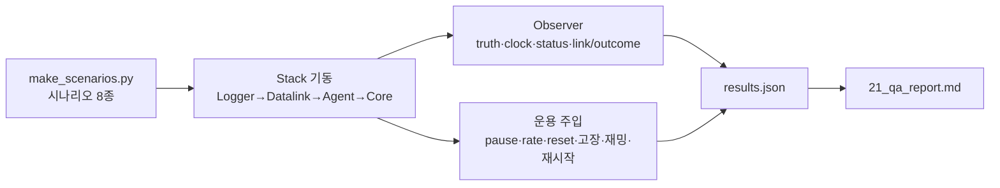
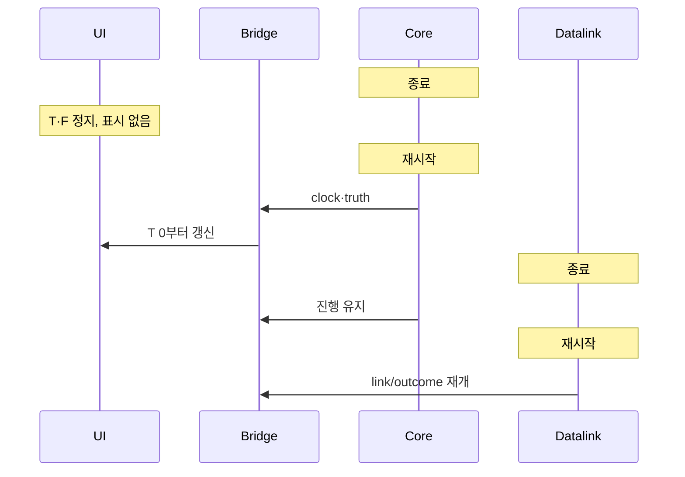
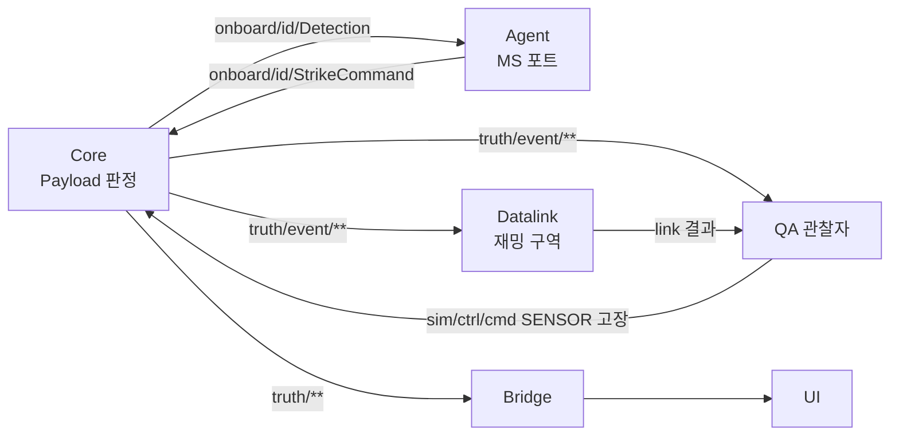

# QA/QC 보고서 (계약 0.8.0, 2026-11-02)

시험 대상은 wp0-contracts 4e3c4c3(WP1 dcc58d8 병합 후)이다. 이 문서는 결함 보고만 한다. 수정은 담당 WP가 한다. §1~8은 1차, §9는 DEC-038 수정 병합 후의 2차 재시험이다. 2차에서 QA-001·002·003·009·010은 수정을 확인했고 QA-005는 대부분 수정, QA-004는 미지원 결정(DEC-038)으로 종결했다. 새 결함은 QA-012~015이다.

## 1. 범위와 방법

| 항목 | 내용 |
|---|---|
| 빌드 | `msvc-debug`만 사용. `msvc-release`는 링크가 실패해 시험하지 못했다 (QA-007) |
| 환경 | Windows 11, MSVC + vcpkg, uv + CPython 3.12, Zenoh 1.10.2 (멀티캐스트 끔, TCP peer) |
| 시험 도구 | `qa/harness.py`(전체 스택 기동·종료·재시작, 버스 관찰자, 자원 표본), `qa/run_qa.py`(TC-QA-001~023), `qa/make_scenarios.py`(시나리오 생성·검증) |
| 재현 | `uv run python qa/make_scenarios.py` → `uv run python qa/run_qa.py [--only 001,010]`. 결과는 `qa/out/results.json` |
| 감시 항목 | 프로세스 종료, 시간·틱 역행, NaN/inf, 프레임 간극·중복, 엔티티 수 불일치, 메시지 순서·유실, CPU·RSS 추세, 결정성, 정지(hang) |

### 1.1 시나리오 (`qa/scenarios/`)

| 파일 | 성격 |
|---|---|
| `qa_s1_formation6` | 6기 3-DoF 편대(리더·추종, formation MA) |
| `qa_s2_swarm20` | 20기 군집. hold·route·racetrack·search_area 혼합 |
| `qa_s3_link` | 불완전 링크 프로파일(지연·손실·좁은 대역·단거리)과 35 km 밖 기체 |
| `qa_s4_engage` | 적·표적·센서·무장 선언 13개 엔티티 |
| `qa_s5_mixed` | 2-DoF/3-DoF, skywalker_x8/aerosonde 혼합, MA 혼합. dof5/dof6는 별도 적재 시험 |
| `qa_s6_load50`, `qa_s6_load100`, `qa_s6_load100_flock` | 50·100기 부하, 100기 flocking(P2P) |

## 2. 시험 결과 (TC-QA-001~023)

| TC | 내용 | 결과 | 비고 |
|---|---|---|---|
| TC-QA-001 | s1 6기 편대 120 s | 통과 | 중심 거리 85~350 m, 프레임 간극 0 |
| TC-QA-002 | s2 20기 임무 혼합 240 s | 통과 | hold 반경 유지, racetrack 범위 유지 |
| TC-QA-003 | s3 불완전 링크 | 통과 | 사유 OUT_OF_RANGE·BURST_LOSS·QUEUE_OVERFLOW 모두 관측. 지연 p99 4.1 s |
| TC-QA-004 | s4 적·표적·센서·무장 | 통과 | 견고성만 확인. 탐지·무장 동작은 Core 미구현(§5) |
| TC-QA-005 | s5 2/3-DoF 혼합, dof5/6 적재 | 통과 | dof5/6는 Core가 종료 코드 1로 종료(§4 D-3) |
| TC-QA-006 | 50기 lockstep 2배속 | 통과 | 실측 1.57배(debug), 간극 0, 엔티티 51 |
| TC-QA-007 | 100기 lockstep 1배속 | 통과 | 실측 0.93배, 엔티티 101 |
| TC-QA-008 | 100기 flocking P2P | 통과 | 실측 0.22배, overrun 1500/1500. Logger RSS 26→313 MB (QA-006) |
| TC-QA-009 | 100기 realtime | 통과 | sim/벽시계 1.00, overrun 3 |
| TC-QA-010 | pause·resume·step·set_rate·reset·반복 | 통과 | 비정상 rate 수용은 QA-003 |
| TC-QA-011 | 모드 전환 lockstep/realtime/freerun | 통과 | Reset 후 Start 순서 필요 |
| TC-QA-012 | 잘못된 SimCommand·시나리오 | 불합격 | QA-001, QA-003 |
| TC-QA-013 | 임무 명령 연속·충돌 | 불합격 | 마지막 명령의 EXECUTING 미관측. 순서 뒤바뀜은 기대 동작이라 결함 아님(§6) |
| TC-QA-014 | 잘못된 임무 값 | 통과 | 기체 종료·이상 이동 없음. 수용 범위는 QA-005 |
| TC-QA-015 | 명령 홍수(10 s에 29.9만 건) | 통과 | 프로세스 생존, 프레임 진행 저하 관찰(QA-011) |
| TC-QA-016 | 실행 중 매개변수 변경·거부 | 불합격 | QA-002 |
| TC-QA-017 | 고장 주입 | 통과 | SENSOR는 기록만(§5) |
| TC-QA-018 | 재밍 구역 on/off | 통과 | 재밍 중 JAMMED 3070건, 해제 후 복귀. `jam_zone`은 시험이 직접 발행 |
| TC-QA-019 | Agent·Datalink·Core 재시작(realtime) | 통과 | Core 재기동 후 frame 1915→326 재개 |
| TC-QA-020 | lockstep 지각 참여·재합류 | 불합격 | 지각 합류 통과(frame None→111). 진행 중 Agent 재합류는 QA-004 |
| TC-QA-021 | Logger 기록 → info → 재생(0.5·1·4·20배) | 통과 | 97,416건·337 채널. 고배속 프레임 감소는 QA-008 |
| TC-QA-022 | 결정성(같은 시나리오 lockstep 2회) | 통과 | 공통 2579 프레임, 최대 차이 0.000000 m |
| TC-QA-023 | 20기 realtime 10분 추세 | 통과 | Core RSS 26→27 MB, Datalink 23→26 MB. Logger +5 MB(QA-006) |

UI·Monitor 점검은 §3에 따로 적는다. 앱 내장 브라우저로 라이브 스택(s2, 20기)을 직접 확인했다.

## 3. UI·Monitor 대조

| 확인 | 결과 |
|---|---|
| UI 엔티티 수 | 21 (UAV 20 + GCS 1). 실제 상태와 일치 |
| UI 시각·프레임 | T 00:01:38.0 / F 4902 → 프레임 ≈ 50/s. 실제와 일치 |
| 일시정지 | 버튼이 `재개`로 바뀌고 상태 `정지`. 2 s 뒤에도 T·F 불변 |
| 재개 | 상태 `실행`, 시간 진행 재개 |
| 배속 ×5 | 5 s 동안 sim 5.2 s만 진행. 반응 없음 (QA-009) |
| Monitor | 연결됨, 계약 0.8.0, `실행 · 실시간 · 50 Hz · ×1.00 · qa-s2-swarm20`, 엔티티 트리 21개 일치 |
| Monitor 통계 | 이 시나리오는 링크 트래픽이 거의 없어 표가 0이다. 트래픽이 많은 상황의 표시 정확성은 확인하지 못했다(§7) |

## 4. 결함

심각도는 치명/높음/보통/낮음이다. 담당 WP는 추정이다.

### 4.1 WP별·심각도별 요약

| WP | 높음 | 보통 | 낮음 |
|---|---|---|---|
| WP1 Core | QA-001 | QA-003, QA-007 | |
| WP3 Agent | QA-002 | QA-004, QA-005 | |
| WP4 Datalink | | | QA-011 |
| WP5 Bridge/UI | | | QA-009, QA-010 |
| WP7 Logger | | QA-006 | QA-008 |
| 치명 | 없음 | | |

### QA-001 — NaN 초기 위치 시나리오가 적재되어 truth에 NaN이 퍼진다
- 담당 WP1 Core / 높음 / TC-QA-012
- 재현: 정지·`LOADED` 상태에서 `uav-003.initial.position.lat_deg = NaN`인 시나리오를 Reset 뒤 `sim/ctrl/scenario`로 발행하고 Start.
- 기대: 적재 거부(`load rejected`), 상태·기존 엔티티 유지.
- 실제: 적재 수용. 첫 프레임부터 `uav-003`의 `truth/state`가 NaN.
- 로그: `[nan_inf] uav-003 frame 0: (nan, 127.39151909999998, 1200.0, 20.0, 0.0, 0.0)` (harness 관찰자)
- 비고: 엔티티 0개 시나리오도 수용(`entity_count=0`). 중복 ID·없는 airframe·`frame_hz=5`·없는 링크 프로파일은 수용 여부를 엔티티 수만으로 구분하지 못했다. 같은 검증 경로의 점검을 권한다.

### QA-002 — MA 매개변수 `k_p=inf` 한 건에 Agent 프로세스가 종료된다
- 담당 WP3 Agent / 높음 / TC-QA-016
- 재현: formation MA 기체(uav-002)에 `SetParams`로 `k_p = inf`(JSON `Infinity`) 전송.
- 기대: `range` 사유로 거부(음수·1e12·문자열·bool·null은 모두 거부되었다).
- 실제: Agent가 종료 코드 1로 죽는다. 20기 전체가 제어를 잃는다.
- 로그: `agent(code 1)`. 같은 시험에서 `k_p=-5`, `1e12`는 `ma param 'k_p' rejected (range)`로 정상 거부.
- 비고: 이 경우를 마지막에 두었으므로 `NaN`은 확인하지 못했다. dynamics 쪽은 NaN·inf·음수·0이 모두 `range`로 거부되었다. MA 경로의 비유한 값 검사가 빠져 있다.

### QA-003 — 비유한·비정상 rate가 Core에서 수용된다
- 담당 WP1 Core / 보통 / TC-QA-010, 012
- 재현: Reset 뒤 `Start(lockstep, rate=NaN)` 또는 `rate=-3.0`. 실행 중 `SetRate(0, -1, NaN, inf, 1e9)`.
- 기대: 거부하거나 유한한 범위로 제한(`Start(realtime, rate=5)`는 1.0으로 제한되었다).
- 실제: 모두 수용. `status.rate_target`에 NaN·inf·음수가 그대로 나타난다. 프로세스는 살아 있다.
- 로그: `[swarm_core] start mode=RUN_MODE_LOCKSTEP hz=50 rate=nan seed=1`
- 비고: 이후 진행 속도는 확인하지 않았다. `hz=0`은 50으로 대체되어 수용된다. `hz=10`·`5000`은 거부된다.

### QA-004 — lockstep 중 이탈한 Agent가 재합류해도 진행이 재개되지 않는다
- 담당 WP1 Core(또는 WP3) / 보통 / TC-QA-020
- 재현: lockstep 실행 중 Agent 프로세스 종료 → 12 s 대기 → Agent 재기동.
- 기대: 장벽 대기 후 재합류 시 재개(DEC-037은 첫 틱 전 지각 참여를 정의한다. 실행 중 재합류는 명시가 없다).
- 실제: 이탈 중 정지(149→149)는 정상이다. 재합류 뒤에도 frame 149에서 멈춘다. Reset + Start로만 복구된다(frame 104).
- 비고: 첫 틱 전 지각 참여는 정상이다(frame None→111). 실행 중 재합류를 지원할지는 §6 항목이다. 지원 대상이 아니면 문서에 명시해야 한다.

### QA-005 — 잘못된 임무 값이 일관되지 않게 처리된다
- 담당 WP3 Agent / 보통 / TC-QA-014
- 재현: 임무 명령에 다음 값을 넣는다.
  - 수용(ACCEPTED→EXECUTING): `alt=inf`, `alt=-값`, `alt=100 km`, 지도 밖 좌표, 위경도 0, `racetrack axis=NaN·999`, `hold radius=1e9`, 경로 점 500개
  - 무응답(REJECTED 없음): `lat=200`, `lon=NaN`, 빈 task_id, 없는 엔티티, 경로 NaN, `radius=NaN`
  - 거부(사유 있음): 빈 경로, `radius<=0`, `leg_length<0`, 빈 task, `strike`
- 기대: 비유한·범위 밖 값은 일관되게 `REJECTED(사유)`.
- 실제: 위와 같음. 기체 종료나 이상 이동은 없었다(최대 이동 1442 m). `raceLeg0`은 ACCEPTED만 오고 EXECUTING이 없다.
- 로그: `qa-bad-altInf:ACCEPTED, EXECUTING, CANCELLED(preempted)`

### QA-006 — Logger 메모리가 부하에 따라 계속 늘어난다
- 담당 WP7 Logger / 보통 / TC-QA-006~009, 023
- 관찰(RSS): 20기 realtime 10분 27.8→39.5 MB(후반 +5.0 MB). 50기 26.9→60.9 MB. 100기 25.9→91.6 MB. 100기 flocking 30 s에 25.6→313.2 MB(후반 +128.8 MB).
- 기대: 쓰기 큐 상한 안에서 안정.
- 실제: 부하와 시간에 비례해 증가. 원인(큐 적체 대 단순 버퍼)은 판별하지 못했다. debug 빌드 기준이다.

### QA-007 — `msvc-release`가 링크되지 않는다
- 담당 WP1 Core 또는 빌드(WP0) / 보통
- 재현: `cmake --preset msvc-release` → 빌드.
- 실제: 링크 단계에서 실패. 세션 초반에 확인했으나 오류 전문은 보존하지 못했다(`qa_bld.log`에 남지 않음). 담당자가 재현해야 한다.
- 영향: 성능 시험이 모두 debug 빌드 값이다. 100기 flocking의 0.22배는 release에서 달라질 수 있다.

### QA-008 — 고배속 재생에서 truth 프레임이 줄어든다
- 담당 WP7 Logger / 낮음 / TC-QA-021
- 같은 기록(truth 프레임 약 2011)을 재생: 0.5배·1배 1970, 4배 1942, 20배 1849 프레임이 관찰자에 도착.
- 기대: 배속과 관계없이 도착 프레임 동일(재생 쪽 유실이 없으면). 수신 측 한계일 수도 있다.

### QA-009 — UI 배속 버튼이 realtime에서 무반응이다
- 담당 WP5 UI / 낮음 / UI 점검
- 재현: 실시간 모드 실행 중 UI에서 `×5` 클릭.
- 기대: 적용되거나 비활성/안내 표시.
- 실제: 5 s 동안 sim 5.2 s 진행(×1 그대로). 버튼은 눌리고 오류 표시는 없다. realtime에서 rate가 고정이라면(DEC-005) 비활성이 맞다.

### QA-010 — `swarm-bridge --help`가 cp949 콘솔에서 비정상 종료한다
- 담당 WP5 Bridge / 낮음
- 재현: 한국어 Windows 콘솔에서 `swarm-bridge --help`.
- 실제: 도움말 문자열 인코딩 오류로 종료. 환경변수 `PYTHONIOENCODING=utf-8`이면 정상.

### QA-011 — 명령 홍수 동안 프레임 진행이 크게 떨어진다
- 담당 WP4 Datalink / 낮음 / TC-QA-015
- 재현: 20기에 10 s 동안 299,349건의 임무 명령 전송.
- 실제: 프로세스는 모두 생존. 홍수 중 10 s 동안 프레임이 181→313(≈13 Hz)만 진행, overrun 25→71. 링크 결과 DROPPED 512,342(큐 넘침). 마지막 명령의 응답은 없다. 보호·속도 제한이 없다는 관찰이며, 요구가 없으면 결함이 아니다.

## 5. 범위 밖으로 확인된 Core 한계

시험 설계에서 확인된 한계다. 결함으로 분류하지 않고 §6에서 결정을 요청한다.

- Detection 메시지를 만들지 않는다. 센서 FOV·거리·가시선 판정(DEC-018)이 동작하지 않는다.
- 무장·발사·명중 논리가 없다(DEC-019). `truth/event/kill` 외 교전 이벤트가 없다.
- `truth/event/jam_zone` 발행자가 없다. 시험이 직접 발행해 Datalink 반응(JAMMED)을 확인했다.
- `SENSOR` 고장은 기록만 하고 효과가 없다.
- dof5/dof6은 미지원이다.

## 6. 결정 확인 필요

| # | 항목 | 확인할 점 |
|---|---|---|
| D-1 | 교전·탐지·재밍 구역 생성 미구현 | 1차 범위인지, 어느 WP가 언제 구현하는지 (DEC-017~019) |
| D-2 | SENSOR 고장 효과 없음 | 효과 정의가 필요한지 |
| D-3 | dof5/dof6 시나리오 적재 시 Core 종료(코드 1) | 거부 후 `LOADED` 유지가 맞는지 |
| D-4 | lockstep 중 참여자 재합류 | 지원 범위(QA-004) |
| D-5 | realtime에서 SetRate 무시 | UI에서 비활성으로 보일지 (QA-009) |
| D-6 | `assignee` 비움 → 전체 기체 수행(19기 응답) | 의도된 방송인지 |
| D-7 | 중복 `task_id` 재전송 시 ACCEPTED가 두 번 | 멱등 처리인지 재할당인지 |
| D-8 | KILL 후 `alive=False`가 고장 해제와 무관하게 유지 | 영구 사망이 맞는지 |
| D-9 | Datalink 지연·지터로 TaskStatus 순서가 뒤바뀜 | 기대 동작이며 결함이 아님 |

## 7. 확인하지 못한 항목

| 항목 | 이유 |
|---|---|
| release 빌드 성능 | `msvc-release` 링크 실패 (QA-007). 모든 속도 수치는 debug 값이다 |
| Agent CPU·메모리 | 표본이 `uv` 래퍼 프로세스를 가리켜 0.0%로 나온다. Agent 자체의 추세는 모른다 |
| 탐지·교전·재밍 구역 동작 | Core 미구현(§5) |
| MA `NaN` SetParams | `inf`에서 Agent가 죽어 뒤 케이스를 실행하지 못했다 |
| Monitor 통계의 정확성 | 이 시나리오는 트래픽이 거의 없다. 트래픽 표·시퀀스 타임라인을 s3·flock 부하로 대조하지 못했다 |
| UI 명령 전송·고장 표시 | 일시정지·재개·배속만 확인했다. 선택·MoveTo 등은 TC-INT-003 범위 |
| 수백 대 이상 | OPN-034와 같은 한계. 100기까지만 시험 |
| 시험 환경 | Linux·MinGW 프리셋은 시험하지 않았다 |

## 8. 이미 알려진 항목

lockstep 시나리오 재발행과 CLI `--mode/--rate` 재정의는 dcc58d8에서 고쳐졌다. 이 시험은 수정을 재확인했다(TC-QA-011, 020의 지각 합류). 새 결함으로 보고하지 않는다.

## 9. 재시험 (2차, 2026-11-02)

시험 대상은 wp0-contracts에 WP1(cddd678)·WP3(a20cd4a)·WP5(73baee1) 수정이 병합된 상태이다(DEC-038). Core를 포함해 `msvc-debug`로 다시 빌드했다. release 빌드(QA-007)는 제외했다.

### 9.1 회귀 시험

| TC | 1차 | 2차 | 판정 근거 |
|---|---|---|---|
| TC-QA-010 | 통과 | 통과 | 비정상 rate가 거부된다(QA-003 수정 확인) |
| TC-QA-012 | 불합격 | 통과 | NaN 초기 위치·dof5/6·빈 시나리오는 적재 거부 후 Core 생존(QA-001, D-3 수정 확인) |
| TC-QA-013 | 불합격 | 통과 | 기준을 바꿨다. 순서 뒤바뀜(D-9, DEC-038 (8))을 허용하고 "기체당 실행 중 임무 1개 이하"와 간격을 둔 마지막 명령의 도달·ACCEPTED로 판정 |
| TC-QA-014 | 통과(비일관) | 불합격 | 경로 NaN(`routeNaN`)·`hold radius=NaN`(`holdRNaN`)이 응답 없이 무시된다(QA-014). 나머지 값은 REJECTED(사유)로 일관(QA-005 대부분 수정). 빈 `assignees` 거부, 중복 `task_id` 교체 확인(D-6, D-7) |
| TC-QA-015 | 통과 | 불합격 | 홍수 후 lockstep이 영구 정지한다(QA-012). 2회 모두 재현 |
| TC-QA-016 | 불합격 | 통과 | MA `k_p`에 `inf`·`NaN`·음수·1e12 모두 `range`로 거부, Agent 생존(QA-002 수정 확인) |
| TC-QA-020 | 불합격 | 통과 | 기준 변경(DEC-038 (4)). Agent 이탈 중 정지, Core 로그 `waiting for frame done: agent-0`, Reset+Start로 복구 |
| QA-009 | | 수정 확인 | realtime에서 UI 배속 버튼이 비활성이다 |
| QA-010 | | 수정 확인 | cp949 콘솔에서 `swarm-bridge --help` 정상 |

### 9.2 새 시험

| TC | 내용 | 결과 | 비고 |
|---|---|---|---|
| TC-QA-024 | 결정성 추가. 시드 7·20261104, s3 불완전 링크, 각 2회 | 불합격 | 같은 시드인데 링크 DROPPED 수가 다르고 궤적이 다르다(QA-013). 손실 없는 시나리오는 1차 TC-QA-022에서 결정적 |
| TC-QA-025 | Agent 프로세스 자체 CPU·RSS(50기 realtime 90 s, python 자식 합산) | 통과 | Agent CPU 평균 63%·최대 119%, RSS 4.5→72.7 MB(후반 -0.1 MB), Core 평균 50%, Logger +8.8 MB(QA-006), Datalink +2.7 MB |
| TC-QA-026 | Monitor 통계 대 독립 집계(s3 라이브) | 통과 | 송신자별 건수·손실률·지연 평균이 독립 집계(`qa/link_count.py`)와 일치. 아래 참고 |
| TC-QA-027 | 임무 중 Core·Datalink 재시작과 UI 복구(realtime, s3) | 통과 | 아래 참고. UI의 끊김 표시 없음(QA-015) |
| UI 명령 | 선택·MoveTo·Hold·Racetrack·Route 전송(브라우저) | 통과 | 5종 모두 TaskStatus 수신. flocking 기체는 Route를 거부(D-10). 고장 표시는 시험하지 못함 |

TC-QA-026 참고:
- s3 40 s 창에서 송신자별 건수·손실률은 일치했다. 예: uav-011은 건수 650, 손실 0.76(QUEUE_OVERFLOW 444, OUT_OF_RANGE 50), 지연 평균 3.6 s.
- Monitor의 지연 p95가 독립 집계보다 크게 나온다. 히스토그램 구간 양자화로 보이며 정확한 원인은 확인하지 못했다.
- 시퀀스 타임라인은 s3에서 메시지 흐름이 표시된다. flocking 100기 부하에서는 대조하지 못했다.

TC-QA-027 결과:

| 단계 | 조작 | 관찰 |
|---|---|---|
| 1 | Core 종료 | UI의 T·F가 멈춘다. 연결 표시는 그대로 "연결"이고 정지·끊김 안내가 없다(QA-015) |
| 2 | Core 재시작 | UI가 새로고침 없이 새 실행(T 0부터)을 따라간다. 엔티티 14 유지 |
| 3 | Datalink 종료 | realtime에서는 Core가 계속 진행한다. UI T·F 정상 진행 |
| 4 | Datalink 재시작 | 링크 결과가 다시 발행된다(10 s에 PeerStatus 2586건, 송신자 4곳, 손실 사유 정상) |

### 9.3 새 결함

#### QA-012 — 명령 홍수 후 lockstep이 영구 정지한다
- 담당 WP4 Datalink(원인 추정) / 높음 / TC-QA-015
- 재현: lockstep 2배속, 20기에 10 s 동안 약 41만 건의 임무 명령을 보낸다.
- 기대: 홍수 뒤 프레임 진행 재개(1차 시험에서는 회복했다).
- 실제: 프레임 271→277에서 멈춘 채 150 s 안에 회복하지 못한다. Core 로그는 `waiting for frame done: datalink-0 (frame 278)`이다. Datalink RSS는 약 2.3 GB까지 늘었다. 2회 모두 재현.
- 비고: 링크 결과 DROPPED 234,465, DELIVERED 1,812. 큐 적체로 `frame_done`을 못 내는 것으로 보인다. 확인하지 못했다.

#### QA-013 — 불완전 링크에서 같은 시드의 결과가 달라진다
- 담당 WP4 Datalink 또는 WP1 Core / 보통 / TC-QA-024
- 재현: `qa_s3_link`를 같은 시드로 lockstep에서 2회 실행해 비교.
- 기대: DEC-005의 결정성(손실 없는 시나리오는 최대 차이 0).
- 실제: 시드 7은 최대 1.97 m, 시드 20261104는 최대 30.8 m 차이. 링크 DROPPED 수와 총 프레임 수도 다르다.
- 비고: 링크 손실·지터 난수가 시드 외 요인(실행 순서·벽시계)에 의존하는 것으로 보인다. 확인하지 못했다. 결정성을 보장해야 하는 범위에 불완전 링크를 포함할지는 §9.5 항목이다.

#### QA-014 — 경로·hold 반경의 NaN이 응답 없이 무시된다
- 담당 WP3 Agent / 낮음 / TC-QA-014
- 재현: 경로 점에 NaN을 넣은 Route, `hold radius=NaN`.
- 기대: 다른 비정상 값처럼 `REJECTED(사유)`.
- 실제: TaskStatus가 오지 않는다. 기체 이동 변화 없음.
- 비고: QA-005의 나머지 항목(`alt=inf`, 범위 밖 좌표, `radius<=0` 등)은 REJECTED로 바뀌었다.

#### QA-015 — Core가 죽어도 UI가 끊김을 표시하지 않는다
- 담당 WP5 UI / 낮음 / TC-QA-027
- 재현: 실행 중 Core 프로세스 종료.
- 기대: 시계 정지·연결 끊김 표시.
- 실제: T·F가 멈추고 연결 표시는 "연결" 그대로. 사용자가 정지를 알아보기 어렵다.

### 9.4 갱신된 결정 확인 항목

| # | 상태 | 비고 |
|---|---|---|
| D-3 | 해결 | dof5/6은 거부 후 Core 생존(DEC-038 (2)) |
| D-4 | 해결 | 재합류 미지원, Reset+Start(DEC-038 (4)). 시험 기준을 바꿨다 |
| D-5 | 해결 | UI 배속 비활성(QA-009) |
| D-6 | 해결 | 빈 `assignees` 거부 |
| D-7 | 해결 | 중복 `task_id`는 교체 |
| D-8 | 확인 | KILL 후 `alive=false` 유지(DEC-038 (7)) |
| D-9 | 확인 | 순서 뒤바뀜은 기대 동작(DEC-038 (8)) |
| D-10 | 신규 | flocking MA는 Route를 `unsupported task route`로 거부한다. UI는 선택한 기체가 flocking이어도 Route 전송을 막지 않고 안내하지 않는다. 의도한 제한인지 확인 필요 |
| D-11 | 신규 | QA-013. 불완전 링크 시나리오에서 같은 시드 결과 동일을 요구하는지(DEC-005) |

### 9.5 2차에서 확인하지 못한 항목

| 항목 | 이유 |
|---|---|
| release 빌드 | 범위 제외(QA-007) |
| flocking 100기 부하의 Monitor 통계 대조 | 시도하지 않았다. s3에서만 대조 |
| UI의 고장 표시 | 시험하지 않았다 |
| 이탈 후 Datalink 재시작의 lockstep 영향 | realtime에서만 시험. lockstep에서 Datalink 이탈은 시험하지 않았다 |

## 10. 3차 시험 (2026-11-03)

2차 수정(QA-006·007·012·013·014·015, D-10, DEC-039·040)이 병합된 wp0-contracts를 병합하고 debug·release를 처음부터 빌드해 재시험했다. 시험 환경은 `msvc-debug`(전체 스위트)와 `msvc-release`(성능·QA-006·008·028)다. 새 결함은 QA-016부터 번호를 붙였다.

### 10.1 회귀 결과

| TC | 결과 | 비고 |
|---|---|---|
| TC-QA-001~013 | 통과 | |
| TC-QA-014 | 통과 | QA-014 수정 확인. NaN 경로·hold 반경이 `REJECTED`로 응답한다. 시험이 BURST_LOSS로 명령을 놓치던 결함이 있어 최대 4회 재전송으로 고쳤다 |
| TC-QA-015 | 통과 | QA-012 수정 확인. 10 s 동안 429,694건을 보낸 뒤 2 s 안에 프레임 진행이 재개된다 |
| TC-QA-016~023 | 통과 | TC-QA-022(waypoint MA 결정성) 포함. QA-006 RSS는 Logger 27.0→27.2 MB(10분) |
| TC-QA-024 | 불합격 | QA-016. waypoint MA는 결정적이지만 flocking/P2P 기체는 같은 시드에서 궤적이 다르다 |
| TC-QA-025 | 통과 | |
| TC-QA-026 | 미실시 | s3는 2차에서 일치. 이번에는 flocking 100기 부하 대조를 시도했으나 QA-017로 창을 맞추지 못했다 |
| TC-QA-027 | 통과 | 브라우저로 Core 종료·재시작을 다시 확인 |
| TC-QA-028 (신규) | 통과 | lockstep 중 Datalink 이탈·재기동 |
| TC-QA-029 (신규) | 해석 | QA-008 재생 판별 스크립트 `qa/qa008_replay.py` |

### 10.2 수정 확인

| 항목 | 확인 |
|---|---|
| QA-006 Logger 메모리 | psutil 측정 RSS 27.0→27.2 MB(10분). 증가 없음 |
| QA-007 release 빌드 | `msvc-release` 빌드와 실행 정상 |
| QA-012 명령 홍수 | 위 TC-QA-015. 회복 확인 |
| QA-013 lockstep 수신 결정성 | 일부만 수정됨. QA-016 참고 |
| QA-014 NaN 거부 | 통과 |
| QA-015 Core 정지 표시 | Core 종료 시 붉은 배지 "시뮬레이터 응답 없음", 재시작 후 자동 복구 |
| D-10 flocking Route | 항로 편집기가 "flocking 기체 4대는 항로를 지원하지 않아 거부될 수 있다"를 안내한다. 전송은 막지 않는다 |

### 10.3 새 결함

#### QA-016 — flocking/P2P 기체의 같은 시드 궤적이 달라진다 (QA-013 부분 수정)
- 담당 WP3 flocking 또는 WP4 P2P / 높음 / TC-QA-024
- 재현: `qa_s3_link`를 같은 시드로 lockstep에서 2회 실행해 비교(`qa/diag_determinism.py`).
- 기대: DEC-005·DEC-040의 결정성.
- 실제:
  - 시드 7: 불일치 8478건, 최대 1.296 m. 엔티티별로는 0.13~0.58 m 차이가 프레임 51~71에서 시작한다.
  - 시드 20261104: 불일치 8422건, 최대 0.393 m.
  - `qa_s6_load100_flock`: 약 1e-4 m.
  - waypoint MA 기체는 모두 일치한다.
- 비고: 2차의 최대 30.8 m에서 크게 줄었다. flocking/P2P 경로에 남은 비결정 요인(이웃 상태 수신 순서나 시각)으로 추정한다. 확인하지 못했다.

#### QA-017 — flocking 100기 부하에서 Monitor의 링크 지연이 계속 늘어난다
- 담당 WP5 Bridge/Monitor / 보통 / TC-QA-026
- 재현: s6 flocking 100기를 Bridge 경유(`?source=bridge&url=ws://127.0.0.1:8765/bus`)로 Monitor에 연결.
- 기대: 실제 링크 지연(수 초 이하)과 비슷한 값.
- 실제: "링크 지연 77.6 s"가 표시되고 83.5 s, 96.4 s로 계속 늘어난다. link 이벤트의 일부만 처리하는 것으로 보인다. 누적 손실률은 Monitor 5.7%, 독립 집계 3.34%로 창이 달라 대조하지 못했다. 시퀀스 타임라인은 "0건".
- 비고: 처리량을 넘는 이벤트를 버리거나 밀리는 방식을 확인하지 못했다.

#### 관찰 — UI에 고장 표시가 없다 (낮음)
ENGINE·GCS_LINK_CUT·KILL을 주입해도 UI에 고장 표시가 없다. 속도 12.0 m/s, 명령 가능 기체 수 12→11처럼 간접으로만 보인다.

### 10.4 성능: release 대 debug와 DEC-040

배속 배수(1.0 = 실시간)다.

| 시나리오 | debug | release | 1차 debug |
|---|---|---|---|
| 50기 lockstep 2배속 | 1.41x | 1.42x | 1.57x |
| 100기 lockstep 1배속 | 0.93x | 0.97x | 0.93x |
| 100기 flocking | 0.26x | 0.45x | 0.22x |

- release 프레임 오버런은 906 / 39 / 967건. release의 Datalink CPU는 lockstep 시나리오에서 3.6~4.4%로 내려간다. flocking에서는 Datalink 105%, Agent 182%.
- Python Agent가 병목이라 release는 Core·Datalink CPU만 줄인다.
- DEC-040 영향: 50기 2배속에서만 1.57→1.41~1.42로 소폭 느려졌다. 나머지는 같거나 빠르다. Agent가 Datalink FrameDone을 기다리는 비용으로 보인다.

### 10.5 QA-008 판별(재생 쪽인가 관찰 쪽인가)

`rec.mcap`의 truth/state는 2018개다. 재생기는 모든 배속에서 98,504건을 발행하고 skipped는 0이다. 수신 쪽 프레임 수는 배속과 수신 부하에 따라 줄어든다.

| 배속 | 가벼운 수신기(개수만) | Observer(전체 처리) | 비고 |
|---|---|---|---|
| 1x | 1995 | 1995 | 첫 프레임 22. 앞 23개는 구독 준비 경쟁으로 보인다 |
| 4x | 1908 | 1863 | |
| 20x | 957 | 550 | 중간 누락 334 |
| 100x | 0 | 0 | 이전 실행 |

판정: 손실은 재생기의 발행이 아니라 전달·수신 쪽에서 생긴다. 재생기에 속도 조절이나 배압이 없다. 설계 한계로 보고한다. 배속이 높은 재생에서 관찰자가 값을 놓치는 것은 이 때문이다.

### 10.6 TC-QA-028 — lockstep 중 Datalink 이탈·재기동

- s2를 lockstep 2배속으로 시작하고 프레임 200을 넘긴 뒤 Datalink를 종료했다.
- 진행이 멈추고(2프레임 이내) Core 로그에 `waiting for frame done: datalink-0 (frame 247)`가 남는다.
- Datalink를 재시작해도 진행은 재개되지 않는다(DEC-038 (4), 재합류 미지원과 일치).
- Reset+Start로 복구되고 20기가 다시 정상 진행한다.

### 10.7 결정 확인 항목

| # | 상태 | 비고 |
|---|---|---|
| D-10 | 확인 필요 | UI가 flocking 기체에 Route를 막지 않고 경고만 한다. 의도한 동작인지 확인 |
| D-11 | 확인 필요 | QA-016. flocking·P2P를 포함해 같은 시드 결과 동일을 요구하는지(DEC-005·DEC-040) |
| D-12 | 신규 | lockstep에서 Datalink가 이탈하면 Core가 무기한 대기한다(DEC-038 (4)). 타임아웃 후 오류 표시나 종료를 원하는지 |
| D-13 | 신규 | 재생에 속도 조절이 없어 고배속에서 수신자가 프레임을 놓친다(QA-008). 재생 모드의 요구 수준 확인 |

### 10.8 3차에서 확인하지 못한 항목

| 항목 | 이유 |
|---|---|
| flocking 100기 Monitor 통계 대조 | QA-017로 창을 맞출 수 없었다 |
| TC-QA-026 재실시 | s3는 2차에서 일치. 이번 차수에서 재실행하지 않았다 |
| release 전체 스위트 | release는 006·007·008·028과 성능만 실시했다. 전체 스위트는 debug |
| QA-016 원인 | 엔티티 단위 차이와 시작 프레임까지만 확인했다 |

## 11. 4차 시험 (2026-11-05)

wp0-contracts ad32860(DEC-041·042·043, QA-017 브리지 묶음 전달)을 병합해 Zenoh 포함 debug로 전체 스위트를 실시했고, 이어 efc38b2(DEC-044 송신 개수 장벽, 계약 0.10.0)를 병합해 `gen_proto.py`와 재빌드 뒤 QA-016 결정성과 처리 속도를 다시 쟀다. base_port는 47980 이상을 썼다.

### 11.1 회귀 결과 (ad32860, debug)

전체 26건 중 통과 25, 불합격 1(TC-QA-024). 불합격은 DEC-044 병합 뒤 통과로 바뀌었다.

| TC | ad32860 | DEC-044 후 | 비고 |
|---|---|---|---|
| TC-QA-001~023, 025, 027 | 통과 | — | 3차와 같다. TC-QA-023 Logger RSS +0.1 MB/10분 |
| TC-QA-024 | 불합격 | 통과 (53 s) | 아래 11.2 |
| TC-QA-026 | 불일치 | 재실시 안 함 | QA-018(아래 11.3). QA-017 수정 후에도 Monitor 값이 독립 집계와 다르다 |
| TC-QA-028 | 통과 | 통과 | 이탈 뒤 프레임 244→244 / 254→254 정지, Core 대기 로그 남음. `SimStatus.waiting_participants`는 미확인 |
| TC-QA-029 | 해석 | — | 20배속 수신기 1358, 관찰자 1082(3차 957 / 550). 재생기 발행은 전부, 수신 쪽 유실은 설계 한계 |
| TC-INT-009 | 통과 | — | 늦게 합류한 Agent가 시나리오를 읽고 프레임 1903까지 진행. p0-demo의 불합격은 재현되지 않았다 |

### 11.2 DEC-044 전후 비교 (QA-016)

`qa/diag_determinism.py`로 같은 시나리오·시드를 lockstep에서 2회 실행해 비교했다.

| 시나리오 | 불일치 엔티티 (전 → 후) | 첫 어긋남 | 최대 위치 차이 (전 → 후) | lockstep 속도 (후) |
|---|---|---|---|---|
| s3 시드 7 | 8478건 / 5897건 → 0/14 | 없음 | 1.296 m → 0.0000 m | 207.6, 218.9 프레임/s |
| s3 시드 20261104 | 8422건 / 6919건 → 0/14 | 없음 | 0.393 m → 0.0000 m | 233.5, 235.5 프레임/s |
| s6 100기 flocking 시드 7 (600프레임) | 약 1e-4 m → 0/101 | 없음 | 약 1e-4 m → 0.0000 m | 15.7, 14.8 프레임/s |

- 전은 3차(efbc15f)의 불일치 건수이고, ad32860에서는 s3 시드 7이 최대 0.003792 m(5897건), 시드 20261104가 0.008477 m(6919건)였다.
- DEC-044로 flocking/P2P 포함 세 시나리오 모두 같은 시드에서 완전히 같아졌다. QA-016은 해결로 판정한다.
- OPN-036은 사용자 결정 사항이라 건드리지 않았다.

처리 속도(배속 배수, 1.0 = 실시간)는 ad32860과 DEC-044 후가 거의 같아 장벽의 비용은 보이지 않는다.

| 시나리오 | 3차 debug | ad32860 | DEC-044 후 |
|---|---|---|---|
| 50기 lockstep 2배속 (TC-QA-006) | 1.41x | 1.58x | 1.61x (오버런 771) |
| 100기 lockstep 1배속 (TC-QA-007) | 0.93x | 0.92x | 0.92x (오버런 45) |
| 100기 flocking (TC-QA-008) | 0.26x | 0.25x | 0.27x (오버런 1500) |

병목은 여전히 Python Agent다. flocking에서는 Datalink CPU 평균 123%, Agent 130%, Logger 113%다. 세 시나리오 모두 프레임 갭 0.

### 11.3 새 결함

#### QA-018 — Monitor의 링크 손실률·지연이 독립 집계와 맞지 않는다 (QA-017 수정 후에도)
- 담당 WP5 Bridge/Monitor / 보통 / TC-QA-026
- 재현: s6 flocking 100기를 Bridge 경유(`?source=bridge&url=ws://127.0.0.1:48765/bus`)로 Monitor에 연결하고 `qa/link_count.py`와 같은 창에서 비교.
- 기대: 누적 손실률이 독립 집계와 같다.
- 실제: 독립 집계 손실률 2.30%, Monitor 4.3~5.0%. 평균 지연이 2~3 s와 68~73 s 사이를 오가고, 처리 중 비율 2~12%, 큐·버스트 비중이 달라 창이 맞지 않는다.
- 비고: QA-017(지연이 계속 늘어남)은 지연이 계속 증가하는 현상은 멈췄다. 표시값이 독립 집계와 다른 문제는 남아 있다. 원인은 확인하지 못했다.

### 11.4 요약표

| 구분 | TC / 결함 |
|---|---|
| 통과 | TC-QA-001~025(DEC-044 후 TC-QA-024 포함), 027, 028, TC-INT-009 |
| 불합격 | 없음 (TC-QA-026은 불일치로 QA-018) |
| 해석 | TC-QA-029 |
| 미확인 | `SimStatus.waiting_participants` 값, DEC-041 "응답 없음" UI 표시, DEC-042 재생 누락 표시, DEC-043 QoS 통일의 개별 확인 |
| 해결 | QA-016 (DEC-044), TC-INT-009 불합격 재현 불가 |
| 열림 | QA-018 |

### 11.5 결정 확인 항목

| # | 상태 | 비고 |
|---|---|---|
| D-11 | 해결 | DEC-044로 flocking·P2P 포함 같은 시드 결과가 동일해졌다 |
| D-12 | 부분 해결 | DEC-041로 5 s 뒤 대기 참가자를 SimStatus에 싣는다. 로그만 확인했고 종료·오류 처리는 여전히 정해지지 않았다 |
| D-13 | 확인 필요 | 재생 속도 조절이 없다. DEC-042가 누락 프레임 표시만 더했다 |
| D-14 | 신규 | TC-INT-009에서 정상 진행 중에도 "waiting for frame done" 로그가 주기적으로 남는다. 5 s 기준이 의도한 것인지 확인 |

### 11.6 4차에서 확인하지 못한 항목

| 항목 | 이유 |
|---|---|
| DEC-044 후 TC-QA-026 재실시 | 시간상 하지 않았다. QA-018은 ad32860 기준 |
| `waiting_participants` 필드 직접 확인 | Core 로그만 확인했다. 버스 구독이나 UI 표시는 확인하지 않았다 |
| release 전체 스위트 | debug만 실시 |

## 12. 4차 미확인 항목 확인 (2026-11-05)

§11.6에서 확인하지 못한 DEC-041·042·043을 e60ba45(bbd23c3 병합)에서 확인했다. e60ba45는 내 커밋 위의 fast-forward라 소스가 같아 다시 빌드하지 않았다.

### 12.1 결과

| 항목 | 결과 | 방법 |
|---|---|---|
| `SimStatus.waiting_participants` (DEC-041, IMP-CORE-020) | 통과 | TC-QA-030(신규). s2 lockstep 2배속 중 Agent 종료 |
| UI "참여자 응답 없음" 경고 (DEC-041) | 통과 | 브라우저(`?source=bus&bridge=ws://127.0.0.1:48765/bus`). lockstep 중 Agent 종료 |
| UI 재생 "누락 프레임" 표시 (DEC-042, IMP-UI-059) | 통과 | 브라우저. 기록을 4배속으로 재생 |
| 버스 QoS (DEC-043) | 간접 확인만 | 아래 12.2 |

### 12.2 상세

- TC-QA-030: 정상 진행 중에는 `waiting_participants`가 비어 있다. Agent를 종료하면 5.5 s 뒤 `['agent-0']`이 실리고, Reset 뒤 비워진다. 5 s 전에는 실리지 않았다. 두 번 실행해 통과했다(첫 실행의 FAIL은 시험이 Agent를 되살리지 않은 시험 쪽 문제였다).
- UI 경고: 상단 막대에 붉은 배지 "참여자 응답 없음: agent-0 — Reset 후 Start로 복구"가 나타난다. 리셋을 누르면 상태가 적재(T 0, F 0)로 돌아가고 배지가 사라진다.
- UI 재생 표시: "재생" 배지와 함께 "누락 프레임 383"이 표시된다. 같은 재생에서 기록된 `waiting_participants`도 경고로 다시 보인다. 20배속 재생은 몇 초 만에 끝나 화면에서 값을 읽지 못했다.
- DEC-043: Zenoh의 우선순위·혼잡 제어 플래그는 버스 밖에서 읽을 수 없어 직접 확인하지 못했다. 간접 증거로 TC-QA-015(명령 429,694건 홍수 뒤 2 s 안에 lockstep 재개), TC-QA-024(DEC-044 후 결정성 0 불일치), TC-QA-028·030(대기·복구)이 통과했다. 이들은 BLOCK 쪽 키가 혼잡에서 버려지지 않았음을 보이지만 DROP 쪽 키의 동작은 보이지 않는다.

### 12.3 결정 확인 필요

| # | 상태 | 비고 |
|---|---|---|
| D-12 | 부분 해결 유지 | 표시는 확인했다. 대기 후 종료·오류 처리는 정해지지 않았다(복구는 Reset+Start) |
| D-15 | 신규 | `ui/` 기본 브리지 주소는 8765이고 쿼리는 `bridge=`이다. 모니터는 `url=`이다. 두 앱의 파라미터 이름이 다르다 |

### 12.4 시험 환경 메모

- `qa/recovery_stack.py`가 lockstep 2배속으로 뜨도록 바꿨다(`qa/ui_lockstep.py`는 실행 중 스택을 lockstep으로 다시 시작하는 보조 스크립트).
- 시험 중 `qa-qc-943022` 빌드의 `swarm_core`·`swarm_datalink`가 base 47980(`scratchpad\448806a9616edee3\...\out18`)으로 남아 있었다. 내 시험이 아니다. 한 번 종료했으나 다시 떠 있어 다른 세션의 실행으로 보고 두지 않았다.

## 13. 5차 시험: QA-018 판정 (2026-11-05)

wp0-contracts ee0f234(IMP-CORE-021, IMP-MON-028 포함)를 fast-forward로 병합하고 debug를 다시 빌드한 뒤 TC-QA-026을 다시 실시했다. base_port는 48280(`qa/recovery_stack.py`)이다.

### 13.1 QA-018 판정

**재현 안 됨. ad32860 이후 해결로 기록한다.** 같은 시나리오에서 Monitor와 독립 집계가 손실률·평균 지연 모두 맞았다.

조건: s6 flocking 100기, lockstep ×2, Bridge 경유 Monitor(`?source=bridge&url=ws://127.0.0.1:48765/bus`), 브라우저 탭 전경. `qa/link_count.py`는 Datalink 엔드포인트에 직접 붙었다.

| 항목 | `link_count.py` | Monitor |
|---|---|---|
| 창 | 60.1 s | 창 시작 약 2 s 전에 연결, 읽은 시점은 시작 약 12 s 뒤(누적) |
| 집계 수 | PeerStatus 635,591건 | 49,999건/s (최근 5 s) |
| 손실률 | 1.905% (12,107건, 전부 BURST_LOSS) | 1.9% (전체 행) |
| 평균 지연 | 19.997 ms (p95 약 28.3 ms) | 20.0 ms (p95 32.8 ms) |
| 기체별 손실률 | 1.5~2.7% | 1.2~2.7%, 같은 경향 (uav-096 2.69% 대 2.6%, uav-055 2.7%) |

- 4차(ad32860)에는 독립 2.30% 대 Monitor 4.3~5.0%, 평균 지연 2~73 s였다. 지금은 지연이 20 ms로 안정하고 손실률 차이가 0.1%p 이내다.
- 재현 조건을 좁히지 못한 부분(미확인): 창이 60 s 하나뿐이다. 브라우저 탭을 뒤로 보냈을 때, 연결을 끊었다 다시 붙일 때, 5분 이상 긴 창은 시험하지 않았다. Monitor 표시는 연결 시점부터의 누적이고 독립 집계 창과 12 s 어긋나 있어 0.1%p 안팎의 차이는 이 어긋남 안이다.
- 시뮬레이션 속도는 100기 flocking에서 실효 0.19배로 느렸다(Python Agent 병목, 4차와 같다). Monitor "처리" 비율은 8.0%였다.

### 13.2 D-14 확인

IMP-CORE-021로 해결로 판정한다. 같은 실행(sim 00:17까지 진행)의 Core 로그에 "waiting for frame done"이 0줄이다. "waiting"이 들어간 줄은 시작 때의 "waiting for frames" 한 줄뿐이다. 프레임 진행 중 Monitor의 시뮬레이션 시각이 계속 올라갔다.

### 13.3 결과 요약

| 항목 | 결과 |
|---|---|
| TC-QA-026 | 통과 (손실률 1.905% 대 1.9%, 평균 지연 20.0 ms 대 20.0 ms) |
| QA-018 | 재현 안 됨, ad32860 이후 해결 |
| D-14 | 해결 (정상 진행 중 대기 로그 0줄) |

### 13.4 결정 확인 항목

| # | 상태 | 비고 |
|---|---|---|
| D-14 | 해결 | IMP-CORE-021 |
| D-12 | 부분 해결 유지 | 5차 범위 밖 |
| D-13 | 확인 필요 유지 | 재생 속도 조절 없음 |
| D-15 | 확인 필요 유지 | `ui/`는 `bridge=`, 모니터는 `url=` |

### 13.5 5차에서 확인하지 못한 항목

| 항목 | 이유 |
|---|---|
| 탭 배경·재연결·장시간 창에서 QA-018 | 60 s 창 하나만 실시했다 |
| 스위트 전체 회귀 | 이번 요청 범위 밖이라 TC-QA-026만 실시했다 |
| release 빌드 | debug만 실시 |

## 14. 6차 시험: P5 종단 시험 (2026-11-05)

wp0-contracts 9ffbb9f(IMP-CORE-022, IMP-UI-060~065, IMP-SCN-010)를 fast-forward로 병합하고 debug를 다시 빌드했다. 시나리오는 `scenario/examples/p5_payload_demo_5.json`(시드 20261105, 50 Hz)이다. Zenoh 실버스에서 Core·Datalink·Agent·Bridge·UI를 실제 프로세스로 띄웠다. 근거 결정은 DEC-046·047·009·012·018이다.

### 14.1 방법

| 항목 | 내용 |
|---|---|
| 구동기 | `qa/p5_e2e.py`. `qa/harness.py`의 Stack·Observer를 확장했다. 관찰자가 truth·`truth/event/**`·`onboard/*/Detection|SensorActivity|StrikeActivity`·link 결과를 모은다 |
| Agent | `qa/p5_probe_agent.py`. 실제 `swarm_agent.cli`를 띄우되 flocking_basic을 QA 관찰용 MA로 바꾼다. flocking 동작은 그대로다. MS 포트(`ms.detections()`·`activities()`)로 받은 것을 세고, 지상 표적을 처음 탐지한 무장 기체가 MS 포트로 StrikeCommand를 낸다 |
| SENSOR 고장 | 탐지가 이어지는 기체 하나에 `sim/ctrl/cmd`로 SENSOR 고장을 주고 10 s(500 프레임) 뒤 해제한다 |
| lockstep | 같은 시드로 3회. l1은 고장 주입, d1·d2는 고장 없음. base_port 48300·48320·48340. 실효 배속 6.5~8.1배 |
| realtime | `qa/scenarios/qa_p5_near.json`. 예제를 그대로 쓰되 기체 출발점만 재밍 구역 남서 약 4 km로 옮겼다. 1배속, 고장 주입, Bridge와 UI(45173)를 붙이고 앱 내장 브라우저로 봤다. base_port 48360 |
| 재현 | `uv run python qa/p5_e2e.py --mode lockstep --out qa/out/p5/d1 --base-port 48320` (고장은 `--fault`, UI는 `--mode realtime --scenario qa/scenarios/qa_p5_near.json --bridge --ui`). 비교는 `--compare <A> <B> --upto <프레임>` |

### 14.2 결과 요약

| TC | 확인 항목 | lockstep | realtime | 판정 |
|---|---|---|---|---|
| TC-QA-031 | Detection이 Agent MS 포트에 도착 | 버스 11쌍과 MS 포트 11쌍의 건수가 모두 같다 | 통과. 10쌍 중 8쌍 같고 2쌍은 MS 포트가 12건 많다(관찰자가 시작 직후 12 프레임을 놓침) | 통과 |
| TC-QA-032 | SENSOR 고장 → Detection 중지·`active=false`, 해제 → 재개 | 통과 | 통과 (uav-002, 프레임 71~570) | 통과 |
| TC-QA-033 | StrikeCommand → Launch/Spawn → 이동 → Impact/Kill → alive=false | 1건 통과. 평지에서만 | 1건 통과 (27,575 발사 → 28,040 impact, 2,367 m) | 부분 통과 (실제 DEM 미확인, QA-022) |
| TC-QA-034 | JamZone → Datalink 구역 → 구역 안 링크 손실 | 통과. 구역 안 수신 27,121건이 모두 JAMMED | JAMMED 26,942건. 관찰자가 jam_zone 이벤트를 놓쳐 구역별 분류는 못 했다(QA-021) | 통과 |
| TC-QA-035 | 같은 시드 lockstep 2회의 truth·이벤트 동일 | 3회 중 2회는 같고 1회가 어긋남 | 해당 없음 | 불합격 (QA-019) |
| TC-QA-036 | UI 구역·궤적·영향 반경·센서 FOV 표시 (TC-UI-051) | 해당 없음 | 구역은 표시되나 발사 순간 렌더링이 멈춘다(QA-023). FOV 없음(QA-020) | 불합격 (QA-023, QA-020) |

### 14.3 TC-QA-031 탐지 → MS 포트

l1(고장 주입) 기준이다. 관찰자가 버스에서 본 Detection 건수와 관찰용 MA가 `ms.detections()`로 받은 건수가 (기체, 표적) 11쌍 모두 같다. d1·d2도 같다.

| 탐지 쌍 | 건수 | 최소 거리 (m) | 센서 |
|---|---|---|---|
| uav-001 > jam-site-01 | 4,381 | 1,425 | eo_wide 3 km |
| uav-002 > jam-site-01 | 7,974 | 1,424 | eo_wide 재정의 4.5 km |
| uav-003 > jam-site-01 | 6,978 | 1,849 | ir_generic 5 km |
| uav-004 > jam-site-01 | 3,972 | 2,622 | eo_narrow 8 km |
| uav-005 > jam-site-01 | 4,396 | 1,412 | eo_wide 3 km |
| uav-001·002·003·005 > tgt-003 | 252·149·110·251 | 2,452~2,604 | |
| uav-001·002 > wpn-uav-001-01 | 269·82 | 126·213 | 같은 편 생성 엔티티 |

- 최소 거리가 모두 각 센서의 최대 거리 안이다.
- 같은 편 기체끼리는 탐지가 없다. 모두 1,500 m 같은 고도이고 카메라가 아래를 향하므로 FOV 밖이다. 판정 코드는 같은 편을 거르지 않는다. 발사한 기체가 자기 생성 엔티티를 탐지한다(관찰 O-1).
- tgt-001·002와 air-001은 탐지되지 않았다. 표적 각본은 약 380 s 안에 끝나고, 군집은 sim 약 1,480 s에 목표점에 닿는다. 그때 표적이 FOV 밖에 있다. 시나리오 배치의 문제로 보며 결함으로 올리지 않았다.
- 지형 가림 판정: Core가 `--terrain-dem`을 지원하지 않아(QA-022) 평지(타원체)에서만 돌렸다. 가림이 생기는 경우를 확인하지 못했다.

### 14.4 TC-QA-032 SENSOR 고장

l1에서 uav-003이 jam-site-01을 탐지하는 중에 고장을 주었다.

| 구간 | 프레임 | 버스 Detection | SensorActivity | MS 포트 탐지 구간 |
|---|---|---|---|---|
| 주입 전 | ~52,468 | 220 | active=true | 52,250~52,469 |
| 고장 중 | 52,469~52,999 | 0 | active=false 531건 (매 프레임) | 없음 |
| 해제 후 | 53,000~ | 6,868 | active=true | 53,001~59,758 |

- 주입 다음 프레임부터 `active=false`이고 Detection이 0건이다. 해제한 프레임부터 다시 나온다. DEC-047 그대로다.
- MS 포트는 버스보다 한 프레임 늦게 받는다. 프레임 경계의 정상 지연이다.
- realtime에서는 시작 직후 uav-002에 고장을 주었다(프레임 71~570). 고장 중 500 프레임 모두 `active=false`이고 Detection 0건, 571부터 재개(6,047건)로 lockstep과 같다.
- realtime의 MS 포트 탐지 구간에는 1 프레임 빈틈이 몇 번 있다(예 3,554→3,556). 버스에는 빈틈이 없다. 실시간 프레임 묶음에서 Agent가 한 프레임을 건너뛴 것으로 보며 확인하지 못했다(관찰 O-3).

### 14.5 TC-QA-033 엔티티 수명 주기

lockstep 세 실행 모두 같은 순서였다.

| 프레임 | 사건 | 내용 |
|---|---|---|
| 82,543 | StrikeCommand | 관찰용 MA가 uav-001 sta1(agm_generic)로 tgt-003을 지정 |
| 82,543 | truth/event/launch, spawn | wpn-uav-001-01 생성. StrikeActivity LAUNCHED |
| 82,544~83,033 | 이동 | truth에 490 프레임 동안 있고 경로 2,501 m, 고도 1,500 → 287 m |
| 83,032 | truth/event/impact | 영향 반경 15 m, killed=[tgt-003]. StrikeActivity IMPACT(proximity) |
| 83,032 | truth/event/kill | tgt-003, cause=impact |
| 종료 | alive | tgt-003=false, wpn-uav-001-01=false, 나머지 true |

- 발사 기체는 25 m/s로 비행 중이었다. 명령을 낸 프레임에 바로 발사되었다(재시도 없음).
- 명령 거부 사유(out_of_range·lock_failed 등)는 이번 실행에서 나오지 않았다.
- 실제 DEM 지형에서는 확인하지 못했다(QA-022). 평지에서만 확인했다.
- AAM(공중 표적)과 FPV는 탐지가 없어 발사하지 않았다. realtime에서도 같은 순서였다(27,575 launch·spawn → 466 프레임 이동 2,367 m → 28,040 impact·kill, tgt-003 alive=false).
- 시나리오의 `require_approval` 승인 흐름은 확인하지 못했다. StrikeCommand를 내는 MA가 저장소에 없다(관찰 O-2).

### 14.6 TC-QA-034 재밍 구역과 Datalink

d2 기준이다. 관찰자가 frame 0의 `truth/event/jam_zone`(jam-site-01, 37.55/128.617, 반경 3,000 m, 고도 제한 없음)을 받았다. 링크 결과를 수신 기체가 그 프레임에 구역 안에 있었는지로 나눴다(수평 거리 기준).

| 분류 | DELIVERED | BURST_LOSS | JAMMED |
|---|---|---|---|
| 수신 기체가 구역 안 | 0 | 0 | 27,121 |
| 송신 기체만 구역 안 | 6,965 | 140 | 15 |
| 둘 다 구역 밖 | 172,435 | 3,463 | 17 |

- 구역 안 수신은 모두 JAMMED이다. 송신 기체만 구역 안이면 정상 전달된다. DEC-028(수신 측 판정)과 DEC-009 그대로다.
- 구역 밖으로 분류된 JAMMED 32건(0.12%)은 구역 경계를 지나는 프레임으로 추정한다. 관찰자 위치와 Datalink 판정 시각이 한 프레임 안에서 어긋날 수 있다. 확인하지 못했다.
- d1의 분류 결과는 d2와 같다. 기체마다 구역 안 프레임이 약 13,550이다.
- l1의 관찰자는 Core보다 먼저 붙였는데도 jam_zone 이벤트를 받지 못했다. JamZone이 상태가 바뀔 때만 한 번 나와서 늦게 붙은 구독자는 구역을 모른다(QA-021).
- realtime 실행은 JAMMED 26,942건이 났다. 그러나 관찰자가 jam_zone 이벤트를 받지 못해 구역별로 나누지 못했다. 같은 실행의 UI는 구역을 받았다(Core 시작 전 연결).

### 14.7 TC-QA-035 lockstep 결정성

| 비교 | 공통 표본 (프레임 이전) | 불일치 | 최대 차이 | 처음 어긋난 프레임 |
|---|---|---|---|---|
| l1 대 d1 (고장 주입 전, 52,000까지) | 570,988 | 0 | 0 | 없음 |
| l1 대 d2 (52,000까지) | 570,988 | 202,845 | 0.0002 m | 11,427 (uav-001) |
| d1 대 d2 (84,000까지) | 약 1,000,000 | 363,335 | 0.0020 m | 11,427 (uav-001) |

- 이벤트 종류와 프레임(launch·impact 82,543·83,032)은 세 실행이 같다. spawn 이벤트의 바이트가 d1과 d2에서 다르다. 생성 위치가 mm 단위로 다르기 때문이다.
- 프레임 11,427(sim 228 s)은 탐지·명령이 하나도 없던 때다. 그때까지 Payload가 낸 것은 SensorActivity뿐이다. 어긋남이 Payload 경로에서 생겼다고 볼 근거가 없다(QA-019).

### 14.8 TC-QA-036 UI 표시 (TC-UI-051)

realtime 실행에 앱 내장 브라우저(`http://localhost:45173/?source=bus&bridge=ws://127.0.0.1:48765/bus`)를 붙였다. 브라우저를 Core 시작 전에 연결했다.

| 표시 | 결과 |
|---|---|
| 재밍 구역 | 표시된다. jam-site-01 위치에 반투명 붉은 원과 "재밍 jam-site-01 · 0 m~상한 없음" 표지. 기체가 원 안에 있다 |
| 생성 엔티티 궤적·영향 반경 | 확인하지 못했다. 발사 순간(sim 551 s) "An error occurred while rendering. Rendering has stopped." 대화 상자가 뜨고 지도가 멈췄다(QA-023) |
| 새로 고침 뒤 | 렌더링은 돌아오지만 재밍 구역 원이 사라진다(QA-021). 생성 엔티티는 이미 없어졌고 tgt-003이 회색으로 표시된다 |
| 센서 FOV | 표시되지 않는다. UI는 `swarm/<gcs>/rx/ms/SensorActivity`를 읽는데 이 키를 내는 프로세스가 없다(QA-020) |

### 14.9 새 결함

#### QA-019 — P5 시나리오 lockstep 같은 시드 궤적이 mm 단위로 달라진다
- 담당 WP1 Core 또는 WP4 Datalink (원인 미확인) / 보통 / TC-QA-035
- 재현: `p5_payload_demo_5`를 lockstep으로 같은 시드에서 3회 실행하고 `--compare`로 비교.
- 기대: DEC-005·DEC-044의 결정성. 4차(§11.2)에서 flocking·P2P 포함 시나리오는 완전히 같았다.
- 실제: 3회 중 d2만 프레임 11,427부터 다섯 기체가 차례로(11,427~11,434) 어긋난다. 차이는 끝까지 커져 최대 2 mm이다. 이벤트 순서·프레임은 같다.
- 비고: 이 시나리오는 4차 시나리오와 달리 Payload(매 프레임 SensorActivity 5건)와 BURST_LOSS가 함께 있다. 어긋나기 시작한 프레임 주변의 링크 결과를 저장하지 않아 원인을 좁히지 못했다.

#### QA-020 — UI 센서 FOV의 입력 키를 내는 곳이 없다
- 담당 WP0 계약(키·중계 경로) / 보통 / TC-QA-036
- 재현: P5 시나리오를 realtime으로 돌리고 UI를 Bridge로 연결.
- 기대: TC-UI-051의 센서 FOV 표시.
- 실제: Core는 `onboard/<id>/SensorActivity`를 낸다. Agent는 이를 MS 포트로만 받는다. UI는 `swarm/<gcs>/rx/ms/SensorActivity`(Datalink를 거친 GCS 수신)를 읽는다. 둘을 잇는 중계가 없다. 목 소스에서만 FOV가 나온다.
- 비고: WP5 쪽지의 요청 1과 같은 내용이다. 누가 보낼지(MA가 MS로 보고, Agent가 자동 중계, UI가 onboard 직접 구독)는 결정이 필요하다(D-16).

#### QA-021 — 늦게 붙은 구독자는 재밍 구역을 받지 못한다
- 담당 WP0 계약 / WP1 Core(Payload) / 보통 / TC-QA-034
- 재현: Core 시작 뒤 관찰자나 UI를 연결. 또는 Core 시작 직전에 연결.
- 기대: 구역이 있는 동안 새 구독자(UI, Monitor, 다시 시작한 Datalink)도 구역을 안다.
- 실제: JamZone은 상태가 바뀔 때만 한 번 나온다. l1의 관찰자는 Core보다 먼저 붙였는데도 Zenoh 탐색이 끝나기 전에 frame 0 이벤트가 지나가 받지 못했다. d1·d2는 받았다. realtime에서는 Core 시작 전에 연결한 UI는 받았지만 관찰자는 받지 못했다. UI를 새로 고치면 구역 원이 사라진다.
- 비고: Datalink가 재시작하면 구역 안 링크가 손실되지 않을 것으로 보인다. 확인하지 못했다. WP5 쪽지 요청 2와 같다.

#### QA-022 — Core에 DEM 지형 로더가 없다
- 담당 WP1 Core / 높음 / TC-QA-031·033
- 재현: `sim_core --terrain-dem <파일>`.
- 기대: DEC-016 한반도 저해상도 지형을 써서 지형 가림(DEC-018)과 지형 위 충돌을 판정.
- 실제: "--terrain-dem: DEM loader not implemented yet" 예외로 시작하지 못한다(`core/src/main.cpp:88`). `--terrain-flat`(기본 0 m)만 된다.
- 비고: PM 요청의 "실제 DEM 지형에서 확인"과 지형 가림 판정은 이 결함 때문에 하지 못했다.

#### QA-023 — 생성 엔티티가 나오면 UI 렌더링이 멈춘다
- 담당 WP5 UI / 높음 / TC-QA-036
- 재현: P5 시나리오 realtime에 UI를 Bridge로 연결하고 StrikeCommand로 발사.
- 기대: 생성 엔티티 궤적과 impact 영향 반경 원 표시(TC-UI-051).
- 실제: 발사 직후 Cesium이 "Rendering has stopped"를 띄우고 지도가 멈춘다. 콘솔: `DeveloperError: This object was destroyed` (`Material.throwOnDestroyed` ← `PolylineCollection.update`).
- 원인 추정: `ui/src/cesium/eventLayer.ts`가 색별 `Material`을 캐시해 여러 polyline에 같이 쓴다. `update()`의 `lines.removeAll()`이 각 polyline을 지우면서 그 Material도 destroy한다(Cesium `Polyline._destroy`). 다음 `update()`에서 지워진 Material을 다시 쓴다. 이벤트 선이 두 번 이상 갱신되면 항상 생긴다. 목 소스 단위 시험은 렌더링을 하지 않아 잡히지 않은 것으로 보인다.
- 비고: 새로 고치면 다시 그려지지만 다음 선이 생기면 같은 일이 생길 것이다. 재밍 구역도 사라진다(QA-021).

#### 관찰
- O-1: 발사한 기체(uav-001)와 이웃(uav-002)이 같은 편 생성 엔티티 wpn-uav-001-01을 탐지한다. Detection에 side가 있어 MA가 거를 수 있다. DEC-018 범위 안으로 보고 결함으로 올리지 않았다.
- O-2: StrikeCommand를 내는 MA가 저장소에 없다. 그래서 `require_approval` 승인 흐름(임무 계획의 strike task → 승인 → 명령)을 확인할 수 없다. 담당 WP3(알고리즘).
- O-3: realtime에서 Agent MS 포트 탐지 구간에 1 프레임 빈틈이 있다(버스에는 없음). 담당 WP3 Agent. 확인하지 못했다.

### 14.10 결정 확인 항목

| # | 상태 | 비고 |
|---|---|---|
| D-16 | 확인 필요 | QA-020. SensorActivity를 GCS로 누가 보내는가(MA 보고, Agent 중계, UI의 onboard 구독). onboard 직접 구독은 DEC-013 경계(UI는 L1 포트 수신만)와 맞는지 |
| D-17 | 확인 필요 | QA-021. JamZone 같은 상태형 이벤트의 재발행 규약(주기 발행 또는 최신값 조회) |
| D-11 | 확인 필요 유지 | QA-019. Payload가 있는 시나리오도 같은 시드 완전 동일을 요구하는지 |

### 14.11 확인하지 못한 항목

| 항목 | 이유 |
|---|---|
| 실제 DEM 지형, 지형 가림 | QA-022 |
| 승인 흐름, MA의 실제 타격 판단 | 타격 MA 없음(O-2). QA 관찰용 MA로 대신 |
| AAM·FPV 수명 주기 | 이번 배치에서 공중 표적·다른 지상 표적이 탐지되지 않았다 |
| 명령 거부 사유 | 거부가 나오는 조건을 만들지 않았다 |
| Datalink 재시작 뒤 재밍 구역 | QA-021로 예상만 했다 |
| UI의 생성 엔티티 궤적·영향 반경 원 | QA-023으로 렌더링이 멈춰 보지 못했다 |
| release 빌드 | debug만 실시 |
