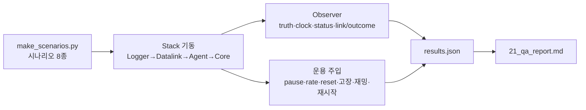
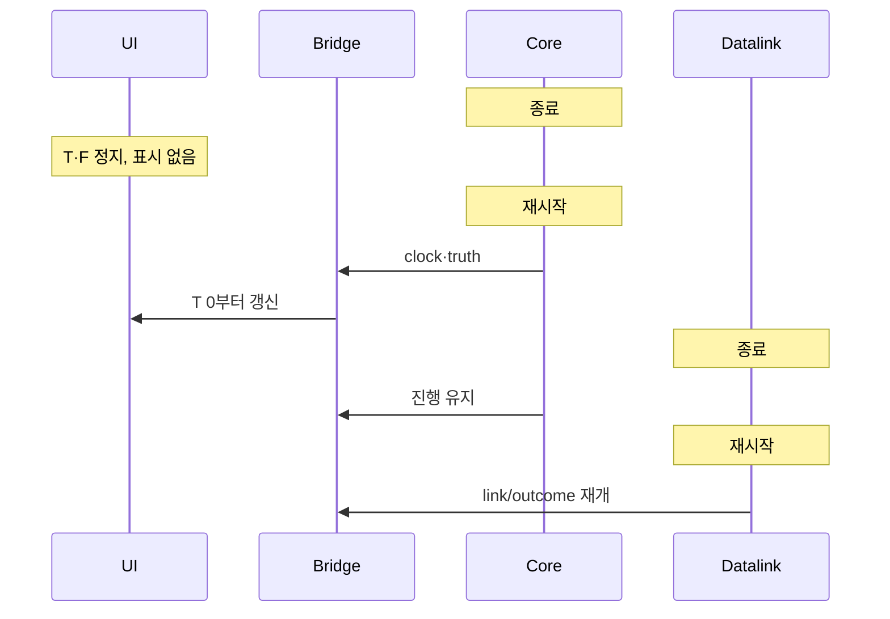
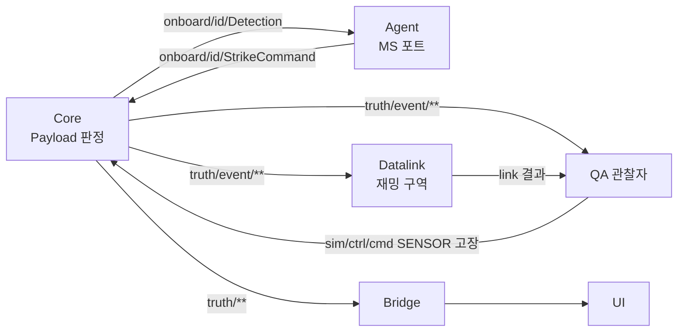
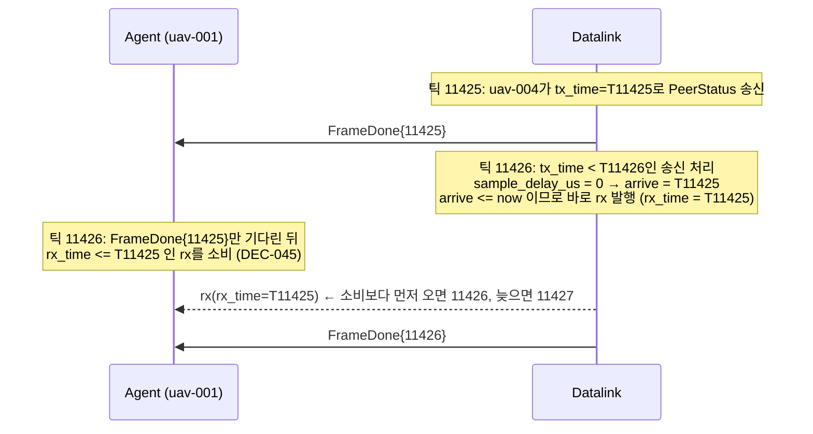

# QA/QC 보고서 (계약 0.8.0, 2026-11-02)

시험 대상은 wp0-contracts 4e3c4c3(WP1 dcc58d8 병합 후)이다. 이 문서는 결함 보고만 한다. 수정은 담당 WP가 한다. §1~8은 1차, §9는 DEC-038 수정 병합 후의 2차 재시험이다. 2차에서 QA-001·002·003·009·010은 수정을 확인했고 QA-005는 대부분 수정, QA-004는 미지원 결정(DEC-038)으로 종결했다. 새 결함은 QA-012~015이다.

## 1. 범위와 방법

| 항목 | 내용 |
|---|---|
| 빌드 | `msvc-debug`만 사용. `msvc-release`는 링크가 실패해 시험하지 못했다 (QA-007) |
| 환경 | Windows 11, MSVC + vcpkg, uv + CPython 3.12, Zenoh 1.10.2 (멀티캐스트 끔, TCP peer) |
| 시험 도구 | `qa/harness.py`(전체 스택 기동·종료·재시작, 버스 관찰자, 자원 표본), `qa/run_qa.py`(TC-QA-001~023), `qa/make_scenarios.py`(시나리오 생성·검증) |
| 재현 | `uv run python qa/make_scenarios.py` → `uv run python qa/run_qa.py [--only 001,010]`. 결과는 `qa/out/results.json` |
| 감시 항목 | 프로세스 종료, 시간·틱 역행, NaN/inf, 프레임 간극·중복, 엔티티 수 불일치, 메시지 순서·유실, CPU·RSS 추세, 결정성, 정지(hang) |



### 1.1 시나리오 (`qa/scenarios/`)

| 파일 | 성격 |
|---|---|
| `qa_s1_formation6` | 6기 3-DoF 편대(리더·추종, formation MA) |
| `qa_s2_swarm20` | 20기 군집. hold·route·racetrack·search_area 혼합 |
| `qa_s3_link` | 불완전 링크 프로파일(지연·손실·좁은 대역·단거리)과 35 km 밖 기체 |
| `qa_s4_engage` | 적·표적·센서·무장 선언 13개 엔티티 |
| `qa_s5_mixed` | 2-DoF/3-DoF, skywalker_x8/aerosonde 혼합, MA 혼합. dof5/dof6는 별도 적재 시험 |
| `qa_s6_load50`, `qa_s6_load100`, `qa_s6_load100_flock` | 50·100기 부하, 100기 flocking(P2P) |

## 2. 시험 결과 (TC-QA-001~023)

| TC | 내용 | 결과 | 비고 |
|---|---|---|---|
| TC-QA-001 | s1 6기 편대 120 s | 통과 | 중심 거리 85~350 m, 프레임 간극 0 |
| TC-QA-002 | s2 20기 임무 혼합 240 s | 통과 | hold 반경 유지, racetrack 범위 유지 |
| TC-QA-003 | s3 불완전 링크 | 통과 | 사유 OUT_OF_RANGE·BURST_LOSS·QUEUE_OVERFLOW 모두 관측. 지연 p99 4.1 s |
| TC-QA-004 | s4 적·표적·센서·무장 | 통과 | 견고성만 확인. 탐지·무장 동작은 Core 미구현(§5) |
| TC-QA-005 | s5 2/3-DoF 혼합, dof5/6 적재 | 통과 | dof5/6는 Core가 종료 코드 1로 종료(§4 D-3) |
| TC-QA-006 | 50기 lockstep 2배속 | 통과 | 실측 1.57배(debug), 간극 0, 엔티티 51 |
| TC-QA-007 | 100기 lockstep 1배속 | 통과 | 실측 0.93배, 엔티티 101 |
| TC-QA-008 | 100기 flocking P2P | 통과 | 실측 0.22배, overrun 1500/1500. Logger RSS 26→313 MB (QA-006) |
| TC-QA-009 | 100기 realtime | 통과 | sim/벽시계 1.00, overrun 3 |
| TC-QA-010 | pause·resume·step·set_rate·reset·반복 | 통과 | 비정상 rate 수용은 QA-003 |
| TC-QA-011 | 모드 전환 lockstep/realtime/freerun | 통과 | Reset 후 Start 순서 필요 |
| TC-QA-012 | 잘못된 SimCommand·시나리오 | 불합격 | QA-001, QA-003 |
| TC-QA-013 | 임무 명령 연속·충돌 | 불합격 | 마지막 명령의 EXECUTING 미관측. 순서 뒤바뀜은 기대 동작이라 결함 아님(§6) |
| TC-QA-014 | 잘못된 임무 값 | 통과 | 기체 종료·이상 이동 없음. 수용 범위는 QA-005 |
| TC-QA-015 | 명령 홍수(10 s에 29.9만 건) | 통과 | 프로세스 생존, 프레임 진행 저하 관찰(QA-011) |
| TC-QA-016 | 실행 중 매개변수 변경·거부 | 불합격 | QA-002 |
| TC-QA-017 | 고장 주입 | 통과 | SENSOR는 기록만(§5) |
| TC-QA-018 | 재밍 구역 on/off | 통과 | 재밍 중 JAMMED 3070건, 해제 후 복귀. `jam_zone`은 시험이 직접 발행 |
| TC-QA-019 | Agent·Datalink·Core 재시작(realtime) | 통과 | Core 재기동 후 frame 1915→326 재개 |
| TC-QA-020 | lockstep 지각 참여·재합류 | 불합격 | 지각 합류 통과(frame None→111). 진행 중 Agent 재합류는 QA-004 |
| TC-QA-021 | Logger 기록 → info → 재생(0.5·1·4·20배) | 통과 | 97,416건·337 채널. 고배속 프레임 감소는 QA-008 |
| TC-QA-022 | 결정성(같은 시나리오 lockstep 2회) | 통과 | 공통 2579 프레임, 최대 차이 0.000000 m |
| TC-QA-023 | 20기 realtime 10분 추세 | 통과 | Core RSS 26→27 MB, Datalink 23→26 MB. Logger +5 MB(QA-006) |

UI·Monitor 점검은 §3에 따로 적는다. 앱 내장 브라우저로 라이브 스택(s2, 20기)을 직접 확인했다.

## 3. UI·Monitor 대조

| 확인 | 결과 |
|---|---|
| UI 엔티티 수 | 21 (UAV 20 + GCS 1). 실제 상태와 일치 |
| UI 시각·프레임 | T 00:01:38.0 / F 4902 → 프레임 ≈ 50/s. 실제와 일치 |
| 일시정지 | 버튼이 `재개`로 바뀌고 상태 `정지`. 2 s 뒤에도 T·F 불변 |
| 재개 | 상태 `실행`, 시간 진행 재개 |
| 배속 ×5 | 5 s 동안 sim 5.2 s만 진행. 반응 없음 (QA-009) |
| Monitor | 연결됨, 계약 0.8.0, `실행 · 실시간 · 50 Hz · ×1.00 · qa-s2-swarm20`, 엔티티 트리 21개 일치 |
| Monitor 통계 | 이 시나리오는 링크 트래픽이 거의 없어 표가 0이다. 트래픽이 많은 상황의 표시 정확성은 확인하지 못했다(§7) |

## 4. 결함

심각도는 치명/높음/보통/낮음이다. 담당 WP는 추정이다.

### 4.1 WP별·심각도별 요약

| WP | 높음 | 보통 | 낮음 |
|---|---|---|---|
| WP1 Core | QA-001 | QA-003, QA-007 | |
| WP3 Agent | QA-002 | QA-004, QA-005 | |
| WP4 Datalink | | | QA-011 |
| WP5 Bridge/UI | | | QA-009, QA-010 |
| WP7 Logger | | QA-006 | QA-008 |
| 치명 | 없음 | | |

### QA-001 — NaN 초기 위치 시나리오가 적재되어 truth에 NaN이 퍼진다
- 담당 WP1 Core / 높음 / TC-QA-012
- 재현: 정지·`LOADED` 상태에서 `uav-003.initial.position.lat_deg = NaN`인 시나리오를 Reset 뒤 `sim/ctrl/scenario`로 발행하고 Start.
- 기대: 적재 거부(`load rejected`), 상태·기존 엔티티 유지.
- 실제: 적재 수용. 첫 프레임부터 `uav-003`의 `truth/state`가 NaN.
- 로그: `[nan_inf] uav-003 frame 0: (nan, 127.39151909999998, 1200.0, 20.0, 0.0, 0.0)` (harness 관찰자)
- 비고: 엔티티 0개 시나리오도 수용(`entity_count=0`). 중복 ID·없는 airframe·`frame_hz=5`·없는 링크 프로파일은 수용 여부를 엔티티 수만으로 구분하지 못했다. 같은 검증 경로의 점검을 권한다.

### QA-002 — MA 매개변수 `k_p=inf` 한 건에 Agent 프로세스가 종료된다
- 담당 WP3 Agent / 높음 / TC-QA-016
- 재현: formation MA 기체(uav-002)에 `SetParams`로 `k_p = inf`(JSON `Infinity`) 전송.
- 기대: `range` 사유로 거부(음수·1e12·문자열·bool·null은 모두 거부되었다).
- 실제: Agent가 종료 코드 1로 죽는다. 20기 전체가 제어를 잃는다.
- 로그: `agent(code 1)`. 같은 시험에서 `k_p=-5`, `1e12`는 `ma param 'k_p' rejected (range)`로 정상 거부.
- 비고: 이 경우를 마지막에 두었으므로 `NaN`은 확인하지 못했다. dynamics 쪽은 NaN·inf·음수·0이 모두 `range`로 거부되었다. MA 경로의 비유한 값 검사가 빠져 있다.

### QA-003 — 비유한·비정상 rate가 Core에서 수용된다
- 담당 WP1 Core / 보통 / TC-QA-010, 012
- 재현: Reset 뒤 `Start(lockstep, rate=NaN)` 또는 `rate=-3.0`. 실행 중 `SetRate(0, -1, NaN, inf, 1e9)`.
- 기대: 거부하거나 유한한 범위로 제한(`Start(realtime, rate=5)`는 1.0으로 제한되었다).
- 실제: 모두 수용. `status.rate_target`에 NaN·inf·음수가 그대로 나타난다. 프로세스는 살아 있다.
- 로그: `[swarm_core] start mode=RUN_MODE_LOCKSTEP hz=50 rate=nan seed=1`
- 비고: 이후 진행 속도는 확인하지 않았다. `hz=0`은 50으로 대체되어 수용된다. `hz=10`·`5000`은 거부된다.

### QA-004 — lockstep 중 이탈한 Agent가 재합류해도 진행이 재개되지 않는다
- 담당 WP1 Core(또는 WP3) / 보통 / TC-QA-020
- 재현: lockstep 실행 중 Agent 프로세스 종료 → 12 s 대기 → Agent 재기동.
- 기대: 장벽 대기 후 재합류 시 재개(DEC-037은 첫 틱 전 지각 참여를 정의한다. 실행 중 재합류는 명시가 없다).
- 실제: 이탈 중 정지(149→149)는 정상이다. 재합류 뒤에도 frame 149에서 멈춘다. Reset + Start로만 복구된다(frame 104).
- 비고: 첫 틱 전 지각 참여는 정상이다(frame None→111). 실행 중 재합류를 지원할지는 §6 항목이다. 지원 대상이 아니면 문서에 명시해야 한다.

### QA-005 — 잘못된 임무 값이 일관되지 않게 처리된다
- 담당 WP3 Agent / 보통 / TC-QA-014
- 재현: 임무 명령에 다음 값을 넣는다.
  - 수용(ACCEPTED→EXECUTING): `alt=inf`, `alt=-값`, `alt=100 km`, 지도 밖 좌표, 위경도 0, `racetrack axis=NaN·999`, `hold radius=1e9`, 경로 점 500개
  - 무응답(REJECTED 없음): `lat=200`, `lon=NaN`, 빈 task_id, 없는 엔티티, 경로 NaN, `radius=NaN`
  - 거부(사유 있음): 빈 경로, `radius<=0`, `leg_length<0`, 빈 task, `strike`
- 기대: 비유한·범위 밖 값은 일관되게 `REJECTED(사유)`.
- 실제: 위와 같음. 기체 종료나 이상 이동은 없었다(최대 이동 1442 m). `raceLeg0`은 ACCEPTED만 오고 EXECUTING이 없다.
- 로그: `qa-bad-altInf:ACCEPTED, EXECUTING, CANCELLED(preempted)`

### QA-006 — Logger 메모리가 부하에 따라 계속 늘어난다
- 담당 WP7 Logger / 보통 / TC-QA-006~009, 023
- 관찰(RSS): 20기 realtime 10분 27.8→39.5 MB(후반 +5.0 MB). 50기 26.9→60.9 MB. 100기 25.9→91.6 MB. 100기 flocking 30 s에 25.6→313.2 MB(후반 +128.8 MB).
- 기대: 쓰기 큐 상한 안에서 안정.
- 실제: 부하와 시간에 비례해 증가. 원인(큐 적체 대 단순 버퍼)은 판별하지 못했다. debug 빌드 기준이다.

### QA-007 — `msvc-release`가 링크되지 않는다
- 담당 WP1 Core 또는 빌드(WP0) / 보통
- 재현: `cmake --preset msvc-release` → 빌드.
- 실제: 링크 단계에서 실패. 세션 초반에 확인했으나 오류 전문은 보존하지 못했다(`qa_bld.log`에 남지 않음). 담당자가 재현해야 한다.
- 영향: 성능 시험이 모두 debug 빌드 값이다. 100기 flocking의 0.22배는 release에서 달라질 수 있다.

### QA-008 — 고배속 재생에서 truth 프레임이 줄어든다
- 담당 WP7 Logger / 낮음 / TC-QA-021
- 같은 기록(truth 프레임 약 2011)을 재생: 0.5배·1배 1970, 4배 1942, 20배 1849 프레임이 관찰자에 도착.
- 기대: 배속과 관계없이 도착 프레임 동일(재생 쪽 유실이 없으면). 수신 측 한계일 수도 있다.

### QA-009 — UI 배속 버튼이 realtime에서 무반응이다
- 담당 WP5 UI / 낮음 / UI 점검
- 재현: 실시간 모드 실행 중 UI에서 `×5` 클릭.
- 기대: 적용되거나 비활성/안내 표시.
- 실제: 5 s 동안 sim 5.2 s 진행(×1 그대로). 버튼은 눌리고 오류 표시는 없다. realtime에서 rate가 고정이라면(DEC-005) 비활성이 맞다.

### QA-010 — `swarm-bridge --help`가 cp949 콘솔에서 비정상 종료한다
- 담당 WP5 Bridge / 낮음
- 재현: 한국어 Windows 콘솔에서 `swarm-bridge --help`.
- 실제: 도움말 문자열 인코딩 오류로 종료. 환경변수 `PYTHONIOENCODING=utf-8`이면 정상.

### QA-011 — 명령 홍수 동안 프레임 진행이 크게 떨어진다
- 담당 WP4 Datalink / 낮음 / TC-QA-015
- 재현: 20기에 10 s 동안 299,349건의 임무 명령 전송.
- 실제: 프로세스는 모두 생존. 홍수 중 10 s 동안 프레임이 181→313(≈13 Hz)만 진행, overrun 25→71. 링크 결과 DROPPED 512,342(큐 넘침). 마지막 명령의 응답은 없다. 보호·속도 제한이 없다는 관찰이며, 요구가 없으면 결함이 아니다.

## 5. 범위 밖으로 확인된 Core 한계

시험 설계에서 확인된 한계다. 결함으로 분류하지 않고 §6에서 결정을 요청한다.

- Detection 메시지를 만들지 않는다. 센서 FOV·거리·가시선 판정(DEC-018)이 동작하지 않는다.
- 무장·발사·도달 논리가 없다(DEC-019). `truth/event/kill` 외 교전 이벤트가 없다.
- `truth/event/jam_zone` 발행자가 없다. 시험이 직접 발행해 Datalink 반응(JAMMED)을 확인했다.
- `SENSOR` 고장은 기록만 하고 효과가 없다.
- dof5/dof6은 미지원이다.

## 6. 결정 확인 필요

| # | 항목 | 확인할 점 |
|---|---|---|
| D-1 | 교전·탐지·재밍 구역 생성 미구현 | 1차 범위인지, 어느 WP가 언제 구현하는지 (DEC-017~019) |
| D-2 | SENSOR 고장 효과 없음 | 효과 정의가 필요한지 |
| D-3 | dof5/dof6 시나리오 적재 시 Core 종료(코드 1) | 거부 후 `LOADED` 유지가 맞는지 |
| D-4 | lockstep 중 참여자 재합류 | 지원 범위(QA-004) |
| D-5 | realtime에서 SetRate 무시 | UI에서 비활성으로 보일지 (QA-009) |
| D-6 | `assignee` 비움 → 전체 기체 수행(19기 응답) | 의도된 방송인지 |
| D-7 | 중복 `task_id` 재전송 시 ACCEPTED가 두 번 | 멱등 처리인지 재할당인지 |
| D-8 | KILL 후 `alive=False`가 고장 해제와 무관하게 유지 | 영구 사망이 맞는지 |
| D-9 | Datalink 지연·지터로 TaskStatus 순서가 뒤바뀜 | 기대 동작이며 결함이 아님 |

## 7. 확인하지 못한 항목

| 항목 | 이유 |
|---|---|
| release 빌드 성능 | `msvc-release` 링크 실패 (QA-007). 모든 속도 수치는 debug 값이다 |
| Agent CPU·메모리 | 표본이 `uv` 래퍼 프로세스를 가리켜 0.0%로 나온다. Agent 자체의 추세는 모른다 |
| 탐지·교전·재밍 구역 동작 | Core 미구현(§5) |
| MA `NaN` SetParams | `inf`에서 Agent가 죽어 뒤 케이스를 실행하지 못했다 |
| Monitor 통계의 정확성 | 이 시나리오는 트래픽이 거의 없다. 트래픽 표·시퀀스 타임라인을 s3·flock 부하로 대조하지 못했다 |
| UI 명령 전송·고장 표시 | 일시정지·재개·배속만 확인했다. 선택·MoveTo 등은 TC-INT-003 범위 |
| 수백 대 이상 | OPN-034와 같은 한계. 100기까지만 시험 |
| 시험 환경 | Linux·MinGW 프리셋은 시험하지 않았다 |

## 8. 이미 알려진 항목

lockstep 시나리오 재발행과 CLI `--mode/--rate` 재정의는 dcc58d8에서 고쳐졌다. 이 시험은 수정을 재확인했다(TC-QA-011, 020의 지각 합류). 새 결함으로 보고하지 않는다.

## 9. 재시험 (2차, 2026-11-02)

시험 대상은 wp0-contracts에 WP1(cddd678)·WP3(a20cd4a)·WP5(73baee1) 수정이 병합된 상태이다(DEC-038). Core를 포함해 `msvc-debug`로 다시 빌드했다. release 빌드(QA-007)는 제외했다.

### 9.1 회귀 시험

| TC | 1차 | 2차 | 판정 근거 |
|---|---|---|---|
| TC-QA-010 | 통과 | 통과 | 비정상 rate가 거부된다(QA-003 수정 확인) |
| TC-QA-012 | 불합격 | 통과 | NaN 초기 위치·dof5/6·빈 시나리오는 적재 거부 후 Core 생존(QA-001, D-3 수정 확인) |
| TC-QA-013 | 불합격 | 통과 | 기준을 바꿨다. 순서 뒤바뀜(D-9, DEC-038 (8))을 허용하고 "기체당 실행 중 임무 1개 이하"와 간격을 둔 마지막 명령의 도달·ACCEPTED로 판정 |
| TC-QA-014 | 통과(비일관) | 불합격 | 경로 NaN(`routeNaN`)·`hold radius=NaN`(`holdRNaN`)이 응답 없이 무시된다(QA-014). 나머지 값은 REJECTED(사유)로 일관(QA-005 대부분 수정). 빈 `assignees` 거부, 중복 `task_id` 교체 확인(D-6, D-7) |
| TC-QA-015 | 통과 | 불합격 | 홍수 후 lockstep이 영구 정지한다(QA-012). 2회 모두 재현 |
| TC-QA-016 | 불합격 | 통과 | MA `k_p`에 `inf`·`NaN`·음수·1e12 모두 `range`로 거부, Agent 생존(QA-002 수정 확인) |
| TC-QA-020 | 불합격 | 통과 | 기준 변경(DEC-038 (4)). Agent 이탈 중 정지, Core 로그 `waiting for frame done: agent-0`, Reset+Start로 복구 |
| QA-009 | | 수정 확인 | realtime에서 UI 배속 버튼이 비활성이다 |
| QA-010 | | 수정 확인 | cp949 콘솔에서 `swarm-bridge --help` 정상 |

### 9.2 새 시험

| TC | 내용 | 결과 | 비고 |
|---|---|---|---|
| TC-QA-024 | 결정성 추가. 시드 7·20261104, s3 불완전 링크, 각 2회 | 불합격 | 같은 시드인데 링크 DROPPED 수가 다르고 궤적이 다르다(QA-013). 손실 없는 시나리오는 1차 TC-QA-022에서 결정적 |
| TC-QA-025 | Agent 프로세스 자체 CPU·RSS(50기 realtime 90 s, python 자식 합산) | 통과 | Agent CPU 평균 63%·최대 119%, RSS 4.5→72.7 MB(후반 -0.1 MB), Core 평균 50%, Logger +8.8 MB(QA-006), Datalink +2.7 MB |
| TC-QA-026 | Monitor 통계 대 독립 집계(s3 라이브) | 통과 | 송신자별 건수·손실률·지연 평균이 독립 집계(`qa/link_count.py`)와 일치. 아래 참고 |
| TC-QA-027 | 임무 중 Core·Datalink 재시작과 UI 복구(realtime, s3) | 통과 | 아래 참고. UI의 끊김 표시 없음(QA-015) |
| UI 명령 | 선택·MoveTo·Hold·Racetrack·Route 전송(브라우저) | 통과 | 5종 모두 TaskStatus 수신. flocking 기체는 Route를 거부(D-10). 고장 표시는 시험하지 못함 |

TC-QA-026 참고:
- s3 40 s 창에서 송신자별 건수·손실률은 일치했다. 예: uav-011은 건수 650, 손실 0.76(QUEUE_OVERFLOW 444, OUT_OF_RANGE 50), 지연 평균 3.6 s.
- Monitor의 지연 p95가 독립 집계보다 크게 나온다. 히스토그램 구간 양자화로 보이며 정확한 원인은 확인하지 못했다.
- 시퀀스 타임라인은 s3에서 메시지 흐름이 표시된다. flocking 100기 부하에서는 대조하지 못했다.

TC-QA-027 결과:

| 단계 | 조작 | 관찰 |
|---|---|---|
| 1 | Core 종료 | UI의 T·F가 멈춘다. 연결 표시는 그대로 "연결"이고 정지·끊김 안내가 없다(QA-015) |
| 2 | Core 재시작 | UI가 새로고침 없이 새 실행(T 0부터)을 따라간다. 엔티티 14 유지 |
| 3 | Datalink 종료 | realtime에서는 Core가 계속 진행한다. UI T·F 정상 진행 |
| 4 | Datalink 재시작 | 링크 결과가 다시 발행된다(10 s에 PeerStatus 2586건, 송신자 4곳, 손실 사유 정상) |



### 9.3 새 결함

#### QA-012 — 명령 홍수 후 lockstep이 영구 정지한다
- 담당 WP4 Datalink(원인 추정) / 높음 / TC-QA-015
- 재현: lockstep 2배속, 20기에 10 s 동안 약 41만 건의 임무 명령을 보낸다.
- 기대: 홍수 뒤 프레임 진행 재개(1차 시험에서는 회복했다).
- 실제: 프레임 271→277에서 멈춘 채 150 s 안에 회복하지 못한다. Core 로그는 `waiting for frame done: datalink-0 (frame 278)`이다. Datalink RSS는 약 2.3 GB까지 늘었다. 2회 모두 재현.
- 비고: 링크 결과 DROPPED 234,465, DELIVERED 1,812. 큐 적체로 `frame_done`을 못 내는 것으로 보인다. 확인하지 못했다.

#### QA-013 — 불완전 링크에서 같은 시드의 결과가 달라진다
- 담당 WP4 Datalink 또는 WP1 Core / 보통 / TC-QA-024
- 재현: `qa_s3_link`를 같은 시드로 lockstep에서 2회 실행해 비교.
- 기대: DEC-005의 결정성(손실 없는 시나리오는 최대 차이 0).
- 실제: 시드 7은 최대 1.97 m, 시드 20261104는 최대 30.8 m 차이. 링크 DROPPED 수와 총 프레임 수도 다르다.
- 비고: 링크 손실·지터 난수가 시드 외 요인(실행 순서·벽시계)에 의존하는 것으로 보인다. 확인하지 못했다. 결정성을 보장해야 하는 범위에 불완전 링크를 포함할지는 §9.5 항목이다.

#### QA-014 — 경로·hold 반경의 NaN이 응답 없이 무시된다
- 담당 WP3 Agent / 낮음 / TC-QA-014
- 재현: 경로 점에 NaN을 넣은 Route, `hold radius=NaN`.
- 기대: 다른 비정상 값처럼 `REJECTED(사유)`.
- 실제: TaskStatus가 오지 않는다. 기체 이동 변화 없음.
- 비고: QA-005의 나머지 항목(`alt=inf`, 범위 밖 좌표, `radius<=0` 등)은 REJECTED로 바뀌었다.

#### QA-015 — Core가 죽어도 UI가 끊김을 표시하지 않는다
- 담당 WP5 UI / 낮음 / TC-QA-027
- 재현: 실행 중 Core 프로세스 종료.
- 기대: 시계 정지·연결 끊김 표시.
- 실제: T·F가 멈추고 연결 표시는 "연결" 그대로. 사용자가 정지를 알아보기 어렵다.

### 9.4 갱신된 결정 확인 항목

| # | 상태 | 비고 |
|---|---|---|
| D-3 | 해결 | dof5/6은 거부 후 Core 생존(DEC-038 (2)) |
| D-4 | 해결 | 재합류 미지원, Reset+Start(DEC-038 (4)). 시험 기준을 바꿨다 |
| D-5 | 해결 | UI 배속 비활성(QA-009) |
| D-6 | 해결 | 빈 `assignees` 거부 |
| D-7 | 해결 | 중복 `task_id`는 교체 |
| D-8 | 확인 | KILL 후 `alive=false` 유지(DEC-038 (7)) |
| D-9 | 확인 | 순서 뒤바뀜은 기대 동작(DEC-038 (8)) |
| D-10 | 신규 | flocking MA는 Route를 `unsupported task route`로 거부한다. UI는 선택한 기체가 flocking이어도 Route 전송을 막지 않고 안내하지 않는다. 의도한 제한인지 확인 필요 |
| D-11 | 신규 | QA-013. 불완전 링크 시나리오에서 같은 시드 결과 동일을 요구하는지(DEC-005) |

### 9.5 2차에서 확인하지 못한 항목

| 항목 | 이유 |
|---|---|
| release 빌드 | 범위 제외(QA-007) |
| flocking 100기 부하의 Monitor 통계 대조 | 시도하지 않았다. s3에서만 대조 |
| UI의 고장 표시 | 시험하지 않았다 |
| 이탈 후 Datalink 재시작의 lockstep 영향 | realtime에서만 시험. lockstep에서 Datalink 이탈은 시험하지 않았다 |

## 10. 3차 시험 (2026-11-03)

2차 수정(QA-006·007·012·013·014·015, D-10, DEC-039·040)이 병합된 wp0-contracts를 병합하고 debug·release를 처음부터 빌드해 재시험했다. 시험 환경은 `msvc-debug`(전체 스위트)와 `msvc-release`(성능·QA-006·008·028)다. 새 결함은 QA-016부터 번호를 붙였다.

### 10.1 회귀 결과

| TC | 결과 | 비고 |
|---|---|---|
| TC-QA-001~013 | 통과 | |
| TC-QA-014 | 통과 | QA-014 수정 확인. NaN 경로·hold 반경이 `REJECTED`로 응답한다. 시험이 BURST_LOSS로 명령을 놓치던 결함이 있어 최대 4회 재전송으로 고쳤다 |
| TC-QA-015 | 통과 | QA-012 수정 확인. 10 s 동안 429,694건을 보낸 뒤 2 s 안에 프레임 진행이 재개된다 |
| TC-QA-016~023 | 통과 | TC-QA-022(waypoint MA 결정성) 포함. QA-006 RSS는 Logger 27.0→27.2 MB(10분) |
| TC-QA-024 | 불합격 | QA-016. waypoint MA는 결정적이지만 flocking/P2P 기체는 같은 시드에서 궤적이 다르다 |
| TC-QA-025 | 통과 | |
| TC-QA-026 | 미실시 | s3는 2차에서 일치. 이번에는 flocking 100기 부하 대조를 시도했으나 QA-017로 창을 맞추지 못했다 |
| TC-QA-027 | 통과 | 브라우저로 Core 종료·재시작을 다시 확인 |
| TC-QA-028 (신규) | 통과 | lockstep 중 Datalink 이탈·재기동 |
| TC-QA-029 (신규) | 해석 | QA-008 재생 판별 스크립트 `qa/qa008_replay.py` |

### 10.2 수정 확인

| 항목 | 확인 |
|---|---|
| QA-006 Logger 메모리 | psutil 측정 RSS 27.0→27.2 MB(10분). 증가 없음 |
| QA-007 release 빌드 | `msvc-release` 빌드와 실행 정상 |
| QA-012 명령 홍수 | 위 TC-QA-015. 회복 확인 |
| QA-013 lockstep 수신 결정성 | 일부만 수정됨. QA-016 참고 |
| QA-014 NaN 거부 | 통과 |
| QA-015 Core 정지 표시 | Core 종료 시 붉은 배지 "시뮬레이터 응답 없음", 재시작 후 자동 복구 |
| D-10 flocking Route | 항로 편집기가 "flocking 기체 4대는 항로를 지원하지 않아 거부될 수 있다"를 안내한다. 전송은 막지 않는다 |

### 10.3 새 결함

#### QA-016 — flocking/P2P 기체의 같은 시드 궤적이 달라진다 (QA-013 부분 수정)
- 담당 WP3 flocking 또는 WP4 P2P / 높음 / TC-QA-024
- 재현: `qa_s3_link`를 같은 시드로 lockstep에서 2회 실행해 비교(`qa/diag_determinism.py`).
- 기대: DEC-005·DEC-040의 결정성.
- 실제:
  - 시드 7: 불일치 8478건, 최대 1.296 m. 엔티티별로는 0.13~0.58 m 차이가 프레임 51~71에서 시작한다.
  - 시드 20261104: 불일치 8422건, 최대 0.393 m.
  - `qa_s6_load100_flock`: 약 1e-4 m.
  - waypoint MA 기체는 모두 일치한다.
- 비고: 2차의 최대 30.8 m에서 크게 줄었다. flocking/P2P 경로에 남은 비결정 요인(이웃 상태 수신 순서나 시각)으로 추정한다. 확인하지 못했다.

#### QA-017 — flocking 100기 부하에서 Monitor의 링크 지연이 계속 늘어난다
- 담당 WP5 Bridge/Monitor / 보통 / TC-QA-026
- 재현: s6 flocking 100기를 Bridge 경유(`?source=bridge&url=ws://127.0.0.1:8765/bus`)로 Monitor에 연결.
- 기대: 실제 링크 지연(수 초 이하)과 비슷한 값.
- 실제: "링크 지연 77.6 s"가 표시되고 83.5 s, 96.4 s로 계속 늘어난다. link 이벤트의 일부만 처리하는 것으로 보인다. 누적 손실률은 Monitor 5.7%, 독립 집계 3.34%로 창이 달라 대조하지 못했다. 시퀀스 타임라인은 "0건".
- 비고: 처리량을 넘는 이벤트를 버리거나 밀리는 방식을 확인하지 못했다.

#### 관찰 — UI에 고장 표시가 없다 (낮음)
ENGINE·GCS_LINK_CUT·KILL을 주입해도 UI에 고장 표시가 없다. 속도 12.0 m/s, 명령 가능 기체 수 12→11처럼 간접으로만 보인다.

### 10.4 성능: release 대 debug와 DEC-040

배속 배수(1.0 = 실시간)다.

| 시나리오 | debug | release | 1차 debug |
|---|---|---|---|
| 50기 lockstep 2배속 | 1.41x | 1.42x | 1.57x |
| 100기 lockstep 1배속 | 0.93x | 0.97x | 0.93x |
| 100기 flocking | 0.26x | 0.45x | 0.22x |

- release 프레임 오버런은 906 / 39 / 967건. release의 Datalink CPU는 lockstep 시나리오에서 3.6~4.4%로 내려간다. flocking에서는 Datalink 105%, Agent 182%.
- Python Agent가 병목이라 release는 Core·Datalink CPU만 줄인다.
- DEC-040 영향: 50기 2배속에서만 1.57→1.41~1.42로 소폭 느려졌다. 나머지는 같거나 빠르다. Agent가 Datalink FrameDone을 기다리는 비용으로 보인다.

### 10.5 QA-008 판별(재생 쪽인가 관찰 쪽인가)

`rec.mcap`의 truth/state는 2018개다. 재생기는 모든 배속에서 98,504건을 발행하고 skipped는 0이다. 수신 쪽 프레임 수는 배속과 수신 부하에 따라 줄어든다.

| 배속 | 가벼운 수신기(개수만) | Observer(전체 처리) | 비고 |
|---|---|---|---|
| 1x | 1995 | 1995 | 첫 프레임 22. 앞 23개는 구독 준비 경쟁으로 보인다 |
| 4x | 1908 | 1863 | |
| 20x | 957 | 550 | 중간 누락 334 |
| 100x | 0 | 0 | 이전 실행 |

판정: 손실은 재생기의 발행이 아니라 전달·수신 쪽에서 생긴다. 재생기에 속도 조절이나 배압이 없다. 설계 한계로 보고한다. 배속이 높은 재생에서 관찰자가 값을 놓치는 것은 이 때문이다.

### 10.6 TC-QA-028 — lockstep 중 Datalink 이탈·재기동

- s2를 lockstep 2배속으로 시작하고 프레임 200을 넘긴 뒤 Datalink를 종료했다.
- 진행이 멈추고(2프레임 이내) Core 로그에 `waiting for frame done: datalink-0 (frame 247)`가 남는다.
- Datalink를 재시작해도 진행은 재개되지 않는다(DEC-038 (4), 재합류 미지원과 일치).
- Reset+Start로 복구되고 20기가 다시 정상 진행한다.

### 10.7 결정 확인 항목

| # | 상태 | 비고 |
|---|---|---|
| D-10 | 확인 필요 | UI가 flocking 기체에 Route를 막지 않고 경고만 한다. 의도한 동작인지 확인 |
| D-11 | 확인 필요 | QA-016. flocking·P2P를 포함해 같은 시드 결과 동일을 요구하는지(DEC-005·DEC-040) |
| D-12 | 신규 | lockstep에서 Datalink가 이탈하면 Core가 무기한 대기한다(DEC-038 (4)). 타임아웃 후 오류 표시나 종료를 원하는지 |
| D-13 | 신규 | 재생에 속도 조절이 없어 고배속에서 수신자가 프레임을 놓친다(QA-008). 재생 모드의 요구 수준 확인 |

### 10.8 3차에서 확인하지 못한 항목

| 항목 | 이유 |
|---|---|
| flocking 100기 Monitor 통계 대조 | QA-017로 창을 맞출 수 없었다 |
| TC-QA-026 재실시 | s3는 2차에서 일치. 이번 차수에서 재실행하지 않았다 |
| release 전체 스위트 | release는 006·007·008·028과 성능만 실시했다. 전체 스위트는 debug |
| QA-016 원인 | 엔티티 단위 차이와 시작 프레임까지만 확인했다 |

## 11. 4차 시험 (2026-11-05)

wp0-contracts ad32860(DEC-041·042·043, QA-017 브리지 묶음 전달)을 병합해 Zenoh 포함 debug로 전체 스위트를 실시했고, 이어 efc38b2(DEC-044 송신 개수 장벽, 계약 0.10.0)를 병합해 `gen_proto.py`와 재빌드 뒤 QA-016 결정성과 처리 속도를 다시 쟀다. base_port는 47980 이상을 썼다.

### 11.1 회귀 결과 (ad32860, debug)

전체 26건 중 통과 25, 불합격 1(TC-QA-024). 불합격은 DEC-044 병합 뒤 통과로 바뀌었다.

| TC | ad32860 | DEC-044 후 | 비고 |
|---|---|---|---|
| TC-QA-001~023, 025, 027 | 통과 | — | 3차와 같다. TC-QA-023 Logger RSS +0.1 MB/10분 |
| TC-QA-024 | 불합격 | 통과 (53 s) | 아래 11.2 |
| TC-QA-026 | 불일치 | 재실시 안 함 | QA-018(아래 11.3). QA-017 수정 후에도 Monitor 값이 독립 집계와 다르다 |
| TC-QA-028 | 통과 | 통과 | 이탈 뒤 프레임 244→244 / 254→254 정지, Core 대기 로그 남음. `SimStatus.waiting_participants`는 미확인 |
| TC-QA-029 | 해석 | — | 20배속 수신기 1358, 관찰자 1082(3차 957 / 550). 재생기 발행은 전부, 수신 쪽 유실은 설계 한계 |
| TC-INT-009 | 통과 | — | 늦게 합류한 Agent가 시나리오를 읽고 프레임 1903까지 진행. p0-demo의 불합격은 재현되지 않았다 |

### 11.2 DEC-044 전후 비교 (QA-016)

`qa/diag_determinism.py`로 같은 시나리오·시드를 lockstep에서 2회 실행해 비교했다.

| 시나리오 | 불일치 엔티티 (전 → 후) | 첫 어긋남 | 최대 위치 차이 (전 → 후) | lockstep 속도 (후) |
|---|---|---|---|---|
| s3 시드 7 | 8478건 / 5897건 → 0/14 | 없음 | 1.296 m → 0.0000 m | 207.6, 218.9 프레임/s |
| s3 시드 20261104 | 8422건 / 6919건 → 0/14 | 없음 | 0.393 m → 0.0000 m | 233.5, 235.5 프레임/s |
| s6 100기 flocking 시드 7 (600프레임) | 약 1e-4 m → 0/101 | 없음 | 약 1e-4 m → 0.0000 m | 15.7, 14.8 프레임/s |

- 전은 3차(efbc15f)의 불일치 건수이고, ad32860에서는 s3 시드 7이 최대 0.003792 m(5897건), 시드 20261104가 0.008477 m(6919건)였다.
- DEC-044로 flocking/P2P 포함 세 시나리오 모두 같은 시드에서 완전히 같아졌다. QA-016은 해결로 판정한다.
- OPN-036은 사용자 결정 사항이라 건드리지 않았다.

처리 속도(배속 배수, 1.0 = 실시간)는 ad32860과 DEC-044 후가 거의 같아 장벽의 비용은 보이지 않는다.

| 시나리오 | 3차 debug | ad32860 | DEC-044 후 |
|---|---|---|---|
| 50기 lockstep 2배속 (TC-QA-006) | 1.41x | 1.58x | 1.61x (오버런 771) |
| 100기 lockstep 1배속 (TC-QA-007) | 0.93x | 0.92x | 0.92x (오버런 45) |
| 100기 flocking (TC-QA-008) | 0.26x | 0.25x | 0.27x (오버런 1500) |

병목은 여전히 Python Agent다. flocking에서는 Datalink CPU 평균 123%, Agent 130%, Logger 113%다. 세 시나리오 모두 프레임 갭 0.

### 11.3 새 결함

#### QA-018 — Monitor의 링크 손실률·지연이 독립 집계와 맞지 않는다 (QA-017 수정 후에도)
- 담당 WP5 Bridge/Monitor / 보통 / TC-QA-026
- 재현: s6 flocking 100기를 Bridge 경유(`?source=bridge&url=ws://127.0.0.1:48765/bus`)로 Monitor에 연결하고 `qa/link_count.py`와 같은 창에서 비교.
- 기대: 누적 손실률이 독립 집계와 같다.
- 실제: 독립 집계 손실률 2.30%, Monitor 4.3~5.0%. 평균 지연이 2~3 s와 68~73 s 사이를 오가고, 처리 중 비율 2~12%, 큐·버스트 비중이 달라 창이 맞지 않는다.
- 비고: QA-017(지연이 계속 늘어남)은 지연이 계속 증가하는 현상은 멈췄다. 표시값이 독립 집계와 다른 문제는 남아 있다. 원인은 확인하지 못했다.

### 11.4 요약표

| 구분 | TC / 결함 |
|---|---|
| 통과 | TC-QA-001~025(DEC-044 후 TC-QA-024 포함), 027, 028, TC-INT-009 |
| 불합격 | 없음 (TC-QA-026은 불일치로 QA-018) |
| 해석 | TC-QA-029 |
| 미확인 | `SimStatus.waiting_participants` 값, DEC-041 "응답 없음" UI 표시, DEC-042 재생 누락 표시, DEC-043 QoS 통일의 개별 확인 |
| 해결 | QA-016 (DEC-044), TC-INT-009 불합격 재현 불가 |
| 열림 | QA-018 |

### 11.5 결정 확인 항목

| # | 상태 | 비고 |
|---|---|---|
| D-11 | 해결 | DEC-044로 flocking·P2P 포함 같은 시드 결과가 동일해졌다 |
| D-12 | 부분 해결 | DEC-041로 5 s 뒤 대기 참가자를 SimStatus에 싣는다. 로그만 확인했고 종료·오류 처리는 여전히 정해지지 않았다 |
| D-13 | 확인 필요 | 재생 속도 조절이 없다. DEC-042가 누락 프레임 표시만 더했다 |
| D-14 | 신규 | TC-INT-009에서 정상 진행 중에도 "waiting for frame done" 로그가 주기적으로 남는다. 5 s 기준이 의도한 것인지 확인 |

### 11.6 4차에서 확인하지 못한 항목

| 항목 | 이유 |
|---|---|
| DEC-044 후 TC-QA-026 재실시 | 시간상 하지 않았다. QA-018은 ad32860 기준 |
| `waiting_participants` 필드 직접 확인 | Core 로그만 확인했다. 버스 구독이나 UI 표시는 확인하지 않았다 |
| release 전체 스위트 | debug만 실시 |

## 12. 4차 미확인 항목 확인 (2026-11-05)

§11.6에서 확인하지 못한 DEC-041·042·043을 e60ba45(bbd23c3 병합)에서 확인했다. e60ba45는 내 커밋 위의 fast-forward라 소스가 같아 다시 빌드하지 않았다.

### 12.1 결과

| 항목 | 결과 | 방법 |
|---|---|---|
| `SimStatus.waiting_participants` (DEC-041, IMP-CORE-020) | 통과 | TC-QA-030(신규). s2 lockstep 2배속 중 Agent 종료 |
| UI "참여자 응답 없음" 경고 (DEC-041) | 통과 | 브라우저(`?source=bus&bridge=ws://127.0.0.1:48765/bus`). lockstep 중 Agent 종료 |
| UI 재생 "누락 프레임" 표시 (DEC-042, IMP-UI-059) | 통과 | 브라우저. 기록을 4배속으로 재생 |
| 버스 QoS (DEC-043) | 간접 확인만 | 아래 12.2 |

### 12.2 상세

- TC-QA-030: 정상 진행 중에는 `waiting_participants`가 비어 있다. Agent를 종료하면 5.5 s 뒤 `['agent-0']`이 실리고, Reset 뒤 비워진다. 5 s 전에는 실리지 않았다. 두 번 실행해 통과했다(첫 실행의 FAIL은 시험이 Agent를 되살리지 않은 시험 쪽 문제였다).
- UI 경고: 상단 막대에 붉은 배지 "참여자 응답 없음: agent-0 — Reset 후 Start로 복구"가 나타난다. 리셋을 누르면 상태가 적재(T 0, F 0)로 돌아가고 배지가 사라진다.
- UI 재생 표시: "재생" 배지와 함께 "누락 프레임 383"이 표시된다. 같은 재생에서 기록된 `waiting_participants`도 경고로 다시 보인다. 20배속 재생은 몇 초 만에 끝나 화면에서 값을 읽지 못했다.
- DEC-043: Zenoh의 우선순위·혼잡 제어 플래그는 버스 밖에서 읽을 수 없어 직접 확인하지 못했다. 간접 증거로 TC-QA-015(명령 429,694건 홍수 뒤 2 s 안에 lockstep 재개), TC-QA-024(DEC-044 후 결정성 0 불일치), TC-QA-028·030(대기·복구)이 통과했다. 이들은 BLOCK 쪽 키가 혼잡에서 버려지지 않았음을 보이지만 DROP 쪽 키의 동작은 보이지 않는다.

### 12.3 결정 확인 필요

| # | 상태 | 비고 |
|---|---|---|
| D-12 | 부분 해결 유지 | 표시는 확인했다. 대기 후 종료·오류 처리는 정해지지 않았다(복구는 Reset+Start) |
| D-15 | 신규 | `ui/` 기본 브리지 주소는 8765이고 쿼리는 `bridge=`이다. 모니터는 `url=`이다. 두 앱의 파라미터 이름이 다르다 |

### 12.4 시험 환경 메모

- `qa/recovery_stack.py`가 lockstep 2배속으로 뜨도록 바꿨다(`qa/ui_lockstep.py`는 실행 중 스택을 lockstep으로 다시 시작하는 보조 스크립트).
- 시험 중 `qa-qc-943022` 빌드의 `swarm_core`·`swarm_datalink`가 base 47980(`scratchpad\448806a9616edee3\...\out18`)으로 남아 있었다. 내 시험이 아니다. 한 번 종료했으나 다시 떠 있어 다른 세션의 실행으로 보고 두지 않았다.

## 13. 5차 시험: QA-018 판정 (2026-11-05)

wp0-contracts ee0f234(IMP-CORE-021, IMP-MON-028 포함)를 fast-forward로 병합하고 debug를 다시 빌드한 뒤 TC-QA-026을 다시 실시했다. base_port는 48280(`qa/recovery_stack.py`)이다.

### 13.1 QA-018 판정

**재현 안 됨. ad32860 이후 해결로 기록한다.** 같은 시나리오에서 Monitor와 독립 집계가 손실률·평균 지연 모두 맞았다.

조건: s6 flocking 100기, lockstep ×2, Bridge 경유 Monitor(`?source=bridge&url=ws://127.0.0.1:48765/bus`), 브라우저 탭 전경. `qa/link_count.py`는 Datalink 엔드포인트에 직접 붙었다.

| 항목 | `link_count.py` | Monitor |
|---|---|---|
| 창 | 60.1 s | 창 시작 약 2 s 전에 연결, 읽은 시점은 시작 약 12 s 뒤(누적) |
| 집계 수 | PeerStatus 635,591건 | 49,999건/s (최근 5 s) |
| 손실률 | 1.905% (12,107건, 전부 BURST_LOSS) | 1.9% (전체 행) |
| 평균 지연 | 19.997 ms (p95 약 28.3 ms) | 20.0 ms (p95 32.8 ms) |
| 기체별 손실률 | 1.5~2.7% | 1.2~2.7%, 같은 경향 (uav-096 2.69% 대 2.6%, uav-055 2.7%) |

- 4차(ad32860)에는 독립 2.30% 대 Monitor 4.3~5.0%, 평균 지연 2~73 s였다. 지금은 지연이 20 ms로 안정하고 손실률 차이가 0.1%p 이내다.
- 재현 조건을 좁히지 못한 부분(미확인): 창이 60 s 하나뿐이다. 브라우저 탭을 뒤로 보냈을 때, 연결을 끊었다 다시 붙일 때, 5분 이상 긴 창은 시험하지 않았다. Monitor 표시는 연결 시점부터의 누적이고 독립 집계 창과 12 s 어긋나 있어 0.1%p 안팎의 차이는 이 어긋남 안이다.
- 시뮬레이션 속도는 100기 flocking에서 실효 0.19배로 느렸다(Python Agent 병목, 4차와 같다). Monitor "처리" 비율은 8.0%였다.

### 13.2 D-14 확인

IMP-CORE-021로 해결로 판정한다. 같은 실행(sim 00:17까지 진행)의 Core 로그에 "waiting for frame done"이 0줄이다. "waiting"이 들어간 줄은 시작 때의 "waiting for frames" 한 줄뿐이다. 프레임 진행 중 Monitor의 시뮬레이션 시각이 계속 올라갔다.

### 13.3 결과 요약

| 항목 | 결과 |
|---|---|
| TC-QA-026 | 통과 (손실률 1.905% 대 1.9%, 평균 지연 20.0 ms 대 20.0 ms) |
| QA-018 | 재현 안 됨, ad32860 이후 해결 |
| D-14 | 해결 (정상 진행 중 대기 로그 0줄) |

### 13.4 결정 확인 항목

| # | 상태 | 비고 |
|---|---|---|
| D-14 | 해결 | IMP-CORE-021 |
| D-12 | 부분 해결 유지 | 5차 범위 밖 |
| D-13 | 확인 필요 유지 | 재생 속도 조절 없음 |
| D-15 | 확인 필요 유지 | `ui/`는 `bridge=`, 모니터는 `url=` |

### 13.5 5차에서 확인하지 못한 항목

| 항목 | 이유 |
|---|---|
| 탭 배경·재연결·장시간 창에서 QA-018 | 60 s 창 하나만 실시했다 |
| 스위트 전체 회귀 | 이번 요청 범위 밖이라 TC-QA-026만 실시했다 |
| release 빌드 | debug만 실시 |

## 14. 6차 시험: P5 종단 시험 (2026-11-05)

wp0-contracts 9ffbb9f(IMP-CORE-022, IMP-UI-060~065, IMP-SCN-010)를 fast-forward로 병합하고 debug를 다시 빌드했다. 시나리오는 `scenario/examples/p5_payload_demo_5.json`(시드 20261105, 50 Hz)이다. Zenoh 실버스에서 Core·Datalink·Agent·Bridge·UI를 실제 프로세스로 띄웠다. 근거 결정은 DEC-046·047·009·012·018이다.

### 14.1 방법

| 항목 | 내용 |
|---|---|
| 구동기 | `qa/p5_e2e.py`. `qa/harness.py`의 Stack·Observer를 확장했다. 관찰자가 truth·`truth/event/**`·`onboard/*/Detection|SensorActivity|StrikeActivity`·link 결과를 모은다 |
| Agent | `qa/p5_probe_agent.py`. 실제 `swarm_agent.cli`를 띄우되 flocking_basic을 QA 관찰용 MA로 바꾼다. flocking 동작은 그대로다. MS 포트(`ms.detections()`·`activities()`)로 받은 것을 세고, 지상 표적을 처음 탐지한 무장 기체가 MS 포트로 StrikeCommand를 낸다 |
| SENSOR 고장 | 탐지가 이어지는 기체 하나에 `sim/ctrl/cmd`로 SENSOR 고장을 주고 10 s(500 프레임) 뒤 해제한다 |
| lockstep | 같은 시드로 3회. l1은 고장 주입, d1·d2는 고장 없음. base_port 48300·48320·48340. 실효 배속 6.5~8.1배 |
| realtime | `qa/scenarios/qa_p5_near.json`. 예제를 그대로 쓰되 기체 출발점만 재밍 구역 남서 약 4 km로 옮겼다. 1배속, 고장 주입, Bridge와 UI(45173)를 붙이고 앱 내장 브라우저로 봤다. base_port 48360 |
| 재현 | `uv run python qa/p5_e2e.py --mode lockstep --out qa/out/p5/d1 --base-port 48320` (고장은 `--fault`, UI는 `--mode realtime --scenario qa/scenarios/qa_p5_near.json --bridge --ui`). 비교는 `--compare <A> <B> --upto <프레임>` |



### 14.2 결과 요약

| TC | 확인 항목 | lockstep | realtime | 판정 |
|---|---|---|---|---|
| TC-QA-031 | Detection이 Agent MS 포트에 도착 | 버스 11쌍과 MS 포트 11쌍의 건수가 모두 같다 | 통과. 10쌍 중 8쌍 같고 2쌍은 MS 포트가 12건 많다(관찰자가 시작 직후 12 프레임을 놓침) | 통과 |
| TC-QA-032 | SENSOR 고장 → Detection 중지·`active=false`, 해제 → 재개 | 통과 | 통과 (uav-002, 프레임 71~570) | 통과 |
| TC-QA-033 | StrikeCommand → Launch/Spawn → 이동 → Impact/Kill → alive=false | 1건 통과. 평지에서만 | 1건 통과 (27,575 발사 → 28,040 impact, 2,367 m) | 부분 통과 (실제 DEM 미확인, QA-022) |
| TC-QA-034 | JamZone → Datalink 구역 → 구역 안 링크 손실 | 통과. 구역 안 수신 27,121건이 모두 JAMMED | JAMMED 26,942건. 관찰자가 jam_zone 이벤트를 놓쳐 구역별 분류는 못 했다(QA-021) | 통과 |
| TC-QA-035 | 같은 시드 lockstep 2회의 truth·이벤트 동일 | 3회 중 2회는 같고 1회가 어긋남 | 해당 없음 | 불합격 (QA-019) |
| TC-QA-036 | UI 구역·궤적·영향 반경·센서 FOV 표시 (TC-UI-051) | 해당 없음 | 구역은 표시되나 발사 순간 렌더링이 멈춘다(QA-023). FOV 없음(QA-020) | 불합격 (QA-023, QA-020) |

### 14.3 TC-QA-031 탐지 → MS 포트

l1(고장 주입) 기준이다. 관찰자가 버스에서 본 Detection 건수와 관찰용 MA가 `ms.detections()`로 받은 건수가 (기체, 표적) 11쌍 모두 같다. d1·d2도 같다.

| 탐지 쌍 | 건수 | 최소 거리 (m) | 센서 |
|---|---|---|---|
| uav-001 > jam-site-01 | 4,381 | 1,425 | eo_wide 3 km |
| uav-002 > jam-site-01 | 7,974 | 1,424 | eo_wide 재정의 4.5 km |
| uav-003 > jam-site-01 | 6,978 | 1,849 | ir_generic 5 km |
| uav-004 > jam-site-01 | 3,972 | 2,622 | eo_narrow 8 km |
| uav-005 > jam-site-01 | 4,396 | 1,412 | eo_wide 3 km |
| uav-001·002·003·005 > tgt-003 | 252·149·110·251 | 2,452~2,604 | |
| uav-001·002 > wpn-uav-001-01 | 269·82 | 126·213 | 같은 편 생성 엔티티 |

- 최소 거리가 모두 각 센서의 최대 거리 안이다.
- 같은 편 기체끼리는 탐지가 없다. 모두 1,500 m 같은 고도이고 카메라가 아래를 향하므로 FOV 밖이다. 판정 코드는 같은 편을 거르지 않는다. 발사한 기체가 자기 생성 엔티티를 탐지한다(관찰 O-1).
- tgt-001·002와 air-001은 탐지되지 않았다. 표적 각본은 약 380 s 안에 끝나고, 군집은 sim 약 1,480 s에 목표점에 닿는다. 그때 표적이 FOV 밖에 있다. 시나리오 배치의 문제로 보며 결함으로 올리지 않았다.
- 지형 가림 판정: Core가 `--terrain-dem`을 지원하지 않아(QA-022) 평지(타원체)에서만 돌렸다. 가림이 생기는 경우를 확인하지 못했다.

### 14.4 TC-QA-032 SENSOR 고장

l1에서 uav-003이 jam-site-01을 탐지하는 중에 고장을 주었다.

| 구간 | 프레임 | 버스 Detection | SensorActivity | MS 포트 탐지 구간 |
|---|---|---|---|---|
| 주입 전 | ~52,468 | 220 | active=true | 52,250~52,469 |
| 고장 중 | 52,469~52,999 | 0 | active=false 531건 (매 프레임) | 없음 |
| 해제 후 | 53,000~ | 6,868 | active=true | 53,001~59,758 |

- 주입 다음 프레임부터 `active=false`이고 Detection이 0건이다. 해제한 프레임부터 다시 나온다. DEC-047 그대로다.
- MS 포트는 버스보다 한 프레임 늦게 받는다. 프레임 경계의 정상 지연이다.
- realtime에서는 시작 직후 uav-002에 고장을 주었다(프레임 71~570). 고장 중 500 프레임 모두 `active=false`이고 Detection 0건, 571부터 재개(6,047건)로 lockstep과 같다.
- realtime의 MS 포트 탐지 구간에는 1 프레임 빈틈이 몇 번 있다(예 3,554→3,556). 버스에는 빈틈이 없다. 실시간 프레임 묶음에서 Agent가 한 프레임을 건너뛴 것으로 보며 확인하지 못했다(관찰 O-3).

### 14.5 TC-QA-033 엔티티 수명 주기

lockstep 세 실행 모두 같은 순서였다.

| 프레임 | 사건 | 내용 |
|---|---|---|
| 82,543 | StrikeCommand | 관찰용 MA가 uav-001 sta1(agm_generic)로 tgt-003을 지정 |
| 82,543 | truth/event/launch, spawn | wpn-uav-001-01 생성. StrikeActivity LAUNCHED |
| 82,544~83,033 | 이동 | truth에 490 프레임 동안 있고 경로 2,501 m, 고도 1,500 → 287 m |
| 83,032 | truth/event/impact | 영향 반경 15 m, killed=[tgt-003]. StrikeActivity IMPACT(proximity) |
| 83,032 | truth/event/kill | tgt-003, cause=impact |
| 종료 | alive | tgt-003=false, wpn-uav-001-01=false, 나머지 true |

- 발사 기체는 25 m/s로 비행 중이었다. 명령을 낸 프레임에 바로 발사되었다(재시도 없음).
- 명령 거부 사유(out_of_range·lock_failed 등)는 이번 실행에서 나오지 않았다.
- 실제 DEM 지형에서는 확인하지 못했다(QA-022). 평지에서만 확인했다.
- AAM(공중 표적)과 FPV는 탐지가 없어 발사하지 않았다. realtime에서도 같은 순서였다(27,575 launch·spawn → 466 프레임 이동 2,367 m → 28,040 impact·kill, tgt-003 alive=false).
- 시나리오의 `require_approval` 승인 흐름은 확인하지 못했다. StrikeCommand를 내는 MA가 저장소에 없다(관찰 O-2).

### 14.6 TC-QA-034 재밍 구역과 Datalink

d2 기준이다. 관찰자가 frame 0의 `truth/event/jam_zone`(jam-site-01, 37.55/128.617, 반경 3,000 m, 고도 제한 없음)을 받았다. 링크 결과를 수신 기체가 그 프레임에 구역 안에 있었는지로 나눴다(수평 거리 기준).

| 분류 | DELIVERED | BURST_LOSS | JAMMED |
|---|---|---|---|
| 수신 기체가 구역 안 | 0 | 0 | 27,121 |
| 송신 기체만 구역 안 | 6,965 | 140 | 15 |
| 둘 다 구역 밖 | 172,435 | 3,463 | 17 |

- 구역 안 수신은 모두 JAMMED이다. 송신 기체만 구역 안이면 정상 전달된다. DEC-028(수신 측 판정)과 DEC-009 그대로다.
- 구역 밖으로 분류된 JAMMED 32건(0.12%)은 구역 경계를 지나는 프레임으로 추정한다. 관찰자 위치와 Datalink 판정 시각이 한 프레임 안에서 어긋날 수 있다. 확인하지 못했다.
- d1의 분류 결과는 d2와 같다. 기체마다 구역 안 프레임이 약 13,550이다.
- l1의 관찰자는 Core보다 먼저 붙였는데도 jam_zone 이벤트를 받지 못했다. JamZone이 상태가 바뀔 때만 한 번 나와서 늦게 붙은 구독자는 구역을 모른다(QA-021).
- realtime 실행은 JAMMED 26,942건이 났다. 그러나 관찰자가 jam_zone 이벤트를 받지 못해 구역별로 나누지 못했다. 같은 실행의 UI는 구역을 받았다(Core 시작 전 연결).

### 14.7 TC-QA-035 lockstep 결정성

| 비교 | 공통 표본 (프레임 이전) | 불일치 | 최대 차이 | 처음 어긋난 프레임 |
|---|---|---|---|---|
| l1 대 d1 (고장 주입 전, 52,000까지) | 570,988 | 0 | 0 | 없음 |
| l1 대 d2 (52,000까지) | 570,988 | 202,845 | 0.0002 m | 11,427 (uav-001) |
| d1 대 d2 (84,000까지) | 약 1,000,000 | 363,335 | 0.0020 m | 11,427 (uav-001) |

- 이벤트 종류와 프레임(launch·impact 82,543·83,032)은 세 실행이 같다. spawn 이벤트의 바이트가 d1과 d2에서 다르다. 생성 위치가 mm 단위로 다르기 때문이다.
- 프레임 11,427(sim 228 s)은 탐지·명령이 하나도 없던 때다. 그때까지 Payload가 낸 것은 SensorActivity뿐이다. 어긋남이 Payload 경로에서 생겼다고 볼 근거가 없다(QA-019).

### 14.8 TC-QA-036 UI 표시 (TC-UI-051)

realtime 실행에 앱 내장 브라우저(`http://localhost:45173/?source=bus&bridge=ws://127.0.0.1:48765/bus`)를 붙였다. 브라우저를 Core 시작 전에 연결했다.

| 표시 | 결과 |
|---|---|
| 재밍 구역 | 표시된다. jam-site-01 위치에 반투명 붉은 원과 "재밍 jam-site-01 · 0 m~상한 없음" 표지. 기체가 원 안에 있다 |
| 생성 엔티티 궤적·영향 반경 | 확인하지 못했다. 발사 순간(sim 551 s) "An error occurred while rendering. Rendering has stopped." 대화 상자가 뜨고 지도가 멈췄다(QA-023) |
| 새로 고침 뒤 | 렌더링은 돌아오지만 재밍 구역 원이 사라진다(QA-021). 생성 엔티티는 이미 없어졌고 tgt-003이 회색으로 표시된다 |
| 센서 FOV | 표시되지 않는다. UI는 `swarm/<gcs>/rx/ms/SensorActivity`를 읽는데 이 키를 내는 프로세스가 없다(QA-020) |

### 14.9 새 결함

#### QA-019 — P5 시나리오 lockstep 같은 시드 궤적이 mm 단위로 달라진다
- 담당 WP4 Datalink (계약 보완 WP0) / 보통 / TC-QA-035, TC-QA-037
- 상태: 원인 확인(§15), 수정 대기 (D-18)
- 상태: 해소 (DEC-054, IMP-LNK-022). §17.3 TC-QA-041
- 재현: `p5_payload_demo_5`를 lockstep으로 같은 시드에서 3회 실행하고 `--compare`로 비교.
- 기대: DEC-005·DEC-044의 결정성. 4차(§11.2)에서 flocking·P2P 포함 시나리오는 완전히 같았다.
- 실제: 3회 중 d2만 프레임 11,427부터 다섯 기체가 차례로(11,427~11,434) 어긋난다. 차이는 끝까지 커져 최대 2 mm이다. 이벤트 순서·프레임은 같다.
- 비고: 이 시나리오는 4차 시나리오와 달리 Payload(매 프레임 SensorActivity 5건)와 BURST_LOSS가 함께 있다. 어긋나기 시작한 프레임 주변의 링크 결과를 저장하지 않아 원인을 좁히지 못했다.

#### QA-020 — UI 센서 FOV의 입력 키를 내는 곳이 없다
- 담당 WP0 계약(키·중계 경로) / 보통 / TC-QA-036
- 재현: P5 시나리오를 realtime으로 돌리고 UI를 Bridge로 연결.
- 기대: TC-UI-051의 센서 FOV 표시.
- 실제: Core는 `onboard/<id>/SensorActivity`를 낸다. Agent는 이를 MS 포트로만 받는다. UI는 `swarm/<gcs>/rx/ms/SensorActivity`(Datalink를 거친 GCS 수신)를 읽는다. 둘을 잇는 중계가 없다. 목 소스에서만 FOV가 나온다.
- 비고: WP5 쪽지의 요청 1과 같은 내용이다. 누가 보낼지(MA가 MS로 보고, Agent가 자동 중계, UI가 onboard 직접 구독)는 결정이 필요하다(D-16).
- 상태: 해소 (DEC-051, IMP-AGT-029). §16.3 TC-QA-038

#### QA-021 — 늦게 붙은 구독자는 재밍 구역을 받지 못한다
- 담당 WP0 계약 / WP1 Core(Payload) / 보통 / TC-QA-034
- 재현: Core 시작 뒤 관찰자나 UI를 연결. 또는 Core 시작 직전에 연결.
- 기대: 구역이 있는 동안 새 구독자(UI, Monitor, 다시 시작한 Datalink)도 구역을 안다.
- 실제: JamZone은 상태가 바뀔 때만 한 번 나온다. l1의 관찰자는 Core보다 먼저 붙였는데도 Zenoh 탐색이 끝나기 전에 frame 0 이벤트가 지나가 받지 못했다. d1·d2는 받았다. realtime에서는 Core 시작 전에 연결한 UI는 받았지만 관찰자는 받지 못했다. UI를 새로 고치면 구역 원이 사라진다.
- 비고: Datalink가 재시작하면 구역 안 링크가 손실되지 않을 것으로 보인다. 확인하지 못했다. WP5 쪽지 요청 2와 같다.
- 상태: 해소 (DEC-052, IMP-CORE-024). §17.4 TC-QA-042

#### QA-022 — Core에 DEM 지형 로더가 없다
- 담당 WP1 Core / 높음 / TC-QA-031·033
- 재현: `sim_core --terrain-dem <파일>`.
- 기대: DEC-016 한반도 저해상도 지형을 써서 지형 가림(DEC-018)과 지형 위 충돌을 판정.
- 실제: "--terrain-dem: DEM loader not implemented yet" 예외로 시작하지 못한다(`core/src/main.cpp:88`). `--terrain-flat`(기본 0 m)만 된다.
- 비고: PM 요청의 "실제 DEM 지형에서 확인"과 지형 가림 판정은 이 결함 때문에 하지 못했다.
- 상태: 해소 (DEC-053, IMP-CORE-023). §18.3 TC-QA-044. 지형 가림은 미확인

#### QA-023 — 생성 엔티티가 나오면 UI 렌더링이 멈춘다
- 담당 WP5 UI / 높음 / TC-QA-036
- 재현: P5 시나리오 realtime에 UI를 Bridge로 연결하고 StrikeCommand로 발사.
- 기대: 생성 엔티티 궤적과 impact 영향 반경 원 표시(TC-UI-051).
- 실제: 발사 직후 Cesium이 "Rendering has stopped"를 띄우고 지도가 멈춘다. 콘솔: `DeveloperError: This object was destroyed` (`Material.throwOnDestroyed` ← `PolylineCollection.update`).
- 원인 추정: `ui/src/cesium/eventLayer.ts`가 색별 `Material`을 캐시해 여러 polyline에 같이 쓴다. `update()`의 `lines.removeAll()`이 각 polyline을 지우면서 그 Material도 destroy한다(Cesium `Polyline._destroy`). 다음 `update()`에서 지워진 Material을 다시 쓴다. 이벤트 선이 두 번 이상 갱신되면 항상 생긴다. 목 소스 단위 시험은 렌더링을 하지 않아 잡히지 않은 것으로 보인다.
- 비고: 새로 고치면 다시 그려지지만 다음 선이 생기면 같은 일이 생길 것이다. 재밍 구역도 사라진다(QA-021).
- 상태: 수정 확인 (IMP-UI-066). §16.3 TC-QA-038

#### 관찰
- O-1: 발사한 기체(uav-001)와 이웃(uav-002)이 같은 편 생성 엔티티 wpn-uav-001-01을 탐지한다. Detection에 side가 있어 MA가 거를 수 있다. DEC-018 범위 안으로 보고 결함으로 올리지 않았다.
- O-2: StrikeCommand를 내는 MA가 저장소에 없다. 그래서 `require_approval` 승인 흐름(임무 계획의 strike task → 승인 → 명령)을 확인할 수 없다. 담당 WP3(알고리즘).
- O-3: realtime에서 Agent MS 포트 탐지 구간에 1 프레임 빈틈이 있다(버스에는 없음). 담당 WP3 Agent. 확인하지 못했다.

### 14.10 결정 확인 항목

| # | 상태 | 비고 |
|---|---|---|
| D-16 | 확인 필요 | QA-020. SensorActivity를 GCS로 누가 보내는가(MA 보고, Agent 중계, UI의 onboard 구독). onboard 직접 구독은 DEC-013 경계(UI는 L1 포트 수신만)와 맞는지 |
| D-17 | 확인 필요 | QA-021. JamZone 같은 상태형 이벤트의 재발행 규약(주기 발행 또는 최신값 조회) |
| D-11 | 확인 필요 유지 | QA-019. Payload가 있는 시나리오도 같은 시드 완전 동일을 요구하는지 |

### 14.11 확인하지 못한 항목

| 항목 | 이유 |
|---|---|
| 실제 DEM 지형, 지형 가림 | QA-022 |
| 승인 흐름, MA의 실제 타격 판단 | 타격 MA 없음(O-2). QA 관찰용 MA로 대신 |
| AAM·FPV 수명 주기 | 이번 배치에서 공중 표적·다른 지상 표적이 탐지되지 않았다 |
| 명령 거부 사유 | 거부가 나오는 조건을 만들지 않았다 |
| Datalink 재시작 뒤 재밍 구역 | QA-021로 예상만 했다 |
| UI의 생성 엔티티 궤적·영향 반경 원 | QA-023으로 렌더링이 멈춰 보지 못했다 |
| release 빌드 | debug만 실시 |

## 15. 7차 시험: QA-019 원인 좁히기 (2026-11-06)

§14.7의 QA-019(같은 시드 P5 lockstep에서 d2만 프레임 11,427부터 mm 단위로 어긋남)의 원인을 좁혔다. 코드는 고치지 않았다. 근거 결정은 DEC-005·DEC-044·DEC-045다.

### 15.1 방법

| 항목 | 내용 |
|---|---|
| 기록 옵션 | `qa/p5_e2e.py --trace-io`. 프레임별로 세 가지를 저장한다. ① `link_io.pkl.gz`: LinkOutcome 전체(src·dst·seq·iface·종류·사유·tx_time·rx_time). ② `agent_io.txt`: `qa/p5_probe_agent.py`가 MA `on_step_batch` 시작 시점에 기록하는 기체별 입력(항법 프레임·신선도·위치/속도 16진 실수·P2P/C2 수신함의 `src:seq:sim_time` 순서). ③ `ctrl_io.pkl.gz`: `onboard/*/ControlOutput` 바이트 |
| 변형 | `qa/make_p5_variants.py`가 예제에서 만든다. `qa_p5_nosensor`(카메라 제거), `qa_p5_nopayload`(페이로드 전부 제거), `qa_p5_noloss`(`uav_default`·`gcs_default` 링크 프로파일의 GE 손실을 0으로) |
| 반복 | 변형마다 같은 시드(20261105)로 6회, 14,000 프레임, lockstep. `qa/qa019_batch.sh`, base_port 48400·48440 두 줄로 병렬 |
| 비교 | `qa/qa019_diff.py`(실행 쌍 비교), `qa/qa019_summary.py`(변형별로 궤적이 같은 실행끼리 묶고 0 지연 전달을 센다) |
| 재현 | `uv run python qa/p5_e2e.py --mode lockstep --frames 14000 --trace-io --out qa/out/p5/q19_base_1 --base-port 48400` 후 `uv run python qa/qa019_summary.py base nosensor nopayload noloss --n 6` |

### 15.2 결과 요약

| 변형 | 실행 | 궤적 무리 | 어긋난 실행 | 처음 다른 MA 입력 | 첫 궤적 차이 | LinkOutcome 집합·순서 차이 | 0 지연 전달(실행마다) | stale 항법 |
|---|---|---|---|---|---|---|---|---|
| base | 6 | {1,3,4,5,6} {2} | 2 | 11,426 uav-001 P2P | 11,427 uav-001, 끝까지 최대 0.036 mm | 0 / 0 | 1건: uav-004→uav-001 seq 1142, tx = rx = 228,500,000 µs (T11425) | 0 |
| nosensor | 6 | {1,3,4,5,6} {2} | 2 | 11,426 uav-001 P2P | 11,427 uav-001, 0.036 mm | 0 / 0 | base와 같은 1건 | 0 |
| nopayload | 6 | {1,3,4,5,6} {2} | 2 | 11,426 uav-001 P2P | 11,427 uav-001, 0.036 mm | 0 / 0 | base와 같은 1건 | 0 |
| noloss | 6 | {1,2,3,4,5,6} | 없음 | 없음 | 없음 | 0 / 0 | 2건: uav-001→gcs-01 seq 487(T4878), uav-004→uav-001 seq 1128(T11285) | 0 |

- 24회 모두 rc 0으로 끝났다. 비교는 공통 프레임(약 14,400까지)에서 했다.
- LinkOutcome은 같은 변형 안에서 모든 실행·모든 프레임이 같다(집합도 순서도). Datalink의 경로·손실·지연 판정은 결정적이다.
- 어긋난 세 실행 모두 같은 프레임에서 MA 입력이 처음 달라진다. 다른 필드(항법 프레임·신선도·위치·속도·C2)는 그 전까지 같다.
- `ctrl_io`(Agent가 낸 ControlOutput)는 nosensor·nopayload에서 실행 1·2를 비교했다. 처음 다른 것은 11,426 uav-001이다. 그 전에는 모두 같다. 1·3은 끝까지 같다. Core가 ControlOutput을 받는 쪽에는 차이가 없다.
- 실행 2가 세 변형 모두에서 어긋났다. 두 줄(48400·48440)을 함께 돌렸으므로 그때의 부하와 관련이 있을 수 있다. 확인하지는 않았다.

### 15.3 처음 어긋나는 프레임 직전의 차이

0 지연 메시지(uav-004→uav-001 seq 1142)가 uav-001 MA 수신함에 처음 보인 프레임은 다음과 같다.

| 변형 | 실행 1 | 2 | 3 | 4 | 5 | 6 |
|---|---|---|---|---|---|---|
| base | 11,427 | **11,426** | 11,427 | 11,427 | 11,427 | 11,427 |
| nosensor | 11,427 | **11,426** | 11,427 | 11,427 | 11,427 | 11,427 |
| nopayload | 11,427 | **11,426** | 11,427 | 11,427 | 11,427 | 11,427 |
| noloss (seq 1128, T11285) | 11,287 | 11,287 | 11,287 | 11,287 | 11,287 | 11,287 |

base 실행 1·2의 프레임 11,426 uav-001 P2P 수신함은 다음과 같다.

| 실행 | 11,426 | 11,427 |
|---|---|---|
| 1 | `[]` | `[uav-005:1142:228480000, uav-004:1142:228500000]` |
| 2 | `[uav-004:1142:228500000]` | `[uav-005:1142:228480000]` |

다른 기체 메시지는 모두 송신 뒤 2틱째에 소비된다(지연 20 ms ±5 ms가 1틱 안이고, DEC-045의 최소 1틱이 더해진다). 0 지연 메시지만 1틱째(실행 2) 또는 2틱째(나머지)로 갈린다. 1틱째로 들어가면 uav-001의 flocking 이웃 표가 한 프레임 일찍 바뀐다. 그 결과 11,426의 ControlOutput이 달라지고, 11,427부터 궤적이 어긋나 다른 기체로 번진다.

### 15.4 메커니즘



- Datalink는 틱 k에서 `tx_time_us < T_k`인 송신, 곧 틱 k-1에 보낸 것을 처리한다(`datalink/src/emulator.cpp:358-359`). 도착은 `depart + sample_delay_us`다(`emulator.cpp:637`). `arrive <= now`이면 같은 틱에 rx를 낸다(`emulator.cpp:646-671`).
- `sample_delay_us`는 `llround(max(latency + jitter·N(0,1), 0)·1000)`이다(`datalink/src/channel.cpp:129-133`). 기본 프로파일(20 ms, 5 ms)에서 z ≤ -4이면 정확히 0이다. 확률은 약 3.2×10⁻⁵이다. 실행마다 약 35,600건을 전달하므로 기대값은 약 1.1건이다. 관측은 1~2건이었다.
- 지연이 0이고 토큰 버킷이 출발을 늦추지 않으면 rx_time = T(k-1)이다. 이 rx는 Datalink 틱 k에서 나온다.
- Agent는 틱 k에서 Datalink `FrameDone{k-1}`만 기다린 뒤 `rx_time <= T(k-1)`인 rx를 소비한다(`agent/src/swarm_agent/runtime.py:389-399`, `424-435`, `471-475`). 틱 k의 Datalink rx는 이 장벽에 들어 있지 않다. 그래서 위 rx가 소비 전에 도착할지는 벽시계 경쟁이다.
- DEC-045는 "틱 f의 rx는 … 확정될 수 없다"를 전제로 `rx_time <= T(f-1)`만 소비한다. 이 규칙은 "rx_time <= T(f-1)인 rx는 모두 Datalink 틱 f-1 이전에 나왔다"는 불변식에 기대고 있다. 그러나 Datalink는 이 불변식을 지키지 않는다. 계약 문서에도 이 불변식이 적혀 있지 않다.
- 같은 틀이 틱당 처리량 상한(`max_routes_per_tick`, `emulator.cpp:363-374`)으로 넘어간 송신에도 해당할 수 있다. 한 틱 이상 늦게 처리되면 rx_time이 T(k-1)보다 작을 수 있다. 상한 기본값이 20,000쌍이라 이 시나리오에서는 일어나지 않았다(확인하지 못한 경로).

### 15.5 범위 좁히기 결과

| 끈 것 | 결과 | 판정 |
|---|---|---|
| Payload 센서(nosensor) | 같은 0 지연 전달이 남고 같은 프레임·같은 메시지로 1/6 어긋남 | 원인 아님 |
| Payload 전부(nopayload) | 같음 | 원인 아님. 페이로드는 Datalink 난수열을 바꾸지 않는다 |
| BURST_LOSS(noloss) | GE 난수 소비가 바뀌어 0 지연 전달이 다른 프레임(4,878·11,285)으로 옮겨진다. 6회 모두 소비 프레임이 같아 어긋나지 않았다 | 원인 아님. 난수열을 바꿔 사건 위치만 옮긴다. 경쟁은 그대로 남아 있다 |

§14.7과 §11.2의 차이(4차 시나리오는 완전히 같았음)도 이것으로 설명된다. 0 지연 표본이 나오는지와 경쟁에서 지는지는 시나리오·난수열·부하에 따라 다르다. 0 지연 표본이 없는 실행은 결정적이다.

### 15.6 원인 WP

| 구분 | WP | 내용 |
|---|---|---|
| 원인 | **WP4 Datalink** | lockstep 틱 k에서 `rx_time_us <= T(k-1)`인 rx를 낸다. 지연 0(`channel.cpp:132`의 0 하한)에서 생긴다. 처리량 상한 이월에서도 생길 수 있다 |
| 계약 공백 | WP0 | DEC-045가 기대는 불변식("Datalink 틱 k가 내는 rx는 rx_time > T(k-1)")이 `docs/10_contracts.md`·DEC-045에 없다 |
| 다른 고칠 곳 | WP3 Agent | rx_time 대신 Datalink가 낸 틱 번호로 소비하면 Datalink 쪽 불변식 없이도 결정적이다. 이 방식은 DEC-045 문구와 다르다 |
| 관계없음 | WP1 Core, Payload | ControlOutput 수신과 Payload 출력은 어긋나기 전까지 같다 |

고칠 방법은 D-18로 올린다. QA는 고치지 않았다.

### 15.7 결함 상태 갱신

- QA-019의 담당을 "WP1 Core 또는 WP4 Datalink (원인 미확인)"에서 "WP4 Datalink (계약 보완 WP0)"로 바꾼다. 상태는 원인 확인, 수정 대기다.
- §14.10 D-11(Payload 시나리오의 결정성 요구)은 Payload가 원인이 아니므로 QA-019와 떼어 볼 수 있다.

### 15.8 결정 확인 항목

| # | 상태 | 비고 |
|---|---|---|
| D-18 | 확인 필요 | QA-019. lockstep rx 불변식을 어디서 지킬지. (a) Datalink: 틱 k에서 내는 rx의 rx_time을 T(k-1)보다 크게 한다(예: 도착 시각 하한을 T_k로, 또는 지연 하한 1 µs). 이월된 송신도 같은 하한을 쓴다. (b) Agent: Datalink가 낸 틱 번호로 소비한다. (c) 계약: 어느 쪽이든 DEC-045 또는 `docs/10_contracts.md`에 불변식을 적는다 |

### 15.9 확인하지 못한 항목

| 항목 | 이유 |
|---|---|
| 처리량 상한 이월 경로 | 이 시나리오의 부하로는 상한(20,000쌍)에 닿지 않는다 |
| 실행 2에서만 어긋난 이유 | 두 줄을 함께 돌린 부하로 추정만 했다. 소비 시점 경쟁 자체는 §15.3으로 확인했다 |
| 0 지연 이외의 rx_time = T(k-1) 경로 | 토큰 버킷 지연이 있으면 rx_time이 T(k-1)보다 커지므로 생기지 않는다고 봤다. 실측하지 않았다 |
| 지상국(gcs-01) 쪽 0 지연 수신 | noloss의 uav-001→gcs-01 seq 487. GCS Agent 입력은 기록하지 않았다 |
| base 실행 1·2와 noloss 실행 1~3의 ControlOutput | 이 기록을 넣기 전에 시작한 실행이다 |

## 16. 8차 시험: 임무장비 상태 자동 보고 (2026-11-06)

wp0-contracts 9c77bd0(계약 0.11.0)을 병합하고 시험했다. 이 커밋에 WP3의 임무장비 상태 자동 보고(DEC-051, IMP-AGT-029)와 UI의 QA-023 수정(IMP-UI-066)이 들어 있다. 코드는 고치지 않았다.

PM 요청 1은 "TC-QA-035 재시험"으로 적혀 있었다. 내용(GCS의 SensorActivity 수신과 UI 센서 FOV, QA-020)은 TC-QA-036에 해당한다. 그래서 새 번호 TC-QA-038로 시험하고 TC-QA-036의 FOV 항목을 다시 판정했다.

### 16.1 방법

| 항목 | 내용 |
|---|---|
| 기록 | `qa/p5_e2e.py`가 `swarm/*/rx/ms/*Activity`를 구독해 `gcs_act.pkl.gz`에 남긴다. 행마다 수신 엔티티, 메시지, 송신 기체(envelope source), seq, envelope 프레임(송신 틱), rx_time, 본문 프레임(Core onboard 발행 프레임), payload_id, 헤더를 뺀 본문의 해시를 적는다. `*Activity`의 LinkOutcome도 함께 남긴다 |
| 링크 두절 (고장) | `--link-cut <기체> --cut-at-s <초> --cut-s <초>`. 관찰자가 `sim/ctrl/cmd`로 `FAULT_KIND_GCS_LINK_CUT`을 주고, 지정한 시간 뒤 `clear`로 해제한다 |
| 링크 두절 (거리) | `qa/scenarios/qa_p5_range.json`. 예제에서 `gcs_default`의 `max_range_m`만 12 km로 바꿨다(`qa/make_p5_variants.py`). 기체가 GCS에서 12 km 넘게 멀어지면 끊긴다 |
| 결정성 | `PREFIX=a40 qa/qa019_batch.sh 48400 14490 6 base`(같은 시드 lockstep 6회, `--trace-io`). `qa/act_det.py`로 GCS 수신 Activity를 실행 1과 비교한다 |
| UI | realtime 1배속, `qa_p5_near`, Bridge 48765, UI 45173. 앱 내장 브라우저를 Core 시작 전에 연결했다. base_port 48420 |

### 16.2 결과 요약

| TC | 내용 | 결과 |
|---|---|---|
| TC-QA-038 | GCS가 `rx/ms/SensorActivity`를 받는가. UI에 센서 FOV가 보이는가 (QA-020) | 통과 |
| TC-QA-039 | GCS 링크가 끊긴 동안 그 기체의 Activity가 GCS에 오지 않는가. 복구 뒤 1 s 안에 다시 오는가 | 통과 |
| TC-QA-040 | 같은 시드 lockstep 반복에서 GCS가 받은 Activity의 순서·프레임이 같은가 | 통과 |

### 16.3 TC-QA-038 GCS 수신과 UI 센서 FOV

| 항목 | 결과 |
|---|---|
| 버스 수신 (realtime, 30,164 프레임) | gcs-01이 SensorActivity 147,976건(기체마다 약 29,500건)과 StrikeActivity 53건을 받았다. 첫 수신은 프레임 1이다 |
| 수신 간격 | 기체별 수신 프레임 사이 최대 간격은 7~11 프레임이다. 이 간격은 BURST_LOSS(기체마다 약 2 %) 때문이다 |
| UI 수신 목록 | "수신" 창에 다섯 기체의 SensorActivity가 계속 들어온다(89 B) |
| UI 센서 FOV | 기체마다 FOV 지면 풋프린트(하늘색 사각형)가 그려지고 기체 자세에 따라 움직인다 |
| QA-023 (발사 뒤 렌더링) | sim 551 s에 발사했다. 이후 도달(영향 반경 15 m 표시)과 표적 파괴까지 렌더링이 멈추지 않았다. 콘솔 오류는 지도 타일 404 4건뿐이다 |
| 로그 | 모든 프로세스 로그에 경고·오류가 없다 |

- QA-020은 해소되었다. TC-QA-036의 FOV 항목은 통과다.
- QA-023은 수정을 확인했다(IMP-UI-066). TC-QA-036은 이제 통과다. 단 QA-021(늦게 연결한 구독자는 재밍 구역을 받지 못함)은 이번에 다시 시험하지 않았다.

### 16.4 TC-QA-039 GCS 링크 두절과 복구

고장 주입 (`qa/out/p5/cut1`, lockstep, 예제 시나리오, uav-004, sim 120 s에 두절):

| 항목 | 값 |
|---|---|
| FAULT_INJECTED로 버린 uav-004 → gcs-01 Activity | 663건, 송신 프레임 6,125~6,787 (관찰자가 낸 해제 명령까지 13.3 s) |
| 두절 중 gcs-01이 받은 uav-004 Activity | 0건. 같은 구간에 전달된 것도 0건 |
| 두절 전 마지막 수신 | 프레임 6,124 |
| 복구 뒤 첫 수신 | 프레임 6,788 (rx_time 기준). 마지막 버림 뒤 0.02 s |
| 다른 기체 | 두절 중에도 계속 받았다. uav-004의 최대 수신 간격은 664 프레임, 다른 기체는 6~8 프레임이다 |

거리 초과 (`qa/out/p5/range1`, lockstep, `qa_p5_range`, 32,000 프레임):

| 기체 | 첫 OUT_OF_RANGE 송신 프레임 | 그 뒤 전달 | 그 뒤 GCS 수신 |
|---|---|---|---|
| uav-001 | 25,923 | 0 | 0 |
| uav-002 | 25,750 | 0 | 0 |
| uav-003 | 25,854 | 0 | 0 |
| uav-004 | 25,578 | 0 | 0 |
| uav-005 | 25,679 | 0 | 0 |

- 이 시나리오에서 기체는 GCS에서 멀어지기만 하므로 거리 초과에서는 복구를 볼 수 없다. 복구는 고장 주입으로만 확인했다.
- 복구가 0.02 s로 빠른 것은 SensorActivity의 boresight가 매 프레임 바뀌어 Agent가 매 틱 보내기 때문이다(관찰 O-4). 상태가 바뀌지 않는 장비는 DEC-051의 1 s 주기 전체 보고로 복구되므로 최대 1 s가 걸릴 것이다. 이 경우는 따로 만들지 않았다.

재밍 구역:

- Datalink는 수신자가 구역 안에 있을 때만 JAMMED로 판정한다(DEC-009, DEC-028). 송신자 위치는 보지 않는다.
- realtime 실행(§16.3)에서 기체는 각각 약 13,000 프레임 동안 구역 안에 있었다. GCS는 구역 밖이므로 그동안 기체 → GCS Activity는 하나도 JAMMED가 되지 않았다(BURST_LOSS만 있음).
- 따라서 재밍 구역으로는 기체 → GCS 상태 보고를 끊을 수 없다. GCS가 구역 안에 있을 때만 끊긴다. 이것이 의도한 동작인지 확인이 필요하다(D-19).

### 16.5 TC-QA-040 GCS 수신 Activity의 결정성

같은 시드 lockstep 6회(14,490 프레임)를 `qa/act_det.py`로 실행 1과 비교했다. 비교 범위는 공통 수신 프레임 끝에서 2 프레임 앞까지다(실행 5는 14,896, 나머지는 14,964).

| 실행 | 수신 건수(비교 범위) | 수신 순서 첫 차이 | 프레임별 집합 차이 | 순서만 다른 프레임 | LinkOutcome 집합 차이 |
|---|---|---|---|---|---|
| a40_base_2 | 73,343 / 73,343 | 없음 | 0 | 0 | 0 |
| a40_base_3 | 73,343 / 73,343 | 없음 | 0 | 0 | 0 |
| a40_base_4 | 73,343 / 73,343 | 없음 | 0 | 0 | 0 |
| a40_base_5 | 73,010 / 73,010 | 없음 | 0 | 0 | 0 |
| a40_base_6 | 73,343 / 73,343 | 없음 | 0 | 0 | 0 |

- 수신 순서, rx 프레임, payload_id, 본문 프레임, 본문 해시가 모두 같다.
- 송신 프레임(envelope 프레임)에서 본문 프레임을 빼면 모든 실행·모든 건에서 1이다. Agent는 틱 f+1에서 Core가 프레임 f에 낸 onboard 상태를 보낸다. onboard 도착이 늦어 한 틱 밀린 경우는 없었다.
- 근거: Core는 프레임 f의 onboard Activity를 낸 다음 프레임 f+1의 NavigationReport를 낸다. 같은 발행자이므로 Agent는 항법을 기다리는 동안 Activity를 먼저 받는다.
- 기체 → GCS Activity 가운데 0 지연 전달(tx_time = rx_time)이 실행마다 2건 있다(uav-003 T5257, uav-004 T10388). 모든 실행에서 같았다. GCS 쪽에는 lockstep으로 이를 소비하는 Agent가 없으므로 QA-019 같은 소비 경쟁은 생기지 않는다.
- 이 6회에서는 QA-019(실행 사이 궤적 차이)도 나타나지 않았다(`qa/qa019_diff.py`: 궤적·MA 입력·ControlOutput·LinkOutcome 모두 같음). §15에서는 6회 중 1회였다. 경쟁이 벽시계에 달려 있어 재현되지 않은 것으로 본다. QA-019의 상태는 바꾸지 않는다.

### 16.6 결함 상태 갱신

- QA-020: 해소 (DEC-051, IMP-AGT-029). TC-QA-038.
- QA-023: 수정 확인 (IMP-UI-066). TC-QA-038.
- QA-019: 바뀌지 않음 (D-18 대기).

### 16.7 관찰

- O-4: SensorActivity의 boresight가 기체 자세에 따라 매 프레임 바뀐다. DEC-051은 바뀐 상태를 이번 틱에 보내므로 카메라를 단 기체마다 50 Hz로 GCS에 보고한다. 5기에서 GCS 수신은 초당 약 250건, 약 22 kB/s다. 기체 수가 늘면 GCS 링크 대역(토큰 버킷)과 Bridge·UI 부하가 커진다. 담당 WP3 Agent(보고 기준) 또는 WP0 계약. 결함으로 올리지 않았다.

### 16.8 결정 확인 항목

| # | 상태 | 비고 |
|---|---|---|
| D-19 | 확인 필요 | 재밍 구역 안의 기체가 구역 밖 GCS로 보내는 메시지(상태 보고 포함)는 JAMMED가 되지 않는다(수신자 위치만 판정, DEC-028). 송신자 쪽 재밍(업링크 방해)도 판정할지 |

### 16.9 확인하지 못한 항목

| 항목 | 이유 |
|---|---|
| 거리 초과 뒤 복구 | 예제 경로에서 기체가 GCS 쪽으로 돌아오지 않는다 |
| 상태가 바뀌지 않는 장비의 복구 시간(1 s 주기 보고) | 시나리오의 Activity가 매 프레임 바뀌는 SensorActivity뿐이다. StrikeActivity는 발사 뒤에만 나온다 |
| JammerActivity의 GCS 보고 | 아군 기체에 재머가 없다. 적 재머 기지는 Agent가 없다 |
| 재밍 구역 안 GCS | 시나리오를 만들지 않았다 |
| QA-021 재시험 | 이번 요청 범위 밖이다 |

## 17. 9차 시험: QA-019·QA-021 재시험, 상태 보고 빈도 (2026-11-06)

wp0-contracts 53c94d5(계약 0.12.0)를 병합하고 시험했다. 이 커밋에는 다음이 들어 있다.

- DEC-054(IMP-LNK-022): lockstep rx 하한 rx_time ≥ T_k
- DEC-052(IMP-CORE-024): 활성 재밍 구역 1 s 재발행
- DEC-056(IMP-AGT-030): Activity 변화 보고 (메시지, payload_id)별 최대 10 Hz
- DEC-053: DEM 로더

병합은 fast-forward였고 msvc-debug 빌드가 통과했다(`qa/out_r9_build.log`). 코드는 고치지 않았다.

### 17.1 방법

| 항목 | 내용 |
|---|---|
| QA-019 | `PREFIX=r9 qa/qa019_batch.sh`. 두 줄(48400: base·nosensor, 48440: nopayload·noloss)을 함께 돌렸다. 변형마다 같은 시드로 lockstep 6회, 14,000 프레임, `--trace-io`. §15와 같은 방식이다 |
| QA-019 비교 | `qa/qa019_summary.py --prefix r9`로 비교했다. 대상은 궤적, MA 입력, LinkOutcome(집합·순서), 0 지연 전달, stale 항법이다. 이번에 truth 이벤트 비교와 `--prefix`를 더했다. 이벤트는 실행 1과 seq를 맞추어 직렬화 바이트로 비교했다(`qa/out/p5/r9_events_aligned.txt`) |
| QA-021 | `qa/jam_late.py`(새 도구). realtime 1배속, `qa_p5_near`. Core를 시작한 뒤 정해진 벽시계 시각에 새 버스 세션(늦은 구독자)을 열어 `truth/state`와 `truth/event/**`를 구독한다. 구독자마다 붙은 뒤 처음 받은 truth 시각과 처음 받은 활성 구역 시각의 차를 잰다. 정해진 모의 시각에 jam-site-01에 `FAULT_KIND_KILL`을 주어 구역을 끈다 |
| QA-021 UI | `jam_late.py --bridge --ui`, Bridge 48765, UI 45173(`?source=bus&bridge=ws://localhost:48765/bus`). 앱 내장 브라우저를 Core 시작 뒤에 열거나 새로 고쳤다. `window.__swarmViewer`의 엔티티로 구역 원을 확인했다 |
| O-4 | `qa/act_rate.py`(새 도구). `link_io.pkl.gz`의 `*Activity` → gcs-01 송신을 센다. 시작 5 s는 뺐다. 크기는 LinkOutcome size_bytes다. 변경 전 실행(a40_base_1, §16.5)과 변경 뒤 실행(r9_base_1)을 비교했다 |

### 17.2 결과 요약

| TC | 내용 | 결과 |
|---|---|---|
| TC-QA-041 | 같은 시드 lockstep 반복(4변형 × 6회)에서 truth 궤적·이벤트·LinkOutcome·MA 입력이 같은가 (QA-019) | 통과 |
| TC-QA-042 | 늦게 붙은 구독자와 UI가 1 s 안에 활성 재밍 구역을 받는가. 꺼진 구역은 다시 오지 않는가 (QA-021) | 통과 |
| TC-QA-043 | 기본 10 Hz 제한에서 기체당 Activity 보고 빈도·대역 (O-4) | 통과 |

### 17.3 TC-QA-041 같은 시드 반복 (QA-019)

| 변형 | 실행 | 궤적 무리 | 비교 범위(프레임) | MA 입력 첫 차이 | LinkOutcome 집합·순서 차이 | 이벤트(seq 맞춤) 바이트 차이 | 0 지연 전달 | 최소 전달 지연 | stale 항법 |
|---|---|---|---|---|---|---|---|---|---|
| base | 6 | {1,…,6} | 14,353 | 없음 | 0 / 0 | 287건 중 0 | 0 | 20 ms | 0 |
| nosensor | 6 | {1,…,6} | 14,457 | 없음 | 0 / 0 | 290건 중 0 | 0 | 20 ms | 0 |
| nopayload | 6 | {1,…,6} | 14,338 | 없음 | 0 / 0 | 286건 중 0 | 0 | 20 ms | 0 |
| noloss | 6 | {1,…,6} | 14,396 | 없음 | 0 / 0 | 289건 중 0 | 0 | 20 ms | 0 |

- 24회 모두 rc 0으로 끝났다(`qa/out_r9_batchA.log`, `qa/out_r9_batchB.log`). 결과 JSON은 `qa/out/p5/r9_summary.json`에 있다.
- 0 지연 전달(tx_time = rx_time)이 모든 실행에서 0건이다. §15에서는 변형마다 1~2건이었다. 전달 지연의 최솟값은 모든 변형에서 20 ms(1틱)다. rx_time에서 송신 프레임 시각을 뺀 값의 최솟값도 20 ms다. 따라서 QA-019의 원인 경로(같은 틱 안의 소비 경쟁)가 생길 표본이 없다.
- 이 시나리오의 truth 이벤트는 모두 `jam_zone`이다. DEC-052의 1 s 재발행으로 50 프레임마다 나온다. 이 재발행도 실행 사이에 프레임·seq·내용이 같다. 14,000 프레임에는 발사·도달이 없다.
- 이벤트 목록을 그대로 비교하면 base 실행 1과 nopayload 실행 1·4가 다르게 나온다. 이 셋은 frame 0의 첫 구역 이벤트(seq 0)를 관찰자가 받지 못했다. seq 1부터는 모두 같다. 원인은 관찰자 구독이 퍼지기 전에 Core가 frame 0 이벤트를 낸 것이다. 그래서 시험 도구 쪽 관찰 누락으로 봤다. 재발행 덕분에 그 관찰자도 frame 50에 구역을 받았다(관찰 O-5).
- §16.5에서도 6회 모두 어긋나지 않았다. 그래서 어긋나지 않았다는 것만으로는 근거가 약하다. 이번 판정의 근거는 원인 표본(0 지연 전달)이 없어졌고 최소 지연이 1틱이라는 점이다.

### 17.4 TC-QA-042 늦게 붙은 구독자 (QA-021)

버스 구독자 (`qa/out/p5/jl1`, 구독자 5개, sim 25 s에 KILL, 관찰 프레임 1,253):

| 구독자 | 붙은 프레임 | 첫 활성 구역 프레임 | 지연(모의) | 재발행 주기 | 마지막 활성 | 꺼짐 이벤트 |
|---|---|---|---|---|---|---|
| L1 | 175 | 200 | 0.50 s | 1.0 s | 1,250 | 1건 (1,253) |
| L2 | 489 | 500 | 0.22 s | 1.0 s | 1,250 | 1건 (1,253) |
| L3 | 902 | 950 | 0.96 s | 1.0 s | 1,250 | 1건 (1,253) |
| L4 | 1,583 (KILL 뒤) | 없음 | 해당 없음 | 해당 없음 | 해당 없음 | 0건 |
| L5 | 1,950 (KILL 뒤) | 없음 | 해당 없음 | 해당 없음 | 해당 없음 | 0건 |

- 두 번째 실행(`qa/out/p5/jl_ui`, Bridge·UI 포함, sim 120 s에 KILL)의 결과는 다음과 같다. L1은 프레임 281에 붙어 300에 받았다(0.38 s). L2는 3,021에 붙어 3,050에 받았다(0.58 s). 주기는 1.0 s이고, 두 구독자 모두 6,004에 꺼짐 이벤트를 1건씩 받았다.
- 모든 지연이 1 s보다 짧다. 꺼짐 이벤트는 한 번만 나오고, 그 뒤에는 활성 구역이 다시 나오지 않았다. KILL 뒤에 붙은 구독자는 구역 이벤트를 하나도 받지 않았다.
- 로그 경고·오류는 없다.

UI (`qa/out/p5/jl_ui2`, sim 60 s에 KILL):

| 항목 | 결과 |
|---|---|
| Core 시작 뒤 UI 열기 | sim 25.3 s에 열었다. sim 26.0 s에 구역 원(반경 3,000 m, 빨간 원)과 라벨 "재밍 jam-site-01"이 그려졌다(0.7 s) |
| KILL 뒤 열려 있던 UI | 라벨이 "(꺼짐)"으로 바뀌었다 |
| KILL 뒤 UI 새로 고침 | sim 70.1~75.6 s 동안 구역 엔티티가 0개였다. 꺼진 구역은 다시 그려지지 않았다 |
| jl_ui에서 sim 78 s에 연결한 UI | 구역이 그려졌다. KILL 뒤 "(꺼짐)"으로 바뀌었다 |

- QA-021은 해소되었다. Datalink 재시작 뒤 구역 안 링크 손실은 이번에도 확인하지 않았다(17.8).

### 17.5 TC-QA-043 Activity 보고 빈도 (O-4)

| 실행 | 기체당 SensorActivity | 최소·최대 간격 | 기체당 대역 | 5기 합계 |
|---|---|---|---|---|
| a40_base_1 (변경 전, §16.5) | 50 msg/s | 0.02 s | 7,360 B/s | 250 msg/s, 36.8 kB/s |
| r9_base_1 (변경 뒤, 284.5 s) | 10.0 msg/s | 0.1 s / 0.1 s | 약 1,471 B/s | 50 msg/s, 7.36 kB/s |

- 기본 10 Hz 제한이 정확히 지켜진다. 간격이 모두 0.1 s다. 보고량은 1/5로 줄었다. 메시지 크기는 146~149 B다(LinkOutcome size_bytes).
- §16.7의 "약 22 kB/s"는 본문 크기(89 B × 250)로 계산한 값이었다. LinkOutcome size_bytes로 다시 계산하면 변경 전은 36.8 kB/s다.
- 결과 JSON은 `qa/out/p5/r9_act_rate.json`에 있다.
- 매 틱 바뀌는 boresight 때문에 GCS 복구가 0.02 s였던 §16.4의 관찰은, 이제 최대 0.1 s가 걸릴 것이다. 따로 재지는 않았다.

### 17.6 결함 상태 갱신

- QA-019: 해소 (DEC-054, IMP-LNK-022). TC-QA-041.
- QA-021: 해소 (DEC-052, IMP-CORE-024). TC-QA-042.
- D-18은 DEC-054로, D-19는 DEC-055(수신자 기준 재밍 유지)로, O-4는 DEC-056으로 정리되었다.

### 17.7 관찰

- O-5: lockstep에서 관찰자(시험 도구)가 frame 0의 첫 이벤트를 받지 못하는 경우가 24회 중 3회 있었다. 구독이 퍼지기 전에 Core가 이벤트를 낸 것으로 본다. 재밍 구역은 1 s 재발행으로 보완된다. 하지만 spawn처럼 한 번만 나오는 frame 0 이벤트는 늦게 붙은 구독자가 놓칠 수 있다. 결함으로 올리지 않았다.

### 17.8 확인하지 못한 항목

| 항목 | 이유 |
|---|---|
| StrikeActivity 빈도 | 14,000 프레임 실행에는 발사가 없다 |
| `--activity-max-hz` 값 바꾸기 | `qa/p5_e2e.py`의 P5Stack에 Agent 인자를 넘길 옵션이 없다. 기본값만 확인했다 |
| 발사·도달이 포함된 긴 lockstep 반복 | 이번에는 14,000 프레임만 돌렸다. TC-QA-035의 84,000 프레임 반복은 하지 않았다 |
| Datalink 재시작 뒤 구역 안 링크 손실 | QA-021 비고의 항목이다. 시험을 만들지 않았다 |
| DEM 지형(DEC-053, QA-022) | 이번 요청 범위 밖이다 |

## 18. 10차 시험: DEM 지형, 긴 lockstep, 보고 빈도, Datalink 재시작, UI 지도 (2026-11-06)

wp0-contracts 96c32c8(계약 0.12.0)을 병합하고 시험했다. 이 커밋에는 DEC-057·059(UI 지도 고해상도 영상·지형)가 들어 있다. 병합 뒤 msvc-debug 빌드가 통과했다. WP 코드는 고치지 않았다. 시험 도구는 `qa/` 안에서만 고치거나 새로 만들었다.

### 18.1 방법

| 항목 | 내용 |
|---|---|
| DEM | `uv run scripts/fetch_dem.py`로 `data/dem/korea_glo90.json`·`.bin`을 받았다. 격자는 12,001 × 8,401, 33~43°N, 124~131°E, int16이다. `qa/dem_check.py`(새 도구)가 시나리오(`qa/scenarios/qa_dem_mtn.json`, `qa_dem_north.json`)를 만들고 lockstep으로 돌린다. truth 궤적의 프레임마다 DEM 쌍선형 보간 고도를 Python으로 따로 계산한다. 처음 지면 아래로 내려간 프레임을 기대값으로 삼아 Core의 kill(cause=ground)과 비교한다 |
| DEM 인자 | `swarm_core`에 `--terrain-flat 500 --terrain-dem …`을 두 순서로 주었다. 없는 파일도 주었다(`qa/out/dem/flagtest.log`) |
| 긴 lockstep | `PREFIX=r10L qa/qa019_batch.sh 48400 84000 3 base`. 기본 시나리오 `p5_payload_demo_5`, 같은 시드, 84,000 프레임, `--trace-io`. 실행마다 82,543에 발사, 83,032에 도달한다. `qa/p5_e2e.py`에 자원 표본(5 s 간격 CPU·RSS)과 15 s 간격 진행 기록(벽시계, 프레임, 관찰자 RSS)을 더했다. 비교는 `qa/qa019_summary.py --prefix r10L --n 3`로 했다 |
| `--activity-max-hz` | `qa/p5_e2e.py`에 `--agent-arg`를 더했다. P5Stack이 이 값을 Agent 명령줄 끝에 붙인다. `qa/qa019_batch.sh`는 환경 변수 `AGENT_ARGS`를 넘긴다. 2, 50, 0으로 84,000 프레임을 1회씩 돌렸다(`r10hz2`, `r10hz50`, `r10hz0`). 빈도는 `qa/act_rate.py`로 쟀다 |
| StrikeActivity | 위 실행의 `link_io.pkl.gz`(송신 시각)와 `gcs_act.pkl.gz`(GCS 수신 본문의 payload_id·해시)로 쟀다 |
| Datalink 재시작 | `qa/dl_restart_jam.py`(새 도구). realtime 1배속, `qa_p5_near`, 포트 48420. sim 20 s와 40 s에 Datalink를 끝내고 3 s 뒤 다시 띄운다. LinkOutcome을 송신 프레임으로 구간을 나눈다. 수신 기체가 그 프레임에 구역 안에 있었는지(truth 궤적, 수평 거리)로 분류한다 |
| O-5 | r9·r10 실행의 trace를 다시 보았다. frame 0에 한 번만 나오는 이벤트가 있는지, Agent가 그것을 쓰는지 코드로 확인했다 |
| UI 지도 | `npm run dev -- --port 45173`. `SWARM_DATA_DIR`는 WP5-2가 만든 `data/tiles/`(영상·지형)가 있는 폴더다. `qa/ui_map_fps.py`(새 도구)는 Playwright로 시스템 Chrome(headless, ANGLE D3D11)을 1600 × 900으로 연다. 카메라 5곳에서 타일을 받은 뒤 정지 상태와 회전 중의 requestAnimationFrame 빈도를 각 8 s 잰다. 콘솔 오류·실패 요청·타일 요청 수·출처 표기도 모은다. 대조로 빈 데이터 폴더(로컬 타일 없음)로도 쟀다. GPU는 Intel UHD(내장)다. 앱 내장 브라우저는 창이 숨겨지면 rAF가 멈춰서 쓰지 않았다 |

### 18.2 결과 요약

| TC | 내용 | 결과 |
|---|---|---|
| TC-QA-044 | DEM 지형에서 지면 충돌 프레임·고도가 DEM 보간값과 맞는가. 격자 밖은 0 m인가 (QA-022) | 부분 통과 (QA-024) → 재시험 통과 (18.16) |
| TC-QA-045 | `--terrain-flat`과 `--terrain-dem`을 함께 주면 거부하는가 | 불합격 (QA-025) → 재시험 통과 (DEC-061, 18.16) |
| TC-QA-046 | 발사·생성·도달이 있는 84,000 프레임 lockstep 3회의 결정성, rx 불변식, 자원 추이 | 통과 |
| TC-QA-047 | StrikeActivity 변경 보고·1 s 주기 보고·(메시지, payload_id)별 10 Hz 상한 | 통과 (상한은 부하 없음) |
| TC-QA-048 | `--activity-max-hz` 2, 50, 0 실측 | 통과 |
| TC-QA-049 | Datalink 재시작 뒤 구역 안 링크가 다시 끊기는가, 수신단 판정 유지 | 통과 (O-6) |
| TC-QA-050 | O-5: frame 0 단발 이벤트를 늦게 붙은 구독자가 놓치는 영향 | 정리 (결함 아님) |
| TC-QA-051 | UI 지도 영상·지형 동시 사용 FPS, 콘솔 오류, 출처 표기 | 통과 |

### 18.3 TC-QA-044 DEM 지형 (QA-022)

설악산 대청봉(DEM 1,694 m)과 한라산(DEM 1,921 m)을 서쪽에서 동쪽으로 넘는 5기, lockstep 7,000 프레임 (`qa/out/dem/mtn`):

| 기체 | 고도 | 경로 최고 지형 | 기대 첫 지면 아래 프레임 | Core kill(ground) | kill 때 고도 / DEM |
|---|---|---|---|---|---|
| uav-001 (설악) | 1,500 m | 1,693.8 m | 178 | 178 | 1,500.00 / 1,500.00 m |
| uav-002 (설악) | 1,650 m | 1,693.8 m | 2,430 | 2,430 | 1,650.00 / 1,650.00 m |
| uav-003 (설악) | 1,850 m | 1,693.8 m | 없음 | 없음 (최소 여유 156.2 m) | 해당 없음 |
| uav-004 (한라) | 1,800 m | 1,920.9 m | 1,144 | 1,144 | 1,800.00 / 1,800.00 m |
| uav-005 (한라) | 2,050 m | 1,920.9 m | 없음 | 없음 (최소 여유 129.1 m) | 해당 없음 |

- kill 프레임이 Python 보간 기대값과 모두 같다. kill 때 고도와 DEM 차이는 0.00 m다. 교차 시점에서 멈추는 동작이 맞다.
- 같은 시나리오를 `--terrain-flat 0`으로 돌리면 kill이 없다(`qa/out/dem/mtn_flat`). DEM이 실제로 쓰였다는 대조다.
- Core 로그는 "terrain=dem 12001x8401 lat 33.0000..43.0000 lon 124.0000..131.0000"이다.

격자 북쪽 끝(43.0°N) 근처 (`qa/out/dem/north`, 3,000 프레임):

| 기체 | 조건 | 결과 |
|---|---|---|
| uav-001 | 격자 밖 43.03°N, 400 m 선회 | kill 없음 |
| uav-003 | 격자 밖 43.03°N, 30 m 선회 | kill 없음 (격자 밖 0 m 위) |
| uav-002 | 격자 밖 400 m에서 남쪽으로 들어온다(격자 안 지형 약 978 m) | 경계를 넘은 프레임 1,667에 kill. 그때 DEM 978.0 m, 기대 프레임과 같다 |
| uav-004 | 격자 안 42.985°N 127.5°E, DEM 820.0 m 위치에서 400 m로 시작(지면 아래 420 m) | kill 없음. 북쪽으로 날며 지형이 최고 979.9 m까지 올라가 3,000 프레임 끝에는 지면 아래 579.9 m였다 (QA-024) |

- 격자 밖은 0 m로 처리된다. 격자 안으로 들어오는 순간 DEM이 적용된다.
- 정정(2026-11-06): 처음 보고에는 uav-004 시작 지형을 979.9 m로 적었다. 이 값은 `dem_check.py` 결과의 `max_terrain_m`(궤적 전체의 최고 지형)이었고 시작점 값이 아니다. 시작점 DEM은 820.0 m다(Python 쌍선형 보간과 Core 적재 경고 값이 같다). 지면 아래 약 580 m도 궤적 끝의 최대 깊이다. 시작 고도가 지형보다 낮아 kill이 나와야 한다는 판정(QA-024)은 바뀌지 않는다. 다시 헷갈리지 않도록 `dem_check.py`에 `start_dem_m`·`start_clearance_m`을 더했다.
- 지면 아래에서 시작한 기체는 지면 이벤트를 걸지 않는다(`core/src/sim_core.cpp:546` 주석 "지면 아래 시작은 제외"). 지상 엔티티를 위한 설계로 보인다. 하지만 공중 기체가 DEM 아래에서 시작해도 경고·거부·kill이 없다. 시나리오 작성자가 DEM을 모르고 낮은 고도로 두면 지면 아래를 계속 난다(QA-024).
- 지형 가림(DEC-018)은 이번에 확인하지 않았다(18.10).

### 18.4 TC-QA-045 지형 인자 함께 쓰기

| 인자 | 결과 |
|---|---|
| `--terrain-flat 500 --terrain-dem data/dem/korea_glo90.json` | 시작한다. 로그 "terrain=dem 12001x8401 …". 평지 값은 조용히 무시된다 |
| `--terrain-dem … --terrain-flat 500` (순서 반대) | 같다. DEM을 쓴다 |
| `--terrain-dem data/dem/nonexist.json` | rc 1, "RawDemLoader: cannot open data/dem/nonexist.json" |

- 계약(`docs/10_contracts.md` DEM 절)은 "`--terrain-dem`과 `--terrain-flat`은 함께 쓰지 않는다"고 한다. Core는 둘을 함께 받아도 거부하지 않는다(`core/src/main.cpp:80~100`). PM 요청의 "거부되는지" 기준으로 불합격으로 했다(QA-025). 계약 문장이 거부를 요구하는지는 분명하지 않다(D-22).

### 18.5 TC-QA-046 긴 lockstep 결정성 (발사·생성·도달 포함)

`p5_payload_demo_5`, 같은 시드 3회, 84,000 프레임. 발사 82,543, 도달 83,032. 생성 엔티티 wpn-uav-001-01은 truth에 490 프레임(82,544~83,033) 나오고 2,501.4 m를 난다. 결과 JSON은 `qa/out/p5/r10L_summary.json`이다.

| 비교 | 결과 |
|---|---|
| 궤적 무리 | {1, 2, 3} 한 무리. 공통 범위 84,713 프레임, 최대 차이 0.0 m |
| MA 입력 첫 차이 | 없음 |
| LinkOutcome 집합·순서 차이 | 0 / 0 (프레임 2~84,793) |
| truth 이벤트(seq 맞춤) | 1,698건 공통, 바이트 차이 0. launch·spawn·impact·kill 프레임이 같다 |
| spawn 이벤트 바이트 | 3회 같다(SHA-1 앞 10자리 d2e7f302e7). §14.7에서 mm 단위로 달랐던 것이 같아졌다 |
| 0 지연 전달 (tx_time = rx_time) | 3회 모두 0건 |
| stale 항법 | 0 |

- 실행 1은 frame 0의 첫 구역 이벤트(seq 0)를 관찰자가 받지 못했다. seq 1(frame 50)부터는 같다. O-5와 같은 현상이다(18.8).
- `--activity-max-hz` 실행(r10hz2·50·0)도 각 1회씩 같은 시나리오로 끝까지 돌았다. 이벤트 종류·프레임은 위와 같다.

자원·처리 시간 (5 s 간격 표본, 실행 6회):

| 프로세스 | RSS 시작 → 끝 | 뒤 절반 증가 | CPU 평균 |
|---|---|---|---|
| Core | 26.5~26.8 → 26.5~26.8 MB | 0.0~0.2 MB | 49~62 % |
| Datalink | 23.0~23.2 → 23.1~23.6 MB | 0.0~0.3 MB | 33~53 % |
| Agent | 기동 직후 4.5 → 58.7~59.5 MB | 0.5~0.9 MB | 74~94 % |
| 관찰자(시험 도구) | 58 → 636~743 MB (10 Hz 이하), 약 1,295 MB (50 Hz·0) | 선형 증가 | 해당 없음 |

- Core·Datalink는 84,000 프레임 동안 메모리가 늘지 않는다. Agent는 기동 뒤 59 MB 근처에서 머문다. 뒤 절반 증가는 1 MB 아래다.
- 관찰자 RSS의 선형 증가는 시험 도구가 궤적·LinkOutcome을 모두 메모리에 모으기 때문이다. 시험 대상의 결함이 아니다.
- 처리 속도는 1분 구간마다 203~343 프레임/s이고 실행 안에서 줄어드는 추세가 없다. 실행 시간은 271~375 s다. 실행 사이 차이는 두 실행 줄을 함께 돌린 데다 UI 측정을 겹쳐 돌린 탓이다.
- 진행 중에 시험자의 실수로 두 배치의 부모 셸이 끝났다. r10L_base_3과 r10hz0_base_1은 처음부터 다시 돌렸다. 앞의 실행(base_1·2, hz2, hz50)은 이미 끝난 뒤였다.

### 18.6 TC-QA-047 StrikeActivity 보고 빈도

r10L_base_1 (uav-001 → gcs-01, 송신 48건):

| 시각(모의) | 종류 | 내용 |
|---|---|---|
| 1,650.88 s (frame 82,544) | 변경 보고 | 발사. payload_id sta1 |
| 1,651.0 s부터 1 s마다 | 주기 보고 | 내용 같음 |
| 1,660.66 s (frame 83,033) | 변경 보고 | 도달 뒤 상태(본문 해시가 바뀐다) |
| 1,661.0 s부터 실행 끝까지 1 s마다 | 주기 보고 | 내용 같음 |

- 변경 보고는 상태가 바뀐 두 번(발사, 도달)에만 나간다. 주기 보고는 1 s 간격을 정확히 지킨다. 같은 키의 최소 간격은 0.12 s(변경 보고 → 다음 주기 보고)다. 10 Hz 상한(0.1 s)보다 길다.
- payload_id는 sta1 하나다. 발사가 1건이라 0.1 s 안에 변경이 여러 번 생기는 경우가 없다. 그래서 StrikeActivity에서 상한이 실제로 막는 경우는 만들지 못했다. 상한 동작 자체는 SensorActivity로 확인했다(18.7).
- 발사 전에는 StrikeActivity가 한 건도 나가지 않는다. 송신 48건 중 1건은 BURST_LOSS로 떨어졌다. GCS 수신 본문 46건의 payload_id·해시가 송신 순서와 맞는다.
- 실행 6회 모두 같은 양상이다(송신 44~48건, 차이는 실행 끝 프레임 차이).

### 18.7 TC-QA-048 `--activity-max-hz` 실측

| 값 | 기체당 SensorActivity | 최소·최대 간격 | 기체당 대역 | 5기 합계 |
|---|---|---|---|---|
| 2 | 2.0 msg/s | 0.5 s / 0.5 s | 302 B/s | 10 msg/s, 1.5 kB/s |
| 10 (기본, r10L_base_1) | 10.0 msg/s | 0.1 s / 0.1 s | 1,512 B/s | 50 msg/s, 7.6 kB/s |
| 50 | 50.0 msg/s | 0.02 s / 0.02 s | 7,596 B/s | 250 msg/s, 38.0 kB/s |
| 0 (무제한) | 50.0 msg/s | 0.02 s / 0.02 s | 7,596 B/s | 250 msg/s, 38.0 kB/s |

- 값마다 간격이 1/hz로 정확하다. 50과 0이 같은 것은 프레임이 50 Hz라서다. 50 Hz 상한은 매 틱 보고와 구별되지 않는다.
- StrikeActivity는 네 값 모두 18.6과 같다(변경 2건 + 1 s 주기).
- 결과 JSON은 `qa/out/p5/r10_act_rate.json`이다.

### 18.8 TC-QA-049 Datalink 재시작 (DEC-052, DEC-055)

`qa/out/p5/dlr1`. 구역은 jam-site-01, 중심 (37.55, 128.617), 반경 3,000 m. 로그 경고·오류는 없다.

| 구간 | LinkOutcome 프레임 | 구역 안 수신 | 송신자만 구역 안 |
|---|---|---|---|
| 0 (재시작 전) | 94~1,030 | JAMMED 683, DELIVERED 0 | DELIVERED 994 |
| 1 (frame 1,034에 종료, 1,183에 시작) | 1,210~2,038 | 첫 결과 1,210. 1,214~1,248에 DELIVERED 48건(12쌍 × 4). 재발행 1,250 뒤 첫 JAMMED 1,254. 그 뒤 JAMMED 1,238, DELIVERED 0 | DELIVERED 1,262 |
| 2 (frame 2,040에 종료, 2,186에 시작) | 2,214~3,050 | 2,214~2,248에 DELIVERED 80건. 재발행 2,250 뒤 첫 JAMMED 2,254. 그 뒤 JAMMED 1,596, DELIVERED 0 | DELIVERED 1,242 |

- 재시작한 Datalink는 다음 재발행(1 s 주기)을 받은 뒤 구역 안 링크를 다시 끊는다. 첫 결과부터 첫 JAMMED까지 44·40 프레임(0.88·0.80 s)이다. DEC-052의 1 s 안이다.
- 첫 JAMMED 뒤에는 구역 안 수신의 DELIVERED가 0건이다. 송신자만 구역 안일 때는 계속 전달된다. DEC-055(수신단 판정)가 유지된다.
- 재시작 직후 다음 재발행까지 최대 1 s 동안 구역 안 수신이 전달된다(구간 1 48건, 구간 2 80건). 설계상 생기는 틈이다(O-6, D-21).
- 구역 밖·송신자만 구역 안에서 JAMMED가 1~5건 있다. 분류에 쓴 수평 거리 근사(구 근사, 앞뒤 프레임 위치)로 경계 근처가 잘못 분류된 것으로 본다.

### 18.9 TC-QA-050 frame 0 단발 이벤트 (O-5)

- r9 24회와 r10 6회에서 frame 0에 나오는 truth 이벤트는 `jam_zone`뿐이다. 관찰자가 frame 0 이벤트를 놓친 경우는 r9 24회 중 3회, r10L 3회 중 1회다. 놓친 경우에도 frame 50 재발행으로 구역을 알았다.
- Core는 onboard StoreLoadout을 첫 프레임과 수량이 바뀔 때 보낸다. Agent의 MS 포트는 이것을 구독하지 않는다. 시나리오의 탑재 수량에서 시작해 발사 보고로 줄인다(코드 확인). 그래서 첫 StoreLoadout을 놓쳐도 지금은 영향이 없다. Agent를 실행 중 다시 띄우면 수량이 시나리오 값으로 돌아갈 것으로 보이나 시험하지 않았다.
- 현재 영향은 없다. 앞으로 frame 0에 한 번만 나오는 이벤트(예: 시작 때 spawn)를 더하면 같은 방식으로 놓칠 수 있다. 결함으로 올리지 않았다.

### 18.10 TC-QA-051 UI 지도 (DEC-057, DEC-059)

층: 기본 NaturalEarthII(최대 레벨 2) 위에 로컬 TMS 영상(`/data/tiles/imagery/`, 최대 레벨 13), 지형은 CesiumTerrainProvider(`/data/tiles/terrain/`). 모의 원본, 엔티티 5개. 화면 출처 표기는 "Contains modified Copernicus Sentinel data 2025-2026 (Sentinel-2 L2A composite)"와 "Copernicus DEM GLO-90 © DLR e.V. 2010-2014 and © Airbus Defence and Space GmbH 2014-2018 provided under COPERNICUS by the European Union and ESA; all rights reserved"다.

| 화면 | 정지 FPS (p95) | 회전 중 FPS (p95) | 힙 | 영상 / 지형 요청 | 대조(타일 없음) 정지 / 회전 FPS |
|---|---|---|---|---|---|
| 한반도 전체 1,500 km | 62.2 (33.4 ms) | 66.9 (20.7 ms) | 132 MB | 14 / 11 | 68.6 / 70.3 |
| 서울 15 km 수직 | 73.4 (16.7 ms) | 85.9 (12.7 ms) | 196 MB | 56 / 31 | 68.6 / 75.6 |
| 설악 8 km 기울임 | 38.4 (29.3 ms) | 77.4 (16.7 ms) | 165 MB | 181 / 112 | 77.2 / 85.1 |
| 한라 6 km 기울임 | 38.3 (50.1 ms) | 65.2 (25.0 ms) | 155 MB | 177 / 120 | 71.6 / 85.6 |
| 재밍 지역 3 km 기울임 | 53.6 (20.9 ms) | 78.9 (16.9 ms) | 255 MB | 69 / 48 | 79.7 / 86.4 |

- 내장 GPU, headless에서 모든 화면이 38 FPS 이상이다. 산악을 기울여 볼 때가 가장 낮다(정지 38 FPS, 대조의 약 절반). 정지 상태가 회전 중보다 낮은 것은 정지 측정이 타일 정착 직후라 지형 메시 처리가 겹치기 때문으로 본다.
- 요청은 영상 562건, 지형 1,243건이다. 실패한 요청과 4xx·5xx 응답은 0건이다.
- 콘솔 오류는 404 1건이다. 응답 수집에 잡히지 않았다. 타일 없는 대조에서도 타일 404 4건 외에 1건이 더 있었다. UI에 favicon이 없어서 생긴 `/favicon.ico` 요청으로 추정한다(확인하지 못함).
- 대조(로컬 타일 없음): 영상은 NaturalEarthII만, 지형은 EllipsoidTerrainProvider로 돌아간다. 출처 표기는 비어 있다. `tilemapresource.xml`·`layer.json` 404가 콘솔 오류로 남는다(O-7).
- 결과 JSON은 `qa/out/ui_map/r10/result.json`, 대조는 `qa/out/ui_map/r10_base/result.json`이다. 두 측정 모두 lockstep 배치가 함께 돌던 때라 CPU 경쟁이 있었다.

### 18.11 새 결함

#### QA-024 — DEM 아래에서 시작한 공중 기체가 지면 충돌 판정을 받지 않는다
- 담당 WP1 Core(또는 WP0 시나리오 검증) / 보통 / TC-QA-044
- 재현: `qa/scenarios/qa_dem_north.json`의 uav-004(42.985°N 127.5°E, DEM 820.0 m, 고도 400 m). `swarm-scenario export --out north.pb qa/scenarios/qa_dem_north.json` 뒤 `swarm_core --scenario north.pb --terrain-dem data/dem/korea_glo90.json`(또는 `qa/dem_check.py --case north`).
- 기대: 시나리오 적재 때 거부·경고하거나 시작 프레임에 kill(cause=ground).
- 실제: 경고 없이 시작하고 3,000 프레임 동안 지면 아래(시작 420 m, 끝 579.9 m)를 난다. `core/src/sim_core.cpp:546`이 시작 때 지면 아래인 엔티티는 지면 이벤트를 걸지 않는다.
- 비고: 지상 엔티티(지면 고도 0 근처 시작)를 위한 제외로 보인다. 평지 0 m에서는 생기지 않던 경우가 DEM에서는 시나리오 작성 실수로 쉽게 생긴다. D-20.
- 상태: 해소 (DEC-060, b591329). 18.16 재시험

#### QA-025 — `--terrain-flat`과 `--terrain-dem`을 함께 주어도 거부하지 않는다
- 담당 WP1 Core / 낮음 / TC-QA-045
- 재현: `swarm_core --terrain-flat 500 --terrain-dem data/dem/korea_glo90.json …` (순서 반대도 같다).
- 기대: 계약 "함께 쓰지 않는다"에 따라 시작 때 오류로 끝난다.
- 실제: 시작하고 DEM을 쓴다. 평지 값은 경고 없이 무시된다.
- 비고: 계약 문장이 Core의 거부를 요구하는지는 분명하지 않다. D-22.
- 상태: 해소 (DEC-061: 거부하지 않고 DEM을 쓰며 경고를 남긴다, b591329). 18.16 재시험

### 18.12 결함 상태 갱신

- QA-022: 해소 (DEC-053, IMP-CORE-023). TC-QA-044에서 DEM 적재와 지면 충돌을 확인했다. 지형 가림(DEC-018)은 아직 확인하지 않았다.

### 18.13 결정 확인 항목

| # | 상태 | 비고 |
|---|---|---|
| D-20 | 결정 (DEC-060) | QA-024. 지면 아래에서 시작한 공중 엔티티를 시나리오 검증에서 거부할지, 시작 프레임에 kill할지, 지금처럼 둘지 |
| D-21 | 확인 필요 | O-6. Datalink 재시작 직후 다음 재발행까지(최대 1 s) 구역 안 전달을 허용할지. 막으려면 Datalink가 시작 때 구역을 조회하거나 Core가 새 참여자에게 즉시 발행해야 한다 |
| D-22 | 결정 (DEC-061) | QA-025. "함께 쓰지 않는다"가 Core의 거부를 뜻하는지 |

### 18.14 관찰

- O-6: Datalink를 재시작하면 다음 구역 재발행까지 0.80~0.88 s 동안 구역 안 수신 48·80건이 전달되었다. DEC-052의 1 s 상한 안이다.
- O-7: 로컬 타일이 없을 때 UI가 대체 층으로 돌아가는 것은 맞다. 하지만 탐지 요청의 404가 콘솔 오류로 남는다. 동작에는 영향이 없다.
- O-5 갱신: 18.9.

### 18.15 확인하지 못한 항목

| 항목 | 이유 |
|---|---|
| DEM 지형 가림(DEC-018) | 이번 요청 범위 밖이다. 산 뒤 표적 시나리오가 필요하다 |
| StrikeActivity 10 Hz 상한이 실제로 막는 경우 | 시나리오에 발사가 1건뿐이다. 0.1 s 안의 연속 변경을 만들지 못했다 |
| Agent 재시작 뒤 StoreLoadout 수량 | 코드 확인만 했다 |
| 실제 GPU·창 모드 FPS | headless Chrome, 내장 GPU로만 쟀다 |
| 실버스(source=bus) UI 지도 | 모의 원본으로만 쟀다 |

### 18.16 재시험과 정정 (wp0-contracts 1decbcb, 2026-11-06)

wp0-contracts 1decbcb(QA-024·025 수정 b591329, DEC-060·061)를 병합하고 msvc-debug로 다시 빌드했다. WP1-2가 지적한 두 가지를 확인하고 TC-QA-044·045를 다시 돌렸다.

**uav-004 시작 지형 값 정정**

| 값 | 출처 | 뜻 |
|---|---|---|
| 820.0 m | DEM 42.985°N 127.5°E 쌍선형 보간(행 11,982, 열 4,200 격자점), Core 적재 경고 "terrain 820.0 m" | 시작점 지형 |
| 979.9 m | 처음 실행 `qa/out/dem/north/result.json`의 `max_terrain_m` | 3,000 프레임 궤적 전체의 최고 지형 |
| −579.9 m | 같은 파일 `min_clearance_m`(프레임 3,000) | 궤적 끝의 최대 깊이 |

18.3 표와 QA-024 재현 문장을 고쳤다. 판정(DEM 아래 시작 기체가 kill되지 않음 = 결함)은 그대로다.

**QA 시나리오 enum 표기**

- `swarm_core --scenario`에 시나리오 JSON을 직접 주면 "scenario proto json: unknown enum value: 'lockstep'"으로 끝난다. QA 시나리오만이 아니라 저장소 예제 `scenario/examples/p5_payload_demo_5.json`도 같다.
- 계약(`docs/10_contracts.md` 시나리오 항목)은 `Scenario`의 필드 구성이 `scenario/` JSON Schema와 같고 "`swarm_core --scenario`에 줄 파일은 `swarm-scenario export`로 만든다"고 한다. 스키마의 enum은 소문자다(`RunMode: realtime, lockstep, freerun`). Core 도움말도 "(.pb 또는 proto JSON, swarm-scenario export로 만든다)"이다.
- `qa/scenarios/` 15개 모두 `swarm-scenario validate`에서 OK다. export하면 `.pb`와 `RUN_MODE_LOCKSTEP` 형식의 proto JSON이 나오고 Core가 읽는다. QA 도구(`qa/harness.py`)는 처음부터 export한 `.pb`를 Core에 준다.
- 그래서 시나리오 파일은 계약 표기(작성 형식)에 맞으므로 바꾸지 않았다. 대문자 proto enum으로 바꾸면 스키마 검증과 QA 도구가 깨진다. 문제는 재현 문장이 export 단계를 빠뜨린 것이라 QA-024 재현 문장을 고쳤다. 결함으로 등록하지 않았다.

**TC-QA-044 재시험** (`qa/out/dem11/mtn`, `qa/out/dem11/north`, 각 7,000 프레임)

| 기체 | 시작 고도 / 시작 DEM | Core kill(ground) | 기대 |
|---|---|---|---|
| mtn uav-001 (설악) | 1,500 / 1,452.8 m | 178 | 178 |
| mtn uav-002 (설악) | 1,650 / 1,452.8 m | 2,430 | 2,430 |
| mtn uav-004 (한라) | 1,800 / 1,710.2 m | 1,144 | 1,144 |
| mtn uav-003·005 | 1,850·2,050 m | 없음 (최소 여유 156.2·129.1 m) | 없음 |
| north uav-004 | 400 / 820.0 m | 1 (sim_time 0) | 시작 프레임 (DEC-060) |
| north uav-002 | 400 / 0 m (격자 밖) | 1,667 (DEM 978.0 m) | 1,667 |
| north uav-001·003 | 400·30 m, 격자 밖 | 없음 | 없음 |

- Core는 적재 때 "warning: uav-004 starts below DEM terrain: alt 400.0 m < terrain 820.0 m; it will be killed (cause=ground) at the start frame (DEC-060)"을 남긴다.
- kill 이벤트 머리는 frame 1, sim_time 0이다. Core 단위 시험(TC-CORE-041)이 "시작 프레임"으로 확인하는 값과 같다.
- 산악 kill 3건과 격자 밖 0 m 결과는 10차와 같다. 판정: 통과.

**TC-QA-045 재시험** (`qa/out/dem11/flagtest.log`)

| 인자 | 결과 |
|---|---|
| `--terrain-flat 500 --terrain-dem …` | "warning: both --terrain-flat and --terrain-dem given; using DEM, flat value 500 m ignored (DEC-061)" 뒤 DEM으로 적재 |
| 순서 반대 | 같다 |
| 없는 DEM 파일 | rc 1, "RawDemLoader: cannot open data/dem/nope.json" |

- DEC-061이 "거부하지 않고 DEM 우선 + 경고"로 정했으므로 그 기준으로 통과다.

## 19. 11차 시험: DEM 가시선 차폐, StrikeActivity 보고 상한 (2026-11-06)

기준은 wp0-contracts 499e4bc다. 브랜치를 이 커밋으로 맞췄다. 1decbcb 이후 바뀐 파일은 QA 문서와 `qa/dem_check.py`뿐이어서 18.16의 msvc-debug 빌드를 그대로 썼다. WP 코드는 고치지 않았다. 시험 도구는 `qa/` 안에 새로 만들었다.

### 19.1 방법

| 항목 | 내용 |
|---|---|
| 가시선 배치 | `qa/los_check.py`(새 도구)가 `qa/scenarios/qa_los.json`을 만든다. 설악산 대청봉(38.1192°N 128.4650°E, DEM 1,692.5 m)과 한라산 정상부(33.3617°N 126.5358°E, DEM 1,919.3 m)를 사이에 두고, 정상 서쪽 약 1.5 km에 정지 센서 기체를, 동쪽 약 1.0·1.2 km에 정지 지상 표적(DEM + 2 m)을 둔다. 센서는 같은 위치에서 고도만 다른 4기(경계 고도 −150, −1, +1, +150 m)와 표적 동쪽으로 옮긴 1기다. 카메라는 hfov·vfov 30°, 거리 8,000 m이고, `default_az_deg`·`default_el_deg`로 표적을 겨눈다. 정지 기체의 자세는 항등(FRD = NED)이다 |
| 가시선 기대값 | 같은 도구가 Python으로 Core와 같은 식을 따로 계산한다. 표본 수 n = clamp(ceil(d/50), 2, 4000), 표본 k = 1..n−1, 광선 고도 = a.alt + s(b.alt − a.alt) − s(1−s)d²/(2·6,378,137), 지면은 DEM 쌍선형 보간(격자 밖 0 m), 끝점에서 50 m 안(min(s, 1−s)·d ≤ 50 m)은 0.5 m 허용, 광선 < 지면 − 허용이면 가림. 거리·FOV도 같은 좌표식으로 계산한다. 50 m 표본으로 경계 고도를 0.01 m까지 이분법으로 구하고, 5 m·1 m 표본으로도 다시 구했다 |
| 가시선 실행 | lockstep 300 프레임 두 번: `--terrain-dem data/dem/korea_glo90.json`(`qa/out/los/dem`)과 `--terrain-flat 0`(`qa/out/los/flat`). `onboard/<id>/Detection`을 (센서, 대상)별로 세어 기대값과 견준다 |
| 연속 발사 배치 | `qa/strike_burst.py`(새 도구)가 `qa/scenarios/qa_burst.json`을 만든다. 정지 사수 uav-001(37.5°N 128.0°E, 500 m), sta1 agm_short 6발, sta2 agm_short 2발. 평지 0 m의 정지 지상 표적 6개(tgt-a~e, 북쪽 1.0~1.5 km; tgt-far, 북쪽 7 km). GCS는 남쪽 2 km. 링크 손실 0. lockstep 2,500 프레임(50 s) |
| 명령 주입 | `qa/strike_burst_agent.py`(새 도구)는 실제 `swarm_agent.cli`를 띄우고 `flocking_basic`만 정해진 MA 프레임에 StrikeCommand를 내는 관찰용 MA로 바꾼다. MA 포트로 받은 StrikeActivity도 기록한다. 명령은 프레임 100(sta1→tgt-a), 101(sta1→tgt-b), 102(sta1→없는 표적), 103(sta1→tgt-far, 사거리 밖), 150(sta2→tgt-c), 그리고 1차 실행(`qa/out/burst/p1`)에서 잰 도달 프레임에 맞춘 361(sta1→tgt-d, 1번 무장 도달 프레임)과 443(sta2→tgt-e, 3번 무장 도달 2프레임 뒤)이다 |
| 보고 비교 | Core가 낸 `onboard/uav-001/StrikeActivity`(기준)와 GCS가 받은 `swarm/gcs-01/rx/ms/StrikeActivity`를 견준다. Agent `--activity-max-hz 10`(기본, `qa/out/burst/h10`)과 `0`(`qa/out/burst/h0`)을 같은 명령으로 돌렸다 |

### 19.2 결과 요약

| TC | 내용 | 결과 |
|---|---|---|
| TC-QA-052 | DEM에서 산릉이 가리면 FOV·거리 안이어도 Detection이 없고, 고도를 높이거나 옮기면 Detection이 나오는가 | 통과 |
| TC-QA-053 | 같은 배치의 `--terrain-flat 0` 대조에서 가려지지 않는가 | 통과 |
| TC-QA-054 | 판정 경계(50 m 표본, 끝점 0.5 m 허용)가 Python 단면 계산과 맞는가 | 통과 (O-8) |
| TC-QA-055 | 0.1 s 안의 연속 변경에서 10 Hz 상한이 보고를 합치거나 늦추는가, 마지막 상태가 전달되는가 | 통과 |
| TC-QA-056 | `--activity-max-hz 0` 대조, 같은 프레임 안 두 변경 | 부분 통과 (QA-026) |

### 19.3 TC-QA-052 DEM 가시선 차폐와 트임

센서 기체에서 표적까지의 50 m 표본 최소 여유(광선 − 지면 + 허용, 음수면 가림)와 300 프레임 동안의 Detection 수다. 거리는 모두 카메라 거리 8,000 m 안이고 FOV 안이다.

| 센서 | 설악 고도 | 여유 | Detection | 한라 고도 | 여유 | Detection |
|---|---|---|---|---|---|---|
| low (경계 −150 m) | 2,404.9 m | −45.4 m | 0 | 2,144.8 m | −58.9 m | 0 |
| edge_lo (경계 −1 m) | 2,553.9 m | −0.29 m | 0 | 2,293.8 m | −0.41 m | 0 |
| edge_hi (경계 +1 m) | 2,555.9 m | +0.31 m | 300 | 2,295.8 m | +0.38 m | 300 |
| high (경계 +150 m) | 2,704.9 m | +12.2 m | 300 | 2,444.8 m | +5.9 m | 300 |
| moved (low 고도, 표적 동쪽) | 2,404.9 m | +49.8 m | 300 | 2,144.8 m | +29.0 m | 300 |

- 가리는 지점은 두 곳 모두 정상부다. 설악은 센서에서 1,980.5 m(지면 1,641.0 m), 한라는 1,688.7 m(지면 1,897.87 m) 지점이다. 표적 근처 지형이 가리는 경우가 아니다.
- 한라의 센서 4기는 한라 moved 기체(uav-010)도 본다(여유 +228~+419 m). 기대값에 넣었고 Detection 300/300이다.
- 14쌍 모두 Core 결과가 Python 기대와 같다. Core가 낸 거리(Detection의 range)도 Python 거리와 0.1 m 자리까지 같다. Core는 "terrain=dem 12001x8401"로 적재했다. SensorActivity는 10기 모두 300 프레임 active다.
- 판정: 통과. 지형 가림이 Detection을 막고, 고도를 높이거나 위치를 옮기면 Detection이 나온다.

### 19.4 TC-QA-053 평지 대조

- 같은 시나리오를 `--terrain-flat 0`으로 돌렸다. 14쌍 모두 Detection 300/300이다. 최소 여유는 +1,256 m 이상이다.
- 거리는 DEM 실행과 같다. 표적 고도는 DEM + 2 m 그대로이므로 기하는 같고 지형만 다르다.
- 판정: 통과.

### 19.5 TC-QA-054 판정 경계

| 지점 | 50 m 표본 경계 고도 | 5 m 표본 | 1 m 표본 | 단면 길이·표본 수 |
|---|---|---|---|---|
| 설악 | 2,554.86 m | 2,556.05 m | 2,556.09 m | 2,822.2 m, 56 |
| 한라 | 2,294.84 m | 2,297.79 m | 2,297.82 m | 2,781.5 m, 55 |

- Core 판정은 50 m 표본 계산과 경계 ±1 m에서 같다(edge_lo 가림, edge_hi 탐지).
- 5 m 표본으로 보면 edge_hi도 가림이다(여유 설악 −0.04 m, 한라 −0.77 m). 50 m 표본은 꼭짓점 사이를 건너뛰므로 경계가 세밀 계산보다 설악 1.23 m, 한라 2.98 m 낮다. 계약의 50 m 간격을 따르는 결과다(O-8).
- 끝점 0.5 m 허용: 가리는 정상부는 표적에서 840 m, 1,090 m 떨어져 있어 허용 구간(끝점 50 m 안) 밖이다. 이 배치에서는 허용이 판정을 가르지 않는다. 표적이 지면 위 2 m여서 표적 쪽 끝점 구간의 여유도 양수다.
- 판정: 통과.

### 19.6 TC-QA-055 10 Hz 상한

Core 기준 변화와 GCS 첫 수신 시각(모의 시간)이다. 지연은 GCS 첫 수신 − Core 변화 시각이다. 도달 시각은 프레임 안의 도달 시점이다.

**sta1**

| Core 프레임 (s) | 변화 | 10 Hz 수신 (지연) | 0 Hz 수신 (지연) |
|---|---|---|---|
| 100 (2.000) | LAUNCHED w01 | 2.06 (60 ms) | 2.06 (60 ms) |
| 101 (2.020) | LAUNCHED w02 | 없음 (합쳐짐) | 2.08 (60 ms) |
| 102 (2.040) | REJECTED unknown_target | 없음 (합쳐짐) | 2.10 (60 ms) |
| 103 (2.060) | REJECTED out_of_range | 2.16 (100 ms) | 2.12 (60 ms) |
| 361 (7.220) | LAUNCHED w04 | 없음 | 없음 |
| 361 (7.235) | IMPACT w01 | 7.28 (45 ms) | 7.26 (25 ms) |
| 362 (7.260) | IMPACT w02 | 7.38 (120 ms) | 7.28 (20 ms) |
| 697 (13.945) | IMPACT w04 | 13.98 (35 ms) | 14.00 (55 ms) |

**sta2**

| Core 프레임 (s) | 변화 | 10 Hz 수신 (지연) | 0 Hz 수신 (지연) |
|---|---|---|---|
| 150 (3.000) | LAUNCHED w03 | 3.06 (60 ms) | 3.06 (60 ms) |
| 441 (8.830) | IMPACT w03 | 8.88 (50 ms) | 8.88 (50 ms) |
| 443 (8.860) | LAUNCHED w05 | 8.98 (120 ms) | 8.92 (60 ms) |
| 779 (15.585) | IMPACT w05 | 15.62 (35 ms) | 15.64 (55 ms) |

- 무장 id는 `wpn-uav-001-NN`이다. 번호는 사수의 스테이션 전체에서 이어진다. sta1이 w01·w02·w04, sta2가 w03·w05다.
- 두 모드에서 Core 변화 12건(프레임·상태·이유·무장)은 같다. 명령 지연은 0 프레임이다. Agent MA 포트는 두 모드 모두 12건을 Core 다음 프레임에 받았다.
- 10 Hz: 20 ms 간격 네 변화 중 가운데 둘(LAUNCHED w02, REJECTED unknown_target)이 합쳐져 GCS에 나오지 않는다. 마지막 REJECTED out_of_range는 다음 허용 시점에 최신 값으로 왔다. 상한 때문에 늦어진 변화는 IMPACT w02와 LAUNCHED w05이며 0 Hz보다 60~100 ms 늦다. 최대 지연은 120 ms다.
- 키(메시지, payload_id)마다 마지막 상태(sta1 IMPACT w04, sta2 IMPACT w05)가 GCS에 왔다. 1 s 주기 보고도 이어졌다(sta1 52건, sta2 50건 수신). 손실 0, 버스 드롭 0이다.
- 판정: 통과. DEC-056 "제한으로 미룬 변화는 다음 허용 시점에 최신 값으로 보낸다"와 맞다.

### 19.7 TC-QA-056 0 Hz 대조와 같은 프레임 변화

- `--activity-max-hz 0`에서는 합쳐짐 없이 변화마다 GCS에 왔다. 지연은 20~60 ms로 상한과 무관한 기본 지연이다.
- 프레임 361에서 sta1은 LAUNCHED w04(7.220 s)와 IMPACT w01(7.235 s)을 함께 냈다. 이 프레임의 앞 변화 LAUNCHED w04는 0 Hz와 10 Hz 모두 GCS에 오지 않았다. GCS 기록에는 w04가 도달(IMPACT w04)할 때 처음 나온다. 발사부터 도달까지 6.7 s 동안 GCS는 w04가 발사된 것을 알 수 없다.
- 원인은 Agent 런타임이다. `agent/src/swarm_agent/runtime.py:368` `_note_activity`는 키별로 마지막 본문만 남긴다. `_report_activity`(380행, 틱마다 534행에서 호출)는 한 틱에 키 하나를 한 번 보낸다. 그래서 같은 틱 안의 앞 변화는 남지 않는다.
- 마지막 상태는 두 모드 모두 전달되었다.
- 판정: 부분 통과. 같은 프레임 변화의 손실을 QA-026으로 등록했다. 계약이 이 합침을 허용하는지는 D-23으로 정리했다.

### 19.8 새 결함

#### QA-026 — 같은 프레임에 같은 키가 두 번 바뀌면 앞 변화가 GCS에 보고되지 않는다
- 담당 WP2 Agent 런타임(또는 WP0 계약) / 낮음 / TC-QA-056
- 재현: `uv run python qa/strike_burst.py --out qa/out/burst/p1 --hz 0` 뒤 `uv run python qa/strike_burst.py --out qa/out/burst/h0 --hz 0 --impact-from qa/out/burst/p1`. 프레임 361에 sta1의 1번 무장이 도달하고, 같은 프레임에 sta1에서 4번째 무장(w04)이 발사된다.
- 기대: DEC-051 "변화 시 보고"에 따라 LAUNCHED w04가 GCS에 한 번은 도착한다.
- 실제: `--activity-max-hz` 0과 10 모두 GCS가 LAUNCHED w04를 받지 못한다. 그 프레임에서는 IMPACT w01만 보내고, w04는 도달 보고(IMPACT w04)에서야 GCS에 나온다. MA 포트는 두 변화를 모두 받는다.
- 비고: DEC-056은 미룬 변화를 "최신 값으로" 보낸다고 하므로 합침 자체는 계약과 맞다고 볼 수도 있다. 그러나 제한이 없는 0 Hz에서도 생기고, StrikeActivity 키가 스테이션 단위여서 서로 다른 무장의 상태가 덮인다. 10 Hz에서는 같은 이유로 LAUNCHED w02도 빠졌다(19.6). D-23.
- 상태: 해소 (DEC-063, IMP-AGT-031). §20 재시험

### 19.9 결함 상태 갱신

- QA-022: 18.12에서 남긴 지형 가림(DEC-018) 미확인을 TC-QA-052~054로 확인했다.

### 19.10 결정 확인 항목

| # | 상태 | 비고 |
|---|---|---|
| D-23 | 확인 필요 | QA-026. 같은 키의 짧은 간격 변화를 어떻게 보고할지. (A) 현행 유지: 키별 최신 값만 보내고, 같은 프레임 변화와 상한 안 변화가 합쳐질 수 있다고 계약에 적는다 (B) 키 안의 변화를 순서대로 쌓아 상한 간격으로 모두 보낸다 (C) StrikeActivity 키를 (메시지, payload_id, weapon_entity)로 나눠 무장별 상태를 따로 보고한다. (B)·(C)는 최대 지연이나 보고 건수가 늘 수 있다 |

### 19.11 관찰

- O-8: 가시선 50 m 표본은 날카로운 정상부를 건너뛴다. 이번 배치에서 탐지 경계 고도가 5 m 표본 계산보다 설악 1.23 m, 한라 2.98 m 낮았다. 정상부를 1~3 m 높이로 넘겨 보는 효과다. 계약 표본 간격을 따른 결과이며 결함으로 보지 않았다.

### 19.12 확인하지 못한 항목

| 항목 | 이유 |
|---|---|
| 끝점 0.5 m 허용이 판정을 가르는 배치 | 표적이 지면 위 2 m이고 가리는 지점이 끝점에서 멀다. 지면에 붙은 표적이나 표적 바로 앞 언덕 배치는 만들지 않았다 |
| 움직이는 센서, 자세가 있는 기체의 가림 | 정지 기체(항등 자세)만 썼다 |
| 능선 뒤 표적에 대한 Strike 발사 판정 | 이번 요청 범위 밖이다. Strike가 가시선을 쓰는지 확인하지 않았다 |
| realtime 모드의 상한 동작 | lockstep에서만 돌렸다 |
| SensorActivity·JammerActivity의 상한 | StrikeActivity만 시험했다 |

## 20. 12차 재시험: StrikeActivity 무장별 보고 키 (DEC-063, 2026-11-06)

wp0-contracts 80a1cda(계약 0.13.0, IMP-AGT-031 5a42d59 병합)로 브랜치를 맞췄다. 28fe67f 이후 바뀐 코드는 Agent 런타임·CLI와 API 버전뿐이고 Core·Datalink는 그대로여서 msvc-debug 빌드는 다시 하지 않았다. 바뀐 내용은 두 가지다. StrikeActivity 보고 키가 (메시지, payload_id, weapon_entity)가 되었다(`agent/src/swarm_agent/runtime.py` `_activity_key`). 그리고 종료 상태(IMPACT·MISSED·REJECTED)를 한 번 보낸 무장 키는 상태 저장소에서 지워져 1 s 전체 보고에서 빠진다.

### 20.1 방법

| 항목 | 내용 |
|---|---|
| 연속 발사 재현 | §19와 같은 시나리오·명령으로 `qa/strike_burst.py`를 다시 돌렸다. 1차(`qa/out/burst2/p1`, 0 Hz)에서 도달 프레임을 재고 10 Hz(`qa/out/burst2/h10`)와 0 Hz(`qa/out/burst2/h0`)를 돌렸다. 도달 프레임(361, 362, 441)과 명령 프레임은 §19와 같다 |
| 키별 분석 | `qa/strike_burst_keys.py`(새 도구). 키 (payload_id, weapon_entity)별로 Core 변화와 GCS 첫 수신을 맞춘다. 1 s 주기 송신 틱(송신 프레임 % 50 = 0)마다 보낸 키와 그 틱에 Agent가 아는 비행 중 무장(발사 프레임 < 틱 ≤ 종료 프레임)을 견준다. 종료 상태를 보낸 키가 다시 나오는지, 같은 키·다른 키 사이 변화 송신 간격도 잰다. 결과는 각 폴더의 `keys.json`이다 |
| 긴 실행 회귀 | `PREFIX=r12L qa/qa019_batch.sh 48400 84000 1 base`(기본 시나리오 `p5_payload_demo_5`, 84,000 프레임, 발사 1건). 10차 `r10L_base_1`과 `gcs_act.pkl.gz`·`link_io.pkl.gz`를 견주고, `qa/act_rate.py`로 SensorActivity 빈도도 다시 쟀다 |

### 20.2 결과 요약

| TC | 내용 | 결과 |
|---|---|---|
| TC-QA-056 | 같은 프레임 LAUNCHED w04 + IMPACT w01, 0 Hz 대조 (QA-026) | 통과 (재시험) |
| TC-QA-055 | 0.1 s 안 연속 변경에서 10 Hz 상한, 마지막 상태 전달 | 통과 (재시험) |
| TC-QA-057 | 1 s 전체 보고에 비행 중 무장만 나오고 종료 무장은 다시 나오지 않는가, 상한이 무장 키별인가 (DEC-063) | 통과 |
| TC-QA-047 | 긴 실행의 StrikeActivity 변경·주기 보고 | 통과 (재시험) |

### 20.3 TC-QA-056·055 재시험

Core 변화 12건은 §19와 같다(프레임·상태·이유·무장). GCS 첫 수신과 지연(GCS 첫 수신 − Core 변화 시각)이다.

| Core 프레임 (s) | 키 | 변화 | 10 Hz 수신 (지연) | 0 Hz 수신 (지연) | §19 10 Hz |
|---|---|---|---|---|---|
| 100 (2.000) | sta1/w01 | LAUNCHED | 2.06 (60 ms) | 2.06 (60 ms) | 2.06 |
| 101 (2.020) | sta1/w02 | LAUNCHED | 2.08 (60 ms) | 2.08 (60 ms) | 없음 |
| 102 (2.040) | sta1/(무장 없음) | REJECTED unknown_target | 2.10 (60 ms) | 2.10 (60 ms) | 없음 |
| 103 (2.060) | sta1/(무장 없음) | REJECTED out_of_range | 2.20 (140 ms) | 2.12 (60 ms) | 2.16 |
| 150 (3.000) | sta2/w03 | LAUNCHED | 3.04 (40 ms) | 3.04 (40 ms) | 3.06 |
| 361 (7.220) | sta1/w04 | LAUNCHED | 7.26 (40 ms) | 7.26 (40 ms) | 없음 |
| 361 (7.235) | sta1/w01 | IMPACT | 7.28 (45 ms) | 7.28 (45 ms) | 7.28 |
| 362 (7.260) | sta1/w02 | IMPACT | 7.30 (40 ms) | 7.30 (40 ms) | 7.38 |
| 441 (8.830) | sta2/w03 | IMPACT | 8.86 (30 ms) | 8.86 (30 ms) | 8.88 |
| 443 (8.860) | sta2/w05 | LAUNCHED | 8.92 (60 ms) | 8.92 (60 ms) | 8.98 |
| 697 (13.945) | sta1/w04 | IMPACT | 13.98 (35 ms) | 13.98 (35 ms) | 13.98 |
| 779 (15.585) | sta2/w05 | IMPACT | 15.62 (35 ms) | 15.62 (35 ms) | 15.62 |

- 같은 프레임의 LAUNCHED w04는 0 Hz와 10 Hz 모두 7.26 s에 GCS에 도착했다. §19에서 10 Hz로 빠졌던 LAUNCHED w02도 2.08 s에 도착했다. 빠진 변화는 두 모드 모두 0건이다.
- 키 6개(무장 5개, 무장 없는 거부 키 1개)마다 마지막 상태가 GCS에 왔다. 손실 0, 버스 드롭 0이다.
- TC-QA-056: 통과. QA-026 해소.
- TC-QA-055: 통과. 10 Hz에서 상한이 늦춘 변화는 REJECTED out_of_range 하나다. 같은 키(sta1, 무장 없음)의 REJECTED unknown_target을 보낸 뒤 100 ms가 지난 틱에 최신 값으로 보냈다(지연 140 ms). DEC-056과 맞다. 무장이 있는 변화는 키가 서로 달라 0 Hz와 같은 시각에 왔다.

### 20.4 TC-QA-057 1 s 전체 보고와 키별 상한

1 s 주기 송신 틱에 보낸 StrikeActivity 키(10 Hz와 0 Hz가 같다):

| 틱 (s) | 보낸 키 | 비행 중 무장 |
|---|---|---|
| 3 | w01, w02 (LAUNCHED) | w01, w02 (w03은 이 틱에 발사, Agent는 다음 틱에 안다) |
| 4~7 | w01, w02, w03 | w01, w02, w03 |
| 8 | w03, w04 | w03, w04 |
| 9~13 | w04, w05 | w04, w05 |
| 14~15 | w05 | w05 |
| 16 이후 | 없음 | 없음 |

- 주기 틱 13개 모두 보낸 키가 비행 중 무장과 같다. 종료 상태를 보낸 키는 주기 보고와 변화 보고 어디에도 다시 나오지 않았다. 무장 없는 거부 키(REJECTED)도 한 번 보낸 뒤 주기 보고에 나오지 않는다.
- GCS가 받은 StrikeActivity는 두 모드 모두 40건이다. §19는 10 Hz 102건이었다. 전과 달리 종료된 스테이션 상태가 실행 끝까지 1 s마다 반복되지 않는다.
- 상한: 10 Hz에서 같은 키의 변화 송신 최소 간격은 100 ms다(무장 없는 거부 키. 0 Hz에서는 20 ms). 같은 스테이션의 서로 다른 무장 키는 0~40 ms 간격으로 바로 나갔다(sta1 프레임 102·103·362·363, sta2 프레임 444). 상한은 무장 키별로 걸린다.
- 판정: 통과.

### 20.5 TC-QA-047 재시험 (긴 실행)

| 항목 | 10차 r10L_base_1 | 12차 r12L_base_1 |
|---|---|---|
| GCS StrikeActivity 수신 | 46건, 1,650.92 ~ 1,695.04 s(실행 끝) | 11건, 1,650.92 ~ 1,660.68 s |
| 본문 변화 | 2회(발사 1,650.92 s, 도달 1,660.68 s) | 같다 |
| 송신(LinkOutcome) | 48건 (DELIVERED 47, DROPPED 1) | 12건 (DELIVERED 11, DROPPED 1) |
| 같은 키 수신 최소 간격 | 0.1 s | 0.1 s |
| SensorActivity 빈도(기체마다) | 10.0 /s, 간격 0.1 s | 10.0 /s, 간격 0.1 s |

- 발사 변경 보고, 비행 중 1 s 주기 보고, 도달 변경 보고가 나오고, 도달 뒤에는 주기 보고가 없다. DEC-063 그대로다. 무장은 1건이라 수신 키는 하나다.
- DROPPED 1건은 시나리오의 링크 손실이며 10차와 같은 위치다.
- SensorActivity의 상한(10 Hz)과 주기 보고는 바뀌지 않았다.
- 판정: 통과.

### 20.6 결함 상태 갱신

- QA-026: 해소 (DEC-063, IMP-AGT-031). TC-QA-056 재시험 통과.

### 20.7 결정 확인 항목

| # | 상태 | 비고 |
|---|---|---|
| D-23 | 결정 (DEC-063) | QA-026. (C) 무장별 키 분리를 택했고, 종료 무장 키는 전체 보고에서 뺀다 |

### 20.8 관찰

- O-9: 무장 없는 StrikeActivity(REJECTED, weapon_entity 빈 값)는 스테이션마다 한 키를 같이 쓴다. 이번 재현에서는 20 ms 간격 거부 2건이 모두 도착했다(뒤 것은 100 ms 미룸). 0.1 s 안에 거부가 3건 이상 이어지면 가운데 것은 DEC-056에 따라 합쳐질 수 있다. 계약(DEC-063 "빈 weapon_entity는 한 키")과 맞다.
- 종료 무장이 빠지므로 모든 무장이 끝난 스테이션은 1 s 전체 보고에 StrikeActivity를 내지 않는다. 지상에서 스테이션의 마지막 상태는 마지막 변화 보고로만 알 수 있다. UI가 이 경우 표시를 어떻게 유지하는지는 이번에 보지 않았다.

### 20.9 확인하지 못한 항목

| 항목 | 이유 |
|---|---|
| MISSED 종료 상태 | 이번 재현에 빗나간 무장이 없다 |
| Agent 재시작 뒤 종료 무장 키 | Agent를 다시 띄우지 않았다 |
| UI의 스테이션 상태 표시 | UI를 띄우지 않았다 |
| realtime 모드 | lockstep에서만 돌렸다 |

## 21. 13차 시험: MISSED 종료, 능선 뒤 표적 Strike, realtime 상한, 끝점 허용 (2026-11-07)

기준은 wp0-contracts 286a5c4(12차 병합)다. 12차 이후 Core·payload·Datalink·Agent 코드 변경이 없어 msvc-debug 빌드는 다시 하지 않았다. §19.12·§20.9의 확인하지 못한 항목 가운데 Agent 재시작과 UI 표시는 이번 범위에서 뺐다.

### 21.1 방법

| 항목 | 내용 |
|---|---|
| MISSED·Sensor·Jammer 재현 | `qa/strike_cases.py --case cases`(새 도구, 평지 0 m, 링크 손실 0). Core onboard 상태를 진실로, GCS rx를 수신으로 본다. 10 Hz lockstep(`qa/out/cases/h10`), 0 Hz lockstep(`h0`), 10 Hz realtime(`rt10`) 세 번 돌렸다. 명령은 `qa/strike_burst_agent.py`가 정해진 MA 프레임에 낸다(이번에 SensorCommand·JammerCommand·조준점 StrikeCommand를 더했다) |
| 시나리오 (cases) | uav-001(500 m, 정지) agm_short 세 스테이션. sta1은 max_flight_time_s를 3 s로 재정의해 5 km 표적에 발사, sta2는 1 km 표적 tgt-a에 20 ms 간격 2발, sta3은 1 s 뒤 tgt-a에 1발. uav-002(500 m, 정지)는 카메라 cam0과 재머 jam0(반경 10 m로 재정의). 프레임 600~649에 SensorCommand enable, 700~749에 JammerCommand enable을 매 프레임 뒤집는다 |
| 능선 뒤 표적 | `qa/strike_cases.py --case ridge --point`. §19(TC-QA-052~054)의 설악 대청봉 배치를 그대로 쓴다. 능선 서쪽 같은 지점에 고도만 다른 사수 4기(차폐 경계 고도 th50 기준 −150 m, −1 m, +1 m, +150 m), 표적은 동쪽 사면 지상 2 m. seeker_fov_deg를 360으로 재정의해 FOV를 판정에서 뺐다. 네 사수 모두 프레임 100에 표적 지정 발사, 차폐 사수(−150 m)는 sta2로 표적 좌표(조준점) 발사도 한다. `--point`는 사수 초기 자세를 표적 방향(방위·내림각)으로 맞춘다. 첫 실행은 자세를 주지 않아 기수가 북쪽이었다(`qa/out/ridge/h10_north`, 21.4 참고) |
| realtime 연속 발사 | `qa/strike_burst.py`에 `--realtime`을 더해 §20과 같은 연속 발사 재현을 realtime 10 Hz로 돌렸다(`qa/out/burst2/rt10`). 키별 분석은 `qa/strike_burst_keys.py` |
| 끝점 0.5 m 허용 | `qa/los_edge.py`(새 도구). DEM(설악 일대)과 평지 0 m에 각각 센서·표적 쌍을 놓고 Core Detection을 허용 0.5 m 기대값과 허용 0 m 기대값 양쪽에 견준다. DEM 쌍은 표적 격자(AGL 0)와 표적에서 3 km 떨어진 센서(지면 위 300 m)를 훑어 골랐다 |
| 코드 확인 | `payload/src/payload_system.cpp` `on_strike_cmd`·`run_weapons`, `payload/src/weapon.cpp`, `core/src/sim_core.cpp`(make_terrain_los), `agent/src/swarm_agent/runtime.py` `_activity_key` |

### 21.2 결과 요약

| TC | 내용 | 결과 |
|---|---|---|
| TC-QA-058 | MISSED expired가 GCS에 한 번 도착하고 이후 1 s 전체 보고에서 빠지는가 | 통과 |
| TC-QA-059 | MISSED destroyed가 GCS에 한 번 도착하고 이후 빠지는가, 비행 중 표적 소멸 시 종료 상태 | 통과 |
| TC-QA-060 | 능선 뒤 표적 Strike: 발사 판정과 탐색기의 DEM 가시선 사용 | 통과 (D-24, O-10) |
| TC-QA-061 | realtime 모드에서 StrikeActivity 10 Hz 상한과 무장별 키 | 통과 |
| TC-QA-062 | SensorActivity·JammerActivity에 상한이 걸리는가 | 통과 |
| TC-QA-063 | DEM: 끝점 0.5 m 허용이 판정을 가르는 배치(지면에 붙은 표적, 표적 바로 앞 언덕) | 통과 |
| TC-QA-064 | 평지: 곡률 처짐만으로 끝점 표본 하나가 가리는 배치 | 통과 |

세 cases 실행과 realtime 연속 발사는 모두 마지막 프레임까지 돌았고 버스 드롭은 0이다. Core overrun은 lockstep debug에서 39(h10)·45(h0), realtime에서 0이다.

### 21.3 TC-QA-058·059 MISSED 종료

Core 변화(세 실행 모두 같다)와 GCS 첫 수신이다.

| Core 프레임 (s) | 키 | 변화 | 10 Hz lockstep 수신 | 0 Hz lockstep 수신 | 10 Hz realtime 수신 |
|---|---|---|---|---|---|
| 100 (2.000) | sta1/w01 | LAUNCHED | 2.06 | 2.06 | 2.042 |
| 100 (2.000) | sta2/w02 | LAUNCHED | 2.06 | 2.06 | 2.040 |
| 101 (2.020) | sta2/w03 | LAUNCHED | 2.08 | 2.08 | 2.062 |
| 150 (3.000) | sta3/w04 | LAUNCHED | 3.04 | 3.04 | 3.035 |
| 249 (5.000) | sta1/w01 | MISSED expired | 5.04 | 5.04 | 5.020 |
| 361 (7.235) | sta2/w02 | IMPACT proximity | 7.26 | 7.26 | 7.255 |
| 361 (7.235) | sta2/w03 | MISSED destroyed | 7.26 | 7.26 | 7.254 |
| 411 (8.235) | sta3/w04 | IMPACT proximity | 8.26 | 8.26 | 8.259 |

- 수신 건수(세 실행 같다): MISSED expired 1건, MISSED destroyed 1건, IMPACT 각 1건. LAUNCHED는 비행 시간만큼 1 s 주기 보고로 w01 3건, w02·w03·w04 각 6건이다.
- 종료 상태를 보낸 키는 그 뒤 변화 보고와 1 s 주기 보고 어디에도 다시 나오지 않았다(terminal_reappear 0). 5 s 틱에는 w01의 MISSED가 실렸고 6 s 틱부터 w01이 빠졌다. 8 s 틱에는 w04만 남았다.
- `strike_burst_keys.py`는 5 s 틱(송신 프레임 250)을 "비행 중 무장과 다름"으로 표시했다. MISSED(프레임 249) 변화 송신이 마침 주기 틱 프레임과 겹친 것이다. MISSED 수신은 1건뿐이고 다음 틱부터 빠졌으므로 결함으로 보지 않았다.
- MISSED expired는 `max_flight_time_s` 도달(`StepEnd::kExpired`) 때 난다. 5 km 표적에 3 s로는 닿지 못해 발사 3 s 뒤(프레임 249)에 끝났다. DEC-048대로 KillEvent는 없다.
- MISSED destroyed는 무장 자신이 다른 무장의 도달 살상반경 안에서 파괴된 경우다. w02 도달(프레임 361)의 살상 대상에 tgt-a와 w03이 같이 들어갔고, 같은 프레임에 w03이 MISSED destroyed로 끝났다. KillEvent는 tgt-a와 w03 두 건(cause impact)이다.
- 비행 중 표적이 사라진 w04(tgt-a는 프레임 361에 소멸)는 MISSED가 아니라 표적의 마지막 위치로 좌표 유도해 IMPACT proximity로 끝났다(살상 대상 없음, 도달 고도 1.1 m). 요청의 "표적 소멸"은 이 경로로 끝나며, MISSED destroyed는 무장 자신의 소멸을 뜻한다(O-11).
- 판정: TC-QA-058 통과, TC-QA-059 통과.

### 21.4 TC-QA-060 능선 뒤 표적 Strike

코드 확인:

- 발사 판정(`on_strike_cmd`)은 표적 지정 발사에서 거리 > max_range면 out_of_range, 거리 > lock_range이거나 탐색기 FOV 밖이거나 `visible()`이 거짓이면 lock_failed로 거부한다. `visible()`은 Core가 넘기는 LosFn(`payload::make_terrain_los(*terrain)`, `core/src/sim_core.cpp`)이며 센서 탐지와 같은 DEM 가시선 함수다.
- 조준점(좌표) 발사는 거리만 본다. 가시선·FOV 판정이 없다.
- 비행 중 탐색기(`weapon.cpp` `accel`)는 FOV(`in_seeker_fov`)만 보고 가시선은 보지 않는다. 표적이 살아 있는 동안 `run_weapons`는 표적의 실제 위치를 유도에 넘긴다. 지형은 지면 충돌 판정에만 쓴다.

실행 결과(`qa/out/ridge/h10`, 66 s):

| 사수 | 고도 (m) | Python 가시선 여유 (50 m 표본) | 발사 판정 | 종료 |
|---|---|---|---|---|
| uav-low sta1 | 2,404.9 | −45.391 (가림) | REJECTED lock_failed | - |
| uav-elo sta1 | 2,553.9 | −0.285 (가림) | REJECTED lock_failed | - |
| uav-ehi sta1 | 2,555.9 | +0.312 (트임) | LAUNCHED | 프레임 480 IMPACT ground, 표적 앞 731 m 능선 사면(고도 1,633.7 m) |
| uav-high sta1 | 2,704.9 | +12.171 (트임) | LAUNCHED | 프레임 607 IMPACT proximity, tgt-r 살상(표적에서 2.5 m) |
| uav-low sta2 (조준점) | 2,404.9 | −45.391 (가림) | LAUNCHED | 프레임 439 IMPACT ground, 표적 앞 950 m 능선 정상부(고도 1,689.5 m) |

- 발사 판정은 DEM 가시선을 쓴다. 거부 경계가 §19 센서 탐지 경계와 같은 자리(−0.285 m 가림, +0.312 m 트임)에 있다. GCS도 lock_failed 2건, LAUNCHED·IMPACT를 모두 받았다.
- 조준점 발사는 가시선과 관계없이 나갔고 능선에 부딪혔다.
- 경계 바로 위에서 쏜 ehi 무장은 발사 때는 가시선이 트였지만 비행 경로가 시선 아래로 처져 능선에 부딪혔다. 비행 중 탐색기가 가시선을 보지 않으므로, 이 무장이 비행 중 가려진 표적을 계속 추적했는지는 상태로 관찰할 수 없었다. 코드상으로는 추적을 유지한다.
- 판단: 결함이 아니라 관찰로 정리하고, 비행 중 가시선 처리를 D-24로 올린다. DEC-018은 "센서 탐지"를 FOV·최대 거리·DEM 가시선으로 판정한다고 정한다. 무장 탐색기는 대상이 아니다. DEC-019는 무장 성능 값(공개 일반값, 시나리오 재정의)만 정한다. 발사 판정 때 가시선을 보는 것은 `docs/11_wp_briefs.md` WP8 4항(StrikeCommand를 받으면 잔량·락온을 확인)과 맞다. 같은 항은 가시선 차폐를 센서 시험 항목으로만 적는다. 비행 중 가시선 상실이나 조준점 발사의 가시선 확인은 계약에 정해진 바가 없다.
- 기수 북쪽 첫 실행(`qa/out/ridge/h10_north`): 사수 기수가 북쪽이고 표적이 동쪽 약 90° 방향이었다. 발사 판정은 위와 같았다. 발사된 세 무장(조준점 포함)은 표적 쪽으로 돌지 않고 북쪽으로 32 s 날아가 표적에서 7.06~7.21 km 떨어진 곳에 IMPACT ground로 끝났다(O-10).
- 판정: 통과. 요청한 확인(가시선 사용 여부)을 기록했다. 발사 판정은 쓰고 비행 중 탐색기와 조준점 발사는 쓰지 않는다.

### 21.5 TC-QA-061 realtime 상한과 무장별 키

| 항목 | 10 Hz lockstep (§20, `burst2/h10`) | 10 Hz realtime (`burst2/rt10`) |
|---|---|---|
| Core 변화 / 빠진 변화 | 12 / 0 | 12 / 0 |
| GCS 수신 StrikeActivity | 40건 | 40건 |
| 변화 지연(GCS 첫 수신 − Core 변화) | 30~60 ms | 25~45 ms |
| 같은 키가 미룬 변화 | REJECTED out_of_range 1건, 140 ms | 같은 1건, 121 ms |
| 같은 키 최소 송신 간격 | 100 ms (무장 없는 거부 키) | 100 ms |
| 다른 무장 키 송신 간격 | 0~40 ms | 0~40 ms |
| 주기 보고 불일치·종료 키 재보고 | 0 / 0 | 0 / 0 |
| Core overrun | - | 0 |

- realtime에서도 상한이 같은 키에만 걸리고 무장 키끼리는 서로를 늦추지 않는다. 키별 마지막 상태가 모두 GCS에 왔다.
- cases realtime(`rt10`)에서도 같은 프레임 두 변화(sta2 w02 IMPACT, w03 MISSED destroyed)가 7.254·7.255 s에 모두 도착했다.
- realtime 지연이 lockstep보다 짧은 것은 lockstep의 20 ms 프레임 단위 관찰이 없기 때문이다.
- 판정: 통과.

### 21.6 TC-QA-062 SensorActivity·JammerActivity 상한

uav-002에서 50프레임(1 s) 동안 매 프레임 enable을 뒤집었다. Core 변화는 메시지마다 51건이다(시작 상태 포함).

| 실행 | GCS 수신 (실행 전체) | 창 안 수신 본문 변화 | 창 안 송신 간격 | 마지막 상태 |
|---|---|---|---|---|
| 10 Hz lockstep | 31건 | 11 | 100 ms (5프레임마다) | 같다 |
| 0 Hz lockstep | 71건 | 51 | 20 ms (매 프레임) | 같다 |
| 10 Hz realtime | 31건 | 11 | 100 ms | 같다 |

- 두 메시지 모두 같은 상한(키당 0.1 s)이 걸린다. 10 Hz에서는 창 안 변화 가운데 송신 시점의 최신 값만 나가고, 창이 끝난 뒤 마지막 값(카메라 active true, 재머 active false)이 GCS에 왔다. 마지막 수신 본문 해시가 0 Hz 실행과 같다.
- Core는 두 메시지를 매 프레임 낸다(1,100프레임에 1,100건). 상한은 Agent 송신에서 걸린다.
- 판정: 통과.

### 21.7 TC-QA-063·064 끝점 0.5 m 허용

DEM 배치(`qa/out/los_edge/dem`, 거리 약 3 km). "끝점 여유"는 표적 쪽 마지막 표본(표적에서 49~50 m)의 시선 − 지면, "중간 여유"는 그 밖 표본의 최소값이다(허용 없이 잰 값).

| 쌍 | 표적 AGL (m) | 끝점 여유 (m) | 중간 여유 (m) | 기대 (허용 0.5) | 기대 (허용 0) | Core Detection |
|---|---|---|---|---|---|---|
| A1 | 0 | −0.425 | 8.875 | 보임 | 안 보임 | 300/300 |
| A1 | 2 | 1.542 | 10.809 | 보임 | 보임 | 300/300 |
| A2 | 0 | −0.424 | 7.890 | 보임 | 안 보임 | 300/300 |
| A3 | 0 | −0.060 | 28.681 | 보임 | 안 보임 | 300/300 |
| B1 | 0 | −1.035 | 9.610 | 안 보임 | 안 보임 | 0 |
| B1 | 0.6 | −0.445 | 10.190 | 보임 | 안 보임 | 300/300 |
| B1 | 2 | 0.932 | 11.544 | 보임 | 보임 | 300/300 |
| B2 | 0 | −4.907 | 6.699 | 안 보임 | 안 보임 | 0 |
| B3 | 0 | −1.129 | 8.278 | 안 보임 | 안 보임 | 0 |

평지 배치(`qa/out/los_edge/flat`, 표적 고도 0, 동쪽 7,909.7 m 센서). 이분 탐색한 경계 고도는 허용 0.5 m에서 4.8429 m, 허용 0 m에서 4.8737 m다. 두 고도 사이에서는 곡률 처짐 때문에 표적 쪽 마지막 표본 하나만 수 mm 가린다.

| 센서 고도 (m) | 기대 (허용 0.5) | 기대 (허용 0) | Core Detection |
|---|---|---|---|
| 4.833 | 안 보임 | 안 보임 | 0 |
| 4.858 | 보임 | 안 보임 | 300/300 |
| 4.884 | 보임 | 보임 | 300/300 |

- 두 지형 모두 Core 결과가 허용 0.5 m 기대값과 전부 같다(불일치 0). 허용 0 m 기대값과 다른 쌍(허용이 판정을 가른 쌍)은 DEM 4쌍(A1·A2·A3 AGL 0, B1 AGL 0.6), 평지 1쌍이다.
- 지면에 붙은 표적은 표적 앞 마지막 표본에서 0.5 m 안으로 가리면 보인다(A 묶음). 표적 바로 앞 지면이 0.5 m 넘게 가리면 허용이 있어도 안 보인다(B 묶음). 같은 자리에서 표적을 0.6 m 올리면 판정이 바뀐다(B1).
- 허용은 양 끝점 50 m 안 표본에만 걸린다. 표적 쪽 표본은 표본 간격(d/n ≤ 50 m) 때문에 마지막 1개뿐이다.
- 판정: TC-QA-063 통과, TC-QA-064 통과. 평지 결과는 cm 아래 경계에서도 Core와 Python 계산이 같음을 보인다.

### 21.8 결함 상태 갱신

- 새 결함 없음.

### 21.9 결정 확인 항목

| # | 상태 | 비고 |
|---|---|---|
| D-24 | 확인 필요 | 무장의 가시선 처리 범위. 현재 발사 판정(표적 지정)만 DEM 가시선을 보고, 비행 중 탐색기와 조준점 발사는 보지 않는다. DEC-018은 센서 탐지만, DEC-019는 성능 값만 정한다. (A) 현행 유지: 발사 때만 가시선을 본다고 계약에 적는다 (B) 비행 중 가시선이 끊기면 탐색기 락을 풀고(좌표 유도 전환 또는 관성 비행) 다시 보이면 재획득한다 (C) (B)에 더해 조준점 발사에도 가시선 확인을 둔다. (B)·(C)는 프레임마다 무장별 가시선 계산이 늘어난다 |

### 21.10 관찰

- O-10: 무장은 사수 동체 x축 방향으로 발사되고 비례항법으로 유도된다. 표적이 기수에서 약 90° 벗어나면 접근 속도가 0에 가까워 무장이 돌지 않는다. 기수 북쪽 첫 실행에서 무장 3발(조준점 포함)이 7 km 넘게 북쪽으로 날아가 지면에 부딪혔다. 이번 배치는 seeker_fov_deg를 360으로 재정의해 표적 지정 발사의 FOV 판정을 뺀 경우다. 기본 프로파일(FOV 90°)에서는 표적 지정 발사가 lock_failed로 막힌다. 조준점 발사는 FOV 판정이 없어 기본 프로파일에서도 같은 결과가 날 수 있다. 비행하는 기체는 보통 진행 방향이 기수라 영향이 작다. 정지 기체를 쓰는 시나리오에서 참고할 사항이다.
- O-11: MISSED destroyed는 무장 자신이 다른 무장의 도달로 파괴된 경우다. 비행 중 표적이 사라지면 무장은 마지막 위치로 좌표 유도해 IMPACT(살상 대상 없음)로 끝난다. 지상에서 "표적을 잃은 무장"을 MISSED로 기대하면 어긋난다.
- DEM 능선 실행(lockstep debug)의 Core overrun은 411(66 s)로 평지보다 많다. 결과에는 영향이 없다.

### 21.11 확인하지 못한 항목

| 항목 | 이유 |
|---|---|
| Agent 재시작 뒤 종료 무장 키 | 이번 범위에서 뺐다 |
| UI의 스테이션 상태 표시 | 이번 범위에서 뺐다. UI는 StrikeActivity를 쓰지 않는다 |
| 비행 중 가려진 표적에 대한 탐색기 상태 | 탐색기 락 상태가 외부에 보고되지 않아 관찰하지 못했다. 코드 확인만 했다 |
| 움직이는 센서, 자세가 있는 기체의 가림 | 정지 기체만 썼다 |
| 센서 쪽 끝점 허용 | 센서가 지면 위 300 m 이상이라 센서 쪽 50 m 안 표본은 가리지 않는다. 지상 센서 배치는 만들지 않았다 |

## 22. 14차 시험: 합성 언덕 DEM으로 비행 중 가시선 상태 전환 (2026-11-07)

기준은 claude/qa-los-synth-1c65b5 c58aa48이다(d380d01 위에 이전 세션의 `qa/los_track.py` 초안 커밋을 얹은 것). IMP-PAY-008(94b6b0e)이 들어 있고 msvc-debug로 다시 빌드했다. wp0-contracts의 693c825(용어 정리)는 이 빌드에 들어 있지 않다. 대상은 DEC-064의 비행 중 처리다. 표적 지정 유도 객체는 탐색기–표적 가시선이 끊기면 락을 풀고, 마지막으로 본 표적 위치(고정점)로 좌표 유도한다. 다시 보이면 따라가기로 돌아간다. WP8 단위 시험 TC-PAY-015~017은 이미 통과했다.

### 22.1 방법

| 항목 | 내용 |
|---|---|
| 도구 | `qa/los_synth.py`(새 도구). `qa/los_track.py`의 관찰기(truth 궤적 기록)와 유도 객체 한 프레임 재계산(`weapon.cpp` advance_weapon의 Python 판, 부 스텝 5 ms)을 가져다 쓴다. 출력은 판정 요약(상태 구간, 전환 프레임, 일치/불일치)뿐이다. 원자료는 결과 폴더의 traj.json·result.json·analysis.json에 남는다 |
| 합성 DEM | 해석식 언덕 하나. z = 150·exp(−r²/2·80²) m, 중심 38.06°N 128.06°E, 그 밖은 0 m. `korea_glo90.json`과 같은 머리글(format=swarm-dem-grid, int16, little, south_to_north)이고 0.0003° 간격 401×401 격자다. 값은 정수 m로 반올림했고 Python도 같은 .bin을 읽는다. `los_synth.py dem`이 `qa/out/los_synth/dem/synth_hill.json`에 만든다 |
| 배치 | 사수 uav-s는 언덕 중심에서 서쪽 2,600 m, 남쪽 150 m, 고도 450 m에 정지해 있고 초기 자세는 발사 시점 표적 방향이다. 표적 tgt-m은 언덕 동쪽 900 m 평지(지상 2 m)에서 북쪽으로 50 m/s 스크립트 이동한다. agm_short는 seeker_fov_deg를 360으로 재정의했다(FOV를 판정에서 빼고 가시선만 본다). 프레임 100에 표적 지정 발사 1발을 쏜다. 시드는 20261107, lockstep 50 Hz, 링크 손실 0이다. 값은 Python 사전 비행(`los_synth.py design`)으로 골랐고 판정에는 쓰지 않는다 |
| 케이스 | hill: 표적 시작 n = −180 m(상실 1회 후 재획득). edge: n = −270 m(재획득 직후 그늘 가장자리에서 한 번 더 끊긴다). flat: hill과 같은 배치에 `--terrain-flat 0`. coord: hill DEM에서 같은 지점(지면 0 m)에 조준점 발사 |
| 기대 상태 | truth 프레임 k(Payload가 쓰는 프레임 시작 상태)의 유도 객체–표적 가시선. `qa/los_check.py` los()는 make_terrain_los와 같은 식이다(50 m 표본, 끝점 0.5 m 허용). 막히면 C, 트이면 T다(FOV 360°, 거리 ≤ lock_range). coord는 내내 A(조준점 좌표 유도)다 |
| 관측 상태 | truth k 상태에서 한 프레임을 다시 계산해 truth k+1과 견준다. 가설은 셋이다. T는 표적의 프레임 k 위치·속도, C는 고정점(마지막 T 프레임의 표적 위치)과 속도 0, A는 조준점이다. 오차 1e-4 m 안에 드는 가설을 그 프레임의 상태로 본다. 연소 종료(t = 4 s)가 걸친 프레임 299~301은 재계산 식이 부 스텝 경계와 어긋날 수 있어 비교에서 뺐다 |
| 결정성 | hill·edge를 같은 시드로 두 번씩 돌려(`*_a`, `*_b`) 유도 객체·표적 truth 궤적, truth 이벤트(프레임·시각·종류·대상), Core StrikeActivity 열을 비교했다(`los_synth.py same`) |

### 22.2 결과 요약

| TC | 내용 | 결과 |
|---|---|---|
| TC-QA-065 | 상태 전환 프레임이 Python 가시선 계산과 같은가 (hill) | 통과 |
| TC-QA-066 | 다시 보이면 따라가기로 돌아가는가, 연속 전환에서 고정점이 갱신되는가 (hill, edge) | 통과 |
| TC-QA-067 | 평지와 조준점 좌표 유도에 회귀가 없는가 (flat, coord) | 통과 |
| TC-QA-068 | 같은 시드 2회 실행의 결정성 (hill, edge) | 통과 |

모든 실행이 프레임 900까지 돌았고 truth 누락 프레임은 0이다. Core overrun은 lockstep debug에서 12~54였고 결과에는 영향이 없다. 로그 이상 항목은 실행마다 정상 종료 줄 1건뿐이다.

### 22.3 TC-QA-065·066 상태 전환과 재획득

프레임 번호는 truth 프레임이다. 유도 객체는 프레임 101부터 truth에 나온다.

| 케이스 | 기대(가시선) | 관측(재계산) | 비교 프레임 | 불일치 | 종료 |
|---|---|---|---|---|---|
| hill | T 101–159, C 160–306, T 307–754 | 같음 | 651 | 0 | 755 도달, 표적까지 1.62 m, tgt-m kill |
| edge | T 101–243, C 244–391, T 392–393, C 394, T 395–751 | 같음 | 648 | 0 | 752 도달, 표적까지 2.93 m, tgt-m kill |

전환 프레임 앞뒤의 Python 가시선 여유(가장 깊이 가린 표본의 광선 − 지면, m)는 다음과 같다.

| 케이스 | 전환 | 여유 (앞, 뒤) |
|---|---|---|
| hill | 159→160 T→C | +0.407, −0.234 |
| hill | 306→307 C→T | −0.496, +0.472 |
| edge | 243→244 T→C | +0.412, −0.218 |
| edge | 391→392 C→T | −0.005, +1.312 |
| edge | 393→394 T→C | +1.773, −0.874 |
| edge | 394→395 C→T | −0.874, +0.103 |

- 전환은 가시선이 바뀐 바로 그 프레임에서 일어났고 앞뒤 1프레임 어긋남도 없다. 여유가 −0.005 m인 프레임(edge 391)도 Core는 막힘으로 판정했다.
- C 구간의 고정점은 직전 T 프레임의 표적 위치다. edge의 두 번째 상실(394)은 393 프레임 표적 위치를 고정점으로 한 C 가설과 맞았다. 재획득 때마다 고정점이 새로 저장된다.
- 재획득 뒤 유도 객체는 표적에 도달했다. 상실 중에는 지면에 닿지 않고 고정점 쪽으로 날다가, 다시 보인 표적을 따라갔다.

### 22.4 TC-QA-067 평지·조준점 회귀

| 케이스 | 기대 | 관측 | 비교 프레임 | 불일치 | 종료 |
|---|---|---|---|---|---|
| flat | T 101–751 | 같음 | 648 | 0 | 752 도달, 표적까지 2.18 m, tgt-m kill |
| coord | A 101–738 | 같음 | 635 | 0 | 739 도달, 조준점까지 1.76 m, kill 없음(표적은 이미 지나감) |

평지에서는 같은 배치가 한 번도 C로 가지 않는다. hill의 C 구간은 DEM 언덕 때문에 생긴 것이다. 조준점 발사는 DEM 언덕이 있어도 내내 조준점 좌표 유도였다(DEC-064: 조준점 발사는 가시선을 보지 않는다).

### 22.5 TC-QA-068 결정성

| 비교 | 궤적 | 이벤트 | StrikeActivity | 판정 |
|---|---|---|---|---|
| hill_a / hill_b | 일치 | 일치 | 일치 | 결정적 |
| edge_a / edge_b | 일치 | 일치 | 일치 | 결정적 |

궤적은 truth의 위치·속도·alive 값을 그대로(반올림 없이) 비교했다.

### 22.6 결함 상태 갱신

- 새 결함 없음.

### 22.7 결정 확인 항목

| # | 상태 | 비고 |
|---|---|---|
| D-25 | 확인 필요 | OPN-055(유도 상태 버스 보고). 이번 시험은 보고 없이 truth 궤적의 한 프레임 재계산만으로 상태를 프레임 단위로 가렸다(오차 1e-4 m). 다만 연소 종료 프레임(비행당 3프레임)은 가리지 못한다. 재계산 식이 `weapon.cpp`와 같아야 하므로 유도 식이 바뀌면 QA 도구도 함께 고쳐야 한다. GCS·Agent는 이 방법을 쓸 수 없다. (A)를 택해도 QA 판정은 가능하다. (B)는 이 의존을 없앤다 |

### 22.8 관찰

- O-12: 50 m 표본 판정에서 전환 프레임 앞뒤 여유는 대부분 ±0.5 m 안이다. 유도 객체가 프레임마다 약 6 m를 움직이므로 전환 프레임은 표본 간격과 int16 반올림에 민감하다. Core와 Python이 같은 격자와 같은 식을 쓰므로 일치했다. 다른 표본 간격과 비교하면 1프레임 어긋날 수 있다.
- 표적 속도 50 m/s는 언덕 그늘(hill에서 C 구간 147프레임, 약 2.9 s)을 비행 시간 안에 빠져나오게 하려고 고른 값이다. 지상 표적으로는 빠르지만 판정 규칙에는 영향이 없다.

### 22.9 확인하지 못한 항목

| 항목 | 이유 |
|---|---|
| 기본 FOV(90°)에서 재획득 조건의 FOV 판정 | FOV를 360°로 재정의해 가시선만 보았다. 재획득의 FOV·거리 조건은 코드 확인만 했다 |
| 연소 종료 프레임 299~301의 상태 | 재계산 식이 부 스텝 경계와 어긋날 수 있어 비교에서 뺐다. 앞뒤 프레임 상태와 가시선은 일치했다 |
| 실제 DEM(설악·한라)에서의 비행 중 전환 | 이번에는 합성 언덕만 썼다. `qa/los_track.py` move 케이스는 돌리지 않았다 |
| 다른 시드, realtime 모드 | 같은 시드 lockstep만 비교했다 |
| DEC-064 이전 빌드와의 궤적 비교 | 이전 빌드를 따로 만들지 않았다. 회귀는 평지·조준점 케이스의 규칙 일치로만 보았다 |

## 23. 15차 시험: P6 Gateway 통합 데모, 조준점 FOV 판정 (2026-11-08)

기준은 claude/qa-p6-gateway-8256f7 057e337(wp0-contracts와 같음)이다. msvc-debug를 Zenoh 1.10.2와 함께 새로 빌드했고(`qa/build_debug.bat`, `-DCMAKE_PREFIX_PATH=C:/dev/zenoh`), 서브모듈 `third_party/agra_lacal`은 45274ce다. Gateway 단위 시험은 이 빌드 환경에서 다시 돌려 35건 모두 통과했다. 대상은 두 가지다. 하나는 DEC-068 Gateway를 시뮬레이터 전체와 함께 돌리는 통합 경로다. 다른 하나는 DEC-066 조준점 FOV 판정의 발사 시점 응답이다. 지형 위 은폐·유도·도달 성능은 이번 범위가 아니다. OPN-060~063은 관찰만 했다.

### 23.1 방법

| 항목 | 내용 |
|---|---|
| A 구성 | Datalink, Agent(`qa/strike_burst_agent.py`: flocking_basic에 정해진 프레임 조준점 발사를 더함), Core(realtime 1배속, 50 Hz, `--terrain-flat 0`), agra_lacal CAL Server(`qa/scenarios/gw_lacal_server.yaml`: Gateway 설정과 같고 포트만 18765/18766), Gateway(`--gcs gcs-01`), 외부 CAL Client(`external_c2`)를 띄웠다. Gateway·CAL Server·외부 클라이언트는 `gateway/.venv`의 python으로 실행했다 |
| Gateway 래퍼 | `qa/gw_wrap.py`는 실제 진입점 `swarm_gateway.__main__.main()`을 그대로 부른다. 그 모듈의 `open_bus`·`start_gateway`만 감싸서 구독 키 표현식, 발행 키, 실제로 받은 표본 키, 카운터를 0.5 s마다 기록한다. Gateway 코드는 바꾸지 않았다. 멀티캐스트는 `--zenoh-config qa/scenarios/gw_zenoh_peer.json5`로 껐다 (D-27) |
| 외부 클라이언트 | `qa/gw_ext_client.py`. 13종을 모두 `swarm.<iface>`로 구독하고, 받은 메시지마다 직접 적재한 공개 XSD(A-GRA 6.0a)로 다시 검증한다. 서버 관리 포트 `/tap`으로 서버를 지난 모든 메시지 이름과 발신 서비스를 센다. `MA_TaskCommand`는 Gateway 변환기를 쓰지 않고 JSON을 직접 만든다(CapabilityID Label `<엔티티>/<작업>`, TaskID Label, 임의 UUIDv4) |
| A 시나리오 | `qa/scenarios/qa_gw_integ.json`(드라이버가 생성). gcs-01 1개와 기체 5대로 구성했다. uav-001~004는 dof2 기체로, 고도 500 m에서 1 km 간격으로 동쪽 8 km `task-001` move_to를 수행한다. 서로 응집하지 않도록 그룹을 기체마다 나눴다. uav-005는 정지 사수로 cam0, jam0, agm_short 2발을 실었다. 모든 기체에 cam0이 있다. 링크 손실은 0이다 |
| A 시간표(모의 s) | 30 외부 hold uav-001(`ext-hold-1`), return_to_base uav-002(`ext-rtb-1`) / 35~44 EXT 주입: uav-003 → gcs-01로 PeerAlgorithmMessage·Detection·FormationCommand를 1 Hz로 각 10건 / 45 uav-005 조준점 발사 / 70 GCS_LINK_CUT uav-003·004 15 s / 95 LINK_CUT gcs-01 15 s / 120 Gateway 강제 종료(PID, `taskkill /T /F /PID`), 130 다시 기동 / 140 외부 hold uav-003(`ext-hold-2`), 145 외부 CANCEL `ext-hold-1` |
| A 판정 근거 | 관찰자가 `swarm/gcs-01/rx/**`·`swarm/gcs-01/tx/**`·`link/outcome/**`·truth/state를 기록한다. 외부 수신은 수신 시각(epoch)을 모의 시각으로 바꿔 구간별로 셌다 |
| A 실행 | r1, r2, r3 세 번. r1은 드라이버 종료 단계의 잠금 버그(QA 도구)로 결과 파일을 쓰지 못했고, 원자료(ext.json, gw*.json)만 썼다. r2는 시간표대로 실행했다. r3은 재기동 Gateway가 LA-CAL 구독을 마친 뒤에 외부 명령을 보내게 고쳤다(O-13). 아래 표는 r3 값이고, r2도 같은 판정이다 |
| B 구성 | `qa/fov_launch.py`. lockstep, 평지 0 m. 정지 사수 uav-001(고도 500 m, 기수 북쪽·수평)이 agm_short(FOV 90°, 축 고각 −30°)로 쏜다. 케이스마다 스테이션을 달리 쓰고(각 2발), 프레임 100부터 20 프레임 간격으로 조준점 1발씩 쏜다 |
| B 판정 근거 | Core `onboard/uav-001/StrikeActivity`의 상태·사유·weapon_entity, GCS가 받은 StrikeActivity, `onboard/uav-001/StoreLoadout`의 스테이션별 잔량, `truth/event` launch·spawn, truth/state 엔티티 수 |

```
uv run python qa/gw_integ.py --out qa/out/gw/r3
uv run python qa/fov_launch.py --out qa/out/fov/r1
```

### 23.2 결과 요약

| TC | 내용 | 결과 |
|---|---|---|
| TC-QA-069 | 외부 클라이언트가 VI·C2·P2P·MS 상태를 받고 공개 XSD 검증 통과 | 부분 통과. C2·P2P·MS는 통과했다. VI는 0건이다(D-26) |
| TC-QA-070 | EXT 메시지가 외부로 나가지 않음 | 통과 |
| TC-QA-071 | 외부 `MA_TaskCommand`(hold, return_to_base, CANCEL)가 Datalink를 거쳐 기체에 도달하고 동작이 바뀜 | 통과 |
| TC-QA-072 | GCS 링크 차단 시 외부 상태 메시지 감소·정지 | 통과 |
| TC-QA-073 | Gateway 프로세스를 끊었다 다시 붙여도 시뮬레이터 계속 진행, 재접속 뒤 양방향 회복 | 통과 (O-13) |
| TC-QA-074 | Gateway의 버스 범위: 구독 `swarm/gcs-01/rx/**`만, `truth/**` 미수신, 발행 `swarm/gcs-01/tx/c2/**`만 | 통과 |
| TC-QA-075 | 조준점이 탐색 FOV 안이면 LAUNCHED | 통과 |
| TC-QA-076 | FOV 밖이면 REJECTED `out_of_fov`, 잔량·엔티티 불변 | 통과 |
| TC-QA-077 | FOV 경계 앞뒤(축과 44.6~45.4°) | 통과 |

A(r3)는 프레임 8629까지 돌았다(모의 172.6 s). truth 누락 프레임은 0이고 overrun은 2다. 프로세스 이상 종료는 없었고, 로그 이상 항목도 없었다. Gateway 거부(`rejections`)·`invalid`·`send_failed`는 모두 0이다.

### 23.3 TC-QA-069 외부 수신과 XSD

외부 클라이언트가 받은 메시지 수다(r3). 모든 메시지가 클라이언트 쪽 XSD 재검증을 통과했고 MessageHeader Mode는 모두 `SIMULATION`이다.

| L1 | UCI 메시지 | 내부 메시지 | GCS rx (Gateway 접속 중) | 외부 수신 | XSD 통과 |
|---|---|---|---|---|---|
| VI | `MA_NavigationReport`, `SystemStatus`, `MA_FlightCommandStatus`, `MA_FlightCapability` | — | 0 | 0 | — |
| C2 | `MA_TaskStatus` | TaskStatus | 12 | 12 | 12 |
| C2 | `MA_ApprovalRequest` | — | 0 | 0 | — |
| P2P | `MA_PackagePartnerStatusReport` | PeerStatus | 3,252 | 3,207 | 3,207 |
| P2P | `MA_LeaderUpdateRequest`, `MA_Entity` | — | 0 | 0 | — |
| MS | `PO_Activity` | SensorActivity | 5,110 | 5,060 | 5,060 |
| MS | `EA_Activity` | JammerActivity | 138 | 137 | 137 |
| MS | `StrikeActivity` | StrikeActivity | 6 | 6 | 6 |
| MS | `StoreLoadoutConfiguration` | — | 0 | 0 | — |
| 계 | | | | 8,422 | 8,422 |

- Gateway 카운터로 보면 `exported`와 `sent`가 같고(1차 6,515, 2차 2,024), 실패는 0이다. GCS rx와 외부 수신의 차이(PeerStatus 45, SensorActivity 50)는 측정 끝 구간에서 생긴다. 외부 클라이언트는 관찰자보다 먼저 기록을 끝낸다. Gateway 안에서 빠진 메시지는 없다.
- 13종 가운데 5종만 실제로 교환됐다. 나머지 8종은 GCS rx에 한 건도 오지 않았다. VI 4종은 기체가 GCS로 보내지 않는다(D-26). 조준점 발사의 StrikeActivity(LAUNCHED 프레임 2252, IMPACT 2496 `proximity`)는 외부에 도착했다.
- 외부 `MA_TaskStatus`는 hold·RTB를 `EXECUTION_PENDING` → `COMPLETED`/`CANCELED`로 보였다. 기체가 hold·RTB에 EXECUTING을 보고하지 않기 때문이다.

### 23.4 TC-QA-070 EXT 미발행, TC-QA-074 버스 범위

| 항목 | 값 |
|---|---|
| EXT 주입 (uav-003 → gcs-01) | PeerAlgorithmMessage 10, Detection 10, FormationCommand 10. GCS rx에 각 10건 도착 |
| Gateway가 받은 EXT | 1차 Gateway의 `rx_keys`: `p2p/PeerAlgorithmMessage` 10, `ms/Detection` 10, `c2/FormationCommand` 10. 카운터 `skipped_ext` 30 |
| 서버를 지난 메시지 (`/tap`) | Gateway(서비스 1·3) 발신: MA_TaskStatus, PO_Activity, EA_Activity, MA_PackagePartnerStatusReport, StrikeActivity. 외부(서비스 2) 발신: MA_TaskCommand 4. 13종 밖의 이름은 없다 |
| 구독 키 (1·2차 Gateway) | `swarm/gcs-01/rx/**` 하나 |
| 실제로 받은 표본 키 | `swarm/gcs-01/rx/*`만 (1차 6,545, 2차 2,024). `truth/**`·`onboard/**`·`link/**`·`sim/**`는 0 |
| 발행 키 | `swarm/gcs-01/tx/c2/TaskCommand`만 (1차 2, 2차 2) |

### 23.5 TC-QA-071 외부 명령 → 기체

| 외부 명령 | PUB | tx/c2 도달 | link/outcome | 기체 TaskStatus (GCS rx) | 외부 MA_TaskStatus |
|---|---|---|---|---|---|
| `ext-hold-1` hold uav-001 (30 s) | +OK, XSD 통과 | 5 ms, seq 0, dst uav-001 | DELIVERED | ACCEPTED, `task-001` CANCELLED(preempted) | EXECUTION_PENDING |
| `ext-rtb-1` return_to_base uav-002 (30 s) | +OK | 3 ms, seq 1 | DELIVERED | ACCEPTED → COMPLETED | EXECUTION_PENDING → COMPLETED |
| `ext-hold-2` hold uav-003 (140 s, 재기동 Gateway) | +OK | 7 ms, seq 0 | DELIVERED | ACCEPTED, `task-001` CANCELLED(preempted) | EXECUTION_PENDING |
| `ext-hold-1` CANCEL uav-001 (145 s) | +OK | 4 ms, seq 1, cancel=true | DELIVERED | CANCELLED | CANCELED |

기체 동작(truth). uav-004는 외부 명령을 받지 않은 대조 기체다.

| 기체 | 명령 | 명령 뒤 60 s 동쪽 이동 | 판정 근거 |
|---|---|---|---|
| uav-001 | hold (30 s) | +57 m (uav-004 +1,295 m) | 50~120 s 동안 명령 시점 위치에서 최대 330 m. 기본 반경 300 m 선회 |
| uav-002 | return_to_base (30 s) | −619 m | 출발점까지 거리 659 m → 90 s에 40 m, COMPLETED |
| uav-003 | hold (140 s) | −296 m (140~172 s, uav-004 +681 m) | 150 s 뒤 명령 시점 위치에서 최대 298 m |
| uav-001 | CANCEL (145 s) | — | 선회를 멈추고 침로를 유지했다(작업 없음 동작) |

### 23.6 TC-QA-072 GCS 링크 차단

r3 구간별 값이다. 외부 수신률은 외부 클라이언트가 받은 메시지 수를 모의 초로 나눈 값이다.

| 구간 (모의 s) | 주입 | 외부 수신 /s | GCS rx /s | GCS rx 발신 기체 | gcs-01 쪽 link/outcome |
|---|---|---|---|---|---|
| 50–70 | 없음 | 67.2 | 67.1 | 5대 | DELIVERED 1,341 |
| 72–85 | GCS_LINK_CUT uav-003·004 | 37.0 | 37.0 | uav-001·002·005 | DELIVERED 480, DROPPED/FAULT_INJECTED 390 |
| 87–95 | 해제 | 66.9 | 67.0 | 5대 | DELIVERED 536 |
| 97–110 | LINK_CUT gcs-01 | 0.0 | 0.0 | — | DROPPED/FAULT_INJECTED 870 |
| 112–120 | 해제 | 65.9 | 66.8 | 5대 | DELIVERED 535 |

부분 차단에서는 차단한 두 기체의 몫만큼 줄었고(−45%), GCS 전체 차단에서는 멈췄다. 해제 뒤 2 s 안에 원래 수준으로 돌아왔다. r2도 37.0/s, 0/s로 같았다.

### 23.7 TC-QA-073 Gateway 재기동

| 항목 | r3 | r2 |
|---|---|---|
| 종료 → 재기동 명령 (벽시계) | 10.0 s | 10.0 s |
| 재기동 → LA-CAL 구독 완료 | 9.7 s | 기록 없음 (첫 외부 수신까지 6.3 s) |
| Gateway가 없던 동안 모의 시각 진행 | 19.3 s / 벽시계 19.8 s | 9.9 s / 9.95 s |
| 그동안 GCS rx | 66.9 /s (5대 모두) | 66.0 /s |
| 그동안 외부 수신 | 17건(종료 직후 서버에 남아 있던 메시지), 이후 0 | 0.4 /s 이하 |
| truth 누락 프레임, Core 상태 | 0, RUNNING 유지 | 0, RUNNING 유지 |
| 재접속 뒤 | 외부 수신 61.1/s, 외부 명령 2건 처리(§23.5) | 60.4/s, 명령 2건 처리 |

Gateway가 끊긴 동안에도 Core·Datalink·Agent는 영향 없이 돌았다. CAL Server와 외부 클라이언트는 연결을 유지했고 오류도 없었다. 다시 붙은 Gateway는 서버에서 새 서비스 세션(서비스 3)으로 보였다.

### 23.8 TC-QA-075~077 조준점 FOV 판정 (DEC-066)

사수 고도는 500 m다. 각도는 조준점 방향과 탐색 축(기수 북쪽, 고각 −30°) 사이 각이고, 반각은 45°다. 방위 경계는 고각 −30°에서 52.45°다.

| 케이스 | 조준점 | 축과의 각 | 기대 | Core StrikeActivity | weapon_entity | launch·spawn | 잔량 (전 → 끝) | GCS 수신 |
|---|---|---|---|---|---|---|---|---|
| on_axis | 북 866 m, 지면 | 0.0° | LAUNCHED | LAUNCHED (명령과 같은 프레임) | wpn-uav-001-01 | 1·1 | 2 → 1 | LAUNCHED |
| behind | 남 1,500 m, 지면 | 131.6° | REJECTED | REJECTED `out_of_fov` | 없음 | 0·0 | 2 → 2 | REJECTED/out_of_fov |
| abeam | 동 1,500 m, 지면 | 80.9° | REJECTED | REJECTED `out_of_fov` | 없음 | 0·0 | 2 → 2 | REJECTED/out_of_fov |
| el_up_in | 북 1 km, 고각 +14.7° (762 m) | 44.7° | LAUNCHED | LAUNCHED | wpn-uav-001-02 | 1·1 | 2 → 1 | LAUNCHED |
| el_up_out | 북 1 km, 고각 +15.3° (774 m) | 45.3° | REJECTED | REJECTED `out_of_fov` | 없음 | 0·0 | 2 → 2 | REJECTED/out_of_fov |
| az_in | 방위 51.95°, 고각 −30° (38 m) | 44.6° | LAUNCHED | LAUNCHED | wpn-uav-001-03 | 1·1 | 2 → 1 | LAUNCHED |
| az_out | 방위 52.95°, 고각 −30° (38 m) | 45.4° | REJECTED | REJECTED `out_of_fov` | 없음 | 0·0 | 2 → 2 | REJECTED/out_of_fov |

- StoreLoadout는 프레임 0, 100, 160, 200에만 나왔다. 이는 처음 보고와 세 번의 발사 시점이다. 거부 때는 잔량 보고가 새로 나오지 않았고, 끝 잔량도 2 그대로다.
- truth/event는 launch 3, spawn 3으로 발사 수와 같다. 엔티티 수는 2(gcs, uav) → 5(유도 객체 3)다.
- 경계는 고각 방향(위쪽 45°)과 방위 방향 모두 축과의 각 ±0.3~0.4° 안에서 갈렸다. 단위 시험 TC-PAY-018(±0.2°)과 같은 규칙이 전체 실행에서도 성립한다.
- lockstep debug에서 Core overrun은 190이었다(rate 20). 판정에는 영향이 없다.

### 23.9 새 결함

| # | 심각도 | 내용 | 근거 | 담당 |
|---|---|---|---|---|
| D-26 | 중 | 통합 실행에서 Gateway 발행 13종 가운데 8종이 한 건도 나오지 않는다. VI 4종(`MA_NavigationReport`, `SystemStatus`, `MA_FlightCommandStatus`, `MA_FlightCapability`), `MA_ApprovalRequest`, `MA_LeaderUpdateRequest`, `MA_Entity`, `StoreLoadoutConfiguration`이다. 이 메시지들은 GCS rx에 오지 않는다. Agent가 GCS로 보내는 것은 C2 포트(TaskStatus), P2P 브로드캐스트(PeerStatus), MS 활동 보고(Sensor·Jammer·StrikeActivity)뿐이다(`agent/src/swarm_agent/ports.py:64`, `:173`, `runtime.py:415`). 기체 상태를 GCS로 보내는 VI 보고 경로가 없다. 그래서 P6 완료 기준 "VI·C2·P2P 주요 상호작용"의 VI는 단위 시험(TC-GW-003·010의 표본 주입)으로만 보였다. 외부 시스템은 기체 위치도 받지 못한다(PeerStatus의 위치는 변환에서 빠진다, OPN-060) | TC-QA-069 | WP3 Agent(보고 경로), WP0(어떤 VI 메시지를 어떤 주기로 GCS에 보고할지 결정, OPN-060과 함께) |
| D-27 | 하 | Gateway CLI에 `--no-multicast`가 없다. `BusConfig` 기본값은 멀티캐스트 스카우팅 켬이다. 다른 참여자(Core·Datalink·Agent·브리지)는 이 옵션을 쓰므로, Gateway만 같은 PC의 다른 버스와 섞일 수 있다. 우회: `--zenoh-config`에 `scouting.multicast.enabled=false` | §23.1 | WP9 |

### 23.10 결정 확인 항목

| # | 상태 | 비고 |
|---|---|---|
| D-26 | 확인 필요 | P6 완료 판정에 VI 통합 교환을 요구할지 정해야 한다. (A) 요구한다: VI 보고 경로를 만들고(D-26) OPN-060을 정한 뒤 다시 시험한다. (B) 요구하지 않는다: P6은 C2·P2P·MS 통합과 VI 단위 시험으로 판정하고 VI 통합은 P7(L1 전면 준수)로 넘긴다 |

### 23.11 관찰

- O-13: 재기동 Gateway가 LA-CAL 구독을 마치기 전에 외부가 PUB한 `MA_TaskCommand`는 서버가 +OK를 돌려주지만 받는 쪽이 없어 사라진다. r1에서는 재기동부터 구독까지 약 20 s가 걸렸다(r3은 9.7 s). 구독 1.6 s 전에 보낸 `ext-hold-2`는 tx/c2에 나오지 않았다. 외부 C2는 MA_TaskStatus가 오지 않는 것으로만 이를 알 수 있다. 기동 시간의 대부분은 XSD 적재로 보인다.
- O-14: 재기동한 Gateway는 `swarm/gcs-01/tx/c2/TaskCommand`의 `header.seq`를 0부터 다시 매긴다(1차 0·1, 2차 0·1). 이번에는 Datalink 전달과 기체 수락에 영향이 없었다(DELIVERED, ACCEPTED). OPN-063(같은 GCS 키의 발행자 구분)을 정할 때 재기동에 따른 seq 재시작도 함께 볼 항목이다.
- O-15: CAL Server 설정에서 `external_c2`의 `declared.sub`은 2종뿐이다. 그런데 서버는 13종 구독을 모두 받았다. agra_lacal에서 선언은 정보이고 강제되지 않는다.
- OPN-060~063 관찰. OPN-060: 외부가 받은 `MA_PackagePartnerStatusReport` 3,207건에 위치가 없고, VI도 오지 않아 외부는 기체 위치를 알 수 없다. OPN-061: 통합 실행에는 ApprovalRequest 자체가 없어 승인 왕복을 볼 수 없었다. OPN-062: 임시 규칙(hold, return_to_base, CANCEL)은 외부에서 직접 만든 JSON으로도 그대로 동작했다. OPN-063: 이번에는 UI 없이 Gateway만 gcs-01 키에 발행해 충돌이 없었다. LA-CAL 쪽에서는 서비스 세션으로 발신자가 구분되지만, 내부 키에서는 source가 `gcs-01` 하나다.

### 23.12 확인하지 못한 항목

| 항목 | 이유 |
|---|---|
| VI 4종·ApprovalRequest·LeaderUpdate·TrackShare·StoreLoadout의 통합 교환 | 시뮬레이터가 GCS로 보내지 않는다 (D-26) |
| UI와 Gateway가 같은 GCS 키에 함께 발행 | UI·브리지를 띄우지 않았다 (OPN-063) |
| 재밍 구역으로 GCS 수신 차단 | 링크 고장 주입(GCS_LINK_CUT, LINK_CUT)만 썼다 |
| CAL Server 재기동, 외부 클라이언트 재접속 | Gateway 재기동만 했다 |
| lockstep에서 Gateway 동작 | realtime만 했다. Gateway는 lockstep 참여자가 아니다 |
| B: 표적 지정 발사의 FOV, 비행 궤적·도달 | 범위 밖 (조준점 발사 시점 응답만) |

## 24. 16차 시험: D-26 재시험, VI 통합 교환과 MA_PositionReport (2026-11-08)

기준은 wp0-contracts 9d21a05(계약 0.14.0)이다. proto를 다시 생성했고 msvc-debug를 Zenoh 1.10.2와 함께 다시 빌드했다. Gateway 단위 시험은 43건 모두 통과했다. 대상은 DEC-071(Agent의 VI 보고), DEC-072(`MA_PositionReport` 추가 발행), DEC-073(Core의 SystemStatus 발행), D-27(`--no-multicast`), O-13(준비 완료 로그)이다. OPN-061~063은 Open 상태이고 이번에도 관찰만 했다.

### 24.1 방법

| 항목 | 내용 |
|---|---|
| 구성 | §23과 같다(`qa/gw_integ.py`, 기체 5대 + gcs-01, realtime 1배속, 평지, 링크 손실 0). Gateway는 `--no-multicast`로 띄웠다 |
| 추가한 것 | 외부 클라이언트가 `MA_PositionReport`를 `swarm.vi`·`swarm.p2p`에서 구독한다. 관찰자는 GCS가 받은 VI·PeerStatus의 내용을 기록한다. 55 s에 uav-004 SENSOR 고장을 주입하고 62 s에 해제한다. 재기동 Gateway의 `gateway: ready at` 로그를 보면 곧바로 외부 명령을 보낸다 |
| 실행 | r2: flocking_basic(§23과 같은 구성). r3wp: uav-001~004를 waypoint MA로 바꾼 구성(`--mover-ma waypoint`). flocking은 작업이 바뀌어도 비행 명령 ID가 그대로라 FlightCommandStatus 확인용으로 따로 돌렸다. r1은 QA 도구 오류(분석 단계 KeyError)로 결과가 없다 |
| 위치 비교 | 외부 `MA_PositionReport`를 GCS가 받은 내부 NavigationReport·PeerStatus와 좌표로 짝짓는다(같은 좌표가 반복되면 Timestamp에 가장 가까운 표본). 그 메시지의 모의 시각과 외부 수신 시점의 truth 두 가지와 비교했다. truth는 QA 비교에만 썼다 |
| 판정 근거 | `qa/gw_vi.py`(재분석: `uv run python qa/gw_vi.py qa/out/gw16/r2`). 아래 값은 표시가 없으면 r2다 |

```
uv run python qa/gw_integ.py --out qa/out/gw16/r2
uv run python qa/gw_integ.py --out qa/out/gw16/r3wp --mover-ma waypoint
```

### 24.2 결과 요약

| TC | 내용 | 결과 |
|---|---|---|
| TC-QA-078 | VI 4종과 `MA_PositionReport`를 외부에서 받고 XSD 통과, 종류별 개수가 기대값과 맞음 | 통과 |
| TC-QA-079 | `MA_PositionReport` 위치가 같은 시각 기체 상태와 맞음 | 통과 (항법 잡음 0 조건) |
| TC-QA-080 | 고장 주입·해제 때 SystemStatus 변화가 외부까지 나감 | 통과 |
| TC-QA-081 | 외부 hold·return_to_base에 대한 `MA_FlightCommandStatus` 변화가 외부까지 나감 | 조건부 통과. waypoint MA는 통과, flocking은 변화가 없다(D-28, O-18) |
| TC-QA-082 | GCS 링크 차단 시 VI 외부 발행이 줄고 해제하면 회복 | 통과 |
| TC-QA-083 | `--no-multicast` 기동, 준비 완료 로그 뒤 보낸 명령이 유실되지 않음 | 통과 |
| TC-QA-084 | TC-QA-069 재판정 | 통과. VI·C2·P2P·MS 모두 외부에서 받았다. 발신자가 없는 4종은 남았다(§24.8) |

두 실행 모두 프레임 8678까지 돌았다(모의 173.6 s). truth 누락 프레임은 0, overrun은 1~2다. 프로세스 이상 종료와 로그 이상 항목은 없다. Gateway의 `rejections`·`invalid`·`send_failed`·`internal_error`는 모두 0이다. 외부 수신은 r2 12,986건, r3wp 8,065건이고 XSD 실패는 0이다.

### 24.3 TC-QA-078 VI 수신과 개수

| UCI 메시지 | 토픽 | 외부 수신 | XSD 통과 | GCS rx (Gateway 접속 중) | 기대값 |
|---|---|---|---|---|---|
| `MA_NavigationReport` | swarm.vi | 656 | 656 | 666 | 아래 참고 |
| `MA_PositionReport` (NavigationReport) | swarm.vi | 656 | 656 | 666 | MA_NavigationReport와 같은 수 |
| `MA_PositionReport` (PeerStatus) | swarm.p2p | 3,209 | 3,209 | 3,253 | PeerStatus와 같은 수 |
| `SystemStatus` | swarm.vi | 9 | 9 | 9 | 기체당 처음 1건 + 고장·해제 변화 |
| `MA_FlightCommandStatus` | swarm.vi | 10 | 10 | 10 | 변화 시 (§24.6) |
| `MA_FlightCapability` | swarm.vi | 5 | 5 | 5 | 기체당 1건 |

- NavigationReport 기대값은 기체 수 × 1 Hz × 시간이다. GCS rx는 uav-001·002·005가 각 159건(기대 158.6 = 173.6 − LINK_CUT 15 s), uav-003·004가 145·144건(기대 143.6 = 추가 GCS_LINK_CUT 15 s 제외)이다.
- 외부 수신의 기대값은 외부 기록이 끝난 171 s와 Gateway 부재 20.7 s를 빼면 약 646건이다. 실제는 656건으로 기체별 +1~3건 차이다. 1 Hz 주기 경계와 구간 경계의 반올림으로 보이며 건별로 가리지는 않았다.
- Gateway 안에서 빠진 것은 없다. `exported.MA_NavigationReport`는 501 + 165 = 666으로 GCS rx(접속 중)와 같다. 외부와의 차이 10건은 외부 클라이언트가 약 2 s 먼저 기록을 끝낸 몫(5건/s)이다.
- 기체별 `MA_FlightCapability`는 `CapabilityID` Label(`uav-001/flight`)로 구분된다.

### 24.4 TC-QA-079 위치 정확도

| 항목 | NavigationReport → swarm.vi | PeerStatus → swarm.p2p |
|---|---|---|
| 외부 수신 / 내부 메시지와 짝지음 | 656 / 656 | 3,209 / 3,209 |
| 변환 오차 (내부 값과 차이) | 0 m | 0 m |
| 메시지 모의 시각의 truth 대비 수평·수직 오차 | 0 m / 0 m | 0 m / 0 m |
| 외부 수신 시점의 메시지 나이 p50 / p95 / 최대 | 0.04 / 0.09 / 0.39 s | 0.04 / 0.07 / 0.35 s |
| 외부 수신 시점 truth 대비 수평 오차, 이동 기체 평균 / p50 / p95 / 최대 | 1.09 / 0.88 / 1.77 / 8.35 m | 0.82 / 0.88 / 1.32 / 7.47 m |
| Gateway Timestamp − GCS 수신 시각 p50 / p95 | 4.3 / 18.5 ms | 2.0 / 9.2 ms |
| DomainVelocity 포함 | 519 / 656 | 2,536 / 3,209 |
| Orientation 포함 | 656 / 656 | 3,209 / 3,209 |

- truth 대비 0 m는 이 시나리오의 항법 해에 잡음이 없기 때문이다. 항법 잡음이 있는 경우의 오차는 이번에 보지 못했다. 위 값이 보이는 것은 변환이 위치를 바꾸지 않는다는 것이다.
- 외부 수신 시점 오차 약 0.9 m는 22 m/s 기체의 메시지 나이 40 ms에 해당한다.
- DomainVelocity가 빠진 수(137, 673)는 정지 기체 uav-005의 건수와 같다. 나머지 기체에는 모두 있다.

### 24.5 TC-QA-080 SystemStatus

uav-004의 값이다. r3wp도 같은 순서다(외부 도달 55.13 s, 62.10 s).

| 사건 (모의 s) | GCS 수신 health | 외부 SystemState (도달 모의 s) |
|---|---|---|
| 시작 | NOMINAL (1.0) | OPERATIONAL (1.27) |
| 55.04 SENSOR 고장 주입 | DEGRADED, sensor FAILED (55.06) | DEGRADED (55.11) |
| 62.02 고장 해제 | NOMINAL (62.04) | OPERATIONAL (62.06) |

- 주입에서 외부 도달까지 약 70 ms다. 외부 메시지에는 어떤 하위 시스템이 고장인지 값이 없다(SubsystemID 목록만 있다, 공개 매핑의 빠지는 정보).
- 70 s의 GCS_LINK_CUT 때 uav-003·004가 낸 SystemStatus 변화는 그 차단에 막혀 DROPPED/FAULT_INJECTED로 끝났고, 85 s 해제 때 NOMINAL 보고만 도착했다(기체별 SystemStatus 건수 uav-003 2, uav-004 4). 이는 링크 모의와 맞는 동작이다(O-16).

### 24.6 TC-QA-081 FlightCommandStatus

| 구성 | 외부 명령 | GCS 수신 | 외부 `MA_FlightCommandStatus` |
|---|---|---|---|
| waypoint (r3wp) | hold uav-001 (30 s) | task-1 CANCELLED(superseded), task-2 EXECUTING (30.22) | task-1 CANCELED, task-2 ACCEPTED (30.27~30.28) |
| waypoint (r3wp) | return_to_base uav-002 (30 s) | task-1 CANCELLED, task-2 EXECUTING (30.22), task-2 COMPLETED (67.12) | task-1 CANCELED, task-2 ACCEPTED (30.27~30.28), task-2 ACCEPTED (67.19) |
| waypoint (r3wp) | hold uav-003 (140.8 s) | task-1 CANCELLED, task-2 EXECUTING (141.02) | task-1 CANCELED, task-2 ACCEPTED (141.09) |
| flocking (r2) | hold·return_to_base | 변화 없음. 시작 때 `<id>-flock` EXECUTING → ACCEPTED 2건뿐 | 시작 때 ACCEPTED 2건뿐 |

- waypoint에서는 외부 명령 하나가 기존 비행 명령 취소와 새 비행 명령 수락으로 약 0.25 s 안에 외부까지 나갔다.
- 외부에서는 EXECUTING·COMPLETED가 모두 ACCEPTED로 보인다. 공개 XSD 열거값이 RECEIVED·ACCEPTED·REJECTED·CANCELED뿐이기 때문이다. 완료는 `MA_TaskStatus`로 본다(O-17).
- r3wp에서 145 s에 외부 CANCEL을 보낸 uav-001은 `MA_TaskStatus` CANCELED가 나갔지만 FlightCommandStatus 변화는 없었다.

### 24.7 TC-QA-082 GCS 링크 차단, TC-QA-083 기동과 준비 로그

외부 VI 발행률(건/s)이다.

| 구간 (모의 s) | 주입 | `MA_NavigationReport` r2 / r3wp | `MA_PositionReport`@vi r2 | 보낸 기체 |
|---|---|---|---|---|
| 40–55 | 없음 | 5.00 / 5.00 | 5.00 | 5대 |
| 72–85 | GCS_LINK_CUT uav-003·004 | 2.92 / 3.00 | 2.92 | uav-001·002·005 |
| 87–95 | 해제 | 5.00 / 5.00 | 5.00 | 5대 |
| 97–110 | LINK_CUT gcs-01 | 0 / 0 | 0 | 없음 |
| 112–120 | 해제 | 5.00 / 5.00 | 5.00 | 5대 |
| Gateway 부재 (120.6–140.8) | Gateway 종료 | 0 / 0 | 0 | 없음 |
| 재기동 뒤 (142.8–168) | | 5.03 / 5.16 | 5.03 | 5대 |

| 항목 | r2 | r3wp |
|---|---|---|
| Gateway 준비 로그 (LA-CAL 접속 기준, 1차 / 2차) | +7.78 s / +9.09 s | +7.33 s / +9.06 s |
| 재기동 명령 → 준비 로그 (벽시계) | 10.73 s | 10.78 s |
| 준비 로그 → 외부 명령 전송 | 0.020 s | 0.018 s |
| 그 명령 `ext-hold-2`의 tx/c2 | 140.86 s, seq 0, DELIVERED | 140.94 s, DELIVERED |
| 5 s 뒤 CANCEL `ext-hold-1` | DELIVERED, CANCELED | DELIVERED, CANCELED |
| 두 Gateway의 구독·수신 범위 | `swarm/gcs-01/rx/**`만 | 같음 |

- 준비 로그 직후 보낸 명령은 두 실행 모두 유실되지 않았고 기체가 수락했다(§23 O-13의 손실이 재현되지 않음). 준비 전 전송은 이번에 다시 시험하지 않았다. 코드 주석의 설명대로 그 구간의 PUB은 여전히 받는 쪽이 없다.
- `--no-multicast`의 효과는 Gateway 수신 키가 gcs-01 rx 뿐이고 정상 동작한다는 것까지 확인했다. 다른 버스를 일부러 띄워 섞이지 않음을 시험하지는 않았다.

### 24.8 TC-QA-084 TC-QA-069 재판정

13종 가운데 이번 통합에서 나온 것은 r2 기준 9종이다.

| L1 | 받음 | 나오지 않음 |
|---|---|---|
| VI | `MA_NavigationReport` 656, `SystemStatus` 9, `MA_FlightCommandStatus` 10, `MA_FlightCapability` 5 | — |
| C2 | `MA_TaskStatus` 12 | `MA_ApprovalRequest` |
| P2P | `MA_PackagePartnerStatusReport` 3,210 | `MA_LeaderUpdateRequest`, `MA_Entity` |
| MS | `PO_Activity` 5,076, `EA_Activity` 137, `StrikeActivity` 6 | `StoreLoadoutConfiguration` |
| 위치 (DEC-072) | `MA_PositionReport` 3,865 | — |

§23의 판정 "VI 0건"은 해소됐다. TC-QA-069는 통과로 바꾼다. 나오지 않은 4종은 시뮬레이터에 발신 코드가 없다. 외부 시스템이 필요로 할 때 별도로 정할 항목이다.

### 24.9 새 결함

| # | 심각도 | 내용 | 근거 | 담당 |
|---|---|---|---|---|
| D-28 | 하 | 같은 `command_id`로 비행 명령을 갱신하면 FA가 수행 중이어도 ACCEPTED를 돌려준다(`agent/src/swarm_agent/fa.py:140`, 갱신 판정 `:101`). 매 프레임 같은 ID로 명령을 내는 flocking에서는 GCS가 EXECUTING(0.88 s) 다음에 ACCEPTED(0.90~1.08 s)를 받고, 이후 마지막 상태가 ACCEPTED로 남는다. 실제로는 수행 중이다. 외부에서는 둘 다 ACCEPTED라 보이지 않고 내부 GCS·Monitor에서만 보인다 | TC-QA-081, r2 | WP3 Agent |

### 24.10 결함 상태 갱신

| # | 상태 | 비고 |
|---|---|---|
| D-26 | 해소 (VI) | VI 4종과 위치가 통합 실행에서 외부까지 나간다. 발신자 없는 4종은 §24.8 |
| D-27 | 해소 | `--no-multicast`로 기동해 정상 동작 |
| O-13 | 완화 | 준비 완료 로그가 생겼고 그 뒤 명령은 유실되지 않았다. 준비 전 PUB이 사라지는 동작 자체는 그대로다 |

### 24.11 관찰

- O-16: SystemStatus는 변화할 때만 보내고 주기 전체 보고가 없다(DEC-071). 링크가 끊긴 동안 생긴 변화는 다음 변화가 있기 전까지 GCS에 전달되지 않는다. 이번에는 해제 때 또 변화가 생겨 복구됐다. 차단 중 주입한 고장이 해제 뒤에도 남는 경우는 시험하지 않았고, 코드 설명으로 추론한 것이다.
- O-17: `MA_FlightCommandStatus`에서 EXECUTING·COMPLETED가 ACCEPTED로 합쳐진다. r3wp의 uav-002 COMPLETED(67.12 s)는 외부에 ACCEPTED 재보고로만 보인다.
- O-18: flocking은 작업이 바뀌어도 비행 명령 ID가 그대로라 외부 hold·return_to_base에 대한 FlightCommandStatus 변화가 없다. 설계상 FA 수준의 상태이고, 작업 수준 변화는 `MA_TaskStatus`로 본다.
- O-19: 재기동한 Gateway(또는 늦게 붙은 외부 시스템)는 `MA_FlightCapability`와 현재 `SystemStatus`를 받지 못한다. 2차 Gateway의 카운터에 두 항목이 없다(r2). Capability는 시작 시 1회, SystemStatus는 변화 시에만 나가기 때문이다.
- O-20: `gateway/config/lacal_server.yaml`의 `declared.pub`에 `MA_PositionReport`가 없다. 서버가 선언을 강제하지 않아(O-15) 동작에는 영향이 없다.
- OPN-061~063 관찰. OPN-061: 통합 실행에 ApprovalRequest가 없어 승인 왕복은 여전히 볼 수 없다. OPN-062: 임시 규칙(hold, return_to_base, 취소)이 두 MA 구성 모두에서 동작했다. OPN-063: 이번에도 UI 없이 Gateway만 gcs-01 키에 발행했다.

### 24.12 P6 완료 판정 의견

완료 기준 "VI·C2·P2P 주요 상호작용을 agra_lacal과 교환"은 통합 실행에서 충족했다고 본다. VI 4종, C2 상태와 외부 명령 왕복, P2P 상태, 위치 보고를 시뮬레이터 전체와 함께 실제 CAL Server로 주고받았고 모두 XSD를 통과했다. 링크 차단과 Gateway 재기동에서도 시뮬레이터가 계속 돌고 외부 흐름이 회복됐다. 새 결함 D-28은 하 등급이고 외부 교환에는 영향이 없다.

완료로 처리하되 다음은 P6 안에서 닫지 못한 항목으로 남긴다.

| 항목 | 상태 |
|---|---|
| 승인 왕복 (`MA_ApprovalRequest`, OPN-061) | Open. 시뮬레이터에 발신 코드가 없어 통합 확인이 안 됐다 |
| 위치가 필요한 외부 작업 (OPN-062) | Open. 지금은 hold, return_to_base, 취소만 |
| GCS 키의 발행자 구분 (OPN-063) | Open. UI와 Gateway 동시 발행은 시험하지 않았다 |
| 발신자 없는 UCI 4종, D-28, O-16 | 담당 WP·필요 시점 판단 |

승인 왕복을 P6 완료 조건에 넣는다면 OPN-061과 발신 경로가 먼저 필요하다.

### 24.13 확인하지 못한 항목

| 항목 | 이유 |
|---|---|
| 항법 잡음이 있을 때의 위치 오차 | 시나리오의 항법 해에 잡음이 없다 |
| 링크 손실이 있을 때의 VI 흐름 | 링크 손실 0 구성만 돌렸다. 차단은 고장 주입으로만 봤다 |
| 재밍 구역으로 인한 VI 감소 | 고장 주입만 썼다 |
| `--no-multicast`의 격리 효과 자체 | 다른 버스를 띄워 시험하지 않았다 |
| 준비 전 전송의 손실 재현 | 준비 로그 뒤 전송만 시험했다 |
| 3-DoF 기체의 VI, lockstep에서 VI 보고의 외부 전달 | dof2·realtime만 돌렸다 |

## 25. 17차 시험: D-28 재시험, FlightCommandStatus 상태 흐름 (2026-11-09)

기준은 wp0-contracts 315727c이다. 16차 뒤 바뀐 코드는 `agent/src/swarm_agent/fa.py`뿐이라(IMP-AGT-033) C++는 다시 빌드하지 않았다. 같은 `command_id`·종류의 갱신에 FA가 수행 중이면 EXECUTING, 수행 전이면 ACCEPTED를 돌려주도록 바뀌었다. WP3의 단위 시험 `agent/tests/test_agent_fa_status.py`는 이 환경에서 5건 통과했다. 이번 시험은 실제 Core·Datalink·Agent·Gateway·CAL Server 통합 실행으로 본다.

### 25.1 방법

| 항목 | 내용 |
|---|---|
| 구성 | §24와 같다(`qa/gw_integ.py`, 기체 5대 + gcs-01, realtime 1배속, 평지, 링크 손실 0, Gateway `--no-multicast`) |
| 실행 | flock2: flocking_basic. wp: uav-001~004를 waypoint MA로 바꾼 구성(uav-005는 flocking_basic). 첫 flock 실행은 PC 절전으로 약 2시간 끊겼고 드라이버의 벽시계 제한에 걸려 모의 151 s에서 끝나 판정에서 뺐다 |
| 분석 | `qa/gw_fcs.py`(새 도구). GCS가 받은 FlightCommandStatus를 기체·`command_id`별로 수신 순서와 메시지 시각 순서로 늘어놓고, ACCEPTED < EXECUTING < 종료 순서의 역행, 같은 상태의 연속 반복, 마지막 상태를 센다 |

```
uv run python qa/gw_integ.py --out qa/out/gw17/flock2
uv run python qa/gw_integ.py --out qa/out/gw17/wp --mover-ma waypoint
uv run python qa/gw_fcs.py qa/out/gw17/flock2 qa/out/gw17/wp
```

### 25.2 결과 요약

| TC | 내용 | 결과 |
|---|---|---|
| TC-QA-085 | flocking: `command_id`별로 역행·반복 없이 EXECUTING 유지, 마지막 상태가 ACCEPTED가 아님 | 통과 |
| TC-QA-086 | waypoint: 외부 hold·return_to_base 때 이전 명령 취소, 새 명령 수락 흐름이 §24와 같음 (회귀) | 통과 |
| TC-QA-087 | TC-QA-081 재판정 | 통과 (기대값은 §25.5) |
| TC-QA-088 | VI 외부 수신·XSD가 §24 수준으로 유지됨 | 통과 |

두 실행 모두 truth 누락 프레임 0, overrun 0이고 프로세스 이상 종료와 로그 이상 항목은 없다. Gateway의 `rejections`·`invalid`·`send_failed`·`internal_error`도 모두 0이다.

### 25.3 TC-QA-085 flocking 상태 흐름

| 항목 | §24 r2 (수정 전) | flock2 (수정 후) |
|---|---|---|
| GCS FlightCommandStatus 건수 | 10 | 5 |
| 기체당 상태 열 | EXECUTING → ACCEPTED | EXECUTING |
| 역행 (수신 순서 / 메시지 시각 순서) | 기체당 1 | 0 / 0 |
| 같은 상태 연속 반복 | 0 | 0 |
| 마지막 상태 | ACCEPTED 5 | EXECUTING 5 |
| 외부 `MA_FlightCommandStatus` | 10 (ACCEPTED) | 5 (ACCEPTED) |
| 링크 손실·차단으로 빠진 FlightCommandStatus | 0 | 0 |

- 실행 169 s 내내 매 프레임 같은 ID의 갱신이 들어갔지만 상태 보고는 시작 때 1건뿐이었다.
- GCS에 ACCEPTED는 오지 않았다. 수락과 수행 시작이 변화 보고 최소 간격(0.1 s) 안에 이어져 최신 값 EXECUTING만 나간다(DEC-056과 같은 동작).

### 25.4 TC-QA-086 waypoint 회귀

GCS가 받은 상태 열이다. 시각은 메시지 시각(모의 s)이다.

| 기체 / 명령 | §24 r3wp | wp | 외부 `MA_FlightCommandStatus` (wp) |
|---|---|---|---|
| uav-001 task-1 → hold (30 s) | EXECUTING → CANCELLED(superseded) | EXECUTING → CANCELLED (30.18) | ACCEPTED → CANCELED (30.24) |
| uav-001 task-2 | EXECUTING | EXECUTING (30.18) | ACCEPTED (30.22) |
| uav-002 task-1 → return_to_base (30 s) | EXECUTING → CANCELLED | EXECUTING → CANCELLED (30.20) | ACCEPTED → CANCELED (30.26) |
| uav-002 task-2 | EXECUTING → COMPLETED | EXECUTING (30.20) → COMPLETED (67.70) | ACCEPTED (30.25) → ACCEPTED (67.75) |
| uav-003 task-1 → hold (재기동 뒤) | EXECUTING → CANCELLED | EXECUTING → CANCELLED (136.50) | ACCEPTED → CANCELED (136.55) |
| uav-003 task-2 | EXECUTING | EXECUTING (136.50) | ACCEPTED (136.53) |
| uav-004 task-1 (명령 없음) | EXECUTING | EXECUTING | ACCEPTED |

- 8개 명령, 12건에서 역행 0, 반복 0이다. 마지막 상태는 EXECUTING 4, CANCELLED 3, COMPLETED 1이다.
- 외부 건수는 13 → 12건이다. 줄어든 1건은 이 구성에서도 flocking인 uav-005의 역행 보고다.
- `MA_TaskStatus`도 §24와 같다(EXECUTION_PENDING → EXECUTING → COMPLETED/CANCELED). 외부 명령 4건은 모두 DELIVERED다.
- 요청의 "새 명령 ACCEPTED"는 외부 표현이다. GCS 내부 값은 §24와 마찬가지로 EXECUTING이다.

### 25.5 TC-QA-087 TC-QA-081 재판정

기대값을 MA 구조별로 나눠 적는다. `FlightCommandStatus`는 MA가 FA에 낸 비행 명령의 상태이고, 임무 작업의 상태는 `TaskStatus`다.

| 구성 | 외부 hold·return_to_base에 대한 `MA_FlightCommandStatus` 기대값 | 작업 변화의 확인 수단 | 결과 |
|---|---|---|---|
| 작업마다 새 비행 명령을 내는 MA (waypoint) | 이전 명령 CANCELED, 새 명령 ACCEPTED | 같은 시점의 `MA_TaskStatus` | 일치 |
| 하나의 ID를 계속 갱신하는 MA (flocking) | 추가 메시지 없음. 시작 때 기체당 1건(내부 EXECUTING, 외부 ACCEPTED), 이후 역행·재보고 없음 | `MA_TaskStatus`와 기체 동작 | 일치 |

flocking에서 외부 명령은 비행 명령을 바꾸지 않으므로 FlightCommandStatus에 변화가 없는 것이 맞다. 대신 flock2에서 `ext-hold-1`은 EXECUTION_PENDING → CANCELED, `ext-rtb-1`은 EXECUTION_PENDING → COMPLETED로 외부에 나갔다. 기체 동작도 바뀌었다(hold 기체는 60 s 동안 동쪽으로 55 m, 대조 기체는 1,296 m. 귀환 기체는 출발점 29 m까지 복귀). 따라서 TC-QA-081은 **통과**로 바꾼다.

### 25.6 TC-QA-088 VI 유지

| 항목 | §24 r2 | flock2 | wp |
|---|---|---|---|
| 외부 수신 / XSD 통과 | 12,986 / 12,986 | 13,068 / 13,068 | 8,087 / 8,087 |
| 모의 시간 | 173.6 s | 169.2 s | 169.0 s |
| `MA_NavigationReport` | 656 | 650 | 649 |
| `MA_PositionReport` (vi + p2p) | 3,865 | 3,891 | 1,326 |
| `SystemStatus` | 9 | 9 | 9 |
| `MA_FlightCommandStatus` | 10 | 5 | 12 |
| `MA_FlightCapability` | 5 | 5 | 5 |
| Nav 외부 발행률 기본 / 두 기체 차단 / GCS 차단 / 해제 / 재기동 뒤 (건/s) | 5.00 / 2.92 / 0 / 5.00 / 5.03 | 5.00 / 3.00 / 0 / 5.00 / 4.96 | 5.00 / 3.00 / 0 / 5.00 / 4.96 |
| uav-004 고장 → 외부 DEGRADED, 해제 → OPERATIONAL (모의 s) | 55.11, 62.06 | 55.08, 62.09 | 55.13, 62.06 |
| 위치 짝짓기, 변환 오차, truth 대비 오차 | 100%, 0 m, 0 m | 100%, 0 m, 0 m | 100%, 0 m, 0 m |

- 시간이 §24보다 짧은 것은 재기동 Gateway의 준비가 빨라(재기동 뒤 6.2~6.4 s, §24는 10.7 s) 뒤 시간표가 당겨졌기 때문이다.
- wp의 `MA_PositionReport`가 적은 것은 waypoint MA가 PeerStatus를 보내지 않기 때문이다(uav-005만 보낸다). §24 r3wp와 같다.
- 준비 로그 뒤 외부 명령은 0.03 s 안에 보냈고 모두 DELIVERED다.

### 25.7 결함 상태 갱신

- 새 결함 없음.

| # | 상태 | 비고 |
|---|---|---|
| D-28 | 해소 | 통합 실행에서 역행 0, 마지막 상태 EXECUTING |

### 25.8 관찰

- O-21: GCS에는 ACCEPTED 없이 EXECUTING이 바로 온다. 수락과 수행 시작이 최소 간격 안에 있으면 합쳐지기 때문이다. 수락 단계를 GCS에서 보려면 구조를 바꿔야 한다. 판정에는 영향이 없다.
- O-22: 서로 다른 `command_id` 사이의 외부 도착 순서는 정해져 있지 않다. wp에서는 새 명령 ACCEPTED가 이전 명령 CANCELED보다 약 20~30 ms 먼저 왔고, §24 r3wp에서는 기체별로 섞였다. 명령별 상태 열에는 영향이 없다.
- O-17은 그대로다. uav-002 COMPLETED는 외부에 ACCEPTED 재보고로 보인다.

### 25.9 확인하지 못한 항목

| 항목 | 이유 |
|---|---|
| 수행 전(ACCEPTED) 상태에서 갱신이 오는 경우의 통합 동작 | 통합 실행에서는 그 구간이 최소 간격 안에 있어 GCS로 나오지 않는다. WP3 단위 시험으로만 확인된다 |
| lockstep에서의 상태 흐름, 다른 MA(formation 등) | realtime의 flocking·waypoint만 돌렸다 |
| 링크 손실이 있을 때의 상태 열 | 링크 손실 0 구성만 돌렸다. 이번 실행에서 FlightCommandStatus 손실은 0이다 |

## 26. 18차 시험: 외부 임무 계획·승인 응답 통합 (2026-11-09)

기준은 wp0-contracts ab0c16b, 계약 0.15.0이다. C++는 `C:/dev/zenoh`로 다시 빌드했고 Gateway는 `--extra zenoh`로 설치했다. Gateway 단위 시험은 이 환경에서 84건 통과, 1건 건너뜀이다. WP9·WP3 시험에 없던 실제 Core·Datalink·Agent·Gateway·agra_lacal 통합 실행으로 DEC-075~077과 IMP-AGT-034를 본다.

### 26.1 방법

| 항목 | 내용 |
|---|---|
| 구성 | `qa/gw_plan.py`(새 도구). uav-001·002·003·007은 waypoint, uav-004·005·006은 flocking_basic, gcs-01. realtime 1배속, 평지, 링크 손실 0, Gateway `--no-multicast`, Logger MCAP 기록, 브리지 |
| 외부 입력 | 외부 CAL Client가 공개 XSD 구조대로 JSON을 직접 만들어 PUB한다(Gateway 변환기를 쓰지 않는다). 받은 메시지도 별도 적재한 XSD로 다시 검증한다 |
| 대조 기체 | uav-003·006은 계획을 받지 않는다 |
| 승인 요청 | 시뮬레이터에 ApprovalRequest 발신자가 없어(DEC-075) QA가 `swarm/<uav>/tx/c2/ApprovalRequest`로 주입했다 |
| UI 발행 | 브리지 프로토콜을 쓰는 시험 클라이언트(`ui-qa`)로 보냈다. 실제 UI 화면은 쓰지 않았다 |
| 실행 | r1: 모의 247.6 s 전체 시간표. order: 도착 순서 대조 147.6 s(D-29). reg: 수정 없는 `qa/gw_integ.py` 168.7 s(회귀) |

```
uv run python qa/gw_plan.py --out qa/out/gw18/r1
uv run --with mcap python qa/gw_plan.py --mcap qa/out/gw18/r1
uv run python qa/gw_plan.py --out qa/out/gw18/order --order-trial
uv run python qa/gw_integ.py --out qa/out/gw18/reg
```

### 26.2 결과 요약

| TC | 내용 | 결과 |
|---|---|---|
| TC-QA-089 | 외부 `MA_RoutePlan`이 XSD 통과 → `tx/mp/RoutePlan` → DELIVERED, waypoint 기체가 항로대로 비행 | 통과 |
| TC-QA-090 | 외부 `MA_MissionPlan`이 1점 move_to, 2점 이상 route로 펴지고 waypoint·flocking이 수행 | 조건부 통과 (D-29) |
| TC-QA-091 | 같은 `plan_id` 재전송 시 중복 없음, 새 `plan_id`는 CANCELLED(preempted) 후 교체, 외부 `MA_TaskStatus`까지 일치 | 통과 |
| TC-QA-092 | 다른 기체 대상 계획이 그 기체 동작을 바꾸지 않음 | 통과 |
| TC-QA-093 | 지원 범위 밖 입력·XSD 위반 거부, 기록, Gateway 계속 동작 | 통과 |
| TC-QA-094 | 외부 APPROVED·REJECTED → `tx/c2/ApprovalResponse` → DELIVERED, 외부로 되돌아 나가지 않음 | 통과 (요청은 QA 주입) |
| TC-QA-095 | `publisher`: Gateway·UI 봉투가 `rx`와 MCAP에서 구분됨 | 통과 |
| TC-QA-096 | GCS 링크 차단 시 DROPPED, 해제 후 재전송 도달 | 통과 |
| TC-QA-097 | VI·C2·P2P·MS 외부 수신과 XSD가 §24 수준 유지 (회귀) | 통과 |

세 실행 모두 truth 누락 프레임 0, overrun 0이고 프로세스 이상 종료와 로그 이상 항목은 없다. 외부 수신 XSD 실패는 0이다(r1 27,222건, reg 13,064건).

### 26.3 TC-QA-089·090 항로와 임무 계획

항로점 최소 거리는 truth 궤적의 매 프레임 값이다. waypoint의 `acceptance_m`은 80 m이다.

| 계획 | 기체 / MA | 내부 변환 | 전달 | 항로점 최소 거리 (m) | TaskStatus (GCS) |
|---|---|---|---|---|---|
| r-a (RoutePlan만, 3점) | uav-001 waypoint | RoutePlan 3점 | DELIVERED | 26.3 / 26.0 / 25.9 | 없음 (설계) |
| plan-w1 (1점) | uav-002 waypoint | move_to | DELIVERED ×2 | 26.1 | ACCEPTED → 55 s 뒤 CANCELLED(preempted) (D-29) |
| plan-w2 (2점) | uav-001 waypoint | route | DELIVERED ×2 | 26.3 / 26.0 | ACCEPTED → EXECUTING → CANCELLED(preempted) (D-29) |
| plan-v1 (1점) | uav-001 waypoint | move_to | DELIVERED ×2 | 32.8 | ACCEPTED → EXECUTING → COMPLETED |
| plan-f1 (1점) | uav-004 flocking | move_to | DELIVERED ×2 | 0.1 | ACCEPTED → COMPLETED |
| plan-f2 (2점) | uav-005 flocking | route | DELIVERED ×2 | 397.6 / 745.2 (따르지 않음) | REJECTED(unsupported task route), 외부 DROPPED |

- 변환은 1점 → move_to, 2점 이상 → route로 모두 맞다. `task_id`는 RoutePlanID 라벨이다.
- flocking은 route를 지원하지 않아 거부한다(설계). 거부된 계획은 기존 작업을 밀어내지 않았다. uav-005는 task-001을 유지하고 10 s당 동쪽 218 m로 계속 갔다.

### 26.4 TC-QA-091 재전송과 교체

| 시각 (모의 s) | 입력 | uav-002 (waypoint) | uav-004 (flocking) |
|---|---|---|---|
| 125 | plan-w3 / plan-f3 | r-w3 ACCEPTED → EXECUTING | r-f3 ACCEPTED |
| 135 | 같은 `plan_id` 재전송 (DELIVERED) | 새 상태·새 비행 명령 0, 속도 21.9 m/s 유지 | 새 상태 0, 속도 21.9 m/s 유지 |
| 145 | 새 `plan_id` | r-w3 CANCELLED(preempted), r-w4 ACCEPTED → EXECUTING | r-f3 CANCELLED(preempted), r-f4 ACCEPTED |
| 외부 `MA_TaskStatus` | | r-w3 CANCELED (145.16), r-w4 EXECUTION_PENDING → EXECUTING | r-f3 CANCELED (145.68), r-f4 EXECUTION_PENDING |

GCS 값과 외부 값의 대응은 ACCEPTED → EXECUTION_PENDING, CANCELLED → CANCELED이다. 계획 교체 뒤 r-w4 첫 항로점까지 거리는 2,236 m에서 742 m로 줄었다.

### 26.5 TC-QA-092 다른 기체

| 항목 | uav-003 (waypoint) | uav-006 (flocking) |
|---|---|---|
| 받은 MP 메시지 | 0 | 0 |
| 작업 | task-001만 | task-001만 |
| 이동 (247.6 s) | 동 5,392 m, 북 675 m | 동 5,272 m, 남 1,321 m |

GCS 발행 RoutePlan·MissionPlan은 모두 `dst`가 대상 기체 1대이고, `rx`도 그 기체에만 왔다. 다른 기체의 RoutePlan을 참조한 MissionPlan은 Gateway가 거부했다(§26.6).

### 26.6 TC-QA-093 거부

| 입력 | XSD | 서버 | Gateway 기록 |
|---|---|---|---|
| RoutePlan `ALL` 대상 | 통과 | +OK | rejected: only ApplicableToIDs/SystemID is supported |
| RoutePlan `PackageID` 대상 | 통과 | +OK | rejected: 같음 |
| RoutePlan `ForPlanningUseOnly=true` | 통과 | +OK | rejected |
| RoutePlan 순환 구간 | 통과 | +OK | rejected: segment cycle |
| RoutePlan `Window` | 통과 | +OK | rejected: unsupported element |
| MissionPlan `TaskPlanID` | 통과 | +OK | rejected: unsupported element |
| MissionPlan 받지 않은 RoutePlan | 통과 | +OK | rejected: was not received |
| MissionPlan 다른 기체의 RoutePlan | 통과 | +OK | rejected: is for uav-001, not uav-002 |
| 승인 응답 PENDING | 통과 | +OK | rejected: has no internal form |
| RoutePlan 필수 요소 누락 | 위반 | -ERR | Gateway까지 오지 않음 |
| MissionPlan 잘못된 UUID | 위반 | -ERR | Gateway까지 오지 않음 |
| 승인 응답 상태 열거값 위반 | 위반 | -ERR | Gateway까지 오지 않음 |

- Gateway 카운터는 외부 수신 38 = 발행 29 + 거부 9로 맞는다. `invalid`·`send_failed`·`internal_error`는 0이다.
- 거부 입력 10 s 뒤의 유효 계획 plan-v1은 정상 도달·완료했다.

### 26.7 TC-QA-094 승인 응답

| 요청 | 외부 응답 | Gateway 발행 | `dst` | 전달 |
|---|---|---|---|---|
| apr-1 (uav-003, 주입) | APPROVED | `tx/c2/ApprovalResponse` approved=true | uav-003 | DELIVERED |
| apr-2 (uav-006, 주입) | REJECTED | approved=false | uav-006 | DELIVERED |
| apr-x (모름) | APPROVED | approved=true | 없음 (브로드캐스트) | 7대 DELIVERED |

- 주입한 요청은 외부에 `MA_ApprovalRequest` 2건으로 나갔다(XSD 통과).
- `/tap` 기준 `MA_ApprovalRequestStatus`는 외부 서비스 발신 4건뿐이고 Gateway 서비스 발신은 0건이다. 기체 → GCS로 주입한 `ApprovalResponse`도 Gateway가 `skipped_inbound_kind` 1로 건너뛰었다.
- 요청의 "GCS까지 DELIVERED"는 GCS의 `tx`에서 대상 기체까지의 전달로 판정했다. 승인 응답의 방향이 GCS → 기체이기 때문이다.

### 26.8 TC-QA-095 publisher

| 지점 | TaskCommand `ui-qa` | TaskCommand `gateway-0` | RoutePlan / MissionPlan / ApprovalResponse (`gateway-0`) |
|---|---|---|---|
| GCS `tx` 건수 (MCAP) | 2 (seq 1, 2) | 2 (seq 0, 1) | 11 / 13 / 3 |
| 기체 `rx` 건수 (MCAP) | 2 | 2 | 10 / 12 / 9 |
| 실시간 `rx` 봉투 | `ui-qa` | `gateway-0` | `gateway-0` |

- 두 발행자가 같은 키에 같은 seq 1을 썼지만 넷 다 DELIVERED이고 uav-007이 순서대로 수행했다. seq는 발행자별로 간다.
- 차이 1건씩은 §26.9의 DROPPED 2건이다. QA가 주입한 기체 쪽 `ApprovalResponse` 1건은 `publisher`가 비어 있다(주입 코드가 넣지 않음).

### 26.9 TC-QA-096 링크 차단

| 시각 (모의 s) | 입력 | 결과 |
|---|---|---|
| 195 | uav-002 GCS_LINK_CUT 15 s | |
| 198 | RoutePlan r-c1, MissionPlan plan-c1 | 둘 다 DROPPED(FAULT_INJECTED), `rx` 0, 작업 변화 없음 (r-w4 유지) |
| 213 | 해제 뒤 MissionPlan plan-c1 재전송 | DELIVERED, r-w4 CANCELLED(preempted), r-c1 ACCEPTED → EXECUTING |

r-c1 항로점까지 거리는 213 s의 2,940 m에서 247 s의 2,203 m로 줄었다.

### 26.10 TC-QA-097 회귀

| 항목 | §25 flock2 | reg |
|---|---|---|
| 외부 수신 / XSD 통과 | 13,068 / 13,068 | 13,064 / 13,064 |
| `MA_NavigationReport` / `SystemStatus` | 650 / 9 | 655 / 9 |
| `MA_FlightCommandStatus` / `MA_FlightCapability` | 5 / 5 | 5 / 5 |
| `MA_TaskStatus` | | 12 |
| `MA_PackagePartnerStatusReport` / `MA_PositionReport` | / 3,891 | 3,236 / 3,890 |
| `PO_Activity` / `EA_Activity` / `StrikeActivity` | | 5,109 / 137 / 6 |
| Nav 발행률 기본 / 두 기체 차단 / GCS 차단 / 해제 / 재기동 뒤 (건/s) | 5.00 / 3.00 / 0 / 5.00 / 4.96 | 5.00 / 3.00 / 0 / 5.00 / 5.15 |
| uav-004 DEGRADED / OPERATIONAL (모의 s) | 55.08 / 62.09 | 55.05 / 62.11 |
| 위치 짝짓기, 변환 오차, truth 대비 오차 | 100%, 0 m, 0 m | 100%, 0 m, 0 m |

외부 명령 4건은 모두 DELIVERED이고 `rejections`·`invalid`·`send_failed`·`internal_error`는 0이다. 1차 Gateway의 `exported`와 `sent`는 5건 차이나는데, Gateway를 강제 종료하는 구간의 마지막 기록 시점 차로 추정한다(건별 확인은 하지 않았다).

### 26.11 D-29 RoutePlan·MissionPlan 도착 순서

waypoint MA는 RoutePlan을 받으면 그 틱에 `<id>-route-<route_id>` 비행 명령을 바로 낸다(`algorithms/src/swarm_algorithms/waypoint.py:36~42`). 같은 틱의 `pilot.step()`이 MissionPlan 작업 명령을 먼저 내므로, 두 메시지가 같은 틱에 처리되거나 MissionPlan이 먼저면 RoutePlan 명령이 작업 명령을 밀어낸다. 작업 명령은 CANCELED, TaskStatus는 다음 계획이 올 때까지 끝나지 않는다. 기체는 같은 항로점으로 날아간다.

Gateway는 RoutePlan을 먼저 발행하지만, 같은 프레임의 `tx`는 Datalink가 키 순으로 정렬한다(`datalink/src/emulator.cpp:355`). 그래서 `.../mp/MissionPlan`이 `.../mp/RoutePlan`보다 앞선다. r1에서는 9쌍 중 5쌍이 MissionPlan 먼저 도착했다.

order 실행: waypoint 기체 4대, 1점 계획 16회, 간격별 8회. 기체를 번갈아 배치했다.

| RoutePlan과 MissionPlan 간격 | COMPLETED | 끝나지 않음 | 항로점 최소 거리 (m) |
|---|---|---|---|
| 연속 전송 (간격 약 0) | 2 / 8 (RoutePlan이 20 ms 먼저 도착) | 6 / 8 | 25.9 ~ 33.0 |
| 2 s | 8 / 8 | 0 / 8 | 32.7 ~ 33.0 |

r1의 외부 `MA_FlightCommandStatus`에서도 같은 흐름이 보인다. plan-w1은 `uav-002-task-2` CANCELED(70.22) 뒤 `route-r-w1`만 남고, r-w1 작업은 항로점 도달(99.94) 뒤에도 ACCEPTED로 남아 125.18에 preempted로 끝났다.

### 26.12 결함

| # | 심각도 | 내용 | 영향 | 위치 |
|---|---|---|---|---|
| D-29 | 중 | waypoint MA: RoutePlan과 이를 참조하는 MissionPlan이 같은 틱에 처리되거나 MissionPlan이 먼저 처리되면 RoutePlan 비행 명령이 작업 명령을 밀어내 작업이 COMPLETED로 끝나지 않는다 | 연속 전송 8회 중 6회 재현. 외부에 EXECUTION_PENDING 또는 EXECUTING이 다음 계획까지 남는다. 기체 항로는 맞다 | `algorithms/src/swarm_algorithms/waypoint.py:36` (Datalink 정렬이 조건을 만든다: `datalink/src/emulator.cpp:355`) |

### 26.13 관찰

- O-23: 시작 시 waypoint 4대의 task-001이 GCS에 EXECUTING → ACCEPTED 순서로 도착했다. D-9 범주지만, 대조 기체 uav-003은 외부 마지막 값이 247 s 동안 EXECUTION_PENDING으로 남는다. 원인은 확인하지 않았다.
- O-24: flocking은 route를 받지 못한다. 2점 이상 RoutePlan을 참조한 MissionPlan은 GCS에 REJECTED, 외부에 DROPPED로 나간다. 외부 측이 MA 종류를 알아야 한다.
- O-25: flocking의 COMPLETED는 `goal_radius_m` 300 m 기준이다. plan-f1은 95.82 s에 COMPLETED를 보고한 뒤 109.44 s에 항로점 0.1 m까지 갔다.
- O-26: RoutePlan 단독은 설계대로 TaskStatus가 없다. r-a 뒤 uav-001의 task-001은 비행 명령이 CANCELED인데 GCS와 외부에는 EXECUTING으로 남았다(다음 계획까지 85 s).
- O-27: 링크 차단으로 RoutePlan이 DROPPED여도 Gateway의 참조표에는 남는다. 해제 뒤 MissionPlan만 재전송해도 작업이 수행된다.
- O-17은 그대로다. 항로 비행 명령의 완료도 외부에 ACCEPTED 재보고로 보인다.

### 26.14 확인하지 못한 항목

| 항목 | 이유 |
|---|---|
| 실제 기체가 낸 ApprovalRequest 흐름 | 시뮬레이터에 발신자가 없어 QA가 주입했다 |
| 실제 UI 화면에서의 발행 | 브리지 프로토콜 시험 클라이언트로 대신했다 |
| 같은 `plan_id`에 내용만 다른 계획 | 이번 시간표에 없다. 단위 시험 범위다 |
| 여러 RoutePlan을 참조한 MissionPlan과 D-29 시 대기 작업 진행 | 1개 참조만 돌렸다. 앞 작업이 끝나지 않으면 대기 작업이 시작되지 않을 것으로 예상하지만 시험하지 않았다 |
| 차단 해제 뒤 RoutePlan 재전송 | MissionPlan만 재전송했다 |
| formation 등 다른 MA, lockstep, 링크 손실 있는 구성 | realtime의 waypoint·flocking, 손실 0만 돌렸다 |

## 27. 19차 시험: D-29·O-23·O-26 재시험 (2026-11-10)

기준은 wp0-contracts 69dc46d이다. IMP-AGT-035(RoutePlan과 계획 작업의 통합, 단독 RoutePlan)와 IMP-LNK-023(프레임 0 송신 시각)이 반영됐다. C++는 다시 빌드했고 Gateway 단위 시험은 84건 통과, 1건 건너뜀이다. 두 변경을 실제 Core·Datalink·Agent·Gateway·agra_lacal 통합 실행으로 본다.

### 27.1 방법

| 실행 | 구성 | 길이 (모의 s) |
|---|---|---|
| order2 | `--order-trial`, realtime. waypoint 4대, 8라운드, 라운드마다 (간격 0 / 2 s) × (항로점 1 / 2개)를 돌려 가며 배정, 조건별 8회 | 347.6 |
| r1 | §26 시간표 + 해제 뒤 RoutePlan 재전송, 단독 RoutePlan 차단·재전송 | 277.6 |
| ls_order | Gateway·외부 입력을 둔 lockstep rate 1, 4라운드, 조건별 4회 | 187.6 |
| det, det2 | Gateway 없이 lockstep rate 0. 손실 없음과 손실·지연 있음(GE 손실, 30±8 ms) 각각 2회, 4회. 앞 60 s의 truth·LinkOutcome·GCS 수신 비교 | 61 |
| reg | 수정 없는 `qa/gw_integ.py` | 168.9 |

첫 order 실행은 모의 22 s에서 PC 절전으로 166 s 끊겨 판정에서 뺐다. Windows 절전 기록(Kernel-Power 506/507)과 벽시계 공백이 일치한다.

```
uv run python qa/gw_plan.py --out qa/out/gw19/order2 --order-trial
uv run python qa/gw_plan.py --out qa/out/gw19/r1
uv run --with mcap python qa/gw_plan.py --mcap qa/out/gw19/r1
uv run python qa/gw_plan.py --out qa/out/gw19/ls_order --order-trial --lockstep --rounds 4 --base-port 48900
uv run python qa/gw_plan.py --lockstep-det qa/out/gw19/det2 --base-port 49000 --det-runs 4
uv run python qa/gw_integ.py --out qa/out/gw19/reg
```

### 27.2 결과 요약

| TC | 내용 | 결과 |
|---|---|---|
| TC-QA-098 | D-29: RoutePlan·MissionPlan 연속 전송이 항로점 1·2개 모두 COMPLETED | 통과 |
| TC-QA-099 | O-26: 단독 RoutePlan 뒤 이전 작업이 CANCELLED(preempted) | 통과 |
| TC-QA-100 | O-23: task-001 순서 ACCEPTED → EXECUTING, 프레임 0 지연 | 통과 (waypoint. flocking은 O-28) |
| TC-QA-101 | lockstep 프레임 0 처리와 같은 시드 재현 | 조건부 통과 (D-30) |
| TC-QA-102 | UI·Gateway 발행 전달 지연이 이전과 같음 | 통과 |
| TC-QA-103 | TC-QA-090 재판정 | 통과 |
| TC-QA-104 | 차단 해제 뒤 RoutePlan 재전송, Gateway를 둔 lockstep | 통과 |
| TC-QA-105 | 외부 수신·XSD 회귀 | 통과 |

모든 실행에서 truth 누락 프레임 0, 프로세스 이상 종료와 로그 이상 항목 0, 외부 수신 XSD 실패 0이다. overrun은 r1 0, order2 2, reg 3, ls_order 11이다. 판정에 영향을 준 구간은 없었다.

### 27.3 TC-QA-098 D-29

| 조건 | 실행 | 횟수 | COMPLETED | MissionPlan 먼저 도착 | TaskStatus 열 | 항로점 최소 거리 (m) |
|---|---|---|---|---|---|---|
| 연속 전송, 1점 | order2 | 8 | 8 | 3 | ACCEPTED → EXECUTING → COMPLETED | 32.6 ~ 33.0 |
| 연속 전송, 2점 | order2 | 8 | 8 | 5 | ACCEPTED → EXECUTING ×2 → COMPLETED | 32.6 ~ 33.0 |
| 2 s 간격, 1점 | order2 | 8 | 8 | 0 | 같음 | 32.5 ~ 33.0 |
| 2 s 간격, 2점 | order2 | 8 | 8 | 0 | 같음 | 32.3 ~ 33.1 |
| 연속 전송, 1점 | ls_order | 4 | 4 | 2 | 같음 | |
| 연속 전송, 2점 | ls_order | 4 | 4 | 2 | 같음 | |
| 2 s 간격, 1점·2점 | ls_order | 8 | 8 | 0 | 같음 | |

§26에서 연속 전송 8회 중 2회만 COMPLETED였던 것이, 순서가 뒤집힌 8쌍을 포함해 16회 모두 COMPLETED로 끝났다. r1의 RoutePlan·MissionPlan 쌍도 10쌍 중 6쌍이 MissionPlan 먼저 도착했고, 이번에는 도착 뒤 끝까지 진행한 쌍이 모두 COMPLETED이다. D-29는 해소다.

### 27.4 TC-QA-099 O-26

| 시각 (모의 s) | uav-001 | GCS | 외부 |
|---|---|---|---|
| 15 | 단독 RoutePlan r-a 수신 (3점) | task-001 CANCELLED(preempted) (15.18) | task-001 CANCELED (15.20) |
| 15 ~ 100 | 항로 비행, 최소 거리 32.8 / 32.6 / 32.8 m | r-a의 TaskStatus 0 | 0 |

비행 명령 ID는 `uav-001-task-2`로 나왔다. `-route-` 형식의 명령은 0건이다.

### 27.5 TC-QA-100 O-23

r1 task-001의 도착 순서이다.

| 기체 | GCS | 외부 |
|---|---|---|
| uav-001·002·003·007 (waypoint) | ACCEPTED → EXECUTING | EXECUTION_PENDING → EXECUTING |
| uav-003 (대조, 끝까지 수행) | ACCEPTED → EXECUTING | 마지막 값 EXECUTING |
| uav-004·005·006 (flocking) | ACCEPTED | EXECUTION_PENDING (O-28) |

프레임 0 송신과 이후 프레임의 전달 지연(ms, r1)이다.

| 메시지 | 프레임 0 건수 | 프레임 0 p50 / 최대 | 이후 건수 | 이후 p50 / 최대 |
|---|---|---|---|---|
| FlightCapability | 7 | 19.0 / 24.9 | 0 | 없음 (첫 틱에 한 번) |
| NavigationReport | 7 | 23.8 / 28.0 | 1,909 | 20.1 / 35.9 |
| TaskStatus | 7 | 22.9 / 30.2 | 44 | 20.5 / 32.1 |
| SystemStatus | 6 | 20.5 / 25.7 | 3 | 25.2 / 27.0 |

프레임 0 송신 32건은 모두 DELIVERED이다. ls_order에서도 task-001 순서가 같고, 지연은 프레임 0과 이후가 모두 20 ~ 40 ms이다.

### 27.6 TC-QA-101 lockstep 같은 시드

| 구성 | 실행 수 | 프레임 0 송신 (FC / Nav / TS) | 프레임 0 미전달 | truth 궤적 | LinkOutcome (전체 10,412) | GCS 수신 |
|---|---|---|---|---|---|---|
| 손실 없음 det | 2 | 7 / 7 / 7 | 0 | 동일 | 동일 | 동일 |
| 손실 없음 det2 | 4 | 7 / 7 / 7 | 0 | 동일 | 1번 대비 다른 건 4 / 4 / 4 | 2 / 2 / 2 |
| 손실·지연 det | 2 | 7 / 7 / 7 | 2 (링크 손실) | 동일 | 다름 | 다름 |
| 손실·지연 det2 | 4 | 7 / 7 / 7 | 2 (링크 손실) | 동일 | 1번 대비 다른 건 7 / 5 / 1 | 4 / 3 / 1 |

프레임 0 처리와 task-001 순서는 정상이고 궤적은 모든 실행에서 비트 단위로 같다. 차이는 전부 첫 SystemStatus의 송신 프레임이다. 같은 기체의 첫 SystemStatus가 실행에 따라 시각 0과 0.02 s로 갈리고(프레임 0 건수 4~6 / 7), 같은 프레임의 다른 메시지 도착 틱도 함께 바뀐다(§27.11 D-30).

### 27.7 TC-QA-102 지상 발행자 지연

GCS `tx`에서 대상 기체 `rx`까지의 관측값(ms, 모의 시각 해상도 20 ms)이다.

| 발행자 | §26 r1 건수 · p50 · 최대 | r1 건수 · p50 · 최대 |
|---|---|---|
| Gateway (`gateway-0`) | 26 · 60 · 80 | 28 · 60 · 80 |
| UI (`ui-qa`) | 2 · 50 · 60 | 2 · 50 · 60 |

LinkOutcome 기준 r1 지연은 p50 48.5, 최대 72.1 ms이고, 지상 발행 메시지의 tx 시각이 0인 건수는 0이다. 시각 0 + `publisher`는 마지막 틱 시각으로 처리되고 있다. MCAP의 `publisher` 구분과 seq도 §26과 같다.

### 27.8 TC-QA-103 TC-QA-090 재판정

| 계획 | r1 내부 변환 | TaskStatus (GCS) | 항로점 최소 거리 (m) |
|---|---|---|---|
| plan-w1 (uav-002, 1점) | move_to | ACCEPTED → EXECUTING → COMPLETED (96.96) | 32.9 |
| plan-w2 (uav-001, 2점) | route | ACCEPTED → EXECUTING ×2 → COMPLETED (150.64) | 33.0 / 32.8 |
| plan-v1 (uav-001, 1점) | move_to | COMPLETED (180.74) | 33.0 |
| plan-f1 (uav-004, 1점) | move_to | ACCEPTED → COMPLETED | 0.1 |
| plan-f2 (uav-005, 2점) | route | REJECTED(unsupported task route), 기존 작업 유지 | 따르지 않음 |

TC-QA-090은 **통과**로 바꾼다. TC-QA-091~096도 r1에서 §26과 같은 결과이다(재전송 중복 0, preempted 교체, 거부 9건, XSD 위반 3건 -ERR, 승인 응답, `publisher`, 링크 차단).

### 27.9 TC-QA-104 재전송과 lockstep

| 입력 | 전달 | 결과 |
|---|---|---|
| 차단 중(198 s) uav-002 RoutePlan r-c1 + MissionPlan | 둘 다 DROPPED(FAULT_INJECTED) | 작업 변화 없음 |
| 해제 뒤(213 s) RoutePlan + MissionPlan 재전송 | 둘 다 DELIVERED | r-w4 CANCELLED(preempted), r-c1 ACCEPTED → EXECUTING, 항로점 거리 2,940 m → 1,543 m (277 s) |
| 차단 중(225 s) uav-001 단독 RoutePlan r-c2 | DROPPED(FAULT_INJECTED) | 항로 변화 없음 |
| 해제 뒤(240 s) 단독 RoutePlan 재전송 | DELIVERED | 항로 비행 시작, 첫 항로점 거리 1,158 m → 442 m (277 s) |

Gateway를 둔 lockstep(ls_order)은 외부 입력 32건을 모두 발행했고 계획 16쌍이 §27.3과 같이 끝났다.

### 27.10 TC-QA-105 회귀

| 항목 | §26 reg | reg |
|---|---|---|
| 외부 수신 / XSD 통과 | 13,064 / 13,064 | 13,067 / 13,067 |
| `MA_NavigationReport` / `SystemStatus` | 655 / 9 | 650 / 9 |
| `MA_FlightCommandStatus` / `MA_FlightCapability` / `MA_TaskStatus` | 5 / 5 / 12 | 5 / 5 / 12 |
| `MA_PackagePartnerStatusReport` / `MA_PositionReport` | 3,236 / 3,890 | 3,242 / 3,892 |
| `PO_Activity` / `EA_Activity` / `StrikeActivity` | 5,109 / 137 / 6 | 5,110 / 136 / 6 |
| Nav 발행률 기본 / 두 기체 차단 / GCS 차단 / 해제 / 재기동 뒤 (건/s) | 5.00 / 3.00 / 0 / 5.00 / 5.15 | 5.00 / 3.00 / 0 / 5.00 / 4.96 |
| uav-004 DEGRADED / OPERATIONAL (모의 s) | 55.05 / 62.11 | 55.08 / 62.15 |
| 위치 짝짓기, 변환 오차 | 100%, 0 m | 100%, 0 m |

외부 명령 4건은 모두 DELIVERED이고 Gateway `rejections`·`invalid`·`send_failed`·`internal_error`는 0이다. r1의 외부 수신은 30,475건 모두 XSD 통과이다.

### 27.11 결함

| # | 심각도 | 내용 | 영향 | 위치 |
|---|---|---|---|---|
| D-30 | 하 | lockstep 같은 시드에서 첫 SystemStatus의 송신 프레임(0 또는 1)이 실행마다 달라, LinkOutcome·GCS 수신 일부가 같지 않다(DEC-039) | 60 s 동안 LinkOutcome 10,412건 중 1~7건, GCS 수신 1~4건. truth 궤적은 동일 | `agent/src/swarm_agent/runtime.py:353` |

틱 해제(`_try_release`)는 onboard NavigationReport로만 판단하고, onboard SystemStatus는 도착 즉시 보고 대상에 넣는다. 그래서 틱 처리와 도착 순서가 경합하는 것으로 본다(코드 확인 기준, 수정 전 빌드와 대조하지는 않았다). SystemStatus가 바뀌는 다른 시점(고장 주입 등)도 같은 구조이지만 이번 구간에는 변화가 없었다.

| # | 상태 | 비고 |
|---|---|---|
| D-29 | 해소 | 연속 전송 realtime 16/16, lockstep 8/8 COMPLETED |
| O-23 | 해소 | waypoint 4대 순서 정상, 프레임 0 지연은 다른 프레임과 같음 |
| O-26 | 해소 | 단독 RoutePlan 뒤 task-001 CANCELLED(preempted) |

### 27.12 관찰

- O-28: flocking은 EXECUTING을 보내지 않아 외부 마지막 값이 EXECUTION_PENDING으로 남는다(uav-005·006). §25·§26과 같은 동작이다. waypoint 기체에는 남지 않는다.
- O-29: 2점 route 작업은 항로점을 지날 때 진행률을 담은 EXECUTING을 한 번 더 보낸다(ACCEPTED → EXECUTING ×2 → COMPLETED).
- O-30: order2는 Agent의 첫 틱이 0.64 s에 처리되어 프레임 0 송신이 없었다(FlightCapability tx 0.64 s, 첫 TaskStatus 1.3 s). realtime 시작 경합으로 보이며, 순서는 ACCEPTED → EXECUTING으로 정상이다. 이 때문에 프레임 0 지연은 r1 값으로 적었다.
- O-17은 그대로다.

### 27.13 확인하지 못한 항목

| 항목 | 이유 |
|---|---|
| D-30의 수정 전 빌드 비교, 고장 주입 등 SystemStatus 변화 시점의 lockstep 재현성 | 현재 빌드의 무고장 60 s만 비교했다 |
| Gateway를 둔 lockstep의 같은 시드 재현성 | Gateway 발행 시각은 마지막 틱 시각이라 시드로 정해지지 않는다. 판정 대상에서 뺐다 |
| 같은 `plan_id`에 내용만 다른 계획, 여러 RoutePlan을 참조한 MissionPlan | 이번 범위 밖 |
| formation 등 다른 MA | realtime·lockstep의 waypoint·flocking만 돌렸다 |

## 28. 20차 시험: D-30 재시험, lockstep 재현성 (2026-11-10)

기준은 wp0-contracts ef6cf99이다(IMP-AGT-036, eed8d76). lockstep에서 NavigationReport를 뺀 onboard 입력을 `header.frame + 지연` 틱에 처리하도록 바뀌었다(SystemStatus +1, 임무장비 출력·Detection +2). C++를 다시 빌드했다. Agent 단위 시험 `test_agent_onboard_order.py`는 9건 통과, Gateway 단위 시험은 84건 통과·1건 건너뜀이다. 이번 차수는 실제 Core·Zenoh 스택에서 재현성을 본다.

### 28.1 방법

| 항목 | 내용 |
|---|---|
| 비교 도구 | `qa/gw_plan.py --lockstep-det`. 같은 시드 lockstep(rate 0, 평지)을 반복해 앞 60 s를 1번 실행과 비교한다 |
| 비교 대상 | truth 궤적(프레임별 전 엔티티), LinkOutcome 전체(송신·수신 시각, 결과, seq), GCS 수신(발신, 메시지, seq, 헤더 시각, 내용 CRC) |
| SystemStatus 변화 | Core를 일시정지하고 StepFrames로 프레임 1000·2000까지 정확히 간 뒤 SENSOR 고장을 주입했다(uav-004 10 s, uav-002 5 s). 시나리오에 고장 예약 기능이 없어 이 방식을 썼다 |
| `late_onboard` | Agent 로그에서 "arrived after tick"을 찾았다. 카운터 값은 외부로 나오지 않으며 첫 건만 로그로 나온다 |

| 실행 | 구성 | 횟수 |
|---|---|---|
| noloss / loss | §27과 같은 7기 구성. 손실 없음 / GE 손실 + 30±8 ms | 각 8 |
| fault_noloss / fault_loss | 위 구성 + 프레임 지정 고장 2건 | 각 8 |
| payload | `qa_s4_engage` | 8 |
| qa_los / qa_cases | Detection이 나오는 기존 시나리오 | 각 5 |
| qa_p5_noloss | 임무장비 다종 시나리오, 기존 설정 그대로 | 8 + 앞선 5 |
| load50 | `qa_s6_load50`(50기) | 3 |
| gateway | 7기 + CAL Server·Gateway·외부 클라이언트, 외부 입력 없음, rate 2 | 5 |
| ls_order1·2 | §27 ls_order와 같은 Gateway lockstep | 2 |
| r1, reg | realtime §26 시간표, 수정 없는 `qa/gw_integ.py` | 각 1 |

```
uv run python qa/gw_plan.py --lockstep-det qa/out/gw20/det --det-runs 8 --variants noloss,loss,fault_noloss,fault_loss,payload --base-port 49100
uv run python qa/gw_plan.py --lockstep-det qa/out/gw20/det_load --det-runs 3 --variants load50 --base-port 49100
uv run python qa/gw_plan.py --lockstep-det qa/out/gw20/det_gw --det-runs 5 --variants gateway --base-port 49200
uv run python qa/gw_plan.py --ext-prefix qa/out/gw20/det_gw/gateway
uv run python qa/gw_plan.py --lockstep-det qa/out/gw20/det_scn --det-runs 5 --variants scn:qa_los,scn:qa_cases,scn:qa_p5_noloss --base-port 49100
uv run python qa/gw_plan.py --out qa/out/gw20/ls_order1 --order-trial --lockstep --rounds 4 --base-port 48900
uv run python qa/gw_plan.py --out qa/out/gw20/r1
uv run python qa/gw_integ.py --out qa/out/gw20/reg
```

### 28.2 결과 요약

| TC | 내용 | 결과 |
|---|---|---|
| TC-QA-106 | 같은 시드 lockstep: 첫 SystemStatus 프레임, LinkOutcome, GCS 수신 (손실 없음·있음) | 통과 |
| TC-QA-107 | 실행 중 SystemStatus가 바뀌는 조건의 같은 비교 | 통과 |
| TC-QA-108 | 임무장비 출력·Detection 시나리오의 같은 비교 | 통과 |
| TC-QA-109 | `late_onboard` 경고 (50기 포함) | 통과 |
| TC-QA-110 | 프레임 0 처리 순서 (TC-QA-100 회귀) | 통과 |
| TC-QA-111 | Gateway 외부 수신·XSD (TC-QA-105 회귀) | 통과 |
| TC-QA-112 | Gateway를 둔 lockstep (TC-QA-104 회귀) | 통과 |
| TC-QA-113 | Gateway lockstep 같은 시드 재현 | 통과 (외부 입력 없는 구성) |

모든 실행에서 truth 누락 프레임 0, 프로세스 이상 종료 0, 로그 이상 항목 0, 외부 수신 XSD 실패 0이다.

### 28.3 TC-QA-106~108 같은 시드 비교

| 구성 | 실행 | truth 궤적 | LinkOutcome | GCS 수신 | 첫 SystemStatus (전 기체) | 프레임 0 미전달 |
|---|---|---|---|---|---|---|
| noloss | 8 | 동일 | 동일 | 동일 | tx 0.02 s | 0 |
| loss | 8 | 동일 | 동일 | 동일 | tx 0.02 s | 2 (링크 손실, 8회 동일) |
| fault_noloss | 8 | 동일 | 동일 | 동일 | tx 0.02 s | 0 |
| fault_loss | 8 | 동일 | 동일 | 동일 | tx 0.02 s | 2 (링크 손실, 8회 동일) |
| payload `qa_s4_engage` | 8 | 동일 | 동일 | 동일 | tx 0.02 s | 0 |
| `qa_los` | 5 | 동일 | 동일 | 동일 | tx 0.02 s | 0 |
| `qa_cases` | 5 | 동일 | 동일 | 동일 | tx 0.02 s | 0 |
| `qa_p5_noloss` | 8 | 동일 | 동일 | 동일 | tx 0.02 s | 0 |

- §27에서 실행마다 4~6 / 7로 갈리던 프레임 0 SystemStatus는 0건이 되고 전 기체가 틱 1로 모였다. D-30은 **해소**다.
- fault 실행의 SystemStatus 변화 시각은 8회 모두 같다. uav-004는 20.04 s(고장)·30.02 s(해제), uav-002는 40.04 s·45.02 s이다.
- 앞선 `qa_p5_noloss` 5회 중 1회만 궤적 비교가 "다름"으로 나왔다. 관측기가 그 실행의 프레임 0 truth를 놓쳐 목록 위치가 어긋난 것이었다(LinkOutcome·GCS 수신은 동일). 프레임 번호로 맞춰 다시 비교하도록 고치고 8회를 돌려 전부 동일함을 확인했다(궤적 33,011행, 누락 0).

임무장비 출력의 양이다(1번 실행, 60 s).

| 시나리오 | onboard 출력 | GCS 보고 |
|---|---|---|
| `qa_s4_engage` | SensorActivity 18,414, JammerActivity 21,483 | SensorActivity 1,980, JammerActivity 3,600 |
| `qa_los` | Detection 42,966, SensorActivity 30,690 | SensorActivity 600 |
| `qa_cases` | Detection 3,100, SensorActivity 3,100, JammerActivity 3,100 | SensorActivity 60, JammerActivity 60 |
| `qa_p5_noloss` | SensorActivity 15,390, JammerActivity 3,078 | SensorActivity 3,000 |

### 28.4 TC-QA-109 `late_onboard`

| 구성 | Agent 로그 수 | "arrived after tick" |
|---|---|---|
| 7기 구성과 임무장비 시나리오 | 63 | 0 |
| 50기 lockstep (60 s, 실행당 벽시계 약 28~31 s) | 3 | 0 |
| Gateway lockstep | 7 | 0 |
| realtime (r1, reg) | 2 | 0 (lockstep 전용 경로) |

50기 3회도 궤적·LinkOutcome·GCS 수신이 서로 같다(첫 SystemStatus tx 0.02 s, 프레임 0 미전달 0).

### 28.5 TC-QA-110 프레임 0 처리 순서

| 구성 | task-001 순서 (GCS / 외부) | 프레임 0 송신 |
|---|---|---|
| ls_order1·2 | waypoint 4대 ACCEPTED → EXECUTING / EXECUTION_PENDING → EXECUTING | FC 7, Nav 7, TS 7, 미전달 0 |
| r1 (realtime) | 같음 | 없음 (O-30). 첫 송신 tx 0.26 s |

lockstep의 프레임 0·이후 지연은 §27과 같다(20 ~ 40 ms).

### 28.6 TC-QA-111 회귀

| 항목 | §27 reg | reg |
|---|---|---|
| 외부 수신 / XSD 통과 | 13,067 / 13,067 | 13,070 / 13,070 |
| `MA_NavigationReport` / `SystemStatus` | 650 / 9 | 651 / 9 |
| `MA_FlightCommandStatus` / `MA_FlightCapability` / `MA_TaskStatus` | 5 / 5 / 12 | 5 / 5 / 12 |
| `MA_PackagePartnerStatusReport` / `MA_PositionReport` | 3,242 / 3,892 | 3,242 / 3,892 |
| `PO_Activity` / `EA_Activity` / `StrikeActivity` | 5,110 / 136 / 6 | 5,112 / 136 / 6 |
| Nav 발행률 기본 / 두 기체 차단 / GCS 차단 / 해제 / 재기동 뒤 (건/s) | 5.00 / 3.00 / 0 / 5.00 / 4.96 | 5.00 / 3.00 / 0 / 5.00 / 4.97 |
| uav-004 DEGRADED / OPERATIONAL (모의 s) | 55.08 / 62.15 | 55.12 / 62.10 |
| 위치 짝짓기, 변환 오차 | 100%, 0 m | 100%, 0 m |

r1도 §26·§27과 같은 결과다. 거부 9건, XSD 위반 3건 -ERR, 승인 응답 전달 9건, 차단 중 DROPPED·해제 뒤 DELIVERED이고, 외부 수신 30,400건 전부 XSD 통과이다. Gateway `rejections`·`invalid`·`send_failed`·`internal_error`는 0이다.

### 28.7 TC-QA-112 Gateway lockstep

| 항목 | §27 ls_order | ls_order1 | ls_order2 |
|---|---|---|---|
| 조건별 COMPLETED (연속 1점·2점, 2 s 1점·2점) | 4 / 4 / 4 / 4 | 4 / 4 / 4 / 4 | 4 / 4 / 4 / 4 |
| MissionPlan 먼저 도착 (연속 전송 8쌍) | 4 | 4 | 5 |
| 외부 발행 / 거부 | 32 / 0 | 32 / 0 | 32 / 0 |
| 외부 XSD 실패 | 0 | 0 | 0 |

**기준선과 달라진 값 (IMP-AGT-036의 의도된 결과)**

| 항목 | §27 ls_order | ls_order1 | 판정 |
|---|---|---|---|
| 첫 SystemStatus tx | 0 (일부 0.02 s) | 0.02 s (전 기체) | 의도된 결과. SystemStatus +1틱 |
| 첫 SensorActivity tx | 0.02 s | 0.04 s | 의도된 결과. 임무장비 출력 +2틱 |
| 프레임 0 송신 합계 | 27 | 21 | 의도된 결과. 프레임 0 SystemStatus 6건이 틱 1로 이동 |
| FC·Nav·TaskStatus·PeerStatus·FlightCommandStatus 첫 tx | 0 / 0 / 0 / 0.06 s / 0.02 s | 같음 | 변화 없음 |
| 모의 20 s까지 메시지별 건수 | 같음 | 같음 | 변화 없음 |
| 모의 20 s까지 전 기체 궤적 (첫 외부 입력 전) | 기준 | 동일 | 변화 없음 |

realtime(r1, reg)은 `_hold_onboard`를 지나지 않으며 수치 변화가 없다.

### 28.8 TC-QA-113 Gateway lockstep 같은 시드

외부 입력이 없는 구성(`gateway`, 5회)이다.

| 항목 | 결과 |
|---|---|
| truth 궤적, LinkOutcome, GCS 수신 | 5회 모두 동일 |
| 외부 수신 / XSD 통과 | 6,467 / 6,460 / 6,460 / 6,460 / 6,470, 전부 통과 |
| 외부 MA_PositionReport의 기체별 값 순서 | 1,350 ~ 1,352건 비교, 불일치 0 |
| 건수 차 | PO_Activity 최대 3, PackagePartner·PositionReport 최대 2 |

건수 차는 정지 시점이 달라 생긴다. 드라이버가 60 s가 지난 뒤 멈추므로 실행마다 마지막 프레임이 3,053 ~ 3,058로 다르다. 공통 구간의 값은 일치한다.

외부 입력이 있는 ls_order1·2는 재현 대상이 아니다. Gateway 발행 시각이 도착 시점의 마지막 틱(ls_order1 20.02 s, ls_order2 20.12 s 등)이라 시드로 정해지지 않는다. 입력을 받은 waypoint 4대의 궤적은 달라졌고 입력을 받지 않은 flocking 3대의 궤적은 같았다. 결과 판정(COMPLETED 수)은 같다.

### 28.9 결함

새 결함 없음.

| # | 상태 | 비고 |
|---|---|---|
| D-30 | 해소 | 무고장·고장·임무장비·50기 lockstep 비교에서 전부 동일 |

### 28.10 관찰

- O-30 재발: r1은 첫 송신이 0.26 s였다(FlightCapability·Nav·TaskStatus tx 0.26 s, 첫 SystemStatus 1.00 s). §27 order2는 0.64 s였다. realtime 시작 때 Core가 Agent 경로 형성 전에 틱을 시작하는 것으로 보이며, lockstep에서는 나오지 않았다. 순서와 판정에는 영향이 없다. 원인은 확인하지 않았다.
- O-31: Gateway lockstep(rate 1)의 Core overrun은 7, 28건이다(§27 11건). 누락 프레임 0이고 판정에 영향은 없다. realtime은 r1·reg 각 1건이다.
- O-28·O-17은 그대로다.

### 28.11 확인하지 못한 항목

| 항목 | 이유 |
|---|---|
| `late_onboard`가 실제로 세어지는 경우의 통합 동작 | 이번 실행에서 경고가 한 번도 나오지 않았다. 지연을 강제로 만드는 시험은 하지 않았고, 단위 시험(가짜 하네스)으로만 확인된다 |
| `late_onboard` 카운터 값 | 첫 건 경고 외에 외부로 나오지 않는다 |
| Detection을 받은 MA의 행동이 2틱 늦어진 영향의 정량 평가 | 궤적 재현성만 봤다. 수정 전 빌드와 임무 결과를 비교하지 않았다 |
| 외부 입력이 있는 Gateway lockstep의 재현 | 발행 시각이 시드로 정해지지 않아 재현 대상이 아니다 |
| 100기 lockstep, 60 s를 넘는 구간 | 50기 60 s까지만 돌렸다 |

## 29. 21차 측정: P1 성능 병목 (2026-11-10)

DEC-079·OPN-067의 판단 자료다. 제품 코드는 고치지 않았고 판정이 아니라 측정이다. 기준은 wp0-contracts 5ccfe81(31553d6 포함), `msvc-release`, Zenoh TCP 루프백, lockstep 최대 배속(rate 0)이다. 도구는 `qa/perf_p1.py`, `qa/perf_agent.py`, 결과는 `qa/out/perf/`(git 제외)다.

### 29.1 결론

| 항목 | 값 |
|---|---|
| 3-DoF 100대 waypoint, 기본 스케줄링 | 약 1.0배 |
| 같은 조건, P 코어 고정 | 1.7배 |
| 3-DoF 100대 flocking | 0.27배, P 코어 고정 0.45배 |
| Agent를 빼면 (Core+Datalink만) | 25.6배 (프레임 0.78 ms) |
| 목표 10배의 프레임 예산 | 2 ms |

- Core와 Datalink는 waypoint 부하에서 병목이 아니다. 프레임의 대부분은 기체별 메시지가 Python Agent를 드나드는 비용이다.
- MA 비용은 waypoint에서 사실상 0이다(hold와 배속이 같다).
- Agent 분할만으로는 약 2.8배에서 포화한다. 8분할은 시작이 멈춰 측정하지 못했다(D-31).
- 3-DoF 100대 10배는 항법·제어 메시지 일괄화와 FA C++ 이전을 합치면 도달 가능하다는 추정이다. flocking 10배는 나열된 선택지로 불가능하다.

### 29.2 환경

i9-14900HX(P 8코어 16스레드, E 16코어, 논리 32), AC 전원, 균형 전원 관리, 측정 외 부하 약 8%다. 단일 스레드 속도는 P가 E의 약 2배다(Python 루프 25.3M 대 13.7M회/0.5 s). 다른 세션이 함께 도는 PC라 고정하지 않은 실행의 편차가 크다. 프로세스를 P 코어(논리 0~15)에 묶은 수치(`_P`)가 반복성이 좋아 분해·추정의 기준으로 썼다. 측정 창은 프레임 250부터 1,250개(§29.3의 첫 표) 또는 750개다.

`qa_s6_load100`은 2-DoF 50대·3-DoF 50대 혼합이다. REQ-PRF-002가 3-DoF이므로 같은 파일의 100대를 모두 dof3로 바꾼 구성(d3)을 함께 쟀다. §10.4의 0.97배는 rate 1 상한 아래의 값이라 이번 무제한 측정과 바로 비교할 수 없다.

### 29.3 TC-QA-114 — 실효 배속

3회의 중앙값(최소~최대)이다.

| 구성 | 혼합 2/3-DoF | 3-DoF 100대 | 3-DoF, P 고정 |
|---|---|---|---|
| waypoint, Logger 끔 | 0.63 (0.55~0.71) | 1.04 (0.83~1.11) | 1.69 (1.68~2.02) |
| waypoint, Logger 켬 | 0.73 (0.54~0.74) | 1.01 (0.96~1.61) | 미측정 |
| MA=hold | 0.56 (0.54~0.68) | 1.03 (0.60~1.34) | 1.70 (1.57~1.84) |
| flocking, Logger 끔 | 0.24 (0.19~0.26) | 0.27 (0.26~0.28) | 0.45 (0.42~0.50) |
| flocking, Logger 켬 | 0.24 (0.19~0.36) | 0.22 (0.19~0.24) | 미측정 |

혼합 구성 P 고정은 waypoint 1.81, flocking 0.41배로 3-DoF와 같은 수준이다. 고정하지 않았을 때의 혼합·3-DoF 차이는 동역학 차이가 아니라 스케줄링 편차로 본다. Logger 영향은 편차 안이고, Logger CPU는 50~100%다.

Agent 일을 단계적으로 뺀 비용 사다리다(3-DoF, P 고정, 2회).

| 구성 | 배속 | 프레임 ms | 직전 대비 |
|---|---|---|---|
| waypoint 전체 | 1.69 | 11.8 | |
| MA=hold | 1.70 | 11.8 | MA 비용 0 |
| hold + FA·ControlOutput 없음 (항법은 수신) | 3.45, 3.76 | 5.5 | FA·제어 발행 6.3 ms |
| 기체를 맡지 않는 Agent (틱→FrameDone만) | 20.1, 19.6 | 1.0 | 항법 수신 4.5 ms |
| Agent 없음 | 25.7, 25.5 | 0.78 | Agent 프로세스 0.2 ms |

### 29.4 TC-QA-115 — 프레임 분해

프레임은 Core(적분·발행) → Agent와 Datalink(병렬) → Core 순의 직렬 사슬이다. 틱과 FrameDone의 수신 시각으로 나누었다. 값은 ms의 평균(p50)이다(3-DoF, P 고정, timers 계측).

| 구간 | waypoint | flocking |
|---|---|---|
| 프레임 전체 | 11.4 (9.3) | 49.6 (48.0) |
| 틱 → Agent FrameDone | 9.8 (7.2) | 47.5 (45.8) |
| 틱 → Datalink FrameDone | 1.7 (0.09) | 21.4 (20.7) |
| 마지막 FrameDone → 다음 틱 (Core·전송) | 1.5 (1.9) | 2.1 (2.0) |
| Agent가 마지막인 프레임 | 98% | 100% |

프레임의 끝은 거의 항상 Agent가 정한다. Datalink는 waypoint에서 무시할 수 있고 flocking에서는 21 ms로 두 번째 병목이다.

Agent의 프레임당 시간이다(ms, 같은 계측). 콜백은 다른 스레드에서 돌아 합이 프레임을 넘을 수 있다.

| 항목 | waypoint | 비율 | flocking | 비율 |
|---|---|---|---|---|
| 틱 처리(`_process_tick`) | 5.86 | 51% | 36.2 | 73% |
| ├ MA | 0.09 | 1% | 29.2 | 59% |
| ├ FA `step` 100회 | 1.26 | 11% | 1.43 | 3% |
| ├ Zenoh put, ControlOutput 100회 (34 µs/회) | 3.41 | 30% | 3.67 | 7% |
| ├ 헤더·직렬화 | 0.54 | 5% | 0.57 | 1% |
| ├ activity 보고·begin_frame·param | 0.43 | 4% | 1.69 | 3% |
| 입력 해석·분배 (주 스레드) | 0.57 | 5% | 5.07 | 10% |
| 버스 콜백 (Zenoh 스레드) | 1.58 | 14% | 8.44 | 17% |
| `queue.get` (대부분 입력 대기) | 4.49 | 39% | 5.78 | 12% |

flocking의 입력 해석·콜백은 대부분 PeerStatus(971건/프레임)다. 콜백 6.4 ms, 해석 4.5 ms.

cProfile(주 스레드, 자체 시간 비율)의 상위 항목이다. 계측으로 배속이 낮아져 절대값은 쓰지 않는다.

| | waypoint | flocking |
|---|---|---|
| Zenoh `Session.put` | 28% | 12% |
| 큐·락 (대부분 입력 대기) | 28% | 12% |
| `flocking.py` | | 32% |
| `runtime.py` | 8% | 12% |
| `fa.py` | 5% | 2% |
| protobuf 직렬화·해석 | 2% | 2% |

- 틱 처리 안의 대기는 작다. P 고정에서 틱 처리의 스레드 CPU와 벽시계가 5.79 대 5.86 ms다. 기본 스케줄링에서는 11.6 대 19.9 ms로 벌어지는데 선점과 GIL 대기를 나누지 못했다.
- 자기 ControlOutput 수신(콜백 0.69 + 해석 0.09 ms)을 구독을 메시지별로 바꿔 없앤 측정은 차이가 편차 안이었다(1.98, 1.69배 대 1.69배).
- `sys.setswitchinterval(0.1 ms)`는 더 느리다(waypoint 0.49배, flocking 0.09배).

### 29.5 TC-QA-116 — 프레임당 메시지

버스 전체 건수를 `**` 구독으로 셌다(3-DoF, rate 0.3·0.1). `sim/param`은 벽시계 1 s 주기라 배속이 오르면 프레임당 건수가 줄어든다.

| 키 | waypoint 건/프레임 | flocking 건/프레임 | flocking B/프레임 |
|---|---|---|---|
| `onboard/*/NavigationReport` | 100 | 100 | 13,549 |
| `onboard/*/ControlOutput` | 99 | 100 | 5,092 |
| `link/state` | 91 | 91 | 5,291 |
| `sim/param/*` | 12.8 | 36.8 | 52,974 |
| `swarm/*/rx/p2p/PeerStatus` | 0 | 980 | 184,806 |
| `swarm/*/tx/p2p/PeerStatus` | 0 | 10 | 1,831 |
| `link/outcome` | 2 | 1,002 | 58,038 |
| 기타 | 약 10 | 약 10 | 약 17,800 |
| 합계 | 314건, 41 KB | 2,330건, 339 KB | |

혼합 구성은 waypoint와 같다(321건, 42 KB). Agent 입출력은 다음과 같다.

| | waypoint | flocking |
|---|---|---|
| 입력 | 204건 (항법 100, 자기 ControlOutput 100, 기타 4) | 1,175건 (PeerStatus 971 포함) |
| 출력 | 약 105건 (ControlOutput 100, FrameDone, 보고·param) | 약 130건 (PeerStatus 10 포함) |

flocking 부하의 원인은 PeerStatus 팬아웃이다. 프레임당 송신 10건이 수신 980건과 outcome 1,000건이 된다.

### 29.6 TC-QA-117 — CPU와 GIL

프로세스 CPU와 스레드별 상위 값(%)이다. 3-DoF, P 고정.

| | waypoint | flocking |
|---|---|---|
| Agent 전체 | 158 | 181 |
| Agent 상위 스레드 | 69, 28, 17, 12 | 77, 34, 29, 8 |
| Core | 85 (5개 스레드에 분산) | 20 |
| Datalink | 7 | 60 |

판단: Agent는 단일 프로세스·GIL에 묶여 있지만 정도가 다르다.

- flocking: GIL을 쥐는 Python 구간의 합이 프레임과 같다(틱 36.2 + 입력 5.07 + 콜백 8.44 = 49.7 ms 대 프레임 49.6 ms). 포화했다.
- waypoint: 같은 합이 8.0 ms로 프레임의 70%다. 나머지는 Core와 전송을 기다리는 시간이다. 프로세스 분할 효과가 작은 이유다.
- 코어 고갈은 아니다. 시스템 평균 사용률 11~18%이고 50%를 넘는 논리 코어는 0~8개다.

### 29.7 TC-QA-118 — 선택지별 배속

Agent 분할은 `--participant agent-N`으로 실제로 쟀고, 나머지는 사다리와 계측값에서 낸 추정이다. 구현해 잰 값이 아니며 기준은 3-DoF, P 고정 11.8 ms(1.69배)다.

| 선택지 | waypoint | flocking | 근거 |
|---|---|---|---|
| 현재 | 1.69 | 0.45 | 실측 |
| P 코어 고정만 (기본 스케줄링 대비) | 1.0 → 1.7 | 0.27 → 0.45 | 실측 |
| Agent 2분할 | 2.45 (2.44, 2.46) | 0.63 (0.71, 0.56) | 실측 |
| Agent 4분할 | 2.76 (2.68, 2.84) | 0.62 (0.73, 0.51) | 실측 |
| Agent 8분할 | 측정 불가 | 측정 불가 | D-31 |
| 일괄 MA `on_step_batch` | 변화 없음 | 이미 일괄. 내부 절반 축소 시 0.6 | hold와 동일 / MA 29.2 ms |
| FA·감속 경로 C++ 이전 (항법은 지금처럼 Python으로) | 3.5 | 0.5 | FA 없음 사다리 5.5 ms |
| 항법·제어 메시지 일괄화 (기체별 → 프레임당 1건) | 5.4 | 0.5 | 약 8 ms 절감 |
| 일괄화 + FA C++ | **약 11 (8~13)** | 약 0.6 | 약 1.85 ms |
| 위 + PeerStatus 주기 축소·묶음 + flocking 내부 축소 + Agent 분할 | | 1~3 | Datalink 21 ms가 하한. 미측정 |

- 일괄화의 절감 약 8 ms는 put 3.3 ms, 자기 수신 0.8 ms, 항법 수신 4.5 ms에서 일괄 메시지 해석 0.5 ms를 뺀 값이다.
- 일괄화 + FA C++의 프레임은 사다리 1.0 ms에 MA 0.09, 틱 관리 0.4, 일괄 해석 0.3, C++ FA 약 0.05 ms를 더한 약 1.85 ms다. 8~13배의 폭은 일괄 메시지의 해석·전송 비용을 재지 못한 불확실성이다.
- 기본 스케줄링에서는 P 고정 대비 약 1.6배 느리다. 일괄화 + FA C++도 고정 없이는 6~8배로 본다.

**권고.** 3-DoF 100대 10배는 (1) 항법·제어 메시지를 프레임당 1건으로 일괄화하고 (2) FA를 C++로 옮기고 (3) 실행기에서 P 코어를 쓰도록 하는 조합으로 시도한다. 이 조합의 추정은 약 11배이고 구현 후 다시 재야 한다. Agent 분할은 약 2.8배에서 포화하고 D-31이 있어 우선순위를 낮춘다. 일괄 MA는 waypoint에 효과가 없다. flocking은 PeerStatus 팬아웃과 Datalink 비용 때문에 나열된 선택지로 10배가 불가능하므로, 도달 가능한 값(1~3배, 미측정)을 기준으로 OPN-067에서 목표를 나누어 정하기를 권한다.

### 29.8 결함

| # | 상태 | 내용 |
|---|---|---|
| D-31 | 신규 | Agent 8분할 lockstep이 시작하지 못한다. 시작 시도 17회 전부 |

재현: `uv run --with psutil python qa/perf_p1.py --out qa/out/perf_try --only d3_w_a8 --meas 300`. 참여자는 `datalink-0`, `agent-0~7`이고 Core를 띄우기 전에 11 s 기다린다.

- 결과: Agent 전원이 적재를 기록하지만 Core가 `waiting for ready: agent-1, agent-2, agent-6, agent-7 (frame 0)`처럼 일부를 기다리며 멈춘다. 빠지는 참여자는 실행마다 다르다.
- 2·4분할은 멈추지 않았다.
- 준비 신호(`FrameDone{frame=0}`)는 적재할 때 한 번만 발행하고, Core의 시나리오 재발행은 이름이 같으면 Agent가 무시한다. 경로 형성 전에 발행돼 유실된다는 추정이며 원인은 확인하지 않았다.
- 시나리오를 파일로 직접 준 시도에서는 9개 전부가 미준비로 남았다. 관측자가 대신 준비 신호를 내는 우회도 8분할을 풀지 못했는데, 그 실행에서 신호가 실제로 나갔는지는 기록이 없다.

대행 신호는 저배속 실행에서 시작 뒤에 나간 경우가 있다(`ready_proxied` 1~3, 상태 보고가 50프레임마다라 시작 여부를 늦게 안다). 측정 창은 프레임 250부터라 수치에 영향이 없다.

### 29.9 관찰

- O-32: E 코어 배치 영향이 크다. 같은 구성의 고정 유무로 약 1.6배 차이가 나고, 기본 스케줄링의 실행 간 편차가 waypoint 0.83~1.11배, hold 0.60~1.34배, Agent 없는 구성 14~25배다.
- O-33: flocking에서 `sim/param`이 저배속 측정 기준 52 KB/프레임이다. 벽시계 1 s 주기라 배속이 오르면 줄어든다.

### 29.10 확인하지 못한 항목

| 항목 | 이유 |
|---|---|
| 일괄화·FA C++ 배속의 실측 | 구현이 없어 추정만 했다 |
| Agent 8분할 이상 | D-31 |
| P 고정의 Logger 켬 구성 | 측정 범위에서 뺐다 |
| Zenoh 설정 조정(공유 메모리, 배치 조정) | 요청 선택지 밖이다 |
| Bridge·Monitor 연결 상태, 6-DoF, 다른 PC | 범위 밖이다 |
| 고정 없는 실행의 GIL 대기와 선점 분리 | 사이클 계측이 둘을 구분하지 못한다 |

## 30. 22차 판정: P2 GCS 재밍·개별 두절·링크 상실 행동 (2026-11-10)

DEC-078을 실제 스택으로 확인했다. 기준은 wp0-contracts 2e79ff3 병합(afea456), `msvc-release`, Datalink·Agent·Core 실제 프로세스, Zenoh TCP 루프백, lockstep이다. 도구는 `qa/p2_lostlink.py`, 결과는 `qa/out/p2/`(git 제외)다.

### 30.1 결론

| TC | 항목 | 판정 |
|---|---|---|
| TC-QA-119 | 기본 정책, `GCS_LINK_CUT`: 약 5 s 뒤 선회, 복구 뒤 유지, 새 명령으로 종료 | 통과 |
| TC-QA-120 | 기본 정책, 재밍 구역 진입 | 통과 |
| TC-QA-121 | `RESUME_ON_RECOVERY`: 복구 시 중단 작업 재개 | 통과 (작업 없는 기체는 D-32) |
| TC-QA-122 | `CONTINUE`: 두절·복구와 무관하게 지속 | 통과 |
| TC-QA-123 | 지정 경로·우선순위, MA별 동작 | 통과 |
| TC-QA-124 | 한 기체 두절의 다른 기체 영향 | 통과 (독립 기체). 같은 무리·편대는 O-37 |
| TC-QA-125 | 같은 시드 재현성 (Heartbeat·불완전 링크·두절·재밍) | 통과 |
| TC-QA-126 | 기존 시나리오 영향 | 영향 3건 목록 (§30.8) |

P2 기준인 GCS 재밍, 개별 기체 두절, 링크 상실 행동 시연은 실제 스택에서 동작한다. 신규 결함은 D-32(낮음) 1건이다.

판정에 MD 외부 출력은 필요하지 않았다. 다만 GCS로 보고되는 `FlightCommandStatus`만으로는 두절 시점을 알 수 없어(O-34) 기체가 버스에 낸 `swarm/<기체>/tx/vi/FlightCommandStatus`로 판정했다.

### 30.2 방법

| 항목 | 내용 |
|---|---|
| 시나리오 | 스크립트가 생성. 3-DoF `skywalker_x8`, 고도 500 m, 20 m/s로 북쪽 20 km 목표. GCS는 2 km 남쪽. 손실 없는 링크 |
| 상실 시점 | command_id `<기체>-lost-link-<n>`의 첫 tx 상태 시각 |
| 재개 시점 | 상실 뒤 첫 `<기체>-task-<n>` 상태 시각 |
| Heartbeat | `LinkOutcome`의 `GcsHeartbeat` 전달·폐기 |
| 선회 | 상실 위치 중심의 거리 범위(`rmin`~`rmax`)와 구간 순이동 속력 |
| 재밍 | `truth/event/jam_zone`으로 구역을 켜고 끈다 |

재현: `uv run python qa/p2_lostlink.py --case cut|jam|iso|iso2|det|regress --out qa/out/p2/<이름>`

### 30.3 TC-QA-119, 121~123 — `GCS_LINK_CUT` (`--case cut`)

19대. 모의 20 s에 60 s 두절, 80 s 복구, 130 s에 새 명령. 상실은 모두 마지막 Heartbeat 수신 후 5.06 s다(타임아웃 5 s + 판정 틱·지연).

| 기체 | 구성 | 상실 s | 복구 뒤 | 판정 |
|---|---|---|---|---|
| uav-001 | 기본, 작업 있음 | 24.10 | 반경 312 m 선회 유지. 130.1 s 새 명령으로 t-001 CANCELLED(preempted), t-new-1 EXECUTING, 19.9 m/s로 이탈 | 통과 |
| uav-016 | 기본, 작업 없음 | 24.10 | 선회 유지. 130.08 s 새 명령으로 이탈 | 통과 |
| uav-002 | RESUME, 시나리오 작업 | 24.14 | 80.08 s 재개, 20.1 m/s | 통과 |
| uav-003 | RESUME, 버스 `TaskCommand` | 24.12 | 80.10 s 재개, 20.1 m/s | 통과 |
| uav-004 | RESUME, `ma_params` | 24.12 | 80.10 s 재개, 20.1 m/s | 통과 |
| uav-011 | RESUME, 3점 항로 | 24.12 | 80.08 s 재개, 항로점 진행 113.5·163.2 s, COMPLETED 203.0 s | 통과 |
| uav-017 | RESUME(`ma_params`), 작업 없음 | 24.10 | 선회가 끝나지 않음 | D-32 |
| uav-005·006·007 | CONTINUE (시나리오 작업, 버스, `ma_params`) | 없음 | 내내 20.1 m/s | 통과 |
| uav-010 | 작업 HOLD + `ma_params` continue | 24.12 | 선회 유지. 작업 정책이 MA 변수를 앞선다 | 통과 |
| uav-008 | 기본, 3 s 두절 | 없음 | 20.1 m/s. 타임아웃 미만은 상실 아님 | 통과 |
| uav-009 | 대조, 두절 없음 | 없음 | Heartbeat 216건 전달 | 통과 |
| uav-012 | flocking_basic, 기본 | 상태 없음 | 궤적으로 반경 323~326 m 선회 유지 (O-35) | 통과 |
| uav-018 | flocking_basic, RESUME | 상태 없음 | 복구 뒤 22.1 m/s | 통과 |
| uav-019 | flocking_basic, CONTINUE | 상태 없음 | 내내 22.1 m/s | 통과 |
| uav-013 | hold MA, 기본 | 24.12 | 선회 유지 | 통과 |
| uav-015 | formation 추종기, 기본 | 24.14 | 반경 414 m 선회 유지 | 통과 |
| uav-014 | formation 리더, 두절 없음 | 없음 | 20.1 m/s | 통과 |

### 30.4 TC-QA-120 — 재밍 구역 진입 (`--case jam`)

반경 6 km 구역을 0.6 s에 켜고 100 s에 껐다. 기체가 비행으로 구역에 들어가 수신 Heartbeat만 끊긴다. 130 s에 uav-001에 새 명령.

| 기체 | 구성 | 진입 s | 상실 s | 이후 |
|---|---|---|---|---|
| uav-001 | 기본 | 24.46 | 29.12 | 궤도가 구역 밖으로 나가 56.06 s Heartbeat 복구. 선회 유지. 130.12 s 새 명령으로 이탈 |
| uav-006 | 기본, 선회 반경 50 m 지정 | 19.16 | 23.12 | 41.06 s 복구. 214 s까지 반경 86~88 m 선회 유지 |
| uav-002 | RESUME | 16.00 | 20.14 | 45.10 s 재개 → 59.12 s 재상실, 3회 반복 (O-36). 구역 해제 뒤 20.1 m/s |
| uav-007 | RESUME, 반경 50 m | 19.16 | 23.14 | 67.08 s 재개 → 72.10 s 재상실, 3회 반복. 구역 해제 뒤 진행 |
| uav-003 | CONTINUE | 16.00 | 없음 | 20.1 m/s로 통과 |
| uav-004·005 | 기본, 구역 밖 | | 없음 | Heartbeat 215·216건 전달 |

상실은 모두 마지막 수신 후 5.06 s다. GCS만 덮는 구역(0.5~15 s)은 기체의 Heartbeat 수신을 끊지 않아 상실이 없다. 재밍은 수신단 기준이기 때문이다(DEC-009, DEC-028).

### 30.5 TC-QA-124 — 다른 기체 영향 (`--case iso`, `iso2`)

uav-001만 프레임 1000에 30 s 두절한 실행과 두절 없는 실행을 프레임 단위로 비교했다. 다른 기체 5대는 waypoint와 별도 flocking 무리다.

| 링크 | 다른 기체 궤적 | LinkOutcome | GCS 수신·상태 |
|---|---|---|---|
| 손실 없음 | 18,755행 동일 | 4,523건 동일 | 동일 |
| 손실 있음 (GE) | 18,755행 동일 | 4,523건 동일 | 동일 |

같은 무리·편대의 한 기체(uav-001, 리더 uav-005)를 두절한 `iso2`의 위치 차이(m)다.

| 기체 | 40 s | 60 s | 80 s | 130 s |
|---|---|---|---|---|
| uav-002~004 (같은 무리, 두절 없음) | 51 | 156 | 약 156 | 약 155 |
| uav-006 (편대 추종기, 두절 없음) | 343 | 999 | 1,451 | 1,843 |
| uav-007 (독립 대조) | 0 | 0 | 0 | 0 |

### 30.6 TC-QA-125 — 같은 시드 재현성 (`--case det`)

TC-QA-106~108 방식으로 LinkOutcome, GCS 수신, 기체 tx의 FlightCommandStatus, truth 궤적을 1번 실행과 비교했다. 두절·재밍은 일시정지 후 정확한 프레임에 넣었다.

| 구성 | 실행 | LinkOutcome | GCS 수신 | 궤적 행 | 결과 |
|---|---|---|---|---|---|
| 손실 없음, 두절 2회 + 재밍 켜기·끄기 | 5 + rate 2 1회 | 5,802 | 1,276 | 27,720 | 전부 동일 |
| GE 손실 + 두절 2회 | 5 | 5,798 | 1,167 | 28,007 | 전부 동일 |
| 강한 손실 (상실·복구 반복, 상태 10건) | 5 | 5,808 | 694 | 28,007 | 전부 동일 |
| `qa_s3_link` | 5 | 15,760 | 1,555 | 42,014 | 전부 동일 |
| `qa_p5_near` | 5 | 11,120 | 4,746 | 33,011 | 전부 동일 |

`qa_s3_link`의 첫 비교는 차이 12~13건이 나왔다. 지연이 긴 `qa_slow`의 끝 무렵 송신이 실행 종료 뒤에 수신되어 잘린 것이어서(tx 57.74 s, rx 61.22 s), 끝 5 s의 송신을 빼고 다시 5회 돌린 값을 적었다.

### 30.7 결함

| # | 상태 | 등급 | 내용 |
|---|---|---|---|
| D-32 | 신규 | 낮음 | RESUME 정책에서 현재 작업이 없는 waypoint 기체는 복구해도 선회가 끝나지 않는다 |

- 재현: `uv run python qa/p2_lostlink.py --case cut --out qa/out/p2/cut`의 uav-017(`ma_params.lost_link_policy = resume_on_recovery`, 작업 없음).
- 기대: `LostLinkGuard` 설명은 복구 시 "중단한 비행(없으면 평소 동작)"으로 돌아간다고 한다.
- 결과: 80 s에 복구되었지만 214 s까지 반경 312 m 선회를 유지한다. `TaskPilot.step`이 `action == "resume"`일 때 진행 중 구간이 있어야 명령을 내므로 FA에 선회 명령이 남는다.

### 30.8 TC-QA-126 — 기존 시나리오 영향 (`--case regress`)

같은 빌드에서 Heartbeat 끔(`--heartbeat-hz 0`, 도입 전과 같은 동작), 기본, 전 기체 `continue` 세 가지로 lockstep 최대 배속 실행해 비교했다. `qa_s3_link`는 300 s, 나머지는 640 s다.

| 시나리오 | 기본 정책의 변화 | `continue` | 권고 |
|---|---|---|---|
| `qa_s3_link` | uav-004(qa_short 3 km)가 164.1 s에 상실, 선회해 끝 위치가 2.6 km 짧다. uav-010(flocking, qa_short)도 선회, 같은 무리 uav-009·011·012가 끌려 3.8~4.0 km 짧다. 나머지는 변화 없음 | 끔과 같음 | `continue`로 변경 |
| `qa_p5_near` | 5대 모두 재밍으로 선회. task-001 COMPLETED(끔 525~532 s)가 나오지 않고 끝 위치가 11.3~11.6 km 짧다 | 끔과 같음 | `continue`로 변경 |
| `qa_p5_range` | 5대 모두 GCS 12 km 경계 부근에서 선회. 끝 위치가 2.8~3.1 km 짧고 기대 "12 km 넘으면 계속 끊김"이 바뀐다 | 끔과 같음 | `continue`로 변경 |
| `qa_p5_noloss` | 변화 없음 (Heartbeat 3,205건 전달) | 변화 없음 | 그대로 |
| `qa_p5_nopayload` | 변화 없음 (Heartbeat 폐기 19건) | 변화 없음 | 그대로 |
| `qa_p5_nosensor` | 변화 없음 (Heartbeat 폐기 19건) | 변화 없음 | 그대로 |

- 위 변화는 기본 정책에 따른 영향 항목이며 결함이 아니다.
- "끔과 같음"과 "변화 없음"은 끝 위치 차이가 1~19 m로, 각 실행이 멈춘 프레임 차이(최대 약 45프레임, 0.44 m/프레임) 범위 안이라는 뜻이다.
- `qa_s3_link`의 손실·저대역 프로파일 기체(uav-002·003·005)는 Heartbeat 폐기가 1~6건/300건으로 적다. 링크 판정이 송신측 프로파일을 쓰므로 GCS → 기체 방향은 `gcs_default`의 영향을 받는다. 거리 조건은 양쪽을 본다.
- `qa_p5_near`를 쓰는 다른 도구(`qa/p5_e2e.py --scenario`, `qa/jam_late.py`, `qa/dl_restart_jam.py`)와 `qa_p5_range`의 TC-QA-039는 비행 궤적이 바뀌므로 기대를 다시 봐야 한다. 이들 도구는 이번에 다시 돌리지 않았다.

### 30.9 관찰

- O-34: `GCS_LINK_CUT` 중에는 기체 → GCS도 끊겨 `-lost-link-` 상태가 GCS에 가지 않고, 변화 보고(DEC-071)라 복구 뒤 다시 보내지 않는다. 기본 정책의 GCS는 다음 명령 때 CANCELLED로만 알고, 새 명령이 없는 uav-010·013·015·017은 끝까지 받지 못했다. 재밍처럼 수신만 끊기면 상실 즉시 받는다(uav-001 29.14 s). 복구 뒤 현재 명령 상태를 한 번 다시 보고할지 검토가 필요하다.
- O-35: flocking은 `FlightCommand`를 쓰지 않아 상실·재개 상태가 없다. 궤적으로만 알 수 있다.
- O-36: RESUME 기체가 재밍 구역 경계에서 선회와 재개를 반복한다. 선회 궤도가 구역 밖으로 나가 복구되고, 재개하면 다시 들어간다. 100 s에 3회였다. 정책 정의대로의 동작이지만 복구 판정에 유지 시간이 없어 생긴다.
- O-37: 한 기체의 선회가 같은 무리·편대에 영향을 준다. flocking 동료는 응집으로 약 156 m 어긋난 뒤 이웃 범위를 벗어나 임무를 잇는다. 목표가 없는 무리(`qa_s3_link`)는 함께 머문다. 편대 추종기는 두절된 리더를 따라 선회한다. 설계대로라면 문서에 적기를 권한다.

### 30.10 확인하지 못한 항목

| 항목 | 이유 |
|---|---|
| realtime·free-run 모드 | 판정을 lockstep으로만 했다 |
| Gateway·UI를 거친 `lost_link_policy` 지정 | 버스 `TaskCommand`와 시나리오로만 지정했다 |
| `LINK_CUT`(전체 두절), GCS 자체 두절, 다중 GCS | 요청 범위 밖이다 |
| 재밍 구역 깊숙이에서 해제까지 유지 | 진입 후 약 100 m에서 상실해 선회 궤도가 구역 밖으로 나갔다. 구역 해제 뒤 진행과 복구 시 동작은 확인했다 |
| `lost_link_timeout_s`와 `--heartbeat-hz` 변경 | 기본값만 확인했다 (끔은 §30.8) |
| 6-DoF, 지형 | 3-DoF·평지만 썼다 |
| `qa/p5_e2e.py` 등 기존 도구 재실행 | A/B 비교로 대체했다 |

### 30.11 §30.8 권고 반영 뒤 재실행 (2026-11-10)

`qa_s3_link`, `qa_p5_near`, `qa_p5_range`의 전 UAV에 `ma_params.lost_link_policy = continue`를 넣었다. 생성기 `qa/make_scenarios.py`, `qa/make_p5_variants.py`도 같게 고쳐 다시 생성해도 유지된다. `qa/p2_lostlink.py --case regress`는 시나리오의 지정을 지우고 모드별로 넣으므로 §30.8 비교는 그대로 재현된다. 링크 상실 행동의 시연은 `qa/p2_lostlink.py`가 맡는다. 결과는 `qa/out/p2/rerun/`(git 제외)이다.

| TC | 도구, 구성 | 결과 | 판정 |
|---|---|---|---|
| TC-QA-036 계열 | `qa/p5_e2e.py --scenario qa_p5_near --fault`, lockstep 최대 배속 | 프레임 27,552 발사, 28,018 도달, tgt-003 파괴. SENSOR 고장 중 탐지 0, 해제 뒤 재개. 프레임 누락 0 | 통과 |
| TC-QA-036 계열 | 같은 시나리오, realtime 1배속 | 프레임 27,583 발사, 28,048 도달, tgt-003 파괴. 프레임 누락 0, 로그 이상 없음 | 통과 |
| TC-QA-042 | `qa/jam_late.py`, realtime | 늦은 구독자 3명이 0.06~0.76 s에 활성 구역 수신, 주기 1.0 s. KILL 뒤 붙은 2명은 구역 0건 | 통과 |
| TC-QA-049 | `qa/dl_restart_jam.py`, realtime | 재시작 2회 모두 0.18 s, 0.12 s 안에 재두절. 그 뒤 구역 안 수신 전달 0 (JAMMED 1,320건, 1,785건) | 통과 |
| TC-QA-039 거리 | `qa_p5_range`, lockstep 32,000 프레임 | 5대 첫 OUT_OF_RANGE 프레임 25,580~25,925. 그 뒤 전달 0, GCS 수신 0 | 통과 |
| TC-QA-039 고장 | 예제 시나리오(변경 없음), uav-004, 120 s 두절, lockstep | 두절 중 수신 0 (FAULT_INJECTED 130건). 마지막 버림 뒤 0.12 s에 재수신 | 통과 |
| TC-QA-003, 018, 024 | `qa/run_qa.py --only 003,018,024`, `qa_s3_link` | PASS. 시드 2종 궤적 불일치 0 | 통과 |

- `qa_p5_near` lockstep의 Agent 로그에 `probe.json` 교체 PermissionError 1건이 있다. QA 프로브가 쓰는 중에 관찰자가 파일을 읽은 Windows 파일 경합이며 결과 파일은 정상이다. 제품 코드와 무관하다.
- `qa_p5_near` 발사 프레임은 Heartbeat 도입 전 기록(sim 551 s)과 같은 범위다.
- 다시 돌리지 않은 것: `qa/recovery_stack.py`, `qa/diag_determinism.py`, `qa/r4_det.sh`, 각 도구의 `--ui`·`--bridge` 경로.
