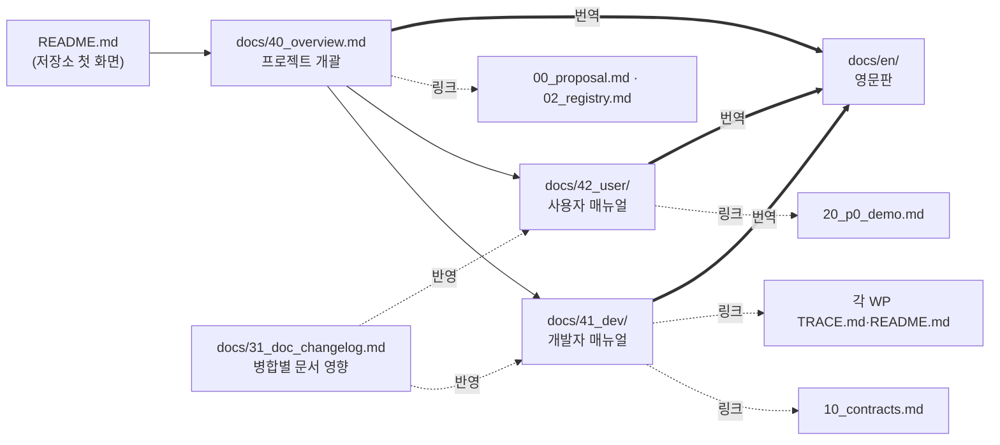
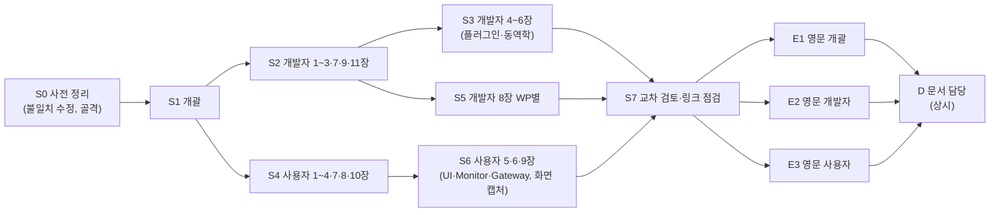
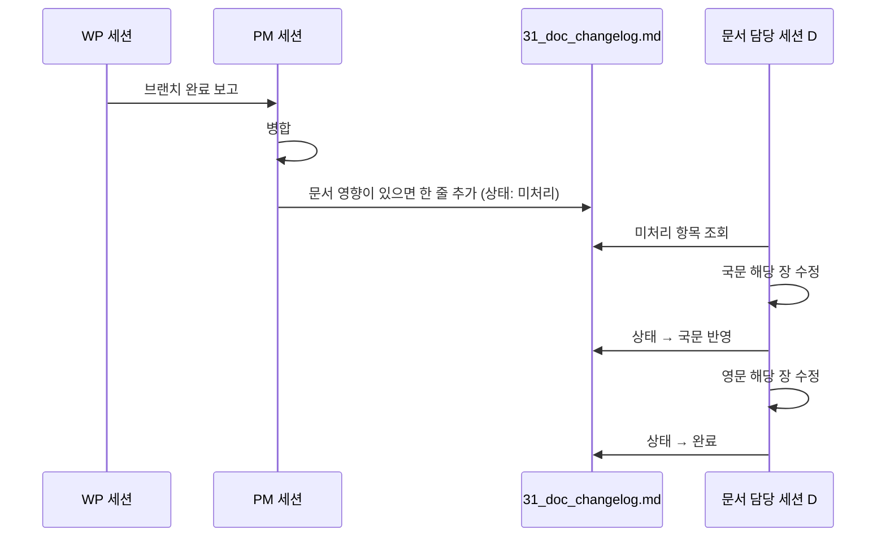

# 매뉴얼 작성 계획

- 대상: 프로젝트 개괄, 개발자 매뉴얼, 사용자 매뉴얼
- 기준: 계약 0.13.0, 커밋 `75ff6ad`(WP9 Gateway 병합 직후), 로드맵 P6 진행 중
- 이 문서는 계획만 담는다. 본문은 별도 세션에서 쓴다. 사용자 결정은 §9.1, 남은 확인 사항은 §9.2에 있다.
- 계획 이후의 변경은 [31_doc_changelog.md](31_doc_changelog.md)에 쌓고 문서 담당 세션이 반영한다(§6.2).

## 1. 원칙

| 원칙 | 내용 | 근거 |
|---|---|---|
| 단일 출처 | 계약(키·스키마·프로토콜·빌드)은 `10_contracts.md`에만 둔다. 매뉴얼은 해당 절로 링크하고, 독자가 바로 쓸 명령·예시만 옮긴다 | DEC-015. 계약은 WP0만 바꾸므로 사본이 생기면 어긋난다 |
| 설계 근거는 링크 | 왜 그렇게 만들었는지는 `00_proposal.md`·`02_registry.md`의 DEC로 링크한다. 매뉴얼은 "어떻게 쓰는가"만 쓴다 | 제안서·등록부와 중복 방지 |
| 구현 기준 | 매뉴얼에는 현재 코드와 시험으로 확인된 동작만 쓴다. 계획 단계 기능은 "미구현" 표지와 로드맵 단계만 적는다 | §8의 미구현 목록 |
| 명령은 실행해 본 것만 | 모든 명령 블록은 작성 세션에서 실제로 실행하고 결과를 확인한다 | §7 검증 |
| 용어 | '도달', '유도 객체'를 쓴다. 임무장비는 "센서·재머·시뮬레이션 이벤트"로 쓴다. 무장 제원·교전 절차 설명은 넣지 않는다 | 사용자 지시 |
| 자료 취급 | Distribution D 표기 A-GRA 자료 내용은 옮기지 않는다. 메시지명은 공개 XSD(Distribution A)와 `02_registry.md` §5에서만 가져온다 | `README.md` §9, `00_proposal.md` §9.4 |
| 형식 | markdown만 쓴다(정적 사이트·PDF 없음). 다이어그램은 mermaid가 기본이고, 기하 도형·좌표계·화면 구역 표시처럼 mermaid로 나타내기 어려운 것은 SVG로 그린다 | 사용자 결정(§9.1) |
| 언어 | 국문·영문 둘 다 쓴다. 국문이 원본이고 영문은 `docs/en/`에 같은 구조로 둔다. 영문은 국문 본문이 확정된 장부터 옮긴다 | 사용자 결정(§9.1) |
| 로컬 파일 비의존 | 매뉴얼은 저장소에 없는 파일(로컬 전용 `CLAUDE.md` 등)을 읽으라고 하거나 링크하지 않는다. 필요한 규칙은 저장소 안 문서(`11_wp_briefs.md`, `01_id_convention.md`)로 링크한다 | `CLAUDE.md`는 사용자가 의도적으로 gitignore한 로컬 파일 |
| 미구현 표기 | 해당 절에 한 줄 표지(`> 미구현: … (로드맵 Pn)`)를 두고 설명은 쓰지 않는다 | 사용자 결정(§9.1) |

## 2. 문서 위치와 이름

| 문서 | 위치 | 형태 |
|---|---|---|
| 프로젝트 개괄 | `docs/40_overview.md` | 단일 파일 |
| 개발자 매뉴얼 | `docs/41_dev/NN_<주제>.md`, 목차 `docs/41_dev/README.md` | 장별 파일 |
| 사용자 매뉴얼 | `docs/42_user/NN_<주제>.md`, 목차 `docs/42_user/README.md` | 장별 파일 |
| 그림 | `docs/img/manual/<문서>/` (SVG 원본과 화면 캡처 JPG) | |
| 영문판 | `docs/en/40_overview.md`, `docs/en/41_dev/`, `docs/en/42_user/` | 국문과 같은 파일 이름·장 번호 |
| 문서 변경 기록 | `docs/31_doc_changelog.md` | 병합마다 한 줄 추가(§6.2) |

- 영문판 파일 머리에 원본 국문 파일과 원본 기준 커밋을 적는다. 국문이 바뀌면 이 커밋과 비교해 영문 갱신 대상을 찾는다.
- 그림은 국문·영문이 같은 파일을 쓴다. SVG 안의 글자는 언어별로 따로 두지 않도록 번호·기호만 넣고 설명은 본문 표에 쓴다. 화면 캡처는 UI가 한국어이므로 한 벌만 둔다.
- mermaid 블록 안 글자는 언어별로 옮긴다.
- 번호 40번대는 기존 체계(00 기획, 10 계약, 20 통합·QA, 30 계획)를 잇는다.
- 매뉴얼을 장별 파일로 나누는 이유: 장마다 다른 세션이 써도 파일이 겹치지 않는다(§6 분담).
- `README.md` §8 문서 표에 세 문서를 추가한다. `README.md` 본문은 개괄로 옮기지 않고 그대로 둔다(첫 화면 요약 역할).
- WP 디렉터리의 `README.md`(bridge, ui, ui/monitor, gateway)는 유지한다. 개발자 매뉴얼은 이 파일들을 링크하고, README가 없는 WP(core, dynamics, datalink, agent, algorithms, scenario, logger, payload, qa)는 매뉴얼의 WP 절이 그 역할을 한다. WP 디렉터리에 README를 새로 만들지 않는다(각 WP 영역이므로).

## 3. 프로젝트 개괄 (`docs/40_overview.md`)

- 독자: 저장소를 처음 보는 사람. 10분 안에 무엇이고, 무엇이 되고, 어디서 시작하는지 알게 한다.
- 분량: 300줄 이하.

| 절 | 다룰 내용 | 출처 |
|---|---|---|
| 1. 목적과 범위 | 연구용 군집 시뮬레이터, 계층별 교체(MA/FA), 범위 밖 항목 | `00_proposal.md` §1, `README.md` §1 |
| 2. 현재 할 수 있는 것 | 기능 표: 구현됨 / 부분 / 미구현과 로드맵 단계. 동역학 2·3-DoF, 실행 모드 3종, 데이터링크 모델, 센서·재머·시뮬레이션 이벤트, UI·Monitor, 기록·재생, Gateway 1·2단계 | 각 `TRACE.md`, §8 |
| 3. 구성 요소 | 프로세스 7종과 버스, 채널 3분리(`swarm/**`·`sim/**`·`truth/**`)와 `onboard/**`·`link/**` | `README.md` §3, `10_contracts.md` §3.1 |
| 4. 한 프레임의 흐름 | tick → Agent(MA→FA) → ControlOutput → Core 적분 → truth/NavigationReport | `core/TRACE.md` 구성 절, `10_contracts.md` §3 |
| 5. 명령 한 건의 흐름 | UI → 브리지 → Datalink → Agent → TaskStatus 귀환 | `20_p0_demo.md` §1 명령 경로 |
| 6. 처음 실행해 보기 | 빌드 산출물 준비 → `run_p0_demo.py live` → 브라우저 주소. 상세는 사용자 매뉴얼 2장 링크 | `20_p0_demo.md` §2~3 |
| 7. 저장소 지도 | 디렉터리·WP·언어·실행 파일 표(payload, gateway, qa 포함) | `README.md` §4, 각 `pyproject.toml`·`CMakeLists.txt` |
| 8. 진행 상태 | P0~P8 표에 완료 기준과 현재 상태(P0·P1·P2·P5 시연 결과, P3·P4 미착수, P6 진행) | `00_proposal.md` §13, `20_p0_demo.md` §5, `21_qa_report.md` |
| 9. 용어 | MA, FA, L1 포트(C2/VI/MS/MP/MD/P2P), GCS, lockstep, 참여자, 엔티티, truth, STD/EXT/SIM | `10_contracts.md`, `00_proposal.md` §3.3 |
| 10. 다음에 읽을 것 | 독자별 경로: 실행·조작 → 사용자 매뉴얼, 알고리즘 → 개발자 4장, WP 기여 → 개발자 8장, 설계 근거 → 제안서·등록부 | |

다이어그램:

| 그림 | 형식 | 비고 |
|---|---|---|
| 구성 요소와 버스 채널 | mermaid flowchart | `README.md` §3 그림에 Payload(Core 내장)·Gateway·브리지 추가 |
| 한 프레임 시퀀스 | mermaid sequenceDiagram | 새로 그림 |
| 명령 경로 | `20_p0_demo.md` 그림 링크 | 다시 그리지 않음 |
| UI 첫 화면 | JPG | `docs/img/p0_demo/01_live_2d_20uav.jpg` 재사용 |

## 4. 개발자 매뉴얼 (`docs/41_dev/`)

- 독자 A: 알고리즘 플러그인 작성자(MA/FA를 Python으로 쓴다. C++·UI는 몰라도 된다).
- 독자 B: WP 기여자(특정 디렉터리를 고치고 시험·추적·계약 규칙을 지킨다).
- 장 구성은 A가 1→2(Python만)→3→4→5, B가 1→2→3→8→9→10 순으로 읽도록 한다.

| 장 | 파일 | 다룰 내용 | 출처 |
|---|---|---|---|
| 1. 개발 환경 | `01_setup.md` | 툴체인 선택 기준(Python만 / C++ 포함 / UI 포함), 필요한 것 표, 설치는 `10_contracts.md` §7.2 링크. 흔한 실패: 긴 경로 C1083, msvc 트리플렛(QA-007), `zenohc.dll` 복사, Python 확장 모듈 툴체인 일치, cp949 콘솔 | `10_contracts.md` §7, `11_wp_briefs.md` 공통 지시(vcvars 호출 형태), `21_qa_report.md` QA-007·QA-010 |
| 2. 빌드와 시험 | `02_build_test.md` | 영역별 명령: C++(`cmake --preset`/`ctest`), Python(`uv sync`·`gen_proto.py`·`uv run pytest`), UI·Monitor(`npm install/test/build`, `gen:proto` 자동), Gateway(독립 uv 프로젝트, 서브모듈 초기화). 생성물 위치(`api/python/src/swarm/v1/`, `ui/src/gen/`), 커밋하지 않는 것 | `10_contracts.md` §4·§7.3, `ui/README.md`, `ui/monitor/README.md`, `gateway/README.md`, 루트 `pyproject.toml`, `CMakePresets.json` |
| 3. 아키텍처와 실행 모델 | `03_architecture.md` | 프로세스와 참여자 ID, `open_bus`·공통 버스 옵션, 키 영역별 접근 규칙(MA 금지 접두어), 실행 모드 3종, lockstep 장벽(준비 신호 `FrameDone{0}`, rx 소비 규칙, `sent_count`), 시나리오 배포(`sim/ctrl/scenario`), 매개변수 결정 순서, 좌표·단위 요약 | `10_contracts.md` §2·§3, DEC-037·040·044·054 |
| 4. MA 플러그인 작성 | `04_ma_plugin.md` | 따라 하기: 최소 MA 클래스 → entry point `swarm.ma` 등록 → 시나리오 `AutonomySpec.ma_plugin` 지정 → `swarm-agent --list-plugins` 확인 → 실행. `AgentContext`·`ctx.ports` 6종·`ctx.rng`·`ctx.params`, `PARAMS`/`on_params`, `BatchMissionAutonomy`(`NavBatch`), `TaskStatus` 보고 규약(ACCEPTED→EXECUTING→COMPLETED, 미지원 REJECTED), 공용 부품 `TaskTracker`·`TaskPilot` 재사용, 기본 MA 4종(hold·waypoint·formation·flocking) 해설, 가짜 Core·Datalink로 단위 시험 | `api/python/src/swarm_api/{plugin,ports}.py`, `algorithms/src/swarm_algorithms/*`, `algorithms/pyproject.toml`, `agent/TRACE.md` IMP-AGT-003~009, `algorithms/TRACE.md` |
| 5. FA 플러그인 작성 | `05_fa_plugin.md` | `FlightAutonomy` 수명(on_init→`FlightCapability`, on_command, step→`ControlOutput`, `pending_status`), VI 제어 모드(HSA·Waypoint·Curve/Orbit·Racetrack), 기본 FA `default`의 유도 방식과 매개변수(`racetrack_guidance` 등), entry point `swarm.fa` | `api/python/src/swarm_api/plugin.py`, `agent/src/swarm_agent/{fa,racetrack}.py`, `agent/TRACE.md` IMP-AGT-007·019 |
| 6. 동역학 모델 추가 | `06_dynamics.md` | `DynamicsModel`·`Integrator`·`EventFn`·`Terrain` 인터페이스, 팩토리 등록, `param_descs`, 바람·대기 속도 규칙, DEM 파일 형식은 계약 링크, 해석해 비교 시험 작성법 | `api/cpp/include/swarm/api/dynamics.hpp`, `dynamics/include/swarm/dyn/*.hpp`, `dynamics/TRACE.md`, `10_contracts.md` §6 |
| 7. 메시지와 계약 | `07_messages.md` | proto 파일별 역할(표는 `10_contracts.md` §4 링크), A-GRA 매핑 옵션(`uci_name`·`mapping`·`l1`)이 Gateway에 쓰이는 방식, 메시지 추가 시 하는 일(proto → 3개 언어 생성 → 키 → 시험) | `10_contracts.md` §4, `proto/swarm/v1/options.proto`, `gateway/README.md` |
| 8. WP별 기여 안내 | `08_wp/<wp>.md` (13개) | 각 WP 한 파일, 같은 틀: 책임, 디렉터리 구조, 진입 파일, 실행 파일과 옵션 표, 구독·발행 키, 시험 명령과 시험 범위, 알려진 제약, `TRACE.md` 링크 | 아래 표 |
| 9. 기여 규칙 | `09_contributing.md` | ID 규칙(IMP/TC/DEC/OPN), `TRACE.md` 갱신, 커밋 메시지 형식, worktree·브랜치 규칙, 계약 변경 요청(CR) 절차와 `CONTRACT_VERSION` 올리기, WP 디렉터리 밖 수정 금지 | `01_id_convention.md`, `11_wp_briefs.md` 공통 지시, `README.md` §9, `10_contracts.md` 머리말 |
| 10. QA 하니스 | `10_qa.md` | `qa/run_qa.py --list/--only`, QA 시나리오 목록과 목적, 결정성 진단(`diag_determinism.py`), 고장 주입 스크립트, 결과 기록 위치 | `qa/run_qa.py`, `qa/scenarios/`, `21_qa_report.md` §1 |
| 11. 문제 해결 | `11_troubleshooting.md` | 증상 → 원인 → 조치 표. lockstep 틱이 안 나감(시나리오 `run.mode`·참여자 준비), 참여자 응답 없음, 포트 충돌, Zenoh 다른 버스와 섞임(멀티캐스트), DLL 미발견 | `20_p0_demo.md` §6, `21_qa_report.md`, `core/TRACE.md` IMP-CORE-018~021 |

8장 WP별 파일:

| 파일 | 출처 | 특기 사항 |
|---|---|---|
| `core.md` | `core/TRACE.md`, `core/src/main.cpp`(옵션 `--scenario --uavs --autostart --mode --rate --hz --seed --participant --frames --integrator --terrain-flat --terrain-dem`) | Payload 통합 호출 순서 포함 |
| `dynamics.md` | `dynamics/TRACE.md` | 6장과 겹치는 내용은 6장 링크 |
| `datalink.md` | `datalink/TRACE.md` "제약과 다음 단계" | 링크 프로파일 표, 손실 사유 |
| `agent.md` | `agent/TRACE.md`, `agent/src/swarm_agent/cli.py` | 호스팅 선택(`--entities`), `--activity-max-hz` |
| `algorithms.md` | `algorithms/TRACE.md` | 4장과 겹치는 내용은 4장 링크 |
| `bridge.md` | `bridge/README.md` 링크 위주 | 프로토콜은 계약 §3.5 링크 |
| `ui.md` | `ui/README.md`, `ui/TRACE.md` | 데이터 소스·모델 계층 구조 |
| `monitor.md` | `ui/monitor/README.md` | 집계 정의 |
| `scenario.md` | `scenario/TRACE.md`, `scenario/src/swarm_scenario/schema/` | 사용자 3장과 역할 구분: 여기는 스키마·변환기 수정법 |
| `logger.md` | `logger/TRACE.md` | 기록 큐·색인 설정 |
| `payload.md` | `payload/TRACE.md`, `payload/profiles/*.json` | 중립 표현으로 쓴다: 센서 탐지 판정, 재머 구역, 유도 객체의 시뮬레이션 이벤트(launch·impact·kill). 제원값은 프로파일 파일 링크만 |
| `gateway.md` | `gateway/README.md`, `gateway/TRACE.md` | 매핑은 proto 옵션이 기준. CR-GW-001~006 상태 표시 |
| `qa.md` | 10장으로 대체 | 별도 파일 없이 10장 링크 |

다이어그램:

| 그림 | 형식 | 장 |
|---|---|---|
| 개발 영역별 필요 도구 | mermaid flowchart | 1 |
| 코드 생성 흐름(proto → C++/Python/TS) | mermaid flowchart | 2, 7 |
| lockstep 한 프레임(tick, rx 소비, FrameDone, sent_count) | mermaid sequenceDiagram | 3 |
| 키 영역별 접근 권한(누가 무엇을 구독·발행) | mermaid flowchart | 3 |
| Core 상태(LOADED·RUNNING·PAUSED, Reset) | mermaid stateDiagram | 3 |
| MA/FA 호출 순서(on_init, 틱마다 on_step, on_params, on_shutdown) | mermaid sequenceDiagram | 4, 5 |
| 플러그인 등록에서 실행까지(entry point → 시나리오 → 런타임 로딩) | mermaid flowchart | 4 |
| TaskStatus 상태 | mermaid stateDiagram | 4 |
| 좌표계(WGS84·NED·FRD, 쿼터니언 방향) | SVG | 3, 6 |
| 편대 모양 6종(LINE·COLUMN·WEDGE·ECHELON·CIRCLE·CUSTOM)과 간격 | SVG | 4 |
| 레이스트랙 정의(두 원 중심의 중점, 직선 길이, 축 방위) | SVG | 5 |
| WP별 구조 | 각 WP README·TRACE의 기존 mermaid 링크 | 8 |

## 5. 사용자 매뉴얼 (`docs/42_user/`)

- 독자: 코드를 고치지 않고 시나리오를 쓰고, 실행하고, UI로 조작하고, 기록을 재생하는 연구자·운용자.
- 전제: 빌드 산출물이 있거나 1장대로 만든다. C++·TS 지식은 요구하지 않는다.

| 장 | 파일 | 다룰 내용 | 출처 |
|---|---|---|---|
| 1. 준비 | `01_install.md` | 필요한 산출물 목록(C++ 실행 파일 3종, uv 패키지, npm), 개발자 매뉴얼 1·2장 링크. 지도 자료: DEM 받기(`fetch_dem.py`), 지형·영상 타일 만들기(소요 용량·시간 포함), 없을 때 동작 | `20_p0_demo.md` §2, `10_contracts.md` §7.3 지형·타일 절, `ui/README.md` 오프라인 지도 |
| 2. 빠른 시작 | `02_quickstart.md` | `run_p0_demo.py live --monitor` 한 번으로 띄우기, 브라우저 주소, 20대 선택·이동 명령, 종료(Ctrl+C·`STOP` 파일), 출력 디렉터리. `probe`로 자동 확인 | `20_p0_demo.md` §3 (옵션 표는 링크) |
| 3. 시나리오 작성 | `03_scenario.md` | 최상위 구조 표(map, run, entities, link_profiles, mission_plan, engagement_criteria), 엔티티 종류·진영·DoF, autonomy(MA/FA 이름과 매개변수 표), 링크 프로파일 재정의, 임무 계획(작업 종류), 탑재 장비(센서·재머 설정, 시뮬레이션 이벤트를 내는 장비는 프로파일 이름과 재정의 방법만), 제약 목록(ID 형식·25자, frame_hz 50–100, 엔티티당 재머 1, 시작 고도), 검증·출력(`swarm-scenario validate/show/export`), 예제 3종 해설 | `scenario/src/swarm_scenario/schema/`, `scenario/TRACE.md`, `scenario/examples/*.json`, `10_contracts.md` §3.3 |
| 4. 실행 | `04_run.md` | 프로세스를 하나씩 띄우는 방법(시작 순서, 참여자 ID, `--connect/--listen`, 멀티캐스트 끄기), 실행 모드 realtime·lockstep·free-run과 배속, lockstep 조건(시나리오 `run.mode`·`participants`), 지형 옵션(`--terrain-flat`/`--terrain-dem`), 적분기 선택, 여러 PC에 나눠 실행(§8 미확인 표지) | `20_p0_demo.md` §1, 각 실행 파일 `--help`, `10_contracts.md` §3.3·§3.4 |
| 5. GCS UI 조작 | `05_ui.md` | 화면 구성(도구 막대, 지도, 오른쪽 패널), 데이터 소스와 URL 인자, 선택(클릭·드래그·그룹), 임무 창(이동·선회 대기·레이스트랙·타격 지정·정찰·항로 편집), 명령 패널(Hold·RTB·편대), 매개변수 패널, 카메라 시점, 이벤트 전시(재밍 구역·센서 시야·시뮬레이션 이벤트 표시), 상태 표시(응답 없음, 참여자 대기, 재생), 단축키 표 | `ui/README.md` 입력·명령 전송, `ui/TRACE.md`, 화면 `docs/img/p0_demo/`, `ui/docs/screenshots/` |
| 6. Traffic Monitor | `06_monitor.md` | 화면 영역별 읽는 법, 손실 사유 7종 뜻, 손실률·지연 집계 정의(분모), 필터, 재생 중 표시 | `ui/monitor/README.md` |
| 7. 데이터링크 상황 만들기 | `07_link.md` | 링크 프로파일로 지연·손실·대역폭 바꾸기, 재밍 구역(재머 장비·jammer_site), 고장 주입(LINK_CUT·GCS_LINK_CUT·ENGINE·NAV·SENSOR) 방법, Monitor로 결과 보기 | `datalink/TRACE.md`, `qa/inject_fault.py`, `core/TRACE.md` IMP-CORE-011 |
| 8. 기록과 재생 | `08_record_replay.md` | `swarm_logger record/replay/info`, `run_p0_demo.py replay`, 재생 중 UI·Monitor 상태(명령 비활성), 고배속 프레임 누락 표시(DEC-042), 기록 크기 예 | `logger/TRACE.md`, `20_p0_demo.md` §4·§5 |
| 9. A-GRA Gateway 연동 | `09_gateway.md` | 무엇을 내보내고 받는지(메시지 표는 `gateway/README.md` 링크), CAL Server·Gateway 실행 순서, 외부 C2 명령의 현재 임시 규칙, 카운터·거부 로그 보는 법 | `gateway/README.md` |
| 10. 문제 해결 | `10_faq.md` | 사용자 증상 위주: 지도가 안 보임, 기체가 안 움직임, 명령이 REJECTED, 재생이 끊김, 브라우저가 연결 안 됨 | `20_p0_demo.md` §6, `21_qa_report.md` |

다이어그램과 그림:

| 그림 | 형식 | 장 |
|---|---|---|
| 데모 프로세스 배치와 포트 | `20_p0_demo.md` §1 그림 링크 | 2, 4 |
| 시나리오 구조(최상위 키와 엔티티 하위 키) | mermaid flowchart(트리) | 3 |
| 실행 모드별 시간 진행 비교 | mermaid sequenceDiagram | 4 |
| 분산 실행 예(PC별 프로세스) | mermaid flowchart | 4 |
| UI 화면 구역 설명 | 캡처 JPG 위에 번호를 얹은 SVG 1장 | 5 |
| 임무 창·항로 편집·매개변수 패널 | 캡처 JPG(기존 재사용, 부족하면 내장 영상 화면으로 새로 캡처) | 5 |
| Monitor 화면 구역 설명 | 캡처 JPG + 번호 SVG | 6 |
| 재밍 판정(수신단 기준) | mermaid flowchart | 7 |
| 기록·재생 구성 | mermaid flowchart | 8 |
| Gateway 연결 | `gateway/README.md` 그림 링크 | 9 |

## 6. 작성 순서와 분담

### 6.1 처음 작성

| 세션 | 산출물 | 선행 | 이유 |
|---|---|---|---|
| S0 | §8 끝의 기존 문서 불일치 수정, 그림 디렉터리, 두 매뉴얼의 목차 파일(`README.md`), `docs/en/` 골격 | 없음 | 형식·틀을 먼저 고정해야 이후 세션이 같은 틀로 쓴다 |
| S1 | `40_overview.md` | S0 | 다른 문서가 링크할 용어·구성 설명의 기준 |
| S2 | 개발자 1·2·3·7·9·11장 | S1 | 빌드·아키텍처를 실제로 실행하며 확인. 이후 장이 이 장을 링크 |
| S3 | 개발자 4·5·6장 | S2 | 예제 플러그인을 실제로 만들어 돌려야 하므로 분리. 예제 코드 위치는 §9.2 결정을 따른다 |
| S4 | 사용자 1·2·3·4·7·8·10장 | S1 | 데모·시나리오·실행 명령을 실제 실행. S2와 병렬 가능(파일 겹침 없음) |
| S5 | 개발자 8장 13개 파일 | S2 | WP 수가 많아 한 세션. TRACE 요약 위주라 코드 실행은 각 WP 시험 명령만 |
| S6 | 사용자 5·6·9장 | S4 | 브라우저로 UI·Monitor를 띄워 캡처해야 한다. Gateway는 서브모듈 초기화 필요 |
| S7 | 링크·용어·중복 점검 보고, `README.md` §8 표 갱신 | S3·S5·S6 | 전체를 한 번에 봐야 하는 일 |
| E1 | `docs/en/40_overview.md` | S7 | 국문을 검토로 확정한 뒤 옮겨야 다시 옮기는 일이 없다 |
| E2 | `docs/en/41_dev/` 전체 | S7 | 장이 많아 사용자 매뉴얼과 나눈다. E1·E3과 병렬 |
| E3 | `docs/en/42_user/` 전체 | S7 | E1·E2와 병렬 |

- 병렬: S2와 S4, S3·S5와 S6, E1·E2·E3은 서로 다른 파일을 쓰므로 동시에 진행할 수 있다.
- 각 세션은 시작할 때 `31_doc_changelog.md`의 미처리 항목 중 자기 장에 해당하는 것을 함께 반영하고 상태를 바꾼다.
- 영문 세션은 번역만 한다. 국문 본문의 오류를 찾으면 국문을 고치지 않고 보고에 적어 D가 국문부터 고치게 한다(원본은 국문).
- 각 세션은 자기 worktree 브랜치에 커밋하고 push하지 않는다. 병합은 시작한 세션이 한다.
- 각 세션은 쓰는 도중 발견한 코드·문서 불일치를 고치지 않고 보고에 "불일치"로 적는다(§8 갱신용).

### 6.2 갱신 (문서 담당 세션 D)

개별 WP 세션에는 매뉴얼 갱신을 요청하지 않는다(`11_wp_briefs.md`는 바꾸지 않는다). 변경은 병합 시점에 기록하고 D가 모아서 반영한다.

| 역할 | 하는 일 |
|---|---|
| PM | 브랜치를 병합할 때마다 문서에 영향이 있는지 보고, 있으면 `31_doc_changelog.md`에 한 줄 추가한다. 영향 판단 기준: 실행 파일 옵션, 시나리오 스키마, 키·proto, UI 조작, 빌드 절차, 새 기능·제약, §8 목록 항목의 변화. 시험·내부 리팩터링만 있는 병합은 적지 않는다 |
| D | 미처리 항목을 반영한다. 국문을 먼저 고치고 영문을 고친다. 반영한 명령은 §7 방법으로 다시 실행한다. §8 미구현·미확인 목록을 최신으로 유지한다 |
| D 실행 시점 | PM이 요청할 때, 그리고 로드맵 단계(Pn)가 끝날 때. 미처리 항목이 쌓이면 PM이 묶어서 요청한다 |
| 처음 작성 세션(S1~S6, E1~E3) | 자기 장을 쓰는 동안 그 장의 미처리 항목을 함께 반영한다. D는 처음 작성이 끝난 장만 맡는다 |

- 변경 기록 형식과 상태 값은 `31_doc_changelog.md` 머리에 둔다.

## 7. 검증 방법

| 대상 | 방법 | 통과 기준 |
|---|---|---|
| 명령 블록 | 작성 세션이 msvc-debug 환경에서 그대로 실행. 오래 걸리는 것(타일 생성, 영상 합성)은 실행 시작과 첫 출력만 확인하고 그 사실을 적는다 | 오류 없이 실행, 설명한 출력과 일치 |
| 실행 파일 옵션 표 | 각 실행 파일 `--help` 출력과 대조 | 표의 옵션이 모두 존재, 기본값 일치 |
| 예제 코드(MA/FA 예제) | 임시 패키지로 등록해 `swarm-agent --list-plugins`에 나오는지, 짧은 시나리오를 `--frames`로 돌려 동작하는지 확인 후 임시 파일 삭제 | 등록·실행 성공 |
| 시나리오 예시 | 문서 안 JSON 조각을 파일로 저장해 `swarm-scenario validate` | 통과(또는 의도한 오류 메시지) |
| UI·Monitor 설명 | 내장 브라우저로 `?source=mock`과 데모 버스 소스를 띄워 단계대로 조작, 캡처 | 설명한 동작 재현 |
| mermaid | 로컬에서만 렌더한다. 문서에서 뽑은 블록을 mermaid-cli(mmdc)로 SVG로 만들거나, mermaid 라이브러리를 넣은 로컬 HTML을 내장 브라우저로 연다. 외부 렌더링 사이트는 쓰지 않는다 | 렌더 오류 없음. ` `·`&lt;` 등 기존 문서 표기 관례 유지 |
| 영문판 | 국문과 장·절·표·명령 블록 수가 같은지 비교, 영문 머리의 원본 기준 커밋이 현재 국문과 같은지 확인 | 구조 일치 |
| SVG | 브라우저에서 밝은·어두운 배경 모두 확인 | 글자·선이 두 배경에서 읽힘 |
| 링크 | 상대 링크와 `파일#절` 앵커를 스크립트로 검사(임시, 커밋하지 않음) | 깨진 링크 0 |
| 용어 | §1 용어 원칙에서 대체한 옛 용어와 무장 제원 숫자가 본문에 없는지 검색 | 0건 |
| 계약 사본 | 키 목록·proto 필드 표·빌드 설치 절차를 통째로 옮긴 곳이 없는지 S7에서 검토 | 링크로 대체됨 |

## 8. 지금 쓸 수 없는 부분 (미구현·미확인)

매뉴얼에는 아래 항목을 "미구현" 또는 "확인 안 됨"으로 표시하고 설명을 쓰지 않는다. 작성 시점에 다시 확인한다.

| 항목 | 상태 | 근거 | 영향받는 절 |
|---|---|---|---|
| 5/6-DoF 동역학(Aerosonde) | 미구현. 팩토리가 `dof5`·`dof6`에 nullptr | `dynamics/src/factory.cpp`, 로드맵 P3 | 개괄 2, 개발 6, 사용자 3 |
| 분산 실행(여러 PC, 수백 대) | 단일 PC에서만 시연. 4 PC·300대 시험 기록 없음 | 로드맵 P4, `20_p0_demo.md` | 사용자 4(절차는 쓰되 "확인 안 됨" 표지) |
| C++ MA/FA 플러그인 | ABI 헤더만 있고 Agent 런타임(Python)에 로딩 경로 없음 | `api/cpp/include/swarm/api/plugin.hpp`만 `swarm_create_ma`를 가짐 | 개발 4·5 |
| 링크 상실 행동(lost-link) | 기본 MA에 구현 없음 | `algorithms/`, `agent/` 검색 결과 없음, 로드맵 P2 완료 기준 | 개괄 2, 개발 4, 사용자 7 |
| UI 시나리오 편집 | 없음. 매개변수의 시나리오 시작값 편집도 없음 | `ui/README.md` 입력 표, `README.md` §2와 불일치 | 사용자 3·5 |
| UI 고장 주입 | UI에 고장 주입·표시 기능 없음. 스크립트(`qa/inject_fault.py`)로만 가능 | `21_qa_report.md` §10.3 관찰, `ui/src` 검색 | 사용자 7 |
| 역할별 권한(RBAC) | 미구현. 브리지는 control/observer만 구분 | DEC-020, `10_contracts.md` §3.5 | 사용자 5 |
| Datalink DEM 가시선 | Datalink 실행 파일은 평지만 쓴다(`FlatTerrain`, `--terrain-dem` 없음). Core·Payload는 DEM 사용 | `datalink/src/main.cpp`, `datalink/TRACE.md` | 개발 8 datalink, 사용자 4·7 |
| 피어 중계(멀티홉) | 미구현 | `datalink/TRACE.md` | 사용자 7 |
| A-GRA L1 전면 준수, SITL | 미착수 | 로드맵 P7·P8 | 개괄 8 |
| Gateway 매핑 일부 | 계약 변경 대기(OPN-060~063: 위치 메시지, 승인 응답, 외부 작업 내용, 발행자 구분). 외부 C2는 hold·return_to_base·취소만 | `gateway/README.md`, `02_registry.md` §4 | 사용자 9, 개발 8 gateway |
| Gateway 실행 위치 | 루트 uv 워크스페이스 미등록(CR-GW-004). `gateway/`에서 따로 `uv sync` | `gateway/README.md` | 개발 2 |
| 브리지와 CAL Server 기본 포트 | 둘 다 기본 8765. 데모와 Gateway를 함께 띄우는 절차는 확인 안 됨 | `bridge/README.md`, `gateway/README.md` | 사용자 9 |
| mingw·linux 프리셋 | 프리셋은 있으나 이번 조사에서 빌드 기록을 찾지 못함. release 프리셋에는 test 프리셋이 없음 | `CMakePresets.json` | 개발 1·2 |
| free-run 모드 | 모드 전환 시험(TC-QA-011)만 있고 사용 사례 기록 없음 | `21_qa_report.md` | 사용자 4 |
| lockstep 지각 참여·재합류 | 시작 전 지각 참여는 됨, 시작 후 재합류는 지원하지 않음(Reset+Start) | DEC-038, `20_p0_demo.md` §6 | 사용자 4, 문제 해결 |
| TaskStatus 순서 뒤바뀜 | 이월된 알려진 현상 | `20_p0_demo.md` §6 | 사용자 10 |

S0에서 함께 고칠 기존 문서 불일치:

- `README.md` §4 디렉터리 표에 `payload/`(WP8)·`gateway/`(WP9)가 없다. §2 "시나리오 편집"은 UI에 없다.
- `10_contracts.md` §3.5 welcome 예시의 `contract`가 `0.10.0`이다(현재 0.13.0, 예시 값인지 확인 필요). 계약 문서이므로 S0은 고치지 않고 WP0에 확인을 요청한다.
- `CLAUDE.md`는 사용자가 의도적으로 gitignore한 로컬 파일이므로 불일치로 보지 않는다. 저장소에 넣거나 `.gitignore`를 바꾸지 않고, 매뉴얼은 이 파일에 의존하지 않게 쓴다(§1).

## 9. 확인 필요

### 9.1 사용자가 정한 사항

| 번호 | 사항 | 결정 | 반영한 곳 |
|---|---|---|---|
| 1 | 문서 언어 | 국문·영문 둘 다 쓴다 | §1 언어, §6.1 E1~E3 |
| 2 | 영문판 위치·동기화 | `docs/en/` 병렬 트리, 국문이 원본 | §2 |
| 3 | 형식 | markdown. 다이어그램은 mermaid 기본, SVG도 쓴다 | §1 형식 |
| 4 | 문서 위치·이름 | §2 체계로 확정 | §2 |
| 6 | 페이로드 서술 범위 | 센서·재머는 설정 예시까지, 그 밖의 장비는 프로파일 이름과 재정의 방법만 쓰고 수치 예시는 넣지 않는다 | §5 3장 |
| 7 | 미구현 표기 | 해당 절에 한 줄 표지와 로드맵 단계 | §1 미구현 표기, §8 |
| 8 | 화면 캡처 | 내장 영상으로 찍는다(로컬 타일을 만들지 않는다) | §5, §7 |
| 9 | 갱신 책임 | WP 세션에는 요청하지 않고 `11_wp_briefs.md`는 바꾸지 않는다. PM이 병합마다 `31_doc_changelog.md`에 적고 문서 담당 세션이 반영한다 | §2, §6.2, `31_doc_changelog.md` |
| 10 | 기존 문서 불일치 | S0에서 함께 고친다. `CLAUDE.md`는 로컬 파일이라 대상에서 뺀다 | §6.1 S0, §8 끝 |

### 9.2 남은 확인 사항

1. 플러그인 예제 코드 위치(S3 시작 전에 정한다)
   - (A) 매뉴얼 본문에만 둔다: 독자는 문서의 코드를 복사해 자기 패키지를 만든다. 저장소 코드는 늘지 않지만, 예제가 API 변경을 따라가는지는 D가 갱신할 때 손으로 다시 돌려 봐야 안다.
   - (B) 실행 가능한 예제 패키지로 둔다(예: `algorithms/examples/`): 독자가 바로 설치해 돌려 볼 수 있고 `uv run pytest`가 예제도 시험하므로 API가 바뀌면 바로 드러난다. 대신 WP3 영역에 파일이 늘고 그 영역을 고치는 세션이 필요하다.
