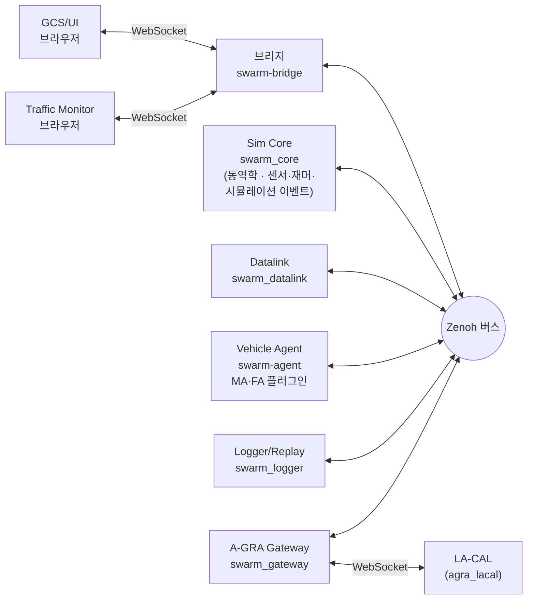
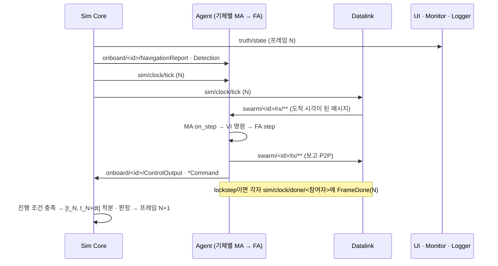
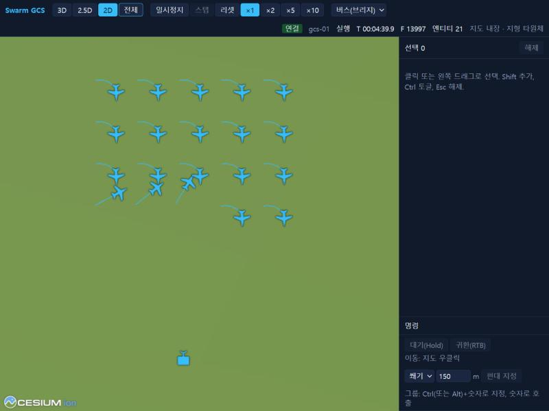

# 프로젝트 개괄

- 저장소를 처음 보는 사람을 위한 문서다. 무엇인지, 지금 무엇이 되는지, 어디서 시작하는지를 다룬다.
- 기준: 계약 0.14.0, 로드맵 P6 완료(2026-11-09).
- 설계 근거는 [제안 계획서](00_proposal.md)와 [등록부](02_registry.md), 계약은 [10_contracts.md](10_contracts.md)가 기준이다. 이 문서는 그 절로 링크한다.

## 1. 목적과 범위

SwarmFlSim은 군집·편대 알고리즘을 설계하고 검증하는 연구용 군집 무인항공기 시뮬레이터다.

- 기체 한 대의 하위 유도·제어(FA)부터 상위 행동 결정(MA)까지 계층별로 바꿔 끼울 수 있다. 연구자는 주로 MA 플러그인을 Python으로 쓴다.
- 기체 간·지상-기체 간 메시지는 모두 데이터링크 모의기를 거친다. 지연·손실·대역폭·재밍이 알고리즘에 그대로 영향을 준다.
- 기체 에이전트는 실제 상태(truth)를 볼 수 없다. 센서와 데이터링크로 받은 정보만 쓴다.
- A-GRA 구조(L1 포트)를 따른다. 외부 A-GRA 시스템과는 Gateway로 메시지를 주고받는다.

범위 밖: 게임 엔진 수준 3D 가시화, 실제 체계 제원, 확률 기반 센서 탐지, 고해상도 지형. 상세는 [제안서 §1.2](00_proposal.md#12-범위-밖).

## 2. 현재 할 수 있는 것

표기: 구현 = 코드와 시험이 있다. 부분 = 일부만 있다. 미구현 = 아직 없다(괄호는 로드맵 단계).

| 영역 | 기능 | 상태 |
|---|---|---|
| 동역학 | 2-DoF(유니사이클), 3-DoF(질점 협조선회), 바람 반영, 지면 충돌 | 구현 |
| 동역학 | 5·6-DoF | 미구현 (P3) |
| 동역학 | 적분기 RK45(프레임 안 가변 스텝)·RK4, 50–100 Hz 고정 프레임 | 구현 |
| 실행 | realtime / lockstep(결정론, 시드 고정) / free-run, 일시정지·스텝·배속 | 구현 |
| 실행 | 여러 PC 분산 실행, 수백 대 규모 | 확인 안 됨 (P4). 버스 옵션은 있고 단일 PC에서 시연했다 |
| 알고리즘 | 기본 MA 4종(hold, waypoint, formation, flocking), 기본 FA(HSA·Waypoint·선회·레이스트랙) | 구현 |
| 알고리즘 | 링크 상실 시 기체 행동 | 미구현 (P2) |
| 데이터링크 | 거리·SNR, 가시선, 버스트 손실, 지연·지터, 대역폭 큐, 재밍 구역(수신단 기준), 링크 두절 고장 | 구현. Datalink의 가시선은 평지만 쓴다 |
| 센서·재머·시뮬레이션 이벤트 | 카메라 탐지(FOV·거리·가시선), 재밍 구역, 유도 객체의 발사·도달 판정 (WP8, Core 내장) | 구현 |
| 지형 | 평지, 한반도 DEM(Copernicus GLO-90) | 구현 |
| UI | 2D/2.5D/3D 지도, 클릭·드래그 선택, 임무 명령(이동·선회 대기·레이스트랙·정찰·항로 등), 편대·그룹, 기체별 매개변수 | 구현 |
| UI | 시나리오 편집 | 미구현. 시나리오는 JSON으로 쓰고 `swarm-scenario`로 검증한다 |
| UI | 역할별 권한 | 미구현 (P6 이후, DEC-020). 지금은 control/observer만 구분 |
| Traffic Monitor | 엔티티별 트래픽 통계, 손실 사유, 시퀀스 타임라인, 메시지 해석 (실시간·재생) | 구현 |
| 기록·재생 | 전 채널 MCAP 기록, 배속 재생 | 구현 |
| A-GRA Gateway | 1단계: GCS가 받은 기체 상태(VI·C2·P2P·MS)를 UCI 메시지로 LA-CAL에 발행, 위치는 `MA_PositionReport`로도 발행(DEC-072). 2단계: 외부 `MA_TaskCommand` 수신(hold·귀환·취소) | 구현 (P6 완료, DEC-074). 미결: 승인 왕복(OPN-061), 위치가 필요한 외부 작업(OPN-062), GCS 키 발행자 구분(OPN-063) |
| A-GRA | L1 전면 준수, PX4/ArduPilot SITL | 미구현 (P7, P8) |

## 3. 구성 요소



| 구성 요소 | 하는 일 | 언어 |
|---|---|---|
| Sim Core | 프레임 진행, 실행 모드, 엔티티 상태, 동역학 적분, 지면 충돌, 센서·재머·시뮬레이션 이벤트 판정, 고장 주입 | C++20 |
| Datalink | `tx` 메시지에 링크 모델을 적용해 `rx`로 전달, 메시지마다 전달·손실 사유 발행 | C++20 |
| Vehicle Agent | 한 프로세스가 여러 기체를 맡는다. 기체마다 MA·FA 플러그인을 돌리고 L1 포트를 제공한다. VI 상태와 임무장비 상태를 GCS에 자동 보고한다(DEC-071, DEC-051) | Python |
| 브리지 | 브라우저를 버스에 붙인다. 구독 다운샘플, 발행 키 허용 검사 | Python |
| GCS/UI, Traffic Monitor | 지도·명령, 트래픽 분석 | TypeScript |
| Logger/Replay | 모든 키를 MCAP으로 기록, 버스로 재발행 | C++20 |
| A-GRA Gateway | GCS 쪽 지상 참여자. 내부 메시지 ⇄ UCI 변환, XSD 검증 | Python |

버스 키는 영역별로 나뉜다. 전체 목록은 [계약 §3.2](10_contracts.md#32-키-목록).

| 접두어 | 내용 | 누가 쓰는가 |
|---|---|---|
| `swarm/**` | 기체 간·지상-기체 간 메시지. 반드시 `tx` → Datalink → `rx` | Agent, UI(GCS), Gateway, Datalink |
| `onboard/**` | 같은 기체 안 신호(항법 보고, 탐지, 제어 출력, 장비 명령) | Core ⇄ 해당 기체 Agent |
| `sim/**` | 시뮬레이션 통제, 시계(tick), lockstep 장벽, 시나리오 배포, 매개변수 | Core, UI, 참여자 런타임 |
| `truth/**` | 실제 상태와 이벤트(launch·impact·kill·jam_zone·spawn) | Core가 발행, UI·Monitor·Logger·Datalink가 구독. Agent의 MA는 볼 수 없다 |
| `link/**` | 링크 결과와 상태 | Datalink가 발행, Monitor·UI·Logger가 구독 |

## 4. 한 프레임의 흐름



- 진행 조건: realtime은 벽시계 dt마다, lockstep은 모든 참여자의 `FrameDone(N)`을 받은 뒤, free-run은 배속에 따른 간격으로 진행한다.
- lockstep에서 기체 간 메시지는 링크 지연에 더해 최소 1틱 늦게 소비된다. 규칙은 [계약 §3.3](10_contracts.md#33-규칙)의 시나리오 배포와 lockstep 시작 절.

## 5. 명령 한 건의 흐름

UI에서 기체를 고르고 지도를 우클릭하면 `TaskCommand`가 GCS의 `tx`로 나가 Datalink를 거쳐 기체에 닿고, 기체의 `TaskStatus`가 같은 길로 돌아온다. 그림은 [20_p0_demo.md §1 명령 경로](20_p0_demo.md#명령-경로-c2).

## 6. 처음 실행해 보기

빌드와 설치는 [계약 §7](10_contracts.md#7-빌드-환경과-시험-dec-022)을 따른다(Windows MSVC 기준 `msvc-debug`). 그다음:

```bash
uv sync
```

```bash
uv run python scripts/gen_proto.py
```

```bash
uv run python scripts/run_p0_demo.py live --monitor
```

- `ui/`, `ui/monitor/`에서 `npm install`을 먼저 한 번 해 둔다.
- 실행기가 Logger → Datalink → Agent → 브리지 → Core → UI·Monitor 순으로 띄운다. 기체 20대와 GCS 1개가 있는 시나리오(`scenario/examples/p0_demo_20.json`)를 realtime 50 Hz로 돌린다.
- 브라우저: `http://localhost:5173/?source=bus&gcs=gcs-01&bridge=ws://127.0.0.1:8765/bus`. 왼쪽 드래그로 기체를 고르고 지도를 우클릭하면 이동 명령이 나간다.
- 기록은 `out/p0_demo/live-<시각>/p0_demo.mcap`에 남는다. 종료는 Ctrl+C.
- 옵션, 재생, 자동 확인(`probe`)은 [20_p0_demo.md](20_p0_demo.md). 사용자 매뉴얼 [2장](42_user/README.md)에서 다시 다룬다(작성 예정).



## 7. 저장소 지도

| 디렉터리 | WP | 내용 | 실행 파일·진입점 |
|---|---|---|---|
| `proto/` | WP0 | Protobuf 스키마 `swarm.v1` | — |
| `api/` | WP0 | 키 체계, 버스 계약, 플러그인 API (C++·Python) | — |
| `bus/` | WP0 | 공용 버스 라이브러리(`open_bus`, Zenoh·인메모리) | — |
| `scripts/` | WP0 | proto 생성, 데모 실행기, DEM·지도 타일 받기 | `gen_proto.py`, `run_p0_demo.py`, `fetch_dem.py`, `make_terrain_tiles.py`, `make_s2_composite_tiles.py` |
| `core/` | WP1 | Sim Core | `swarm_core` |
| `dynamics/` | WP2 | 동역학 모델, 적분기, 지형 | (Core가 링크) |
| `agent/` | WP3 | Agent 런타임, 기본 FA | `swarm-agent` |
| `algorithms/` | WP3 | 기본 MA 플러그인 | (entry point `swarm.ma`) |
| `datalink/` | WP4 | 링크 모델과 중계 | `swarm_datalink` |
| `bridge/` | WP5 | WebSocket 브리지 | `swarm-bridge` |
| `ui/` | WP5 | GCS/UI | `npm run dev` (포트 5173) |
| `ui/monitor/` | WP6 | Traffic Monitor | `npm run dev` (포트 5174) |
| `scenario/` | WP7 | 시나리오 JSON Schema, 검증·변환, 예제 | `swarm-scenario validate/show/export` |
| `logger/` | WP7 | MCAP 기록·재생 | `swarm_logger record/replay/info` |
| `payload/` | WP8 | 센서·재머·유도 객체 판정 라이브러리, 기본 프로파일 | (Core가 링크) |
| `gateway/` | WP9 | A-GRA Gateway. 독립 uv 프로젝트 | `python -m swarm_gateway` |
| `third_party/agra_lacal` | WP9 | LA-CAL 서브모듈(수정하지 않음) | — |
| `qa/` | QA | 시험 하니스, QA 시나리오, 결정성 진단 | `qa/run_qa.py` |
| `examples/plugins/` | — | 플러그인 예제 패키지. S3에서 만들 예정(DEC-070) | — |
| `docs/` | — | 계획·계약·등록부·매뉴얼 | — |

- C++ 실행 파일은 `build/<프리셋>/<디렉터리>/`에 생긴다. Python 진입점은 `uv run <이름>`으로 실행한다.

## 8. 진행 상태

완료 기준은 [제안서 §13](00_proposal.md#13-로드맵). 상태는 2026-11-09 기준이다.

| 단계 | 완료 기준 | 상태 | 근거 |
|---|---|---|---|
| P0 | 2-DoF 20대가 2D 지도에 표시되고, 드래그 선택으로 이동 명령 가능 | 완료 | [20_p0_demo.md §5](20_p0_demo.md#5-확인-결과-2026-11-02-windows-msvc-debug) TC-INT-001~004 |
| P1 | 3-DoF 편대 기본 알고리즘, Traffic Monitor 기본 화면, 가속 벤치마크 1차 | 기능 구현 | 편대·flocking·Monitor 구현, QA 성능 측정([21_qa_report.md §10.4](21_qa_report.md#104-성능-release-대-debug와-dec-040)). 완료 판정 기록은 없다 |
| P2 | GCS 재밍, 개별 기체 두절, 링크 상실 행동 시연 | 부분 | 재밍·두절은 구현·QA 확인. 링크 상실 행동 미구현 |
| P3 | Aerosonde 6-DoF가 VI 제어 모드 추종, RK45/RK4 오차 비교 | 부분 | RK45·RK4와 오차 시험은 있다. 5·6-DoF 미구현 |
| P4 | 4대 PC에 분산해 300대 실행 | 미착수 | 단일 PC에서 100기까지 QA 부하 시험 |
| P5 | 센서·재머·시뮬레이션 이벤트 시나리오, 효과 반경 판정 | 기능 구현 | WP8 Payload Core 통합, QA 종단 시험([21_qa_report.md §14](21_qa_report.md#14-6차-시험-p5-종단-시험-2026-11-05)) |
| P6 | VI·C2·P2P 주요 상호작용을 agra_lacal과 교환 | 완료 | DEC-074. 통합 실행 확인 TC-QA-069~074, 078~084([21_qa_report.md §24.12](21_qa_report.md#2412-p6-완료-판정-의견)). 미결: OPN-061~063, 발신 코드가 없는 UCI 4종(ApprovalRequest, LeaderUpdate, MA_Entity, StoreLoadout), D-28, O-16, O-19 |
| P7 | L1 컴플라이언스 하네스 통과 | 미착수 | |
| P8 | PX4/ArduPilot SITL 기체 1대 이상 연동 | 미착수 | |

## 9. 용어

| 용어 | 뜻 |
|---|---|
| MA (Mission Autonomy) | 행동 결정·군집·경로 계획 계층. 사용자가 플러그인으로 쓴다. L1 포트로만 바깥과 통신한다 |
| FA (Flight Autonomy) | 유도·제어 계층. MA의 VI 명령을 받아 제어 출력(`ControlOutput`)을 낸다 |
| L1 포트 | A-GRA 인터페이스 구분: C2(지상 통제), VI(MA↔FA), MS(임무장비), MP(임무 계획), MD(기록), P2P(기체 간) |
| GCS | 지상 통제 엔티티(예: `gcs-01`). UI와 Gateway가 이 엔티티로서 명령을 보내고 보고를 받는다 |
| 엔티티 | 시나리오 안의 객체(기체, GCS, 표적, 재밍 기지, 유도 객체). ID 예: `uav-001` |
| 참여자 | 버스에 붙는 프로세스. lockstep에서는 Core가 모든 참여자의 프레임 완료를 기다린다. ID 예: `agent-0` |
| lockstep | 참여자 전원이 프레임마다 완료를 보고해야 다음 프레임으로 가는 결정론 실행 모드 |
| truth | 시뮬레이션의 실제 상태. 기체 에이전트는 볼 수 없다 |
| STD / EXT / SIM | proto 메시지의 A-GRA 대응 구분: 외부로 내보내는 표준 / 자체 확장 / 시뮬레이터 내부 전용 |
| 유도 객체 | 발사 후 표적이나 조준점으로 유도되는 시뮬레이션 엔티티(`wpn-<발사 기체>-<순번>`) |

## 10. 다음에 읽을 것

| 하려는 일 | 문서 |
|---|---|
| 시나리오를 쓰고 실행·조작·재생 | [사용자 매뉴얼](42_user/README.md) |
| MA/FA 알고리즘 플러그인 작성 | [개발자 매뉴얼](41_dev/README.md) 4·5장 |
| 특정 WP 디렉터리 기여 | [개발자 매뉴얼](41_dev/README.md) 8·9장, 각 디렉터리의 `TRACE.md` |
| 키·메시지·프로토콜·빌드의 정확한 규칙 | [10_contracts.md](10_contracts.md) |
| 설계 근거와 결정 이력 | [00_proposal.md](00_proposal.md), [02_registry.md](02_registry.md) |
| 시험 결과와 알려진 결함 | [21_qa_report.md](21_qa_report.md) |
