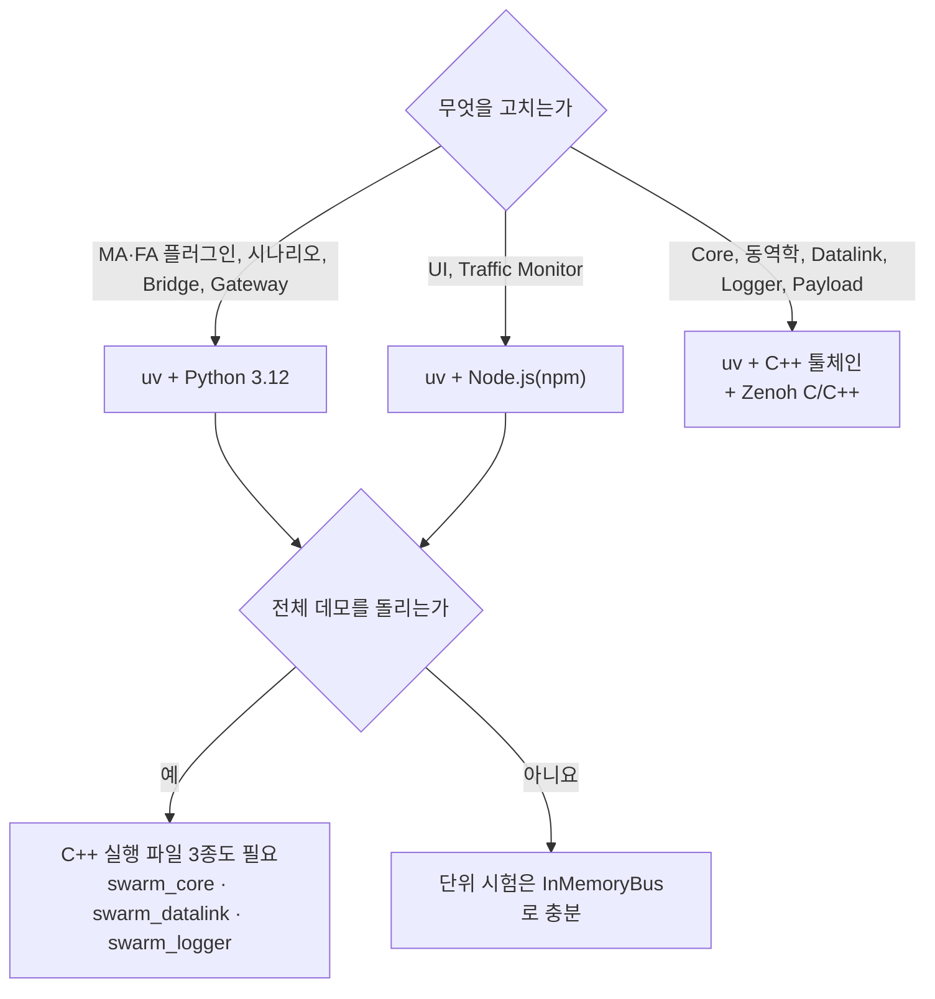

# 1. 개발 환경

- 설치 명령의 기준은 [10_contracts.md §7](../10_contracts.md#7-빌드-환경과-시험-dec-022)이다. 이 장은 무엇을 설치할지 고르는 기준과 자주 나는 실패를 다룬다.
- 다음 장: [2. 빌드와 시험](02_build_test.md).

## 1.1 무엇을 설치할까



| 도구 | 필요한 경우 | 받는 곳 |
|---|---|---|
| uv | 항상. Python 3.12와 패키지를 uv가 관리한다 | 계약 §7.2 "공통 (Python)" |
| Node.js, npm | `ui/`, `ui/monitor/` | 배포판 또는 공식 설치본 |
| Visual Studio Build Tools + vcpkg | Windows MSVC로 C++ 빌드 | 계약 §7.2 "MSVC + vcpkg" |
| MSYS2 UCRT64 또는 Linux 패키지 | MSVC 대신 다른 C++ 툴체인 | 계약 §7.2 |
| zenoh-c, zenoh-cpp 1.10.2 | C++ 프로세스를 실제 버스에 붙일 때 | 계약 §7.2 "Zenoh" |
| MCAP 헤더 | Logger. vcpkg는 자동, MSYS2·Linux는 직접 받는다 | 계약 §7.2 "MCAP" |
| git 서브모듈 | Gateway | [2장](02_build_test.md#26-gateway) |

> 확인 안 됨: `mingw-*`, `linux-*` 프리셋은 있지만 이 매뉴얼을 쓰면서 실행해 보지 않았다. 아래 명령은 Windows `msvc-debug`로 확인했다.

## 1.2 프리셋 고르기

프리셋 표는 [계약 §7.1](../10_contracts.md#71-지원-툴체인)에 있다. 고르는 기준은 다음과 같다.

- Windows에서 전체를 돌린다: `msvc-debug`. 데모 실행기의 기본 경로가 `build/msvc-debug`다.
- 성능을 잰다: `msvc-release`. 다만 Python Agent가 병목이면 큰 차이가 없다([21_qa_report.md §10.4](../21_qa_report.md#104-성능-release-대-debug와-dec-040)).
- 시험 프리셋(`ctest --preset`)은 `*-debug`와 `linux-vcpkg-debug`에만 있다. release 프리셋에는 없다.

## 1.3 MSVC 빌드 셸

일반 셸에는 `cl`이 없다. `vcvars64.bat`를 먼저 부른 셸(x64 Native Tools)에서 빌드한다. Visual Studio 설치 경로는 다음으로 찾는다.

```bash
"%ProgramFiles(x86)%\Microsoft Visual Studio\Installer\vswhere.exe" -latest -products * -property installationPath
```

한 줄로 실행하려면 `11_wp_briefs.md` [공통 지시](../11_wp_briefs.md#공통-지시)의 `cmd /c` 형태를 쓴다.

## 1.4 자주 나는 실패

| 증상 | 원인 | 조치 |
|---|---|---|
| abseil 컴파일이 C1083으로 실패 | 저장소 경로가 길어 vcpkg 빌드 트리 경로가 한계를 넘는다 | 구성 명령에 `-DVCPKG_INSTALL_OPTIONS=--x-buildtrees-root=C:/b/bt`를 더한다. worktree에서는 거의 항상 필요하다 |
| release 링크에서 `GlobalEmptyString` 미해결 | 예전 트리플렛으로 만든 `build/msvc-*`가 남아 있다 (QA-007) | `build/msvc-*`를 지우고 다시 구성한다 |
| 구성 중 Zenoh 경고, 실행 시 `--bus zenoh` 불가 | `CMAKE_PREFIX_PATH`에 Zenoh 접두 경로가 없다. 없으면 memory 백엔드만 빌드된다 | `-DCMAKE_PREFIX_PATH=<Zenoh 접두 경로>`를 주거나 환경 변수로 둔다 |
| Windows에서 `zenohc.dll`을 찾지 못한다 | 실행 파일을 빌드 트리 밖으로 옮겼다 | 빌드 트리 안의 실행 파일을 쓰거나 dll을 옆에 복사한다 |
| Linux에서 `libzenohc.so`를 찾지 못한다 | 위와 같다 | `LD_LIBRARY_PATH=<prefix>/lib` |
| 경고 후 `logger/`가 빠진다 (MSYS2·Linux) | `MCAP_INCLUDE_DIR`가 없다 | 계약 §7.2 "MCAP"대로 헤더를 받아 넘긴다 |
| Python 확장 모듈을 불러오지 못한다 | 빌드한 툴체인과 Python이 다르다 | [계약 §7.4](../10_contracts.md#74-툴체인별-제약) |
| `--help`에서 `UnicodeEncodeError: 'cp949'` | 일부 스크립트 도움말에 cp949로 못 쓰는 글자가 있다 | `PYTHONUTF8=1`을 설정하고 실행한다. 또는 PowerShell에서 `$env:PYTHONUTF8=1` |

그 밖의 실패는 [11. 문제 해결](11_troubleshooting.md).
