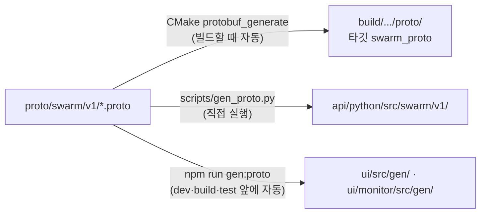

# 2. 빌드와 시험

- 이 장의 명령은 저장소 루트에서 실행한다. 다른 경우는 명령 앞에 적었다.
- 영역별로 따로 빌드하고 따로 시험한다. Python만 고친다면 2.3부터 본다.

## 2.1 코드 생성

`proto/swarm/v1/*.proto`가 원본이다. 언어마다 생성물이 따로 있고 커밋하지 않는다.



- proto를 바꾸거나 새로 받은 뒤에는 Python 생성물을 직접 다시 만든다.

```bash
uv run python scripts/gen_proto.py
```

## 2.2 C++ (Core, 동역학, Datalink, Logger, Payload, 버스)

`<preset>`은 [1.2](01_setup.md#12-프리셋-고르기)에서 고른다. MSVC는 `vcvars64.bat`를 부른 셸에서 실행한다.

```bash
cmake --preset <preset> -DCMAKE_PREFIX_PATH=<Zenoh 접두 경로>
```

```bash
cmake --build --preset <preset>
```

```bash
ctest --preset <preset>
```

- `CMAKE_PREFIX_PATH`를 환경 변수로 뒀다면 `-D` 옵션은 빼도 된다. worktree처럼 경로가 긴 곳에서는 [1.4](01_setup.md#14-자주-나는-실패)의 `VCPKG_INSTALL_OPTIONS`도 함께 준다.
- 산출물: `build/<preset>/core/swarm_core`, `build/<preset>/datalink/swarm_datalink`, `build/<preset>/logger/swarm_logger`
- 시험 이름은 모듈 접두어가 붙는다(예: `pay.TC-PAY-018`). 일부만 돌릴 때는 다음과 같이 쓴다.

```bash
ctest --preset <preset> -R pay
```

## 2.3 Python (API, 시나리오, Bridge, Agent, 알고리즘)

루트 `pyproject.toml`의 uv workspace가 여섯 패키지(예제 패키지 포함)를 묶는다.

```bash
uv sync
```

```bash
uv run python scripts/gen_proto.py
```

```bash
uv run pytest
```

- 대상은 루트 `pyproject.toml`의 `testpaths`다: `api/python/tests`, `scenario/tests`, `bridge/tests`, `agent/tests`, `algorithms/tests`, `examples/plugins/tests`.
- 한 패키지만 돌린다.

```bash
uv run pytest bridge/tests
```

- 설치된 플러그인 이름을 확인한다.

```bash
uv run swarm-agent --list-plugins
```

- `uv sync`는 eclipse-zenoh까지 설치한다. 단위 시험은 `InMemoryBus`로 돌아가므로 C++ 빌드가 없어도 된다.

## 2.4 GCS/UI (`ui/`)

```bash
cd ui && npm install
```

```bash
cd ui && npm test
```

```bash
cd ui && npm run build
```

- `npm run dev`는 포트 5173에서 개발 서버를 띄운다. `?source=mock`(기본)은 버스 없이 동작한다. 구조와 URL 인자는 [ui/README.md](../../ui/README.md).

## 2.5 Traffic Monitor (`ui/monitor/`)

```bash
cd ui/monitor && npm install
```

```bash
cd ui/monitor && npm test
```

```bash
cd ui/monitor && npm run build
```

- 개발 서버 포트는 5174다. 부하 측정은 `npm run bench`. 상세는 [ui/monitor/README.md](../../ui/monitor/README.md).

## 2.6 Gateway

Gateway는 루트 workspace에 들어 있지 않은 독립 uv 프로젝트다(CR-GW-004). LA-CAL 클라이언트는 서브모듈에서 가져온다(DEC-069).

```bash
git submodule update --init third_party/agra_lacal
```

```bash
cd gateway && uv sync --extra zenoh
```

```bash
cd gateway && uv run pytest
```

- proto 생성물이 없으면 루트에서 2.3의 `gen_proto.py`를 먼저 실행한다.
- 시험은 프로세스 안에서 띄운 CAL Server와 `InMemoryBus`를 쓴다. `--extra zenoh`를 빼도 시험은 통과하지만, 실행하면 Gateway가 설치 방법을 알리고 종료 코드 1로 끝난다. 실행 방법은 [사용자 매뉴얼 9장](../42_user/09_gateway.md).

## 2.7 커밋하지 않는 것

`.gitignore`에 있는 것: `build/`, `out/`, `.venv/`, `node_modules/`, `dist/`, `*.mcap`, `data/dem/`, `data/tiles/`, `api/python/src/swarm/`. `ui/src/gen/`과 `ui/monitor/src/gen/`도 커밋하지 않는다.

## 2.8 통합 확인

단위 시험을 통과한 뒤 전체 경로를 돌려 본다. 데모 실행과 자동 확인은 사용자 매뉴얼 [2. 빠른 시작](../42_user/02_quickstart.md), QA 하니스는 [10장](10_qa.md)을 본다.

다음: [3. 아키텍처와 실행 모델](03_architecture.md).
