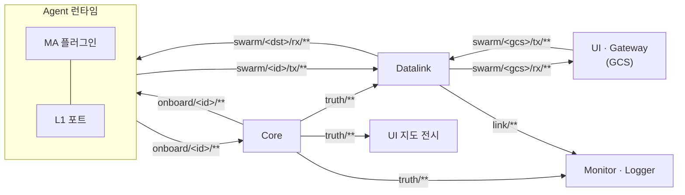
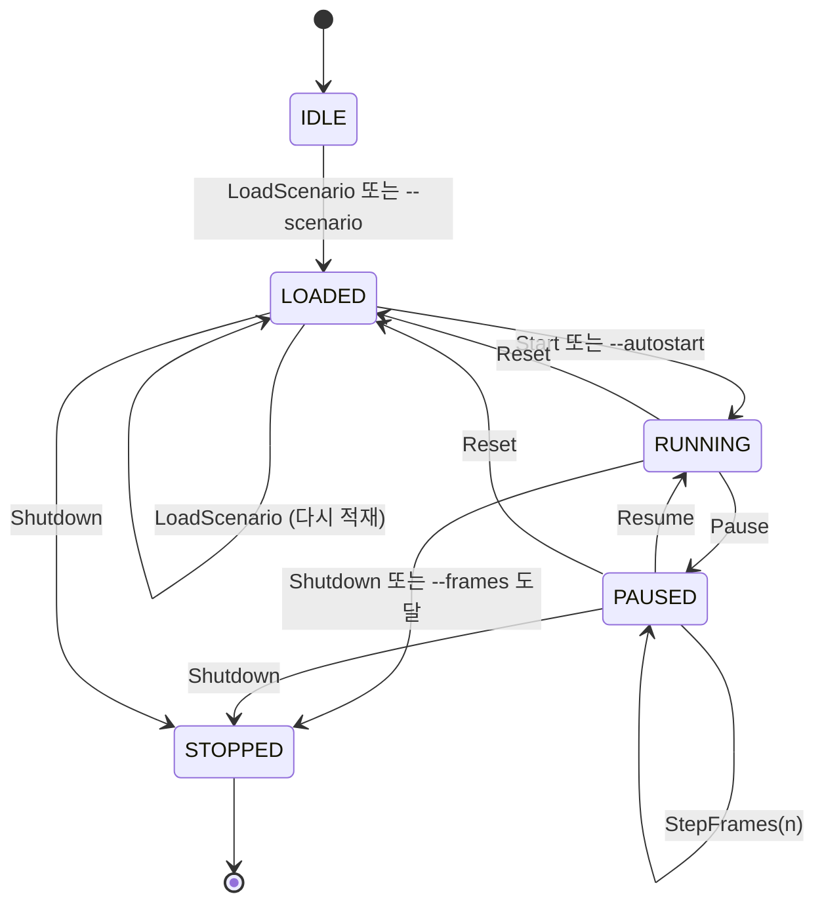
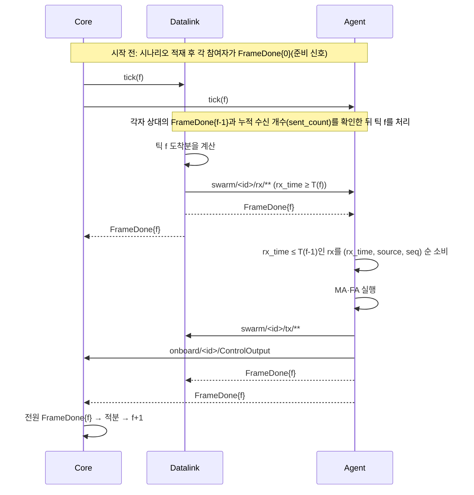

# 3. 아키텍처와 실행 모델

- 전체 구성은 [개괄 §3](../40_overview.md#3-구성-요소)을 먼저 본다. 이 장은 코드를 쓸 때 지켜야 할 실행 규칙을 정리한다.
- 정확한 규칙은 [계약 §3](../10_contracts.md#3-zenoh-키-체계-prp-net-003)이 기준이다.

## 3.1 프로세스와 참여자

| 프로세스 | 기본 참여자 ID | lockstep 장벽 | 비고 |
|---|---|---|---|
| `swarm_core` | — | 장벽을 관리한다 | `--participant`를 쓰거나 시나리오 `run.participants`를 읽는다 |
| `swarm_datalink` | `datalink-0` | 참여 | `--no-frame-done`이면 `FrameDone`을 보내지 않는다 |
| `swarm-agent` | `agent-0` | 참여 | 한 프로세스가 여러 기체를 맡는다. `--entities`로 나눈다 |
| `swarm_logger`, `swarm-bridge`, Gateway | — | 참여하지 않음 | Gateway의 `--participant`(기본 `gateway-0`)는 `LinkEnvelope.publisher`용이다 |

- 참여자 ID는 엔티티 ID와 같은 형식이다(`^[a-z][a-z0-9]*(-[a-z0-9]+)+$`).
- Agent는 `run.participants` 중 `datalink`로 시작하는 ID를 Datalink로 본다. Datalink 참여자 이름은 이 접두어로 시작하게 한다.

## 3.2 버스 열기

프로세스는 버스 구현을 직접 만들지 않고 `open_bus(BusConfig)`로 연다(DEC-026). C++는 `swarm/bus/open_bus.hpp`, Python은 `swarm_api.open_bus`다. 실행 파일은 같은 이름의 옵션을 받는다.

| 옵션 | 뜻 |
|---|---|
| `--bus zenoh\|memory` | 백엔드. 비우면 Zenoh가 있으면 zenoh |
| `--zenoh-config <file>` | Zenoh json5 설정 |
| `--zenoh-mode peer\|client\|router` | Zenoh 모드 |
| `--connect <endpoint>`, `--listen <endpoint>` | 엔드포인트. 반복 가능. 예: `tcp/127.0.0.1:17600` |
| `--no-multicast` | 멀티캐스트 스카우팅을 끈다 |

- 같은 PC에 다른 버스가 있으면 `--no-multicast`와 명시적 `--connect`로 섞이지 않게 한다.
- 다른 QoS로 키를 발행하지 않는다. `sim/clock/**`·`swarm/**`는 혼잡 제어 BLOCK, 나머지는 DROP이다(DEC-043).

## 3.3 키 영역과 접근 규칙

지켜야 할 규칙:

- 기체 간·지상-기체 간 메시지는 반드시 `tx` → Datalink → `rx`로 간다. 런타임이 다른 엔티티의 `rx`에 직접 발행하지 않는다.
- MA 플러그인은 버스에 접근하지 않는다. `sim/ctrl/`, `truth/`, `link/` 접두어는 플러그인에 노출되지 않는다(`MA_FORBIDDEN_PREFIXES`, DEC-014).
- Gateway는 `swarm/<gcs>/rx/**`만 구독하고 `swarm/<gcs>/tx/c2/<msg>`와 `swarm/<gcs>/tx/mp/<msg>`만 발행한다.
- 브라우저는 Zenoh에 직접 붙지 않고 브리지로만 붙는다(DEC-027).

Agent 런타임이 플러그인과 무관하게 GCS로 자동 보고하는 것:

| 대상 | 보고 시점 | 근거 |
|---|---|---|
| `SensorActivity`, `JammerActivity`, `StrikeActivity` | 값이 바뀔 때(키별 최대 `--activity-max-hz`, 기본 10 Hz)와 1 Hz | DEC-051, DEC-056, DEC-063 |
| `NavigationReport` | 주기 `--vi-report-hz`(기본 1 Hz, 0 이하이면 끔) | DEC-071 |
| `SystemStatus`, `FlightCommandStatus` | 값이 바뀔 때 | DEC-071, DEC-073 |
| `FlightCapability` | 시작할 때 1회 | DEC-071 |

- `SystemStatus`의 출처는 Core가 내는 `onboard/<id>/SystemStatus`다(값이 바뀔 때와 1 Hz, DEC-073).
- 보고는 Datalink를 거치므로 GCS 링크가 끊기면 지상에 닿지 않는다. `SystemStatus`는 주기 재전송이 없어 끊긴 동안의 변화가 다음 변화 때까지 전달되지 않는다(O-16).

## 3.4 Core 상태

- 실행 중 모드를 바꾸려면 Reset 뒤 Start를 보낸다.
- 지원하지 않는 시나리오는 적재를 거부하고 Core는 IDLE로 남는다(DEC-038).

## 3.5 실행 모드

| 모드 | 진행 조건 | 결정론 | 쓰는 경우 |
|---|---|---|---|
| `realtime` | 벽시계 dt마다. 배속은 1로 고정 | 아님 | UI 조작, 시연 |
| `lockstep` | 모든 참여자의 `FrameDone(N)`을 받은 뒤. 배속 > 0이면 dt/배속 간격, 0이면 대기 없음 | 시드 고정 | 알고리즘 비교, 회귀 시험 |
| `freerun` | 배속 > 0이면 dt/배속 간격, 0이면 대기 없음 | 아님 | Core 단독 가속 |

> 같은 시드 lockstep은 truth 궤적, `LinkOutcome`, GCS 수신이 실행마다 같다. 무고장, 고장 주입, 임무장비, 50기 구성과 외부 입력이 없는 Gateway 구성을 앞 60 s까지 비교해 확인했다([QA §28](../21_qa_report.md#28-20차-시험-d-30-재시험-lockstep-재현성-2026-11-10)). 외부 입력이 있는 Gateway lockstep은 재현 대상이 아니다. Gateway 발행 시각이 입력이 도착한 시점의 틱이라 시드로 정해지지 않는다.

## 3.6 lockstep 한 프레임

- 틱 0에서는 rx를 소비하지 않는다. 기체 간 메시지는 모델 지연에 더해 최소 1틱 늦게 소비된다(DEC-040, DEC-045).
- 틱 f에서 Datalink가 낸 rx는 다음 틱부터 소비된다.
- `NavigationReport`를 뺀 onboard 입력은 도착 즉시 처리하지 않고 메시지 프레임 기준 틱의 시작 전에 처리한다. `SystemStatus`는 프레임 + 1, 임무장비 출력(`*Activity`)과 `Detection`은 프레임 + 2다(IMP-AGT-036). 처리 틱이 지나 도착하면 경고를 한 번 남기고 내부 통계 `late_onboard`에 세며 다음 틱에 처리한다. 통합 실행에서는 발생하지 않았다. realtime과 free-run은 도착 즉시 처리한다.
- `sent_count`는 지금까지 발행한 샘플의 누적 수다. 수신 측은 이 수만큼 받을 때까지 기다린다(DEC-044). 대상은 `swarm/**`뿐이다.
- 난수는 `ctx.rng`만 쓴다. 벽시계, 딕셔너리 순서, 스레드 경합에 의존하면 결정성이 깨진다.
- 참여자 응답이 벽시계 5 s 넘게 없으면 `SimStatus.waiting_participants`에 실린다. 시작 후 이탈한 참여자의 재합류는 지원하지 않는다. 복구는 Reset+Start다(DEC-038, DEC-041).
- 정확한 문구는 [계약 §3.3](../10_contracts.md#33-규칙)의 "시나리오 배포와 lockstep 시작".

## 3.7 시나리오 배포

- Core는 적재 직후와 LOADED·lockstep 준비 대기 중에 1초(벽시계)마다 `sim/ctrl/scenario`에 `Scenario`를 발행한다(DEC-037). CLI의 `--mode`, `--rate`도 반영한다.
- 다른 참여자는 `--scenario` 없이 이 키에서 받을 수 있다. 시나리오 `name`이 바뀌면 다시 적재하고 준비 신호를 다시 보낸다.

## 3.8 기체별 매개변수

- 값 결정 순서: 소유자 기본값 → airframe 표(동역학만) → 시나리오(`dynamics_params`, `fa_params`, `ma_params`) → 실행 중 `SimCommand.set_params`.
- 소유자는 동역학(Core)·FA·MA다. 잘못된 항목은 조용히 버리지 않고 `EntityParams.rejected`에 사유(`unknown`, `type`, `range`, `choice`, `not_runtime`)를 남긴다.
- 상세는 [계약 §3.3 기체별 매개변수](../10_contracts.md#33-규칙).

## 3.9 좌표와 단위

| 항목 | 규칙 |
|---|---|
| 위치 | WGS84 위도·경도(deg), 고도 MSL(m) |
| 속도 | NED(m/s). 동역학 상태의 속도는 대기 속도, `to_kinematic` 출력은 대지 속도 |
| 자세 | NED → 기체 FRD 회전 쿼터니언 (w, x, y, z) |
| 각속도 | 기체 FRD(rad/s) |
| 시간 | `sim_time_us`(uint64, µs), `frame` |
| 각도 필드 | 이름에 `_deg`·`_rad`를 붙인다. 없으면 rad |

다음: 플러그인 작성자는 [4장](04_ma_plugin.md), WP 기여자는 [8장](README.md#8장-wp별-파일-08_wp).
