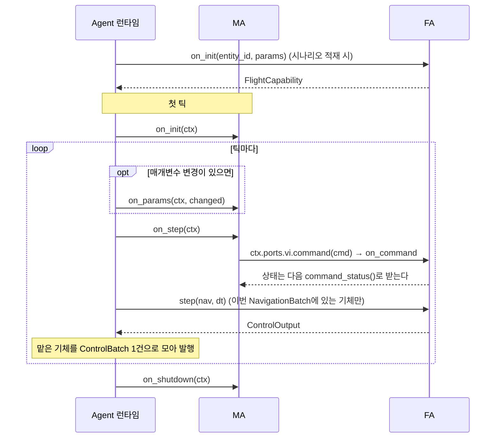
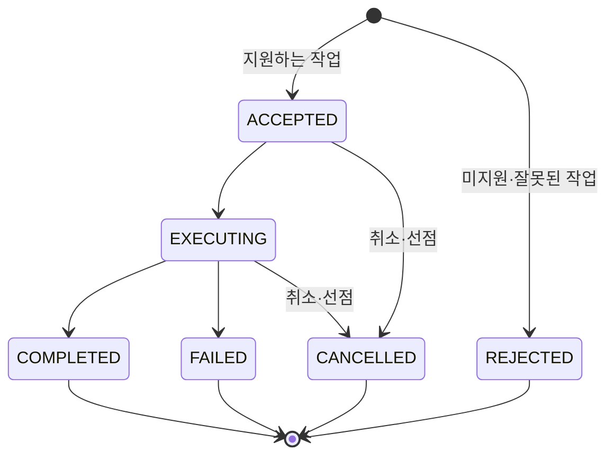
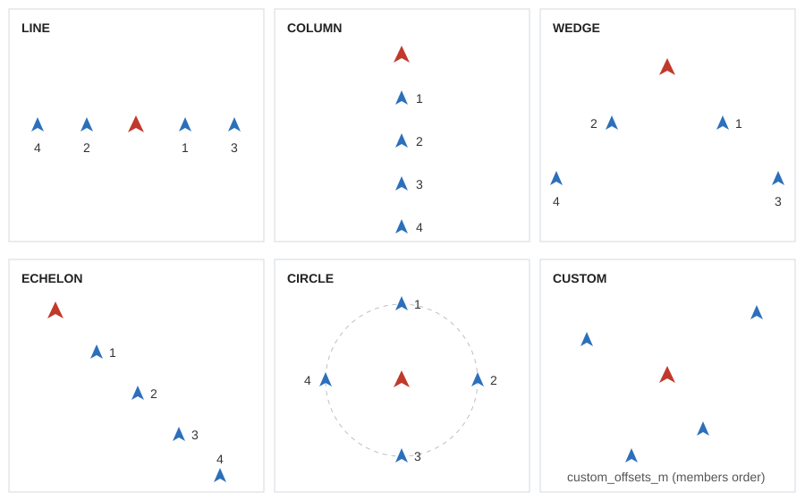

# 4. MA 플러그인 작성

MA(Mission Autonomy)는 기체 하나 또는 군집의 임무 판단을 맡는 Python 클래스다. 작업을 받아 비행 명령과 장비 명령으로 바꾼다.

모든 예제는 실행되는 코드다. [examples/plugins/](../../examples/plugins/)에 있고 루트 `uv run pytest`에 포함된다.

| 예제 등록명 | 파일 | 보여 주는 것 |
|---|---|---|
| `example_turn` | [turn.py](../../examples/plugins/src/swarm_plugin_examples/turn.py) | 가장 작은 MA, 매개변수 |
| `example_patrol` | [patrol.py](../../examples/plugins/src/swarm_plugin_examples/patrol.py) | `TaskPilot` 재사용, 작업 상태 보고 |
| `example_rendezvous` | [rendezvous.py](../../examples/plugins/src/swarm_plugin_examples/rendezvous.py) | 일괄 MA, P2P 이웃 정보 |

## 4.1 따라 하기


**1. 클래스를 쓴다.** `on_step`만 필수다. 전체 파일은 [turn.py](../../examples/plugins/src/swarm_plugin_examples/turn.py).

```python
class TurnToHeading(MissionAutonomy):
    PARAMS = (
        ParamDef("heading_deg", 90.0, ParamLayer.BEHAVIOR, "deg", 0.0, 360.0, "목표 침로"),
    )

    def on_init(self, ctx: AgentContext) -> None:
        self.heading_deg = float(ctx.params.get("heading_deg", 90.0))
        self.sent = False

    def on_step(self, ctx: AgentContext) -> None:
        ctx.ports.c2.inbox()
        ctx.ports.vi.command_status()
        nav = ctx.ports.vi.nav()
        if self.sent or nav is None:
            return
        k = nav.kinematics
        cmd = vi_pb2.FlightCommand(command_id=f"{ctx.entity_id}-turn")
        cmd.hsa.heading_deg = self.heading_deg
        cmd.hsa.altitude_m = k.position.alt_m
        cmd.hsa.speed_mps = math.hypot(k.velocity_ned_mps.x, k.velocity_ned_mps.y)
        ctx.ports.vi.command(cmd)
        self.sent = True
```

**2. 등록한다.** 패키지의 [pyproject.toml](../../examples/plugins/pyproject.toml)에 entry point를 적는다. 왼쪽이 시나리오에 쓰는 이름이다.

```toml
[project.entry-points."swarm.ma"]
example_turn = "swarm_plugin_examples.turn:TurnToHeading"
```

새 패키지를 저장소에 둘 때는 루트 `pyproject.toml`의 네 곳에 추가한다: `tool.uv.workspace.members`, `tool.uv.sources`, `dependency-groups.dev`, `tool.pytest.ini_options.testpaths`.

**3. 설치하고 이름을 확인한다.**

```bash
uv sync
```

```bash
uv run swarm-agent --list-plugins
```

```text
swarm.ma: example_patrol, example_rendezvous, example_turn, flocking, flocking_basic, formation, hold, waypoint
swarm.fa: default, example_hsa
```

**4. 시나리오에서 고른다.** 시나리오 형식은 사용자 매뉴얼 [3장](../42_user/03_scenario.md)에 있다. 예제 전부를 쓰는 시나리오는 [examples_all.json](../../examples/plugins/scenarios/examples_all.json)이다.

```json
"autonomy": { "ma_plugin": "example_turn", "ma_params": { "heading_deg": 120.0 } }
```

**5. 실행한다.** C++ 실행 파일이 필요하다([2.2](02_build_test.md#22-c-core-동역학-datalink-logger-payload-버스)). 빌드 없이 확인하려면 [4.9](#49-단위-시험)로 건너뛴다. 시나리오를 `.pb`로 바꾼 뒤 터미널마다 하나씩 띄운다. Core의 `--rate 0`은 최대 속도, `--frames 3000`은 모의 시간 60초다.

```bash
uv run swarm-scenario export examples/plugins/scenarios/examples_all.json --out out/examples.pb
```

```bash
build/msvc-debug/datalink/swarm_datalink --no-multicast --listen tcp/127.0.0.1:17601
```

```bash
uv run swarm-agent --frames 3000 --no-multicast --listen tcp/127.0.0.1:17602 --connect tcp/127.0.0.1:17601
```

```bash
build/msvc-debug/core/swarm_core --scenario out/examples.pb --autostart --rate 0 --frames 3000 --no-multicast --listen tcp/127.0.0.1:17603 --connect tcp/127.0.0.1:17601 --connect tcp/127.0.0.1:17602
```

Agent 로그에 `hosting 4 vehicles`와 마지막의 `ticks=3000`이 나오면 정상이다. Datalink는 Ctrl+C로 끝낸다.

## 4.2 호출 순서



- 한 프레임에서 MA는 기체 ID 순으로 호출되고, 일괄 MA는 그 뒤에 플러그인 이름 순으로 호출된다.
- `on_step`은 틱마다 불린다. 항법 보고가 아직 없으면 `nav()`가 `None`이다.
- 플러그인이 던진 예외는 로그에 남고 프로세스는 계속된다(DEC-038). 시험의 `Harness`는 `strict` 모드라 예외를 그대로 던진다.

## 4.3 AgentContext와 포트

플러그인은 `ctx.ports`로만 외부와 통신한다(DEC-013). 버스나 `truth/**`에 직접 접근하지 않는다.

| `ctx` 필드 | 뜻 |
|---|---|
| `entity_id` | 이 기체 ID |
| `frame`, `sim_time_s`, `dt_s` | 프레임 번호, 모의 시각, 프레임 간격 |
| `params` | 기본값을 채운 현재 매개변수. `on_params`가 불릴 때는 이미 새 값이다 |
| `rng` | 시드가 고정된 `numpy.random.Generator`. lockstep 결정론을 지키려면 난수는 이것만 쓴다 |
| `ports` | 아래 6종 |

| 포트 | 메서드 | 내용 |
|---|---|---|
| `c2` | `inbox()`, `send(msg)` | 통제 GCS의 작업·`ApprovalResponse` 수신, `TaskStatus`·`ApprovalRequest` 등 송신 |
| `vi` | `nav()`, `capability()`, `system_status()`, `command(cmd)`, `command_status()` | 항법 보고, FA 능력, 기체 상태, 비행 명령과 그 상태 |
| `ms` | `loadout()`, `detections()`, `command(msg)`, `activities()` | 탑재 장비 목록, 탐지 결과, 장비 명령(`SensorCommand`, `JammerCommand`, `StrikeCommand`), 장비 상태 |
| `mp` | `mission_plan()`, `route_plans()`, `engagement_criteria()` | 시나리오의 계획과 실행 중 받은 계획 |
| `p2p` | `send(msg, to=None)`, `inbox()` | 기체 간 통신. `to`가 없으면 방송. 데이터링크를 거쳐 손실·지연이 있다. 같은 편 GCS도 방송을 받으므로 `LeaderUpdate`, `TrackShare`는 Gateway를 거쳐 외부로도 나간다 |
| `md` | `record(name, value)` | 분석용 값 기록. 지금은 런타임 메모리에만 남고 버스나 MCAP으로 나가지 않는다 |

- 다른 기체 상태는 `p2p`로 받은 것만 쓴다. `nav()`는 잡음이 포함된 자기 항법값이다.
- 수신함은 매 프레임 비운다. 쓰지 않아도 호출해 두면 다음 프레임에 쌓이지 않는다.
- 비행 명령 모드는 [5.2](05_fa_plugin.md#52-vi-제어-모드)에 있다.

## 4.4 매개변수

클래스 속성 `PARAMS`에 `ParamDef`를 선언한다. UI 매개변수 패널은 이 선언으로 그려진다.

```python
ParamDef("idle_radius_m", 400.0, ParamLayer.BEHAVIOR, "m", 50.0, 100000.0, "작업이 없을 때 선회 반경")
```

| 인자 | 뜻 |
|---|---|
| `name`, `default`, `layer` | 이름, 기본값(형식도 여기서 정해진다), 계층 |
| `unit`, `min`, `max`, `description` | 단위, 범위, 설명 |
| `runtime` | `False`면 실행 중 변경 불가. 기본 `True` |
| `choices` | 문자열 매개변수의 허용 값 |

- 계층 `ParamLayer`: `AIRFRAME`, `CONTROL`, `GUIDANCE`, `BEHAVIOR`, `DECISION`.
- 실행 중 값이 바뀌면 프레임 시작에 `on_params(ctx, changed)`가 불린다. `changed`에는 바뀐 항목만 있다.
- 거부 사유는 `unknown`, `type`, `range`, `choice`, `not_runtime`이다. 값 결정 순서는 [3.8](03_architecture.md#38-기체별-매개변수).

## 4.5 일괄 MA

기체가 많으면 `BatchMissionAutonomy`로 한 번에 처리한다. 같은 플러그인을 쓰는 같은 호스트의 기체가 묶인다.

```python
class Rendezvous(BatchMissionAutonomy):
    def on_step_batch(self, ctxs: Sequence[AgentContext], nav: NavBatch) -> None:
        ...
```

- `NavBatch`: `ids`, `lat_lon_alt`(N×3), `velocity_ned`(N×3), `valid`(N). 행 `i`가 `ctxs[i]`다.
- 송수신은 `ctxs[i].ports`로 기체마다 따로 한다.
- `NavBatch`에서 **자기 행만** 쓴다. 다른 행을 이웃 정보로 쓰면 데이터링크 모의를 건너뛰게 된다(DEC-008). [rendezvous.py](../../examples/plugins/src/swarm_plugin_examples/rendezvous.py)가 이렇게 쓴다.
- 일괄 MA의 `on_init`, `on_shutdown`은 `ctxs`를, `on_params`는 기체 하나의 `ctx`를 받는다.

## 4.6 작업과 TaskStatus

`c2.inbox()`로 받은 `TaskCommand`에 `TaskStatus`로 답한다.



- 지원하지 않는 작업은 `REJECTED`로 답한다. 조용히 무시하면 운용자는 왜 안 움직이는지 알 수 없다.
- `assignees`가 비어 있는 작업은 거부한다. 자기가 없는 작업은 무시한다.
- 같은 `task_id`가 다시 오면 내용을 바꾼다. 이전 작업을 취소로 보고하지 않는다(DEC-033).
- `cancel`이 참이면 해당 작업을 `CANCELLED`로 끝낸다.
- 시작 계획(`mp.mission_plan()`)의 미지원·잘못된 작업도 첫 틱에 `REJECTED`로 한 번 보고한다(O-45).
- 승인을 받는 작업은 응답 전에 `TaskStatus`를 보내지 않는다. 승인되면 `ACCEPTED`, 거부·시간 제한이면 `REJECTED`다([4.7](#47-재사용-부품)).

## 4.7 재사용 부품

위 규칙은 [algorithms/src/swarm_algorithms/common.py](../../algorithms/src/swarm_algorithms/common.py)에 구현돼 있다.

좌표 변환과 경로 추종 도구는 플러그인 API로 공개돼 있다(DEC-104, 계약 0.22.0). 플러그인은 `swarm_agent` 내부 모듈을 import하지 않는다.

| 모듈 | 내용 |
|---|---|
| `swarm_api.geo` | 평면 근사 좌표 변환. `ned_offset`(기준점 대비 북·동 오프셋 m), `offset_geo`(역변환), `wrap_pi`, `course_rad`. 스칼라와 NumPy 배열 모두 받는다 |
| `swarm_api.racetrack` | 레이스트랙 기하·유도. `locate`, `path_error`, `dubins_course`, `vector_field_course` |

`swarm_agent.geo`·`swarm_agent.racetrack`은 같은 모듈을 가리키는 호환 별칭으로 남아 있다.

| 부품 | 맡는 일 |
|---|---|
| `TaskTracker(ctx, supported)` | `MissionPlan` 순차 수행, C2 작업 선점·취소·거부, `TaskStatus` 송신. `handle(msg)`, `update(nav)`, `status(...)`, `finish(...)` |
| `TaskPilot(ctx, acceptance_m, hold_radius_m, speed_mps, supported)` | `TaskTracker`에 비행 수행까지 더한 것. `step()` 호출 하나로 MoveTo, Hold, RTB, SearchArea, Route를 처리 |
| `every(ctx, hz)` | 기체마다 위상을 달리한 주기 판정 |
| `PayloadTasker` | Track·Jam·Strike 수행과 센서 지향(DEC-106). `TaskPilot(payload_tasks=True)`로 켠다. MA 변수 `track_standoff_m`, `track_acquire_timeout_s`, `track_lost_s`, `strike_range_m` |
| `peer_status(nav, group_id, task_id)` | `PeerStatus` 구성 |
| `TrackSharer` | `track_share_hz` > 0이면 `ms.detections()`를 표적별 최신으로 모아 주기마다 표적당 `TrackShare` 한 건을 방송. 0이면 `detections()`를 건드리지 않는다 |
| `CommandIds` | 비행 명령 ID 발급. 같은 목적의 흐름은 같은 ID, 흐름이 끝나면(`end()`) 새 ID(`base`, `base-2`, `base-3` …) |

`TaskTracker`의 승인 규칙(IMP-AGT-046, DEC-088):

- MA 변수 `approval_tasks`(쉼표 구분 작업 종류)에 든 작업, 또는 `EngagementCriteria.require_approval`이 참인 교전 작업은 시작 전에 `c2`로 `ApprovalRequest`(`request_id` = `<기체>-approval-<n>`)를 보낸다. 내장 MA는 `APPROVAL_PARAMS`를 `PARAMS`에 더한다.
- 같은 `request_id`의 `ApprovalResponse`가 승인이면 C2 명령처럼 시작한다. 거부는 `REJECTED`(`approval denied`), `approval_timeout_s` 초과는 `REJECTED`(`approval timeout`)다. 모르는 요청과 끝난 요청의 응답은 무시한다.
- 기다리는 동안 지금 작업을 밀어내지 않는다. 대기 중 취소는 `CANCELLED`, 새 작업·새 계획·단독 항로는 대기 작업을 `CANCELLED`(`preempted`)로 끝낸다. 계획 작업도 꺼낼 때 승인을 받는다.
- MD에 `approval_requested`, `approval`을 남긴다.

비행 명령 ID 규칙(IMP-AGT-051): 끝 상태에 이른 `FlightCommand` ID를 다시 쓰지 않는다. 같은 ID로 다시 내면 끝 상태 뒤에 상태가 이어져 외부 명령 상태 규칙(DEC-097)과 표준 점검 C5에 걸린다. 직접 명령을 내는 MA는 `CommandIds`를 쓴다.

[patrol.py](../../examples/plugins/src/swarm_plugin_examples/patrol.py)는 `self.pilot.step()`만 부르고, 작업이 없을 때의 행동만 직접 정한다.

`TaskTracker`와 `formation`은 실행 중 받은 `MissionPlan`을 틱마다 확인한다(DEC-076). 기준은 [algorithms/TRACE.md](../../algorithms/TRACE.md)의 IMP-AGT-034, IMP-AGT-035다.

| 받은 것 | 동작 |
|---|---|
| 이미 본 `plan_id`의 `MissionPlan` | 내용이 달라도 무시 |
| 새 `plan_id`의 `MissionPlan` | 교체. 현재 작업은 `CANCELLED`(`preempted`), 대기 작업도 `CANCELLED`가 되고 새 계획을 수행한다. 같은 `task_id`면 취소 보고 없이 내용을 바꾼다 |
| 이 기체 몫의 유효한 작업이 없는 `MissionPlan` | 현재 작업을 밀어내지 않는다. 지원하지 않거나 값이 잘못된 작업은 `REJECTED` |
| 같은 ID의 계획 작업이 있는 `RoutePlan` (`waypoint`) | 따로 비행하지 않는다. 그 작업이 수행해 도착 순서와 무관하게 `COMPLETED`로 끝난다 |
| 계획에 없는 단독 `RoutePlan` (`waypoint`) | 바로 비행한다. 수행 중 작업은 `CANCELLED`(`preempted`), 대기 작업은 항로가 끝나면 잇는다. `RoutePlan` 자체의 `TaskStatus`는 없다. 비행 명령 ID는 `<id>-task-<n>` |
| 값이 잘못된 `RoutePlan` (`waypoint`) | 현재 작업을 건드리지 않고 MD `route_plan_invalid`만 남긴다 |

- 포트는 최신 계획만 들고 있어 한 틱에 두 계획이 닿으면 마지막 것만 실행한다.
- `formation`은 계획에 이 기체의 편대가 있을 때만 편대를 바꾼다.

## 4.8 기본 MA

| 이름 | 파일 | 동작 | 매개변수 |
|---|---|---|---|
| `hold` | [hold.py](../../algorithms/src/swarm_algorithms/hold.py) | 첫 항법 상태의 침로·속도·고도 유지. 작업을 처리하지 않는다 | `orbit_radius_m`(0이면 직진) |
| `waypoint` | [waypoint.py](../../algorithms/src/swarm_algorithms/waypoint.py) | `TaskPilot`으로 작업 수행. `PayloadTasker`로 Track·Jam·Strike도 수행 | `acceptance_m`, `hold_radius_m`, `speed_mps`, `track_*`, `strike_range_m` |
| `formation` | [formation.py](../../algorithms/src/swarm_algorithms/formation.py) | 리더-추종 편대. 리더는 `waypoint`처럼, 추종기는 슬롯을 HSA로 추종. 리더가 정해지거나 바뀌면 새 리더가 `LeaderUpdate`(`term` = 그 기체가 본 리더 변경 횟수)를 방송. 추종기는 리더 정보가 없거나 `leader_timeout_s`보다 오래되면 명령을 내지 않는다 | `group`, `peer_hz`, `leader_speed_mps`, `leader_timeout_s`, `corr_max_mps` 등 |
| `approval_demo` | [approval_demo.py](../../algorithms/src/swarm_algorithms/approval_demo.py) | 승인 흐름 시험·데모 전용, 기본 MA 아님(DEC-103). `strike`만 수행하고 승인이 필요하면 승인 `ApprovalResponse` 뒤에만 유도 객체를 보낸다. 거부·시간 초과면 보내지 않고 `REJECTED` | `approval_tasks`, `approval_timeout_s` |
| `flocking` | [flocking.py](../../algorithms/src/swarm_algorithms/flocking.py) | Reynolds 분리·정렬·응집 일괄 MA. Route와 장비 작업은 거부. 수락 다음 틱에 `EXECUTING`(IMP-AGT-057) | `cruise_mps`, `neighbor_radius_m`, `separation_m`, `w_sep`, `w_align`, `w_coh`, `peer_hz`, `stale_s`, `goal_radius_m`, `hold_radius_m`, `wander_deg`, `group` |

`flocking_basic`은 예제 시나리오용 변형이다. 전체 항목은 [algorithms/TRACE.md](../../algorithms/TRACE.md).

내장 MA는 모두 링크 상실 행동을 한다(DEC-078). 공용 부품은 [common.py](../../algorithms/src/swarm_algorithms/common.py)의 `LinkMonitor`(Heartbeat 감시)와 `LostLinkGuard`(정책 판단)다. `TaskPilot`을 쓰는 MA는 따로 할 일이 없고, 선회 대신 다른 행동을 하려면 `TaskPilot.enter_lost_link_hold`를 덮어쓴다.

| 항목 | 내용 |
|---|---|
| 매개변수 | `lost_link_timeout_s`(기본 5 s), `lost_link_policy`(`hold_until_command` 기본, `resume_on_recovery`, `continue`), `lost_link_recover_hold_s`(기본 5 s), `lost_link_recover_gap_s`(기본 2 s). 내장 MA는 `LOST_LINK_PARAMS`를 `PARAMS`에 더한다 |
| 복구 확정 | `LinkMonitor`는 상실 중 Heartbeat를 다시 받으면 복구 대기에 들어간다. `lost_link_recover_hold_s` 동안 Heartbeat 간격이 `lost_link_recover_gap_s` 이하로 이어져야 "recovered"를 낸다. 간격이 넘으면 대기를 버리고(MD `recover_aborted`) 상실을 이어 간다. 확정 전에는 상실 행동을 유지한다(DEC-101(2), DEC-105) |
| 정책 결정 | 상실 순간 현재 작업의 `TaskCommand.lost_link_policy`, 없으면 MA 변수 |
| 선회 | 현재 위치 중심, 반경은 `hold_radius_m`과 최소 선회 반경 × 1.3 중 큰 값 |
| 선회 중 새 작업 명령 | 복구 전이라도 선회를 끝내고 명령을 따른다. `FormationCommand`처럼 작업 밖 명령은 `release()`로 알린다 |
| 복구(`resume_on_recovery`) | 중단한 작업을 다시 한다. 작업이 없었으면 상실 전 비행 명령을 다시 낸다(IMP-AGT-039) |
| 기록 | MD `link_state`, `lost_link_policy`, `lost_link_action` |

- 런타임은 MA와 따로 Heartbeat가 다시 온 직후 현재 `FlightCommandStatus`와 진행 중인 작업의 `TaskStatus`를 GCS에 한 번 다시 보낸다(DEC-101(1)). MA의 복구 확정보다 먼저 나갈 수 있다. MA가 이 재보고를 따로 할 필요는 없다.
- `hold` MA는 작업이 없으므로 MA 변수만 쓴다. `formation` 추종기도 `FormationCommand`에 정책 필드가 없어 MA 변수를 쓴다.

`formation`의 슬롯은 리더 FRD 기준 오프셋이다. `s`는 `spacing_m`, `k`는 추종기 순번(0부터)이다.



| 모양 | 오프셋 (전방, 우측) |
|---|---|
| `LINE` | (0, ±s·⌈(k+1)/2⌉), 짝수 k가 오른쪽 |
| `COLUMN` | (−s(k+1), 0) |
| `WEDGE` | (−s·r, ±s·r), r = ⌊k/2⌋+1 |
| `ECHELON` | (−s(k+1), s(k+1)) |
| `CIRCLE` | 리더 둘레 반경 s 등간격 |
| `CUSTOM` | `custom_offsets_m`, `members` 순서 |

## 4.9 단위 시험

`swarm_agent.testing`의 `Harness`가 가짜 Core와 Datalink로 런타임을 돌린다. 프로세스도 Zenoh도 필요 없다. 전체는 [test_plugin_examples.py](../../examples/plugins/tests/test_plugin_examples.py).

```python
from swarm_agent.testing import Harness, make_scenario, send_c2

def test_turn():
    h = Harness(make_scenario(1, "example_turn", {"heading_deg": 200.0}, course_deg=45.0))
    h.run_s(60.0)
    b = h.core.bodies["uav-001"]
    assert math.degrees(b.course) % 360.0 == pytest.approx(200.0, abs=1.0)
```

| 도구 | 쓰임 |
|---|---|
| `make_scenario(n, ma_plugin, ma_params, ...)` | 기체 `uav-001`.. n대와 `gcs-01` |
| `Harness(sc)` | 시나리오 적재까지 수행. `run_s(초)`로 진행 |
| `h.core.bodies[id]` | 현재 `lat`, `lon`, `alt`, `course`, `speed` |
| `send_c2(h.bus, "gcs-01", msg, [대상])` | GCS가 보낸 메시지 주입. 대상은 목록이다 |
| `h.task_states(task_id)`, `h.gcs_rx` | GCS가 받은 작업 상태, 전체 수신 메시지 |
| `Harness(sc, drop=...)` | `(src, dst, msg)` 판정 함수로 링크 손실 주입 |

```bash
uv run pytest examples/plugins/tests
```

> 미구현: C++ MA 플러그인. ABI 헤더만 있고 로딩 경로가 없다.

다음: [5. FA 플러그인 작성](05_fa_plugin.md).
