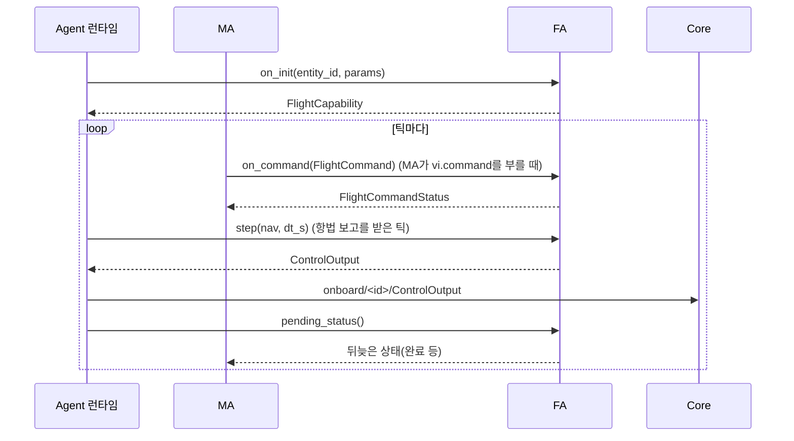
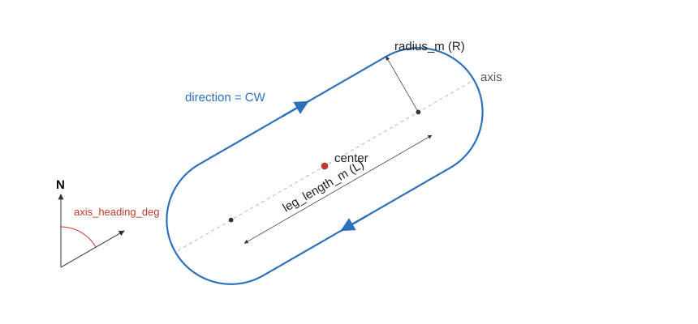

# 5. FA 플러그인 작성

FA(Flight Autonomy)는 MA의 비행 명령을 동역학 제어 출력으로 바꾼다. 기본 FA를 그대로 쓰고, 다른 유도·제어 법칙을 비교할 때만 직접 쓴다.

예제는 [hsa_fa.py](../../examples/plugins/src/swarm_plugin_examples/hsa_fa.py)(`example_hsa`)다. HSA만 처리하는 가장 작은 FA이고 시험은 [test_plugin_examples.py](../../examples/plugins/tests/test_plugin_examples.py)에 있다.

## 5.1 수명



| 메서드 | 할 일 |
|---|---|
| `on_init(entity_id, params)` | 시나리오 적재 시 호출. 성능 한계를 `FlightCapability`로 돌려준다 |
| `on_params(values, changed)` | 실행 중 변경. `values`는 전체, `changed`는 바뀐 것만 |
| `on_command(cmd)` | 즉시 `ACCEPTED` 또는 `REJECTED`를 돌려준다 |
| `step(nav, dt_s)` | `ControlOutput`을 돌려준다 |
| `pending_status()` | 쌓인 상태를 비워서 돌려준다. 경유점 완료처럼 나중에 정해지는 상태에 쓴다 |

- `step`은 항법 보고를 받은 틱에만 불린다. `dt_s`는 프레임 간격이다.
- `FlightCapability`의 `supports_hsa`, `supports_waypoint`, `supports_curve`는 지원하는 모드만 참으로 둔다.
- `min_speed_mps` 등 기체 한계는 시작할 때 보고하므로 `runtime=False`로 선언한다.

## 5.2 VI 제어 모드

`FlightCommand`의 `mode`는 다음 중 하나다. 정의는 [vi.proto](../../proto/swarm/v1/vi.proto).

| 모드 | 필드 | 뜻 |
|---|---|---|
| `hsa` | `heading_deg`, `speed_mps`, `altitude_m` | 침로·속도·고도 유지 |
| `waypoint` | `waypoints[]{position, speed_mps, acceptance_radius_m}`, `loop` | 경유점 순서 비행 |
| `curve.orbit` | `center`, `radius_m`, `direction`, `speed_mps` | 원 선회 |
| `curve.racetrack` | `center`, `radius_m`, `leg_length_m`, `axis_heading_deg`, `direction`, `speed_mps` | 레이스트랙 선회(DEC-034) |



두 원의 중심은 `center ± (L/2)·축`이다. 축 방위는 진북 기준 시계 방향이다.

`ControlOutput`은 `kinematic`, `attitude`, `actuator` 중 하나를 채운다. 현재 2·3-DoF 모델은 `kinematic`만 받는다.

| `KinematicCmd` 필드 | 쓰는 모델 |
|---|---|
| `speed_mps`, `climb_rate_mps` | 2·3-DoF |
| `heading_rate_rps` | 2-DoF |
| `bank_rad` | 3-DoF |

`heading_rate_rps`와 협조선회 뱅크 `bank = atan(V·ψ̇/g)`를 함께 채우면 두 모델이 같은 궤적을 따른다.

## 5.3 기본 FA

등록명 `default`, 코드는 [agent/src/swarm_agent/fa.py](../../agent/src/swarm_agent/fa.py), 레이스트랙 기하는 [racetrack.py](../../agent/src/swarm_agent/racetrack.py)다.

- 유도: Waypoint는 직행, Orbit은 벡터장, Racetrack은 `racetrack_guidance`로 고른다.
- 제어: 침로 오차 비례 선회율(최대 뱅크로 제한), 고도 오차 비례 상승률.
- 고도 `alt_m <= 0`은 현재 고도 유지다.
- 명령 전에는 첫 항법 보고의 침로·속도·고도를 유지한다.
- 마지막 경유점에 닿으면 `COMPLETED`를 보내고 그 점 둘레를 선회한다.

| 매개변수 | 계층 | 기본값 | 실행 중 변경 |
|---|---|---|---|
| `min_speed_mps` | AIRFRAME | 12 | 불가 |
| `max_speed_mps` | AIRFRAME | 35 | 불가 |
| `max_climb_mps` | AIRFRAME | 5 | 불가 |
| `max_bank_deg` | AIRFRAME | 35 | 불가 |
| `max_altitude_m` | AIRFRAME | 6000 | 불가 |
| `k_heading` | CONTROL | 0.8 | 가능 |
| `k_altitude` | CONTROL | 0.3 | 가능 |
| `k_orbit` | GUIDANCE | 2.0 | 가능 |
| `acceptance_radius_m` | GUIDANCE | 50 | 가능 |
| `racetrack_guidance` | GUIDANCE | `dubins` (`vector_field`) | 가능 |
| `k_cross_track` | GUIDANCE | 0.02 | 가능 |
| `cross_track_inf_deg` | GUIDANCE | 60 | 가능 |
| `k_racetrack_line` | GUIDANCE | 0.3 | 가능 |
| `racetrack_gamma` | GUIDANCE | 0.2 | 가능 |

## 5.4 등록과 선택

MA와 같은 방식이고 그룹만 `swarm.fa`다. `fa_plugin`을 비우면 `default`를 쓴다.

```toml
[project.entry-points."swarm.fa"]
example_hsa = "swarm_plugin_examples.hsa_fa:HsaOnlyFlightAutonomy"
```

```json
"autonomy": { "ma_plugin": "example_turn", "fa_plugin": "example_hsa", "fa_params": { "k_heading": 0.8 } }
```

`example_hsa`는 Waypoint와 Curve를 `REJECTED`로 답하므로 `waypoint` MA와 함께 쓰면 작업이 실행되지 않는다. FA를 바꿀 때는 MA가 쓰는 모드를 지원하는지 먼저 본다.

## 5.5 시험

`make_scenario`로 만든 시나리오의 기체에 `fa_plugin`을 넣는다. `sc.entities[0]`은 GCS다.

```python
sc = make_scenario(1, "example_turn", {"heading_deg": 120.0}, course_deg=45.0)
sc.entities[1].autonomy.fa_plugin = "example_hsa"
h = Harness(sc)
h.run_s(60.0)
```

명령 처리처럼 기체 없이 볼 수 있는 부분은 클래스를 직접 만들어 호출한다.

> 미구현: C++ FA 플러그인. `api/cpp`에 ABI 헤더만 있고 로딩 경로가 없다. 지금 FA는 Python만 쓴다.

다음: [6. 동역학 모델 추가](06_dynamics.md).
