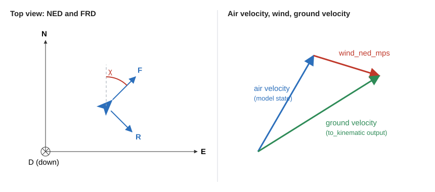
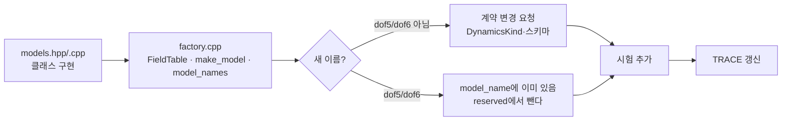

# 6. 동역학 모델 추가

동역학 모델은 C++로 쓰고 `dynamics/`에 넣어 Core와 함께 빌드한다. Python 플러그인처럼 따로 등록하지 않는다. 동역학은 C++이라 Python 플러그인을 담는 [예제 패키지](../../examples/plugins/)(DEC-070)의 대상이 아니다. 이 장은 실제 `dof2` 코드와 시험을 예로 든다.

| 볼 파일 | 내용 |
|---|---|
| [api/cpp/include/swarm/api/dynamics.hpp](../../api/cpp/include/swarm/api/dynamics.hpp) | 인터페이스 |
| [dynamics/include/swarm/dyn/models.hpp](../../dynamics/include/swarm/dyn/models.hpp), [src/models.cpp](../../dynamics/src/models.cpp) | `Dof2Model`, `Dof3Model` |
| [dynamics/src/factory.cpp](../../dynamics/src/factory.cpp) | 이름 → 모델 |
| [dynamics/tests/test_dynamics.cpp](../../dynamics/tests/test_dynamics.cpp) | TC-DYN-001~015 |

## 6.1 좌표와 바람



- 위치는 WGS84(deg)와 MSL 고도(m), 속도는 NED(m/s)다. 침로 χ는 진북 기준 시계 방향이다. 전체 규칙은 [3.9](03_architecture.md#39-좌표와-단위).
- **모델 상태의 속도는 대기 속도다.** 위치 미분에는 바람을 더한다.
- **`to_kinematic`의 `vel_ned_mps`는 대지 속도다.** 대기 속도에 `env.wind_ned_mps`를 더한다(DEC-023). 자세의 중력값도 `env.gravity_mps2`를 쓴다.
- `from_kinematic`의 `vel_ned_mps`는 초기 상태 설정용이고 대기 속도로 해석한다.

## 6.2 인터페이스

| `DynamicsModel` 메서드 | 할 일 |
|---|---|
| `name()`, `dof()` | 등록명, 자유도(2, 3, 5, 6) |
| `state_size()`, `input_size()` | 상태 x, 입력 u의 크기 |
| `derivatives(t, x, u, env, dxdt)` | `dx/dt = f(t, x, u, env)` |
| `map_control(cmd, u)` | `ControlOutput`을 u로 바꾼다. 받지 않는 형식이면 `false` |
| `to_kinematic(x, env, out)` | 상태를 공통 형식 `KinematicSample`로 |
| `from_kinematic(in, x)` | 초기 상태 설정 |
| `param_descs()`, `get_param`, `set_param` | 매개변수 노출. 이름이 없거나 범위 밖이면 `set_param`은 `false`이고 값은 그대로다 |

| 보조 타입 | 뜻 |
|---|---|
| `Integrator::step(model, t0, dt, x, u, env, event)` | 프레임 한 칸 적분. `rk4`는 고정 스텝, `rk45`는 프레임 안 가변 스텝(기본) |
| `EventFn` | 영점 교차 함수(예: 고도 − 지형 고도). 나면 `StepResult.event`가 참이고 x는 그 시점 상태다 |
| `Terrain::elevation_m(lat, lon)` | 지형 조회 |
| `Environment` | `gravity_mps2`, `air_density_kgpm3`, `wind_ned_mps`, `terrain` |

- 모델은 프레임 사이에 내부 상태를 두지 않는다. 적분기가 `derivatives`를 프레임 안에서 여러 번 부른다.
- 가변 스텝 오차 기준을 상태별로 주려면 `ErrorScaleProvider`도 구현한다. 위·경도와 고도처럼 단위가 다른 상태에 필요하다.

`dof2`의 `derivatives`는 이 형태다.

```cpp
const double v = x[kSpeed], psi = x[kHeading];
const double* w = env.wind_ned_mps;
const double vn = v * std::cos(psi) + w[0], ve = v * std::sin(psi) + w[1], vd = -x[kClimbRate] + w[2];
geo::geodetic_rates(x[kLat], x[kAlt], vn, ve, vd, dxdt[kLat], dxdt[kLon], dxdt[kAlt]);

const double v_c = std::clamp(u[kSpeedCmd], p_.min_speed_mps, p_.max_speed_mps);
dxdt[kSpeed] = (v_c - v) / p_.tau_speed_s;
```

## 6.3 추가 절차



1. `models.hpp`·`models.cpp`에 클래스를 만든다. 매개변수는 `Params` 구조체와 `ParamDesc` 표(`kDof2Descs`처럼)로 선언한다.
2. [factory.cpp](../../dynamics/src/factory.cpp)에 `FieldTable`을 추가하고 `make_model(name, params)`에 분기를 넣는다. `model_names()`에 이름을 넣는다.
3. `dof5`, `dof6`는 예약돼 있다. 이 모델을 구현하면 `reserved_model_names()`에서 빼고 `scenario/src/swarm_scenario/validate.py`의 `IMPLEMENTED_DYNAMICS`에 더한다. 예약 모델은 시나리오 검증과 Core 검사에서 거부된다.
4. 그 밖의 이름은 `proto`의 `DynamicsKind`와 시나리오 스키마를 바꿔야 한다. [계약 변경 요청](09_contributing.md#95-계약-변경-요청) 절차를 따른다.
5. 기체별 기본값이 필요하면 [core/src/wp2_dynamics.cpp](../../core/src/wp2_dynamics.cpp)의 `kAirframes`를 고친다. 현재 표는 `skywalker_x8`, `aerosonde`이고 속도 한계와 뱅크 한계를 정한다.

## 6.4 매개변수

`ParamDesc`는 `{이름, 계층, 기본값, 단위, 최소, 최대, runtime, 설명}`이다.

```cpp
{"tau_speed_s", L::kControl, 1.0, "s", 0.05, 30.0, true, "속도 명령 1차 지연 시정수"},
```

- `Params` 구조체의 기본값과 선언 표의 기본값이 같아야 한다. TC-DYN-014가 검사한다.
- 시정수는 CONTROL, 속도·선회·상승 한계는 AIRFRAME 계층에 둔다.
- 값은 UI 매개변수 패널과 `sim/param/<id>/dynamics`로 노출된다.

## 6.5 지형

- DEM 파일 형식은 [계약 §6](../10_contracts.md#6-core--동역학-dynamicshpp)에 있다(DEC-053). int16 원시 격자와 JSON 머리글 한 쌍이고 `RawDemLoader`가 읽는다.
- 모델은 `env.terrain`으로 조회한다. 지면 충돌 판정은 Core가 `EventFn`으로 건다.

## 6.6 시험

해석해와 비교한다. 기존 시험이 좋은 본보기다.

| 시험 | 비교 대상 |
|---|---|
| TC-DYN-001 | 등속·일정 상승의 해석해 |
| TC-DYN-002 | 2-DoF 정상 선회 반경 V/ψ̇와 폐합 |
| TC-DYN-003 | 3-DoF 협조선회 반경 v²/(g·tanφ) |
| TC-DYN-004, 005 | RK4·RK45 오차 차수 |
| TC-DYN-008 | 지면 교차 시각 |
| TC-DYN-009 | `map_control` 형식 검사 |
| TC-DYN-011 | `to_kinematic` ↔ `from_kinematic` 왕복 |
| TC-DYN-013 | 바람에서의 이동 거리와 대지 속도 |

새 시험은 `test_dynamics.cpp`에 함수를 만들어 표에 등록하고, [dynamics/CMakeLists.txt](../../dynamics/CMakeLists.txt)의 `foreach` 목록에 ID를 넣는다.

```bash
ctest --preset msvc-debug -R "^dyn\."
```

> 미구현: `dof5`, `dof6` 모델 (로드맵 P3). 이름만 예약돼 있고 시나리오에 쓰면 검증과 Core가 거부한다.

다음: [7. 메시지와 계약](07_messages.md).
