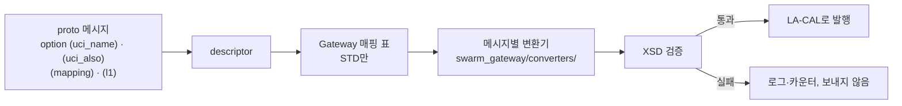

# 7. 메시지와 계약

- proto 파일별 역할은 [계약 §4](../10_contracts.md#4-protobuf-스키마)의 표가 기준이다. 이 장은 메시지를 다룰 때 필요한 절차를 쓴다.
- 코드 생성 흐름은 [2.1](02_build_test.md#21-코드-생성).

## 7.1 메시지의 세 구분

각 메시지에 커스텀 옵션(`proto/swarm/v1/options.proto`)으로 A-GRA 대응을 단다.

| 옵션 | 뜻 |
|---|---|
| `mapping` | `STD`: 외부로 내보낸다. `EXT`: 자체 확장, 외부 비공개. `SIM`: 시뮬레이터 내부 전용 |
| `uci_name` | 공개 XSD의 UCI 메시지명. EXT·SIM은 비운다 |
| `uci_also` | 같은 내용을 함께 싣는 추가 UCI 메시지명(STD만, DEC-072). 예: `NavigationReport`, `PeerStatus` → `MA_PositionReport` |
| `l1` | L1 인터페이스(C2·VI·MS·MP·MD·P2P) |

Gateway는 이 옵션을 descriptor에서 읽어 매핑 표를 만든다. 표를 코드에 하드코딩하지 않는다. 등록부 §5 표와 어긋나면 proto가 기준이다.



## 7.2 메시지를 추가하거나 바꾸는 절차

계약을 바꾸는 일이므로 WP0을 거친다. WP 세션이라면 구현하지 말고 계약 변경 요청을 올린다([9장](09_contributing.md#95-계약-변경-요청)).

1. `proto/swarm/v1/`의 알맞은 파일에 메시지나 필드를 추가한다. 필드 번호를 재사용하지 않는다. 호환을 깨는 변경은 `swarm.v2`로 한다.
2. 메시지 옵션을 단다. `mapping`을 정하고, STD면 `uci_name`을 공개 XSD의 이름으로 적는다.
3. 버스에 싣는다면 키를 정한다. `api/python/src/swarm_api/keys.py`와 `api/cpp/include/swarm/api/keys.hpp`를 함께 고치고, 계약 §3.2 표에 적는다.
4. 시나리오에 드러나면 `scenario/src/swarm_scenario/schema/scenario.schema.json`을 같은 필드 구성으로 고친다.
5. `CONTRACT_VERSION`(`api/python/src/swarm_api/__init__.py`)을 올리고, `10_contracts.md` 머리의 변경 목록에 적는다.
6. 코드를 다시 생성하고 전 영역 시험을 돌린다.

```bash
uv run python scripts/gen_proto.py
```

```bash
uv run pytest
```

C++는 다시 빌드하면 생성된다. UI·Monitor는 `npm test`가 다시 생성한다.

## 7.3 시나리오와 proto

- 시나리오 JSON의 필드 구성은 `swarm.v1.Scenario`와 같다. 열거값은 접두어를 뺀 소문자를 쓴다(`ENTITY_KIND_GROUND_TARGET` → `ground_target`).
- 변환은 `swarm_scenario.to_proto` / `from_proto`가 한다. `swarm_core --scenario`에 줄 파일은 `swarm-scenario export`로 만든다.
- 런타임 전달에는 `LoadScenario.scenario`를 쓴다. `scenario_json`은 폐기 예정이다(DEC-024).

## 7.4 MCAP과의 관계

MCAP 채널은 버스 키와 1:1이고, 스키마는 protobuf descriptor다(PRP-LOG-001). 새 키는 Logger 수정 없이 기록된다.
