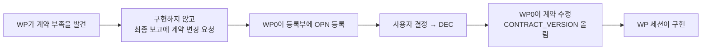

# 9. 기여 규칙

저장소의 작업은 WP(작업 패키지) 단위로 나뉘고, 요구에서 시험까지 ID로 추적한다.

## 9.1 작업 범위

- 자기 WP 디렉터리만 수정한다. WP와 디렉터리의 대응은 [개괄 §7](../40_overview.md#7-저장소-지도).
- `proto/`, `api/`, `bus/`, `docs/10_contracts.md`는 WP0의 계약이다. 바꿔야 하면 [9.5](#95-계약-변경-요청) 절차를 따른다.
- 다른 WP의 내부 구현에 의존하지 않는다. 동역학·버스·플러그인은 `api/`의 인터페이스로만 연결한다. 다른 WP가 없으면 자기 디렉터리의 목과 `InMemoryBus`로 시험한다.
- 새 Python 패키지를 만드는 WP는 루트 `pyproject.toml`의 네 곳에 추가한다([4.1](04_ma_plugin.md#41-따라-하기) 2단계). 새 C++ 의존성은 `vcpkg.json`과 계약 §7.2의 패키지 목록을 함께 고친다.

## 9.2 ID 체계

전체 규칙은 [01_id_convention.md](../01_id_convention.md). 자주 쓰는 것:

| ID | 뜻 | 어디에 |
|---|---|---|
| `REQ-*` | 요구사항 | `02_registry.md` |
| `PRP-*` | 제안 | `02_registry.md` |
| `OPN-NNN` | 미결정 사항 | `02_registry.md` §4 |
| `DEC-NNN` | 결정 사항 | `02_registry.md` §3 |
| `IMP-<모듈>-NNN` | 구현 항목 | 각 WP의 `TRACE.md` |
| `TC-<모듈>-NNN` | 시험 항목 | 각 WP의 `TRACE.md` |

- 모듈 코드: `API`, `CORE`, `DYN`, `AGT`, `LNK`, `UI`, `MON`, `SCN`, `LOG`, `PAY`, `GW`, `EXP`, `INT`, `QA`.
- ID는 재사용하지 않는다. 이미 `TRACE.md`가 있는 디렉터리는 기존 번호 뒤를 잇는다.
- 모든 구현은 REQ 또는 DEC에 연결한다.

## 9.3 추적 기록

- 구현과 시험을 자기 디렉터리의 `TRACE.md` 표에 적는다. 열은 ID, 내용, 위치, 근거, 시험 결과다.
- `docs/03_traceability.md`는 WP 세션이 고치지 않는다. 통합할 때 WP0이 옮긴다.

## 9.4 커밋과 브랜치

- 커밋 메시지에 관련 ID를 적는다. 예: `IMP-CORE-003: RK45 적분기 추가 (REQ-DYN-004, DEC-005)`
- 병렬 세션은 `wp0-contracts`에서 갈라진 자기 worktree에서 작업한다(DEC-015, DEC-021).
- 자기 worktree 브랜치에만 커밋한다. 병합은 통합 담당(PM)이 한다.

## 9.5 계약 변경 요청

- 요청에는 무엇이 부족한지, 선택지, 제안을 적는다. Gateway의 `CR-GW-*`가 예다(`gateway/TRACE.md`).
- 메시지 변경의 실제 절차는 [7.2](07_messages.md#72-메시지를-추가하거나-바꾸는-절차).

## 9.6 시험 완료 기준

- 자기 영역의 시험을 모두 통과시킨다([2장](02_build_test.md)).
- 버스를 거치는 동작은 실제 Zenoh로 한 번 돌려 보고 결과를 `TRACE.md`에 적는다.
- lockstep에 영향을 주는 변경은 같은 시드 2회 실행의 결과를 비교한다([10.3](10_qa.md#103-결정성-진단)).

## 9.7 문서 갱신

WP 세션은 매뉴얼을 고치지 않는다. 통합 담당이 병합할 때 [31_doc_changelog.md](../31_doc_changelog.md)에 문서 영향을 기록하고, 문서 담당 세션이 반영한다([30_doc_plan.md §6.2](../30_doc_plan.md#62-갱신-문서-담당-세션-d)).

## 9.8 자료 취급

- 무기체계 실제 제원은 넣지 않는다. 프로파일은 공개 일반값만 쓴다(DEC-019).
- A-GRA 배포 제한(Distribution D) 내용은 저장소에 옮기지 않는다. 메시지명은 공개 XSD에서 가져온다.
- 용어는 '도달', '유도 객체'를 쓴다.

다음: [10. QA 하니스](10_qa.md).
