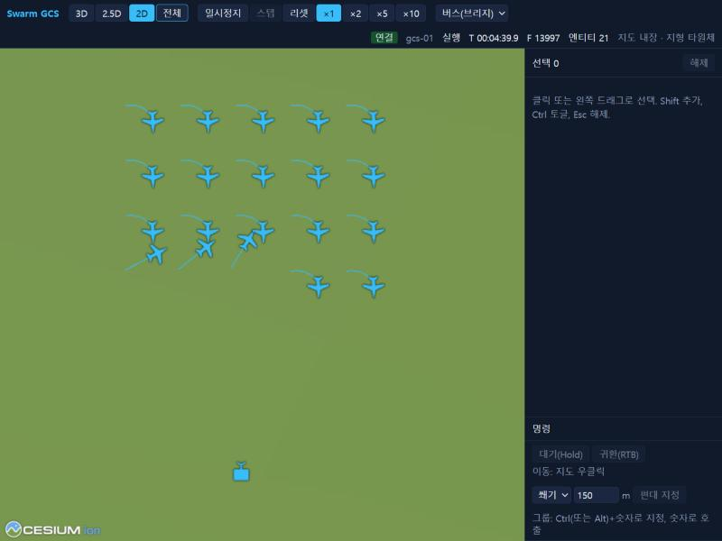

# 2. 빠른 시작

데모 실행기가 모든 프로세스를 한 번에 띄운다. 기체 20대와 GCS 1개가 있는 예제 시나리오를 실시간으로 돌린다. 구성 그림은 [20_p0_demo.md §1](../20_p0_demo.md#1-구성).

## 2.1 띄우기

```bash
uv run python scripts/run_p0_demo.py live --monitor
```

출력 끝에 주소가 나온다.

| 화면 | 주소 |
|---|---|
| GCS UI | `http://localhost:5173/?source=bus&gcs=gcs-01&bridge=ws://127.0.0.1:8765/bus` |
| Traffic Monitor | `http://localhost:5174/?source=bridge&url=ws://127.0.0.1:8765/bus` |

## 2.2 기체 움직이기

1. GCS UI를 열고 도구 막대에서 `2D`, `전체`를 차례로 누른다. 도구 막대에 `연결`, `실행`, `엔티티 21`이 보인다.
2. 왼쪽 드래그로 기체를 고른다.
3. 지도를 우클릭해 임무 창에서 이동을 고르고 전송한다.
4. 명령 패널에 기체별 상태가 수행 → 완료로 바뀐다.

UI 조작 전체는 5장(작성 예정), 지금은 [ui/README.md](../../ui/README.md)의 입력 표를 본다.



## 2.3 자동으로 확인하기

실행기가 켜진 상태에서 다른 터미널로 실행한다. 데이터링크까지 지나는 이동 명령을 UI 없이 보내고 도달을 판정한다.

```bash
uv run python scripts/run_p0_demo.py probe --connect tcp/127.0.0.1:17601 --targets uav-001,uav-002
```

끝에 `[probe] PASS`가 나오면 정상이다. 선회·항로·매개변수 확인은 [20_p0_demo.md §3](../20_p0_demo.md#3-실행)의 `--kind` 표.

## 2.4 끝내기

- Ctrl+C를 누른다. 또는 출력에 나온 실행 디렉터리에 `STOP` 파일을 만든다.
- 정해진 시간만 돌리려면 `--duration <초>`.
- 결과는 `out/p0_demo/live-<시각>/`에 남는다.

| 파일 | 내용 |
|---|---|
| `p0_demo.mcap` | 전 채널 기록. 재생은 [8장](08_record_replay.md) |
| `scenario.pb` | 실행에 쓴 시나리오 |
| `<프로세스>.log` | 프로세스별 로그 |

## 2.5 자주 쓰는 옵션

| 옵션 | 뜻 |
|---|---|
| `--scenario <json>` | 다른 시나리오 |
| `--no-autostart` | UI의 시작 버튼을 기다린다 |
| `--no-record` | MCAP 기록을 끈다 |
| `--no-ui` | 브라우저 서버를 띄우지 않는다 |
| `--lockstep`, `--rate <배속>` | lockstep으로 실행한다 |
| `--base-port`, `--bridge-port`, `--ui-port`, `--monitor-port` | 포트를 바꾼다 |

전체 옵션은 [20_p0_demo.md §3](../20_p0_demo.md#3-실행).

다음: [3. 시나리오 작성](03_scenario.md).
