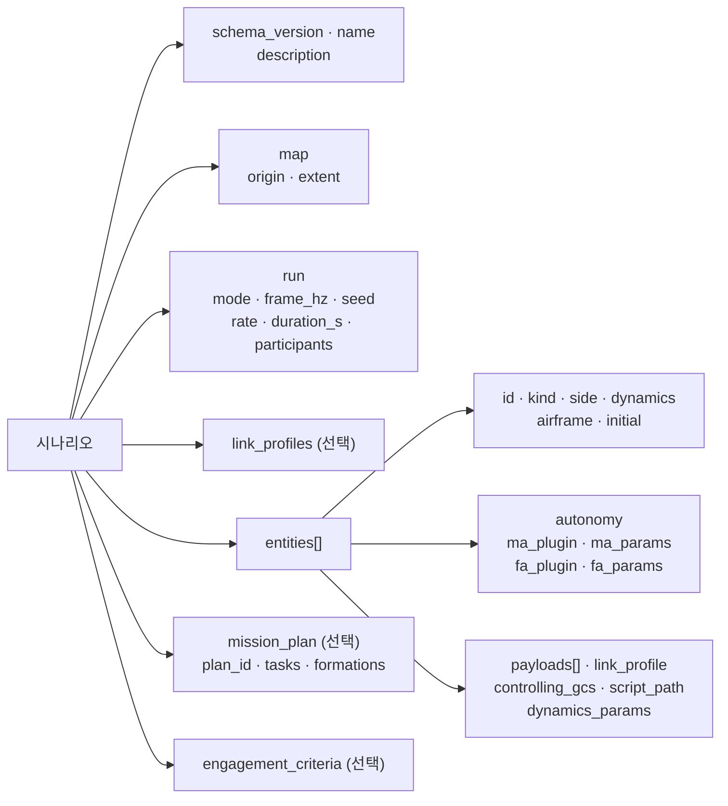

# 3. 시나리오 작성

시나리오는 JSON 파일 하나다. 스키마는 `scenario/src/swarm_scenario/schema/scenario.schema.json`이다.

> 미구현: UI의 시나리오 편집. JSON을 직접 쓰고 `swarm-scenario`로 검증한다.

## 3.1 구조



필수 키는 `schema_version`, `name`, `map`, `run`, `entities`다.

## 3.2 예제

실행 가능한 최소 예제다. 기체 2대, GCS, 지상 표적, 재밍 기지가 있다. `my_first.json`으로 저장한다.

```json
{
  "schema_version": "0.1",
  "name": "my-first",
  "description": "기체 2대, GCS, 지상 표적, 재밍 기지",
  "map": {
    "origin": { "lat_deg": 37.4, "lon_deg": 127.4, "alt_m": 100.0 },
    "extent": { "south_deg": 37.2, "north_deg": 37.7, "west_deg": 127.1, "east_deg": 127.7 }
  },
  "run": {
    "mode": "lockstep",
    "frame_hz": 50,
    "seed": 42,
    "rate": 1.0,
    "participants": ["agent-0", "datalink-0"]
  },
  "link_profiles": [
    { "name": "uav_slow", "base": "uav_default", "latency_ms": 80.0, "jitter_ms": 20.0 }
  ],
  "entities": [
    {
      "id": "gcs-01", "kind": "gcs", "side": "blue", "dynamics": "static",
      "initial": { "position": { "lat_deg": 37.4, "lon_deg": 127.4, "alt_m": 100.0 } },
      "link_profile": "gcs_default"
    },
    {
      "id": "uav-001", "kind": "uav", "side": "blue", "dynamics": "dof3", "airframe": "skywalker_x8",
      "initial": {
        "position": { "lat_deg": 37.42, "lon_deg": 127.39, "alt_m": 1200.0 },
        "velocity_ned_mps": { "x": 20.0, "y": 0.0, "z": 0.0 }
      },
      "payloads": [
        { "id": "cam0", "type": "camera", "profile": "eo_wide", "overrides": { "max_range_m": 4000.0 } }
      ],
      "autonomy": { "ma_plugin": "waypoint", "ma_params": { "hold_radius_m": 200 } },
      "link_profile": "uav_slow",
      "controlling_gcs": "gcs-01"
    },
    {
      "id": "uav-002", "kind": "uav", "side": "blue", "dynamics": "dof3", "airframe": "skywalker_x8",
      "initial": {
        "position": { "lat_deg": 37.42, "lon_deg": 127.41, "alt_m": 1200.0 },
        "velocity_ned_mps": { "x": 20.0, "y": 0.0, "z": 0.0 }
      },
      "autonomy": { "ma_plugin": "waypoint" },
      "link_profile": "uav_default",
      "controlling_gcs": "gcs-01"
    },
    {
      "id": "tgt-001", "kind": "ground_target", "side": "red", "dynamics": "static",
      "initial": { "position": { "lat_deg": 37.47, "lon_deg": 127.40, "alt_m": 100.0 } }
    },
    {
      "id": "jam-site-01", "kind": "jammer_site", "side": "red", "dynamics": "static",
      "initial": { "position": { "lat_deg": 37.5, "lon_deg": 127.45, "alt_m": 100.0 } },
      "payloads": [
        { "id": "jam0", "type": "jammer", "profile": "site_generic", "overrides": { "radius_m": 2500.0 } }
      ]
    }
  ],
  "mission_plan": {
    "plan_id": "plan-001",
    "tasks": [
      {
        "task_id": "task-001",
        "assignees": ["uav-001", "uav-002"],
        "move_to": { "destination": { "lat_deg": 37.47, "lon_deg": 127.40, "alt_m": 1200.0 }, "speed_mps": 22.0 }
      }
    ]
  }
}
```

## 3.3 검증과 변환

```bash
uv run swarm-scenario validate my_first.json
```

```bash
uv run swarm-scenario show my_first.json
```

```bash
uv run swarm-scenario export my_first.json --out my_first.pb
```

- `validate`는 스키마를 먼저 보고, 통과하면 참조·범위 같은 의미 검사를 한다. 스키마 오류가 있으면 의미 오류는 나오지 않으므로 고친 뒤 다시 돌린다.
- 오류는 위치와 함께 나온다. 예: `/entities/3/id: 'uav001' does not match ...`
- `export`로 만든 `.pb`를 `swarm_core --scenario`에 준다([4장](04_run.md)).

저장소의 예제:

| 파일 | 내용 |
|---|---|
| `scenario/examples/p0_demo_20.json` | 2-DoF 20대 + GCS. realtime. `waypoint` MA. 데모 기본값 |
| `scenario/examples/korea_east_strike_20.json` | 2-DoF 20대(2개 편대) + GCS + 지상 표적 4. lockstep. `flocking_basic` MA |
| `scenario/examples/p5_payload_demo_5.json` | 5대에 카메라와 시뮬레이션 이벤트 장비를 탑재한 예제. 재밍 기지와 지상·공중 표적 포함. lockstep |

## 3.4 map, run

| 키 | 내용 | 제약 |
|---|---|---|
| `map.origin` | 맵 원점 | `extent` 안 |
| `map.extent` | 남북동서 경계(deg) | 한반도 범위(33–43.1°N, 124–131.9°E) 안 |
| `run.mode` | `realtime`, `lockstep`, `freerun` | |
| `run.frame_hz` | 프레임 주파수 | 50–100 |
| `run.seed` | 난수 시드 | 정수 |
| `run.rate` | 목표 배속. 생략하면 1 | realtime은 1로 고정 |
| `run.duration_s` | 실행 시간. 생략하면 제한 없음 | |
| `run.participants` | lockstep 참여자 ID 목록 | [4.4](04_run.md#44-lockstep) |

## 3.5 엔티티

| 키 | 값 |
|---|---|
| `id` | 소문자·숫자와 하이픈, 하이픈으로 나뉜 조각 2개 이상. 예: `uav-001`. 25자 이하 |
| `kind` | `uav`, `gcs`, `ground_target`, `air_target`, `fpv`, `jammer_site`, `missile` |
| `side` | `blue`, `red`, `neutral` |
| `dynamics` | `dof2`, `dof3`, `scripted`, `static` |
| `airframe` | `skywalker_x8`, `aerosonde`. 생략하면 모델 기본값 |
| `initial.position` | 위도·경도(deg), 고도 MSL(m). 맵 범위 안 |
| `initial.velocity_ned_mps` | 시작 속도. `x` 북, `y` 동, `z` 아래 |
| `controlling_gcs` | 이 기체를 맡는 GCS 엔티티 |
| `script_path` | `scripted` 경로. 초기 속도 크기로 따라간다 |
| `dynamics_params` | 동역학 매개변수 재정의 |

> 미구현: `dof5`, `dof6` (로드맵 P3). `swarm-scenario validate`가 미구현으로 거부한다.

- 시작 고도가 DEM 지형보다 낮은 공중 엔티티는 적재 때 경고하고 시작 프레임에 파괴 처리한다(`--terrain-dem` 사용 시, DEC-060).

## 3.6 자율 플러그인 (autonomy)

`ma_plugin`, `fa_plugin`에 등록 이름을 쓴다. 이름 목록은 `uv run swarm-agent --list-plugins`로 본다.

| MA | 하는 일 | 지원 작업 |
|---|---|---|
| `hold` | 현재 침로·속도·고도 유지. `orbit_radius_m` > 0이면 그 자리 선회 | 임무 작업을 수행하지 않음 |
| `waypoint` | 임무 계획과 C2 명령 수행 | `move_to`, `hold`, `return_to_base`, `search_area`, `route` |
| `formation` | 리더-추종 편대 | 편대 지정과 리더의 작업 수행 |
| `flocking`, `flocking_basic` | Reynolds 군집과 목표점 이동 | `move_to`, `hold`, `return_to_base`, `search_area`. `route`는 `REJECTED` |

- FA는 `default`만 있다. 생략하면 `default`를 쓴다.
- 지원하지 않는 작업은 `TaskStatus` REJECTED로 돌아온다. 기본 MA는 `track`, `strike`, `jam` 작업을 지원하지 않는다.
- 매개변수는 `ma_params`, `fa_params`에 쓴다. 이름과 범위는 실행 중 UI의 매개변수 패널에서 볼 수 있다. 없는 이름이나 범위 밖 값은 적용되지 않고 거부 사유가 남는다.

자주 쓰는 매개변수:

| 소유자 | 이름 | 기본값 | 뜻 |
|---|---|---|---|
| waypoint | `acceptance_m` | 80 | 경유점 도달 판정 반경(m) |
| waypoint | `hold_radius_m` | 300 | Hold 기본 선회 반경(m) |
| formation | `k_p` | 0.08 | 슬롯 오차 비례 이득 |
| flocking | `cruise_mps` | 22 | 순항 속력(m/s) |
| flocking | `separation_m` | 80 | 분리 거리(m) |
| flocking | `neighbor_radius_m` | 600 | 이웃 인식 반경(m) |
| flocking | `group` | 빈 값 | 같은 그룹 이웃만 사용 |
| default FA | `racetrack_guidance` | `dubins` | 레이스트랙 유도(`dubins`, `vector_field`) |

## 3.7 임무 계획 (mission_plan)

`tasks`의 각 작업에는 `task_id`, `assignees`와 작업 종류 키 하나를 쓴다.

| 작업 키 | 내용 |
|---|---|
| `move_to` | `destination`, `speed_mps` |
| `hold` | `center`, `radius_m`, `duration_s`, `direction`(`cw`, `ccw`), `racetrack`. 비우면 현재 위치에서 선회 |
| `search_area` | 원 또는 다각형 영역 |
| `route` | 항로점 목록. 항로점마다 `position`, `speed_mps`, `acceptance_radius_m`, 행위(`loiter`, `recon`) |
| `return_to_base` | 시작 위치로 귀환 |

`formations`는 `group_id`, `members`, `leader`, `shape`(`line`, `column`, `wedge`, `echelon`, `circle`, `custom`), `spacing_m`, `custom_offsets_m`를 쓴다. `custom`은 `custom_offsets_m` 개수가 `members`와 같아야 한다.

## 3.8 탑재 장비 (payloads)

```json
{ "id": "cam0", "type": "camera", "profile": "eo_wide", "overrides": { "max_range_m": 4000.0, "hfov_deg": 50.0 } }
```

| 키 | 내용 |
|---|---|
| `id` | 기체 안에서 유일. 소문자로 시작 |
| `type` | `camera`, `jammer` 또는 시뮬레이션 이벤트 장비 |
| `profile` | 프로파일 이름. `payload/profiles/<type>.json`에 있다 |
| `overrides` | 프로파일 값 재정의 |

센서: 탐지는 FOV·최대 거리·가시선으로만 판정한다(DEC-018).

| 프로파일 | 비고 |
|---|---|
| `eo_wide`, `eo_narrow`, `ir_generic` | 값은 `payload/profiles/camera.json`. 재정의 키: `hfov_deg`, `vfov_deg`, `max_range_m`, `default_az_deg`, `default_el_deg`, `default_enabled` |

재머: 구역 안의 수신단은 메시지를 받지 못한다([7장](07_link.md#73-재밍-구역)).

| 프로파일 | 비고 |
|---|---|
| `ea_generic`, `site_generic` | 값은 `payload/profiles/jammer.json`. 재정의 키: `radius_m`, `max_radius_m`, `min_alt_m`, `max_alt_m`, `update_distance_m`, `default_enabled` |

- 엔티티당 재머는 1개다. 2개 이상이면 적재를 거부한다(DEC-049).

시뮬레이션 이벤트를 내는 그 밖의 장비는 `type`이 `aam_short`, `agm_short`, `fpv`이고 `count`가 필수다. 프로파일 이름은 `payload/profiles/<type>.json`의 키에서 고르고, 같은 방식으로 `overrides`로 재정의한다. 값은 프로파일 파일을 본다. 예제는 `scenario/examples/p5_payload_demo_5.json`이다.

`engagement_criteria`의 형식은 스키마를 본다.

## 3.9 검사 항목 요약

| 항목 | 규칙 | 어디서 |
|---|---|---|
| 엔티티 ID | 형식, 중복 금지, 25자 이하 | 스키마·validate, 길이는 Core 적재 |
| 맵 범위 | 원점·초기 위치·스크립트 경로가 범위 안 | validate |
| 참조 | `controlling_gcs`, `assignees`, `target_id`, `members`, `leader`가 있는 엔티티 | validate |
| `task_id` | 중복 금지 | validate |
| 재머 수 | 엔티티당 1개 | Core 적재 |
| DoF | `dof2`, `dof3`, `scripted`, `static`만 실행 가능 | validate |
| 값 | NaN·무한대·범위 밖 거부 | Core 적재 |

Core가 거부하면 프로세스는 종료하지 않고 `scenario rejected`를 로그에 남긴 뒤 다음 시나리오를 기다린다.

다음: [4. 실행](04_run.md).
