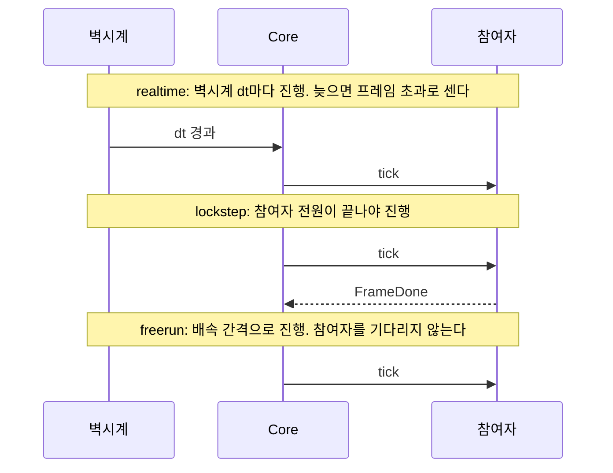
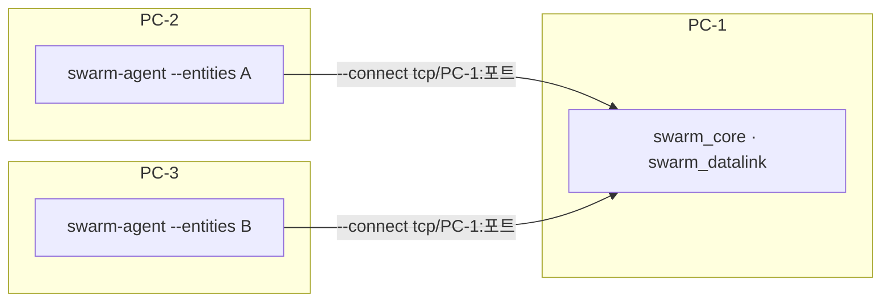

# 4. 실행

전체를 한 번에 띄우려면 [2장](02_quickstart.md)의 실행기가 가장 쉽다. 이 장은 다른 시나리오로 돌리거나 프로세스를 직접 띄우는 방법을 다룬다.

## 4.1 실행기로 내 시나리오 돌리기

```bash
uv run python scripts/run_p0_demo.py live --scenario my_first.json
```

- `run.mode`가 lockstep인 시나리오는 `--lockstep`을 함께 준다. 실행기가 시나리오에 `participants`를 넣는다.

## 4.2 프로세스를 하나씩 띄우기

아래 명령은 Windows `msvc-debug` 기준이다. 다른 프리셋이면 `build/<프리셋>/`로 바꾼다.

먼저 시나리오를 `.pb`로 내보낸다([3.3](03_scenario.md#33-검증과-변환)). 터미널마다 하나씩 실행한다. 뒤에 뜨는 프로세스가 앞 프로세스에 `--connect`한다.

realtime 예:

```bash
build/msvc-debug/logger/swarm_logger record --out run.mcap --no-multicast --listen tcp/127.0.0.1:17600
```

```bash
build/msvc-debug/datalink/swarm_datalink --scenario my_first.pb --no-frame-done --no-multicast --listen tcp/127.0.0.1:17601 --connect tcp/127.0.0.1:17600
```

```bash
uv run swarm-agent --scenario my_first.pb --no-multicast --listen tcp/127.0.0.1:17602 --connect tcp/127.0.0.1:17600 --connect tcp/127.0.0.1:17601
```

```bash
uv run swarm-bridge --port 8765 --no-multicast --listen tcp/127.0.0.1:17603 --connect tcp/127.0.0.1:17600 --connect tcp/127.0.0.1:17601 --connect tcp/127.0.0.1:17602
```

```bash
build/msvc-debug/core/swarm_core --scenario my_first.pb --autostart --mode realtime --no-multicast --listen tcp/127.0.0.1:17604 --connect tcp/127.0.0.1:17600 --connect tcp/127.0.0.1:17601 --connect tcp/127.0.0.1:17602 --connect tcp/127.0.0.1:17603
```

브라우저 화면은 `ui/`와 `ui/monitor/`에서 각각 띄운다.

```bash
cd ui && npm run dev
```

```bash
cd ui/monitor && npm run dev
```

시작 순서: Logger → Datalink → Agent → 브리지 → (2초 대기) → Core. 기록이 필요 없으면 Logger는 뺀다.

| 프로세스 | 주요 옵션 |
|---|---|
| `swarm_core` | `--scenario`, `--autostart`, `--mode`, `--rate`, `--hz`, `--seed`, `--frames`, `--integrator rk4\|rk45`, `--terrain-flat <m>`, `--terrain-dem <json>` |
| `swarm_datalink` | `--scenario`, `--participant`, `--no-frame-done`, `--seed`, `--terrain-flat <m>`, `--no-los`, `--state-period <s>` |
| `swarm-agent` | `--scenario`, `--participant`, `--entities`, `--frames`, `--activity-max-hz`, `--vi-report-hz` |
| `swarm-bridge` | `--host`, `--port`, `--queue-limit` |
| 공통 버스 옵션 | `--bus`, `--zenoh-config`, `--zenoh-mode`, `--connect`, `--listen`, `--no-multicast` |

- 실행 파일마다 `--help`로 전체 옵션을 본다.
- `--autostart`가 없으면 Core는 LOADED로 멈추고 UI의 시작 버튼을 기다린다.
- 브리지가 다른 PC의 브라우저를 받으려면 `--host 0.0.0.0`.

## 4.3 실행 모드



| 모드 | 배속 | 같은 시드 재현 | 쓰는 경우 |
|---|---|---|---|
| `realtime` | 1 고정. UI 배속 버튼이 꺼진다 | 아님 | UI 조작, 시연 |
| `lockstep` | `rate`. 0은 최대 속도 | 시드 고정. 아래 참고 | 알고리즘 비교, 반복 실험 |
| `freerun` | `rate`. 0은 최대 속도 | 아님 | Core만 빠르게 돌릴 때 |

> 확인 안 됨: `freerun`은 모드 전환 시험(TC-QA-011)만 있고 사용 사례 기록이 없다.

> 같은 시드 lockstep은 기체 궤적, 링크 결과, GCS 수신이 실행마다 같다(무고장, 고장 주입, 임무장비, 50기로 60 s 비교). Gateway를 둔 구성은 외부 입력이 없을 때만 같다. 외부 입력이 있으면 Gateway 발행 시각이 시드로 정해지지 않아 재현 대상이 아니다.

- 모드는 시나리오 `run.mode`로 정하고, Core의 `--mode`, `--rate`로 바꿀 수 있다.
- 배속 0(최대 속도)은 Core의 `--rate 0`으로만 준다. 시나리오의 `run.rate`는 0보다 커야 한다.

## 4.4 lockstep

시나리오에 참여자를 적고 시나리오는 Core에만 준다. 다른 프로세스는 버스에서 받는다.

```bash
build/msvc-debug/datalink/swarm_datalink --no-multicast --listen tcp/127.0.0.1:17601
```

```bash
uv run swarm-agent --no-multicast --listen tcp/127.0.0.1:17602 --connect tcp/127.0.0.1:17601
```

```bash
build/msvc-debug/core/swarm_core --scenario my_first.pb --autostart --no-multicast --listen tcp/127.0.0.1:17603 --connect tcp/127.0.0.1:17601 --connect tcp/127.0.0.1:17602
```

- `run.participants`의 ID가 실제 프로세스의 ID와 같아야 한다. 기본은 `datalink-0`, `agent-0`이다. 틀리면 첫 틱이 나가지 않는다.
- 시나리오가 realtime이어도 Core에 `--mode lockstep --participant datalink-0 --participant agent-0`을 주면 lockstep으로 돈다.
- 처음 틱 전까지 늦게 띄운 참여자도 합류한다. 시작 뒤에 이탈하면 합류하지 못하고 멈춘다. 참여자를 다시 띄우고 Reset 뒤 Start한다.
- 기체가 많으면 Agent를 여러 개로 나눈다. `--entities`로 맡을 기체를 정하고 참여자 ID를 다르게 준다. 시나리오의 `participants`에도 모두 적는다.

## 4.5 지형과 적분기

- 평지가 기본이다. 고도는 `--terrain-flat <m>`로 준다.
- DEM을 쓰려면 Core에 `--terrain-dem data/dem/korea_glo90.json`을 준다. 둘 다 주면 DEM을 쓰고 경고한다(DEC-061).
- Datalink의 가시선은 `--terrain-flat`의 평지로만 판정한다. DEM을 쓰지 않는다.
- 적분기는 Core의 `--integrator`로 고른다. 기본은 `rk45`다.

## 4.6 상태 보고 주기

Agent가 GCS로 자동으로 보내는 항목이다. MA 구현과 무관하고 Datalink를 거친다.

| 항목 | 시점 | 옵션 |
|---|---|---|
| 항법 보고 `NavigationReport` | 주기, 기본 1 Hz | `--vi-report-hz`(0 이하이면 끔) |
| 기체 상태 `SystemStatus` | 값이 바뀔 때. 고장 주입이 health·subsystems에 반영된다 | |
| 비행 명령 상태 `FlightCommandStatus` | 값이 바뀔 때 | |
| 비행 성능 `FlightCapability` | 시작 시 1회 | |
| 임무장비 상태 `SensorActivity`, `JammerActivity` 등 | 값이 바뀔 때(키별 최대 10 Hz)와 1 Hz | `--activity-max-hz` |

## 4.7 여러 PC에 나눠 실행

> 확인 안 됨: 여러 PC 분산 실행(로드맵 P4)은 시험 기록이 없다. 단일 PC에서만 확인했다.

옵션 구조만 적어 둔다.



- listen 주소에 `127.0.0.1` 대신 실제 주소나 `0.0.0.0`을 쓴다.
- 브라우저는 브리지 주소를 URL의 `bridge=`로 준다.

다음: [5. GCS UI 조작](05_ui.md), [7. 데이터링크 상황 만들기](07_link.md).
