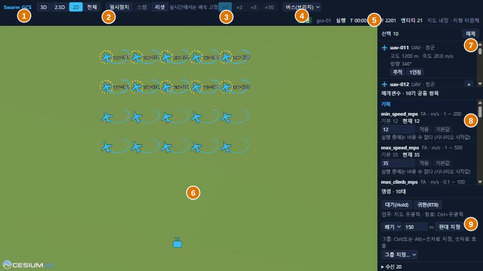
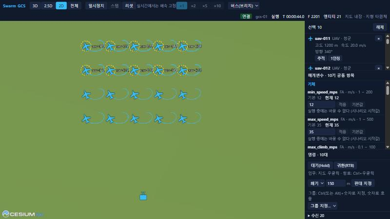
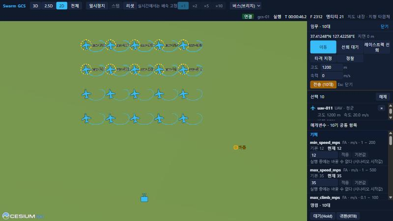
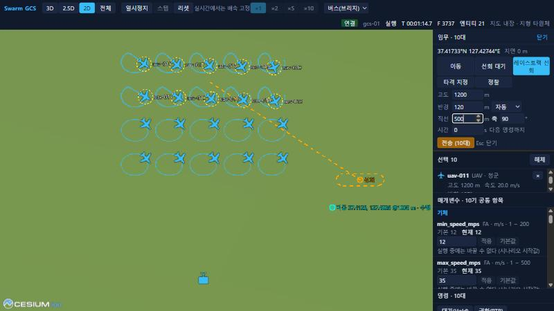
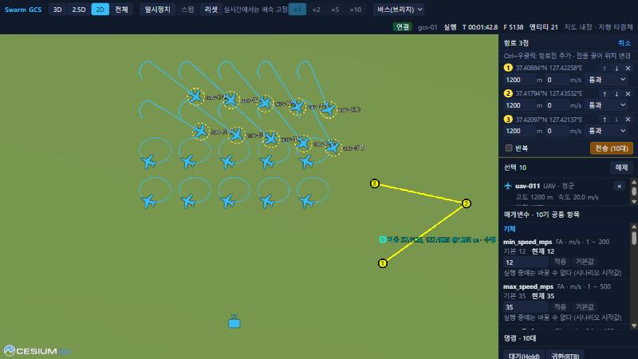
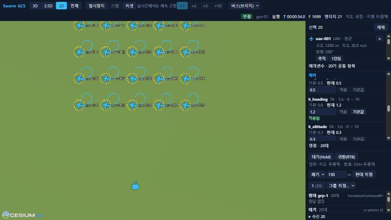
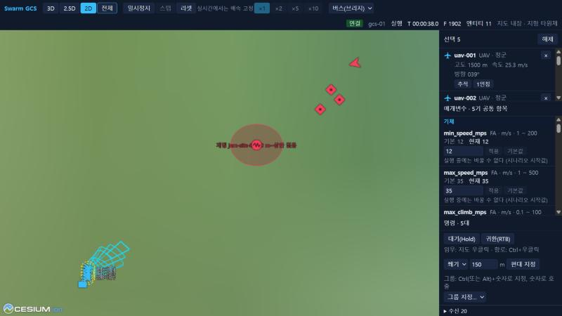

# 5. GCS UI 조작

브라우저에서 지도를 보고 기체에 임무를 내리는 화면이다. 띄우는 방법은 [2장](02_quickstart.md).

## 5.1 화면 구성

| 번호 | 구역 | 내용 |
|---|---|---|
| 1 | 시점 | `3D`, `2.5D`, `2D`, `전체`(모든 엔티티가 보이게 맞춤) |
| 2 | 시뮬레이션 통제 | `일시정지`/`재개`, `시작`, `스텝`, `리셋` |
| 3 | 배속 | `×1`, `×2`, `×5`, `×10`. realtime에서는 고정이다 |
| 4 | 데이터 소스 | `목 소스`, `버스(브리지)` |
| 5 | 상태 | 연결, GCS, 실행 상태, 모의 시각 `T`, 프레임 `F`, 엔티티 수, 지도 자료 |
| 6 | 지도 | 엔티티와 궤적. 선택한 기체는 노란 고리로 표시된다 |
| 7 | 선택 패널 | 선택한 기체의 상태, 카메라 버튼 |
| 8 | 매개변수 패널 | 선택한 기체의 매개변수 |
| 9 | 명령 패널 | Hold, RTB, 편대, 그룹, 보낸 명령의 상태 |

임무 창과 항로 창은 지도 위가 아니라 오른쪽 패널 맨 위에 열린다.

## 5.2 URL 인자

| 인자 | 뜻 |
|---|---|
| `source` | `mock`(기본, 버스 없이 동작), `bus` |
| `bridge` | 브리지 주소. 기본 `ws://<페이지 호스트>:8765/bus` |
| `gcs` | 이 UI가 맡은 GCS. 비우면 관찰만 하고 명령을 보내지 않는다 |

예: `http://localhost:5173/?source=bus&gcs=gcs-01&bridge=ws://127.0.0.1:8765/bus`

> 미구현: 역할별 권한 (P6 이후, DEC-020). 지금은 통제와 관찰만 구분한다.

## 5.3 선택

| 입력 | 동작 |
|---|---|
| 왼쪽 클릭 | 가까운 엔티티 선택. 빈 곳이면 해제 |
| 왼쪽 드래그 | 박스 선택. 박스 안의 청군 비행체를 고른다 |
| Shift + 선택 | 추가 |
| Ctrl + 선택 | 토글 |
| Ctrl+A | 청군 비행체 전체 선택 |
| Esc | 선택과 추적 해제 |

## 5.4 임무 창

기체를 고른 뒤 지도를 **우클릭**하면 임무 창이 열린다. 선택한 기체 전체가 작업 하나의 대상이 된다. 적 표적 위에서 우클릭하면 표적 ID가 함께 표시된다.

| 탭 | 입력 | 보내는 작업 |
|---|---|---|
| `이동` | 고도, 속력(0이면 현재 속도 유지) | MoveTo |
| `선회 대기` | 고도, 반경, 방향, 시간(0이면 다음 명령까지) | Hold |
| `레이스트랙 선회` | 고도, 반경, 방향, 직선 길이, 축 방위(진북 시계), 시간 | Hold(레이스트랙) |
| `타격 지정` | 유도 객체 종류(`aam_short`, `agm_short`, `fpv`). 적 위면 표적 지정, 아니면 조준점 | Strike |
| `정찰` | 고도, 원 반경 | SearchArea |

전송하면 창이 닫히고 명령 패널에 상태가 뜬다. 지도에는 목적지 표지가 남는다.

레이스트랙은 클릭한 점을 두 원 중심의 중점으로 삼는다. 지도에 폐곡선이 미리 보인다. 실제 비행 경로의 정의는 [개발자 5.2](../41_dev/05_fa_plugin.md#52-vi-제어-모드).

> 주의: 임무 창의 입력 칸에 커서가 있으면 Esc가 동작하지 않는다. `닫기`를 누르거나 입력 칸 밖을 먼저 클릭한다.

## 5.5 항로

**Ctrl+우클릭**으로 항로점을 차례로 찍는다. 항로 창에서 항로점별로 고도, 속력, 행위(`통과`, `선회 대기`, `정찰`)를 고치고 `↑`, `↓`, `✕`로 순서를 바꾼다. 지도에서 점을 왼쪽 드래그하면 위치를 옮긴다. `반복`을 켜면 끝없이 돈다.

- `전송`하면 버튼이 `다시 전송`으로 바뀌고, 같은 작업 ID로 다시 보내면 항로 전체가 바뀐다.
- 명령 패널의 항로 행에 있는 `편집`으로 다시 연다.
- `취소`나 Esc로 편집을 버린다.
- 기본 MA 중 `flocking`은 Route를 거부한다.

## 5.6 명령 패널

| 조작 | 동작 |
|---|---|
| `대기(Hold)` 또는 H | 현재 위치 선회 |
| `귀환(RTB)` | 시작 위치로 귀환 |
| 모양, 간격, `편대 지정` | 첫 선택 기체를 리더로 FormationCommand 전송 |
| Ctrl+숫자 또는 Alt+숫자, `그룹 지정…` | 선택을 부대 그룹으로 지정. Chrome에서는 Ctrl+숫자가 탭 전환이므로 Alt+숫자를 쓴다 |
| 숫자 | 그룹 호출(선택) |
| 숫자 두 번 빠르게 | 호출하고 그 그룹으로 카메라 이동 |

아래쪽 목록에 보낸 명령과 기체별 상태가 나온다.

| 표시 | 뜻 |
|---|---|
| `수락` | ACCEPTED |
| `수행` | EXECUTING |
| `완료` | COMPLETED |
| `거부` | REJECTED. 사유가 괄호로 붙는다. 예: `거부 (unsupported task strike)` |
| `취소` | CANCELLED. 새 명령이 앞선 명령을 대체했을 때도 이렇게 표시된다 |
| `응답 없음` | 상태 보고가 오지 않았다. 편대와 그룹 명령은 기본 MA가 상태를 보내지 않으므로 정상이다 |

## 5.7 매개변수

기체를 고르면 매개변수 패널에 기체·제어·유도·행위·결정 계층별로 항목이 나온다.

- 값을 고치고 `적용`을 누른다. 항목 옆에 `적용됨`이 뜨면 기체가 값을 받아들인 것이다.
- `기본값`은 기본값으로 되돌린다.
- 범위를 벗어난 값은 항목 아래에 사유가 나오고 `적용`이 꺼진다.
- `실행 중에는 바꿀 수 없다`로 표시된 항목은 시나리오에서 바꾼다.
- 여러 기체를 고르면 이름이 같은 항목만 합쳐 한꺼번에 바꾼다.

> 미구현: UI의 시나리오 편집. 시작값은 [시나리오 JSON](03_scenario.md)에 쓴다.

## 5.8 카메라

| 입력 | 동작 |
|---|---|
| 휠 | 확대·축소 |
| 오른쪽 드래그 | 카메라 이동(3D에서는 회전) |
| 가운데 드래그, Ctrl+오른쪽 드래그 | 기울이기 |
| 선택 패널의 `추적` | 기체를 따라간다 |
| 선택 패널의 `1인칭` | 기체 자세로 본다 |
| `전체` | 모든 엔티티가 보이게 맞춘다 |

> 확인 안 됨: 오른쪽 드래그, 가운데 드래그, Ctrl+오른쪽 드래그는 이번 확인 도구로 재현하지 못했다. 코드의 카메라 설정 기준으로 적었다.

## 5.9 이벤트 전시

| 표시 | 뜻 |
|---|---|
| 진영색 원·기둥 | 재밍 구역. 라벨에 재머와 고도 범위가 나온다 |
| 청록 사각뿔 모서리 | 센서 시야. 지면에 닿으면 풋프린트가 굵어진다 |
| 궤적(주황, 자홍) | 비행 중인 유도 객체 |
| 빨간 원 | `impact` 이벤트의 효과 범위 |
| 회색 점 | 파괴된 엔티티 |

## 5.10 상태 표시

| 표시 | 뜻 |
|---|---|
| `연결`, `연결 중`, `끊김` | 브리지 연결 |
| `대기`, `적재`, `실행`, `정지`, `종료` | Core 상태. `리셋` 뒤에는 `적재`가 되고 `시작`이 나타난다 |
| `시뮬레이션 응답 없음` | 3초 넘게 Core 상태를 받지 못했다 |
| 참여자 대기 표시 | lockstep 참여자를 기다린다 |
| `재생` | MCAP 재생 중. 시작·일시정지·스텝·배속이 꺼진다 |
| `누락 프레임 N` | 재생 속도를 못 따라가 빠진 프레임 수 |
| `지도 내장`, `지형 타원체` | 로컬 타일이 없다([1.2](01_install.md#12-지도-자료-선택)) |

`스텝`은 일시정지 중에만 켜지고 한 프레임 진행한다.

## 5.11 단축키

| 키 | 동작 |
|---|---|
| Esc | 임무·항로 창 닫기, 그다음 선택·추적 해제 |
| Ctrl+A | 청군 비행체 전체 선택 |
| H | Hold |
| 숫자 | 그룹 호출, 두 번이면 이동 |
| Ctrl+숫자, Alt+숫자 | 그룹 지정 |

다음: [6. Traffic Monitor](06_monitor.md).
