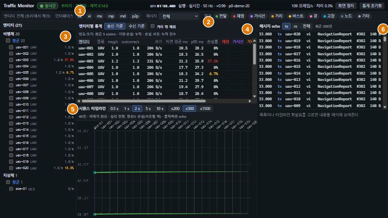
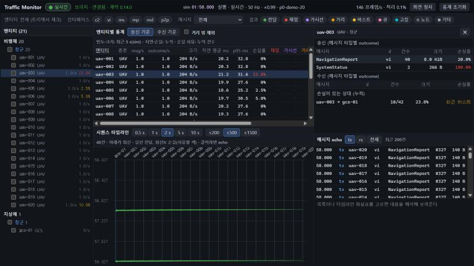
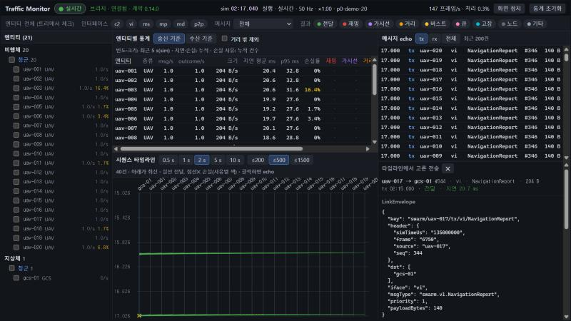

# 6. Traffic Monitor

데이터링크를 지나는 메시지를 집계해 보여 주는 화면이다. 관찰만 하고 명령을 보내지 않는다. 실행기에 `--monitor`를 주면 함께 뜬다.

주소: `http://localhost:5174/?source=bridge&url=ws://127.0.0.1:8765/bus`

| 인자 | 뜻 |
|---|---|
| `source` | `mock`(기본, 내장 목 트래픽), `bridge` |
| `url` | 브리지 주소 |
| `replay` | `1`이면 상태를 받기 전까지 재생으로 표시 |
| `uavs`, `hz`, `rate` | 목 소스의 기체 수, 방송 주기, 배속 |

## 6.1 화면 구성

| 번호 | 구역 | 내용 |
|---|---|---|
| 1 | 머리줄 | 실시간·재생 배지, 연결과 계약 버전, 모의 시각과 상태, 처리량, `화면 정지`, `통계 초기화` |
| 2 | 필터 막대 | 엔티티, 인터페이스, 메시지 타입, 결과 |
| 3 | 엔티티 트리 | 비행체·지상체 → 진영 → 엔티티. 송신 빈도와 손실률 |
| 4 | 통계 표 | 엔티티별 빈도, 크기, 지연, 손실률, 사유별 건수 |
| 5 | 시퀀스 타임라인 | 메시지 전달과 손실의 시간 순 표시 |
| 6 | 메시지 echo | 최근 메시지 목록과 내용 해석 |

머리줄의 그 밖의 표시는 다음과 같다.

| 표시 | 뜻 |
|---|---|
| 되감기 횟수 | 재생으로 시각이 거꾸로 간 횟수 |
| 프레임 누락 | `truth/state` 프레임 번호의 공백 |
| 응답 없음 참여자 | lockstep 참여자 중 답이 없는 것 |
| `링크 지연` | 집계가 모의 시각보다 늦은 정도. 1초를 넘으면 뜬다 |

## 6.2 손실 사유

| 화면 | 사유 | 뜻 |
|---|---|---|
| 재밍 | `JAMMED` | 수신자가 재밍 구역 안 |
| 가시선 | `NO_LOS` | 지형에 가려짐 |
| 거리 | `OUT_OF_RANGE` | 거리 또는 SNR 부족 |
| 버스트 | `BURST_LOSS` | 버스트 손실 |
| 큐 | `QUEUE_OVERFLOW` | 대역폭 큐 초과 |
| 고장 | `FAULT_INJECTED` | 고장 주입 |
| 노드 | `NODE_DEAD` | 상대가 파괴됨 |
| 기타 | 그 외 | 계약에 없는 값 |

원인을 만들고 없애는 방법은 [7장](07_link.md).

## 6.3 집계 정의

| 값 | 정의 |
|---|---|
| msg/s, 크기 | 모의 시각 최근 5초 이동 창. 재생 배속과 무관하다 |
| 지연 평균, p95 | 누적 |
| 손실률 | 손실 outcome / (전달 + 손실 outcome), 누적 |
| 사유별 건수 | 누적 |

- 분모는 수신자별 결과다. 방송 메시지는 닿지 않는 같은 편 수신자마다 손실 1건으로 들어간다(DEC-032).
- `거리 밖 제외`를 켜면 `OUT_OF_RANGE`를 분자와 분모에서 뺀다. 원래 멀어서 안 닿는 쌍을 빼고 링크 품질만 볼 때 쓴다.
- `송신 기준`, `수신 기준`으로 표의 집계 기준을 바꾼다.
- `통계 초기화`는 누적값을 지운다.

## 6.4 필터

- 엔티티 트리의 체크박스가 엔티티 필터다. 쓰는 동안 머리의 범위 선택(`송신 또는 수신` 등)이 나타난다.
- 인터페이스(`c2`, `vi`, `ms`, `mp`, `md`, `p2p`)와 메시지 타입, 결과 칩으로 좁힌다.
- 필터가 켜지면 막대가 두 줄로 늘어나고 `필터 해제`가 나타난다.
- 필터는 타임라인과 echo에 적용된다. 통계 표에는 엔티티 필터만 적용된다.
- 트리에서 이름을 클릭하면 상세가 열린다. 필터는 체크박스로 건다.

## 6.5 상세와 타임라인

엔티티 상세는 메시지 타입별 송수신과 손실이 있는 상대를 보여 준다.

타임라인은 레인이 엔티티이고 아래쪽이 최신이다. 전달은 실선, 손실은 사유 색의 점선과 ✕다. `0.5 s`~`10 s`로 창 폭을, `≤200`~`≤1500`으로 표시 상한을 바꾼다. 화살표를 클릭하면 해당 메시지의 LinkEnvelope와 payload가 오른쪽 아래에 해석돼 나온다.

`화면 정지`를 누르면 버튼이 `화면 재개`로 바뀌고 패널 갱신을 멈춘다. 머리줄의 시각은 계속 움직인다. 데이터 수신은 멈추지 않는다.

## 6.6 재생

MCAP을 재생하면 머리줄 배지가 `재생 (MCAP)`이 되고 화면 테두리가 주황이 된다. 프레임 누락과 다시 재생할 때의 집계는 [8.4](08_record_replay.md#84-재생-중-화면).

다음: [7. 데이터링크 상황 만들기](07_link.md).
