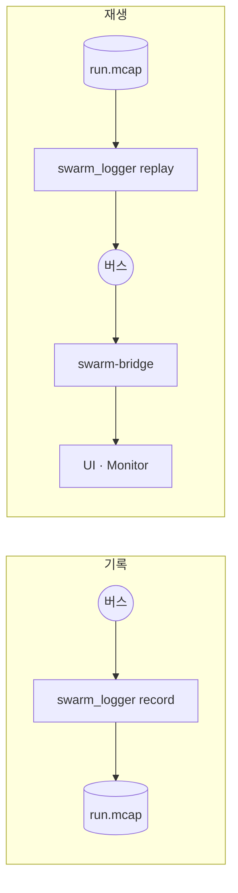

# 8. 기록과 재생

버스의 모든 메시지를 MCAP 파일 하나에 기록하고, 원래 시간 간격으로 버스에 다시 내보낸다. 재생 중 UI와 Monitor는 실시간과 같은 화면을 쓴다.



## 8.1 기록

데모 실행기는 기본으로 기록한다(`out/p0_demo/live-<시각>/p0_demo.mcap`). 끄려면 `--no-record`.

직접 기록할 때:

```bash
build/msvc-debug/logger/swarm_logger record --out run.mcap --no-multicast --listen tcp/127.0.0.1:17600
```

- `--key <표현식>`으로 일부 키만 기록한다. 기본은 전체다.
- 끝낼 때는 Ctrl+C. Logger가 파일을 닫아야 재생할 수 있다.

## 8.2 파일 살펴보기

```bash
build/msvc-debug/logger/swarm_logger info run.mcap
```

메시지 수, 시간 범위, 채널별 건수가 나온다. 채널은 버스 키와 같다.

## 8.3 재생

실행기로 브리지와 화면까지 한 번에 띄운다.

```bash
uv run python scripts/run_p0_demo.py replay out/p0_demo/live-<시각>/p0_demo.mcap --rate 3 --monitor
```

- UI: `http://localhost:5173/?source=bus&gcs=&bridge=ws://127.0.0.1:8765/bus`. `gcs=`를 비워 명령을 막는다.
- Monitor: `http://localhost:5174/?source=bridge&url=ws://127.0.0.1:8765/bus`
- Core·Datalink·Agent는 띄우지 않는다. 끝나면 종료한다. `--linger <초>`로 화면을 더 둘 수 있다.

내용만 확인할 때:

```bash
build/msvc-debug/logger/swarm_logger replay run.mcap --dry-run
```

- `--rate`는 배속, `--key`는 재생할 키다. `--dry-run`은 버스에 내보내지 않고 건수만 센다. 버스 옵션은 다른 실행 파일과 같다.

## 8.4 재생 중 화면

- UI 도구 막대에 `재생`이 뜨고 시작·일시정지·스텝·배속이 꺼진다. Monitor는 `재생 (MCAP)` 배지를 띄운다(DEC-031).
- 재생기는 수신자 속도에 맞추지 않는다. 고배속에서 수신자가 놓친 프레임은 `truth/state` 프레임 번호의 공백으로 세어 화면에 표시한다(DEC-042).
- 같은 Monitor로 다시 재생하면, 시각이 5 s 넘게 거꾸로 가는 시점에 집계가 지워진다.

## 8.5 분량 참고

20대 데모를 약 25초 기록하면 약 12 MB, 메시지 약 5만 8천 건이었다. 약 2분이면 메시지 약 30만 건이다. 기체 수와 시간에 비례해 늘어난다.
