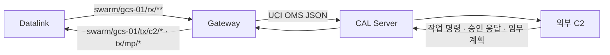
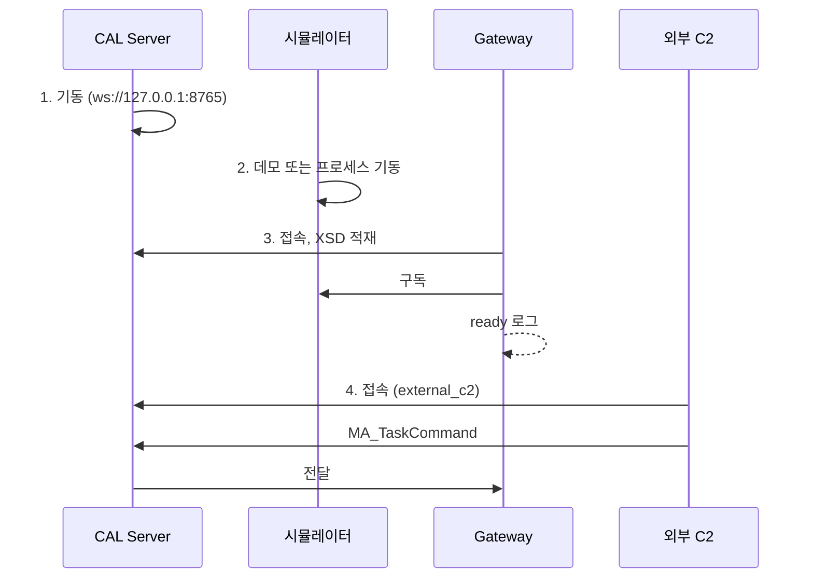

# 9. A-GRA Gateway 연동

시뮬레이터의 GCS 쪽 메시지를 외부 A-GRA 시스템과 주고받는다. Gateway는 CAL Server를 거쳐 외부 C2와 통신한다(DEC-068, DEC-069).



교환 메시지 전체 표는 [gateway/README.md](../../gateway/README.md#교환-메시지)에 있다. 기체 위치(`MA_NavigationReport`, `MA_PositionReport`), 작업 상태(`MA_TaskStatus`), 비행 명령 상태(`MA_FlightCommandStatus`), 기체가 낸 승인 요청(`MA_ApprovalRequest`)·리더 변경(`MA_LeaderUpdateRequest`)·탐지 공유(`MA_Entity`)·적재 구성(`StoreLoadoutConfiguration`, DEC-088)을 내보내고 `MA_TaskCommand`, `MA_ApprovalRequestStatus`, `MA_RoutePlan`, `MA_MissionPlan`을 받는다.

## 9.1 준비

```bash
git submodule update --init third_party/agra_lacal
```

```bash
cd gateway && uv sync --extra zenoh
```

> 주의: `--extra zenoh`를 빼면 Gateway는 설치 방법을 알리고 종료 코드 1로 끝난다. 저장소를 갱신한 뒤 다시 동기화할 때도 `--extra zenoh`를 붙인다. 빼고 `uv sync`를 하면 zenoh가 빠져 Gateway가 시작하지 못한다(QA 39차). 시뮬레이터 없이 확인만 할 때는 `--bus memory`를 명시한다. 이때는 시뮬레이터 메시지가 오지 않는다.

## 9.2 실행 순서



**1. CAL Server를 띄운다.**

```bash
cd gateway && uv run python -m swarm_gateway.lacal_server --config config/lacal_server.yaml
```

**2. 시뮬레이터를 띄운다.** CAL Server가 8765 포트를 쓰므로 브리지 포트를 바꾼다.

```bash
uv run python scripts/run_p0_demo.py live --bridge-port 8770
```

브라우저 UI는 URL의 `bridge=`도 `ws://127.0.0.1:8770/bus`로 준다.

**3. Gateway를 띄운다.** `--no-multicast`와 `--connect`로 시뮬레이터 버스에 직접 붙는다.

```bash
cd gateway && uv run python -m swarm_gateway --gcs gcs-01 --lacal ws://127.0.0.1:8765 --no-multicast --connect tcp/127.0.0.1:17600 --connect tcp/127.0.0.1:17601
```

`--connect`의 포트는 실행기의 `--base-port`(기본 17600)를 따른다. `--participant <id>`는 Gateway의 발행자 ID다(기본 `gateway-0`).

| 옵션 | 뜻 |
|---|---|
| `--sim-epoch <UTC>` | UCI 시각의 기준 시각을 고정한다. ISO 8601, 시간대 필수(예: `2026-01-01T00:00:00Z`). 시나리오 값보다 앞선다. 재현 시험용이다. 보통은 비워 시나리오 값을 쓴다([UCI 시각](#uci-시각)) |
| `--lacal-admin <url>` | CAL Server 관리 주소. 기본은 `--lacal` 호스트의 8766. 새 외부 구독을 알아내 마지막 값을 다시 보낼 때 쓴다. `none`이면 끈다 |
| `--envelope on\|off` | 외부 교환 봉투. 기본 `on`([봉투](#외부-교환-봉투)). `off`는 봉투 없이 UCI 메시지를 그대로 주고받고, CAL Server 설정은 `config/lacal_server_raw.yaml`을 쓴다 |
| `--envelope-dest <UUID>` | 보내는 봉투의 목적지(외부 시스템 UUID). 반복 가능. 비우면 넣지 않는다 |
| `--transport lacal\|stomp` | 외부 전송 경로. 기본 `lacal`. `stomp`는 A-GRA 시험 하네스 버스([시험 하네스](#시험-하네스-stomp-경로)) |
| `--scenario-query-attempts <n>` | 시작 때 시나리오 조회 횟수, 기본 5. 0이면 조회하지 않는다(DEC-109) |

옵션 전체는 [gateway/README.md](../../gateway/README.md)에 있다.

실행 순서: Gateway는 시작할 때 Core에 시나리오를 조회하므로(계약 0.24.0, DEC-109) 시뮬레이터보다 늦게 켜도 알려진 기체와 UCI 기준 시각을 바로 안다. 다만 작업 상태와 승인 요청은 바뀔 때만 나오므로 늦게 켠 Gateway는 그 전에 시작한 작업의 현재 상태를 외부에 주지 못하고, 그 전의 승인 요청에 외부가 답할 수 없다. 운용에서는 Gateway를 시뮬레이터보다 먼저 띄우기를 권한다(OPN-095, 미결).

**4. 외부 C2를 붙인다.** 같은 CAL Server에 `external_c2` 서비스로 접속해 `swarm.c2` 토픽에 `MA_TaskCommand`·`MA_ApprovalRequestStatus`·`QueryDataRequest`를, `swarm.mp` 토픽에 `MA_RoutePlan`·`MA_MissionPlan`을 보낸다. 봉투가 켜진 기본 실행에서는 이 메시지를 `MA_RxDataPayload`에 싸서 보내고, Gateway가 내는 메시지는 각 토픽의 `MA_TxDataPayloadCommand`를 받아 푼다. 시험용 클라이언트 구현은 [qa/gw_ext_client.py](../../qa/gw_ext_client.py)에 있다.

## 9.3 시작 직후

Gateway는 CAL Server에 접속하자마자 외부 명령 구독을 건다. 그 뒤 XSD를 적재하고(약 4 s) 버스에서 시나리오와 수신 보고를 1.5 s 받는다. 그동안 받은 외부 메시지는 받은 순서대로 최대 256건 쌓았다가 준비가 끝나면 처리한다(IMP-GW-034). 쌓였던 명령은 받은 때부터 최대 약 6 s 늦게 나간다.

| 로그 | 뜻 |
|---|---|
| `LA-CAL connected ... at +N s` | 접속됐다 |
| `LA-CAL SUB MA_TaskCommand@swarm.c2 done` | 외부 명령 구독 완료. 이때부터 외부 메시지를 잃지 않는다 |
| `XSD loaded, mapping built` | 검증 준비 완료 |
| `ready at +N s: ...; K external messages held, processed after 1.5 s settle` | 양방향 준비 완료. 쌓인 K건은 1.5 s 뒤 처리한다 |
| `pre-ready <메시지> held N s -> <결과>` | 쌓였던 메시지를 처리했다 |
| `no scenario after N queries` | 시작 때 시나리오 조회에 응답이 없었다. 구독으로 올 때를 기다린다 |

- Gateway를 재기동하면 앞 Gateway가 끝난 뒤 새 구독이 걸리기까지(측정 약 1.1 s) 외부가 보낸 명령은 사라진다. CAL Server는 `+OK`로 답하지만 보관하지 않는다. 재기동 측정에서 회당 2~3건이었다(고치기 전 10~11건). 이 구간은 Gateway가 받을 수 없으므로, 외부 C2는 명령마다 `MA_TaskStatus`를 기다리고 오지 않으면 다시 보낸다(O-13).

## 9.4 외부 `MA_TaskCommand` 규칙

이 규칙은 위치가 필요 없는 작업과 취소에만 쓴다(DEC-076).

- `Command` 항목 하나가 수행 기체 하나다.
- `CapabilityID.DescriptiveLabel` = `<엔티티 ID>/<작업 종류>`.
- 작업 종류는 `hold`(현재 위치 선회 대기)와 `return_to_base`만 받는다.
- `TaskID.DescriptiveLabel`이 내부 작업 ID가 된다.
- `CommandState`가 `CANCEL`이면 취소다.
- 모든 항목의 `TaskID`와 `CommandState`가 같아야 한다.

이동 목적지처럼 위치 정보가 필요한 작업은 [9.6](#96-임무-계획-수신)의 임무 계획으로 받는다.

`hold`를 보내면 `MA_TaskStatus`로 `EXECUTION_PENDING` → `EXECUTING`이 온다. 기체가 맡고 있던 이전 작업은 `CANCELED`가 된다.

## 9.5 외부 승인 응답

`MA_ApprovalRequestStatus`를 `swarm.c2`로 받아 `ApprovalResponse`로 보낸다(DEC-075).

- 기체 쪽 승인 요청은 MA 변수 `approval_tasks`로 켠다([3.6](03_scenario.md#36-자율-플러그인-autonomy)). 요청은 `MA_ApprovalRequest`로 나가고 `RespondBy`는 보고 시각 + 승인 대기 시간이다.
- `RequestProcessingState`가 `COMPLETED`이고 `ApprovalRequestProcessingState`가 `APPROVED` 또는 `REJECTED`인 것만 받는다. 그 밖의 상태는 거부한다.
- Gateway가 내보낸 요청이면 요청한 기체로만 보낸다. 모르는 요청(재기동 뒤 포함)은 `dst`를 비워 보내고 받는 쪽이 `request_id`로 가른다.

## 9.6 임무 계획 수신

`MA_RoutePlan`·`MA_MissionPlan`을 `swarm.mp`로 받아 `RoutePlan`·`MissionPlan`으로 보낸다(DEC-076). 지원·거부 항목의 전체 표는 [gateway/README.md](../../gateway/README.md#임무-계획-수신-dec-076)에 있다.

- `MA_RoutePlan`을 먼저 보낸 뒤 그 경로를 참조하는 `MA_MissionPlan`을 보낸다. 받은 경로는 Gateway 메모리에만 있어(최근 1024건) 재기동 뒤에는 다시 보낸다.
- `MA_MissionPlan`은 참조한 경로마다 작업 하나가 된다. 항로점 하나면 `move_to`, 둘 이상이면 `route`이고 `task_id`는 경로 ID다.
- 대상은 `ApplicableToIDs/SystemID` 하나다. `ALL`, `NON`, `PackageID`는 거부한다(CR-GW-009).
- 영역 탐색처럼 경로로 표현되지 않는 작업은 받지 못한다(CR-GW-007).

내장 MA는 실행 중 받은 계획을 다음과 같이 반영한다.

| 받은 것 | 동작 |
|---|---|
| 이미 본 `plan_id`의 `MissionPlan` | 내용이 달라도 무시 |
| 새 `plan_id`의 `MissionPlan` | 교체. 수행 중 작업과 대기 작업은 `CANCELLED`가 되고 새 계획을 수행한다 |
| 같은 ID의 계획 작업이 있는 `RoutePlan` (`waypoint`) | 따로 비행하지 않고 그 작업이 수행한다. `RoutePlan`과 `MissionPlan`을 어느 순서로 보내도 `COMPLETED`로 끝난다 |
| 계획에 없는 단독 `RoutePlan` (`waypoint`) | 바로 비행한다. 수행 중 작업은 `CANCELLED`, 대기 작업은 항로가 끝나면 잇는다. `RoutePlan` 자체의 작업 상태는 오지 않는다 |

- `flocking`은 항로점 둘 이상의 `route` 작업을 거부한다.
- `flocking`도 다른 내장 MA처럼 수락 다음 틱에 `EXECUTING`을 보낸다(IMP-AGT-057, O-28 해소).

### 외부로 내는 상태와 시각

외부 시스템이 보는 규칙이다. 자세한 내용은 [gateway/README.md](../../gateway/README.md#늦게-붙은-외부-시스템-dec-089)에 있다.

#### 늦게 붙은 외부 시스템

- 변화 보고(기체 상태, 비행 능력, 장비 상태, 적재 구성, 작업 상태)는 값이 바뀔 때만 나간다. Gateway는 마지막 값을 들고 있다가 외부 시스템이 그 메시지를 새로 구독하면 한 번 다시 보낸다(DEC-089).
- 위치 같은 주기 보고, 승인 요청, 리더 변경, 탐지 공유, 비행 명령 상태는 다시 보내지 않는다.
- 다시 보낸 값은 같은 토픽의 기존 구독자에게도 한 번 더 간다. Gateway를 다시 띄우면 보관 값이 없다.
- 외부 상태 값은 공개 XSD enum 그대로다. `MA_FlightCommandStatus`에는 수행·완료 값이 없어 `ACCEPTED`로 보인다. 수행·완료는 `MA_TaskStatus`에서 읽는다(DEC-090).

#### 명령 상태

- `MA_FlightCommandStatus`는 UCI Command-2 상태 기계를 따른다. `ACCEPTED`, `REJECTED`, `CANCELED`가 끝 상태다(DEC-097).
- 한 기체의 한 `CommandID`에 끝 상태를 한 번 낸 뒤에는 그 ID의 상태를 더 내지 않는다. `RECEIVED` 반복도 내지 않는다. 막은 수는 카운터 `skipped_command_state`에 남는다.
- 첫 보고는 무엇이든 낸다. 접수 전에 다른 명령으로 바뀐 명령은 첫 보고가 `CANCELED`일 수 있다.
- Gateway를 다시 띄우면 끝난 ID를 기억하지 못해 같은 끝 상태가 ID당 최대 한 번 더 나갈 수 있다.

#### UCI 시각

UCI 머리 `Timestamp`와 위치·속도·자세 시각은 벽시계가 아니라 메시지 모의 시각의 UTC다. UTC = 기준 시각 + 모의 시각이고, 기준 시각은 다음 순서로 정한다(DEC-098).

1. `--sim-epoch`. 시나리오 값이 와도 바꾸지 않는다.
2. 시나리오의 `run.epoch_utc`. 적지 않았으면 Core가 채운 값이다([3.4](03_scenario.md#34-map-run)). 보통 이 값을 쓴다.
3. 시나리오를 받기 전에 온 첫 메시지. 그때의 벽시계 − 그 모의 시각이고, 경고 로그 `no scenario epoch yet`이 남는다.

- 3으로 정한 뒤 시나리오 값이 오면 시나리오 값으로 바꾼다. 경고 로그 `UCI time base changed`와 카운터 `epoch_changed`가 남는다. 새 시나리오의 다른 값도 같다.
- 한 기준 안에서는 일시정지·배속에서도 (Timestamp − 모의 시각)이 일정하다.

#### 모르는 기체를 가리키는 명령

- 외부 `MA_TaskCommand`, `MA_RoutePlan`, `MA_MissionPlan`이 가리키는 기체가 하나라도 알려지지 않았으면 버스에 내지 않고 거부한다(D-35). 경고 로그 `unknown entity [...]`와 카운터 `ext_rejected`가 남는다.
- 알려진 기체는 시나리오(`sim/ctrl/scenario`, Gateway는 읽기만 한다)의 UAV와 이 GCS가 보고를 받은 기체다. truth는 쓰지 않는다(DEC-096).
- `MA_TaskCommand`, `MA_MissionPlan`을 거부하면 모르는 기체별로 `MA_TaskStatus`(`DROPPED`, 사유 포함)를 보내 외부에 알린다. `MA_RoutePlan`은 알릴 상태 메시지가 없어 기록만 남는다.

### 외부 교환 봉투

외부 인터페이스(MA-C2) 메시지는 봉투에 싸서 오간다(DEC-111, 기본 켬). 자세한 규칙은 [gateway/README.md](../../gateway/README.md#외부-교환-봉투-dec-111)에 있다.

- 받기: `MA_RxDataPayload`의 `EncodedPayload`에 든 UCI XML 문서를 풀어 평소대로 처리한다. 봉투와 안의 메시지를 모두 XSD로 검증한다.
- 목적지(`SpecificDestinationID`)가 비었거나 Gateway 시스템 UUID를 포함할 때만 받는다. 아니면 무시한다(카운터 `envelope_not_addressed`).
- 보내기: `MA_TxDataPayloadCommand`로 싼다. 목적지는 `--envelope-dest`로 준다.
- 봉투를 켜면 봉투 없는 메시지는 받지 않는다(`envelope required`). 봉투 안 문자열은 ASCII다. 내보낼 문자열의 ASCII가 아닌 글자는 바꾼다(`envelope_ascii_replaced`).

### 조회 응답 (QueryDataRequest)

외부 `QueryDataRequest`에 Gateway가 이미 내보낸 메시지의 기체별 최신 값으로 답한다(DEC-112). MA와 런타임에는 묻지 않는다.

- 처리하면 `QueryDataRequestStatus` `PROCESSING` 뒤 `COMPLETED`(결과에 최신 값)를 보낸다. `ResultsPerPage`가 결과 수보다 작으면 쪽마다 `COMPLETED`를 하나씩 보낸다.
- 내보내지 않는 메시지 종류나 조건식 조회는 `REJECTED` 하나로 거부하고 사유를 싣는다.
- `CANCEL`은 취소할 처리가 없다. 받은 적 없는 `RequestID`는 `REJECTED`, 이미 끝난 것은 그 끝 상태를 다시 하나 보낸다.
- 상세 규칙은 [gateway/README.md](../../gateway/README.md)의 교환 메시지 절에 있다.

### 시험 하네스 STOMP 경로

A-GRA 시험 하네스 버스(ActiveMQ STOMP 1.2)에 직접 붙는 두 번째 전송 경로다(DEC-110). 변환, 검증, 봉투, 알려진 기체 확인은 LA-CAL 경로와 같다. 옵션과 예는 [gateway/README.md](../../gateway/README.md#시험-하네스-stomp-경로-dec-110)에 있다.

- `--transport stomp`, `--stomp <host:port>`, 우리 플랫폼 UUID `--system-uuid`, C2 UUID `--envelope-dest`를 준다. 5.0a 하네스는 `--schema-version 005.0a.ASK`이고, 이때 5.0a에 없는 `MA_NavigationReport`·`MA_Entity`는 내보내지 않는다.
- 하네스 토픽은 보관하지 않으므로 Gateway를 하네스보다 먼저 띄운다.
- 하네스의 시작·정지 신호에는 같은 `RequestID`로 응답한다(시작 `COMPLETED`, 정지 `CANCELED`).
- 하네스 코드, XSD, 컨테이너 이미지, 실행 로그 원본은 저장소에 넣지 않고 재배포하지 않는다(DEC-114). 하네스는 각 PC에 로컬로 설치해 쓰고, 하네스 시험은 설치가 있는 PC에서만 할 수 있다. QA 자동 시험도 로컬 설치가 있을 때만 하네스 단계를 돌리고, 없으면 "건너뜀"으로 기록한다.
- 하네스 결과를 적을 때는 릴리스 번호, 시드, 묶음, 구성(전송 경로, `--schema-version`, 봉투 켬·끔)을 함께 적는다.
- 하네스는 5.0a 기준의 형식(순서, 시간, XSD, 필수 필드)만 본다. 통과해도 6.0a 적합성이나 기체 동작을 보이지 않고, QA 판정을 대신하지 않는다.
- 실하네스 조회 시험(MA/C2 `common_query_data` 23건)은 하네스 기본 시드 42에서 0/23, 시드 1에서 23/23이었다. 시드 42가 무작위 값으로 만드는 요청이 취소(`CANCEL`) 요청이 되기 때문이다([gateway/TRACE.md](../../gateway/TRACE.md)).
- 사용 기준, 시험 범위, 한계는 [A-GRA 시험 하네스 사용 기준](../48_agra_test_harness.md)에 있다.

## 9.7 카운터와 거부

`--stats-s` 주기로 `counters` 로그가 나온다.

| 항목 | 뜻 |
|---|---|
| `rx` | 버스에서 받은 메시지 |
| `exported`, `exported.<UCI 메시지>` | XSD 검증을 통과해 내보낸 수 |
| `sent` | LA-CAL로 보낸 수 |
| `ext_rx` | 외부에서 받은 명령 |
| `ext_published` | 버스로 내보낸 명령 |
| `ext_rejected` | 모르는 기체를 가리켜 거부한 외부 명령 |
| `skipped_command_state` | 끝 상태 뒤라서 내지 않은 명령 상태 |
| `replayed` | 늦게 붙은 외부 구독에 다시 보낸 값 |
| `epoch_changed` | UCI 기준 시각을 시나리오 값으로 바꾼 횟수 |
| `scenario_query`, `scenario_by_query`, `scenario_by_subscription` | 시작 때 시나리오 조회 횟수와, 시나리오를 받은 길 |
| `envelope_tx`, `envelope_rx`, `envelope_not_addressed`, `envelope_invalid` | 봉투를 보내고 받은 수, 우리 앞이 아니어서 무시한 수, 형식 오류 |
| `query_rx`, `query.COMPLETED`, `query.REJECTED` | 받은 조회와 응답 상태별 수 |

- XSD 검증이나 변환에 실패한 메시지는 내보내지 않고 로그와 카운터에 남긴다. Gateway는 계속 돈다.
- 위치 대응 메시지 하나가 실패해도 다른 대응 메시지는 내보낸다.

> lockstep으로 돌려도 외부 입력이 있으면 같은 시드 결과가 같지 않다. Gateway 발행 시각이 입력이 도착한 시점의 틱이라 입력을 받은 기체의 궤적이 실행마다 달라진다. 외부 입력이 없는 구성은 궤적, 링크 결과, GCS 수신이 같다.

다음: [10. 문제 해결](10_faq.md).
