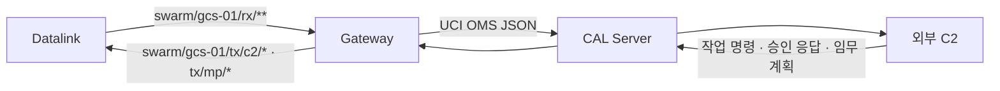
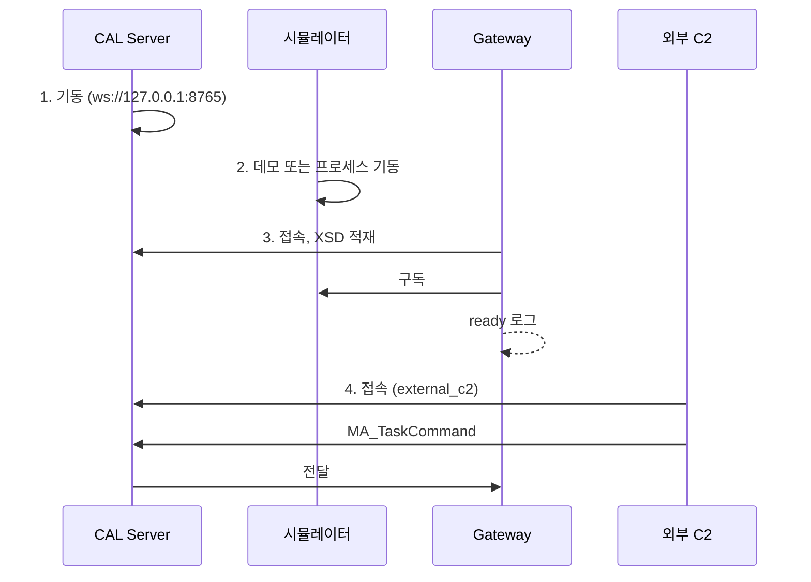

# 9. A-GRA Gateway 연동

시뮬레이터의 GCS 쪽 메시지를 외부 A-GRA 시스템과 주고받는다. Gateway는 CAL Server를 거쳐 외부 C2와 통신한다(DEC-068, DEC-069).



교환 메시지 전체 표는 [gateway/README.md](../../gateway/README.md#교환-메시지)에 있다. 기체 위치(`MA_NavigationReport`, `MA_PositionReport`), 작업 상태(`MA_TaskStatus`), 비행 명령 상태(`MA_FlightCommandStatus`)를 내보내고 `MA_TaskCommand`, `MA_ApprovalRequestStatus`, `MA_RoutePlan`, `MA_MissionPlan`을 받는다.

## 9.1 준비

```bash
git submodule update --init third_party/agra_lacal
```

```bash
cd gateway && uv sync --extra zenoh
```

> 주의: `--extra zenoh`를 빼면 Gateway는 설치 방법을 알리고 종료 코드 1로 끝난다. 시뮬레이터 없이 확인만 할 때는 `--bus memory`를 명시한다. 이때는 시뮬레이터 메시지가 오지 않는다.

## 9.2 실행 순서



**1. CAL Server를 띄운다.**

```bash
cd gateway && uv run python -m swarm_gateway.lacal_server --config config/lacal_server.yaml
```

**2. 시뮬레이터를 띄운다.** CAL Server가 8765 포트를 쓰므로 브리지 포트를 바꾼다.

```bash
uv run python scripts/run_p0_demo.py live --bridge-port 8770
```

브라우저 UI는 URL의 `bridge=`도 `ws://127.0.0.1:8770/bus`로 준다.

**3. Gateway를 띄운다.** `--no-multicast`와 `--connect`로 시뮬레이터 버스에 직접 붙는다.

```bash
cd gateway && uv run python -m swarm_gateway --gcs gcs-01 --lacal ws://127.0.0.1:8765 --no-multicast --connect tcp/127.0.0.1:17600 --connect tcp/127.0.0.1:17601
```

`--connect`의 포트는 실행기의 `--base-port`(기본 17600)를 따른다. `--participant <id>`는 Gateway의 발행자 ID다(기본 `gateway-0`).

**4. 외부 C2를 붙인다.** 같은 CAL Server에 `external_c2` 서비스로 접속해 `swarm.c2` 토픽에 `MA_TaskCommand`·`MA_ApprovalRequestStatus`를, `swarm.mp` 토픽에 `MA_RoutePlan`·`MA_MissionPlan`을 보낸다. 시험용 클라이언트의 구현 예는 [qa/gw_ext_client.py](../../qa/gw_ext_client.py)다.

## 9.3 시작 직후

Gateway는 접속 뒤 XSD를 적재한다. 이번 확인에서 약 9초 걸렸다. 그동안 외부가 보낸 명령은 서버가 `+OK`로 답해도 받는 쪽이 없어 사라진다(O-13). 외부 C2는 `ready` 줄이 나온 뒤 명령을 보낸다.

| 로그 | 뜻 |
|---|---|
| `LA-CAL connected ... not ready yet` | 접속만 됐다 |
| `XSD loaded, mapping built` | 검증 준비 완료 |
| `LA-CAL SUB MA_TaskCommand@swarm.c2 done` | 외부 명령 구독 완료 |
| `ready at +N s` | 양방향 준비 완료 |

## 9.4 외부 `MA_TaskCommand` 규칙

이 규칙은 위치가 필요 없는 작업과 취소에만 쓴다(DEC-076).

- `Command` 항목 하나가 수행 기체 하나다.
- `CapabilityID.DescriptiveLabel` = `<엔티티 ID>/<작업 종류>`.
- 작업 종류는 `hold`(현재 위치 선회 대기)와 `return_to_base`만 받는다.
- `TaskID.DescriptiveLabel`이 내부 작업 ID가 된다.
- `CommandState`가 `CANCEL`이면 취소다.
- 모든 항목의 `TaskID`와 `CommandState`가 같아야 한다.

이동 목적지처럼 위치 정보가 필요한 작업은 [9.6](#96-임무-계획-수신)의 임무 계획으로 받는다.

`MA_TaskStatus`의 흐름은 다음과 같다. `hold`를 보내면 `EXECUTION_PENDING` → `EXECUTING`이 온다. 기체가 맡고 있던 이전 작업은 `CANCELED`가 된다.

## 9.5 외부 승인 응답

`MA_ApprovalRequestStatus`를 `swarm.c2`로 받아 `ApprovalResponse`로 보낸다(DEC-075).

- `RequestProcessingState`가 `COMPLETED`이고 `ApprovalRequestProcessingState`가 `APPROVED` 또는 `REJECTED`인 것만 받는다. 그 밖의 상태는 거부한다.
- Gateway가 내보낸 요청이면 요청한 기체로만 보낸다. 모르는 요청(재기동 뒤 포함)은 `dst`를 비워 보내고 받는 쪽이 `request_id`로 가른다.

## 9.6 임무 계획 수신

`MA_RoutePlan`·`MA_MissionPlan`을 `swarm.mp`로 받아 `RoutePlan`·`MissionPlan`으로 보낸다(DEC-076). 지원·거부 항목의 전체 표는 [gateway/README.md](../../gateway/README.md#임무-계획-수신-dec-076)에 있다.

- `MA_RoutePlan`을 먼저 보낸 뒤 그 경로를 참조하는 `MA_MissionPlan`을 보낸다. 받은 경로는 Gateway 메모리에만 있어(최근 1024건) 재기동 뒤에는 다시 보낸다.
- `MA_MissionPlan`은 참조한 경로마다 작업 하나가 된다. 항로점 하나면 `move_to`, 둘 이상이면 `route`이고 `task_id`는 경로 ID다.
- 대상은 `ApplicableToIDs/SystemID` 하나다. `ALL`, `NON`, `PackageID`는 거부한다(CR-GW-009).
- 영역 탐색처럼 경로로 표현되지 않는 작업은 받지 못한다(CR-GW-007).

내장 MA는 실행 중 받은 계획을 다음과 같이 반영한다.

| 받은 것 | 동작 |
|---|---|
| 이미 본 `plan_id`의 `MissionPlan` | 내용이 달라도 무시 |
| 새 `plan_id`의 `MissionPlan` | 교체. 수행 중 작업과 대기 작업은 `CANCELLED`가 되고 새 계획을 수행한다 |
| 같은 ID의 계획 작업이 있는 `RoutePlan` (`waypoint`) | 따로 비행하지 않고 그 작업이 수행한다. `RoutePlan`과 `MissionPlan`을 어느 순서로 보내도 `COMPLETED`로 끝난다 |
| 계획에 없는 단독 `RoutePlan` (`waypoint`) | 바로 비행한다. 수행 중 작업은 `CANCELLED`, 대기 작업은 항로가 끝나면 잇는다. `RoutePlan` 자체의 작업 상태는 오지 않는다 |

- `flocking`은 항로점 둘 이상의 `route` 작업을 거부한다.
- `flocking`은 `EXECUTING`을 보내지 않아 외부의 마지막 값이 `EXECUTION_PENDING`으로 남는다(O-28).

## 9.7 카운터와 거부

`--stats-s` 주기로 `counters` 로그가 나온다.

| 항목 | 뜻 |
|---|---|
| `rx` | 버스에서 받은 메시지 |
| `exported`, `exported.<UCI 메시지>` | XSD 검증을 통과해 내보낸 수 |
| `sent` | LA-CAL로 보낸 수 |
| `ext_rx` | 외부에서 받은 명령 |
| `ext_published` | 버스로 내보낸 명령 |

- XSD 검증이나 변환에 실패한 메시지는 내보내지 않고 로그와 카운터에 남긴다. Gateway는 계속 돈다.
- 위치 대응 메시지 하나가 실패해도 다른 대응 메시지는 내보낸다.

> 알려진 제약: `config/lacal_server.yaml`의 `declared.pub`에 `MA_PositionReport`가 없다(O-20). 이번 확인에서는 메시지가 그대로 전달됐다.

다음: [10. 문제 해결](10_faq.md).
