# 관점별 아키텍처 그림

- 목적: 아키텍처를 여러 관점의 그림으로 보여 주고 설계 피드백을 받는다. 피드백 질문은 [§11](#11-사용자-피드백-질문)에 있다.
- 기준: `wp0-contracts` 커밋 `6516484`, 계약 0.19.0, 로드맵 P2·P6 완료, P1 성능 판정 진행 중. 계획(제안서)과 구현이 다르면 구현을 그리고 차이를 "계획 대비"로 적는다.
- 표지: **[추정]**은 코드나 기록으로 확인하지 않은 해석이다. **[미구현]**은 계획에만 있는 것이다.
- 그림마다 "보여 주는 것 / 근거 / 판단할 지점"을 붙였다. 판단할 지점은 §11 질문 번호(Q)와 이어진다.
- 매뉴얼과 달리 이 문서는 설계 검토용이다. 사용법은 [개괄](40_overview.md), [개발자 매뉴얼](41_dev/README.md), [사용자 매뉴얼](42_user/README.md)에 있다.

## 1. 시스템 맥락

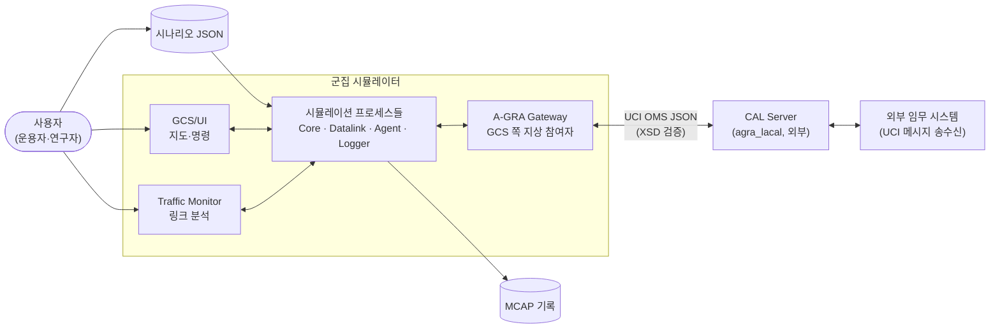

| 항목 | 내용 |
|---|---|
| 보여 주는 것 | 시뮬레이터 밖에 있는 것: 사용자, 시나리오 파일, 기록 파일, CAL Server와 그 너머의 외부 시스템 |
| 근거 | 제안서 §3.1, DEC-068·069(Gateway), DEC-076(임무 계획 수신), [gateway/README.md](../gateway/README.md) |
| 계획 대비 | 제안서의 PX4/ArduPilot SITL 연동(P8)과 L1 컴플라이언스 하네스(P7)는 **[미구현]**이다 |
| 판단할 지점 | Gateway는 GCS 하나로 행동한다. 외부 시스템이 여러 GCS를 대표하거나 기체를 직접 지휘하는 구성이 필요한가(Q1) |

## 2. 프로세스와 배치

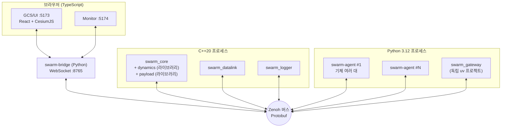

| 프로세스 | 언어 | 하는 일 | 개수 |
|---|---|---|---|
| `swarm_core` | C++20 | 프레임 진행, 동역학 적분, 센서·재머·유도 객체 판정(payload 라이브러리), 고장 주입, truth 발행 | 1 |
| `swarm_datalink` | C++20 | `tx` → 링크 모델 → `rx`, 링크 결과·상태 발행, GCS Heartbeat 발생 | 1 |
| `swarm-agent` | Python | 기체마다 MA·FA 실행, L1 포트 제공. 한 프로세스가 여러 기체를 맡는다 | 1개 이상 |
| `swarm_logger` | C++20 | 모든 키를 MCAP으로 기록, 재생 | 0~1 |
| `swarm-bridge` | Python | 브라우저 ⇄ 버스. 구독 다운샘플, 발행 키 허용 검사 | 0~1 |
| `swarm_gateway` | Python | 내부 메시지 ⇄ UCI 변환 | 0~1 |

| 항목 | 내용 |
|---|---|
| 보여 주는 것 | 실행 단위와 언어. 모든 프로세스는 Zenoh 버스 하나로만 연결된다. 브라우저는 브리지를 거친다 |
| 근거 | DEC-005(버스), DEC-006(언어), DEC-022(빌드), [개괄 §3](40_overview.md#3-구성-요소), 각 `CMakeLists.txt` |
| 계획 대비 | Payload는 별도 프로세스가 아니라 Core에 링크되는 정적 라이브러리다. 4대 PC 분산(P4)은 **[미구현]**이고 단일 PC에서 100기까지 시험했다 |
| 판단할 지점 | Agent 분할 단위(기체 수, 그룹, PC)를 사용자가 정하는 지금 방식이 맞는가(Q2) |

## 3. 데이터 흐름과 키

### 3.1 키 영역과 흐름

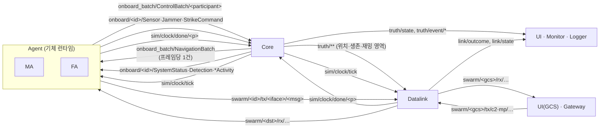

| 키 | 발행 | 구독 | 비고 |
|---|---|---|---|
| `sim/clock/tick`, `sim/clock/done/
` | Core / 참여자 | 참여자 / Core·Datalink | lockstep 장벽 |
| `sim/ctrl/cmd·status·scenario`, `sim/param/<entity>/<owner>` | UI·Core·런타임 | 모두 | 통제·배포·매개변수 |
| `onboard_batch/NavigationBatch` | Core | Agent 런타임 | 전 기체 항법. MA 금지(DEC-081) |
| `onboard_batch/ControlBatch/<participant>` | Agent 런타임 | Core | 참여자당 프레임당 1건 |
| `onboard/<id>/<msg>` | Core ⇄ 그 기체 런타임 | 그 기체 | 같은 기체 안 신호 |
| `swarm/<src>/tx/<iface>/<msg>` | 기체 런타임, UI, Gateway(c2·mp) | Datalink만 | 기체 간·지상-기체 간 |
| `swarm/<dst>/rx/...` | Datalink만 | 수신 기체·GCS | |
| `link/outcome/<src>/<dst>`, `link/state/<a>/<b>` | Datalink | UI·Monitor·Logger | 기체는 구독하지 않음 |
| `truth/state`, `truth/event/<kind>` | Core | UI·Monitor·Logger·Datalink | 기체는 구독하지 않음 |

| 항목 | 내용 |
|---|---|
| 보여 주는 것 | 키 영역별 생산자와 소비자. 기체 간 메시지는 반드시 `tx` → Datalink → `rx`를 거친다 |
| 근거 | [계약 §3.1~3.2](10_contracts.md#31-메시지-흐름), DEC-013, DEC-077(publisher), DEC-081 |
| 판단할 지점 | `onboard_batch`는 성능 때문에 "한 기체 = 한 키" 원칙을 깼다. 분산 배치(P4)에서 Agent마다 자기 기체만 받는 배치로 나눌 필요가 있는가(Q3) |

### 3.2 가시성 경계 (DEC-013)

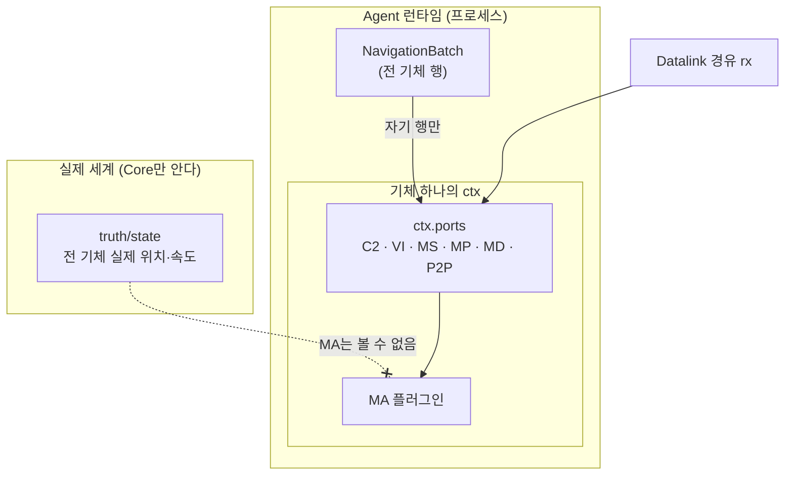

| 항목 | 내용 |
|---|---|
| 보여 주는 것 | MA가 볼 수 있는 것은 자기 포트뿐이다. 다른 기체 정보는 P2P로 받은 메시지로만 안다. 런타임은 전 기체 항법을 받지만 MA에는 자기 행만 준다 |
| 근거 | DEC-013, PRP-SIM-003, [runtime.py](../agent/src/swarm_agent/runtime.py) 머리 주석 |
| 지키는 방법 | MA에는 버스를 주지 않고 포트만 준다. 런타임이 MA 금지 접두사(`sim/ctrl/`, `truth/`, `link/`, `onboard_batch/`, `keys.MA_FORBIDDEN_PREFIXES`)를 구독하지 않는 것은 시험으로 확인한다. 같은 프로세스 안이라 MA 코드가 런타임 객체를 직접 뒤지는 것까지 막지는 않는다 **[추정: 그런 장치를 찾지 못함]** |
| 판단할 지점 | 일괄 MA(`on_step_batch`, flocking)는 NumPy 배열로 여러 기체를 한 번에 계산한다. 이 경우도 기체별 입력만 쓰도록 하는 지금 규약이면 충분한가(Q4) |

## 4. 시간과 동기: lockstep 한 프레임

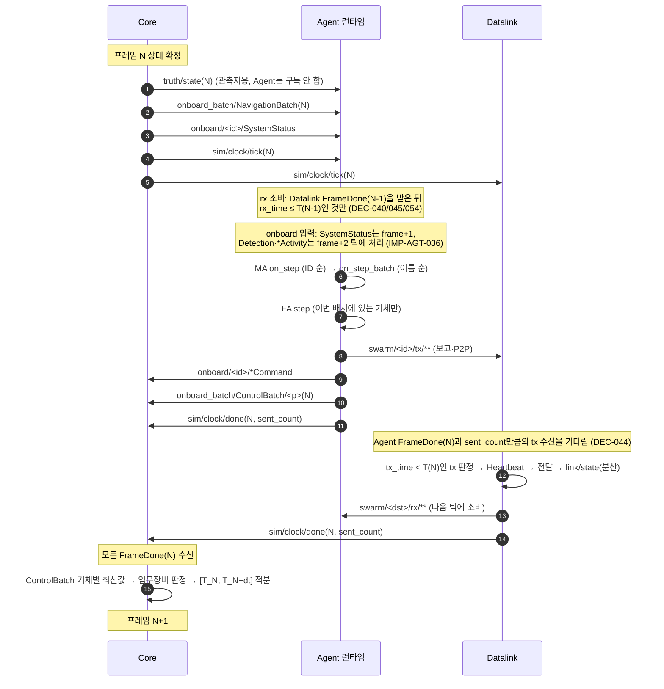

| 항목 | 내용 |
|---|---|
| 보여 주는 것 | 한 프레임 안의 순서와 장벽 세 개: Agent의 rx 소비 장벽(Datalink FrameDone N-1), Datalink의 송신 개수 장벽(DEC-044), Core의 FrameDone 장벽 |
| 근거 | [계약 §3.3](10_contracts.md#33-규칙) DEC-037·040·044·045·054, [sim_core.cpp](../core/src/sim_core.cpp) `publish_frame`·`integrate_frame`, [emulator.cpp](../datalink/src/emulator.cpp) `run_tick`, DEC-083 |
| 결과 | 기체 간 메시지는 링크 지연에 더해 최소 1틱 늦게 소비된다. 같은 시드면 truth, `LinkOutcome`, GCS 수신이 실행마다 같다(외부 입력이 있는 Gateway 구성 제외) |
| D-33 / DEC-083 | 일괄화 뒤 Python 구독이 스레드마다 따로 콜백을 불러 NavigationBatch와 tick의 큐 순서가 바뀌는 일이 생겼다(입력 지연 경고). Agent 런타임만 `subscribe(ordered=True)`로 수신 스레드에서 직접 콜백해 Core 발행 순서를 지킨다 |
| 판단할 지점 | 제어 입력은 프레임 N 항법으로 계산해 [T_N, T_N+dt] 적분에 쓰인다(지연 0프레임). 반면 P2P는 최소 1틱, 임무장비 결과는 2틱 늦다. 이 지연 구조가 비행제어·군집 연구 목적에 맞는가(Q5) |

## 5. 기체 내부 계층

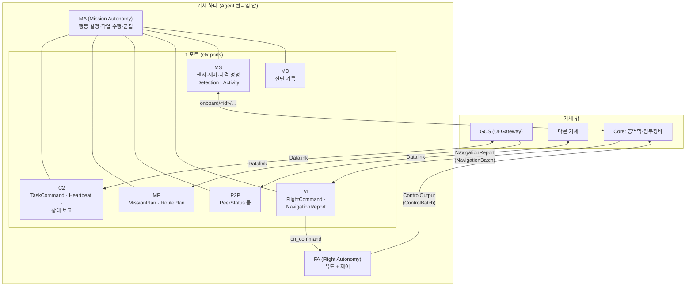

| 포트 | 방향 | 주 메시지 | 경로 |
|---|---|---|---|
| C2 | 양방향 | `TaskCommand`, `FormationCommand`, `GcsHeartbeat` / `TaskStatus`, 상태 보고 | Datalink |
| MP | 수신 | `MissionPlan`, `RoutePlan`, `EngagementCriteria` | Datalink, 시작 시 시나리오 |
| P2P | 양방향 | `PeerStatus` 등 | Datalink |
| VI | MA → FA, Core → MA | `FlightCommand`(HSA, Waypoint, Curve) / `NavigationReport`, `FlightCommandStatus`, `SystemStatus` | 같은 프로세스, Core |
| MS | 양방향 | `SensorCommand`, `JammerCommand`, `StrikeCommand` / `Detection`, `*Activity` | Core(onboard) |
| MD | 기록 | 이름·값 진단 | 런타임 내부 |

| 항목 | 내용 |
|---|---|
| 보여 주는 것 | MA와 FA 사이의 계약은 VI `FlightCommand` 하나다. FA는 MA를 모르고, MA는 제어 출력을 모른다 |
| 근거 | 제안서 §3.3, PRP-BHV-002, DEC-013, [ports.py](../agent/src/swarm_agent/ports.py), [플러그인 API](41_dev/04_ma_plugin.md) |
| 계획 대비 | VI 상태 보고(NavigationReport 1 Hz, 명령 상태)는 MA가 아니라 런타임이 GCS로 자동 보고한다(DEC-071) |
| 판단할 지점 | VI 명령 종류가 HSA·Waypoint·Curve(Orbit·Racetrack) 셋뿐이다. 편대 추종은 HSA를 매 프레임 갱신해 흉내 낸다. 속도 벡터나 가속도 명령 같은 저수준 모드가 필요한가(Q6) |

## 6. 유도·항법·제어 체인과 상위 행동

### 6.1 체인

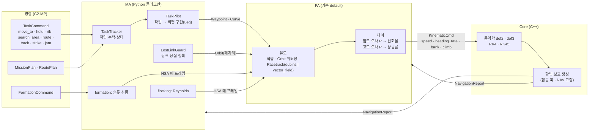

| 계층 | 구현 | 계획(제안서 §3.3) | 차이 |
|---|---|---|---|
| MA 행동 결정 | 플러그인별 Python 코드. 공용 부품 `TaskTracker`, `TaskPilot`, `LostLinkGuard` | BT/FSM | BT/FSM 프레임워크는 **[미구현]**. 상태 기계는 각 플러그인 안에 손으로 짰다 |
| MA 경로 계획 | 경유점 직행, 원 선회, 레이스트랙. 장애물·지형 회피 없음 | 경로 계획 | 경로 계획기 **[미구현]** |
| FA 유도 | 직행(경유점 방위), Orbit 벡터장(Beard & McLain), Racetrack dubins·vector_field(DEC-034) | L1, vector field, PN | L1 **[미구현]**. PN은 FA가 아니라 Core의 유도 객체 모델에 있다 |
| FA 제어 | 침로·고도 비례 제어, 최대 뱅크·상승률 제한, 협조선회 `bank = atan(V·ψ̇/g)` | PID, LQR | 적분·미분 항 없음, LQR **[미구현]** |
| 동역학 | `dof2`, `dof3`(운동학 명령 입력), 적분기 RK4·RK45 | 2·3·5·6-DoF | `dof5`·`dof6` 이름만 예약, **[미구현]**(P3) |
| 항법 | Core가 truth 위치·속도를 그대로 `NavigationReport`로 낸다. NAV 고장이면 그 기체 보고를 빼고, `SystemStatus`에 반영한다 | 센서 모델(GNSS·IMU 잡음) | 잡음 함수 자리(`nav_noise`)만 있고 실행 파일에서 연결하지 않는다. 시험에서만 쓴다. 항법 잡음 **[미구현]** |

| 항목 | 내용 |
|---|---|
| 보여 주는 것 | 명령이 MA → VI → FA → 동역학으로 내려가고 항법이 다시 올라오는 고리. 유도와 제어는 모두 FA 안에 있다 |
| 근거 | [fa.py](../agent/src/swarm_agent/fa.py), [common.py](../algorithms/src/swarm_algorithms/common.py), [factory.cpp](../dynamics/src/factory.cpp), [sim_core.cpp](../core/src/sim_core.cpp) `publish_frame`, PRP-GNC-001, DEC-033·034 |
| 판단할 지점 | FA 출력이 운동학 명령(속도·선회율·뱅크·상승률)이라 5·6-DoF가 들어오면 FA 출력(자세·추력·조종면)과 제어기 위치를 다시 정해야 한다(Q7). 항법 잡음을 어느 계층에 둘지(Core 훅 / FA 앞 필터 / 별도 항법 모델)(Q8) |

### 6.2 상위 행동 목록

| 행동 | 입력 | 지원하는 내장 MA | MA가 내리는 VI 명령 | FA 유도 |
|---|---|---|---|---|
| 이동 (`move_to`) | C2 `TaskCommand`, MP 작업 | waypoint, formation(리더), flocking | Waypoint 1점 | 직행, 도달 후 선회 |
| 대기 선회 (`hold`) | 같음 | waypoint, formation(리더), flocking | Curve Orbit 또는 Racetrack | Orbit 벡터장 / Racetrack |
| 기지 귀환 (`return_to_base`) | 같음 | waypoint, formation(리더), flocking | Waypoint(첫 항법 위치) | 직행 |
| 영역 탐색 (`search_area`) | 같음 | waypoint, formation(리더), flocking | Curve Orbit (영역 원 1바퀴, `area_circle`) | Orbit |
| 항로 (`route`) | C2 `TaskCommand`, `RoutePlan`(Gateway) | waypoint, formation(리더) | 구간마다 Waypoint, 항로점 동작은 Orbit·Racetrack | 직행, Orbit, Racetrack |
| 항로점 선회 (`LoiterAction`) | `route` 안 | 위와 같음 | Orbit 또는 Racetrack, 시간 | 같음 |
| 항로점 정찰 (`ReconAction`) | `route` 안 | 위와 같음 | Orbit 1바퀴 | Orbit |
| 편대 (leader-follower) | C2 `FormationCommand`, `MissionPlan.formations` | formation | 리더: 작업대로. 추종기: HSA 매 프레임 | HSA |
| 군집 (Reynolds flocking) | 이웃 `PeerStatus`(P2P) | flocking, flocking_basic | HSA 매 프레임 | HSA |
| 추적 (`track`) | C2 | 없음(REJECTED) | — | — |
| 타격 (`strike`) | C2 | 없음(REJECTED) | MS `StrikeCommand`(사용자 MA) | 유도 객체는 Core가 계산 |
| 재밍 (`jam`) | C2 | 없음(REJECTED) | MS `JammerCommand`(사용자 MA) | — |
| 센서 운용 | — | 없음 | MS `SensorCommand`(사용자 MA) | — |
| 링크 상실 행동 | C2 `GcsHeartbeat` 끊김 | hold, waypoint, formation, flocking | Orbit(제자리) | Orbit / Hold 벡터장 |
| 예제: 선회·순찰·랑데부 | — | example_turn, example_patrol, example_rendezvous | — | — |

| 항목 | 내용 |
|---|---|
| 보여 주는 것 | 행동마다 어느 메시지로 들어와 어느 MA가 처리하고 어떤 VI 명령으로 내려가는지 |
| 근거 | [c2.proto](../proto/swarm/v1/c2.proto) `TaskCommand`, `common.py` `PILOT_TASKS`·`TaskPilot._plan`, `formation.py`·`flocking.py`·`hold.py` 머리 주석, DEC-033·034·078 |
| 판단할 지점 | 임무장비 작업(track·strike·jam)을 받는 내장 MA가 없다. 사용자 MA 몫으로 둘지, 기본 MA에 넣을지(Q9) |

### 6.3 링크 상실 정책 (DEC-078)

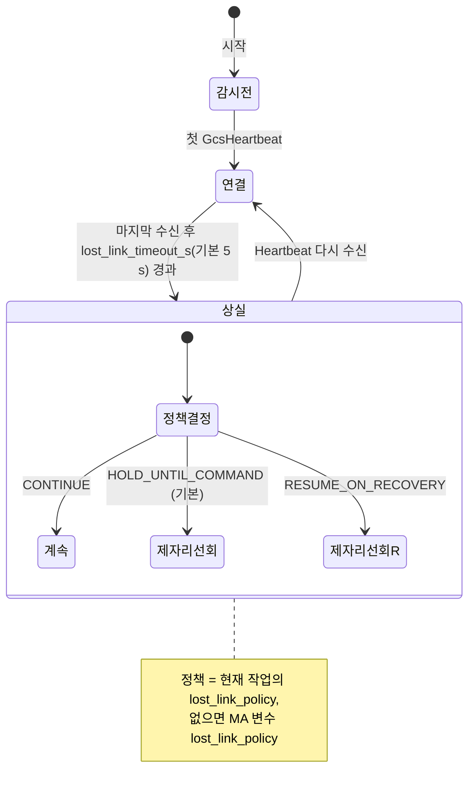

| 정책 | 상실 시 | 복구 시 |
|---|---|---|
| `HOLD_UNTIL_COMMAND`(기본) | 제자리 선회, 작업 진행·대기 작업 시작 멈춤 | 새 명령이 올 때까지 선회 유지 |
| `RESUME_ON_RECOVERY` | 제자리 선회 | 중단한 작업 재개 |
| `CONTINUE` | 작업 계속 | 변화 없음 |

| 항목 | 내용 |
|---|---|
| 보여 주는 것 | MA가 C2 포트의 Heartbeat만으로 링크 상실을 판단하고 정책에 따라 행동하는 상태 |
| 근거 | DEC-078, [계약 §3.3](10_contracts.md#33-규칙), `common.py` `LinkMonitor`·`LostLinkGuard`, `c2.proto` `LostLinkPolicy` |
| 제약 | `FormationCommand`에는 정책 필드가 없어 추종기는 MA 변수만 쓴다. 상실 판단은 MA 안에 있고 FA·Core에는 없다 |
| 판단할 지점 | 기지 귀환(RTB)이나 일정 시간 뒤 귀환 같은 정책이 필요한가. 상실 판단을 MA가 아니라 FA(비행 안전 계층)에 둘지(Q10) |

### 6.4 임무장비와 유도 객체의 위치

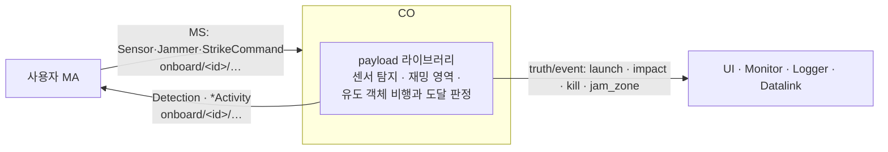

| 항목 | 내용 |
|---|---|
| 보여 주는 것 | 임무장비는 기체 FA가 아니라 Core 안 payload 라이브러리가 프레임마다 판정한다. 유도 객체의 유도(PN 등)도 여기에 있다 |
| 근거 | DEC-047(센서 고장), DEC-055(재밍 수신단 기준), IMP-CORE-022, [weapon.cpp](../payload/src/weapon.cpp), 제안서 §5.3 |
| 판단할 지점 | 유도 객체를 Core 내부 모델로 두는 지금 구조와, 별도 기체(자기 MA·FA를 가진 엔티티)로 띄우는 구조 중 무엇이 연구 목적에 맞는가(Q11) |

### 6.5 정리 필요 항목

| 번호 | 항목 | 현재 상태 | 왜 애매한가 |
|---|---|---|---|
| G-1 | "유도"라는 말이 두 곳에 있다 | 기체 FA의 경로 유도(직행·벡터장)와 Core payload의 유도 객체 유도(PN) | 제안서 §3.3은 PN을 FA에 두었다. 문서·코드에서 두 의미를 구분할 이름이 없다 |
| G-2 | 경로 계획의 소속 | `TaskPilot`이 작업을 Leg로 바꾸고 FA가 경유점·원·레이스트랙을 따라간다. Racetrack은 MA(`path_error`)와 FA(침로) 양쪽에 코드가 있다 | 같은 기하를 두 계층이 따로 계산한다 |
| G-3 | 경유점 도달 판정 중복 | MA `TaskPilot`(acceptance 80 m)와 FA `_waypoint`(acceptance 50 m 또는 선회 반경)가 각각 판정한다 | 어느 쪽 완료가 기준인지 혼동 여지 |
| G-4 | 편대·flocking의 명령 경로 | 매 프레임 HSA 명령으로 FA 상태를 갱신한다(같은 command_id 재사용) | VI 명령을 연속 제어 입력처럼 쓰는 것이 VI 계약의 의도와 맞는지 |
| G-5 | 링크 상실 처리 계층 | MA 공용 부품. MA 플러그인이 `LostLinkGuard`를 안 쓰면 아무 행동도 없다 | 비행 안전 기능이 교체 가능한 플러그인에 달려 있다 |
| G-6 | 기본 MA 범위 밖 작업 | track·strike·jam은 REJECTED | 사용자 MA가 MS 포트로 직접 해야 하는데 예제가 없다 |
| G-7 | 항법 잡음 | Core에 훅만 있고 실행 파일은 연결하지 않음. 항법 = truth | 항법 오차가 군집·편대 성능에 주는 영향을 지금은 볼 수 없다 |
| G-8 | 5·6-DoF와 FA 출력 | FA 출력은 운동학 명령(`KinematicCmd`). `ControlOutput`에 `AttitudeCmd`·`ActuatorCmd`가 정의돼 있지만 쓰는 모델이 없다 | 6-DoF가 오면 자세 제어기가 FA인지 동역학 모델 안인지 정해야 한다 |
| G-9 | BT/FSM | 플러그인마다 수작업 상태 기계 | 상위 행동을 조합하는 공통 틀이 없다 |
| G-10 | 상위 행동의 이름 체계 | `TaskCommand` 종류, `RouteWaypoint` 동작(loiter·recon), `FormationCommand`, MA 이름이 서로 다른 축이다 | 사용자에게 "행동"이 무엇인지 한 표로 정의되지 않았다(§6.2가 임시 정리) |

## 7. 데이터링크 모델

### 7.1 판정 순서

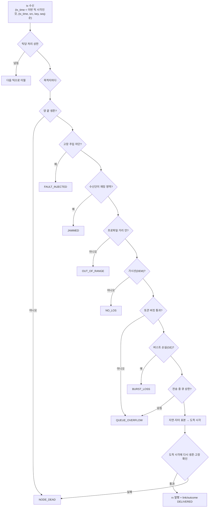

| 항목 | 내용 |
|---|---|
| 보여 주는 것 | 메시지 한 건이 목적지 하나에 대해 거치는 판정과 손실 사유 |
| 근거 | [emulator.cpp](../datalink/src/emulator.cpp) `static_check_locked`·`route_locked`·`deliver_locked`, 제안서 §4, DEC-009·028·055 |
| 계획 대비 | 제안서 §4는 경로손실·SNR 기반 확률 손실을 들었다. 구현의 거리 판정은 프로파일 거리 안/밖이다 **[추정: SNR 연속 모델은 미구현]**. 제안서 §3.6의 링크 상태 머신(Connected/Degraded/Jammed/Lost/LostLink)은 `link/state`의 UP/DEGRADED/DOWN 세 값으로 줄었다 |
| 판단할 지점 | 거리에 따른 손실률 변화(SNR 곡선)가 군집 실험에 필요한가(Q12) |

### 7.2 Heartbeat와 링크 상태

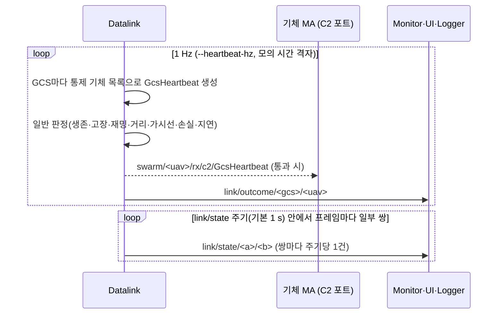

| 항목 | 내용 |
|---|---|
| 보여 주는 것 | Heartbeat는 실제 GCS가 내는 메시지가 아니라 Datalink가 대신 만든다. `swarm/<gcs>/tx`를 거치지 않으므로 송신 개수 장벽 대상이 아니다. `link/state`는 주기 안 프레임에 나눠 낸다(DEC-084) |
| 근거 | DEC-078, DEC-084, `emulator.cpp` `heartbeats_locked`·`publish_states_locked` |
| 판단할 지점 | GCS가 실제로 Heartbeat를 보내는 모델(UI·Gateway가 발행)로 바꿀 필요가 있는가. 지금은 GCS 프로세스가 멈춰도 Heartbeat는 계속된다(Q13) |

## 8. 성능 구조

### 8.1 일괄화 전후 메시지

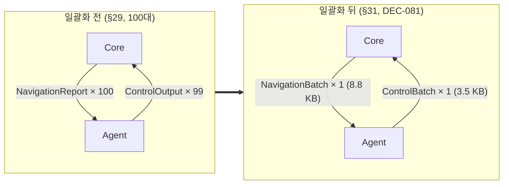

| 프레임당 (3-DoF 100대 waypoint) | 일괄화 전 | 일괄화 뒤 |
|---|---|---|
| 항법 | 100건 | 1건 8.8 KB |
| 제어 | 99건 | 1건 3.5 KB |
| `link/state` | 91건 | 94건 |
| 합계 | 314건, 41 KB | 125건, 46 KB |
| Agent 입력 / 출력 | 204건 / 약 105건 | 약 7건 / 약 5건 |
| 배속 (Logger 끔, 기본 스케줄링) | 1.04배 | 10.21배 |

### 8.2 P1 성능 판정 현황

| 구성 (3-DoF 100대 waypoint, lockstep 최대 배속) | 값 | 출처 |
|---|---|---|
| 목표 | Logger 켬 ≥ 10배, Agent 1개(DEC-084) | DEC-082, DEC-084 |
| Agent 1개, Logger 끔 | 10.21배 | QA §31.1 |
| Agent 1개, Logger 켬 | 9.05배 (미달) | QA §31.1 |
| Agent 1개, Logger 켬 (24차, 짧은 창 / 긴 창) | 7.61배 / 8.74배 | [QA §32.1](21_qa_report.md#32-24차-측정-logger-켬-10배-충족-수단-2026-11-13) |
| Agent 1개, Logger 켬, `link/state` 끔 (24차) | 8.83배 / 9.23배 | [QA §32.1](21_qa_report.md#32-24차-측정-logger-켬-10배-충족-수단-2026-11-13) |
| Agent 2분할, Logger 끔 | 12.39배 | DEC-082 |
| Agent 분할, Logger 켬, `link/state` 끔 | 11.7~12.8배 | QA 24차(DEC-084 인용) |
| `link/state` 분산 구현 뒤 Agent 1개, Logger 켬 | 측정 중 | IMP-LNK-025 병합(e49dfd3), QA 25차 |
| flocking 100대 | 0.41배 (P1 판정 제외) | QA §31.1, DEC-080 |

| 항목 | 내용 |
|---|---|
| 보여 주는 것 | 병목이 기체별 메시지가 Python Agent를 드나드는 비용이었고 일괄화로 메시지 수를 줄였다. 남은 차이의 대부분은 Logger가 1 Hz `link/state` 몰림을 받는 비용(프레임당 0.30~0.39 ms)이다. 다만 Agent 1개는 `link/state`를 꺼도 9.23배라 0.17~0.27 ms를 더 줄여야 한다(QA §32.1) |
| 근거 | [QA §29](21_qa_report.md#29-21차-측정-p1-성능-병목-2026-11-10)·[§31](21_qa_report.md#31-23차-측정-항법제어-일괄화-2026-11-10), DEC-079~084 |
| 남은 병목 | GIL을 쥐는 Python 구간이 프레임의 약 72%다(QA §31.6). flocking은 `PeerStatus`·`link/outcome` 약 2,000건/프레임이 병목이다 |
| 판단할 지점 | flocking 100대 실시간 이상이 필요한 시점(Q14). FA C++ 이전은 보류 상태다(DEC-082) |

## 9. 빌드·저장소·WP

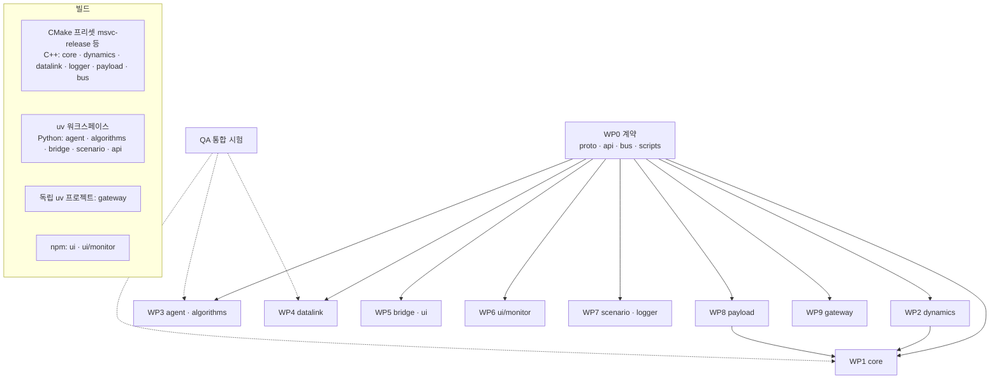

| 항목 | 내용 |
|---|---|
| 보여 주는 것 | WP0이 계약(proto·키·API)을 쥐고 나머지 WP가 그것에 의존한다. Core는 dynamics·payload를 라이브러리로 링크한다 |
| 근거 | DEC-015(계약 단일 출처), DEC-022(빌드), [개괄 §7](40_overview.md#7-저장소-지도), [11_wp_briefs.md](11_wp_briefs.md) |
| 판단할 지점 | 없음(참고용) |

## 10. 문서 사이 차이

이 문서를 쓰며 찾은, 이 문서 밖의 불일치다. 개괄 §4·§8의 차이는 문서 일괄 갱신에서 고쳤다.

| 위치 | 내용 |
|---|---|
| [계약 §3.5](10_contracts.md) welcome 예시 | `"contract":"0.16.0"`. 현재 0.19.0 **[추정: 예시라 갱신하지 않은 것]** |

## 11. 사용자 피드백 질문

| Q | 질문 | 관련 |
|---|---|---|
| Q1 | Gateway가 GCS 하나로 행동하는 구조로 충분한가, 여러 GCS나 기체 직접 지휘가 필요한가 | §1 |
| Q2 | Agent 분할 단위를 사용자가 시나리오에서 정하는 방식이 맞는가 | §2 |
| Q3 | 분산 배치(P4)에서 `NavigationBatch`를 Agent별로 나눌 필요가 있는가 | §3.1 |
| Q4 | 일괄 MA의 가시성 경계를 규약으로만 두어도 되는가 | §3.2 |
| Q5 | 제어 지연 0프레임, P2P 최소 1틱, 임무장비 결과 2틱의 지연 구조가 연구 목적에 맞는가 | §4 |
| Q6 | VI 명령(HSA·Waypoint·Curve) 외에 속도 벡터·가속도 같은 저수준 모드가 필요한가 | §5, G-4 |
| Q7 | 5·6-DoF 도입 시 자세 제어기를 FA에 둘지 동역학 모델 안에 둘지 | §6.1, G-8 |
| Q8 | 항법 잡음을 어느 계층에 둘지(Core 훅, FA 앞 필터, 별도 항법 모델), 언제 필요한지 | §6.1, G-7 |
| Q9 | track·strike·jam을 기본 MA에 넣을지, 사용자 MA 몫으로 두고 예제만 줄지 | §6.2, G-6 |
| Q10 | 링크 상실 정책에 RTB 등 추가가 필요한가, 상실 판단을 FA로 내릴지 | §6.3, G-5 |
| Q11 | 유도 객체를 Core 내부 모델로 둘지, 독립 엔티티(자체 MA·FA)로 둘지 | §6.4, G-1 |
| Q12 | 거리에 따른 연속 손실 모델(SNR 곡선)이 필요한가 | §7.1 |
| Q13 | Heartbeat를 Datalink가 대신 만드는 지금 방식 대신 GCS 프로세스가 직접 내야 하는가 | §7.2 |
| Q14 | flocking 100대 배속 목표와 시점 | §8 |
| Q15 | 경유점 도달 판정과 레이스트랙 기하를 MA·FA 중 한쪽으로 모을지 | G-2, G-3 |
| Q16 | 상위 행동을 조합하는 공통 틀(BT/FSM)을 언제 둘지, 행동 이름 체계를 하나로 정할지 | G-9, G-10 |
