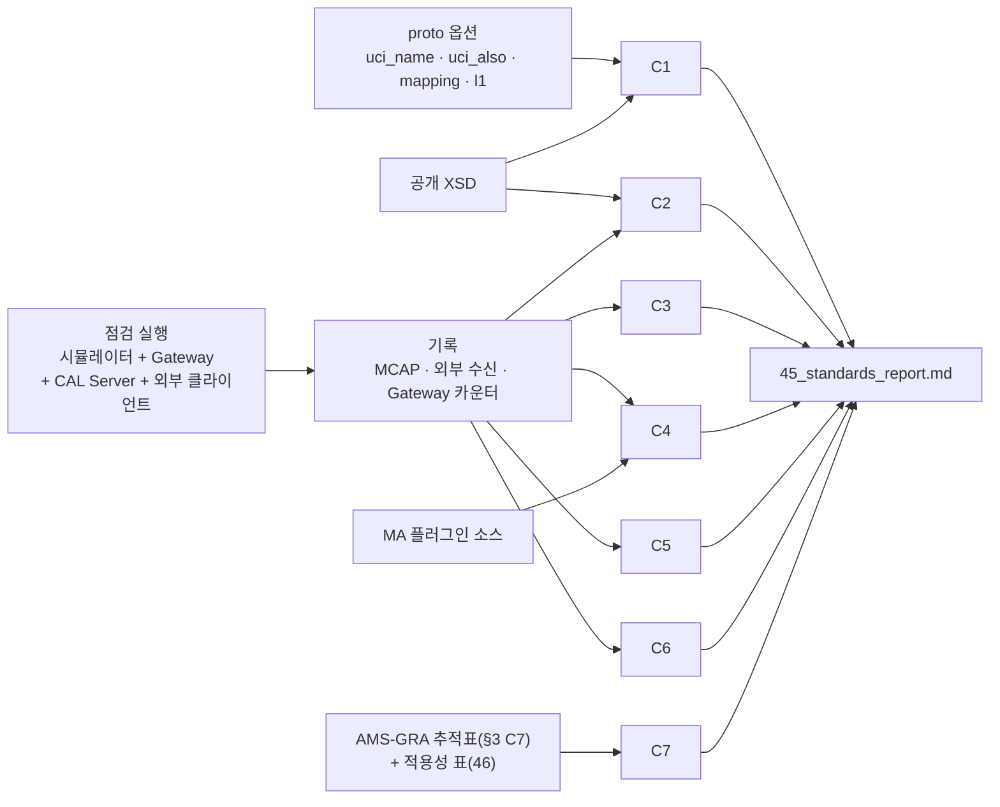

# 표준 적합성 점검 기준

- 근거: REQ-STD-001, DEC-092, DEC-093, DEC-094(C1 범위 구분), DEC-095(이력), DEC-097(명령 상태), DEC-098(시각 기준). 관련 결정: DEC-013(기체 계층 경계), DEC-014(확장 메시지), DEC-068·069(Gateway·agra_lacal), DEC-072(`uci_also`), DEC-075·076(외부 수신), DEC-088·089·090.
- 점검 결과는 [45_standards_report.md](45_standards_report.md)에 둔다. 도구가 만든다.
- 이 점검은 자체 점검이다. 공식 A-GRA 적합성 시험이나 외부 검토를 대신하지 않는다.

## 1. 표준별 적용 수준

표준마다 이 프로젝트에서 맡은 역할이 다르다. 판정도 그 역할에 맞춰 한다.

| 표준 | 적용 수준 | 판정 대상 | 점검 항목 |
|---|---|---|---|
| UCI (A-GRA 6.0a 공개 XSD, 스키마 `006.0.ASK`) | 외부 교환 메시지 형식 준수 | Gateway가 내보내고 받는 메시지 | C1, C2, C3 |
| A-GRA | 기체 계층 구조와 상호작용 행위 준용 (L1 전면 준수는 확장 목표) | MA 경계, 상호작용 상태 흐름, 상호작용 범위 | C1, C4, C5 |
| OMS / LA-CAL | 외부 연동 통로 준수 | agra_lacal CAL Server를 거친 양방향 교환 | C6 |
| AMS-GRA | 개념 차용 (준수 주장 없음, DEC-093) | 차용 개념의 반영 위치, 요구별 적용성 | C7 |

- 메시지명·필드는 공개(Distribution A) XSD에서만 가져온다. 배포 제한(Distribution D) 문서는 점검 기준에 쓰지 않는다.

## 2. 점검 흐름



- 점검 실행은 lockstep 고정 시드로 한다. 같은 커밋에서 다시 돌리면 같은 결과가 나와야 한다(외부 입력 시각 차이는 §4 한계).
- 외부 클라이언트는 Gateway 변환기를 쓰지 않고 공개 XSD 구조대로 메시지를 직접 만들고 다시 검증한다. 같은 코드로 만들고 같은 코드로 검사하는 것을 피하기 위해서다.

## 3. 점검 항목

### C1. 적용 범위 표

| 구분 | 내용 |
|---|---|
| 입력 | proto descriptor(`uci_name`, `uci_also`, `mapping`, `l1`), Gateway 변환기 등록, 공개 XSD, 등록부 §5 상호작용 목록 |
| 산출 | 상호작용별 행: L1, UCI 메시지, 방향(송신·수신), 구분(STD·EXT·SIM), 변환기 유무, 구현 ID, 시험 ID, 상태(구현·시험됨 / 부분 / 미구현) |
| 요약 | XSD 최상위 메시지 수, 그중 `MA_` 메시지 수, 대응한 UCI 메시지 수, 송신·수신 각각의 수 |
| 범위 구분 | STD 메시지를 GCS 경계(`swarm/<gcs>/**`로 오갈 수 있음)와 기체 내부(`onboard/**`로만 오감, MA↔장비·FA)로 나눈다. 기체 내부 STD는 "Gateway 범위 밖(기체 내부)"으로 표시한다 (DEC-094) |
| 실패 조건 | STD로 표시된 메시지의 `uci_name`·`uci_also`가 XSD에 없다. GCS 경계 STD인데 변환기가 없다. 변환기는 있는데 STD가 아니다 |

- 미구현 상호작용은 실패가 아니다. 범위를 보이는 것이 목적이다.
- 기체 내부 STD의 변환기 없음은 실패가 아니다. STD 표시는 UCI 메시지 대응을 뜻하고 Gateway 송출을 뜻하지 않는다.

### C2. 형식 검증 (UCI)

| 구분 | 내용 |
|---|---|
| 입력 | 점검 실행에서 외부 클라이언트가 받은 모든 메시지, 외부가 보낸 모든 메시지 |
| 방법 | 외부 클라이언트가 공개 XSD로 다시 검증한다. 메시지 종류별 건수와 실패 수를 센다 |
| 부정 시험 | XSD 위반, 지원 밖 작업, 모르는 기체, 잘못된 상태값을 외부에서 보내 Gateway가 버스에 내지 않고 거부로 기록하는지 본다 |
| 실패 조건 | 재검증 실패 1건 이상. 부정 입력이 버스로 나감 |

### C3. 값 의미 검증 (UCI)

XSD는 형식만 본다. 단위·기준·좌표계가 맞는지는 변환 전후 값을 대조해 본다.

| 대조 | 기준 |
|---|---|
| 위치 | Gateway 입력(버스의 `NavigationReport`, 도·m) ↔ UCI(`MA_PositionReport`·`MA_NavigationReport`, rad·m). 도→rad 변환 뒤 차이가 수치 오차 이내, 고도 기준 MSL |
| 속도·자세 | NED 속도 일치, NED→FRD 자세 변환 뒤 오일러각 일치 |
| 시각 | UCI Timestamp가 메시지 모의 시각과 맞음 |
| 시각 기준 (DEC-098) | UCI Timestamp − 모의 시각 = `sim/ctrl/scenario`의 `run.epoch_utc_us` (허용 오차 0.5 s). Gateway `epoch_changed` 카운터 0. epoch 관측 0건이거나 값이 0이면 실패. 카운터 확인은 epoch 일치 확인과 함께 판정한다(Gateway가 실행 중에 붙으면 카운터가 0이어도 첫 메시지 기준으로 틀릴 수 있다) |
| 식별자 | 같은 기체·작업은 실행 내내 같은 UUID, DescriptiveLabel = 내부 ID |
| 상태값 | 내부 상태 → XSD enum 대응이 DEC-090 표와 같음 |
| 수신 | 외부 `MA_RoutePlan`의 rad 좌표 → 내부 도 좌표, 항로점 순서(`NextPathSegment`)가 그대로 |

- 실제 위치(truth)와는 항법 잡음(PRP-SIM-003) 범위 안에 있는지만 본다. 변환 정확도 판정은 변환 전후 대조로 한다.
- 실패 조건: 허용 오차를 넘는 대조 1건 이상.

### C4. A-GRA 기체 계층 경계

DEC-013: MA는 L1 포트로만 통신하고 시뮬레이터 내부 상태나 `truth/**`에 직접 닿지 않는다.

| 방법 | 기준 |
|---|---|
| 실행 기록 | 점검 실행 MCAP에서 Agent 프로세스(MA 플러그인을 싣는 런타임)가 구독·발행한 키를 모은다. 허용 키 밖이면 실패. 허용 키는 계약 §3.2의 Agent 행(`swarm/**`, `onboard/**`, `onboard_batch/**`, lockstep 장벽 등)에서 정한다. `truth/**`는 어떤 경우에도 실패 |
| 소스 | MA 플러그인 소스(내장 `algorithms/`)가 버스·Zenoh·truth 메시지·Core 모듈을 import하지 않는다. 플러그인 API(계약 §5)만 쓴다 |
| 포트 | MA가 받고 낸 메시지의 L1 표시가 C2·VI·MS·MP·MD·P2P 중 하나이거나 EXT이다. SIM 표시 메시지가 MA에 오가면 실패 |

### C5. 상호작용 상태 흐름 (A-GRA)

| 구분 | 내용 |
|---|---|
| 입력 | 점검 실행의 `TaskStatus`, `FlightCommandStatus`, `ApprovalRequest`·`ApprovalResponse` 흐름 (내부 메시지와 외부 UCI 둘 다) |
| 기준 | 상호작용별 허용 전이 표. 예: 작업은 접수 → 수행 → 끝 상태(완료·취소·실패·거부) 중 하나로 끝나고, 끝 상태 뒤에 다시 수행으로 가지 않는다. 승인이 필요한 작업은 승인 응답 전에 수행하지 않는다 |
| 대응 | 외부 표현은 DEC-090 그대로(내부 EXECUTING·COMPLETED → 외부 ACCEPTED, 수행·완료는 상태 보고에서 읽는다) |
| 명령 상태 (DEC-097) | 외부 `MA_*CommandStatus`: 첫 보고는 RECEIVED·ACCEPTED·REJECTED·CANCELED, RECEIVED 뒤는 ACCEPTED·REJECTED·CANCELED. ACCEPTED·REJECTED·CANCELED는 끝 상태이고 같은 CommandID에 그 뒤 보고가 있으면 실패. 내부 `FlightCommandStatus`는 첫 보고 CANCELLED(접수 전 대체)를 허용한다 |
| 실패 조건 | 허용 전이 표 밖의 전이 1건 이상. 명령에 대한 상태 보고 누락(링크 정상 구간) |

- 허용 전이 표는 도구 안에 두고 보고서에 그대로 싣는다.

### C6. OMS / LA-CAL 왕복

| 구분 | 내용 |
|---|---|
| 구성 | agra_lacal CAL Server(서브모듈 고정 커밋) + Gateway + 외부 클라이언트(`external_c2` 서비스) |
| 송신 | Gateway가 선언한 발행 메시지가 모두 외부에 도착한다. CAL Server 관리 포트 `/tap` 건수와 외부 수신 건수가 맞다 |
| 수신 | 외부가 보낸 `MA_TaskCommand`, `MA_ApprovalRequestStatus`, `MA_RoutePlan`, `MA_MissionPlan`이 버스에 나가고 기체가 반영한다(C5 상태 보고로 확인) |
| 선언 | `gateway/config/lacal_server.yaml`의 `declared.pub·sub`와 실제 교환 메시지가 일치한다 |
| 실패 조건 | 선언된 메시지 중 교환되지 않은 것, 선언 밖 메시지 교환 |

### C7. AMS-GRA 개념 차용 추적과 적용성

준수 판정이 아니라 추적이다(DEC-093). 두 부분으로 한다.

- 차용 개념 추적: 제안서 §9.3의 차용 개념마다 반영 위치와 근거를 적는다(아래 표).
- 요구별 적용성: [46_amsgra_applicability.md](46_amsgra_applicability.md)의 표(요구 224건, 해당·부분·해당없음과 근거)를 쓴다.

| AMS-GRA 개념 | 반영 | 근거 | 확인 방법 |
|---|---|---|---|
| ASB(Abstract Service Bus) | `open_bus` 추상 계층, Zenoh 백엔드 | PRP-NET-001, DEC-002, DEC-026 | 모든 프로세스가 `open_bus`로만 버스를 여는지 소스 점검 |
| OMS 서비스 분해 | 임무장비를 서비스(카메라·재머·무장)별 Command/Activity로 모델링 | PRP-PAY-001 | MS 메시지가 장비 서비스별로 나뉘는지 C1 표에서 확인 |
| Time Distribution | Sim Core 고정 프레임, lockstep 장벽 | DEC-005, DEC-043 | lockstep 결정론 시험 결과 링크 |
| Armament | 무장 서비스·탑재 구성 명명(`StoreLoadoutConfiguration`) | DEC-019, DEC-088 | C1 표의 MS 행 |

- 도구는 이 표를 보고서에 싣고, 확인 방법 중 자동으로 볼 수 있는 것(소스 점검, 시험 결과 링크)을 채운다.
- 도구는 적용성 표의 요약(요구 군별 건수)을 보고서에 싣고, 해당·부분 행의 근거에 적힌 파일·ID가 저장소에 있는지 확인한다. 근거가 없어진 행이 있으면 실패로 적는다.

## 4. 한계

- 자체 점검이다. 같은 팀이 기준과 구현을 함께 만들었다. 외부 클라이언트를 Gateway 코드와 따로 두어 일부만 줄인다.
- 공식 A-GRA 적합성 시험 도구와 Distribution D 인터페이스 볼륨의 상세 규칙은 쓰지 않는다.
- A-GRA는 MA L1 준수 문서(요구 MA-L1-001~025, 최소 메시지 집합)와 자동 L1 준수 시험 도구가 있다고 안내한다. 이 저장소 자료에는 도구가 없다. 공식 판정이 필요하면 입수해야 한다.
- A-GRA MA-L1-009~012·025는 DMS의 DDS 사용을 요구한다. DEC-002(Zenoh만 사용)와 충돌하므로 이 점검으로는 L1 전면 준수를 보일 수 없다. 미들웨어 변경은 보류한다(DEC-099).
- AMS-GRA에는 시험 도구가 없다. 준수 평가는 요구별 통과·실패·해당없음 평가표와 가중 점수, Tier 0~3로 하는 자체 평가이고 최종 판단은 획득 기관이 한다. 이 저장소는 준수를 주장하지 않으므로 평가표 대신 적용성 표(46)를 둔다.
- 외부 입력이 있으면 같은 시드에서도 기체 궤적이 실행마다 조금 달라진다(외부 입력 도착 틱 차이). 판정은 건수·전이·대조 오차로 하고 궤적 일치는 보지 않는다.

## 5. 도구 사용

```bash
uv run python qa/conformance/run.py --out qa/out/conformance/<날짜>
```

- 점검 전에 msvc-release Core를 빌드한다. 계약 proto가 바뀌었으면 `scripts/gen_proto.py`로 생성 코드를 다시 만든다.
- 점검 실행을 띄우고(C2~C6), 정적 점검(C1, C4 소스, C7)을 하고, `docs/45_standards_report.md`와 결과 폴더(JSON, 표)를 만든다.
- 실행 중 띄운 프로세스는 끝날 때 PID로 정리한다.
- 보고서 첫 줄에 커밋, 계약 버전, agra_lacal 커밋, 실행 날짜를 적는다.

## 6. 이력 (DEC-095)

점검 조건과 결과가 커밋마다 어떻게 바뀌었는지 추적한다.

| 산출 | 내용 |
|---|---|
| `qa/conformance/history.jsonl` | 실행마다 한 줄을 덧붙인다. 고치거나 지우지 않는다 |
| `docs/47_conformance_history.md` | 도구가 `history.jsonl`과 git 기록으로 만든다. 손으로 고치지 않는다 |

실행 기록 필드:

| 필드 | 내용 |
|---|---|
| 실행 | 실행 날짜, 결과 폴더 |
| 대상 | 점검한 커밋(작업 트리가 깨끗하지 않으면 `dirty` 표시), 계약 버전, agra_lacal 커밋 |
| 조건 | 기준 문서 커밋(`docs/44`의 마지막 커밋), 도구 커밋(`qa/conformance/`의 마지막 커밋), 시나리오 시드, 반복 횟수 |
| 결과 | C1~C7 판정과 실패 문구 수, 항목별 핵심 수치, 발견 ID 목록 |

`docs/47_conformance_history.md`의 표:

1. **실행 이력**: 실행마다 한 행. 대상 커밋, 기준·도구 커밋, C1~C7 판정. 이전 실행과 달라진 판정을 표시한다.
2. **점검 조건 변경 이력**: `docs/44`와 `qa/conformance/`를 바꾼 커밋마다 한 행. 커밋, 날짜, 제목, 관련 DEC. 판정이 바뀐 원인이 조건 변경인지 제품 변경인지 가르는 데 쓴다.
3. **발견 추적**: 발견 ID마다 처음 나온 실행·커밋, 마지막으로 재현된 실행, 사라진 실행·커밋, 현재 상태(재현·해소).
