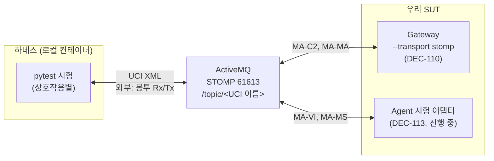

# A-GRA 시험 하네스 사용 기준 (DEC-114)

이 문서는 A-GRA 적합성 시험 하네스를 어떤 것으로, 어떻게, 어디까지 썼는지와 그 한계를 정한다. 우리 자체 점검 기준은 [44_standards_conformance.md](44_standards_conformance.md)이고, 하네스는 그 밖에서 상대편 구현으로 판정하는 보조 수단이다.

## 1. 결정 (DEC-114)

- 하네스 코드·XSD·컨테이너 이미지·실행 로그 원본은 저장소에 넣지 않고 재배포하지 않는다. 릴리스에 배포 등급·라이선스·저작권 표기가 없고, 제공처 확인이 불가하며 갱신본도 없기 때문이다(OPN-094).
- 저장소에는 하네스 이름·릴리스 번호·실행 구성·시드·건수와 우리 분석 결과만 적는다.
- 하네스는 각 개발 환경에 로컬로 설치해 쓴다. QA 자동 시험은 로컬 설치가 있을 때만 하네스 단계를 돌리고, 없으면 "건너뜀"으로 기록한다. 하네스 단계 결과는 QA 판정(C1~C7)을 대신하지 않는다.
- 하네스 결과를 적을 때는 릴리스 번호, 시드, 묶음, SUT 구성(전송 경로, SchemaVersion, 봉투 여부)을 함께 적는다.
- 하네스에 맞추려고 6.0a 뜻과 어긋나게 구현을 바꾸지 않는다(OPN-088).

## 2. 사용한 하네스

| 항목 | 내용 |
|---|---|
| 이름 | A-GRA Compliance Test Harness |
| 릴리스 | 1.2.2.a (릴리스 노트: ASK 5.0a 첫 시험 하네스 패키지) |
| 기준 표준 | A-GRA ASK 5.0a (메시지 `SchemaVersion` `005.0a.ASK`). 우리 구현 기준은 6.0a다 |
| 입수 | 사용자가 로컬에 둔 릴리스 zip(약 444 MB). 공개 저장소 zip에는 README와 Quickstart 문서만 있고 시험 코드·이미지는 없다 |
| 구성 | 컨테이너 이미지 2개: ActiveMQ Classic 6.1.2(메시지 버스), 하네스 이미지(Python 3.10, pytest). 메시지 생성·검증·인코딩은 이미지 안에만 있는 제3자 CAL 라이브러리가 한다(zip에 소스 없음) |
| 실행 환경 | Docker Desktop. 동봉 스크립트는 Podman 기준이라 같은 구성을 docker 명령으로 재현했다 |
| 배포 표기 | Distribution 표기, 라이선스 파일, 저작권 표기 없음 |

## 3. 동작 방식

- **버스:** ActiveMQ STOMP, 토픽은 `/topic/<UCI 메시지 이름>`, 본문은 UCI XML이다. 토픽은 비지속이라 SUT가 하네스보다 먼저 구독해야 한다.
- **역할:** 하네스가 SUT의 상대편을 맡는다. MA 묶음에서는 C2·피어 MA·MS·VI 역할을 하고 MA(SUT)를 시험한다.
- **봉투:** 외부 인터페이스(C2, MA-C2, MA-MA)는 하네스→SUT `MA_RxDataPayload`, SUT→하네스 `MA_TxDataPayloadCommand`로 오간다. `EncodedPayload`는 내부 UCI XML 문서를 문자당 1바이트로 넣은 hexBinary다(DEC-111). 하네스는 목적지 ID가 비었거나 자기 UUID를 포함할 때만 받는다. 플랫폼 인터페이스(VI, MS)는 봉투 없이 주고받는다.
- **시작·정지 신호:** 시험마다 `ServiceConfigurationChangeRequest`를 보내고 Ack를 기다린다. Ack가 없어도 경고만 낸다. 하네스는 사전 상태를 만들어 주지 않고, SUT가 스스로 상태를 맞춰야 한다.
- **메시지 생성:** 메시지 필드는 XSD에서 무작위로 만든다. 시드 `xml_generation_seed`(기본 42)에 따라 값이 정해진다.
- **판정:** 기대 메시지가 시간 제한(기본 6 s) 안에 순서대로 오고, XSD와 필수 필드가 맞으면 통과다. 값의 의미는 보지 않는다.

## 4. 시험 범위

### 4.1 하네스에 들어 있는 시험

시험은 A-GRA 상호작용 순서도에서 생성된 것으로, 상호작용마다 한 파일이다.

| 묶음 | SUT | 건수 |
|---|---|---|
| MA-C2 | MA | 208 |
| MA-MA | MA | 267 |
| MA-MS | MA | 53 |
| MA-VI | MA | 36 |
| C2, MS, VI | 상대 구성요소(하네스가 MA 역할) | 208, 53, 36 |
| 계 | | 861 |

우리 SUT에 해당하는 것은 MA 묶음 564건이다. C2·MS·VI 묶음은 우리가 상대 구성요소를 만들지 않으므로 대상이 아니다.

### 4.2 우리 구현 대비 분류 (정적 분석, 2026-11-24)

시험 파일의 송신·대기 메시지와 Gateway 교환 목록(`gateway/config/lacal_server.yaml`), Agent VI·MS 포트를 대조했다.

| 분류 | MA-C2 | MA-MA | MA-MS | MA-VI | 계 |
|---|---|---|---|---|---|
| 메시지 대응됨 | 1 | 3 | 0 | 0 | 4 |
| 출력은 대응, 입력 미지원 | 1 | 18 | 1 | 4 | 24 |
| SUT 응답을 요구하지 않음 | 21 | 80 | 29 | 13 | 143 |
| 5.0a 전용 메시지 | 2 | 2 | 0 | 3 | 7 |
| 기능 없음 | 183 | 164 | 23 | 16 | 386 |

- "SUT 응답을 요구하지 않음" 143건은 SUT가 없어도 통과한다. 통과 건수로 세지 않는다.
- 분류는 당시 구현 기준이다. 그 뒤 `QueryDataRequest` 응답(DEC-112)이 들어가 공통 조회 시험은 대응 대상이 됐다(§4.3). 전체 재분류는 하지 않았다.
- "기능 없음"의 가장 큰 몫은 `MA_SystemNotification`(MA-C2 56, MA-MA 37)과 `QueryDataRequest` 계열이다. `MA_SystemNotification`은 OPN-092로 열려 있다.

### 4.3 실행한 시험

| 날짜 | 구성 | 묶음 | 시드 | 결과 | 근거 |
|---|---|---|---|---|---|
| 2026-11-24 | 하네스끼리, 봉투 중계 시제품(저장소 밖) | C2 11, MS 2, VI 3쌍 | 42 | 16쌍 모두 한 기동 순서 이상에서 양쪽 통과. 실패는 모두 기동 순서에 따른 시간초과, XSD 오류 0 | OPN-088 |
| 2026-11-24 | Gateway `--transport stomp --schema-version 005.0a.ASK`, 봉투 켬 | MA-C2 공통 조회 23건 | 42 | 0/23. 하네스가 CANCEL 요청을 만들고 상태 두 건을 기다리나, 6.0a 뜻대로 `REJECTED UNKNOWN_ID` 한 건으로 답함 | OPN-088, IMP-GW-039 |
| 2026-11-24 | 같은 구성 | 같은 23건 | 1 | 23/23 (요청 NEW → PROCESSING, COMPLETED) | IMP-GW-039 |
| 2026-11-24 | Agent `--harness-stomp`(DEC-113 어댑터), 기체 1대, 봉투 없음, SUT 먼저 기동 | MA-VI 36건 | 42 | 19/36. SUT 출력으로 통과 6건(`MA_FlightCommand` 3종 제어 방식 포함), 응답 불요 13건, 실패 17건은 모두 없는 기능 대기 시간초과. XSD 오류 0 | IMP-AGT-061 |
| 2026-11-24 | 같은 구성 | MA-MS 53건 | 42 | 34/53. SUT 출력으로 통과 1건(`PO_Command`), 응답 불요 33건, 실패 19건은 모두 없는 기능(`MA_Task`, AMTI·ESM, DLZ·WEZ). XSD 오류 0 | IMP-AGT-061 |

- 첫 줄은 하네스 자체의 동작과 봉투 규칙을 확인한 것이다. 우리 SUT 결과가 아니다.
- 기체 내부 묶음(MA-VI, MA-MS)은 DEC-113 어댑터로 실행했다. `EA_Command`·`StrikeCommand`를 기다리는 하네스 시험은 없어 단위 시험의 XSD 검증으로만 확인했다.

## 5. 한계

- **판본 차이:** 하네스는 5.0a이고 우리 구현은 6.0a다.
  - 하네스가 쓰는 메시지 이름 가운데 8종이 6.0a에 없다.
  - 우리 송신 중 `MA_NavigationReport`·`MA_Entity`는 5.0a에 없어 5.0a 하네스에서는 내보내지 않는다.
  - `MA_TaskCommand`·`MA_MissionPlan`의 교전 파라미터와 `MA_FlightCapability` 성능 프로파일 구조가 두 판에서 다르다.
  - 그래서 하네스 통과는 5.0a 기준 통과이고, 6.0a 적합성을 보이지 않는다. 갱신된 6.0a 하네스는 없다.
- **공식 판정 아님:** A-GRA MA L1 준수 판정 도구가 아니다. L1의 DDS 요구(MA-L1-009~012·025)는 DEC-002·DEC-099로 이 저장소가 충족하지 않는다.
- **형식만 판정:** 순서·시간·XSD·필수 필드만 본다. 값의 의미, 기체 동작, 상태 기계의 정합은 보지 않는다. 이 부분은 우리 C3·C5가 본다.
- **무작위 입력:** 무작위 필드로 만든 명령은 알려진 기체 확인(IMP-GW-029)과 미지원 작업 거부에 걸리는 경우가 많다. 시드에 따라 결과가 달라진다(조회 시험 시드 1 23/23, 시드 42 0/23).
- **6.0a와 다른 기대:** 하네스는 CANCEL 요청에도 상태 두 건을 기다린다. 우리는 6.0a 뜻을 따르므로 해당 시드에서는 실패로 나온다(§1).
- **제어 방식을 보지 않음:** 기본 MA는 C2 작업만으로 HSA 명령을 내지 않는다. 어댑터는 HSA 시험에도 경유점 명령으로 답했고, 하네스는 XSD와 순서만 보므로 통과했다. 제어 방식별 통과로 세지 않는다.
- **응답 불요 시험:** 143건은 SUT 없이 통과하므로 범위 지표로 쓰지 않는다.
- **기동 순서:** 비지속 토픽이라 SUT가 늦게 뜨면 메시지를 잃고 시간초과로 실패한다.
- **검증 불가 부분:** 하네스 내부 CAL 라이브러리는 소스가 없어 검증할 수 없다. 5.0a XSD도 이미지 안에만 있다.
- **재현성:** 하네스는 저장소 밖에 있으므로, 결과를 재현하려면 같은 릴리스를 로컬에 설치해야 한다.

## 6. 관련 결정

| ID | 내용 |
|---|---|
| OPN-088 | 하네스 분석·실행 결과, 하네스와 6.0a 뜻의 차이 |
| OPN-094 | 배포 조건 → DEC-114 |
| DEC-110 | Gateway 하네스 STOMP 경로(5.0a 기준) |
| DEC-111 | 외부 교환 봉투 |
| DEC-112 | `QueryDataRequest` 응답 |
| DEC-113 | 기체 내부 인터페이스 시험 어댑터 |
| OPN-092 | `MA_SystemNotification` 미지원 |
