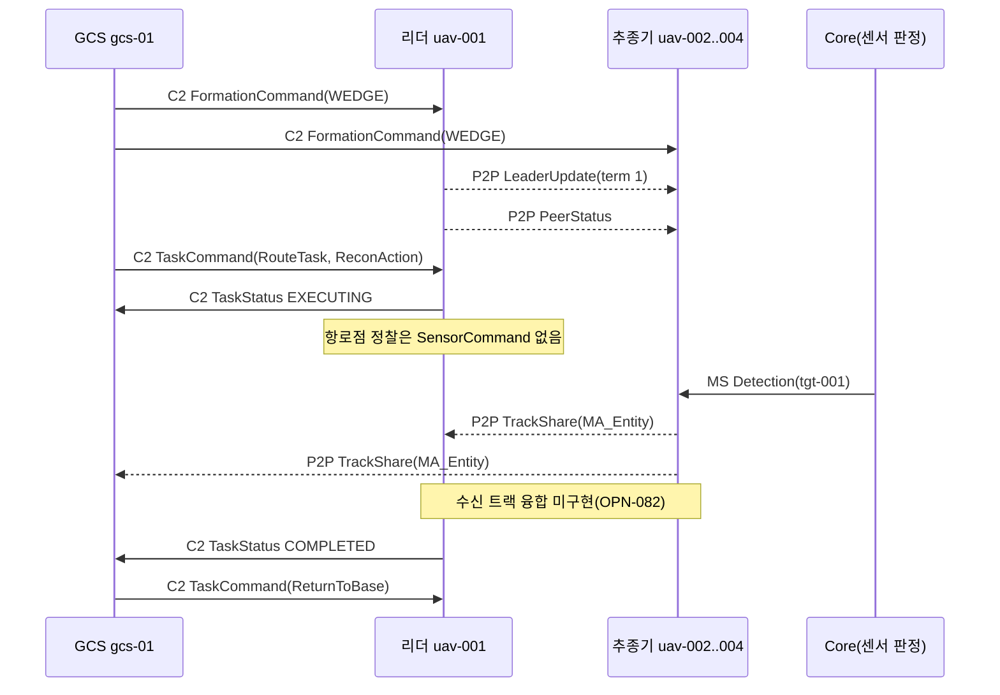
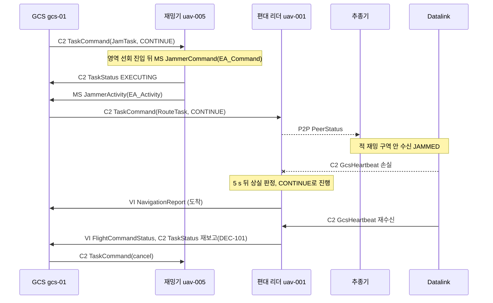
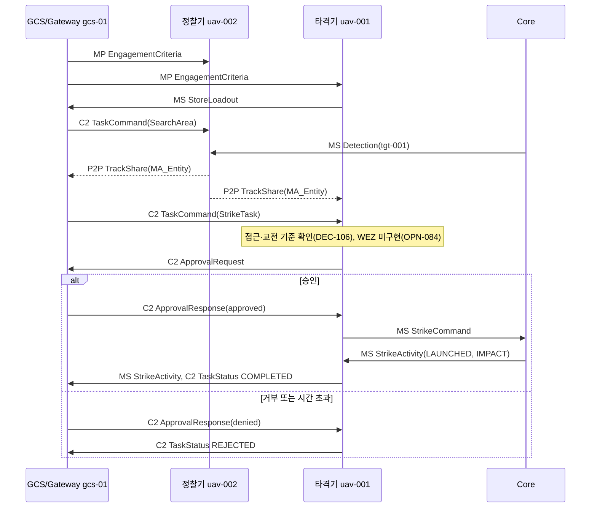
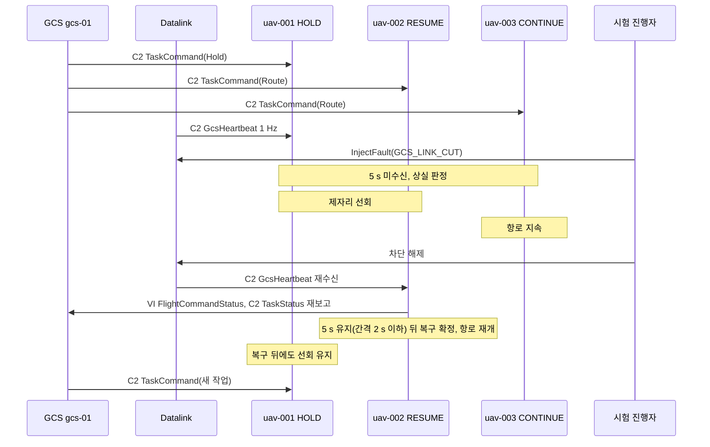
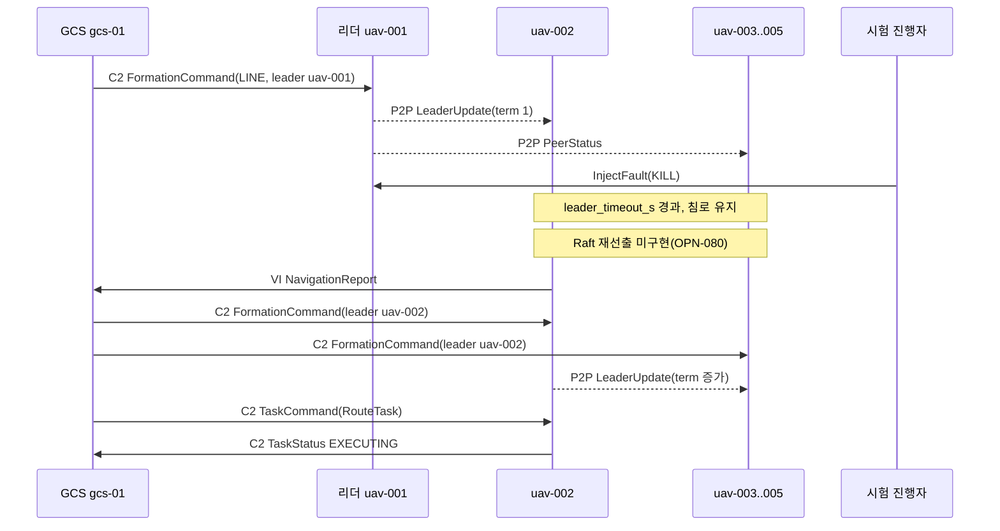
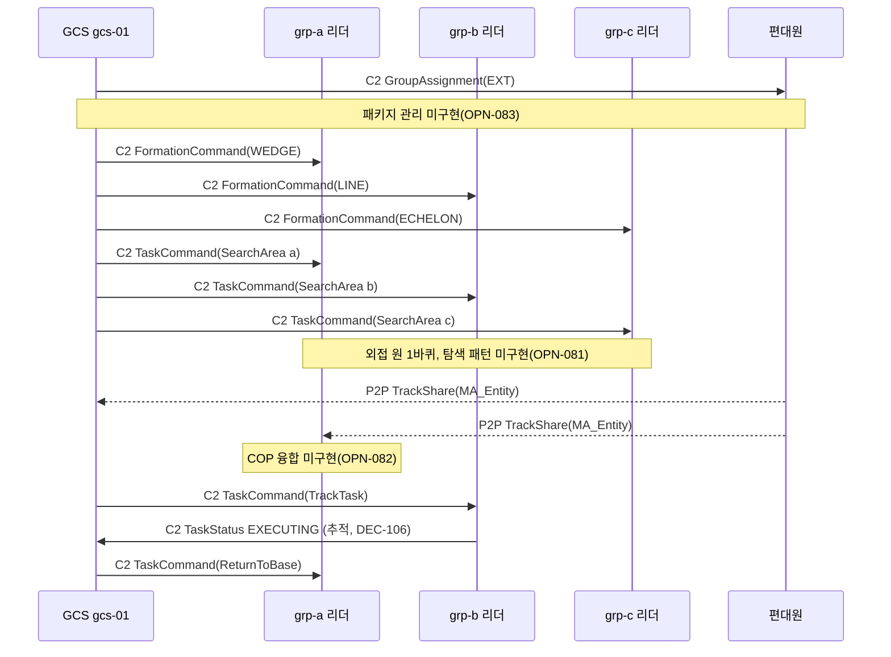

# 편대 전장 운용 시나리오

- 목적: A-GRA 기능(메시지)을 조합한 편대 운용 시나리오를 시간 순서로 정의한다. 보완 항목(OPN-079~084)의 우선순위와 시험 시나리오 작성의 근거로 쓴다.
- 기준: 계약 0.23.0, 통합 브랜치 `wp0-contracts`(DEC-106 등록 시점). 기능 상태(§0.2·0.3)와 단계의 현재 동작은 계약 0.24.0, `wp0-contracts` 38123ee 기준으로 갱신했다(DEC-106 구현 IMP-AGT-060, DEC-107). 단계별 수행률은 [51_scenario_feasibility.md](51_scenario_feasibility.md)에 있다.
- 기능의 출처는 등록부 §5 매핑 표, proto `uci_name`, `docs/10_contracts.md`, 기본 MA docstring으로 한정한다. 메시지명은 공개 XSD 이름과 내부 proto 이름만 쓴다.
- 기체 계층 경계(DEC-013): MA는 L1 포트로만 주고받는다. `truth/**`는 관찰(UI·Monitor·Logger) 용도로만 쓴다.
- 시뮬레이터 조작(`sim/ctrl/cmd`의 `InjectFault`)은 시험 진행자가 내는 사건 주입이며 L1 포트가 아니다.

## 0. 시나리오 × 기능 대응

### 0.1 상태 표기

- 구현됨: `wp0-contracts`에 송신·수신과 기본 MA 동작이 있다.
- 부분: 메시지는 있으나 기본 MA가 일부만 수행하거나 한쪽 방향만 있다.
- 미구현(OPN-xxx): proto 또는 MA 동작이 없다.
- OPN-079는 DEC-106으로 결정되고 기본 MA `PayloadTasker`(IMP-AGT-060)로 구현됐다. 이 항목은 "구현됨(DEC-106)"으로 쓴다.

### 0.2 대응 표

- 시나리오: S1 편대 정찰·탐지 공유, S2 재밍 지원 하 침투, S3 승인 기반 타격, S4 링크 상실·복구, S5 리더 상실·편대 재구성, S6 다편대 영역 분할 탐색.
- ●: 핵심 기능, ○: 보조·분기에서 사용.

| L1 | 기능 | 내부 메시지 (UCI) | 상태 | S1 | S2 | S3 | S4 | S5 | S6 |
|---|---|---|---|---|---|---|---|---|---|
| C2 | 임무 부여·상태 | `TaskCommand` (`MA_TaskCommand`), `TaskStatus` (`MA_TaskStatus`) | 구현됨 | ● | ● | ● | ● | ● | ● |
| C2 | 항로 비행(정찰·선회 행위) | `TaskCommand.route` (`RouteTask`, EXT) | 구현됨 (waypoint·formation 리더. flocking은 REJECTED) | ● | ● | ○ | ○ | | |
| C2 | 영역 정찰 | `SearchAreaTask` | 부분 (영역 중심 선회 1바퀴) | ○ | | | | | ● |
| C2 | 표적 추적 | `TrackTask` | 구현됨(DEC-106) (waypoint·formation 리더, `track_standoff_m` 선회 추적) | ○ | | ○ | | | ● |
| C2 | 재밍 임무 | `JamTask` | 구현됨(DEC-106) (영역 중심 선회 진입 뒤 재머 켬, `duration_s`) | | ● | | | | |
| C2 | 타격 임무 | `StrikeTask` | 구현됨(DEC-106) (waypoint·formation 리더, `strike_range_m` 안에서 교전 기준 확인) | | ○ | ● | ○ | | |
| C2 | 편대 형태 지정 | `FormationCommand` (EXT) | 구현됨 (6형태) | ● | ● | ○ | ○ | ● | ● |
| C2 | 팀(패키지) 구성 | `GroupAssignment` (EXT), `MA_PackageManagementCommand`·`MA_PackageManagementCommandStatus` | 미구현(OPN-083) (EXT 메시지는 있고 쓰는 기본 MA·상태 보고 없음) | | | | | ○ | ● |
| C2 | 타격 승인 | `ApprovalRequest` (`MA_ApprovalRequest`), `ApprovalResponse` (`MA_ApprovalRequestStatus`) | 부분 (MA `TaskTracker`·Gateway 경로 있음, UI 승인 화면 없음. UI는 WP5 진행 중) | | | ● | ○ | | |
| C2 | 타격 동의 | `StrikeConsentRequest` | 미구현(OPN-084) (`ApprovalRequest`로 대신) | | | ○ | | | |
| C2 | 운용자 역할·권한 | `MA_OperatorRole`, `MA_Authorization` | 미구현(OPN-084) | | | ○ | | | ○ |
| C2 | GCS 링크 감시 | `GcsHeartbeat` (EXT), 상실 정책 3종 (DEC-078, DEC-101, DEC-105) | 구현됨 | ○ | ● | ○ | ● | ○ | ○ |
| VI | 비행 명령·상태 | `FlightCommand` (`MA_FlightCommand`), `FlightCommandStatus` (`MA_FlightCommandStatus`) | 구현됨 | ● | ● | ● | ● | ● | ● |
| VI | 비행 성능 | `FlightCapability` (`MA_FlightCapability`) / `MA_FlightCapabilityStatus` | 부분 (시작 1회 보고, 상태 메시지 미구현 OPN-084) | ○ | | | | | ○ |
| VI | 위치·항법 보고 | `NavigationReport` (`MA_NavigationReport`, `MA_PositionReport`) | 구현됨 (런타임 1 Hz, DEC-071) | ● | ● | ● | ● | ● | ● |
| VI | 시스템 상태 | `SystemStatus` / `SubsystemStatus` | 부분 (`SubsystemStatus`는 하위 필드, 독립 메시지 미구현 OPN-084) | ○ | | | ○ | ● | |
| P2P | 편대원 상태 | `PeerStatus` (`MA_PackagePartnerStatusReport`) | 구현됨 | ● | ● | ○ | ○ | ● | ● |
| P2P | 리더 알림 | `LeaderUpdate` (`MA_LeaderUpdateRequest`) | 부분 (지정·변경 시 송신, 상실 시 재선출 없음) | ○ | | | | ● | ○ |
| P2P | 리더 선출 | `MA_RaftVoteRequest`, `MA_RaftAppendEntriesRequest` | 미구현(OPN-080) | | | | | ● | ○ |
| P2P | 탐지 공유 송신 | `TrackShare` (`MA_Entity`) | 구현됨 (`track_share_hz`, DEC-088) | ● | | ○ | | | ● |
| P2P | 탐지 공유 활용(COP) | `TrackShare` 수신 융합·재배정 | 미구현(OPN-082) | ● | | ○ | | | ● |
| MS | 센서 지향 | `SensorCommand` (`PO_Command`) | 구현됨(DEC-106) (track·search_area·strike 수행 중 지향. 항로점 정찰(`ReconAction`)에서는 지향하지 않음) | ● | | ● | | | ● |
| MS | 센서 상태·탐지 | `SensorActivity` (`PO_Activity`), `Detection` (EXT) | 구현됨 (FOV·거리·가시선, DEC-018) | ● | ○ | ● | | | ● |
| MS | 재밍 | `JammerCommand` (`EA_Command`), `JammerActivity` (`EA_Activity`) | 구현됨(DEC-106) (재머 소유 기체 자신의 수신은 면제, DEC-107) | | ● | | ○ | | |
| MS | 타격·결과 | `StrikeCommand`, `StrikeActivity` | 구현됨(DEC-106) | | ○ | ● | | | |
| MS | 무장 탑재 현황 | `StoreLoadout` (`StoreLoadoutConfiguration`) | 구현됨 (DEC-088) | | | ● | | | |
| MS | 교전 범위 | `MA_WEZ` | 미구현(OPN-084) | | | ○ | | | |
| MS | 데이터 전송 | `MA_TxDataPayloadCommand`, `MA_RxDataPayload` | 미구현(OPN-084) (기체 쪽 DMS. Gateway 외부 교환 봉투로는 쓰인다, DEC-111) | ○ | | | | | ○ |
| MP | 임무 계획 | `MissionPlan` (`MA_MissionPlan`), `RoutePlan` (`MA_RoutePlan`) | 구현됨 (DEC-076) | ● | ● | ○ | | | ● |
| MP | 교전 기준 | `EngagementCriteria` (`MA_EngagementCriteria`) | 구현됨 (승인 요구는 `TaskTracker`) | | ○ | ● | | | |
| MP | 탐색 패턴·영역 분할 | (SearchArea 수행 확장) | 미구현(OPN-081) | ○ | | | | | ● |
| MD | 기록·재생 | MCAP | 구현됨 | ○ | ○ | ○ | ○ | ○ | ○ |

### 0.3 시나리오별 미구현 기능 요약

| 시나리오 | 미구현·부분 기능 | 관련 OPN |
|---|---|---|
| S1 | 항로점 정찰 중 센서 지향, COP 활용, 탐색 패턴, DMS | OPN-082, OPN-081, OPN-084 |
| S2 | 없음(UI 재밍 작업은 WP5 진행 중) | — |
| S3 | WEZ, StrikeConsentRequest, RBAC, UI 승인 화면(WP5 진행 중) | OPN-084 |
| S4 | 없음 | — |
| S5 | 리더 재선출(Raft), 패키지 상태 보고, SubsystemStatus | OPN-080, OPN-083, OPN-084 |
| S6 | 탐색 패턴·영역 분할, COP 활용, 패키지 관리, 실행 중 TrackTask 발령·재배정 | OPN-081, OPN-082, OPN-083 |

### 0.4 공통 전제

- 지역: 한반도(DEC-016), DEM 가시선 판정이 의미 있는 동부 산악 지역. 예제 `scenario/examples/korea_east_strike_20.json` 부근(북위 37.4° 내외)을 기준으로 한다.
- 적·표적(DEC-017): 스크립트 경로 또는 고정 위치. 지상 표적 `tgt-*`(ground_target), 공중 표적 `air-*`(air_target), 적 재밍 기지 `jam-site-*`(jammer_site). 적 MA를 붙이는 변형은 선택 사항이다.
- 통제: 단일 GCS `gcs-01`. 명령은 UI 또는 Gateway가 `swarm/gcs-01/tx/c2/*`·`tx/mp/*`로 보낸다. 승인 응답은 현재 Gateway 경로로만 낸다.
- 링크: 모든 기체 간·지상-기체 메시지는 Datalink 판정(거리·가시선·재밍·손실·지연)을 거친다. 재밍은 수신단 기준이다(DEC-028, DEC-055).
- 실행: lockstep. 판정 결과는 Logger MCAP과 `link/outcome/**`로 확인한다.

## S1. 편대 정찰·탐지 공유

### 목적

- 쐐기 편대가 항로 정찰을 하며 탐지를 `TrackShare`로 편대원과 GCS에 공유하는 흐름을 확인한다.
- COP 활용(OPN-082)과 항로점 정찰 중 센서 지향의 필요 범위를 정한다.

### 전제·초기 조건

- 기체 4대 `uav-001`~`uav-004`, 편대 1개 `grp-1`, 형태 WEDGE, 간격 300 m, 리더 `uav-001`.
- MA: 4대 모두 `formation`, `track_share_hz` = 1.
- 페이로드: 4대 모두 `camera`.
- 표적: 고정 지상 표적 `tgt-001`~`tgt-003`. 하나는 능선 뒤에 두어 가시선 차단을 만든다.
- 항로: 항로점 4개, 두 번째·세 번째 항로점에 `ReconAction`(반경 1500 m).

### 참여자

- 통제 GCS `gcs-01`(UI).
- 기체 MA(`formation`)와 FA(기본 FA).
- 적: 정지 지상 표적(행동 없음).

### 단계별 진행

1. 편대 구성
   - 행위자: GCS → 4대
   - 포트·메시지: C2 `FormationCommand`(group `grp-1`, WEDGE, leader `uav-001`)
   - 기대 결과: 리더가 P2P `LeaderUpdate`(term 1) 브로드캐스트. 편대원이 P2P `PeerStatus`를 `peer_hz`로 교환. 추종기가 슬롯을 HSA로 추종.
2. 항로 정찰 부여
   - 행위자: GCS → 리더
   - 포트·메시지: C2 `TaskCommand`(`RouteTask`, `ReconAction`), 또는 MP `MissionPlan`
   - 기대 결과: 리더 `TaskStatus` ACCEPTED → EXECUTING. VI `FlightCommand`(Waypoint·Curve) 수락을 `FlightCommandStatus`로 보고.
3. 정찰 항로점 진입
   - 행위자: 리더 MA
   - 포트·메시지: MS `SensorCommand`(`PO_Command`, 영역 중심 지향) — 항로점 정찰에서는 내지 않는다(DEC-106은 track·search_area·strike에서만 지향)
   - 기대 결과(현재): 시나리오 기본 센서 상태로 탐지한다. 추종기는 리더 선회를 따라간다.
4. 탐지
   - 행위자: Core → 각 기체 런타임
   - 포트·메시지: MS `Detection`(EXT), `SensorActivity`(`PO_Activity`, 런타임이 GCS로 1 Hz·변화 보고)
   - 기대 결과: 가시선이 열린 표적만 탐지(DEC-018). 능선 뒤 표적은 탐지되지 않는다.
5. 탐지 공유
   - 행위자: 탐지한 기체 MA
   - 포트·메시지: P2P `TrackShare`(`MA_Entity`, track_id `<자기 ID>/<표적 ID>`) 브로드캐스트
   - 기대 결과: 편대원과 GCS가 수신. GCS 표시에 트랙이 나타난다.
6. 공유 트랙 활용
   - 행위자: 수신 기체 MA
   - 포트·메시지: 수신 `TrackShare` 융합 — 미구현(OPN-082)
   - 기대 결과(현재): 수신 기체 작업·비행 변화 없음. 같은 표적의 트랙이 기체 수만큼 따로 남는다.
7. 항로 종료
   - 행위자: 리더 → GCS
   - 포트·메시지: C2 `TaskStatus` COMPLETED, 이어 GCS `ReturnToBaseTask`
   - 기대 결과: 편대 RTB.

### 분기·예외

- 추종기가 리더 `PeerStatus`를 `leader_timeout_s` 넘게 못 받음: 추종기는 현재 침로 유지. 편대 이탈로 관찰한다.
- 정찰 중 GCS 링크 상실: 작업 `lost_link_policy`에 따른다(S4). `RESUME_ON_RECOVERY` 권장.
- 표적이 능선 뒤로만 보임: 다른 기체 탐지가 공유돼도 자기 센서 지향을 바꾸지 않는다(OPN-082).

### 종료 조건

- 리더 `TaskStatus` COMPLETED 후 RTB 접수, 또는 모의 시간 상한.

### 관찰 항목

- 표적별 최초 탐지 시각과 탐지 기체, 가시선 차단 표적의 미탐지.
- `TrackShare` 전달률과 지연(`link/outcome`), GCS 수신 트랙 수.
- 편대 슬롯 오차(truth 기준, 관찰 전용).
- 중복 트랙 수(COP 융합 필요성 근거).

## S2. 재밍 지원 하 침투

### 목적

- 재밍기가 적 방공 구역을 재밍하는 동안 침투 편대가 항로로 통과하는 흐름을 확인한다.
- 재밍 구역이 아군 링크에 주는 영향(수신단 기준)과 링크 상실 정책 선택을 정한다.

### 전제·초기 조건

- 기체 6대: 재밍기 `uav-005`(`camera`, `jammer`) 1대, 침투 편대 `grp-2` 4대(`uav-001`~`uav-004`, `camera`, 2대는 `agm_short`), 예비 1대 `uav-006`.
- MA: 재밍기 `waypoint`, 침투 편대 `formation`(COLUMN, 간격 200 m).
- 적: 고정 지상 표적 `tgt-001`(방공 위치 표시용), 적 재밍 기지 `jam-site-01`(활성).
- 항로: 침투 편대 항로가 적 재밍 구역 가장자리를 지난다.

### 참여자

- 통제 GCS `gcs-01`.
- 기체 MA(`waypoint`, `formation`)와 FA.
- 적: 재밍 기지(구역 고정), 지상 표적.

### 단계별 진행

1. 편대 구성과 재밍기 전개
   - 행위자: GCS → 침투 편대, 재밍기
   - 포트·메시지: C2 `FormationCommand`(COLUMN), C2 `TaskCommand`(`MoveTo`, 재밍 위치)
   - 기대 결과: 재밍기 `TaskStatus` EXECUTING → COMPLETED.
2. 재밍 임무 부여
   - 행위자: GCS → 재밍기
   - 포트·메시지: C2 `TaskCommand`(`JamTask`, 영역, `duration_s` 0, `lost_link_policy` CONTINUE)
   - 기대 결과: 영역 중심 선회 진입 후 MS `JammerCommand`(`EA_Command`, enable) → EXECUTING(DEC-106). 재밍기에 재머가 없으면 FAILED(`no jammer`).
3. 재밍 구역 활성
   - 행위자: Core → 재밍기 런타임 → GCS
   - 포트·메시지: MS `JammerActivity`(`EA_Activity`, zone) 1 Hz·변화 보고, `truth/event/jam_zone`(관찰)
   - 기대 결과: 아군 재밍 구역이 표시된다.
4. 침투 항로 부여
   - 행위자: GCS → 침투 편대 리더
   - 포트·메시지: C2 `TaskCommand`(`RouteTask`, `lost_link_policy` CONTINUE)
   - 기대 결과: 리더 EXECUTING, 추종기 슬롯 추종.
5. 적 재밍 구역 통과
   - 행위자: Datalink
   - 포트·메시지: 구역 안 기체가 수신하는 C2 `GcsHeartbeat`·P2P `PeerStatus`가 JAMMED 손실
   - 기대 결과: 구역 안 기체는 GCS 명령을 못 받지만 상태 보고는 GCS에 도착(DEC-055). 추종기가 리더 `PeerStatus`를 잃으면 침로 유지.
6. 링크 상실 판정
   - 행위자: 침투 편대 MA
   - 포트·메시지: `GcsHeartbeat` 미수신 `lost_link_timeout_s`(5 s)
   - 기대 결과: 리더는 작업 정책 CONTINUE로 항로 지속. 추종기는 MA 변수 정책을 따른다(FormationCommand에 정책 없음).
7. 구역 이탈·복구
   - 행위자: 침투 편대 MA, 런타임
   - 포트·메시지: `GcsHeartbeat` 재수신, 런타임이 `FlightCommandStatus`·`TaskStatus` 재보고(DEC-101(1))
   - 기대 결과: `lost_link_recover_hold_s` 동안 간격 `lost_link_recover_gap_s` 이하이면 복구 확정(DEC-105).
8. 재밍 해제
   - 행위자: GCS → 재밍기
   - 포트·메시지: C2 `TaskCommand`(cancel)
   - 기대 결과: `JammerCommand`(disable), `TaskStatus` CANCELLED(DEC-106).

### 분기·예외

- 추종기 정책이 `hold_until_command`(기본): 구역에서 추종기만 선회하고 리더는 진행해 편대가 갈라진다. 추종기 MA 변수를 `continue`로 두는 시나리오 값을 시험한다.
- 재밍기 GCS 링크 상실: `JamTask` 정책 CONTINUE면 재밍 유지, 그 밖이면 끈다(DEC-106(6)).
- 아군 재밍 구역 안 아군 수신: 수신단 기준이라 구역 안 다른 아군의 수신도 손실된다(DEC-028). 재머를 가진 기체 자신의 수신은 면제된다(DEC-107). 재밍 영역과 아군 항로 간 거리를 관찰한다.
- 침투 중 타격 필요: S3 흐름으로 넘긴다.

### 종료 조건

- 침투 편대가 마지막 항로점 통과, 재밍 작업 취소 확인.

### 관찰 항목

- 구역별 JAMMED 손실 건수와 대상 인터페이스(`link/outcome`).
- 링크 상실·복구 판정 시각과 정책별 행동(리더·추종기 차이).
- 편대 분리 거리, 항로 이탈.
- 재밍 시작 지연(작업 수락 → 재머 켬).

## S3. 승인 기반 타격

### 목적

- 교전 기준에 따라 탐지 → 승인 요청 → 승인·거부 → 발사 → 결과 보고까지의 흐름을 확인한다.
- 기본 MA 타격(DEC-106)을 확인하고, WEZ·타격 동의·RBAC(OPN-084)의 필요 범위를 정한다.

### 전제·초기 조건

- 기체 3대: 정찰기 `uav-002`(`camera`, `waypoint`, `track_share_hz` 1), 타격기 `uav-001`(`camera`, `agm_short`), 타격기 `uav-003`(`camera`, `fpv`).
- 타격기 MA: `waypoint`, MA 변수 `approval_tasks` = `strike`(승인 규칙 DEC-088, 타격 수행 DEC-106). 시험용 `approval_demo`(DEC-103)는 쓰지 않는다.
- MP `EngagementCriteria`: `hostile_sides` red, `require_approval` true, `weapons_free` 영역 1개, `no_strike` 영역 1개.
- 표적: 고정 `tgt-001`(weapons_free 안), `tgt-002`(no_strike 안), 이동 `tgt-003`(스크립트 경로).

### 참여자

- 통제 GCS `gcs-01`. 승인 응답은 Gateway(외부 C2)가 낸다. UI 승인 화면은 없다.
- 기체 MA(`waypoint`)와 FA.
- 적: 지상 표적(고정·스크립트).

### 단계별 진행

1. 교전 기준 배포
   - 행위자: GCS → 3대
   - 포트·메시지: MP `EngagementCriteria`
   - 기대 결과: MA `TaskTracker`가 승인 요구를 적용.
2. 무장 현황 보고
   - 행위자: 타격기 → GCS
   - 포트·메시지: MS `StoreLoadout`(`StoreLoadoutConfiguration`, 잔량)
   - 기대 결과: GCS가 스테이션·잔량을 안다.
3. 정찰·탐지
   - 행위자: 정찰기
   - 포트·메시지: C2 `TaskCommand`(`SearchAreaTask`), MS `Detection`, P2P `TrackShare`
   - 기대 결과: GCS가 `tgt-001` 트랙을 받는다.
4. 타격 임무 부여
   - 행위자: GCS → `uav-001`
   - 포트·메시지: C2 `TaskCommand`(`StrikeTask`, target `tgt-001`, weapon_type `agm_short`)
   - 기대 결과: `TaskStatus` ACCEPTED.
5. 접근·교전 기준 확인
   - 행위자: 타격기 MA
   - 포트·메시지: 표적 위치는 자기 `Detection`·수신 `TrackShare`만 사용(DEC-106(2)), `strike_range_m` 안 진입 뒤 교전 기준 확인(DEC-106). 교전 범위 `MA_WEZ` — 미구현(OPN-084)
   - 기대 결과: 표적으로 접근해 `strike_range_m` 안에서 교전 기준이 맞으면 승인 단계로 간다.
6. 승인 요청
   - 행위자: 타격기 → GCS
   - 포트·메시지: C2 `ApprovalRequest`(`MA_ApprovalRequest`, request_id, task_id, target_id). `StrikeConsentRequest` — 미구현(OPN-084)
   - 기대 결과: Gateway가 외부로 넘긴다. 운용자 권한 확인(`MA_OperatorRole`·`MA_Authorization`) — 미구현(OPN-084).
7. 승인
   - 행위자: GCS(Gateway) → 타격기
   - 포트·메시지: C2 `ApprovalResponse`(`MA_ApprovalRequestStatus`, approved true)
   - 기대 결과: 승인 뒤에만 MS `StrikeCommand`(스테이션, target) 송신. `TaskStatus` EXECUTING.
8. 발사·결과
   - 행위자: Core → 타격기 런타임 → GCS
   - 포트·메시지: MS `StrikeActivity`(LAUNCHED → IMPACT/MISSED/REJECTED), `StoreLoadout` 잔량 갱신
   - 기대 결과: IMPACT → `TaskStatus` COMPLETED, MISSED → FAILED("missed"). IMPACT는 유도 객체의 도달만 뜻하며 파괴는 `truth/event/kill`로 관찰한다(DEC-067).

### 분기·예외

- 승인 거부: `ApprovalResponse` approved false → `TaskStatus` REJECTED("approval denied"), 발사 없음.
- 승인 시간 초과: `approval_timeout_s` 경과 → REJECTED("approval timeout"), 발사 없음.
- `no_strike` 표적(`tgt-002`) 지정: 교전 기준 불일치 → REJECTED(사유), 발사 없음(DEC-106(5)).
- 잔량 없음: FAILED("no store").
- 승인 대기 중 GCS 링크 상실: 응답이 닿지 않아 시간 초과로 끝난다. 링크 상실 선회 중에는 발사하지 않는다(DEC-106(6)).
- 이동 표적(`tgt-003`) 추적 후 타격: `TrackTask` 선행(DEC-106). 실행 중 발령은 UI 경로가 생긴 뒤 가능하다(지금은 시나리오 `mission_plan`).
- FPV 타격기(`uav-003`): weapon_type `fpv`로 같은 흐름. 발사된 엔티티 ID는 `StrikeActivity.weapon_entity`(`wpn-uav-003-<순번>`).

### 종료 조건

- 승인 표적의 `StrikeActivity` 종료 상태 수신과 `TaskStatus` 끝 상태, 거부·시간 초과 분기 각각의 REJECTED 확인.

### 관찰 항목

- 탐지 → 승인 요청 → 응답 → 발사 → 도달까지 각 지연.
- 거부·시간 초과·no_strike에서 `StrikeCommand` 미송신(발사 0건).
- `StrikeActivity`와 `truth/event/launch`·`impact`·`kill`의 대응.
- `StoreLoadout` 잔량 변화.

## S4. 링크 상실·복구

### 목적

- GCS 링크 상실 판정, 정책 3종의 행동, 복구 확정과 재보고를 한 시나리오에서 비교한다.
- 짧게 들린 Heartbeat를 복구로 오판하지 않는지 확인한다(DEC-105).

### 전제·초기 조건

- 기체 3대, 서로 다른 정책의 작업을 받는다.
  - `uav-001`: `HoldTask`(duration 없음), `HOLD_UNTIL_COMMAND`
  - `uav-002`: `RouteTask`(loop), `RESUME_ON_RECOVERY`
  - `uav-003`: `RouteTask`(loop), `CONTINUE`
- MA: 3대 모두 `waypoint`. `lost_link_timeout_s` 5, `lost_link_recover_hold_s` 5, `lost_link_recover_gap_s` 2.
- Heartbeat 1 Hz(Datalink 기본).
- 적: 없음. 링크 차단은 `InjectFault`(GCS_LINK_CUT)로 주입한다. 변형으로 적 재밍 기지 구역 진입을 쓴다.

### 참여자

- 통제 GCS `gcs-01`.
- 기체 MA(`waypoint`)와 FA.
- 시험 진행자: `sim/ctrl/cmd` `InjectFault`.

### 단계별 진행

1. 작업 부여
   - 행위자: GCS → 3대
   - 포트·메시지: C2 `TaskCommand`(정책별)
   - 기대 결과: 3대 EXECUTING, 첫 `GcsHeartbeat` 수신 뒤 감시 시작.
2. 링크 차단
   - 행위자: 시험 진행자
   - 포트·메시지: `InjectFault`(3대, `GCS_LINK_CUT`, duration 30 s)
   - 기대 결과: `GcsHeartbeat`와 GCS 명령이 기체에 닿지 않고, 기체 보고도 GCS에 닿지 않는다.
3. 상실 판정
   - 행위자: 각 MA
   - 포트·메시지: Heartbeat 미수신 5 s
   - 기대 결과: `uav-001`·`uav-002`는 제자리 선회, `uav-003`은 항로 지속. MD에 link_state·lost_link_action 기록.
4. 상실 중 명령
   - 행위자: GCS → `uav-002`
   - 포트·메시지: C2 `TaskCommand`(새 작업)
   - 기대 결과: 닿지 않음(`link/outcome` 손실). 기체 행동 변화 없음.
5. 짧은 재수신(변형)
   - 행위자: 시험 진행자
   - 포트·메시지: 차단 해제 1 s 후 재차단
   - 기대 결과: 간격이 `lost_link_recover_gap_s`를 넘어 복구 대기를 버리고 상실 행동 유지(DEC-105). 런타임 재보고는 재수신 직후 나갈 수 있다.
6. 복구
   - 행위자: Datalink → 각 기체, 런타임 → GCS
   - 포트·메시지: `GcsHeartbeat` 재수신, VI `FlightCommandStatus`·C2 `TaskStatus` 1회 재보고(DEC-101(1)), 변화 보고 키 재송신(DEC-089)
   - 기대 결과: 5 s 유지 뒤 복구 확정. `uav-001` 선회 유지, `uav-002` 중단한 항로 재개, `uav-003` 변화 없음.
7. 선회 해제
   - 행위자: GCS → `uav-001`
   - 포트·메시지: C2 `TaskCommand`(새 작업)
   - 기대 결과: 선회 종료, 새 작업 EXECUTING.

### 분기·예외

- 차단 중 작업 종료(Hold duration 경과 등): 선회 중 작업 진행은 멈추며, 작업 없이 복구하면 상실 전 비행 상태로 돌아간다(D-32).
- 타격 작업 중 상실: 발사하지 않는다(DEC-106(6)).
- 재밍 작업 중 상실: CONTINUE일 때만 재밍 유지(DEC-106(6)).
- 재밍 구역 경계에서 RESUME 기체의 선회·재개 반복: DEC-105 복구 조건으로 억제되는지 관찰.

### 종료 조건

- 3대의 복구 확정과 정책별 기대 행동 확인, `uav-001` 새 작업 수락.

### 관찰 항목

- 상실 판정 시각(차단 + 5 s), 복구 확정 시각(재수신 + 5 s).
- 정책별 궤적(선회 중심, 재개 항로점).
- 재보고 메시지 수(재수신당 1회)와 GCS 표시 갱신.
- 짧은 재수신에서 오판 0건.

## S5. 리더 상실·편대 재구성

### 목적

- 편대 리더를 잃었을 때 현재 동작(재선출 없음)과 GCS 수동 재구성 흐름을 확인한다.
- 자동 재선출(OPN-080)과 패키지 상태 보고(OPN-083)의 필요 범위를 정한다.

### 전제·초기 조건

- 기체 5대 `uav-001`~`uav-005`, 편대 `grp-3`, 형태 LINE, 간격 250 m, 리더 `uav-001`.
- MA: `formation`, `leader_timeout_s` 기본값.
- 작업: 리더에게 `RouteTask`.
- 적: 공중 표적 `air-001`(스크립트 경로, 편대와 교차). 리더 상실은 `InjectFault`(KILL)로 주입한다.

### 참여자

- 통제 GCS `gcs-01`.
- 기체 MA(`formation`)와 FA.
- 시험 진행자: `InjectFault`.

### 단계별 진행

1. 편대 구성·항로 부여
   - 행위자: GCS → 5대, 리더
   - 포트·메시지: C2 `FormationCommand`(LINE, leader `uav-001`), C2 `TaskCommand`(`RouteTask`)
   - 기대 결과: P2P `LeaderUpdate`(term 1), `PeerStatus` 교환.
2. 리더 상실
   - 행위자: 시험 진행자
   - 포트·메시지: `InjectFault`(`uav-001`, KILL)
   - 기대 결과: 리더 `PeerStatus`·`NavigationReport` 중단. GCS는 `NavigationReport` 공백과 `SystemStatus` 변화로 인지.
3. 추종기 반응
   - 행위자: 추종기 MA
   - 포트·메시지: 리더 `PeerStatus` 미수신 `leader_timeout_s`
   - 기대 결과(현재): 현재 침로 유지. 리더를 다시 정하지 않는다.
   - 자동 재선출: P2P `MA_RaftVoteRequest`·`MA_RaftAppendEntriesRequest` — 미구현(OPN-080).
4. GCS 상황 판단
   - 행위자: GCS
   - 포트·메시지: VI `NavigationReport`, `SystemStatus`(`SubsystemStatus` 독립 메시지 — 미구현 OPN-084), P2P `PeerStatus`(GCS 수신분)
   - 기대 결과: 생존 기체 4대 확인.
5. 수동 재구성
   - 행위자: GCS → 생존 4대
   - 포트·메시지: C2 `FormationCommand`(같은 group, members 4대, leader `uav-002`), C2 `TaskCommand`(`RouteTask`, 새 리더)
   - 기대 결과: 새 리더가 P2P `LeaderUpdate`(term 증가) 브로드캐스트. 슬롯 재배치.
6. 패키지 상태 확인
   - 행위자: GCS
   - 포트·메시지: `MA_PackageManagementCommandStatus` — 미구현(OPN-083)
   - 기대 결과(현재): 구성 결과는 `PeerStatus.group_id`와 `LeaderUpdate`로만 확인.
7. 항로 지속
   - 행위자: 새 리더
   - 포트·메시지: C2 `TaskStatus` EXECUTING
   - 기대 결과: 편대 항로 복귀.

### 분기·예외

- 리더 지정 없는 `FormationCommand`: members 사전순 첫 기체가 리더(`uav-002`). 지정과 같은 결과인지 확인.
- 재구성 명령 시점에 GCS 링크 상실: 추종기는 침로 유지 또는 상실 정책 선회. 링크 복구 뒤 재구성(S4와 결합).
- 리더 상실이 아닌 리더 링크 고장(`InjectFault` LINK_CUT): 리더는 계속 비행하지만 추종기는 리더를 잃는다. 재선출 시 두 리더 공존 가능성 — OPN-080에서 `LeaderUpdate` term 규칙으로 정할 사항.
- 추종기 1대 상실: 슬롯은 members 순서로 정해지므로 재명령 전에는 빈 슬롯이 남는다.

### 종료 조건

- 새 리더 기준 편대가 슬롯 오차 수렴 후 항로 진행.

### 관찰 항목

- 리더 상실 → 추종기 침로 유지까지 시간, 이 동안 편대 산개 거리.
- GCS 인지 지연(`NavigationReport` 공백 판단 기준).
- 재구성 명령 → `LeaderUpdate`(term) → 슬롯 수렴 시간.
- 자동 재선출이 있었다면 줄었을 공백 시간(OPN-080 근거).

## S6. 다편대 영역 분할 탐색

### 목적

- 넓은 영역을 여러 편대에 나눠 탐색하고, 발견 표적을 공유해 추적으로 재배정하는 흐름을 확인한다.
- 탐색 패턴·분할(OPN-081), COP(OPN-082), 패키지 관리(OPN-083)의 우선순위를 정하고 추적(DEC-106)을 확인한다.

### 전제·초기 조건

- 기체 12대, 편대 3개(각 4대): `grp-a`, `grp-b`, `grp-c`. 형태 WEDGE·LINE·ECHELON.
- MA: `formation`(`params.group`으로 소속 편대 지정), `track_share_hz` 1.
- 페이로드: 전 기체 `camera`.
- 영역: 동부 산악 지역의 직사각 다각형 1개(약 20 km × 15 km)를 3개 하위 영역으로 GCS가 나눈다.
- 적: 고정 지상 표적 4개, 스크립트 경로 이동 표적 2개. 일부는 계곡 안(가시선 제한).

### 참여자

- 통제 GCS `gcs-01`.
- 기체 MA(`formation`)와 FA.
- 적: 지상 표적(고정·이동).

### 단계별 진행

1. 패키지 구성
   - 행위자: GCS → 12대
   - 포트·메시지: C2 `GroupAssignment`(EXT, 편대별). `MA_PackageManagementCommand`·`Status` — 미구현(OPN-083)
   - 기대 결과(현재): 편대 소속은 `FormationCommand`와 `params.group`으로 정한다.
2. 편대 형태 지정
   - 행위자: GCS → 편대별
   - 포트·메시지: C2 `FormationCommand` 3건
   - 기대 결과: 편대별 리더 `LeaderUpdate`(term 1).
3. 영역 분할 배정
   - 행위자: GCS → 각 편대 리더
   - 포트·메시지: C2 `TaskCommand`(`SearchAreaTask`, 하위 영역) 3건, 또는 MP `MissionPlan`(tasks·formations)
   - 기대 결과(현재): 하위 영역 중심(다각형은 외접 원) 선회 1바퀴 뒤 COMPLETED.
   - 탐색 패턴(센서 폭 기준)과 자동 분할 — 미구현(OPN-081).
4. 탐색·탐지
   - 행위자: Core → 각 기체
   - 포트·메시지: MS `Detection`, `SensorActivity`. search_area 수행 중 영역 중심으로 `SensorCommand` 지향(DEC-106)
   - 기대 결과: 외접 원 선회로 덮지 못한 구역의 표적은 미탐지.
5. 탐지 공유
   - 행위자: 탐지 기체
   - 포트·메시지: P2P `TrackShare`(`MA_Entity`) 브로드캐스트
   - 기대 결과: 같은 편 무전기 전원이 수신 대상(DEC-032). 거리·가시선 밖 수신자는 손실 사유 기록.
6. COP 구성
   - 행위자: 각 기체 MA
   - 포트·메시지: 수신 트랙 융합 — 미구현(OPN-082)
   - 기대 결과(현재): GCS만 전체 트랙을 모은다.
7. 추적 재배정
   - 행위자: GCS → 이동 표적에 가까운 편대 리더
   - 포트·메시지: C2 `TaskCommand`(`TrackTask`, target)
   - 기대 결과: `track_standoff_m` 선회 추적, 위치 미상이면 `track_acquire_timeout_s` 뒤 FAILED(DEC-106).
   - 실행 중 발령 수단: UI·Gateway에 없다(UI는 WP5 진행 중). 지금은 시나리오 `mission_plan`으로 시작 때만 낼 수 있다.
   - 트랙 기반 자동 재배정 — 미구현(OPN-082).
8. 탐색 결과 전송
   - 행위자: 편대 → GCS
   - 포트·메시지: DMS `MA_TxDataPayloadCommand`·`MA_RxDataPayload` — 미구현(OPN-084)
   - 기대 결과(현재): 결과는 GCS가 받은 `TrackShare`로 대신한다.
9. 귀환
   - 행위자: GCS → 편대 리더
   - 포트·메시지: C2 `TaskCommand`(`ReturnToBaseTask`)
   - 기대 결과: 편대별 RTB.

### 분기·예외

- 한 편대 리더 상실: S5 흐름. 해당 하위 영역은 미탐색으로 남고 GCS가 다른 편대에 재배정한다.
- 편대 간 거리로 `TrackShare` 미도달: 다른 편대는 트랙을 모른다. COP·중계 필요성 관찰.
- 하위 영역 경계 중첩·공백: 외접 원 선회의 덮개 오차. 분할 기준은 OPN-081에서 정한다.
- 비행 성능 차이로 배정 조정 필요: `FlightCapability`는 시작 시 1회, `MA_FlightCapabilityStatus` — 미구현(OPN-084).
- 운용자 권한별 배정 제한: `MA_OperatorRole`·`MA_Authorization` — 미구현(OPN-084).

### 종료 조건

- 3개 편대의 탐색 작업 끝 상태와 RTB 접수, 또는 모의 시간 상한.

### 관찰 항목

- 영역 덮개율(센서 FOV 투영 누적, truth 기준 관찰)과 표적 탐지율.
- 편대별 탐지 표적 수, 표적별 최초 탐지 시각.
- 편대 간 `TrackShare` 전달률(거리·가시선 사유별).
- 이동 표적 재배정까지 지연, `TrackTask` 결과.

## 보완 항목 우선순위 근거

- OPN-079(DEC-106): 구현됐다(IMP-AGT-060). S2·S3·S4의 핵심 단계가 풀렸다.
- OPN-082(COP 활용): S1·S6의 공유 탐지가 수신 쪽에서 쓰이지 않는다. S3 표적 위치(DEC-106(2))도 수신 `TrackShare`를 쓴다.
- OPN-081(탐색 패턴·분할): S6의 탐색 품질을 정한다. S1 정찰 항로점 정찰에도 영향.
- OPN-080(리더 재선출): S5에서만 핵심이다. GCS 수동 재구성으로 대체 가능하다.
- OPN-083(패키지 관리): S6 구성과 S5 상태 확인. 현재 `FormationCommand`·`params.group`으로 대체 가능하다.
- OPN-084: WEZ는 S3 접근 판정(지금은 `strike_range_m`), RBAC는 S3 승인 권한, DMS·성능 상태·하위 시스템 상태는 보조. 항목별로 필요할 때 추가한다.
