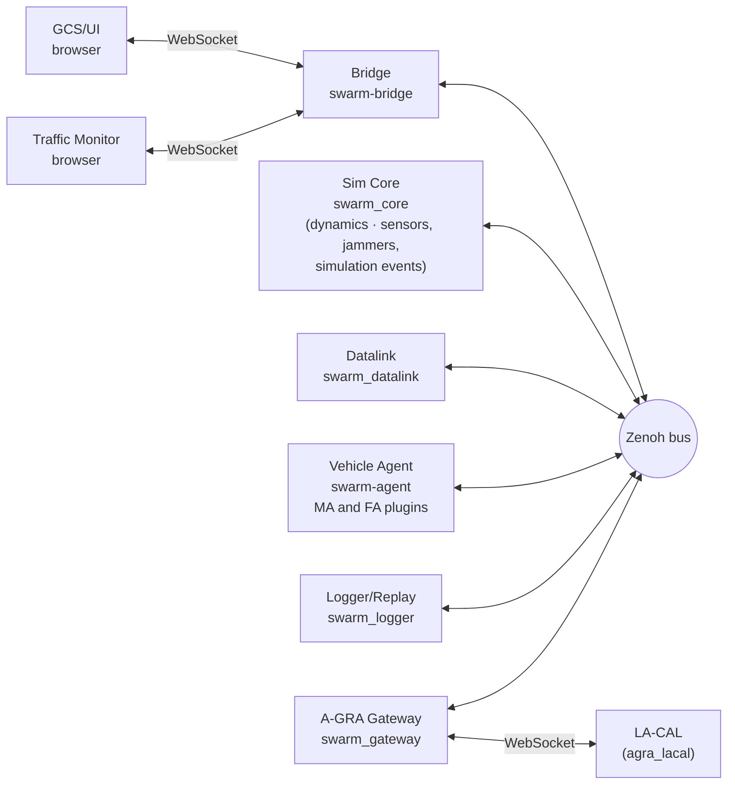
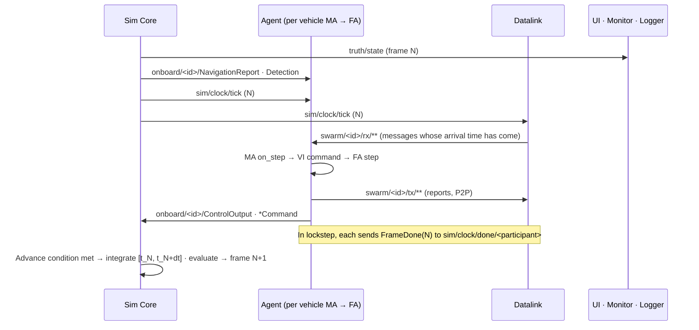
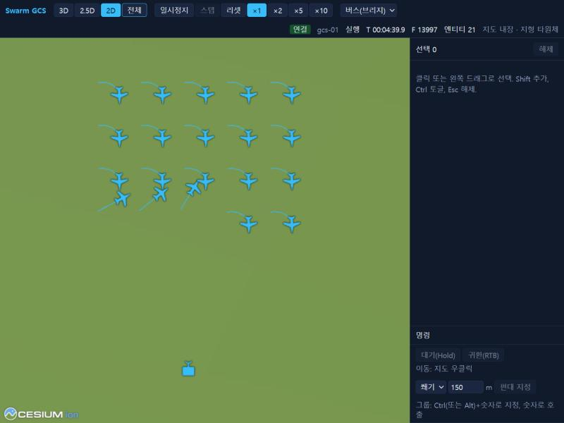

# Project overview

> Source: [docs/40_overview.md](../40_overview.md) at commit `24fc9be`.

- This document is for people seeing the repository for the first time. It covers what the project is, what works today, and where to start.
- Baseline: contract 0.14.0, roadmap P6 complete (2026-11-09).
- The [proposal](../00_proposal.md) (Korean) and the [registry](../02_registry.md) (Korean) hold the design rationale, and [10_contracts.md](../10_contracts.md) (Korean) is the authority for contracts. This document links to their sections.

## 1. Purpose and scope

SwarmFlSim is a research simulator for swarms of unmanned aircraft, used to design and verify swarm and formation algorithms.

- Each layer can be replaced, from a single vehicle's low-level guidance and control (FA) to high-level decision making (MA). Researchers mostly write MA plugins in Python.
- All vehicle-to-vehicle and ground-to-vehicle messages pass through the datalink emulator. Latency, loss, bandwidth and jamming act directly on the algorithms.
- Vehicle agents cannot see the true state (truth). They use only what they receive from sensors and the datalink.
- The project follows the A-GRA structure (L1 ports). It exchanges messages with external A-GRA systems through the Gateway.

Out of scope: game-engine-grade 3D visualization, real system specifications, probabilistic sensor detection, high-resolution terrain. Details are in [proposal §1.2](../00_proposal.md#12-범위-밖).

## 2. What works today

Legend: Implemented = code and tests exist. Partial = only part exists. Not implemented = does not exist yet (roadmap phase in parentheses).

| Area | Feature | Status |
|---|---|---|
| Dynamics | 2-DoF (unicycle), 3-DoF (point mass, coordinated turn), wind, ground collision | Implemented |
| Dynamics | 5-DoF and 6-DoF | Not implemented (P3) |
| Dynamics | RK45 (variable step within a frame) and RK4 integrators, fixed frames at 50–100 Hz | Implemented |
| Execution | realtime / lockstep (deterministic, fixed seed) / free-run, pause, step, rate | Implemented |
| Execution | Distributed runs across PCs, hundreds of vehicles | Not verified (P4). The bus options exist and it has been demonstrated on a single PC |
| Algorithms | 4 baseline MAs (hold, waypoint, formation, flocking), baseline FA (HSA, Waypoint, orbit, racetrack) | Implemented |
| Algorithms | Vehicle behavior on link loss | Not implemented (P2) |
| Datalink | Range and SNR, line of sight, burst loss, latency and jitter, bandwidth queue, jamming zones (receiver-based), link-cut faults | Implemented. Datalink line of sight uses flat terrain only |
| Sensors, jammers and simulation events | Camera detection (FOV, range, line of sight), jamming zones, launch and arrival of guided objects (WP8, built into Core) | Implemented |
| Terrain | Flat, Korean Peninsula DEM (Copernicus GLO-90) | Implemented |
| UI | 2D/2.5D/3D map, click and drag selection, mission commands (move, loiter, racetrack, reconnaissance, route and others), formations and groups, per-vehicle parameters | Implemented |
| UI | Scenario editing | Not implemented. Write scenarios in JSON and validate them with `swarm-scenario` |
| UI | Role-based permissions | Not implemented (after P6, DEC-020). Only control and observer are distinguished today |
| Traffic Monitor | Per-entity traffic statistics, loss reasons, sequence timeline, message decoding (live and replay) | Implemented |
| Recording and replay | MCAP recording of all channels, replay at a chosen rate | Implemented |
| A-GRA Gateway | Stage 1: publishes vehicle state received by the GCS (VI, C2, P2P, MS) to LA-CAL as UCI messages, with position also published as `MA_PositionReport` (DEC-072). Stage 2: receives external `MA_TaskCommand` (hold, return to base, cancel) | Implemented (P6 complete, DEC-074). Open: approval round trip (OPN-061), external tasks that need a position (OPN-062), publisher identification on GCS keys (OPN-063) |
| A-GRA | Full L1 compliance, PX4/ArduPilot SITL | Not implemented (P7, P8) |

## 3. Components



| Component | What it does | Language |
|---|---|---|
| Sim Core | Frame progression, run modes, entity state, dynamics integration, ground collision, evaluation of sensors, jammers and simulation events, fault injection | C++20 |
| Datalink | Applies the link model to `tx` messages and delivers them to `rx`. Publishes a delivery or loss reason for each message | C++20 |
| Vehicle Agent | One process hosts many vehicles. Runs MA and FA plugins per vehicle and provides the L1 ports. Automatically reports VI state and payload state to the GCS (DEC-071, DEC-051) | Python |
| Bridge | Connects browsers to the bus. Downsamples subscriptions and checks allowed publish keys | Python |
| GCS/UI, Traffic Monitor | Map and commands, traffic analysis | TypeScript |
| Logger/Replay | Records all keys to MCAP and republishes them to the bus | C++20 |
| A-GRA Gateway | Ground participant on the GCS side. Converts internal messages ⇄ UCI, validates against XSD | Python |

Bus keys are divided by area. The full list is in [contract §3.2](../10_contracts.md#32-키-목록).

| Prefix | Contents | Used by |
|---|---|---|
| `swarm/**` | Vehicle-to-vehicle and ground-to-vehicle messages. Always `tx` → Datalink → `rx` | Agent, UI (GCS), Gateway, Datalink |
| `onboard/**` | Signals inside one vehicle (navigation reports, detections, control outputs, equipment commands) | Core ⇄ that vehicle's Agent |
| `sim/**` | Simulation control, clock (tick), lockstep barrier, scenario distribution, parameters | Core, UI, participant runtimes |
| `truth/**` | True state and events (launch, impact, kill, jam_zone, spawn) | Published by Core, subscribed by UI, Monitor, Logger and Datalink. The Agent's MA cannot see it |
| `link/**` | Link results and state | Published by Datalink, subscribed by Monitor, UI and Logger |

## 4. Flow of one frame



- Advance condition: realtime advances every wall-clock dt, lockstep after receiving `FrameDone(N)` from every participant, and free-run at an interval set by the rate.
- In lockstep, vehicle-to-vehicle messages are consumed at least one tick later on top of the link latency. The rules are in the scenario distribution and lockstep start part of [contract §3.3](../10_contracts.md#33-규칙).

## 5. Flow of one command

When you select vehicles in the UI and right-click the map, a `TaskCommand` goes out on the GCS `tx`, reaches the vehicles through the Datalink, and the vehicles' `TaskStatus` returns the same way. The diagram is in [20_p0_demo.md §1 command path](../20_p0_demo.md#명령-경로-c2) (Korean).

## 6. First run

Build and install according to [contract §7](../10_contracts.md#7-빌드-환경과-시험-dec-022) (`msvc-debug` on Windows MSVC). Then:

```bash
uv sync
```

```bash
uv run python scripts/gen_proto.py
```

```bash
uv run python scripts/run_p0_demo.py live --monitor
```

- Run `npm install` once beforehand in `ui/` and `ui/monitor/`.
- The runner starts Logger → Datalink → Agent → Bridge → Core → UI and Monitor in that order. It runs a scenario with 20 vehicles and one GCS (`scenario/examples/p0_demo_20.json`) in realtime at 50 Hz.
- Browser: `http://localhost:5173/?source=bus&gcs=gcs-01&bridge=ws://127.0.0.1:8765/bus`. Drag with the left button to select vehicles and right-click the map to send a move command.
- The recording is written to `out/p0_demo/live-<time>/p0_demo.mcap`. Press Ctrl+C to stop.
- Options, replay and the automatic check (`probe`) are in [20_p0_demo.md](../20_p0_demo.md). For a walkthrough, see [chapter 2](42_user/02_quickstart.md) of the user manual.



## 7. Repository map

| Directory | WP | Contents | Executable or entry point |
|---|---|---|---|
| `proto/` | WP0 | Protobuf schema `swarm.v1` | — |
| `api/` | WP0 | Key scheme, bus contract, plugin API (C++ and Python) | — |
| `bus/` | WP0 | Shared bus library (`open_bus`, Zenoh and in-memory) | — |
| `scripts/` | WP0 | Proto generation, demo runner, DEM and map tile download | `gen_proto.py`, `run_p0_demo.py`, `fetch_dem.py`, `make_terrain_tiles.py`, `make_s2_composite_tiles.py` |
| `core/` | WP1 | Sim Core | `swarm_core` |
| `dynamics/` | WP2 | Dynamics models, integrators, terrain | (linked by Core) |
| `agent/` | WP3 | Agent runtime, baseline FA | `swarm-agent` |
| `algorithms/` | WP3 | Baseline MA plugins | (entry point `swarm.ma`) |
| `datalink/` | WP4 | Link models and relay | `swarm_datalink` |
| `bridge/` | WP5 | WebSocket bridge | `swarm-bridge` |
| `ui/` | WP5 | GCS/UI | `npm run dev` (port 5173) |
| `ui/monitor/` | WP6 | Traffic Monitor | `npm run dev` (port 5174) |
| `scenario/` | WP7 | Scenario JSON Schema, validation and conversion, examples | `swarm-scenario validate/show/export` |
| `logger/` | WP7 | MCAP recording and replay | `swarm_logger record/replay/info` |
| `payload/` | WP8 | Library evaluating sensors, jammers and guided objects, default profiles | (linked by Core) |
| `gateway/` | WP9 | A-GRA Gateway. Standalone uv project | `python -m swarm_gateway` |
| `third_party/agra_lacal` | WP9 | LA-CAL submodule (not modified) | — |
| `qa/` | QA | Test harness, QA scenarios, determinism diagnostics | `qa/run_qa.py` |
| `examples/plugins/` | — | Plugin example package (DEC-070). 3 MAs, 1 FA | — |
| `docs/` | — | Plans, contracts, registry, manuals | — |

- C++ executables are built in `build/<preset>/<directory>/`. Run Python entry points with `uv run <name>`.

## 8. Progress status

Completion criteria are in [proposal §13](../00_proposal.md#13-로드맵). Status is as of 2026-11-09.

| Phase | Completion criterion | Status | Evidence |
|---|---|---|---|
| P0 | 20 2-DoF vehicles shown on a 2D map, move commands by drag selection | Complete | [20_p0_demo.md §5](../20_p0_demo.md#5-확인-결과-2026-11-02-windows-msvc-debug) TC-INT-001~004 |
| P1 | 3-DoF baseline formation algorithms, basic Traffic Monitor screens, first acceleration benchmark | Features implemented | Formation, flocking and Monitor implemented, QA performance measurements ([21_qa_report.md §10.4](../21_qa_report.md#104-성능-release-대-debug와-dec-040), Korean). No completion decision on record |
| P2 | Demonstration of GCS jamming, individual vehicle link cuts, link-loss behavior | Partial | Jamming and link cuts implemented and confirmed by QA. Link-loss behavior not implemented |
| P3 | Aerosonde 6-DoF follows VI control modes, RK45/RK4 error comparison | Partial | RK45, RK4 and error tests exist. 5-DoF and 6-DoF not implemented |
| P4 | 300 vehicles distributed across 4 PCs | Not started | QA load test up to 100 vehicles on a single PC |
| P5 | Scenario with sensors, jammers and simulation events, effect radius evaluation | Features implemented | WP8 Payload integrated into Core, QA end-to-end tests ([21_qa_report.md §14](../21_qa_report.md#14-6차-시험-p5-종단-시험-2026-11-05)) |
| P6 | Main VI, C2 and P2P interactions exchanged with agra_lacal | Complete | DEC-074. Integrated run confirmed by TC-QA-069~074, 078~084 ([21_qa_report.md §24.12](../21_qa_report.md#2412-p6-완료-판정-의견)). Open: OPN-061~063, 4 UCI messages with no sending code (ApprovalRequest, LeaderUpdate, MA_Entity, StoreLoadout), O-16, O-19 |
| P7 | Passes the L1 compliance harness | Not started | |
| P8 | At least one PX4/ArduPilot SITL vehicle integrated | Not started | |

## 9. Terminology

| Term | Meaning |
|---|---|
| MA (Mission Autonomy) | Layer for behavior decisions, swarming and path planning. Users write it as a plugin. It communicates with the outside only through L1 ports |
| FA (Flight Autonomy) | Guidance and control layer. Takes VI commands from the MA and produces control output (`ControlOutput`) |
| L1 ports | A-GRA interface categories: C2 (ground control), VI (MA↔FA), MS (payload), MP (mission planning), MD (recording), P2P (vehicle to vehicle) |
| GCS | Ground control entity (for example `gcs-01`). The UI and Gateway send commands and receive reports as this entity |
| Entity | An object in the scenario (vehicle, GCS, target, jammer site, guided object). Example ID: `uav-001` |
| Participant | A process attached to the bus. In lockstep, Core waits for frame completion from every participant. Example ID: `agent-0` |
| lockstep | Deterministic run mode in which every participant must report completion each frame before the next frame starts |
| truth | The true state of the simulation. Vehicle agents cannot see it |
| STD / EXT / SIM | A-GRA mapping categories of proto messages: standard, exported externally / own extension / simulator-internal only |
| Guided object | A simulation entity that, once launched, is guided to a target or aim point (`wpn-<launching vehicle>-<sequence>`) |

Fixed English terms used throughout the English edition:

| Korean | English |
|---|---|
| 도달 | arrival (the event name `IMPACT` stays as is) |
| 유도 객체 | guided object |
| 시뮬레이션 이벤트 | simulation event |
| 임무장비 | payload |

## 10. What to read next

| What you want to do | Document |
|---|---|
| Write, run, operate and replay scenarios | [User manual](42_user/README.md) |
| Write MA/FA algorithm plugins | [Developer manual](41_dev/README.md), chapters 4 and 5 |
| Contribute to a specific WP directory | [Developer manual](41_dev/README.md), chapters 8 and 9, and each directory's `TRACE.md` |
| Exact rules for keys, messages, protocols and builds | [10_contracts.md](../10_contracts.md) |
| Design rationale and decision history | [00_proposal.md](../00_proposal.md), [02_registry.md](../02_registry.md) |
| Test results and known defects | [21_qa_report.md](../21_qa_report.md) |
