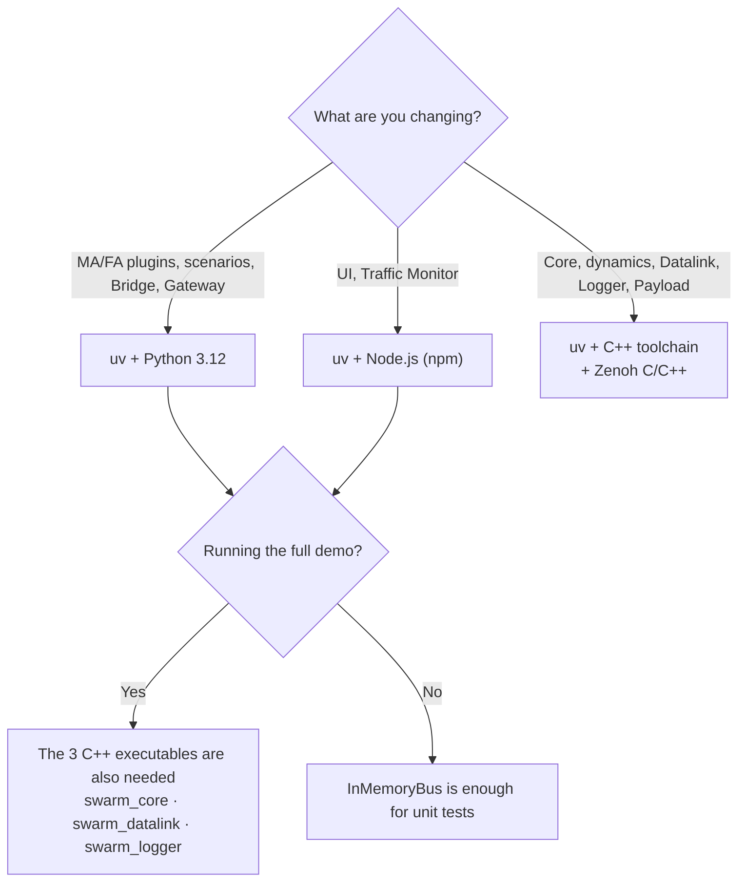

# 1. Development environment

> Source: [docs/41_dev/01_setup.md](../../41_dev/01_setup.md) at commit `7affdae`.

- [10_contracts.md §7](../../10_contracts.md#7-빌드-환경과-시험-dec-022) (Korean) is the authority for install commands. This chapter covers how to decide what to install and the failures you are likely to hit.

## 1.1 What to install



| Tool | When needed | Where to get it |
|---|---|---|
| uv | Always. uv manages Python 3.12 and the packages | Contract §7.2 "공통 (Python)" (common) |
| Node.js, npm | `ui/`, `ui/monitor/` | Distribution or official installer |
| Visual Studio Build Tools + vcpkg | C++ builds with Windows MSVC | Contract §7.2 "MSVC + vcpkg" |
| MSYS2 UCRT64 or Linux packages | Other C++ toolchains instead of MSVC | Contract §7.2 |
| zenoh-c, zenoh-cpp 1.10.2 | Attaching C++ processes to the real bus | Contract §7.2 "Zenoh" |
| MCAP headers | Logger. Automatic with vcpkg, fetched by hand on MSYS2 and Linux | Contract §7.2 "MCAP" |
| git submodule | Gateway | [Chapter 2](02_build_test.md#26-gateway) |

> Not verified: the `mingw-*` and `linux-*` presets exist but were not run while writing this manual. The commands below were confirmed on Windows `msvc-debug`.

## 1.2 Choosing a preset

The preset table is in [contract §7.1](../../10_contracts.md#71-지원-툴체인). Choose as follows.

- To run everything on Windows: `msvc-debug`. The demo runner's default path is `build/msvc-debug`.
- To measure performance: `msvc-release`. If the Python Agent is the bottleneck, it makes little difference ([21_qa_report.md §10.4](../../21_qa_report.md#104-성능-release-대-debug와-dec-040), Korean).
- Test presets (`ctest --preset`) exist only for `*-debug` and `linux-vcpkg-debug`. Release presets have none.

## 1.3 MSVC build shell

A plain shell has no `cl`. Build in a shell where `vcvars64.bat` has been called (x64 Native Tools). Find the Visual Studio install path with:

```bash
"%ProgramFiles(x86)%\Microsoft Visual Studio\Installer\vswhere.exe" -latest -products * -property installationPath
```

To run it in one line, use the `cmd /c` form in the [common instructions](../../11_wp_briefs.md#공통-지시) of `11_wp_briefs.md` (Korean).

## 1.4 Common failures

| Symptom | Cause | Fix |
|---|---|---|
| abseil compile fails with C1083 | The repository path is long and the vcpkg build tree path exceeds the limit | Add `-DVCPKG_INSTALL_OPTIONS=--x-buildtrees-root=C:/b/bt` to the configure command. Almost always needed in a worktree |
| `GlobalEmptyString` unresolved at release link | A `build/msvc-*` made with an old triplet remains (QA-007) | Delete `build/msvc-*` and reconfigure |
| Zenoh warning at configure, `--bus zenoh` unavailable at run time | `CMAKE_PREFIX_PATH` lacks the Zenoh prefix. Without it only the memory backend is built | Pass `-DCMAKE_PREFIX_PATH=<Zenoh prefix>` or set it as an environment variable |
| `zenohc.dll` not found on Windows | The executable was moved out of the build tree | Use the executable inside the build tree or copy the dll next to it |
| `libzenohc.so` not found on Linux | Same as above | `LD_LIBRARY_PATH=<prefix>/lib` |
| Warning, then `logger/` is skipped (MSYS2, Linux) | `MCAP_INCLUDE_DIR` is missing | Fetch the headers as in contract §7.2 "MCAP" and pass them |
| The Python extension module cannot be loaded | The toolchain used to build differs from the Python one | [Contract §7.4](../../10_contracts.md#74-툴체인별-제약) |
| `UnicodeEncodeError: 'cp949'` from `--help` | Some script help text contains characters cp949 cannot write | Set `PYTHONUTF8=1` and run again. Or in PowerShell, `$env:PYTHONUTF8=1` |

For other failures see [11. Troubleshooting](11_troubleshooting.md).

Next: [2. Build and test](02_build_test.md).
