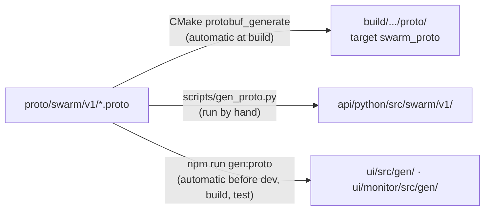

# 2. Build and test

> Source: [docs/41_dev/02_build_test.md](../../41_dev/02_build_test.md) at commit `f7bcbac`.

Each area is built and tested separately, so if you only change Python, start at 2.3. Run the commands from the repository root. Exceptions are written in front of the command.

## 2.1 Code generation

`proto/swarm/v1/*.proto` is the source. Each language has its own generated code, none of which is committed.



- After changing or pulling proto files, regenerate the Python code by hand.

```bash
uv run python scripts/gen_proto.py
```

## 2.2 C++ (Core, dynamics, Datalink, Logger, Payload, bus)

Pick `<preset>` as in [1.2](01_setup.md#12-choosing-a-preset). For MSVC, run in a shell where `vcvars64.bat` has been called.

```bash
cmake --preset <preset> -DCMAKE_PREFIX_PATH=<Zenoh prefix>
```

```bash
cmake --build --preset <preset>
```

```bash
ctest --preset <preset>
```

- If `CMAKE_PREFIX_PATH` is set as an environment variable, you can drop the `-D` option. Where the path is long, such as a worktree, also pass `VCPKG_INSTALL_OPTIONS` from [1.4](01_setup.md#14-common-failures).
- Outputs: `build/<preset>/core/swarm_core`, `build/<preset>/datalink/swarm_datalink`, `build/<preset>/logger/swarm_logger`
- Test names carry a module prefix (for example `pay.TC-PAY-018`). To run only some of them:

```bash
ctest --preset <preset> -R pay
```

## 2.3 Python (API, scenarios, Bridge, Agent, algorithms)

The uv workspace in the root `pyproject.toml` groups six packages (including the example package).

```bash
uv sync
```

```bash
uv run python scripts/gen_proto.py
```

```bash
uv run pytest
```

- The targets are `testpaths` in the root `pyproject.toml`: `api/python/tests`, `scenario/tests`, `bridge/tests`, `agent/tests`, `algorithms/tests`, `examples/plugins/tests`.
- To run one package:

```bash
uv run pytest bridge/tests
```

- To list the installed plugin names:

```bash
uv run swarm-agent --list-plugins
```

- `uv sync` also installs eclipse-zenoh. Unit tests run on `InMemoryBus`, so no C++ build is needed.

## 2.4 GCS/UI (`ui/`)

```bash
cd ui && npm install
```

```bash
cd ui && npm test
```

```bash
cd ui && npm run build
```

- `npm run dev` starts a development server on port 5173. `?source=mock` (the default) works without a bus. Structure and URL arguments are in [ui/README.md](../../../ui/README.md).

## 2.5 Traffic Monitor (`ui/monitor/`)

```bash
cd ui/monitor && npm install
```

```bash
cd ui/monitor && npm test
```

```bash
cd ui/monitor && npm run build
```

- The development server port is 5174. For load measurement use `npm run bench`. Details are in [ui/monitor/README.md](../../../ui/monitor/README.md).

## 2.6 Gateway

The Gateway is a standalone uv project outside the root workspace (CR-GW-004). The LA-CAL client comes from a submodule (DEC-069).

```bash
git submodule update --init third_party/agra_lacal
```

```bash
cd gateway && uv sync --extra zenoh
```

```bash
cd gateway && uv run pytest
```

- If the proto generated code is missing, run `gen_proto.py` from 2.3 at the root first.
- The tests use a CAL Server started in-process and `InMemoryBus`. Without `--extra zenoh` the tests still pass, but at run time the Gateway reports how to install it and exits with code 1. For how to run it, see [user manual chapter 9](../42_user/09_gateway.md).

## 2.7 What is not committed

Listed in `.gitignore`: `build/`, `out/`, `.venv/`, `node_modules/`, `dist/`, `*.mcap`, `data/dem/`, `data/tiles/`, `api/python/src/swarm/`. `ui/src/gen/` and `ui/monitor/src/gen/` are not committed either.

## 2.8 Integrated check

After unit tests pass, run the full path. For the demo and its automatic check see [2. Quick start](../42_user/02_quickstart.md) in the user manual. For the QA harness see [chapter 10](10_qa.md).

Next: [3. Architecture and execution model](03_architecture.md).
