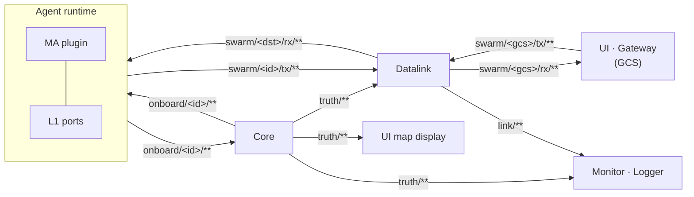
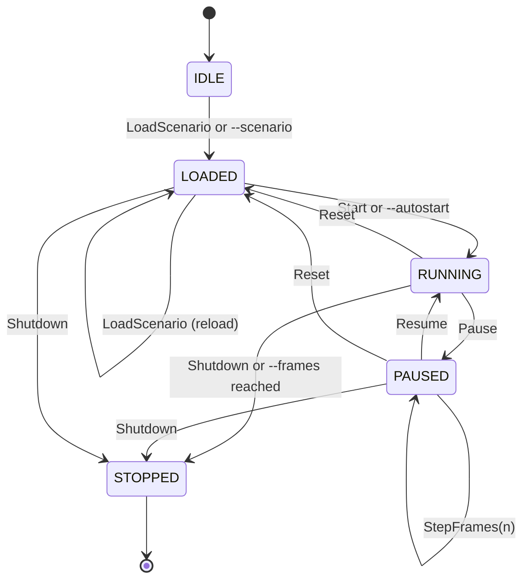
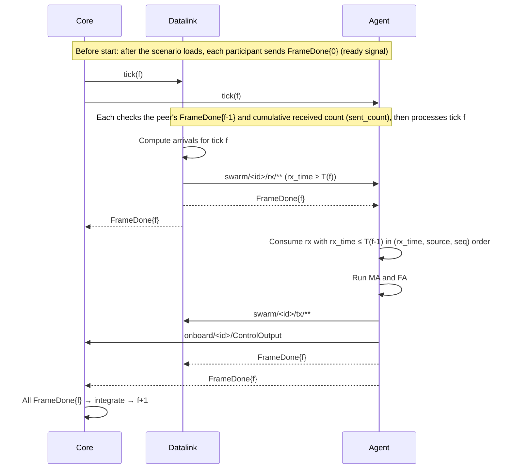

# 3. Architecture and execution model

> Source: [docs/41_dev/03_architecture.md](../../41_dev/03_architecture.md) at commit `bbf4d92`.

- See [overview §3](../40_overview.md#3-components) first for the overall structure. This chapter sets out the execution rules to follow when writing code.
- [Contract §3](../../10_contracts.md#3-zenoh-키-체계-prp-net-003) (Korean) is the authority for the exact rules.

## 3.1 Processes and participants

| Process | Default participant ID | Lockstep barrier | Notes |
|---|---|---|---|
| `swarm_core` | — | Manages the barrier | Uses `--participant` or reads the scenario's `run.participants` |
| `swarm_datalink` | `datalink-0` | Participates | With `--no-frame-done` it does not send `FrameDone` |
| `swarm-agent` | `agent-0` | Participates | One process hosts many vehicles. Split with `--entities` |
| `swarm_logger`, `swarm-bridge`, Gateway | — | Does not participate | The Gateway's `--participant` (default `gateway-0`) is for `LinkEnvelope.publisher` |

- Participant IDs have the same format as entity IDs (`^[a-z][a-z0-9]*(-[a-z0-9]+)+$`).
- The Agent treats IDs in `run.participants` that start with `datalink` as the Datalink. Start Datalink participant names with this prefix.

## 3.2 Opening the bus

Processes do not construct a bus implementation directly. They open it with `open_bus(BusConfig)` (DEC-026). In C++ it is `swarm/bus/open_bus.hpp`, in Python `swarm_api.open_bus`. Executables accept options of the same names.

| Option | Meaning |
|---|---|
| `--bus zenoh\|memory` | Backend. If empty, zenoh when Zenoh is available |
| `--zenoh-config <file>` | Zenoh json5 configuration |
| `--zenoh-mode peer\|client\|router` | Zenoh mode |
| `--connect <endpoint>`, `--listen <endpoint>` | Endpoints. Repeatable. Example: `tcp/127.0.0.1:17600` |
| `--no-multicast` | Turns off multicast scouting |

- If another bus exists on the same PC, use `--no-multicast` and explicit `--connect` so they do not mix.
- Do not publish a key with a different QoS. `sim/clock/**` and `swarm/**` use congestion control BLOCK, the rest DROP (DEC-043).

## 3.3 Key areas and access rules

Rules to follow:

- Vehicle-to-vehicle and ground-to-vehicle messages always go `tx` → Datalink → `rx`. A runtime does not publish directly to another entity's `rx`.
- MA plugins do not access the bus. The prefixes `sim/ctrl/`, `truth/` and `link/` are not exposed to plugins (`MA_FORBIDDEN_PREFIXES`, DEC-014).
- The Gateway subscribes only to `swarm/<gcs>/rx/**` and publishes only to `swarm/<gcs>/tx/c2/<msg>` and `swarm/<gcs>/tx/mp/<msg>`.
- Browsers do not attach to Zenoh directly, only through the bridge (DEC-027).

What the Agent runtime automatically reports to the GCS regardless of the plugin:

| Target | When reported | Basis |
|---|---|---|
| `SensorActivity`, `JammerActivity`, `StrikeActivity` | On change (per key at most `--activity-max-hz`, default 10 Hz) and at 1 Hz | DEC-051, DEC-056, DEC-063 |
| `NavigationReport` | Periodically at `--vi-report-hz` (default 1 Hz, off at 0 or below) | DEC-071 |
| `SystemStatus`, `FlightCommandStatus` | On change | DEC-071, DEC-073 |
| `FlightCapability` | Once at start | DEC-071 |

- The source of `SystemStatus` is `onboard/<id>/SystemStatus` published by Core (on change and at 1 Hz, DEC-073).
- Reports go through the Datalink, so they do not reach the ground while the GCS link is down. `SystemStatus` has no periodic retransmission, so changes made during the outage are not delivered until the next change (O-16).

## 3.4 Core states

- To change the mode during a run, send Reset and then Start.
- An unsupported scenario is refused at load and Core stays in IDLE (DEC-038).

## 3.5 Run modes

| Mode | Advance condition | Deterministic | Used for |
|---|---|---|---|
| `realtime` | Every wall-clock dt. Rate fixed at 1 | No | UI operation, demonstrations |
| `lockstep` | After `FrameDone(N)` from every participant. At rate > 0 the interval is dt/rate, at 0 there is no wait | With a fixed seed | Algorithm comparison, regression tests |
| `freerun` | At rate > 0 the interval is dt/rate, at 0 there is no wait | No | Accelerating Core alone |

> Known limitation: in comparisons of 2 to 4 same-seed lockstep runs (QA round 19, 60 s without faults) the truth trajectories were the same, but the frame in which the first `SystemStatus` is sent differs between runs, so some `LinkOutcome` and GCS receptions were not the same (D-30, being fixed). Reproducibility at points where `SystemStatus` changes, such as fault injection, and with a Gateway in the setup was not checked.

## 3.6 One lockstep frame

- At tick 0 no rx is consumed. Vehicle-to-vehicle messages are consumed at least one tick later on top of the model latency (DEC-040, DEC-045).
- rx produced by the Datalink at tick f is consumed from the next tick on.
- `sent_count` is the cumulative number of samples published so far. The receiver waits until it has received that many (DEC-044). It applies only to `swarm/**`.
- Use only `ctx.rng` for random numbers. Depending on wall clocks, dictionary order or thread races breaks determinism.
- If a participant does not respond for more than 5 s of wall-clock time, it appears in `SimStatus.waiting_participants`. A participant that left after start cannot rejoin. Recovery is Reset+Start (DEC-038, DEC-041).
- The exact wording is "시나리오 배포와 lockstep 시작" (scenario distribution and lockstep start) in [contract §3.3](../../10_contracts.md#33-규칙).

## 3.7 Scenario distribution

- Right after load, and every second (wall clock) while LOADED or waiting for lockstep readiness, Core publishes `Scenario` on `sim/ctrl/scenario` (DEC-037). The CLI `--mode` and `--rate` are also reflected.
- Other participants can receive it from this key without `--scenario`. When the scenario `name` changes, they reload and send the ready signal again.

## 3.8 Per-vehicle parameters

- Value precedence: owner default → airframe table (dynamics only) → scenario (`dynamics_params`, `fa_params`, `ma_params`) → `SimCommand.set_params` during the run.
- Owners are dynamics (Core), FA and MA. Invalid items are not silently dropped. The reason (`unknown`, `type`, `range`, `choice`, `not_runtime`) is left in `EntityParams.rejected`.
- Details are in [contract §3.3, per-vehicle parameters](../../10_contracts.md#33-규칙).

## 3.9 Coordinates and units

| Item | Rule |
|---|---|
| Position | WGS84 latitude and longitude (deg), altitude MSL (m) |
| Velocity | NED (m/s). Velocity in the dynamics state is air velocity, `to_kinematic` output is ground velocity |
| Attitude | Quaternion (w, x, y, z) rotating NED → body FRD |
| Angular rate | Body FRD (rad/s) |
| Time | `sim_time_us` (uint64, µs), `frame` |
| Angle fields | Name with `_deg` or `_rad`. rad if absent |

Next: plugin authors go to [chapter 4](04_ma_plugin.md), WP contributors to [chapter 8](README.md#chapter-8-files-08_wp).
