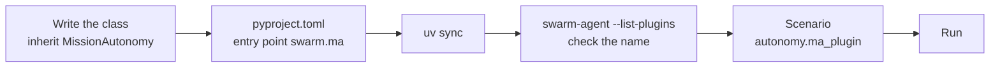
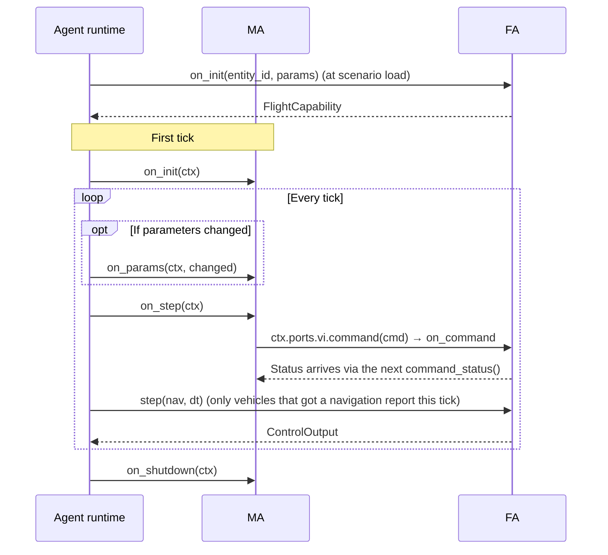
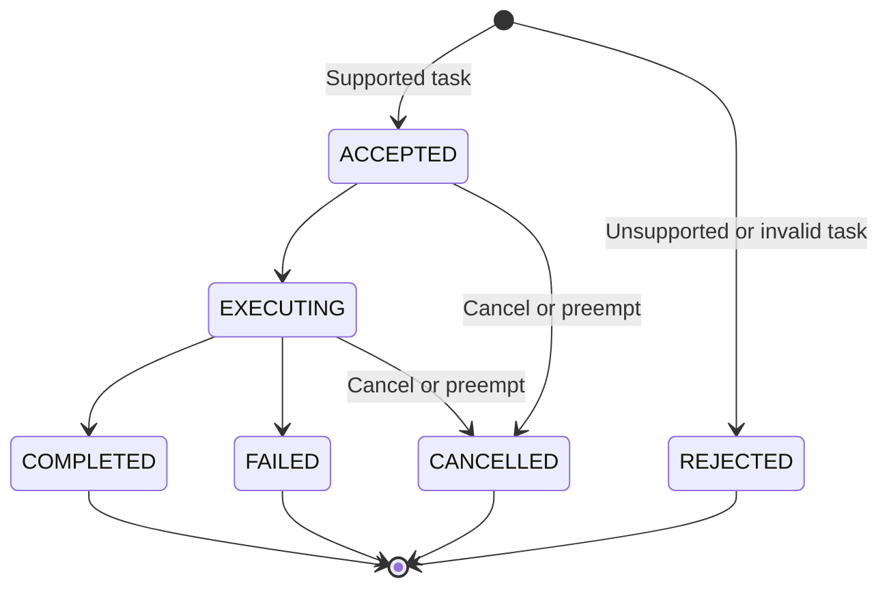
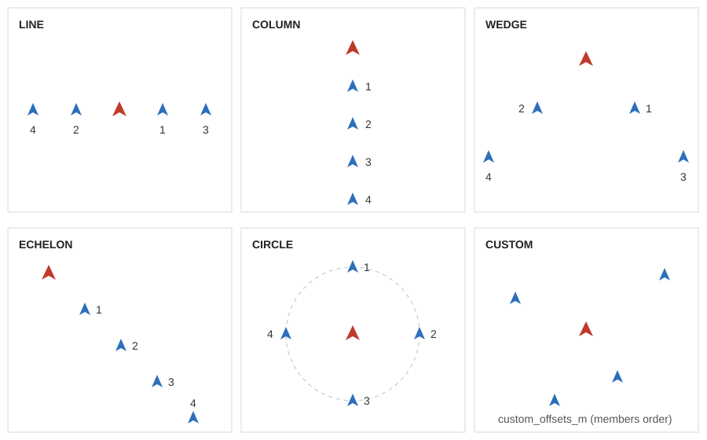

# 4. Writing an MA plugin

> Source: [docs/41_dev/04_ma_plugin.md](../../41_dev/04_ma_plugin.md) at commit `24fc9be`.

An MA (Mission Autonomy) is a Python class that makes the mission decisions for one vehicle or a swarm. It takes tasks and turns them into flight commands and equipment commands.

Every example is runnable code. They are in [examples/plugins/](../../../examples/plugins/) and are included in the root `uv run pytest`.

| Example registered name | File | What it shows |
|---|---|---|
| `example_turn` | [turn.py](../../../examples/plugins/src/swarm_plugin_examples/turn.py) | The smallest MA, parameters |
| `example_patrol` | [patrol.py](../../../examples/plugins/src/swarm_plugin_examples/patrol.py) | Reusing `TaskPilot`, task status reporting |
| `example_rendezvous` | [rendezvous.py](../../../examples/plugins/src/swarm_plugin_examples/rendezvous.py) | Batch MA, P2P neighbor information |

## 4.1 Walkthrough



**1. Write the class.** Only `on_step` is required. The full file is [turn.py](../../../examples/plugins/src/swarm_plugin_examples/turn.py).

```python
class TurnToHeading(MissionAutonomy):
    PARAMS = (
        ParamDef("heading_deg", 90.0, ParamLayer.BEHAVIOR, "deg", 0.0, 360.0, "목표 침로"),
    )

    def on_init(self, ctx: AgentContext) -> None:
        self.heading_deg = float(ctx.params.get("heading_deg", 90.0))
        self.sent = False

    def on_step(self, ctx: AgentContext) -> None:
        ctx.ports.c2.inbox()
        ctx.ports.vi.command_status()
        nav = ctx.ports.vi.nav()
        if self.sent or nav is None:
            return
        k = nav.kinematics
        cmd = vi_pb2.FlightCommand(command_id=f"{ctx.entity_id}-turn")
        cmd.hsa.heading_deg = self.heading_deg
        cmd.hsa.altitude_m = k.position.alt_m
        cmd.hsa.speed_mps = math.hypot(k.velocity_ned_mps.x, k.velocity_ned_mps.y)
        ctx.ports.vi.command(cmd)
        self.sent = True
```

**2. Register it.** Add an entry point to the package's [pyproject.toml](../../../examples/plugins/pyproject.toml). The left side is the name used in scenarios.

```toml
[project.entry-points."swarm.ma"]
example_turn = "swarm_plugin_examples.turn:TurnToHeading"
```

When placing a new package in the repository, add it in four places in the root `pyproject.toml`: `tool.uv.workspace.members`, `tool.uv.sources`, `dependency-groups.dev`, `tool.pytest.ini_options.testpaths`.

**3. Install and check the name.**

```bash
uv sync
```

```bash
uv run swarm-agent --list-plugins
```

```text
swarm.ma: example_patrol, example_rendezvous, example_turn, flocking, flocking_basic, formation, hold, waypoint
swarm.fa: default, example_hsa
```

**4. Select it in a scenario.** The scenario format is in [chapter 3](../42_user/03_scenario.md) of the user manual. A scenario using all the examples is [examples_all.json](../../../examples/plugins/scenarios/examples_all.json).

```json
"autonomy": { "ma_plugin": "example_turn", "ma_params": { "heading_deg": 120.0 } }
```

**5. Run it.** The C++ executables are needed ([2.2](02_build_test.md#22-c-core-dynamics-datalink-logger-payload-bus)). To check without a build, skip to [4.9](#49-unit-tests). Convert the scenario to `.pb`, then start one process per terminal. Core's `--rate 0` is maximum speed, and `--frames 3000` is 60 seconds of simulation time.

```bash
uv run swarm-scenario export examples/plugins/scenarios/examples_all.json --out out/examples.pb
```

```bash
build/msvc-debug/datalink/swarm_datalink --no-multicast --listen tcp/127.0.0.1:17601
```

```bash
uv run swarm-agent --frames 3000 --no-multicast --listen tcp/127.0.0.1:17602 --connect tcp/127.0.0.1:17601
```

```bash
build/msvc-debug/core/swarm_core --scenario out/examples.pb --autostart --rate 0 --frames 3000 --no-multicast --listen tcp/127.0.0.1:17603 --connect tcp/127.0.0.1:17601 --connect tcp/127.0.0.1:17602
```

It is working if the Agent log shows `hosting 4 vehicles` and, at the end, `ticks=3000`. Stop the Datalink with Ctrl+C.

## 4.2 Call order



- Within a frame, MAs are called in vehicle ID order, then batch MAs in plugin name order.
- `on_step` is called every tick. If no navigation report has arrived yet, `nav()` is `None`.
- An exception thrown by a plugin is logged and the process continues (DEC-038). The `Harness` in tests runs in `strict` mode and rethrows it.

## 4.3 AgentContext and ports

Plugins communicate with the outside only through `ctx.ports` (DEC-013). They do not access the bus or `truth/**` directly.

| `ctx` field | Meaning |
|---|---|
| `entity_id` | This vehicle's ID |
| `frame`, `sim_time_s`, `dt_s` | Frame number, simulation time, frame interval |
| `params` | Current parameters with defaults filled in. When `on_params` is called, these are already the new values |
| `rng` | Seeded `numpy.random.Generator`. Use only this for random numbers to keep lockstep determinism |
| `ports` | The 6 ports below |

| Port | Methods | Contents |
|---|---|---|
| `c2` | `inbox()`, `send(msg)` | Receives tasks from the controlling GCS, sends `TaskStatus` and others |
| `vi` | `nav()`, `capability()`, `system_status()`, `command(cmd)`, `command_status()` | Navigation report, FA capability, vehicle status, flight commands and their status |
| `ms` | `loadout()`, `detections()`, `command(msg)`, `activities()` | Payload list, detection results, equipment commands (`SensorCommand`, `JammerCommand`, `StrikeCommand`), equipment status |
| `mp` | `mission_plan()`, `route_plans()`, `engagement_criteria()` | Plans from the scenario |
| `p2p` | `send(msg, to=None)`, `inbox()` | Vehicle-to-vehicle communication. Broadcast if `to` is absent. Passes through the datalink, with loss and latency |
| `md` | `record(name, value)` | Records values for analysis. For now they stay in runtime memory and do not go to the bus or MCAP |

- Use only what arrived on `p2p` for the state of other vehicles. `nav()` is the vehicle's own navigation value, including noise.
- Inboxes are cleared every frame. Even if unused, calling them keeps messages from piling up into the next frame.
- Flight command modes are in [5.2](05_fa_plugin.md#52-vi-control-modes).

## 4.4 Parameters

Declare `ParamDef` entries in the class attribute `PARAMS`. The UI parameter panel is drawn from this declaration.

```python
ParamDef("idle_radius_m", 400.0, ParamLayer.BEHAVIOR, "m", 50.0, 100000.0, "작업이 없을 때 선회 반경")
```

| Argument | Meaning |
|---|---|
| `name`, `default`, `layer` | Name, default value (which also sets the type), layer |
| `unit`, `min`, `max`, `description` | Unit, range, description |
| `runtime` | If `False`, cannot be changed during a run. Default `True` |
| `choices` | Allowed values for a string parameter |

- Layers `ParamLayer`: `AIRFRAME`, `CONTROL`, `GUIDANCE`, `BEHAVIOR`, `DECISION`.
- When values change during a run, `on_params(ctx, changed)` is called at the start of the frame. `changed` holds only the changed items.
- Rejection reasons are `unknown`, `type`, `range`, `choice`, `not_runtime`. Value precedence is in [3.8](03_architecture.md#38-per-vehicle-parameters).

## 4.5 Batch MA

With many vehicles, handle them at once with `BatchMissionAutonomy`. Vehicles on the same host using the same plugin are grouped.

```python
class Rendezvous(BatchMissionAutonomy):
    def on_step_batch(self, ctxs: Sequence[AgentContext], nav: NavBatch) -> None:
        ...
```

- `NavBatch`: `ids`, `lat_lon_alt` (N×3), `velocity_ned` (N×3), `valid` (N). Row `i` is `ctxs[i]`.
- Send and receive per vehicle through `ctxs[i].ports`.
- Use **only your own row** of `NavBatch`. Using other rows as neighbor information bypasses the datalink emulation (DEC-008). [rendezvous.py](../../../examples/plugins/src/swarm_plugin_examples/rendezvous.py) has that form.
- A batch MA's `on_init` and `on_shutdown` take `ctxs`, and `on_params` takes one vehicle's `ctx`.

## 4.6 Tasks and TaskStatus

Answer each `TaskCommand` received from `c2.inbox()` with a `TaskStatus`.



- Answer unsupported tasks with `REJECTED`. If you silently ignore them, the operator cannot tell why the vehicle does not move.
- Reject a task whose `assignees` is empty. Ignore a task that does not include you.
- If the same `task_id` arrives again, change the content. Do not report the previous task as cancelled (DEC-033).
- If `cancel` is true, end that task with `CANCELLED`.

## 4.7 Reusable parts

The rules above are implemented in [algorithms/src/swarm_algorithms/common.py](../../../algorithms/src/swarm_algorithms/common.py).

| Part | What it does |
|---|---|
| `TaskTracker(ctx, supported)` | Runs `MissionPlan` in sequence, preempts, cancels and rejects C2 tasks, sends `TaskStatus`. `handle(msg)`, `update(nav)`, `status(...)`, `finish(...)` |
| `TaskPilot(ctx, acceptance_m, hold_radius_m, speed_mps, supported)` | `TaskTracker` plus flight execution. One `step()` call handles MoveTo, Hold, RTB, SearchArea, Route |
| `every(ctx, hz)` | Periodic check with a different phase per vehicle |
| `peer_status(nav, group_id, task_id)` | Builds a `PeerStatus` |

[patrol.py](../../../examples/plugins/src/swarm_plugin_examples/patrol.py) only calls `self.pilot.step()` and decides for itself just what to do when there is no task.

## 4.8 Baseline MAs

| Name | File | Behavior | Parameters |
|---|---|---|---|
| `hold` | [hold.py](../../../algorithms/src/swarm_algorithms/hold.py) | Holds the heading, speed and altitude of the first navigation state. Does not handle tasks | `orbit_radius_m` (0 means straight) |
| `waypoint` | [waypoint.py](../../../algorithms/src/swarm_algorithms/waypoint.py) | Executes tasks with `TaskPilot` | `acceptance_m`, `hold_radius_m`, `speed_mps` |
| `formation` | [formation.py](../../../algorithms/src/swarm_algorithms/formation.py) | Leader-follower formation. The leader acts like `waypoint`, followers track their slots with HSA | `group`, `peer_hz`, `leader_speed_mps`, `leader_timeout_s`, `corr_max_mps` and others |
| `flocking` | [flocking.py](../../../algorithms/src/swarm_algorithms/flocking.py) | Reynolds separation, alignment and cohesion batch MA. Rejects Route | `cruise_mps`, `neighbor_radius_m`, `separation_m`, `w_sep`, `w_align`, `w_coh`, `peer_hz`, `stale_s`, `goal_radius_m`, `hold_radius_m`, `wander_deg`, `group` |

`flocking_basic` is a variant for example scenarios. The full list is in [algorithms/TRACE.md](../../../algorithms/TRACE.md).

> Not implemented: vehicle behavior on link loss (roadmap P2).

`formation` slots are offsets in the leader's FRD frame. `s` is `spacing_m`, `k` is the follower index (from 0).



| Shape | Offset (forward, right) |
|---|---|
| `LINE` | (0, ±s·⌈(k+1)/2⌉), even k on the right |
| `COLUMN` | (−s(k+1), 0) |
| `WEDGE` | (−s·r, ±s·r), r = ⌊k/2⌋+1 |
| `ECHELON` | (−s(k+1), s(k+1)) |
| `CIRCLE` | Equally spaced around the leader at radius s |
| `CUSTOM` | `custom_offsets_m`, in `members` order |

## 4.9 Unit tests

`Harness` in `swarm_agent.testing` runs the runtime with a fake Core and Datalink. Neither processes nor Zenoh are needed. The full file is [test_plugin_examples.py](../../../examples/plugins/tests/test_plugin_examples.py).

```python
from swarm_agent.testing import Harness, make_scenario, send_c2

def test_turn():
    h = Harness(make_scenario(1, "example_turn", {"heading_deg": 200.0}, course_deg=45.0))
    h.run_s(60.0)
    b = h.core.bodies["uav-001"]
    assert math.degrees(b.course) % 360.0 == pytest.approx(200.0, abs=1.0)
```

| Tool | Use |
|---|---|
| `make_scenario(n, ma_plugin, ma_params, ...)` | n vehicles `uav-001`.. and `gcs-01` |
| `Harness(sc)` | Performs scenario load. Advance with `run_s(seconds)` |
| `h.core.bodies[id]` | Current `lat`, `lon`, `alt`, `course`, `speed` |
| `send_c2(h.bus, "gcs-01", msg, [targets])` | Injects a message sent by the GCS. Targets is a list |
| `h.task_states(task_id)`, `h.gcs_rx` | Task states received by the GCS, all received messages |
| `Harness(sc, drop=...)` | Injects link loss with a `(src, dst, msg)` predicate |

```bash
uv run pytest examples/plugins/tests
```

> Not implemented: C++ MA plugins. Only the ABI header exists, with no loading path.

Next: [5. Writing an FA plugin](05_fa_plugin.md).
