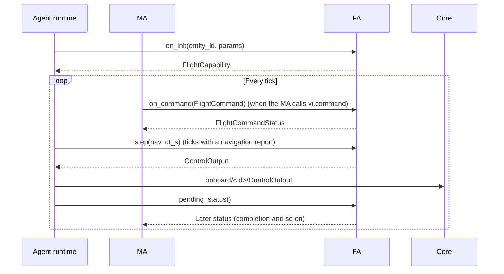
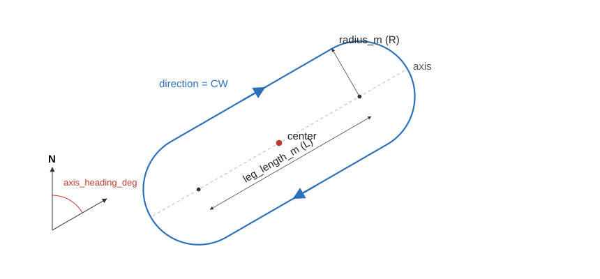

# 5. Writing an FA plugin

> Source: [docs/41_dev/05_fa_plugin.md](../../41_dev/05_fa_plugin.md) at commit `24fc9be`.

An FA (Flight Autonomy) turns the MA's flight commands into dynamics control output. The default FA is enough in most cases. Write your own when comparing other guidance and control laws.

The example is [hsa_fa.py](../../../examples/plugins/src/swarm_plugin_examples/hsa_fa.py) (`example_hsa`). It is the smallest FA, handling only HSA, and its tests are in [test_plugin_examples.py](../../../examples/plugins/tests/test_plugin_examples.py).

## 5.1 Lifecycle



| Method | What to do |
|---|---|
| `on_init(entity_id, params)` | Called at scenario load. Returns performance limits as `FlightCapability` |
| `on_params(values, changed)` | Change during a run. `values` is everything, `changed` only what changed |
| `on_command(cmd)` | Returns `ACCEPTED` or `REJECTED` immediately |
| `step(nav, dt_s)` | Returns `ControlOutput` |
| `pending_status()` | Drains and returns queued status. Used for status decided later, such as waypoint completion |

- `step` is called only on ticks where a navigation report arrived. `dt_s` is the frame interval.
- In `FlightCapability`, set `supports_hsa`, `supports_waypoint` and `supports_curve` to true only for supported modes.
- Vehicle limits such as `min_speed_mps` are reported at start, so declare them `runtime=False`.

## 5.2 VI control modes

`mode` of `FlightCommand` is one of the following. The definition is in [vi.proto](../../../proto/swarm/v1/vi.proto).

| Mode | Fields | Meaning |
|---|---|---|
| `hsa` | `heading_deg`, `speed_mps`, `altitude_m` | Hold heading, speed and altitude |
| `waypoint` | `waypoints[]{position, speed_mps, acceptance_radius_m}`, `loop` | Fly waypoints in order |
| `curve.orbit` | `center`, `radius_m`, `direction`, `speed_mps` | Circular orbit |
| `curve.racetrack` | `center`, `radius_m`, `leg_length_m`, `axis_heading_deg`, `direction`, `speed_mps` | Racetrack orbit (DEC-034) |



The two circle centers are `center ± (L/2)·axis`. The axis heading is measured clockwise from true north.

`ControlOutput` fills one of `kinematic`, `attitude`, `actuator`. The current 2-DoF and 3-DoF models accept only `kinematic`.

| `KinematicCmd` field | Models using it |
|---|---|
| `speed_mps`, `climb_rate_mps` | 2-DoF and 3-DoF |
| `heading_rate_rps` | 2-DoF |
| `bank_rad` | 3-DoF |

If you fill both `heading_rate_rps` and the coordinated-turn bank `bank = atan(V·ψ̇/g)`, the two models follow the same trajectory.

## 5.3 Default FA

Registered name `default`, code in [agent/src/swarm_agent/fa.py](../../../agent/src/swarm_agent/fa.py), racetrack geometry in [racetrack.py](../../../agent/src/swarm_agent/racetrack.py).

- Guidance: Waypoint is direct, Orbit is a vector field, Racetrack is selected by `racetrack_guidance`.
- Control: turn rate proportional to heading error (limited by maximum bank), climb rate proportional to altitude error.
- Altitude `alt_m <= 0` means hold the current altitude.
- Before any command, it holds the heading, speed and altitude of the first navigation report.
- On reaching the last waypoint, it sends `COMPLETED` and orbits that point.

| Parameter | Layer | Default | Changeable during a run |
|---|---|---|---|
| `min_speed_mps` | AIRFRAME | 12 | No |
| `max_speed_mps` | AIRFRAME | 35 | No |
| `max_climb_mps` | AIRFRAME | 5 | No |
| `max_bank_deg` | AIRFRAME | 35 | No |
| `max_altitude_m` | AIRFRAME | 6000 | No |
| `k_heading` | CONTROL | 0.8 | Yes |
| `k_altitude` | CONTROL | 0.3 | Yes |
| `k_orbit` | GUIDANCE | 2.0 | Yes |
| `acceptance_radius_m` | GUIDANCE | 50 | Yes |
| `racetrack_guidance` | GUIDANCE | `dubins` (`vector_field`) | Yes |
| `k_cross_track` | GUIDANCE | 0.02 | Yes |
| `cross_track_inf_deg` | GUIDANCE | 60 | Yes |
| `k_racetrack_line` | GUIDANCE | 0.3 | Yes |
| `racetrack_gamma` | GUIDANCE | 0.2 | Yes |

## 5.4 Registration and selection

Same as the MA, except the group is `swarm.fa`. If `fa_plugin` is empty, `default` is used.

```toml
[project.entry-points."swarm.fa"]
example_hsa = "swarm_plugin_examples.hsa_fa:HsaOnlyFlightAutonomy"
```

```json
"autonomy": { "ma_plugin": "example_turn", "fa_plugin": "example_hsa", "fa_params": { "k_heading": 0.8 } }
```

`example_hsa` answers Waypoint and Curve with `REJECTED`, so tasks are not executed if it is used with the `waypoint` MA. When changing the FA, first check that it supports the modes the MA uses.

## 5.5 Tests

Set `fa_plugin` on the vehicle of a scenario made with `make_scenario`. `sc.entities[0]` is the GCS.

```python
sc = make_scenario(1, "example_turn", {"heading_deg": 120.0}, course_deg=45.0)
sc.entities[1].autonomy.fa_plugin = "example_hsa"
h = Harness(sc)
h.run_s(60.0)
```

Parts that can be checked without a vehicle, such as command handling, are tested by constructing the class directly and calling it.

> Not implemented: C++ FA plugins. `api/cpp` has only the ABI header, with no loading path. FAs are Python only for now.

Next: [6. Adding a dynamics model](06_dynamics.md).
