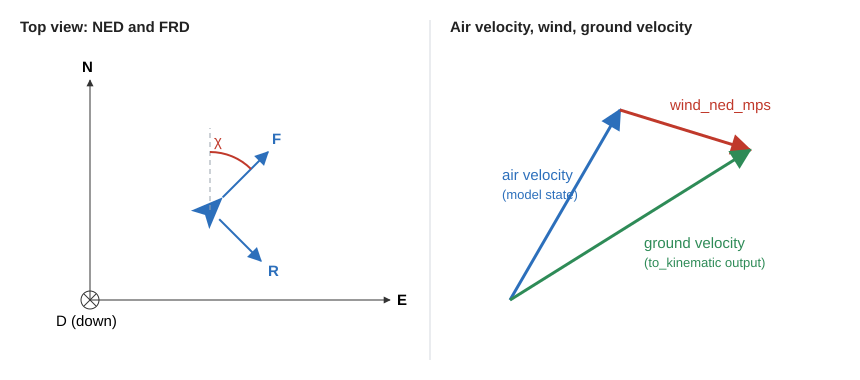
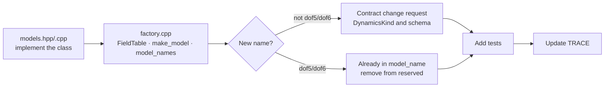

# 6. Adding a dynamics model

> Source: [docs/41_dev/06_dynamics.md](../../41_dev/06_dynamics.md) at commit `f7bcbac`.

Dynamics models are written in C++, placed in `dynamics/` and built together with Core. They are not registered separately like Python plugins and do not go in the [example package](../../../examples/plugins/) (DEC-070), which holds Python plugins. The examples use the real `dof2` code and tests.

| File to read | Contents |
|---|---|
| [api/cpp/include/swarm/api/dynamics.hpp](../../../api/cpp/include/swarm/api/dynamics.hpp) | Interface |
| [dynamics/include/swarm/dyn/models.hpp](../../../dynamics/include/swarm/dyn/models.hpp), [src/models.cpp](../../../dynamics/src/models.cpp) | `Dof2Model`, `Dof3Model` |
| [dynamics/src/factory.cpp](../../../dynamics/src/factory.cpp) | Name → model |
| [dynamics/tests/test_dynamics.cpp](../../../dynamics/tests/test_dynamics.cpp) | TC-DYN-001~015 |

## 6.1 Coordinates and wind



- Position is WGS84 (deg) and MSL altitude (m), velocity is NED (m/s). Course χ is measured clockwise from true north. The full rules are in [3.9](03_architecture.md#39-coordinates-and-units).
- **Velocity in the model state is air velocity.** Wind is added in the position derivative.
- **`vel_ned_mps` of `to_kinematic` is ground velocity.** Add `env.wind_ned_mps` to the air velocity (DEC-023). The gravity value for attitude also uses `env.gravity_mps2`.
- `vel_ned_mps` of `from_kinematic` is for setting the initial state and is interpreted as air velocity.

## 6.2 Interface

| `DynamicsModel` method | What to do |
|---|---|
| `name()`, `dof()` | Registered name, degrees of freedom (2, 3, 5, 6) |
| `state_size()`, `input_size()` | Sizes of state x and input u |
| `derivatives(t, x, u, env, dxdt)` | `dx/dt = f(t, x, u, env)` |
| `map_control(cmd, u)` | Converts `ControlOutput` to u. `false` for a form it does not accept |
| `to_kinematic(x, env, out)` | State to the common form `KinematicSample` |
| `from_kinematic(in, x)` | Sets the initial state |
| `param_descs()`, `get_param`, `set_param` | Exposes parameters. If the name is unknown or the value out of range, `set_param` is `false` and the value is unchanged |

| Helper type | Meaning |
|---|---|
| `Integrator::step(model, t0, dt, x, u, env, event)` | Integrates one frame. `rk4` is fixed step, `rk45` is variable step within the frame (default) |
| `EventFn` | Zero-crossing function (for example altitude − terrain elevation). When it fires, `StepResult.event` is true and x is the state at that moment |
| `Terrain::elevation_m(lat, lon)` | Terrain lookup |
| `Environment` | `gravity_mps2`, `air_density_kgpm3`, `wind_ned_mps`, `terrain` |

- Models keep no internal state between frames. The integrator calls `derivatives` several times within a frame.
- To give per-state error scales for variable-step integration, also implement `ErrorScaleProvider`. It is needed for states with different units, such as latitude/longitude and altitude.

The `derivatives` of `dof2` looks like this.

```cpp
const double v = x[kSpeed], psi = x[kHeading];
const double* w = env.wind_ned_mps;
const double vn = v * std::cos(psi) + w[0], ve = v * std::sin(psi) + w[1], vd = -x[kClimbRate] + w[2];
geo::geodetic_rates(x[kLat], x[kAlt], vn, ve, vd, dxdt[kLat], dxdt[kLon], dxdt[kAlt]);

const double v_c = std::clamp(u[kSpeedCmd], p_.min_speed_mps, p_.max_speed_mps);
dxdt[kSpeed] = (v_c - v) / p_.tau_speed_s;
```

## 6.3 Procedure for adding a model



1. Create the class in `models.hpp` and `models.cpp`. Declare parameters with a `Params` struct and a `ParamDesc` table (like `kDof2Descs`).
2. Add a `FieldTable` in [factory.cpp](../../../dynamics/src/factory.cpp) and a branch in `make_model(name, params)`. Add the name to `model_names()`.
3. `dof5` and `dof6` are reserved. When implementing these models, remove them from `reserved_model_names()` and add them to `IMPLEMENTED_DYNAMICS` in `scenario/src/swarm_scenario/validate.py`. Reserved models are refused by scenario validation and the Core check.
4. Any other name requires changing `DynamicsKind` in `proto` and the scenario schema. Follow the [contract change request](09_contributing.md#95-contract-change-requests) procedure.
5. If per-airframe defaults are needed, change `kAirframes` in [core/src/wp2_dynamics.cpp](../../../core/src/wp2_dynamics.cpp). The current table has `skywalker_x8` and `aerosonde` and sets speed and bank limits.

## 6.4 Parameters

`ParamDesc` is `{name, layer, default, unit, min, max, runtime, description}`.

```cpp
{"tau_speed_s", L::kControl, 1.0, "s", 0.05, 30.0, true, "속도 명령 1차 지연 시정수"},
```

- Defaults in the `Params` struct and the declaration table must match. TC-DYN-014 checks this.
- Time constants go in the CONTROL layer, speed, turn and climb limits in AIRFRAME.
- Values are exposed in the UI parameter panel and on `sim/param/<id>/dynamics`.

## 6.5 Terrain

- The DEM file format is in [contract §6](../../10_contracts.md#6-core--동역학-dynamicshpp) (Korean) (DEC-053). It is a pair of an int16 raw grid and a JSON header, read by `RawDemLoader`.
- Models query it through `env.terrain`. Core sets up the ground collision check with an `EventFn`.

## 6.6 Tests

Compare with analytic solutions. Write new tests in the same form as the existing ones.

| Test | Compared with |
|---|---|
| TC-DYN-001 | Analytic solution for constant speed and constant climb |
| TC-DYN-002 | 2-DoF steady turn radius V/ψ̇ and closure |
| TC-DYN-003 | 3-DoF coordinated turn radius v²/(g·tanφ) |
| TC-DYN-004, 005 | RK4 and RK45 error order |
| TC-DYN-008 | Ground crossing time |
| TC-DYN-009 | `map_control` form check |
| TC-DYN-011 | `to_kinematic` ↔ `from_kinematic` round trip |
| TC-DYN-013 | Distance traveled and ground velocity in wind |

Add a new test as a function in `test_dynamics.cpp`, register it in the table, and add the ID to the `foreach` list in [dynamics/CMakeLists.txt](../../../dynamics/CMakeLists.txt).

```bash
ctest --preset msvc-debug -R "^dyn\."
```

> Not implemented: `dof5` and `dof6` models (roadmap P3). Only the names are reserved, and validation and Core refuse them in a scenario.

Next: [7. Messages and contracts](07_messages.md).
