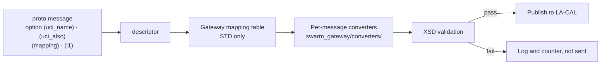

# 7. Messages and contracts

> Source: [docs/41_dev/07_messages.md](../../41_dev/07_messages.md) at commit `24fc9be`.

- The table in [contract §4](../../10_contracts.md#4-protobuf-스키마) (Korean) is the authority for the role of each proto file. This chapter gives the procedures for working with messages.
- The code generation flow is in [2.1](02_build_test.md#21-code-generation).

## 7.1 The three message categories

Each message carries its A-GRA mapping as a custom option (`proto/swarm/v1/options.proto`).

| Option | Meaning |
|---|---|
| `mapping` | `STD`: exported externally. `EXT`: own extension, not public externally. `SIM`: simulator-internal only |
| `uci_name` | UCI message name in the public XSD. Empty for EXT and SIM |
| `uci_also` | Additional UCI message names carrying the same content (STD only, DEC-072). Example: `NavigationReport`, `PeerStatus` → `MA_PositionReport` |
| `l1` | L1 interface (C2, VI, MS, MP, MD, P2P) |

The Gateway reads these options from the descriptor to build its mapping table. The table is not hard-coded. If it differs from the table in registry §5, the proto is the authority.



## 7.2 Adding or changing a message

This changes the contract, so it goes through WP0. In a WP session, do not implement it. Raise a contract change request ([chapter 9](09_contributing.md#95-contract-change-requests)).

1. Add the message or field to the appropriate file in `proto/swarm/v1/`. Do not reuse field numbers. Breaking changes go to `swarm.v2`.
2. Add the message options. Decide `mapping`, and for STD write the public XSD name in `uci_name`.
3. If it goes on the bus, decide the key. Change `api/python/src/swarm_api/keys.py` and `api/cpp/include/swarm/api/keys.hpp` together and add it to the table in contract §3.2.
4. If it appears in scenarios, change `scenario/src/swarm_scenario/schema/scenario.schema.json` to the same field structure.
5. Raise `CONTRACT_VERSION` (`api/python/src/swarm_api/__init__.py`) and add it to the change list at the top of `10_contracts.md`.
6. Regenerate the code and run the tests of all areas.

```bash
uv run python scripts/gen_proto.py
```

```bash
uv run pytest
```

C++ is regenerated on rebuild. UI and Monitor are regenerated by `npm test`.

## 7.3 Scenarios and proto

- The scenario JSON has the same field structure as `swarm.v1.Scenario`. Enum values drop the prefix and are lowercase (`ENTITY_KIND_GROUND_TARGET` → `ground_target`).
- `swarm_scenario.to_proto` and `from_proto` do the conversion. Make the file for `swarm_core --scenario` with `swarm-scenario export`.
- For run-time delivery, use `LoadScenario.scenario`. `scenario_json` is planned for removal (DEC-024).

## 7.4 Relationship to MCAP

MCAP channels map 1:1 to bus keys, and the schemas are protobuf descriptors (PRP-LOG-001). New keys are recorded without changing the Logger.

Next: [chapter 8](README.md#chapter-8-files-08_wp), [9. Contribution rules](09_contributing.md).
