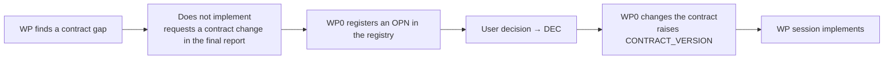

# 9. Contribution rules

> Source: [docs/41_dev/09_contributing.md](../../41_dev/09_contributing.md) at commit `bbf4d92`.

Work in the repository is divided into WPs (work packages), and everything from requirements to tests is traced by ID.

## 9.1 Scope of work

- Change only your own WP directory. The mapping of WPs to directories is in [overview §7](../40_overview.md#7-repository-map).
- `proto/`, `api/`, `bus/` and `docs/10_contracts.md` are the WP0 contract. If they need changing, follow the procedure in [9.5](#95-contract-change-requests).
- Do not depend on the internal implementation of other WPs. Dynamics, bus and plugins connect only through the interfaces in `api/`. If another WP is absent, test with mocks in your own directory and `InMemoryBus`.
- A WP that creates a new Python package adds it in four places in the root `pyproject.toml` ([4.1](04_ma_plugin.md#41-walkthrough), step 2). A new C++ dependency changes `vcpkg.json` and the package list in contract §7.2 together.

## 9.2 ID scheme

The full rules are in [01_id_convention.md](../../01_id_convention.md) (Korean). The common ones:

| ID | Meaning | Where |
|---|---|---|
| `REQ-*` | Requirement | `02_registry.md` |
| `PRP-*` | Proposal | `02_registry.md` |
| `OPN-NNN` | Open issue | `02_registry.md` §4 |
| `DEC-NNN` | Decision | `02_registry.md` §3 |
| `IMP-<module>-NNN` | Implementation item | Each WP's `TRACE.md` |
| `TC-<module>-NNN` | Test item | Each WP's `TRACE.md` |

- Module codes: `API`, `CORE`, `DYN`, `AGT`, `LNK`, `UI`, `MON`, `SCN`, `LOG`, `PAY`, `GW`, `EXP`, `INT`, `QA`.
- IDs are not reused. In a directory that already has a `TRACE.md`, continue after the existing numbers.
- Every implementation links to a REQ or DEC.

## 9.3 Traceability records

- Record implementation and tests in the `TRACE.md` table of your own directory. The columns are ID, content, location, basis, test result.
- WP sessions do not change `docs/03_traceability.md`. WP0 transfers items at integration.

## 9.4 Commits and branches

- Put the related IDs in the commit message. Example: `IMP-CORE-003: add RK45 integrator (REQ-DYN-004, DEC-005)`
- Parallel sessions work in their own worktree branched from `wp0-contracts` (DEC-015, DEC-021).
- Commit only to your own worktree branch. The integrator (PM) does the merging.

## 9.5 Contract change requests

- A request states what is missing, the options, and a proposal. `CR-GW-*` of the Gateway are examples (`gateway/TRACE.md`).
- The actual procedure for changing messages is in [7.2](07_messages.md#72-adding-or-changing-a-message).

## 9.6 Test completion criteria

- Pass all tests of your own area ([chapter 2](02_build_test.md)).
- Run behavior that goes over the bus once on real Zenoh and record the result in `TRACE.md`.
- For changes affecting lockstep, compare the results of two runs with the same seed ([10.3](10_qa.md#103-determinism-diagnostics)).

## 9.7 Documentation updates

WP sessions do not change the manuals. At merge the integrator records the documentation impact in [31_doc_changelog.md](../../31_doc_changelog.md) (Korean), and the documentation session applies it ([30_doc_plan.md §6.2](../../30_doc_plan.md#62-갱신-문서-담당-세션-d), Korean).

## 9.8 Handling of materials

- Do not include real specifications of weapon systems. Profiles use only public generic values (DEC-019).
- Do not bring A-GRA distribution-restricted (Distribution D) content into the repository. Message names come from the public XSD.
- Use the terms arrival and guided object.

Next: [10. QA harness](10_qa.md).
