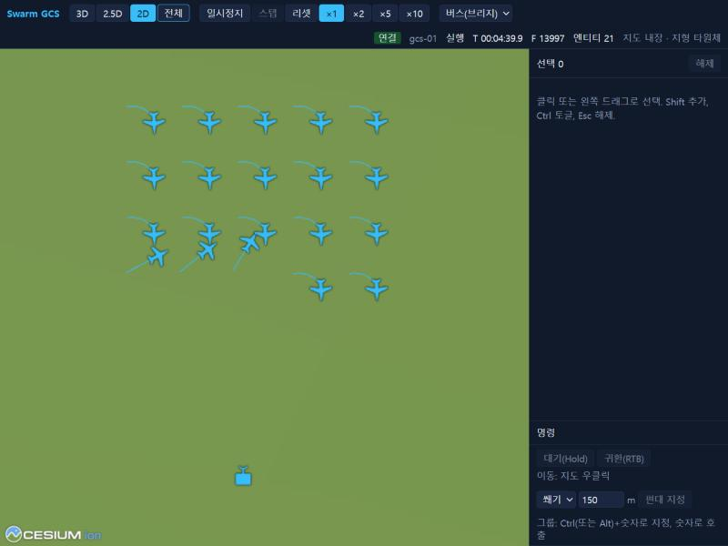

# 2. Quick start

> Source: [docs/42_user/02_quickstart.md](../../42_user/02_quickstart.md) at commit `f0729ee`.

The demo runner starts all processes at once. It runs an example scenario with 20 vehicles and one GCS in realtime. The configuration diagram is in [20_p0_demo.md §1](../../20_p0_demo.md#1-구성) (Korean).

## 2.1 Launch

```bash
uv run python scripts/run_p0_demo.py live --monitor
```

The addresses appear at the end of the output.

| Screen | Address |
|---|---|
| GCS UI | `http://localhost:5173/?source=bus&gcs=gcs-01&bridge=ws://127.0.0.1:8765/bus` |
| Traffic Monitor | `http://localhost:5174/?source=bridge&url=ws://127.0.0.1:8765/bus` |

## 2.2 Moving vehicles

1. Open the GCS UI and press `2D` and then `전체` (Fit all) on the toolbar. The toolbar shows `연결` (Connected), `실행` (Running) and `엔티티 21` (Entities 21).
2. Drag with the left button to select vehicles.
3. Right-click the map, choose move in the mission window, and send.
4. In the command panel the status of each vehicle changes from executing to completed.

For all UI operations see [chapter 5](05_ui.md).



## 2.3 Automatic check

With the runner on, run this from another terminal. It sends a move command through the datalink without the UI and evaluates arrival.

```bash
uv run python scripts/run_p0_demo.py probe --connect tcp/127.0.0.1:17601 --targets uav-001,uav-002
```

It is working if `[probe] PASS` appears at the end. Orbit, route and parameter checks are in the `--kind` table of [20_p0_demo.md §3](../../20_p0_demo.md#3-실행).

## 2.4 Shutting down

- Press Ctrl+C. Or create a `STOP` file in the run directory shown in the output.
- To run for a fixed time, use `--duration <seconds>`.
- Results remain in `out/p0_demo/live-<time>/`.

| File | Contents |
|---|---|
| `p0_demo.mcap` | Recording of all channels. Replay is in [chapter 8](08_record_replay.md) |
| `scenario.pb` | The scenario used for the run |
| `<process>.log` | Per-process logs |

## 2.5 Common options

| Option | Meaning |
|---|---|
| `--scenario <json>` | A different scenario |
| `--no-autostart` | Waits for the start button in the UI |
| `--no-record` | Turns off MCAP recording |
| `--no-ui` | Does not start the browser servers |
| `--lockstep`, `--rate <rate>` | Runs in lockstep |
| `--base-port`, `--bridge-port`, `--ui-port`, `--monitor-port` | Change the ports |

All options are in [20_p0_demo.md §3](../../20_p0_demo.md#3-실행).

Next: [3. Writing scenarios](03_scenario.md).
