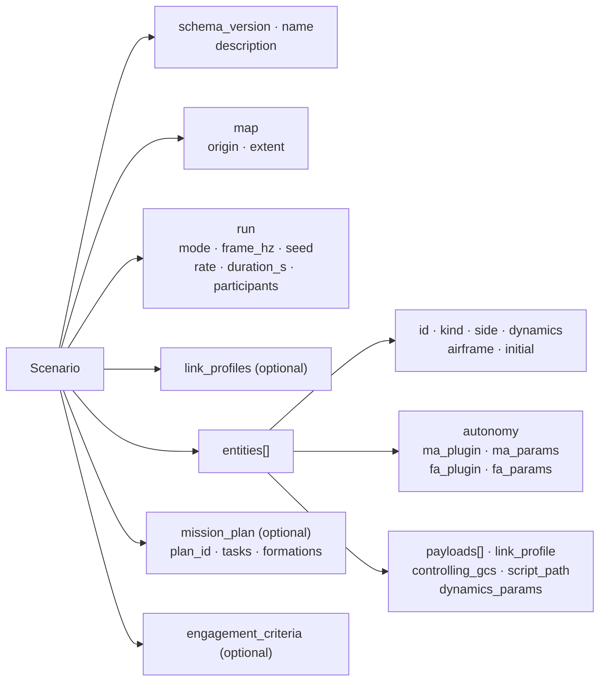

# 3. Writing scenarios

> Source: [docs/42_user/03_scenario.md](../../42_user/03_scenario.md) at commit `f7bcbac`.

A scenario is one JSON file. The schema is `scenario/src/swarm_scenario/schema/scenario.schema.json`.

> Not implemented: scenario editing in the UI. Write the JSON directly and validate it with `swarm-scenario`.

## 3.1 Structure



The required keys are `schema_version`, `name`, `map`, `run`, `entities`.

## 3.2 Example

A minimal runnable example with 2 vehicles, a GCS, a ground target and a jammer site. Save it as `my_first.json`.

```json
{
  "schema_version": "0.1",
  "name": "my-first",
  "description": "2 vehicles, GCS, ground target, jammer site",
  "map": {
    "origin": { "lat_deg": 37.4, "lon_deg": 127.4, "alt_m": 100.0 },
    "extent": { "south_deg": 37.2, "north_deg": 37.7, "west_deg": 127.1, "east_deg": 127.7 }
  },
  "run": {
    "mode": "lockstep",
    "frame_hz": 50,
    "seed": 42,
    "rate": 1.0,
    "participants": ["agent-0", "datalink-0"]
  },
  "link_profiles": [
    { "name": "uav_slow", "base": "uav_default", "latency_ms": 80.0, "jitter_ms": 20.0 }
  ],
  "entities": [
    {
      "id": "gcs-01", "kind": "gcs", "side": "blue", "dynamics": "static",
      "initial": { "position": { "lat_deg": 37.4, "lon_deg": 127.4, "alt_m": 100.0 } },
      "link_profile": "gcs_default"
    },
    {
      "id": "uav-001", "kind": "uav", "side": "blue", "dynamics": "dof3", "airframe": "skywalker_x8",
      "initial": {
        "position": { "lat_deg": 37.42, "lon_deg": 127.39, "alt_m": 1200.0 },
        "velocity_ned_mps": { "x": 20.0, "y": 0.0, "z": 0.0 }
      },
      "payloads": [
        { "id": "cam0", "type": "camera", "profile": "eo_wide", "overrides": { "max_range_m": 4000.0 } }
      ],
      "autonomy": { "ma_plugin": "waypoint", "ma_params": { "hold_radius_m": 200 } },
      "link_profile": "uav_slow",
      "controlling_gcs": "gcs-01"
    },
    {
      "id": "uav-002", "kind": "uav", "side": "blue", "dynamics": "dof3", "airframe": "skywalker_x8",
      "initial": {
        "position": { "lat_deg": 37.42, "lon_deg": 127.41, "alt_m": 1200.0 },
        "velocity_ned_mps": { "x": 20.0, "y": 0.0, "z": 0.0 }
      },
      "autonomy": { "ma_plugin": "waypoint" },
      "link_profile": "uav_default",
      "controlling_gcs": "gcs-01"
    },
    {
      "id": "tgt-001", "kind": "ground_target", "side": "red", "dynamics": "static",
      "initial": { "position": { "lat_deg": 37.47, "lon_deg": 127.40, "alt_m": 100.0 } }
    },
    {
      "id": "jam-site-01", "kind": "jammer_site", "side": "red", "dynamics": "static",
      "initial": { "position": { "lat_deg": 37.5, "lon_deg": 127.45, "alt_m": 100.0 } },
      "payloads": [
        { "id": "jam0", "type": "jammer", "profile": "site_generic", "overrides": { "radius_m": 2500.0 } }
      ]
    }
  ],
  "mission_plan": {
    "plan_id": "plan-001",
    "tasks": [
      {
        "task_id": "task-001",
        "assignees": ["uav-001", "uav-002"],
        "move_to": { "destination": { "lat_deg": 37.47, "lon_deg": 127.40, "alt_m": 1200.0 }, "speed_mps": 22.0 }
      }
    ]
  }
}
```

## 3.3 Validation and conversion

```bash
uv run swarm-scenario validate my_first.json
```

```bash
uv run swarm-scenario show my_first.json
```

```bash
uv run swarm-scenario export my_first.json --out my_first.pb
```

- `validate` checks the schema first and, if that passes, does semantic checks such as references and ranges. If there are schema errors, semantic errors are not shown, so fix them and run again.
- Errors come with their location. Example: `/entities/3/id: 'uav001' does not match ...`
- Give the `.pb` made by `export` to `swarm_core --scenario` ([chapter 4](04_run.md)).

Examples in the repository:

| File | Contents |
|---|---|
| `scenario/examples/p0_demo_20.json` | 20 2-DoF vehicles + GCS. realtime. `waypoint` MA. Demo default |
| `scenario/examples/korea_east_strike_20.json` | 20 2-DoF vehicles (2 formations) + GCS + 4 ground targets. lockstep. `flocking_basic` MA |
| `scenario/examples/p5_payload_demo_5.json` | 5 vehicles carrying cameras and simulation event equipment. Includes a jammer site and ground and air targets. lockstep |

## 3.4 map, run

| Key | Contents | Constraint |
|---|---|---|
| `map.origin` | Map origin | Inside `extent` |
| `map.extent` | South, north, east and west bounds (deg) | Within the Korean Peninsula range (33–43.1°N, 124–131.9°E) |
| `run.mode` | `realtime`, `lockstep`, `freerun` | |
| `run.frame_hz` | Frame frequency | 50–100 |
| `run.seed` | Random seed | Integer |
| `run.rate` | Target rate. 1 if omitted | Fixed at 1 for realtime |
| `run.duration_s` | Run time. Unlimited if omitted | |
| `run.participants` | List of lockstep participant IDs | [4.4](04_run.md#44-lockstep) |

## 3.5 Entities

| Key | Value |
|---|---|
| `id` | Lowercase letters, digits and hyphens, at least 2 parts separated by hyphens. Example: `uav-001`. At most 25 characters |
| `kind` | `uav`, `gcs`, `ground_target`, `air_target`, `fpv`, `jammer_site`, `missile` |
| `side` | `blue`, `red`, `neutral` |
| `dynamics` | `dof2`, `dof3`, `scripted`, `static` |
| `airframe` | `skywalker_x8`, `aerosonde`. Model default if omitted |
| `initial.position` | Latitude and longitude (deg), altitude MSL (m). Inside the map range |
| `initial.velocity_ned_mps` | Starting velocity. `x` north, `y` east, `z` down |
| `controlling_gcs` | The GCS entity in charge of this vehicle |
| `script_path` | `scripted` path. Followed at the magnitude of the initial velocity |
| `dynamics_params` | Dynamics parameter overrides |

> Not implemented: `dof5`, `dof6` (roadmap P3). `swarm-scenario validate` refuses them as not implemented.

- An air entity whose starting altitude is below the DEM terrain gets a warning at load and is destroyed in the first frame (with `--terrain-dem`, DEC-060).

## 3.6 Autonomy plugins (autonomy)

Write registered names in `ma_plugin` and `fa_plugin`. List the names with `uv run swarm-agent --list-plugins`.

| MA | What it does | Supported tasks |
|---|---|---|
| `hold` | Holds current heading, speed and altitude. If `orbit_radius_m` > 0, orbits in place | Does not execute mission tasks |
| `waypoint` | Executes mission plans and C2 commands | `move_to`, `hold`, `return_to_base`, `search_area`, `route` |
| `formation` | Leader-follower formation | Formation assignment and the leader's tasks |
| `flocking`, `flocking_basic` | Reynolds swarming and movement to a goal point | `move_to`, `hold`, `return_to_base`, `search_area`. `route` is `REJECTED` |

- The only FA is `default`. It is used if omitted.
- Unsupported tasks return `TaskStatus` REJECTED. Baseline MAs do not support `track`, `strike` or `jam` tasks.
- Write parameters in `ma_params` and `fa_params`. Names and ranges can be seen in the UI parameter panel during a run. Unknown names and out-of-range values are not applied, and a rejection reason is recorded.

Common parameters:

| Owner | Name | Default | Meaning |
|---|---|---|---|
| waypoint | `acceptance_m` | 80 | Waypoint arrival radius (m) |
| waypoint | `hold_radius_m` | 300 | Default Hold orbit radius (m) |
| formation | `k_p` | 0.08 | Proportional gain on slot error |
| flocking | `cruise_mps` | 22 | Cruise speed (m/s) |
| flocking | `separation_m` | 80 | Separation distance (m) |
| flocking | `neighbor_radius_m` | 600 | Neighbor awareness radius (m) |
| flocking | `group` | empty | Use only neighbors in the same group |
| default FA | `racetrack_guidance` | `dubins` | Racetrack guidance (`dubins`, `vector_field`) |

## 3.7 Mission plan (mission_plan)

Each task in `tasks` has a `task_id`, `assignees` and one task-kind key.

| Task key | Contents |
|---|---|
| `move_to` | `destination`, `speed_mps` |
| `hold` | `center`, `radius_m`, `duration_s`, `direction` (`cw`, `ccw`), `racetrack`. If empty, orbits at the current position |
| `search_area` | Circular or polygonal area |
| `route` | List of route points. For each point `position`, `speed_mps`, `acceptance_radius_m`, action (`loiter`, `recon`) |
| `return_to_base` | Returns to the starting position |

Each `formations` entry has `group_id`, `members`, `leader`, `shape` (`line`, `column`, `wedge`, `echelon`, `circle`, `custom`), `spacing_m`, `custom_offsets_m`. For `custom`, the number of `custom_offsets_m` must equal `members`.

## 3.8 Onboard payloads (payloads)

```json
{ "id": "cam0", "type": "camera", "profile": "eo_wide", "overrides": { "max_range_m": 4000.0, "hfov_deg": 50.0 } }
```

| Key | Contents |
|---|---|
| `id` | Unique within the vehicle. Starts with a lowercase letter |
| `type` | `camera`, `jammer` or simulation event equipment |
| `profile` | Profile name. Found in `payload/profiles/<type>.json` |
| `overrides` | Overrides of profile values |

Sensors: detection is evaluated only by FOV, maximum range and line of sight (DEC-018).

| Profile | Notes |
|---|---|
| `eo_wide`, `eo_narrow`, `ir_generic` | Values in `payload/profiles/camera.json`. Override keys: `hfov_deg`, `vfov_deg`, `max_range_m`, `default_az_deg`, `default_el_deg`, `default_enabled` |

Jammers: receivers inside the zone do not receive messages ([chapter 7](07_link.md#73-jamming-zones)).

| Profile | Notes |
|---|---|
| `ea_generic`, `site_generic` | Values in `payload/profiles/jammer.json`. Override keys: `radius_m`, `max_radius_m`, `min_alt_m`, `max_alt_m`, `update_distance_m`, `default_enabled` |

- One jammer per entity. Two or more are refused at load (DEC-049).

Other equipment that produces simulation events has `type` of `aam_short`, `agm_short` or `fpv`, and `count` is required. Choose the profile name from the keys of `payload/profiles/<type>.json` and override it with `overrides` in the same way. See the profile files for values. The example is `scenario/examples/p5_payload_demo_5.json`.

See the schema for the format of `engagement_criteria`.

## 3.9 Check summary

| Item | Rule | Where |
|---|---|---|
| Entity ID | Format, no duplicates, at most 25 characters | Schema and validate, length at Core load |
| Map range | Origin, initial positions and script paths inside the range | validate |
| References | `controlling_gcs`, `assignees`, `target_id`, `members`, `leader` are existing entities | validate |
| `task_id` | No duplicates | validate |
| Jammer count | One per entity | Core load |
| DoF | Only `dof2`, `dof3`, `scripted`, `static` can run | validate |
| Values | NaN, infinity and out-of-range values are refused | Core load |

If Core refuses, the process does not exit. It logs `scenario rejected` and waits for the next scenario.

Next: [4. Running](04_run.md).
