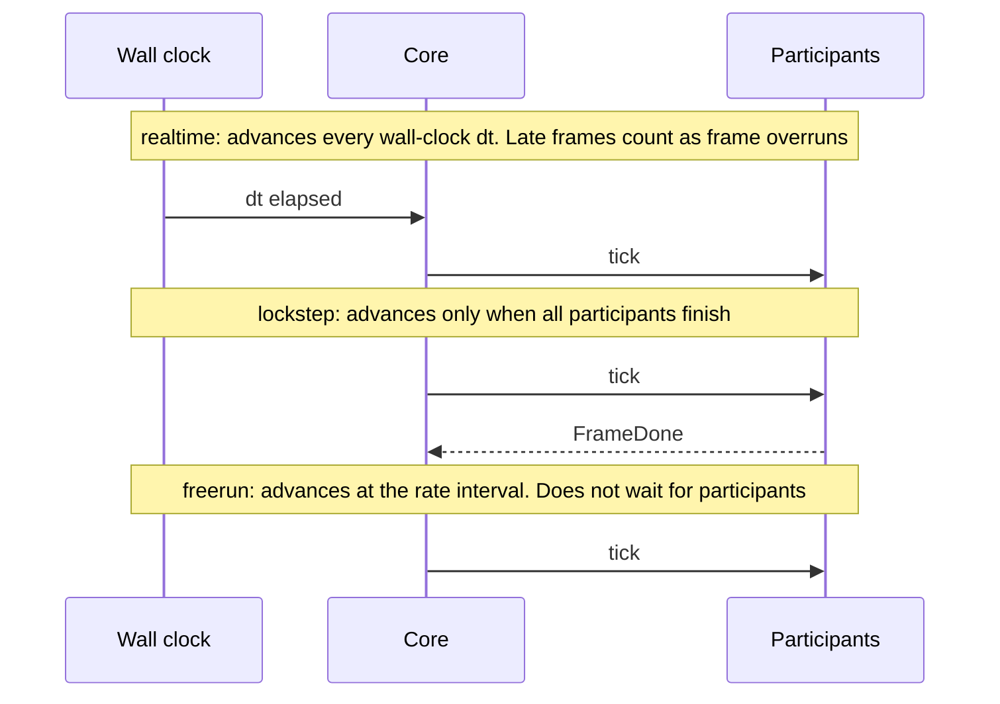
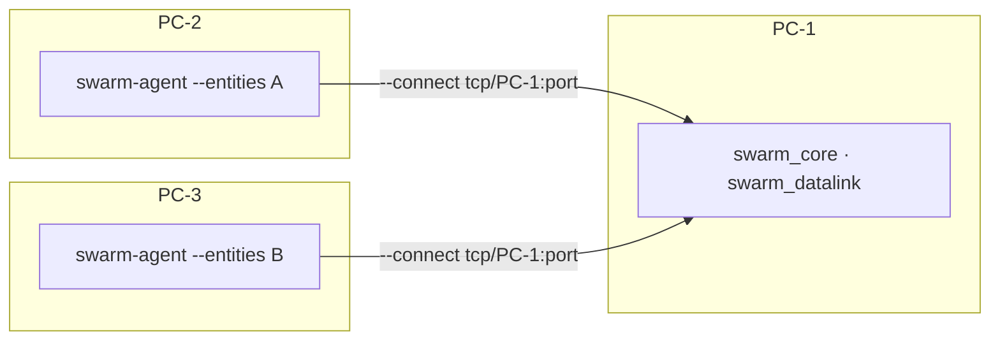

# 4. Running

> Source: [docs/42_user/04_run.md](../../42_user/04_run.md) at commit `24fc9be`.

To start everything at once, the runner in [chapter 2](02_quickstart.md) is the easiest. This chapter covers running other scenarios and starting processes yourself.

## 4.1 Running your own scenario with the runner

```bash
uv run python scripts/run_p0_demo.py live --scenario my_first.json
```

- For a scenario whose `run.mode` is lockstep, also pass `--lockstep`. The runner adds `participants` to the scenario.

## 4.2 Starting processes one by one

The commands below are for Windows `msvc-debug`. For another preset, change to `build/<preset>/`.

First export the scenario to `.pb` ([3.3](03_scenario.md#33-validation-and-conversion)). Run one per terminal. Later processes `--connect` to earlier ones.

realtime example:

```bash
build/msvc-debug/logger/swarm_logger record --out run.mcap --no-multicast --listen tcp/127.0.0.1:17600
```

```bash
build/msvc-debug/datalink/swarm_datalink --scenario my_first.pb --no-frame-done --no-multicast --listen tcp/127.0.0.1:17601 --connect tcp/127.0.0.1:17600
```

```bash
uv run swarm-agent --scenario my_first.pb --no-multicast --listen tcp/127.0.0.1:17602 --connect tcp/127.0.0.1:17600 --connect tcp/127.0.0.1:17601
```

```bash
uv run swarm-bridge --port 8765 --no-multicast --listen tcp/127.0.0.1:17603 --connect tcp/127.0.0.1:17600 --connect tcp/127.0.0.1:17601 --connect tcp/127.0.0.1:17602
```

```bash
build/msvc-debug/core/swarm_core --scenario my_first.pb --autostart --mode realtime --no-multicast --listen tcp/127.0.0.1:17604 --connect tcp/127.0.0.1:17600 --connect tcp/127.0.0.1:17601 --connect tcp/127.0.0.1:17602 --connect tcp/127.0.0.1:17603
```

Start the browser screens from `ui/` and `ui/monitor/` respectively.

```bash
cd ui && npm run dev
```

```bash
cd ui/monitor && npm run dev
```

Start order: Logger → Datalink → Agent → Bridge → (wait 2 seconds) → Core. If you do not need a recording, leave out the Logger.

| Process | Main options |
|---|---|
| `swarm_core` | `--scenario`, `--autostart`, `--mode`, `--rate`, `--hz`, `--seed`, `--frames`, `--integrator rk4\|rk45`, `--terrain-flat <m>`, `--terrain-dem <json>` |
| `swarm_datalink` | `--scenario`, `--participant`, `--no-frame-done`, `--seed`, `--terrain-flat <m>`, `--no-los`, `--state-period <s>` |
| `swarm-agent` | `--scenario`, `--participant`, `--entities`, `--frames`, `--activity-max-hz`, `--vi-report-hz` |
| `swarm-bridge` | `--host`, `--port`, `--queue-limit` |
| Common bus options | `--bus`, `--zenoh-config`, `--zenoh-mode`, `--connect`, `--listen`, `--no-multicast` |

- See all options with `--help` on each executable.
- Without `--autostart`, Core stops at LOADED and waits for the start button in the UI.
- For the bridge to accept browsers on other PCs, use `--host 0.0.0.0`.

## 4.3 Run modes



| Mode | Rate | Same-seed reproduction | Used for |
|---|---|---|---|
| `realtime` | Fixed at 1. UI rate buttons are off | No | UI operation, demonstrations |
| `lockstep` | `rate`. 0 is maximum speed | Deterministic | Algorithm comparison, repeated experiments |
| `freerun` | `rate`. 0 is maximum speed | No | Running only Core fast |

> Not verified: `freerun` has only a mode-switching test (TC-QA-011) and no record of actual use.

- The mode is set by the scenario's `run.mode` and can be changed with Core's `--mode` and `--rate`.
- Rate 0 (maximum speed) is given only with Core's `--rate 0`. The scenario's `run.rate` must be greater than 0.

## 4.4 lockstep

List the participants in the scenario and give the scenario only to Core. The other processes receive it from the bus.

```bash
build/msvc-debug/datalink/swarm_datalink --no-multicast --listen tcp/127.0.0.1:17601
```

```bash
uv run swarm-agent --no-multicast --listen tcp/127.0.0.1:17602 --connect tcp/127.0.0.1:17601
```

```bash
build/msvc-debug/core/swarm_core --scenario my_first.pb --autostart --no-multicast --listen tcp/127.0.0.1:17603 --connect tcp/127.0.0.1:17601 --connect tcp/127.0.0.1:17602
```

- The IDs in `run.participants` must match the IDs of the actual processes. The defaults are `datalink-0` and `agent-0`. If they are wrong, the first tick does not go out.
- Even if the scenario is realtime, passing `--mode lockstep --participant datalink-0 --participant agent-0` to Core runs it in lockstep.
- Participants started late still join until the first tick. A participant that leaves after start cannot rejoin and the run stops. Restart the participant, then Reset and Start.
- With many vehicles, split them across several Agents. Choose vehicles with `--entities` and give each a different participant ID. List them all in the scenario's `participants` too.

## 4.5 Terrain and integrator

- Flat terrain is the default. Give the elevation with `--terrain-flat <m>`.
- To use the DEM, pass `--terrain-dem data/dem/korea_glo90.json` to Core. If both are given, the DEM is used with a warning (DEC-061).
- The Datalink evaluates line of sight only against the flat elevation of `--terrain-flat`. It does not use the DEM.
- The integrator is chosen with Core's `--integrator`. The default is `rk45`.

## 4.6 Status report periods

These are the items the Agent automatically sends to the GCS. They are independent of the MA implementation and pass through the Datalink.

| Item | When | Option |
|---|---|---|
| Navigation report `NavigationReport` | Periodic, default 1 Hz | `--vi-report-hz` (off at 0 or below) |
| Vehicle status `SystemStatus` | On change. Fault injection is reflected in health and subsystems | |
| Flight command status `FlightCommandStatus` | On change | |
| Flight capability `FlightCapability` | Once at start | |
| Payload status `SensorActivity`, `JammerActivity` and others | On change (per key at most 10 Hz) and at 1 Hz | `--activity-max-hz` |

## 4.7 Running across several PCs

> Not verified: distributed runs across PCs (roadmap P4) have no test record. Confirmed only on a single PC.

Only the option structure is given here.



- For listen addresses, use the real address or `0.0.0.0` instead of `127.0.0.1`.
- Give browsers the bridge address with `bridge=` in the URL.

Next: [5. Operating the GCS UI](05_ui.md), [7. Creating datalink conditions](07_link.md).
